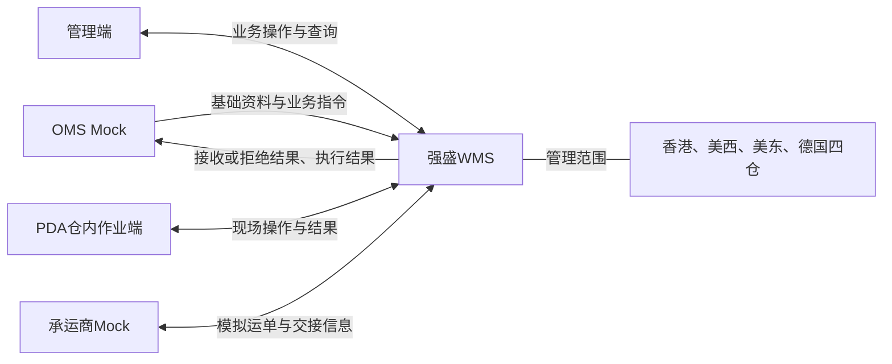
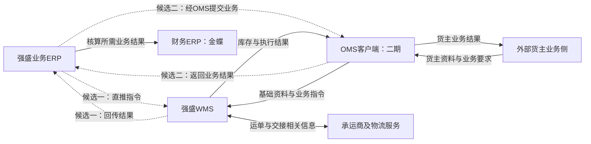

# 强盛WMS能力蓝图与系统协作

> 本文说明一期能力如何组成，以及WMS与上下游系统怎么协作。项目范围见[项目定位与范围](01-项目定位与范围.md)，阶段与完成标准见[阶段规划与一期交付标准](03-阶段规划与一期交付标准.md)。图表达业务协作关系，具体部署、接口和页面方案由应用设计承接。

## 一、一期能力蓝图

基础资料提供作业依据，入库、出库和退货记录执行事实，库存与库内能力维护实物数量及位置；系统集成与对接负责输入和结果传递。

| 能力 | 承接的输入 | 输出与衔接 |
| --- | --- | --- |
| 基础资料 | 上游货主、商品资料及仓内位置、作业配置 | 为收货、存放和发货提供身份与作业依据 |
| 入库 | 入库指令、到货实物 | 记录实收、品质与差异；实际落位确认后形成库存，向上游反馈执行结果 |
| 库存与库内 | 收发及移库、盘点等作业结果 | 维护数量、位置、品质与占用，为出库提供可用库存并保留追溯记录 |
| 出库 | 出库指令、可用库存及交接要求 | 完成预占、拣核与交接，确认出库后扣减库存并反馈实发结果 |
| 退货 | 退货预报、退回实物 | 认出货主与原发货记录，记录实收与良品／不良品，上架后形成库存，向上游反馈退货结果 |
| 系统集成与对接 | 上游资料、业务消息及仓内已有结果 | 传递输入与处理结果，保留接收、拒绝和送达情况 |

管理端与PDA是上述能力的操作入口，共用业务记录；公共能力提供仓库与动作权限、语言、时间处理及关键操作记录。范围与约束见[项目定位与范围第二节](01-项目定位与范围.md#二一期范围)，具体模块划分见[系统与模块地图](../05-应用设计方案/20261002-MVP版本/系统架构设计/00-系统与模块地图.md)。

## 二、一期演示系统协作

OMS Mock和承运商Mock模拟外部协作方，管理端与PDA实现可操作的WMS业务功能。图中四仓属于同一套WMS的管理范围。

## 三、目标系统协作蓝图

虚线表示自营业务的两种候选接入路径，尚未确定采用哪一种。WMS沿选定的指令来源回传结果：直连接入时回传ERP，经OMS接入时由OMS返回业务结果。图中为目标协作关系，不表示真实接口已建成；各系统职责见[项目定位与范围第三节](01-项目定位与范围.md#三系统职责边界)。
