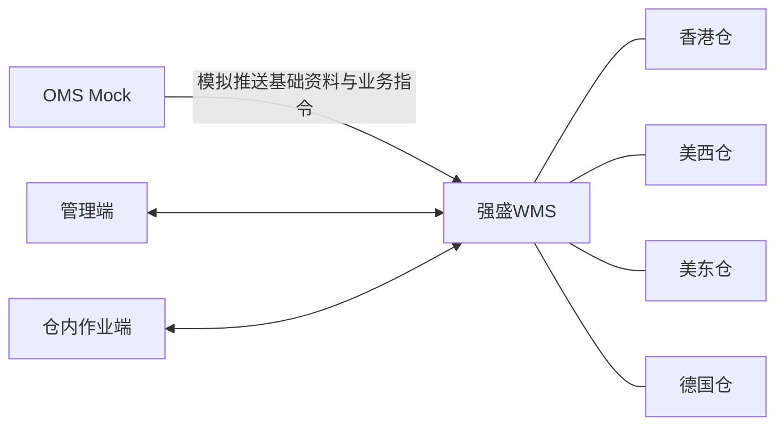
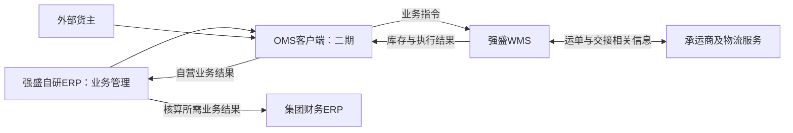

# 03 强盛WMS能力蓝图与系统架构

> 本文只定义能力分区和系统协作，不规定单据、字段、状态、算法、接口协议或页面。范围以[02-项目定位与范围](02-项目定位与范围.md)为准，阶段以[05-阶段规划与交付边界](05-阶段规划与交付边界.md)为准。

## 一期能力蓝图

| 能力分区 | 作用 |
| --- | --- |
| 基础资料与仓内空间 | 为四仓、货主、商品和存放位置提供共同基础。 |
| 入库管理 | 承接正常入库和调拨入库需求，记录到货、收货、质检、上架及结果。 |
| 库存与仓内作业 | 管理仓内实物库存，支持仓内作业和库存信息查询。 |
| 出库管理 | 支撑B2C包裹履约、平台仓转运、B2B批发、调拨出库和异常货物退回出库；B2C可选择基础波次，B2B按单摘果拣货。 |
| 上游协作 | 接收OMS推送的基础资料和业务指令并提供执行结果；一期由OMS Mock模拟。 |
| PDA作业 | 支撑收货、质检、上架、拣货、复核、移库和盘点等现场操作，与管理端共用同一业务记录。 |

这些能力共同服务四仓和多货主，管理人员通过管理端使用，现场人员通过PDA作业端使用。调拨不是独立的跨仓业务链：调出按出库、调入按入库分别执行。业务记录贯穿各能力，用于查询与追溯，不在此另行设计具体报表或异常处理流程。

## 一期演示架构

一期不建设真实OMS客户端，也不以WMS自行导入上游业务指令替代OMS Mock推送。OMS Mock模拟未来OMS向WMS提供货主、商品等基础资料以及入库单、出库单、变更和取消消息，并接收执行结果。演示需要能够通过管理端和PDA操作并观察WMS接收指令后的业务执行与结果；Mock的具体技术形式及结果展示方式留给应用设计。

## 后续系统协作蓝图

此图表达目标协作关系，不承诺二期完成所有真实接口。具体数据交换路径及接入深度在对应阶段设计中确认。财务ERP负责核算，全局库存协同由业务ERP考虑，均不列入WMS能力蓝图。

## 多仓共同约束

四仓采用共同业务框架，均可切换进入并执行入库、库存和出库主链，同时兼容经调研确认的仓库差异。一期界面支持中文、英文；业务时间统一以UTC+0存储，用户可在页面右上角切换展示时区，导出按当前选择的时区生成。履约时限、效期日期等业务判断按业务所属仓库的当地时区计算，页面展示时区切换不改变判断结果。用户按仓库授权，拥有某仓库权限后可查看该仓全部货主数据；商品、库存和单据仍保留货主归属。菜单、目录和业务动作通过RBAC角色授权，不按岗位名称硬编码动作范围。轻小件、大件、异形货的具体规则进入需求分析和产品设计。
