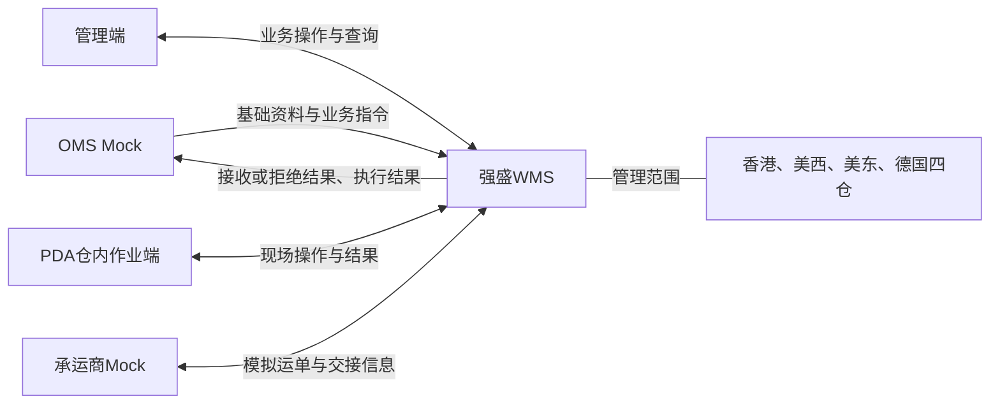
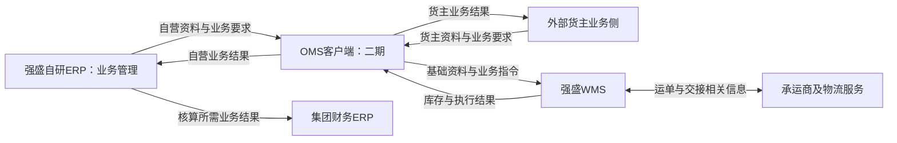

# 03 强盛WMS能力蓝图与系统架构

> 本文说明一期能力如何组成、管理端与PDA如何配合，以及WMS与上下游的协作关系。项目范围见[项目定位与范围](02-项目定位与范围.md)，建设阶段见[阶段规划与交付边界](04-阶段规划与交付边界.md)。文中的架构图表达业务协作关系，具体部署、接口和页面方案由应用设计承接。

## 一期能力蓝图

强盛WMS围绕到仓接收、仓内保管和出仓交接组织能力。基础资料提供货物归属、存放位置和作业要求；入库、库存、出库共同记录实物变化；上游协作将仓内执行与业务指令对应起来。

### 业务能力

一期模块划分与各域要完成的工作，以[项目定位与范围](02-项目定位与范围.md#32-仓内业务与上游协作)第三节表格为准；功能规则见[需求分析总览](../03-需求调研和分析/00-项目总览/02-需求分析总览.md#三功能概览)。

本图只强调五块能力共用同一套业务记录与库存：**基础资料、入库、库存与库内、出库、上游协作**（一期由 OMS Mock 模拟上游）。调拨分端执行、退回与客户退货入库的区分见定位文稿 §3.2 与 §5.1。

### 使用端与公共能力

| 使用端 | 主要用途 |
| --- | --- |
| 管理端 | 维护仓内资料，查询业务与库存，处理单据、差异及异常，查看执行与交接结果。 |
| PDA仓内作业端 | 支持收货、质检、上架、拣货、复核、移库和盘点等现场操作，与管理端共用同一份业务记录和库存。 |

PDA是仓内业务的操作入口，其动作归属相应业务模块。仓库授权、RBAC角色权限、中文／英文、时间处理和关键操作记录由公共能力支持，适用于各业务模块。具体动作权限、字段和状态由需求分析与业务设计定义。

## 一期演示架构

一期通过OMS Mock推送货主、商品等基础资料，以及入库单、出库单、变更和取消消息，并接收WMS返回的结果。不以WMS自行导入上游业务指令替代这一交接。演示应能观察指令接收、仓内执行和结果回传；重复消息、回传失败与重试由对应规则处理。Mock的技术形式与结果展示方式由应用设计确定。

不良品其他出库另有线下入口：仓库收到邮件通知后，在管理端手工创建并保留通知来源。这是人工录入业务，不要求系统自动接收或解析邮件。

承运商使用Mock数据参与出库演示，打印机、电子秤采用模拟或手工数据。管理端和PDA属于一期WMS本身的功能，应支持实际业务操作与结果查询。菜单与模块落地见[系统与模块地图](../05-应用设计方案/20261002-MVP版本/系统架构设计/00-系统与模块地图.md)。

图中的四仓表示同一WMS管理的业务范围，不表示为每个仓单独建设一套系统，也不表示目标仓网已经租赁、开仓或上线。

## 后续系统协作蓝图

后续由OMS承接强盛自营和外部货主业务，再向WMS下发仓内执行要求。WMS记录本仓实物与作业结果，经OMS返回对应业务侧。承运商承担仓外运输和配送；业务ERP承担经营与全局库存协同，集团财务ERP承担正式核算。

图中的财务链路表示相关业务结果需要交给财务核算，具体交换路径仍由后续设计确定。二期已确定建设OMS客户端，其对客功能、真实接口范围与接入深度尚需明确；目标协作图不代表全部真实接口都已纳入二期。

## 多仓共同约束

仓库权限、RBAC、中英文、UTC+0 存储与当地履约／效期判断、两端一致与关键留痕等，完整表述见[项目定位与范围](02-项目定位与范围.md#33-使用端与公共能力) §3.3 与[需求分析总览](../03-需求调研和分析/00-项目总览/02-需求分析总览.md#四共同约束)。本文件仅补充一句：**切换页面展示时区不改变**履约截止与效期准入的判断结果（与 COM-FR-002 一致）。

单据、数量、异常与交接细节见[业务蓝图](../04-业务分析和设计/00-业务蓝图.md)。
