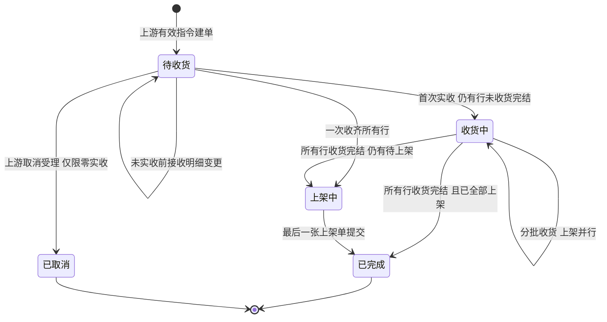
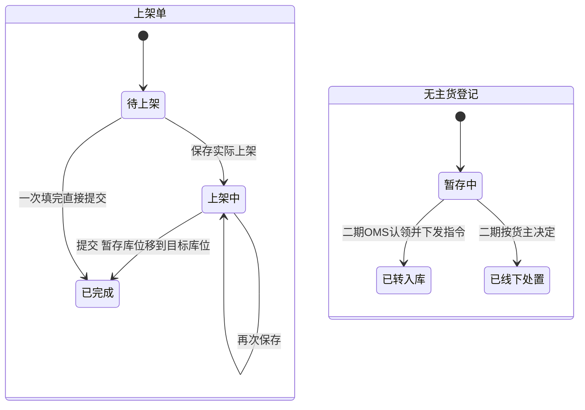
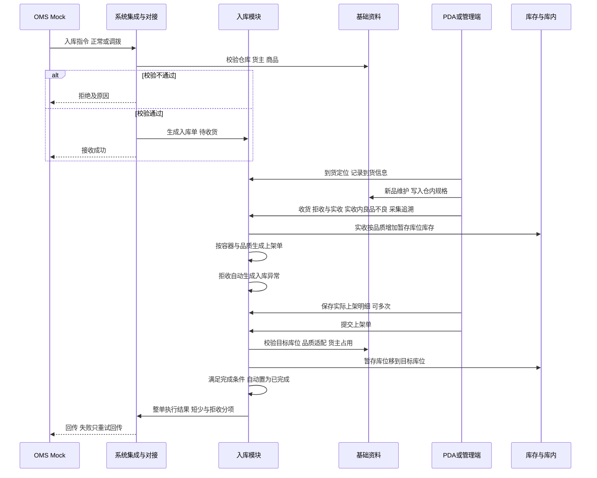
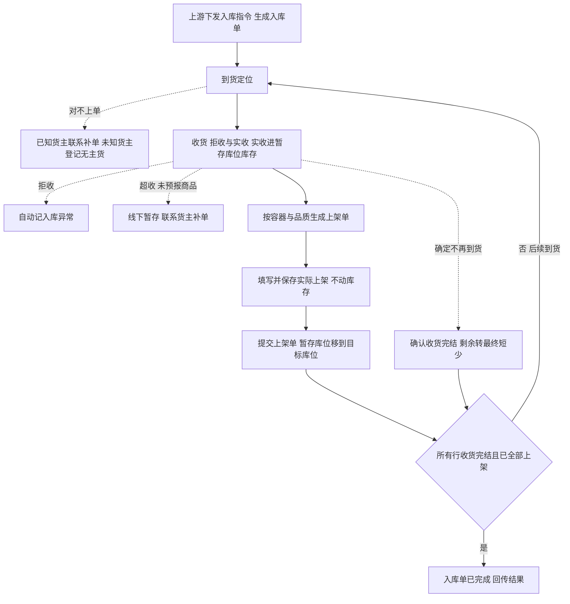

# 入库模块宏观系统架构

> 本文从全局视角确认入库模块有哪些对象、各自有哪些状态、系统之间怎么交互、业务怎么流转。规则真源见[入库业务需求分析](../03-需求调研和分析/02-入库业务/入库业务需求分析.md)，场景与数量走查见[入库业务设计](../04-业务分析和设计/02-入库业务设计.md)。库存怎样记账、盘点怎样阻断收货和上架，见[库存模块宏观系统架构](07-库存模块宏观系统架构.md)。字段、页面与接口由应用设计承接。
>
> 命名：现场、产品与应用设计统称「上架单」（有单号、可列表查询，与入库单、收货记录并列）。部分旧文档仍写「上架任务」，与上架单指同一实体，不是两张不同的单。中英文名称、缩写与单号规则见[单据术语与生成规则](08-单据术语与生成规则.md)。

## 一、范围与取舍

入库模块处理正常入库和调拨入库：接收上游指令，完成到货定位、新品维护、收货（拒收数量与实收数量，实收内分良品与不良品）、上架，并回传执行结果。调拨入库只是业务类型不同，现场链路与正常入库相同，不关联调出仓单据。

本版已确认的取舍：

| 主题 | 一期做法 |
| --- | --- |
| 入库质检 | 不设质检任务与质检单。良品、不良品在收货时于实收内录入，不做收货后再质检拆分。商品资料一期不设质检配置 |
| 收货数量 | 拒收数量（带原因，不计实收）＋实收数量（计入累计实收）。实收内再分良品、不良品（良品＋不良品＝实收）。拒收还是收为不良品由现场人工判断，后续可考虑配置项 |
| 不超量收货 | 每行实收＋拒收不得超过预计；超出预计的实物不收，按对不上单的疑问实物线下暂存，联系货主补单 |
| 库存形成 | 收货确认即按实收、按品质进入本仓**收货暂存库位**库存。上架是把库存从暂存库位移到存储库位或不良隔离库位 |
| 收货暂存库位 | 允许多货主混放；库存仍按货主、SKU、品质、批次分别记账；不参与出库分配 |
| 作业容器 | 不建独立容器对象。容器号挂在收货行、应上架行、实际上架行上；扫容器可带出本容器待上架内容 |
| 上架单 | 收货后自动生成，一张单对应一个作业容器加一种品质（单头）。实际上架明细可多次保存，不动库存；整张单全部填完后提交，一次性把库存从暂存库位移到目标库位 |
| 上架前残损、暂存期间丢失 | 一期不在上架单上单独处理。上架时发现收货未登记的残损，先按原品质上架，再在库存与库内做品质转换；暂存期间丢失，仍按应上架数量提交，再通过盘点调整库存 |
| 实收误记、货主认错 | 一期不支持更正，受影响数量保持未完成 |
| 无单实物 | 只有无主货建登记对象。已知货主待补单、超收、未预报商品等对不上单的实物由仓库线下暂存跟踪；拒收记入库异常 |
| 新品维护 | 不建待维护单据，也不在入库单上设新品状态。量方提交后生成一条新品维护记录，并写入商品仓内规格；同一货主同一商品有记录即不是新品，四仓共用，没有记录的商品首次收货前须先维护 |
| 入库单来源 | 全部由上游指令生成，一期由 OMS Mock 模拟，管理端不提供手工新建 |

## 二、实体对象

### 2.1 入库模块自有对象

| 对象 | 是什么 | 关系与基数 |
| --- | --- | --- |
| 入库单 | 由一条有效上游指令生成，记录业务类型、货主、仓库、到货信息及整单进度 | 1 个货主、1 个仓库；同一指令重发不增加单据 |
| 入库单明细 | 每个 SKU 的预计、实收、拒收、未收、良品／不良品、已上架 | 1 张入库单有 1～多行；每行归属该单货主的 1 个 SKU，同一 SKU 只占一行 |
| 收货记录 | 一次收货提交的事实；收货明细行按 SKU、批次、效期／SN、容器录入拒收数量（及原因）、实收数量，并在实收内录入良品与不良品 | 1 张入库单对应 0～多条收货记录；同一 SKU 可多行（多批次、多容器） |
| 入库异常记录 | 收货环节现场有实物、和入库单对不上的情况；一期只有拒收一类，记数量、原因、商品和来源收货明细行；边界见 2.1.3 | 归属入库单；收货确认时自动生成，无手工新建入口；不计实收 |
| 上架单 | 把暂存库位库存移到目标库位的现场工作单：单头含作业容器、品质（良品／不良品）、来源收货记录；单内分应上架明细与实际上架明细 | 收货确认后按「容器 × 品质」拆单；提交后的上架单就是上架结果，不另建上架记录 |
| 无主货登记 | 无法确定货主的到货实物：仓库、暂存位置、箱唛与运单等识别线索 | 不关联入库单，不形成实收或库存 |

以上是业务对象，不等于每种都要单独做菜单。追溯关系：收货明细行 → 应上架行 → 实际上架行；入库异常记录指回对应的收货明细行。

收货记录是独立对象，有自己的编号、表头和明细，供上架单、入库异常和库存流水引用；界面上放在入库单详情里，用「收货记录」页签展示，一期不设独立菜单。入库异常同样在入库单详情的「入库异常」页签展示。

拒收数量在收货时与实收数量一起录入，记在收货明细行上，是收货记录的一部分；系统同时生成一条拒收类入库异常，指回该收货明细行，供异常查询和整单回传使用。现场不需要另到异常页面重复登记。只有拒收、没有实收的收货也生成收货记录，但不生成上架单、不增加库存。

#### 2.1.1 上架单怎么生成

收货记录确认后，系统按本次实收生成上架单，不按入库单 SKU 汇总行拆单，而按现场怎么搬箱、怎么扫容器来拆：

| 拆单维度 | 规则 |
| --- | --- |
| 作业容器 | 收货时绑了容器号：按容器号拆；一张上架单只含一个容器里的实物（可多 SKU、多批次，在应上架明细里多行展示） |
| 品质 | 同一容器里良品与不良品各一张上架单；该容器下某品质数量为 0 则不生成 |
| 无容器收货 | 未绑容器的实物：同一收货记录、同一品质合并为一张上架单（单头容器为空或标「无容器收货」），应上架明细仍按 SKU＋批次多行 |

一条收货明细行同时有良品和不良品时，会分别进入良品单和不良品单，所以对应 1～2 条应上架行。一条收货记录通常对应多张上架单。PDA 扫容器号可定位到该容器待提交的上架单。

#### 2.1.2 上架单里的两类明细

界面上可用「应上架」「实际上架」两个页签（或上下两个子表），数据都在同一张上架单上；单头已固定容器与品质。

| 明细 | 一行代表什么 | 来源与可否修改 | 行数关系 |
| --- | --- | --- | --- |
| 应上架明细 | 本容器、本品质下要上架的货：SKU、批次（及效期／SN 等）、应上架数量 | 由收货明细行带入；上架人员不能修改 | 一条收货明细行在本单里对应一条应上架行 |
| 实际上架明细 | 实际上架到哪个库位、多少件 | 上架时填写；可多次「保存」，只保存进度，不动库存 | 一条应上架行可对应多条实际上架行（拆多个库位） |

提交规则：

- **保存：**只保存实际上架明细，上架单状态为「上架中」，不动库存。
- **提交：**校验每条应上架行「各库位数量合计＝应上架数量」，并校验目标库位启用、品质适配与货主占用。通过后上架单变为「已完成」，按实际上架行一次性把库存从暂存库位移到目标库位。

目标库位的货主占用按以下时点判断：

| 时点 | 是否占用目标库位 |
| --- | --- |
| 实际上架明细还没填这个库位 | 不占用 |
| 已保存、未提交 | 占用。其他货主的上架单不能保存或提交到该库位 |
| 已提交 | 转为实际库存占用 |
| 保存后删除该行或改填其他库位 | 释放原库位的占用 |

两个货主同时想用同一个空库位时，谁先保存（或未保存直接提交）谁占用，后操作的一方被阻断。收货暂存库位不受此限制，允许多货主混放。

一期上架单不处理品质转换和丢失。上架时发现收货未登记的残损，先按原品质上架，再在库存与库内做品质转换；暂存期间丢失，仍按应上架数量提交，再通过盘点调整库存。入库单明细的良品、不良品数量只取收货录入的数量。

入库单明细按 SKU 汇总预计与进度；应上架、实际上架按批次、容器、库位等现场粒度展开，再汇总回写 SKU 级的已上架数量。

#### 2.1.3 入库异常存什么、不存什么

入库异常只记一类事：**收货环节，现场有实物、和入库单对不上的情况**。做法参照富勒的「收货异常处理」，只管收货当下；收货确认后货已形成库存，之后的品质变化和数量变化都归库存与库内。

一期入库异常只有一类：

| 异常类型 | 什么情况 | 怎么产生 | 要不要跟进 |
| --- | --- | --- | --- |
| 拒收 | 货到了，现场判断不接收（含效期不足） | 收货确认时按拒收数量自动生成，无手工新建入口 | 系统内不跟进；拒收实物交司机退回或放拒收区，由仓库线下处理 |

拒收数量以收货记录为准，入库异常只引用，不另改数；整单完成回传时，拒收按入库异常分项告诉上游。

以下情况不记入库异常：

| 情况 | 为什么不记 | 在哪里处理 |
| --- | --- | --- |
| 短少 | 没有实物要处置 | 入库单未收数量；收货完结后即为最终短少，随整单回传 |
| 收货时录入的不良品 | 是正常收货结果 | 收货记录；入库单良品、不良品数量随整单回传 |
| 超收（本单已有的商品多到了） | 一期不做系统登记 | 按对不上单的实物线下暂存，联系货主补单 |
| 未预报商品（本单没有的商品夹带到了） | 一期不做系统登记 | 按对不上单的实物线下暂存，联系货主补单 |
| 无单到货 | 归不到入库单 | 已知货主线下联系补单；未知货主走无主货登记 |
| 上架前发现的残损、暂存期间丢失 | 货已是暂存库位库存，一期上架单不处理 | 残损先按原品质上架，再做库存品质转换；丢失按应上架数量提交，再盘点调整 |
| 上架后的残损、丢失，以及盘点差异 | 已是正式库存 | 库存与库内的库存调整、盘点 |
| 实收误记、货主认错 | 一期没有更正路径 | 线下跟进，见第六节已知限制 |
| 新品实测尺寸重量与预报不一致 | 是商品资料差异，不是数量差异 | 新品维护操作记录 |

超收、未预报商品后续如需纳入，在 PDA 收货时提示「本单无此商品」或「已达预计数量」，由收货人员点「登记异常」生成，不另设新建页面。

### 2.2 引用其他模块的对象

| 对象 | 所属模块 | 入库怎么用 |
| --- | --- | --- |
| 入库指令消息、结果回传消息 | 系统集成与对接 | 接收建单与明细变更；整单结果按原指令回传，失败只重试回传 |
| 仓库、货主、商品、货位 | 基础资料 | 建单校验；每仓需配置收货暂存库位（允许多货主混放）；上架校验目标库位启用、品质适配与货主占用 |
| 商品仓内规格 | 基础资料 | 新品维护写入；同一货主商品首次维护后四仓共用 |
| 实际库存、库存流水 | 库存与库内 | 收货确认时增加暂存库位库存；上架单提交时从暂存库位移到目标库位；盘点中的 SKU 不能收货，含它的上架单不能开始作业 |

### 2.3 数量骨架

| 层级 | 字段 | 含义 | 关系 |
| --- | --- | --- | --- |
| 收货 | 实收数量 | 接收入库的件数 | 各次收货实收之和；收货确认即进入暂存库位库存 |
| 收货 | 拒收数量 | 现场判断不接收的件数 | 带原因，自动记入库异常；不计实收，不进库存 |
| 收货 | 未收数量 | 既没实收也没拒收的件数 | 预计＝实收＋拒收＋未收；收货完结后即为最终短少 |
| 收货 | 良品／不良品 | 实收内的品质拆分 | 良品＋不良品＝实收 |
| 约束 | 收货上限 | 防止超量收货 | 实收＋拒收≤预计 |
| 进度 | 已上架 | 已提交上架单移到目标库位的数量 | 只在上架单提交时认定；实收－已上架即待上架，页面按需计算，不单独设字段 |

库存在收货确认时形成：良品进暂存库位的正常库存，不良品进暂存库位、整体不可用。暂存库位库存计入实际库存，良品同时计入可用、可被接单预占，但不参与出库分配；上架提交后，良品在存储库位才能被分配、拣货。

模拟例：预计 1000，拒收 5（现场判定残次不收），实收 995（良品 990、不良品 5）。实收＋拒收＝1000，未收 0，该行自动收货完结。暂存库位库存增加良品 990、不良品 5；上架单提交后移到对应库位。

## 三、状态与状态机

收货记录、已提交的上架单、入库异常记录是已发生事实，一期不作废、不更正。未提交的上架单，实际上架明细可多次保存覆盖。入库单及明细状态由数量和上架单自动推导，不靠人工改状态；唯一的人工动作是授权人员确认收货完结。

### 3.1 状态怎样推导

一张入库单可多次收货、多人协作。一次收货提交生成一条收货记录：按行先填拒收数量（及原因）与实收数量，再在实收内填良品与不良品。收货确认后实收进入暂存库位库存，并按「容器 × 品质」生成上架单。

同一入库明细行可能同时「还在等后续到货」和「已收部分待上架」。这种情况明细状态记为收货中，上架进度看实收与已上架数量。

### 3.2 明细行状态

明细行只有一个「明细状态」，取值与入库单状态一致，由数量自动推导。先判断是否收货完结：未收为 0（实收＋拒收＝预计），或整单已确认收货完结。

| 明细状态 | 判断条件 |
| --- | --- |
| 待收货 | 实收为 0，且未收货完结 |
| 收货中 | 实收大于 0，且未收货完结；收货与上架可并行 |
| 上架中 | 已收货完结，且已上架小于实收 |
| 已完成 | 已收货完结，且已上架等于实收（须整单累计实收大于 0）；有行少收、随整单确认收货完结结案时，未到货行也为已完成 |
| 已取消 | 入库单已为已取消；明细随单收口，不设已完成 |

明细行展示的数量字段：预计、实收、拒收、未收、良品、不良品、已上架。

模拟例：预计 20，第一批拒收 0、实收 12（良品 10、不良品 2），暂存库位库存 12。容器 A 的良品单 8 件、不良品单 2 件已提交，容器 B 的良品单 2 件还在保存中。此时明细状态为收货中，已上架 10、未收 8。第二批再收良品 7，实收 19，直至各上架单提交。

零实收行例：A 商品预计 10、实收并上架 10；B 商品预计 5、未到货。授权人员确认整单收货完结后，B 为已完成、未收 5（即最终短少 5），整单可带短少完成。

### 3.3 入库单状态

入库单状态由各明细行汇总：

| 状态 | 判断条件 | 说明 |
| --- | --- | --- |
| 待收货 | 整单累计实收为 0，且尚未受理取消 | 包括尚未到货、收货中仅拒收尚未收齐各行等；**不能**按零实收走入库完成 |
| 收货中 | 整单累计实收大于 0，且还有行未收货完结 | 收货与上架可并行 |
| 上架中 | 整单累计实收大于 0，所有行收货完结，还有行已上架小于实收 | 不再接收到货，只剩上架 |
| 已完成 | 整单累计实收大于 0，所有行已完成 | 系统自动进入；短少取入库单未收数量，拒收取入库异常，在整单回传中分项体现，入库单头不设差异标记 |
| 已取消 | 整单累计实收为 0，且已接受上游取消 | 一期纳入；含**全单拒收**（仅有拒收、无实收）、**未到货零收**等。仓库通知上游取消，由 OMS Mock 下发取消并受理；拒收事实仍保留在收货记录与入库异常，**不回传**入库完成结果 |

「整单累计实收大于 0」是收货中、上架中、已完成的共同前提。**全单拒收**与「确定不再收货的零实收」均视为零收：不作已完成，走通知上游取消；取消受理后整单及明细为已取消，不设已完成。

入库单头展示预计、实收、拒收、已上架四个总数量；收货进度、上架进度由页面按这些数量计算展示。

所有行收货完结有两种情况：每行实收＋拒收都等于预计时自动进入；有行少收时，由授权人员确认整单收货完结。确认前提是整单实收大于 0；某行零实收可随整单结案，整单零实收一期不能确认完结。

实收后拒绝明细变更；仓库、货主、业务类型不得在原单更换。误记或货主认错时，受影响数量保持未完成，单据停在收货中或上架中。

「上架中」同时出现在入库单状态、明细状态和上架单状态里，含义一致：还有已收货物没提交上架。

### 3.4 上架单与无主货登记状态

| 对象 | 状态 | 说明 |
| --- | --- | --- |
| 上架单 | 待上架、上架中、已完成 | 待上架：已生成应上架明细，尚无保存的实际上架明细。上架中：已保存过，未提交。已完成：已提交，库存已从暂存库位移到目标库位 |
| 无主货登记 | 暂存中、已转入库、已线下处置 | 一期只有暂存中；后两者待 OMS 认领能力上线 |

## 四、系统流程

结果只在入库单变为「已完成」时回传一次，短少与拒收分项列出；收货、上架过程中不回传进度。

## 五、业务流程

需新品维护的 SKU 须先完成量方才能收货。清点时按行填拒收数量（及原因）、实收数量，实收内再分良品与不良品，并绑定作业容器（同一 SKU 多批次、多容器则多行）。「确认收货完结」不阻断后续上架，只表示不再收货、剩余部分记为最终短少。

同一批物理到货可能对应多张入库单（拼柜、多单同批到仓）：到货人员按单号、运单、箱唛分别归单，每张单按自己的预报数量独立收货、上架和结案，不建立到货批次对象；细节见[入库业务设计](../04-业务分析和设计/02-入库业务设计.md)海外仓入库场景。

| 环节 | 谁做 | 交出什么 |
| --- | --- | --- |
| 接收指令 | 上游下发，系统校验 | 待收货的入库单，或拒绝原因 |
| 到货定位 | 到货人员 | 实物对应到单据；对不上的按货主是否可知分别处理 |
| 新品维护 | 收货人员 | 仓内规格；未完成时阻断该 SKU 在本单收货与上架 |
| 收货 | 收货人员 | 拒收数量与原因（自动记入库异常）、实收数量、实收内良品／不良品；追溯信息；暂存库位库存。超收、未预报商品线下暂存 |
| 上架 | 上架人员 | 实际上架明细（可多库位）；保存或提交；提交时库存移到目标库位 |
| 收货完结与结案 | 授权仓库责任人 | 最终短少（未收数量）及拒收，整单结果回传 |

## 六、一期已知限制

- 实收误记、货主认错没有更正路径，受影响单据无法完成，只能保留异常证据线下跟进。
- 已知货主待补单、超收、未预报商品等对不上单的实物没有系统记录，靠仓库线下暂存与跟踪。
- 上架单不支持品质转换和丢失收口：上架前残损仍先按原品质上架，再做品质转换；暂存丢失仍按应上架数量提交，再盘点调整。发现账实差异即由库存模块标记本仓本货主 SKU 待核对，暂停新分配，已有任务收尾后盘点；账面暂时多出的数量不能新分配。回传给上游的上架数量仍不反映这部分丢失。
- 零实收且不再接收（含全单拒收）：仓库通知上游取消；一期由 OMS Mock 下发取消消息，WMS 受理后原单转已取消，不生成库存、不回传入库完成结果。产生任何实收后不得取消。
- 拒收与收为不良品的边界由现场人工判断，没有系统规则约束。
