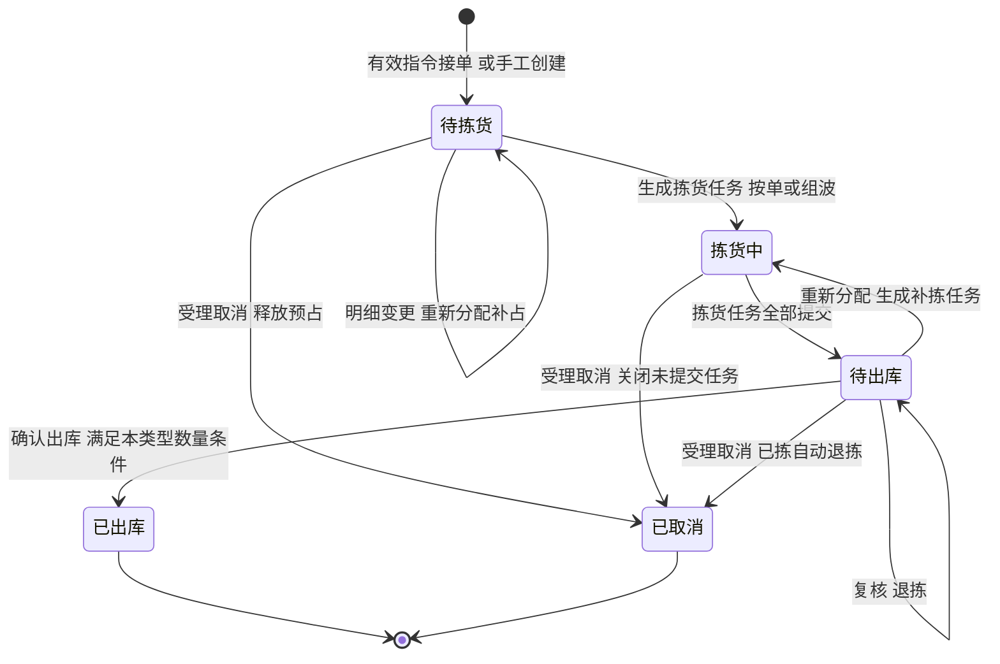
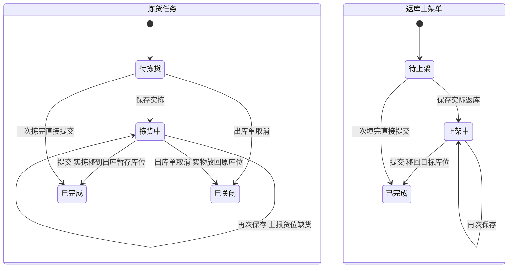
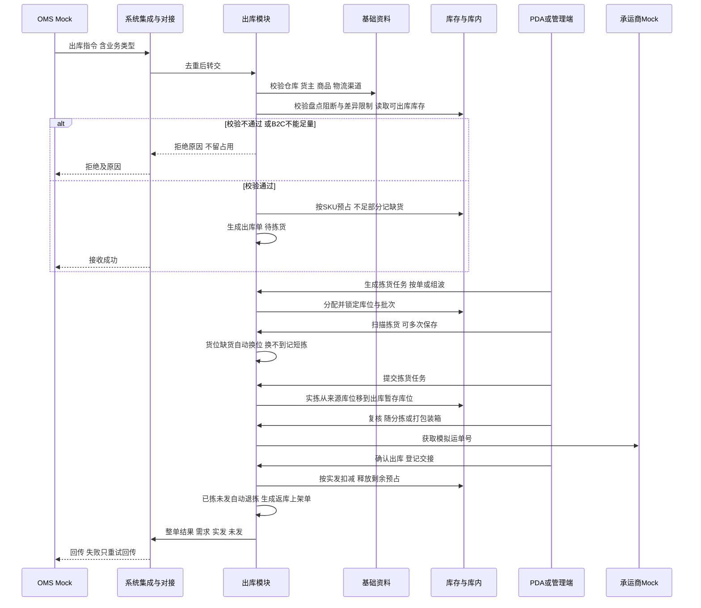
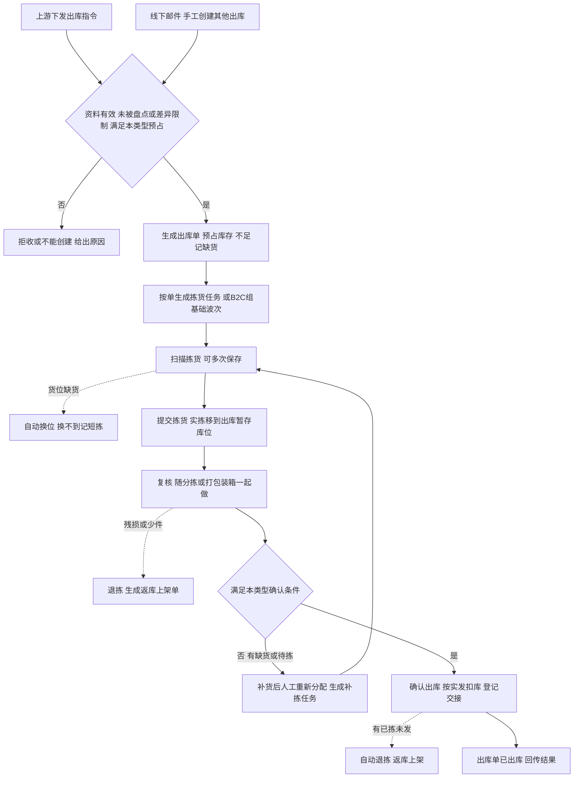

# 出库模块宏观系统架构

> 本文从全局视角确认出库模块有哪些对象、各自有哪些状态、系统之间怎么交互、业务怎么流转。规则真源见[出库业务需求分析](../03-需求调研和分析/03-出库业务/出库业务需求分析.md)，类型差异与数量走查见[出库业务设计](../04-业务分析和设计/03-出库业务设计.md)，库存怎样形成、收货暂存库位怎样记账见[入库模块宏观系统架构](04-入库模块宏观系统架构.md)。字段、页面与接口由应用设计承接。
>
> 命名：现场、产品与应用设计统称「拣货任务」「复核记录」「返库上架单」。部分旧文档里的「拣货记录」「装箱结果」「返库上架记录」，分别对应拣货任务的实拣明细、复核记录和返库上架单，不是另外的单据；旧文档里的「出库异常记录」一期不设。
>
> 出库类型按第一节的三大类、六种业务类型称呼。旧文档里的「B2C 包裹履约」「平台仓转运」「当地 B2B 批发」「退回出库」「不良品其他出库」，依次对应 B2C 出库、FBA 转运出库、批发出库、采购退货出库、其他出库。

## 一、范围与取舍

出库模块按发给谁、怎么交付分三大类：B2C 出库、FBA 转运出库、B2B 出库。B2B 出库再按出库原因细分为批发出库、调拨出库、采购退货出库和其他出库，一期共六种业务类型。各类共用一条链路：接单预占 → 拣货 → 复核 → 确认出库 → 结果回传，区别只在接单怎么占库存、怎么拣和复核、确认时能不能缺量。完成与扣库以仓库确认出库为准，承运商是否揽收不影响；四仓共用这套规则。

| 大类 | 业务类型 | 是什么 |
| --- | --- | --- |
| B2C 出库 | B2C 出库 | 按消费者订单发包裹（一件代发），交承运商派送 |
| FBA 转运出库 | FBA 转运出库 | 从本仓库存拣货、按箱／托装货，发往亚马逊 FBA 等平台仓补货；平台仓不是强盛四仓 |
| B2B 出库 | 批发出库 | 向当地批发客户、经销商交付大货，交司机或客户自提 |
| B2B 出库 | 调拨出库 | 按调出指令发往另一仓（自营仓或第三方海外仓），不关联调入仓单据 |
| B2B 出库 | 采购退货出库 | 已收入库的正常品按上游指令退回供应商；引用原入库单，不冲销原入库 |
| B2B 出库 | 其他出库 | 以上类型之外的出库；一期只处理不良品，按上游通知或线下邮件移出指定的在库不良品 |

FBA 转运出库不并入 B2B 出库，是因为平台按箱核收：每箱装了哪些 SKU、各几件要逐箱记准，箱数和组托方式还关系到货主在平台申请的箱唛与预约，装箱变化影响这些资料时要先交货主确认。B2B 出库的四种业务类型都按单拣货、按件或箱／托核对，差别在单据来源、占用哪部分库存、确认时能不能缺量。除其他出库外的五种业务类型统称普通出库，只发正常品。

六种业务类型的差异：

| 业务类型 | 接单怎么占库存 | 怎么拣、怎么复核 | 确认出库条件 |
| --- | --- | --- | --- |
| B2C 出库 | 所有 SKU 都能足量预占才接单，否则整单拒收，不留部分占用 | 按单或基础波次拣货；复核随分拣或打包，按包裹记模拟运单号与重量 | 每行足量 |
| FBA 转运出库 | 按需求与可出库库存的较小值预占，差额记缺货 | 按单拣货；按箱／托复核，逐箱记各 SKU 件数 | 可缺量：至少一行实发大于 0，一次确认整单结案 |
| 批发出库 | 同 FBA 转运出库 | 按单拣货；按件或箱／托核对，登记司机或自提信息 | 同 FBA 转运出库 |
| 调拨出库 | 同 FBA 转运出库 | 按单拣货；按件或箱／托核对 | 每行足量 |
| 采购退货出库 | 同 FBA 转运出库；货还在收货暂存库位的先完成上架 | 按单拣货；按件或箱／托核对 | 每行足量 |
| 其他出库 | 占用创建时指定的在库不良品（与原品质锁定不重复计算）；指定实物不足不建单 | 按单、按指定实物拣，不换位 | 指定数量足量 |

接单时允许部分预占，不代表确认时允许缺量：调拨出库、采购退货出库带缺货接单后，要补齐才能确认出库。

本版已确认的取舍：

| 主题 | 一期做法 |
| --- | --- |
| 出库单来源 | 普通出库全部由上游指令生成，一期由 OMS Mock 模拟，管理端不提供手工新建。其他出库可由 OMS Mock 下发，也可凭线下邮件在管理端手工创建；手工来源保留邮件依据，不伪造上游指令号 |
| 接单预占 | 按本仓本货主 SKU 预占，接单时不锁库位、不跨仓借量。只认存储、拣货库位上未被占用的正常品（可出库库存）；收货暂存、出库暂存、不良隔离等库位上的库存不参与 |
| 库位分配 | 生成拣货任务时才分配并锁定库位与批次。效期商品先到期先出，过期品不出，临期正品可出 |
| 拣货组织 | B2C 出库可按单拣，也可手工组基础波次（同仓同货主，先拣后分）；FBA 转运出库和 B2B 出库一律按单拣货。不做自动波次和派工 |
| 拣货任务 | 实拣明细可多次保存，不动库存；全部应拣行有结果后提交，一次性把实拣数量从来源库位移到出库暂存库位 |
| 出库暂存库位 | 每仓配置，与收货暂存库位分开；允许多货主混放；已拣未发的库存在这里仍计实际库存和本单预占，不参与出库分配 |
| 货位缺货 | 现场少于应拣时在拣货任务上上报，系统自动换位；换不到的记短拣，不改需求、不释放预占。原库位的账实差异交库存与库内盘点 |
| 复核 | 各类出库都要复核，可以和分拣放在一起，也可以和打包装箱放在一起，结果记为复核记录。容器只是记录，不形成箱库存或托盘库存 |
| 确认出库 | 实发取已复核数量；FBA 转运出库、批发出库可缺量一次结案，其余业务类型必须足量。交接信息可随确认登记，也可之后补登 |
| 缺货恢复 | 补货后不自动恢复；由有权限的人员对原单「重新分配」，只补预占缺口；已开始拣货的单另为待拣数量生成补拣任务 |
| 取消与变更 | 生成拣货任务前可受理明细变更与取消；之后只受理取消；确认出库后都不受理 |
| 退拣与返库上架 | 取消、缺量结案时已拣未发的实物自动退拣，复核发现残损或少件时人工退拣。退拣生成返库上架单，结构与提交规则同入库上架单 |
| 已拣后残损、丢失 | 一期不在出库单上单独收口。退拣后残损件先按原品质返库，再在库存与库内做品质调整；找不到的仍按应返库数量提交，再通过盘点调整库存 |
| 出库异常 | 一期不设出库异常单据。货位缺货和短拣记在拣货任务上，复核发现的残损、少件记为退拣原因，随返库上架单留痕；库位账实差异和残损品质由库存与库内通过盘点、品质调整处理 |
| 结果回传 | 出库单已出库时整单回传一次；取消受理即为已取消并回传结论；手工创建的其他出库不回传，在仓内可查 |

## 二、实体对象

### 2.1 出库模块自有对象

| 对象 | 是什么 | 关系与基数 |
| --- | --- | --- |
| 出库单 | 由一条有效上游指令生成（其他出库也可凭邮件手工创建），记录业务类型、货主、仓库、物流渠道、收货或交接信息及整单进度 | 1 个仓库、1 个货主、1 种业务类型；同一指令重发不增加单据；采购退货出库引用 1 张原入库单 |
| 出库单明细 | 每个 SKU 的需求、预占、已拣、已复核、实发 | 1 张出库单有 1～多行；同一 SKU 只占一行；其他出库在行下挂指定的库位、批次／SN |
| 波次 | 把多张 B2C 单合起来拣货的组织对象 | 只收同仓、同货主、待拣货的 B2C 单；1 张单至多进 1 个波次；不改需求、不加预占 |
| 拣货任务 | 现场拣货工作单，分应拣明细（系统分配的库位、批次、数量）与实拣明细；货位缺货和短拣记在应拣行上 | 按单或按波次生成；1 张出库单可有多张（首次拣货＋补拣）；提交后的拣货任务就是拣货结果，不另建拣货记录 |
| 复核记录 | 一次复核提交的结果：本单核对过的 SKU、批次／SN 和数量，装进包裹或箱／托时带上容器号 | 1 张出库单有 0～多条；随分拣复核时按单一条，随打包装箱复核时一个包裹或箱／托一条；B2C 包裹另记模拟运单号与重量 |
| 出库交接记录 | 实物交给了谁：交接方式（承运商、司机、客户自提）、物流渠道、运单号、件数与凭证 | 1 张出库单有 0～多条；确认出库时登记或之后补登，补登不再扣库 |
| 返库上架单 | 把退拣实物从出库暂存库位送回存储库位的现场工作单，分应返库明细与实际返库明细；单头记退拣原因（取消、缺量结案、残损、少件） | 每次退拣生成 1 张，指回原出库单；结构与提交规则同入库上架单 |

以上是业务对象，不等于每种都要单独做菜单。追溯关系：出库单明细 → 应拣行 → 实拣行 → 复核记录；退拣生成的返库上架单指回原出库单。

复核记录和交接记录在出库单详情里用页签展示，一期不设独立菜单；出库单、波次、拣货任务、返库上架单可列表查询，PDA 以拣货、复核、返库上架为作业入口。作业容器不建独立对象：拣货周转箱号记在实拣明细上，包裹号、箱号、托号记在复核记录上。

#### 2.1.1 拣货任务怎么生成

出库单接单后只有 SKU 级预占。仓库组织者生成拣货任务时，系统才在预占范围内分配具体库位和批次：

| 组织方式 | 规则 |
| --- | --- |
| 按单拣货 | 一张出库单生成一张拣货任务；FBA 转运出库和 B2B 出库的四种业务类型一律按单 |
| 基础波次 | 从同仓、同货主、待拣货的 B2C 单中手工组波；一个波次生成一张拣货任务，应拣按库位＋SKU＋批次汇总。提交后按波次内顺序把实拣分回各单，短拣落在顺序靠后的单上 |
| 补拣 | 已拣过的出库单重新分配后，补上的数量另生成一张按单拣货任务 |

分配规则：

- 只在本仓本货主的存储、拣货库位上分配正常品，合计不超过本单预占；效期商品先到期先出，过期品不分配，临期正品可出。
- 分配即锁定该库位上的这部分数量：其他任务不能再分配，移库也不能移走。分配不到的部分留作待拣，等重新分配。
- 其他出库不另分配，应拣明细直接取创建时指定的库位、批次／SN。
- 生成拣货任务即视为出库单「开始拣货」：之后不再受理明细变更，波次成员也不能移出，只能取消。

#### 2.1.2 拣货任务里的两类明细

界面上可用「应拣」「实拣」两个页签（或上下两个子表），数据都在同一张拣货任务上。

| 明细 | 一行代表什么 | 来源与可否修改 | 行数关系 |
| --- | --- | --- | --- |
| 应拣明细 | 到哪个库位拣哪个 SKU、批次、多少 | 生成任务时系统分配；拣货人员不能改，只能上报货位缺货 | 一条出库单明细可对应多条应拣行（多库位、多批次）；波次任务一行可汇总多张单 |
| 实拣明细 | 实际从该库位拣了多少；SN 按商品配置逐件扫描 | 拣货时扫描填写；可多次保存 | 一条应拣行对应一条实拣行 |

提交规则：

- **保存：**只保存实拣进度，不动库存。扫描的库位、SKU、批次／SN 与应拣不符即阻断。
- **货位缺货：**库位上的实物少于应拣（含发现残损不能拣）时，在该应拣行上报缺货数量和原因（无货、残损）。系统释放该行未拣部分的分配，到本仓同货主的其他库位重新分配并追加应拣行，即换位；分配不到的部分在提交时记为该行短拣。原库位的账实差异和残损件，交库存与库内盘点或做品质调整。其他出库按指定实物执行，不换位。
- **提交：**每条应拣行须拣足或已上报缺货。通过后拣货任务变为「已完成」，按实拣一次性把库存从来源库位移到出库暂存库位，仍为本单预占。
- **短拣：**不改需求、不释放预占。补货后重新分配补拣；FBA 转运出库、批发出库也可按已复核数量缺量结案；其余业务类型等补齐或上游取消。

模拟例：应拣为 L1 库位 X 商品 5 件，现场只有 3 件。拣 3 件并上报货位缺货 2 件，系统改在 L2 分配 2 件，拣足后提交，5 件进入出库暂存库位，预占不变。若 L2 也没有货，提交时短拣 2 件：本单已拣 3、待拣 2，预占仍为 5，等补货后重新分配。

#### 2.1.3 复核、确认出库与退拣

**复核**是各类出库的必经环节，但不单设一道工序：可以和分拣放在一起，也可以和打包装箱放在一起。不论哪种做法，都按原单逐件扫描核对 SKU、批次／SN 和数量，结果记为复核记录；波次汇总数量对不能代替逐单核对。

| 做法 | 常见场景 | 复核记录怎么形成 |
| --- | --- | --- |
| 和分拣一起 | B2C 波次集中拣出后按原单分拣，分的时候逐件扫描 | 每单一条；打包时补记包裹号、重量（模拟）和模拟运单号 |
| 和打包装箱一起 | 按单拣货的单；FBA 转运出库按箱／托装货 | 边扫边装，一个包裹或一个箱／托一条，记容器号和内含各 SKU 件数；B2C 另记重量与模拟运单号 |

不用容器的（如批发散件自提、其他出库）按单核对一条，容器为空。复核不动库存，确认出库前复核记录可删除重做。

**确认出库**时，实发取各行已复核数量，按第一节各业务类型的确认条件校验；普通出库只能发正常品，已拣后过期或残损的要先退拣。通过后出库单变为「已出库」，按实发扣减出库暂存库位的实际库存和本单预占，同时释放本单剩余预占。确认后实物即使还在仓里等揽收，也不再计入库存。

**退拣**是把已拣实物从本单退出，生成返库上架单送回存储库位（不良品回不良隔离库位），单头记退拣原因：

| 退拣情况 | 怎么触发 | 本单预占 |
| --- | --- | --- |
| 复核时发现残损或少件 | 复核人员人工退拣 | 保留，可重新分配补拣 |
| 缺量结案时有已拣未发 | 确认出库时自动退拣 | 随结案释放 |
| 取消时已有已拣 | 受理取消时自动退拣 | 随取消释放 |

返库上架单的结构与提交规则同入库上架单：应返库明细不能改；实际返库可多次保存，不动库存；全部填完后提交，一次性把库存从出库暂存库位移到目标库位，并校验目标库位启用、品质适配与货主占用。残损件先按原品质返库，再由库存与库内做品质调整；找不到的仍按应返库数量提交，再通过盘点调整。

### 2.2 引用其他模块的对象

| 对象 | 所属模块 | 出库怎么用 |
| --- | --- | --- |
| 出库指令、明细变更与取消消息、结果回传消息 | 系统集成与对接 | 去重后交出库模块判断受理；接收或拒绝结论、整单结果按原指令回传，失败只重试回传 |
| 承运商 Mock 运单与交接信息 | 系统集成与对接 | B2C 打包时取模拟运单号；交接登记引用 |
| 仓库、货主、商品、库位 | 基础资料 | 接单校验；每仓配置出库暂存库位（暂存类库区，允许多货主混放）；拣货与返库校验库位启用、品质适配与货主占用 |
| 物流渠道、物流承运商 | 基础资料 | 指令引用的渠道及其所属承运商须启用，任一停用整单拒收；交接登记引用渠道 |
| 实际库存、库存锁定、库存流水 | 库存与库内 | 接单读取可出库库存并预占；盘点阻断与差异限制拦截新单；拣货提交移到出库暂存库位；确认出库扣减；返库上架移回 |
| 原入库单 | 入库 | 采购退货出库引用；原入库的实收、上架与流水不冲销 |
| 履约截止时间、动作权限 | 公共能力 | 有效接单起按仓库当地时间加 48 小时，超时只提示；确认出库、重新分配、手工其他出库按权限执行，邮件来源的其他出库由仓库主管确认 |

### 2.3 数量骨架

| 层级 | 字段 | 含义 | 关系 |
| --- | --- | --- | --- |
| 接单 | 需求数量 | 上游要求发出的件数 | 待拣货时可随明细变更调整，开始拣货后不变 |
| 接单 | 预占数量 | 本单锁定的库存 | 预占≤需求；缺货＝需求－预占，页面计算，不单独设字段 |
| 拣货 | 已拣数量 | 已提交拣货、仍在本单名下的件数 | 拣货提交时增加，退拣时减少；确认出库前已拣≤预占；待拣＝预占－已拣，页面计算 |
| 复核 | 已复核数量 | 复核记录里的件数 | 已复核≤已拣 |
| 结果 | 实发数量 | 确认出库时认定的发出件数 | 实发＝确认时的已复核数量；已拣未发自动退拣后，已拣等于实发 |
| 结果 | 未发数量 | 最终没发出的件数 | 未发＝需求－实发；出库单已出库后定型 |

缺货、待拣是执行中的数量；出库单已出库后只看实发与未发，已取消后预占、已拣都归零。

接单预占只认**可出库库存**：本仓本货主该 SKU 在存储、拣货库位上的正常品，扣掉别的出库单已预占、尚未拣出的部分。收货暂存、出库暂存、不良隔离等库位上的库存计入实际库存，但不参与预占和分配。可出库库存只是出库的口径，不改变库存与库内「实际＝预占＋可用」的记账。

库存在各环节这样变：接单预占只加预占，不动实际；分配、复核不动库存；拣货提交把库存从来源库位移到出库暂存库位，仍计实际库存和本单预占；确认出库按实发扣减出库暂存库位的实际库存和本单预占，剩余预占一并释放；取消释放本单全部预占。退拣的实物要等返库上架单提交、回到存储库位后，才重新算进可出库库存。

模拟例：美西仓货主 A 的 X 商品在存储库位实际 8、无其他占用。FBA 转运出库单需求 10，预占 8、缺货 2。拣货提交后 8 件进入出库暂存库位，实际仍为 8、预占仍为 8。复核装两箱（C1 装 5、C2 装 3）后确认出库：实发 8、未发 2，实际与预占都变为 0；回传需求 10、实发 8、未发 2。两个箱号只记在复核记录上，不形成箱库存。

取消例：X 商品在存储库位实际 10，B2C 单需求 3 并全部预占，可出库剩 7。拣货提交后 3 件在出库暂存库位。上游取消：出库单已取消，预占 3 释放，3 件自动退拣并生成返库上架单。返库上架单提交前，实际 10、预占 0、可出库仍为 7；提交后 3 件回到存储库位，可出库恢复为 10。

## 三、状态与状态机

已提交的拣货任务和返库上架单、交接记录，以及已出库单的复核记录，都是已发生事实，一期不作废、不更正；确认出库前复核记录可删除重做。出库单状态由拣货任务和确认出库自动推导，不靠人工改状态。

### 3.1 状态怎样推导

一张出库单可以拣多次（首次拣货、补拣）、复核多次（多个包裹或箱托），多人协作。缺货和短拣不单设状态：出库单带着缺货数量或待拣数量停在待拣货或待出库，等补货后人工重新分配，或按类型缺量结案、等上游取消。明细行不单设状态，进度看需求、预占、已拣、已复核、实发。

### 3.2 出库单状态

| 状态 | 判断条件 | 说明 |
| --- | --- | --- |
| 待拣货 | 已接单，还没生成过拣货任务 | 可受理明细变更；B2C 可组波；非 B2C 可能带缺货 |
| 拣货中 | 有未提交的拣货任务 | 不再受理明细变更；首次拣货、补拣都算 |
| 待出库 | 生成过拣货任务，当前没有未提交的任务 | 复核、退拣、确认出库都在这一步；有缺货或待拣时可重新分配补拣 |
| 已出库 | 已确认出库 | 实发、未发定型并回传；可补登交接，不能取消 |
| 已取消 | 已受理取消 | 预占全部释放，已拣实物退拣返库；不回传出库结果 |

「拣货中」也是拣货任务的状态：出库单拣货中表示还有任务没提交，任务拣货中表示已开始扫描、还没提交。

### 3.3 变更与取消按状态受理

| 出库单状态 | 明细变更 | 取消 |
| --- | --- | --- |
| 待拣货 | 受理：需求与预占一起重算，B2C 仍须足量；重算失败保留原单原预占 | 受理：释放预占，转已取消 |
| 拣货中、待出库 | 拒绝 | 受理：释放预占和库位分配；未提交的拣货任务关闭（波次只扣减本单份额），已拿出的实物放回原库位；已在出库暂存库位的实物自动退拣；转已取消 |
| 已出库 | 拒绝 | 拒绝；后续撤销走上游其他业务，不回写已出库事实 |
| 已取消 | 拒绝 | 重复取消返回原结论 |

仓库、货主、业务类型不能在原单变更，只能在允许取消时取消原单、重新下发。手工创建的其他出库，由有权限的仓库用户在管理端按同样规则取消。

### 3.4 拣货任务、返库上架单与波次状态

| 对象 | 状态 | 说明 |
| --- | --- | --- |
| 拣货任务 | 待拣货、拣货中、已完成、已关闭 | 待拣货：已分配，还没保存实拣。拣货中：保存过，未提交。已完成：已提交，库存已移到出库暂存库位。已关闭：出库单取消，未提交的实拣不动库存；波次任务在成员全部取消时才关闭，否则只扣减该单份额 |
| 返库上架单 | 待上架、上架中、已完成 | 与入库上架单相同；已完成表示库存已从出库暂存库位移回目标库位 |
| 波次 | 拣货中、已完成 | 组波即生成波次拣货任务；任务提交或关闭后波次已完成，成员单各自复核、确认出库 |

## 四、系统流程

结果只在出库单变为「已出库」时回传一次：需求、实发、未发分项列出，附交接信息；拣货、复核过程中不回传进度。明细变更与取消先回受理或拒绝结论，取消受理后出库单即为已取消。手工创建的其他出库不回传，结果和邮件依据在仓内可查。同一指令重发不重复建单；管理端与 PDA 共用同一份记录，重复提交不重复移库、扣库。

## 五、业务流程

上游可以在确认出库前的任何时点取消，按第 3.3 节受理。缺货、短拣的单不会自动循环：FBA 转运出库、批发出库可以按已复核数量缺量结案，其余业务类型等补货后重新分配，或由上游取消。

| 环节 | 谁做 | 交出什么 |
| --- | --- | --- |
| 接单预占 | 上游下发，系统校验；邮件来源由有权限的仓库用户手工创建 | 待拣货的出库单（预占与缺货），或拒绝原因 |
| 组织拣货 | 仓库组织者 | 按单拣货任务或 B2C 基础波次，库位与批次已分配 |
| 拣货 | 拣货人员 | 实拣明细与货位缺货上报；提交后实物在出库暂存库位 |
| 复核 | 分拣或打包装箱的人员一并完成 | 复核记录；B2C 包裹号、重量与模拟运单号；不能发的实物退拣 |
| 确认出库与交接 | 有确认出库权限的仓库人员；邮件来源的其他出库由仓库主管确认 | 实发、未发与库存扣减；交接记录 |
| 返库上架 | 上架人员 | 退拣实物回到存储库位，不良品回不良隔离库位 |
| 缺货恢复 | 有权限的仓库人员 | 补上的预占与补拣任务；补货本身不触发 |

同一辆车或同一次自提可能带走多张出库单的货，包括不同货主的货：每张单仍各自复核、确认出库和登记交接，不合并单据或库存；细节见[出库业务设计](../04-业务分析和设计/03-出库业务设计.md)第 3.2 节。

## 六、一期已知限制

- 已拣后的残损、丢失没有出库单内的收口，只能退拣后补拣，或缺量结案、等上游取消。返库上架单按应返库数量提交，丢失件会让账上短暂出现实物不存在的库存，要靠盘点调整；残损件要另做品质调整。
- 货位缺货只换位，并在拣货任务上留下上报记录；原库位的账实差异要等库存与库内盘点修正。
- 缺货、短拣的单补货后不自动恢复，要人工重新分配；超过 48 小时履约截止只提示，不自动取消或缺量结案。
- 生成拣货任务后不再受理明细变更，上游只能取消后重新下发；确认出库后不能取消或撤销。
- 波次只支持同仓同货主 B2C 手工组波、先拣后分；不做自动波次、边拣边分、派工和产能调度。
- 承运商运单、打印和称重都是模拟，不跟踪揽收与运输。FBA 等平台仓的箱唛、预约、BOL／POD 在线下协作，装箱变化要线下通知货主。
- 其他出库按指定实物执行，指定实物找不到时不能换位，只能取消后重新指定。
