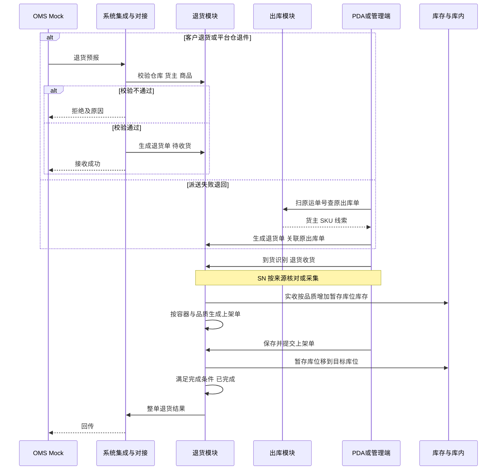
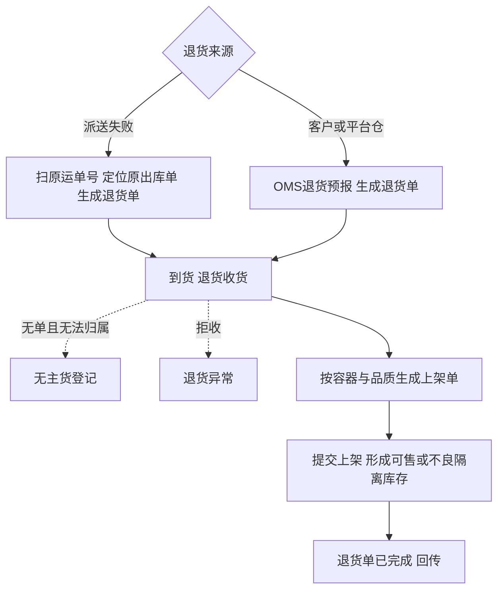

# 退货模块宏观系统架构

> 本文从全局视角确认退货模块有哪些对象、各自有哪些状态、系统之间怎么交互、业务怎么流转。规则真源见[退货业务需求分析](../03-需求调研和分析/05-退货业务/退货业务需求分析.md)，场景与数量走查见[退货业务设计](../04-业务分析和设计/07-退货业务设计.md)。字段、页面与接口由应用设计承接。
>
> 库存怎样进入收货暂存库位、上架怎样移到存储或不良隔离库位，与[入库模块宏观系统架构](04-入库模块宏观系统架构.md)一致，记账口径与盘点规则见[库存模块宏观系统架构](07-库存模块宏观系统架构.md)；B2C 出库时的运单号、复核 SN 与[出库模块宏观系统架构](05-出库模块宏观系统架构.md)衔接。命名：现场、产品与应用设计统称「上架单」，退货收货后生成的上架单与正常入库共用同一对象与提交规则，单头标明来源业务（入库单或退货单）。中英文名称、缩写与单号规则见[单据术语与生成规则](08-单据术语与生成规则.md)。
>
> **与入库类型的关系：**一期入库业务类型仍只有正常入库、调拨入库。货从仓外退回本仓走退货模块，不增加「退货入库」入库类型，避免与「全部由上游入库指令生成」混淆。货从本仓退回仓外仍走出库模块的采购退货出库等类型，见[项目定位与范围](01-项目定位与范围.md)。

## 一、范围与取舍

退货模块处理货从仓外退回本仓后的到件识别、清点收货、良品／不良品判定、上架及结果回传。一期覆盖三类来源；亚马逊 FBA 移除退仓（FNSKU、换标、退货库存隔离）单独作为后续能力，见项目定位第 4.1 节。

| 退货来源 | 是什么 | 归属怎么定 | 一期单据怎么来 |
| --- | --- | --- | --- |
| 派送失败退回 | 本仓 B2C 等已发包裹未妥投，承运商原路退回 | 扫**原出库运单号**（模拟运单号）定位原出库单，带出货主、SKU、应退数量线索 | 现场扫运单号**由 WMS 生成或补全退货单**（货主、仓库、关联原出库单）；货主也可经 OMS Mock 先下退货预报，到仓按预报收货 |
| 客户退货 | 买家签收后寄回 | 依据货主**退货预报**（退货运单号、商品与数量；可含原销售单号） | **主要由 OMS Mock 退货预报生成**退货单；货主已知、预报未到时可请货主补预报，一期不单独做「认领池」产品能力 |
| 平台仓退件 | FBA 以外平台仓移除退回（如 WFS） | 依据货主退货预报与**平台侧退货单号** | 同客户退货，预报驱动生成退货单 |

到仓时没有预报、又无法扫原运单号对应出库的：货主已知的请货主补预报后再收货；认不出货主的按[无主货登记](04-入库模块宏观系统架构.md)只登记、暂存，不生成退货单与库存。识别为 FBA 退货特征的实物一期不执行退货收货，保留识别线索并线下协调，与 FBA 退货后续范围一致。

本版已确认的取舍：

| 主题 | 一期做法 |
| --- | --- |
| 与入库、出库边界 | 退回本仓＝退货模块；已收货物从本仓退回仓外＝出库模块（如采购退货出库），方向相反，不共用单据 |
| 派送失败建单 | **允许仓库侧建单**：PDA 或管理端扫原运单号解析原 B2C 出库单后生成退货单，再收货、上架；建单与结案结果**回传 OMS Mock**，不伪造上游预报号。有预报时以预报为准，运单号与预报可互相校验 |
| 客户退货、平台仓退件建单 | **以 OMS Mock 退货预报为主**生成退货单；管理端不提供无依据的手工新建。仓库不能代货主虚构预报，只能催补预报或转无主货 |
| 收货与品质 | 与入库相同：**拒收数量（带原因，不计实收）＋实收数量**；实收内分良品、不良品。良品、不良品在收货时录入，不设退货后单独质检任务 |
| 良品处置 | **良品收货确认后走上架**，目标为存储库位；收货确认后良品即计入可用，上架后才能分配拣货；**不良品上架到不良隔离库位**。一期不因「等货主意见」而长期停在暂存库位（货主争议通过不良品判定、备注与结果回传体现，销毁／退运留后续） |
| 库存形成 | 与入库一致：收货确认按实收、按品质增加本仓**收货暂存库位**库存；上架提交后移到存储或不良隔离库位 |
| 作业容器与上架单 | 与入库一致：容器号挂在退货收货行上；按「容器 × 品质」生成上架单，应上架／实际上架明细及提交规则同入库上架单 |
| SN | 商品配置要求 SN 时，收货实收须采集 SN。**派送失败退回**：须与原出库单复核记录（或实发 SN）**一致才允许计入实收**；不一致只能拒收，记录扫描SN、核对依据与拒收原因，不计实收、不生成上架单、不增库存，不能改记为不良品实收。**客户退货、平台仓退件**：预报或原销售单能关联到原出库且系统存有 SN 时，**须扫描核对**，不一致按同一拒收规则处理；无法关联时仍须采集 SN 入账，但不阻断收货（仅提示无原单可对核） |
| 数量上限 | 每行实收＋拒收不得超过退货单预计（或派送失败场景下原出库可退线索数量）；超出部分不收，按对不上单疑问实物线下暂存或拒收记原因 |
| 结果回传 | 退货单「已完成」时整单回传一次，分项列出短少、拒收与良品／不良品实收；收货、上架过程中不回传进度 |

## 二、实体对象

### 2.1 退货模块自有对象

| 对象 | 是什么 | 关系与基数 |
| --- | --- | --- |
| 退货单 | 记录退货来源、货主、仓库、关联线索（原出库单或退货预报）及整单进度 | 1 个货主、1 个仓库、1 种退货来源；派送失败退回关联 1 张原出库单（通常 B2C）；客户退货／平台仓退件关联 1 条有效退货预报；同一预报重发不增加单据 |
| 退货单明细 | 每个 SKU 的预计、实收、拒收、未收、良品／不良品、已上架 | 1 张退货单 1～多行；每行 1 个 SKU |
| 退货收货记录 | 一次退货收货提交的事实；行上按 SKU、批次、效期／SN、容器录入拒收与实收，实收内分良品、不良品 | 1 张退货单 0～多条；结构对齐入库收货记录，业务上独立编号与表头 |
| 退货异常记录 | 收货时实物与退货单对不上（一期以拒收为主） | 归属退货单；收货确认时自动生成，指回退货收货明细行；不计实收 |
| 上架单（来源＝退货） | 退货收货后生成，对象模型同入库上架单，单头标记来源退货单与退货收货记录 | 规则见入库架构 2.1.1、2.1.2 |

退货收货记录、退货异常在退货单详情页签展示，一期不设独立菜单。上架单可列表查询，PDA 以「退货收货」「上架」为入口（上架可与正常入库共用作业页，按来源单区分）。

追溯关系：派送失败退回的 SN 核对链为 **原出库单 → 复核记录 SN → 退货收货 SN**；预报类为 **退货预报 → 退货单 → 退货收货记录 → 上架单 → 库存流水**。

### 2.2 关联对象（其他模块）

| 对象 | 所属 | 退货模块怎么用 |
| --- | --- | --- |
| 原出库单 | 出库 | 派送失败退回建单与 SN 核对；只读引用，不冲销原出库 |
| 退货预报 | 上游／对接 | 客户退货、平台仓退件生成退货单的指令来源 |
| 无主货登记 | 入库域对象 | 认不出货主或长期无预报的到件，不进入退货单 |
| 库存与流水 | 库存与库内 | 收货、上架驱动暂存与存储／不良隔离库存变化 |

## 三、状态流转

### 3.1 退货单与明细

退货单状态与入库单对齐，便于两端查询与培训：**待收货 → 收货中 → 上架中 → 已完成**；另有 **已取消**（仅在上游取消预报或授权作废且未形成不可回滚库存时）。明细行随实收、上架进度更新未收与已上架数量。

完成条件：所有明细行收货已完结（含确认收货完结转最终短少）且实收部分已全部提交上架。

### 3.2 退货收货记录、上架单

状态规则同[入库模块宏观系统架构](04-入库模块宏观系统架构.md)第三节：上架单为待上架、上架中、已完成；拒收自动生成退货异常记录，不生成上架单、不增加库存。

## 四、系统流程

## 五、业务流程

| 环节 | 谁做 | 交出什么 |
| --- | --- | --- |
| 预报或建单 | 货主经 OMS 下预报；派送失败由现场扫运单建单 | 待收货的退货单 |
| 到货与收货 | 收货人员 | 拒收与实收、良品／不良品、SN、容器；暂存库位库存 |
| 上架 | 上架人员 | 存储或不良隔离库位库存 |
| 结案 | 系统／授权人员 | 短少与拒收分项、实收上架结果回传上游 |

## 六、一期已知限制

- 实收误记、货主认错无更正路径，与入库一致，受影响单据无法完成，保留证据线下跟进。
- 无预报且非派送失败可解析的场景，不能形成退货库存，只能无主货或等补预报。
- FBA 退货、换标、独立退货库存类型、认领公海与销毁计费均不在一期。
- 退货视频、拍照留证可作为备注或附件扩展，一期不强制。

## 七、下游文档衔接

应用设计需新增退货单、退货收货记录等字段清单与 PRD；系统与模块地图、边界总览与 OMS Mock 消息设计已纳入退货模块，字段样例与 Mock 收发台能力待应用设计细化。
