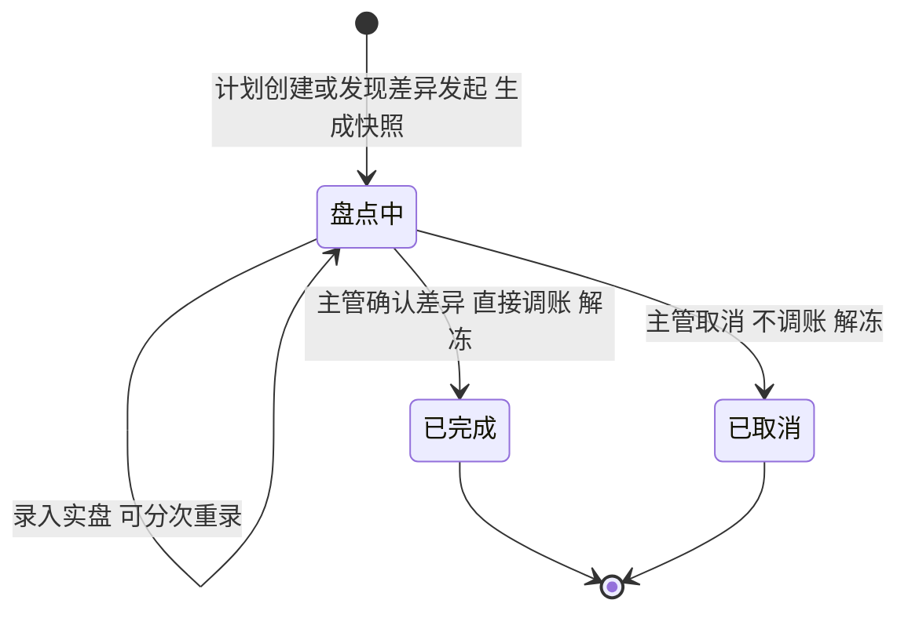
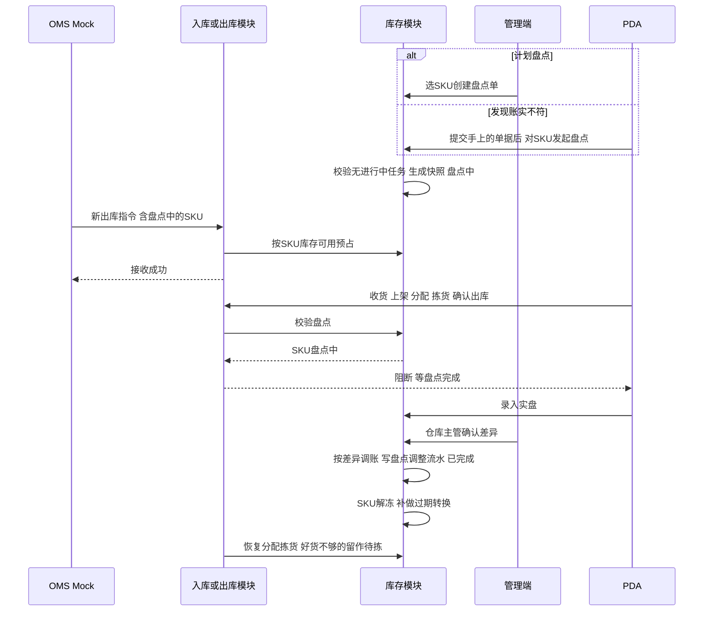

# 库存模块宏观系统架构

> 本文从全局视角确认库存模块怎么记账、有哪些对象和状态、哪些动作会改库存，以及盘点怎样影响入库、出库。规则真源见[库存与库内业务需求分析](../03-需求调研和分析/04-库存与库内业务/库存与库内业务需求分析.md)，数量走查见[库存与库内业务设计](../04-业务分析和设计/04-库存与库内业务设计.md)。收货和上架怎样形成库存见[入库模块宏观系统架构](04-入库模块宏观系统架构.md)，预占、拣货和确认出库见[出库模块宏观系统架构](05-出库模块宏观系统架构.md)。字段、页面与接口由应用设计承接。
>
> 命名：正常品转不良品统称「品质转换」，旧文档里的「品质调整」是同一个动作。旧文档里的「可出库库存」拆成两个口径：接单看 SKU 库存的可用，分配看库存明细的可分配。中英文名称、缩写与单号规则见[单据术语与生成规则](08-单据术语与生成规则.md)。

## 一、范围与取舍

库存模块管两件事。一是库存账：每件货在哪个仓、属于哪个货主、放在哪个库位、什么品质、被哪些出库单占着、分给了哪个拣货任务。二是库内作业：移库、品质转换和盘点。收货、上架、拣货、确认出库等收发动作由入库、退货、出库模块执行，库存模块按本文口径记账、写流水。

本版取舍：

| 主题 | 一期做法 |
| --- | --- |
| 两层账 | SKU 库存按仓库＋货主＋SKU 记三量，接单在这一层占；库存明细按仓库＋货主＋SKU＋库位＋批次＋品质记实际和已分配，分配在这一层落。启用 SN 的商品另记每件 SN 在哪，不按 SN 拆库存明细。四仓分别记账，不跨仓、跨货主借量 |
| 改数入口 | 不提供直接改库存的入口。实际数量只由已确认的收发事实和盘点差异调整改变 |
| 流水 | 两层共用一本流水，一行只记一个数的一次变化：实际记到库存明细那一行，订单占用记到 SKU 层；在库位或品质之间转移记一减一加两行；分配不写流水 |
| 三量 | 按 SKU 库存算：实际＝预占＋可用。预占＝订单占用＋不良品；可用＝正常品实际－订单占用 |
| 接单与分配 | 接单预占看可用，收货暂存、出库暂存库位上的正常品也能占。分配看库存明细的可分配（实际－已分配），普通出库只取存储、拣货库位上的正常品。接了单的货还在暂存时，要等上架或返库上架后才能分配、拣货 |
| 暂存库位 | 收货暂存、出库暂存库位允许多货主混放；上面的正常品计实际、算可用，接单可以占，但不参与分配。上面的货跟着上架单、出库单走，不移库、不盘点、不做过期转换 |
| 品质 | 库存品质只有正常品、不良品（收货时叫良品、不良品）。不良品整体不可用；临期是效期等级，不是第三种品质 |
| 品质转换 | 库存动作，不设单据；一期只有正常品转不良品一个方向，原位转换 |
| 移库 | 只在 PDA 上一次扫描提交，没有中间状态；只改库位，不改仓库、货主和品质 |
| 盘点 | 按 SKU 建单，盘这些 SKU 在存储、拣货、不良隔离库位上的库存。计划盘点由管理端建；拣货、复核、上架时发现账实不符，由发现的人直接对这个 SKU 发起盘点。盘点中的 SKU 不动库存：不收货、不上架、不拣货、不发货、不移库；出库单可以推进来、照常预占，但不分配、不组波、不拣货。差异经仓库主管确认后直接调账 |
| 丢失与多出 | 一律经盘点调整。已收未上架、已拣后丢失的，先按应上架、应返库数量提交，再对这个 SKU 发起盘点 |
| 作业容器 | 箱、托只作记录，不形成库存 |
| 一期不做 | 箱库存与托盘库存、库位容量；补货任务与补货建议；循环盘点；报损／销毁；库存初始化导入；向上游独立回传库存 |

## 二、库存怎么记账

### 2.1 两层账

接单时只知道货主和 SKU，生成拣货任务时才知道去哪个库位、拿哪个批次，所以库存分两层记：

| 层 | 一行是什么 | 记什么 | 用在哪 |
| --- | --- | --- | --- |
| SKU 库存 | 仓库＋货主＋SKU | 正常品实际、不良品实际、订单占用，三量由这三个数算出 | 接单预占、补占、释放；三量查询 |
| 库存明细 | 仓库＋货主＋SKU＋库位＋批次＋品质 | 实际、已分配；可分配＝实际－已分配 | 收发、上架、分配、拣货、返库、移库、品质转换、盘点 |

| 维度 | 说明 |
| --- | --- |
| 仓库、货主、SKU | 必有。同一编码属于不同货主时是两个商品，库存分开记 |
| 库位 | 库存明细必有。一个库位同一时点只归一个货主，同货主可放多个 SKU；收货暂存、出库暂存库位除外 |
| 批次 | 商品启用批次或效期时必填，带生产日期、有效期 |
| 品质 | 正常品或不良品 |
| SN | 不拆库存明细的行。启用 SN 的商品另记每件 SN 当前所在的库位、批次、品质和是否在库；库存明细上的数量，就是这个位置上在库 SN 的件数。SN 身份按货主＋SKU＋SN 跨四仓判断 |

- 两层要对得上：SKU 库存的正常品实际、不良品实际，等于库存明细按品质加总；订单占用等于未结案出库单明细上的预占数量合计；库存明细的已分配，等于拣货任务分到这一行、还没拣走的数量，加上其他出库指定在这一行的数量。
- 收货确认、确认出库、品质转换、盘点调整同时改两层；上架、拣货提交、返库上架、移库只在库存明细的行之间搬，SKU 库存不变；接单预占、补占、释放只改 SKU 库存的订单占用；分配只改库存明细的已分配。完整对照见第四节。
- 效期等级（临期、过期）由商品配置和仓库当地日期算出，用于展示和判断，不参与记账。按仓库、SKU、库位、批次、SN 及组合查询，都是这两层的不同汇总。

### 2.2 库位用途

库位用途由所属库区的类型决定。收货暂存、出库暂存库位都建在暂存类库区，每仓分别指定。

| 库位 | 放什么 | 怎么进 | 怎么出 | 算不算可用 | 普通出库能不能分配 | 多货主混放 |
| --- | --- | --- | --- | --- | --- | --- |
| 收货暂存库位 | 已收货、未上架的正常品和不良品 | 收货确认（入库、退货） | 上架单提交 | 正常品算 | 不能，上架后才能分配 | 允许 |
| 存储库位、拣货库位 | 正常品 | 上架单、返库上架单提交；移库 | 拣货任务提交；移库 | 算 | 能，只分没被分配的正常品 | 不允许 |
| 不良隔离库位 | 不良品 | 上架单、返库上架单提交；移库 | 其他出库的拣货任务提交；移库 | 不算，不良品记在预占里 | 不能；其他出库按指定实物出 | 不允许 |
| 出库暂存库位 | 已拣、未确认出库的货 | 拣货任务提交 | 确认出库扣减；退拣后返库上架单提交 | 正常品算，已拣的同时算本单占用 | 不能，退拣的货返库上架后才能分配 | 允许 |
| 异常处理库区（含无主货暂存位置） | 无主货、超收、拒收等没有入账的实物 | 线下摆放，无主货另做登记 | 线下处理 | 不计库存 | — | — |

- 暂存库位只是收发过程的停放点。收货暂存库位的货由上架单搬走，出库暂存库位的货由确认出库扣减或返库上架单搬走，都不用移库搬，也不盘点、不做过期转换。只有复核发现已拣残损时，在出库暂存库位转成不良品再退拣。
- 品质转换在原库位进行，存储、拣货库位上可能暂时有不良品。它们不可用，接单和分配都不会用到，之后移库到不良隔离库位。
- 已确认出库、等待揽收的货可能还在出库暂存库位或交接区，但已不计实际库存。

### 2.3 三量与可分配

三量记在 SKU 库存上，按仓库＋货主＋SKU 看，实际＝预占＋可用：

| 数量 | 怎么算 | 说明 |
| --- | --- | --- |
| 实际 | 正常品＋不良品 | 只由第四节的动作改变 |
| 预占 | 订单占用＋不良品 | 订单占用是各出库单明细上的预占数量合计；不良品整体不可用，全部算在预占里 |
| 可用 | 正常品实际－订单占用 | 收货暂存、出库暂存库位上的正常品也算可用，接单可以占，只是暂时分配不到 |

- **接单看可用，分配看可分配：**接单和补占只看 SKU 库存的可用。分配看库存明细的可分配（实际－已分配），普通出库只取存储、拣货库位上的正常品，过期的不分，盘点中的 SKU 不分，先到期先出。占了暂存货的单，要等上架或返库上架后才能分配、拣货。
- **分配不加占用：**接单只占 SKU 的数量。生成拣货任务时才把它落到具体库位、批次，叫拣货分配。分配不增加预占，只增加库存明细的已分配；分到的数量不能再分给别的任务，也不能移库或做品质转换。拣货任务提交时，已分配随实物从来源库位一起减掉。
- **其他出库指定实物，不另加占用：**其他出库在明细上记下指定的不良品库位、批次／SN，建单时就计入这些库存明细的已分配，生成拣货任务时不再重复加。不良品本来就不可用，不加订单占用；同一批货也就不会被两张其他出库重复指定。
- **可用可能为负：**接单和补占只在可用范围内占，不会让可用变负。盘点调减、品质转换会减少正常品，剩下的正常品不够订单占用时，可用就是负数，表示这些出库单占着的好货不够了。分配时差的部分留作待拣，按出库的缺货规则处理。

例：正常品 8、不良品 2，出库单占用 3。实际 10，预占＝3＋2＝5，可用＝8－3＝5。之后存储库位上 1 件正常品过期转成不良品：正常品 7、不良品 3，出库单还要 3 件好货，预占＝3＋3＝6，可用＝7－3＝4。订单占用照算，因为订单得另找好货，不能拿这件不良品抵。如果过期的正好是这张单已分到的那件，要等拣货时上报货位缺货、换位释放后才转。

### 2.4 流水怎么记

两层共用一本库存流水，一行只记一个数的一次变化：

| 变的是什么 | 记在哪 | 例子 |
| --- | --- | --- |
| 实际 | 库存明细那一行，带库位、批次、品质 | 收货确认记在收货暂存库位那一行；SKU 库存的实际不另记，按 SKU 汇总就是 |
| 订单占用 | SKU 层，库位、批次、品质为空 | 接单预占、补占，取消释放，确认出库扣掉的占用 |
| 库位或品质 | 涉及的两行库存明细各记一行，一减一加 | 上架、拣货提交、返库上架、移库；品质转换是同一库位上正常品那行减、不良品那行加 |

- 分配和其他出库的指定只改已分配，不写流水，追溯看拣货任务和出库单明细。
- 每行指回来源单据，记变化前后的数量、操作者和时间；启用 SN 的商品还带上这次涉及的 SN，SN 轨迹从流水查。
- 按库存明细查，一行的流水合计就是它的实际；按 SKU 汇总，搬动的一减一加正好抵消，实际和订单占用的合计就是 SKU 库存上的数。

## 三、实体对象

### 3.1 库存模块自有对象

| 对象 | 是什么 | 关系与基数 |
| --- | --- | --- |
| SKU 库存 | 一个仓库、一个货主、一个 SKU 的正常品实际、不良品实际和订单占用，三量由此算出 | 仓库＋货主＋SKU 唯一；接单预占、补占、释放在这一层校验和增减 |
| 库存明细 | 一个库位上某批次、某品质的实际数量和已分配数量 | 仓库＋货主＋SKU＋库位＋批次＋品质唯一；只由第四节的动作改变 |
| SN 库存 | 启用 SN 的商品，每件 SN 当前在哪个仓库、库位、批次，什么品质，是否在库 | 货主＋SKU＋SN 唯一；随收货、上架、拣货、返库、移库、品质转换、盘点和确认出库更新 |
| 库存流水 | 一个数的一次变化：类型、变化前后的数量、来源单据、操作者和时间 | 每次变化至少 1 条，指回来源单据；不能编辑；记法见第 2.4 节 |
| 移库作业 | 一次 PDA 移库提交的结果 | 每次提交 1 条，可含多行；每行记源库位、目标库位、SKU、批次／SN、品质和数量 |
| 盘点单 | 一次盘点：盘哪些 SKU、为什么盘（计划盘点或发现账实不符）、账面快照、实盘和差异 | 1 个仓库、1～多个 SKU；创建即生成快照 |

不另建订单预占关系和库存锁定记录：每张单占了多少、分到哪里，仍记在出库单明细和拣货任务上，两层库存只记合计（见第 2.1 节）；不良品看品质就知道不可用。发现账实不符也不另设限制记录，直接对这个 SKU 发起盘点，见第 6.2 节。品质转换是动作，不是对象，见第 3.1.3 节。

#### 3.1.1 移库怎么提交

移库只在 PDA 上做，提交即完成：现场人员扫源库位、商品（批次／SN）、数量，搬到位后扫目标库位并提交，系统一次性把库存从源库位移到目标库位，写「移库」流水。没有管理端预先下达的移库，也没有待执行、执行中。

提交时校验：

- 数量不超过源库位上没被分配的实际数量（实际－已分配）；
- 目标库位启用、品质适配，空着或已归同一货主；
- 源库位、目标库位都不是暂存库位；
- SKU 不在盘点中。

移库不改仓库、货主、品质和三量合计，也不用于调拨。过期或残损转成不良品后要搬到不良隔离库位的，另做一次移库。

#### 3.1.2 盘点单里的明细

盘点单的明细，是单上这些 SKU 在本仓存储、拣货、不良隔离库位上的库存明细，一行一组记账维度：

| 数量 | 怎么来 | 能否修改 |
| --- | --- | --- |
| 账面数量 | 创建盘点单时取当时的实际数量 | 不能改 |
| 实盘数量 | PDA 或管理端录入，SN 商品逐件扫描；可分人、分次录入 | 主管确认差异前可重录 |
| 差异数量 | 实盘－账面，系统计算 | 不能改 |

实盘发现快照里没有的实物（比如某库位多出一个批次），另加一行，账面数量为 0；认不出货主或商品的不加行，按无主货登记。盘点时发现残损的，按不良品录实盘，确认差异时正常品、不良品一起调整。实盘录入只记数，不动库存；仓库主管确认差异时，才按差异调整库存明细和 SKU 库存（SN 商品同时更新 SN 库存），并写「盘点调整」流水。

收货暂存、出库暂存库位上的货跟着上架单、出库单走，不盘。暂存期间丢的货，上架或返库时按应上架、应返库数量提交，落到目标库位后再在那里盘出来。

#### 3.1.3 品质转换

品质转换是库存动作，不建单据、不编号：

| 项目 | 规则 |
| --- | --- |
| 转什么 | 指定库位上指定数量的正常品转为不良品，原位转换，不搬货。只转没被分配的数量；已分到拣货任务上的，等拣货时上报货位缺货、换位释放后再转。一期没有不良品转回正常品 |
| 过期 | 系统按仓库当地日期自动转换，只转存储、拣货库位上没被分配的货。收货暂存库位上的等上架后再转；出库暂存库位上已拣的不转，照常复核、发出 |
| 残损 | 仓库主管在管理端或 PDA 确认转换，并通知货主。存储、拣货库位上发现的随时可转，已分配的除外；复核发现已拣的残损，在出库暂存库位先转再退拣；收货暂存库位上发现的先按原品质上架再转，免得和上架单的品质对不上 |
| 结果 | 实际数量、库位、批次／SN 不变；正常品减少、不良品增加，可用随之减少；写一减一加两行「品质转换」流水，原因、依据和通知结果记在流水上 |
| 盘点 | 盘点中的 SKU 不转；过期转换也暂停，盘点完成后补做 |

### 3.2 引用其他模块的对象

| 对象 | 所属模块 | 库存怎么用 |
| --- | --- | --- |
| 仓库、货主、商品、库区、库位 | 基础资料 | 记账维度；库区类型决定库位用途，每仓在暂存类库区中指定收货暂存、出库暂存库位；商品决定是否启用批次、效期、SN 及效期天数 |
| 收货记录、退货收货记录、上架单 | 入库、退货 | 收货确认增加收货暂存库位库存；上架单提交把库存从收货暂存库位移到目标库位 |
| 出库单及明细、拣货任务、返库上架单 | 出库 | 出库单明细上的预占数量合计成 SKU 库存的订单占用；拣货任务分到的数量和其他出库指定的实物，合计成库存明细的已分配；拣货提交移到出库暂存库位；确认出库扣减；返库上架移回 |
| 仓库当地日期、动作权限 | 公共能力 | 效期等级与过期转换按仓库当地日期；品质转换、盘点差异确认与取消由仓库主管执行 |

## 四、谁改库存

各模块的动作对库存的影响如下：

| 动作 | 谁触发 | 实际 | 预占 | 已分配 | 库位 | 流水类型 |
| --- | --- | --- | --- | --- | --- | --- |
| 收货确认 | 入库、退货 | 按实收增加 | 收到的不良品计入预占 | 不变 | 进收货暂存库位 | 收货入暂存库位 |
| 上架单提交 | 入库、退货 | 不变 | 不变 | 不变 | 收货暂存库位 → 存储、拣货或不良隔离库位 | 上架移库 |
| 接单预占、重新分配补占 | 出库 | 不变 | 订单占用增加 | 不变 | 不变 | 预占 |
| 其他出库建单 | 出库 | 不变 | 不变 | 指定的不良品增加 | 不变 | — |
| 生成拣货任务 | 出库 | 不变 | 不变 | 分到的库位、批次增加 | 不变 | — |
| 拣货任务提交 | 出库 | 不变 | 不变，仍是本单占用 | 清零：拣走的随实物减掉，没拣到的释放 | 来源库位 → 出库暂存库位 | 拣货移入出库暂存库位 |
| 确认出库 | 出库 | 按实发减少 | 扣实发对应的订单占用（其他出库扣不良品），释放本单剩余占用 | 不变 | 从出库暂存库位扣减 | 确认出库扣减、释放 |
| 取消出库单 | 出库 | 不变 | 释放本单全部订单占用 | 释放没拣走的部分 | 已拣的留在出库暂存库位，生成返库上架单 | 释放 |
| 返库上架单提交 | 出库 | 不变 | 不变 | 不变 | 出库暂存库位 → 存储、拣货或不良隔离库位 | 返库上架 |
| 移库 | 库存 | 不变 | 不变 | 不变，只能移没被分配的 | 源库位 → 目标库位 | 移库 |
| 品质转换 | 库存 | 不变 | 不良品增加，可用随之减少 | 不变，只转没被分配的 | 不变 | 品质转换 |
| 盘点差异确认 | 库存 | 按差异增减 | 不良品有差异时随之增减 | 不变 | 不变 | 盘点调整 |

- 上表以外没有动作能改实际数量。拒收、无主货登记、超收不形成库存；建盘点单只冻结作业，不改库存；退拣本身不动库存，实物要等返库上架单提交才离开出库暂存库位。已确认出库的货即使还在仓里等揽收，也不再计实际。
- 丢失和多出都走盘点。已收未上架丢失的，上架单仍按应上架数量提交；已拣后丢失的，返库上架单仍按应返库数量提交；再对这个 SKU 发起盘点，同一损失只调一次。
- 流水怎么记见第 2.4 节。管理端与 PDA 共用同一份库存和流水，重复提交返回原结果，不重复改库存。

模拟例：美西仓货主 A 的 X 商品，存储库位 S1、不良隔离库位 Q1。

| 时点 | 动作 | 库位分布 | 实际／预占／可用 |
| --- | --- | --- | --- |
| T1 | 收货确认 10 件，良品 9、不良品 1 | 收货暂存：正常 9、不良 1 | 10／1／9 |
| T2 | B2C 出库单接单，预占 3 | 同上 | 10／4／6 |
| T3 | 两张上架单提交 | S1：正常 9；Q1：不良 1 | 10／4／6 |
| T4 | 生成拣货任务 | S1：正常 9，其中已分配 3；Q1：不良 1 | 10／4／6 |
| T5 | 拣货任务提交 | S1：正常 6；出库暂存：正常 3；Q1：不良 1 | 10／4／6 |
| T6 | 复核后确认出库，实发 3 | S1：正常 6；Q1：不良 1 | 7／1／6 |
| T7 | S1 发现 1 件残损，仓库主管品质转换 | S1：正常 5、不良 1；Q1：不良 1 | 7／2／5 |
| T8 | 把 S1 的 1 件不良品移库到 Q1 | S1：正常 5；Q1：不良 2 | 7／2／5 |

实际只在 T1 收货确认、T6 确认出库时变化；T2 只加订单占用，T4 只加已分配，其余动作只换库位或品质。T2 接单时货还在收货暂存库位，照样能占；但要等 T3 上架后才能分配，T4 才能生成拣货任务。

## 五、盘点单状态

库存模块只有盘点单要走状态，移库作业提交即完成。

| 状态 | 怎么进入 | 这一步做什么 |
| --- | --- | --- |
| 盘点中 | 管理端按计划选仓库和 SKU 创建，或发现账实不符的人在 PDA 上对这个 SKU 发起；创建即生成账面快照。这些 SKU 有进行中的上架单、返库上架单或拣货任务时不能创建，先让任务提交完 | 这些 SKU 不动库存（见第 6.1 节）；PDA 或管理端录入实盘 |
| 已完成 | 仓库主管确认差异，没有差异也由主管确认 | 按差异直接调整实际库存；SKU 解冻，被拦的作业继续，暂停的过期转换补做 |
| 已取消 | 建错了或暂时盘不了，仓库主管取消 | 不调账，SKU 解冻 |

想盘某个库区，就把这个库区里的 SKU 选进盘点单；盘的是这些 SKU 在本仓的存储、拣货、不良隔离库位。

确认差异不看订单占用和已分配：盘亏后剩下的正常品不够订单占用的，可用变成负数，这些出库单分配时差的部分留作待拣，按出库的缺货规则处理，即补货后人工重新分配，或按类型缺量结案、等上游取消；其他出库指定的不良品盘亏了，这张其他出库只能取消后重新指定。

模拟例：美西仓货主 A 的 X 商品，存储库位 S1 正常品 5，不良隔离库位 Q1 不良品 2；B2C 出库单 O1 已预占 4，还没拣货。

| 时点 | 动作 | 实际／预占／可用 | 说明 |
| --- | --- | --- | --- |
| T0 | 起始 | 7／6／1 | 预占＝订单占用 4＋不良品 2 |
| T1 | 按 X 建盘点单 | 7／6／1 | 没有进行中的任务，可以建；快照 S1 正常 5、Q1 不良 2，X 冻结 |
| T2 | B2C 出库单 O2 推进来，需求 1 | 7／7／0 | 照常接单预占；O1、O2 都不能分配、拣货 |
| T3 | 实盘 S1 正常 4、Q1 不良 2 | 7／7／0 | 只记数，不动库存 |
| T4 | 主管确认差异，S1 盘亏 1，盘点完成 | 6／7／－1 | 订单占着 5 件好货，实际只有 4 件；X 解冻 |
| T5 | 生成拣货任务 | 6／7／－1 | 一共只能分到 4 件：O1 整单分到 4 件，生成拣货任务；O2 分不到，留在待拣货，按缺货处理 |

## 六、与入库、出库的交互

### 6.1 盘点中的 SKU 不动库存

盘点单从创建到完成或取消，单上的 SKU 冻结。规则只有一条：不能让这些 SKU 的数量、库位或品质发生变化。

| 模块 | 不允许 | 允许 |
| --- | --- | --- |
| 入库、退货 | 收这些 SKU 的货；含这些 SKU 的上架单开始作业 | 入库单、退货单照常接收建单；收其他 SKU |
| 出库 | 含这些 SKU 的出库单除接单和取消以外的作业：分配、组波、拣货、复核、确认出库、重新分配；含这些 SKU 的返库上架单开始作业 | 出库单照常推进来，接单时照常预占；受理取消，已拣的退拣后等盘点完成再返库上架 |
| 库存 | 移库、人工品质转换；过期转换暂停，盘点完成后补做 | 查询、录入实盘 |

建盘点单时这些 SKU 不能有进行中的上架单、返库上架单、拣货任务，所以冻结后不会留下做到一半的作业；收货、确认出库这类一次提交的动作，盘点期间直接拦住。

### 6.2 发现账实不符就发起盘点

拣货、复核、上架时发现账上的货比现场多，不另做登记，先把手上的单据按规则提交，再由发现的人对这个 SKU 发起盘点：

| 发现环节 | 在哪个模块 | 先做什么 |
| --- | --- | --- |
| 拣货时库位缺货，换位或短拣 | 出库 | 上报货位缺货，提交拣货任务 |
| 复核发现少件 | 出库 | 按「少件」退拣，返库上架单按应返库数量提交 |
| 上架或返库上架时找不到 | 入库、退货、出库 | 上架单、返库上架单按应上架、应返库数量提交 |

盘点单记下发现环节、库位和少了多少，之后按盘点规则冻结、清点、调账。这个 SKU 还有别人在做的上架、拣货任务时，等它们提交完再发起。

### 6.3 交互时序

盘点只在仓内生效，结果不向上游单独回传。

## 七、一期已知限制

- 盘点期间这些 SKU 的收货、上架、拣货、发货、移库全部停下，盘点要尽快做完。有进行中的任务时建不了盘点单，发现账实不符的人也要等这个 SKU 的任务都提交完才能发起。
- 盘点期间照常接单预占，盘亏后好货可能不够订单占用，可用为负，这些单要等补货后重新分配，或按类型缺量结案、等上游取消。
- 已收未上架、已拣后丢失的，先按应上架、应返库数量提交再盘点；从提交到发起盘点之间，账上多出的这部分仍可能被分配出去。
- 收货暂存、出库暂存库位上的货不盘，暂存期间丢的货要等上架、返库时才在目标库位盘出来。
- 接单可以占暂存库位上的货，但这些货要上架或返库上架后才能分配、拣货；暂存里的货要是丢了或坏了，盘点后可用为负，按缺货处理。
- 已分到拣货任务上的货坏了或过期了，不能马上转不良，要等拣货时上报货位缺货、换位释放后再转。
- 移库是一次提交，系统看不到正在搬的货。建盘点单前由仓库组织者确认现场没有搬到一半的移库。
- 收货没有「进行中」状态，盘点期间这些 SKU 的到货不能收，需要现场协调到货时间。
- 品质只能从正常品转不良品，判错了没有转回的路径；不良品只能经其他出库移出，或在盘点确认短少时调减。
- 已拣出的货不再做过期转换，在出库暂存库位等发货时过了期，也会照常发出。
- 没有补货任务和补货建议：拣货库位不够时人工移库，缺货单补货后人工重新分配。
- 不向上游独立回传库存，上游只能从入库、退货、出库的执行结果了解库存变化。
