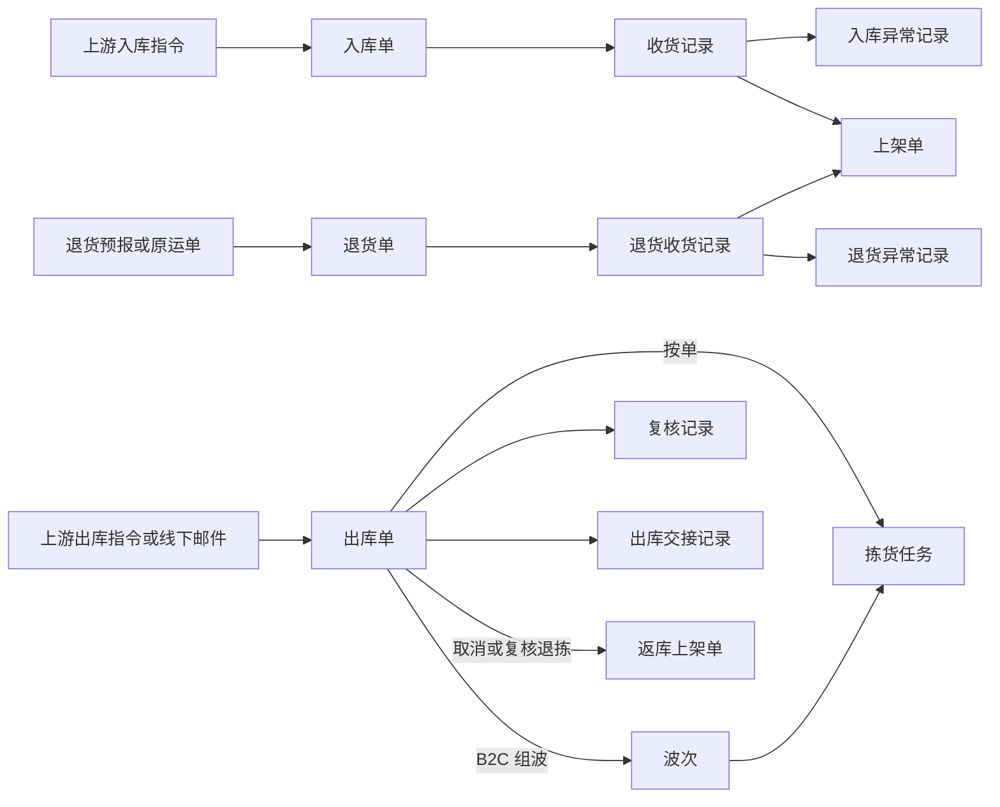

# 单据术语、缩写与生成规则

> 本文统一入库、退货、出库和库存与库内单据的中英文名称、缩写和生成规则。需求、业务设计、应用设计、字段清单、原型界面和单号都按本文取名。单据的对象关系、状态流转和数量规则仍以四份宏观系统架构为准：[入库](04-入库模块宏观系统架构.md)、[出库](05-出库模块宏观系统架构.md)、[退货](06-退货模块宏观系统架构.md)、[库存](07-库存模块宏观系统架构.md)。
>
> 缩写只用于单号前缀、字段和代码；正文仍写中文单据名，不用缩写代替。基础资料（货主、商品、仓库、库区、库位、承运商、物流渠道）的编码不在本文范围。

## 一、术语统一

### 1.1 单据与记录

类别说明对象在业务里的作用：执行单据承载上游需求和整单进度；作业单是现场按它干活的工作单；记录是已发生事实的留痕；系统记录由系统维护，用户只查询。

| 模块 | 中文名 | English | 类别 | 不再使用的叫法 |
| --- | --- | --- | --- | --- |
| 入库 Inbound | 入库单 | Inbound Order | 执行单据 | — |
| 入库 Inbound | 收货记录 | Receipt | 记录 | — |
| 入库 Inbound | 入库异常记录 | Inbound Exception | 记录 | — |
| 入库 Inbound | 上架单 | Putaway Order | 作业单 | 上架任务、Putaway Task |
| 入库 Inbound | 新品维护记录 | New SKU Measurement | 记录 | — |
| 入库 Inbound | 无主货登记 | Unclaimed Goods Registration | 记录 | 无主件认领、Unclaimed Parcels |
| 退货 Returns | 退货单 | Return Order | 执行单据 | 退件单 |
| 退货 Returns | 退货收货记录 | Return Receipt | 记录 | — |
| 退货 Returns | 退货异常记录 | Return Exception | 记录 | — |
| 出库 Outbound | 出库单 | Outbound Order | 执行单据 | 出库包裹、Packages |
| 出库 Outbound | 波次 | Wave | 组织对象 | — |
| 出库 Outbound | 拣货任务 | Pick Task | 作业单 | 拣货记录（已并入实拣明细） |
| 出库 Outbound | 复核记录 | Verification Record | 记录 | 装箱结果、复核打包 |
| 出库 Outbound | 返库上架单 | Put-back Order | 作业单 | 返库上架记录 |
| 出库 Outbound | 出库交接记录 | Handover Record | 记录 | — |
| 库存与库内 Inventory | 盘点单 | Stocktake Order | 执行单据 | Cycle Count |
| 库存与库内 Inventory | 移库作业 | Stock Move | 记录 | 移库单、Transfer |
| 库存与库内 Inventory | SKU 库存 | SKU Inventory | 系统记录 | — |
| 库存与库内 Inventory | 库存明细 | Inventory Balance | 系统记录 | — |
| 库存与库内 Inventory | SN 库存 | Serial Inventory | 系统记录 | — |
| 库存与库内 Inventory | 库存流水 | Inventory Transaction | 系统记录 | Stock Movement |

- 一期不设出库异常记录：库位缺货与短拣记在拣货任务上，退拣原因记在返库上架单上。
- Transfer 只用于调拨（调拨入库、调拨出库）；仓内换位置一律叫移库，英文 Stock Move。
- Cycle Count 指动态循环盘点，一期不做；盘点单统一叫 Stocktake Order。
- 品质转换是库存动作，不设单据，原因与依据记在库存流水上。
- 不设订单预占关系、库存锁定记录和差异新单限制记录：订单占用记在出库单明细的预占数量上，合计到 SKU 库存；拣货分配记在拣货任务上，合计到库存明细的已分配；不良品看品质就知道不可用，发现账实不符就对这个 SKU 发起盘点。

### 1.2 业务类型

出库按出库模块宏观系统架构的三大类、六种业务类型称呼。需求分析、业务设计和字段清单里仍是旧称，改稿时按下表替换。

| 模块 | 大类 | 业务类型 | English | 旧称 |
| --- | --- | --- | --- | --- |
| 入库 | — | 正常入库 | Standard Inbound | — |
| 入库 | — | 调拨入库 | Transfer Inbound | — |
| 退货 | — | 派送失败退回 | Failed Delivery Return | — |
| 退货 | — | 客户退货 | Customer Return | — |
| 退货 | — | 平台仓退件 | Platform Return | — |
| 出库 | B2C 出库 | B2C 出库 | B2C Outbound | B2C 包裹履约 |
| 出库 | FBA 转运出库 | FBA 转运出库 | FBA Transfer Outbound | 平台仓转运 |
| 出库 | B2B 出库 | 批发出库 | Wholesale Outbound | 当地 B2B 批发 |
| 出库 | B2B 出库 | 调拨出库 | Transfer Outbound | — |
| 出库 | B2B 出库 | 采购退货出库 | Return-to-Vendor Outbound | 退回出库 |
| 出库 | B2B 出库 | 其他出库 | Other Outbound | 不良品其他出库 |

### 1.3 常用术语

| 中文 | English | 说明 |
| --- | --- | --- |
| 库区 | Zone | |
| 库位 | Location | 旧称「货位」，指同一对象；新写文档统一用「库位」 |
| 收货暂存库位 | Receiving Staging Location | 收货确认后库存先进这里 |
| 出库暂存库位 | Outbound Staging Location | 拣货任务提交后库存移到这里 |
| 存储库位 | Storage Location | |
| 拣货库位 | Pick Location | |
| 不良隔离库位 | Quarantine Location | 不良品上架、退拣的去处 |
| 作业容器 | Container | 箱、托、包裹的统称，只作记录，不形成库存 |
| 实际库存 | On-hand Qty | ＝预占＋可用 |
| 预占 | Reserved Qty | ＝订单占用（Order Reservation）＋不良品；订单占用记在出库单明细上 |
| 可用 | Available Qty | ＝正常品实际－订单占用，按 SKU 库存算，接单按它预占；暂存库位上的正常品也算，只是暂时分配不到；盘亏或品质转换后可能为负，表示订单占着的好货不够 |
| 已分配 | Allocated Qty | 库存明细上被拣货任务分到、还没拣走的数量，加上其他出库指定的数量；不能再分配、移库或做品质转换 |
| 可分配 | Allocatable Qty | ＝库存明细的实际－已分配；普通出库只从存储、拣货库位上正常品的可分配里分配。旧称「可出库库存」不再使用：接单看可用，分配看可分配 |
| 良品／不良品 | Good / Defective | 库存品质只有这两种；临期不是第三种品质 |
| 实收／拒收 | Received Qty / Rejected Qty | |
| 缺货 | Shortage Qty | 需求－预占 |
| 短拣 | Short Pick | 换位也分配不到、拣货任务提交时记下的数量 |
| 实发／未发 | Shipped Qty / Unshipped Qty | |
| 收货完结 | Receiving Close | |
| 上架 | Putaway | |
| 拣货 | Pick | |
| 复核 | Verify | |
| 换位 | Location Swap | 库位缺货时系统改到其他库位分配 |
| 退拣 | Unpick | 已拣实物从本单退出，生成返库上架单 |
| 补拣 | Re-pick | |
| 重新分配 | Reallocate | 补货后人工为缺口补预占，已开始拣货的生成补拣任务 |
| 确认出库 | Ship Confirm | 扣库和出库完成的节点 |
| 缺量结案 | Short Close | FBA 转运出库、批发出库库存不足时一次结案 |
| 品质转换 | Quality Conversion | 正常品转不良品 |

### 1.4 状态名称

同一个中文状态在不同单据上英文相同；记录类对象没有状态。

| 单据 | 状态（中文 English） |
| --- | --- |
| 入库单、退货单 | 待收货 Pending Receipt · 收货中 Receiving · 上架中 Putting Away · 已完成 Completed · 已取消 Cancelled |
| 上架单、返库上架单 | 待上架 Pending Putaway · 上架中 Putting Away · 已完成 Completed |
| 出库单 | 待拣货 Pending Pick · 拣货中 Picking · 待出库 Pending Shipment · 已出库 Shipped · 已取消 Cancelled |
| 拣货任务 | 待拣货 Pending Pick · 拣货中 Picking · 已完成 Completed · 已关闭 Closed |
| 波次 | 拣货中 Picking · 已完成 Completed |
| 盘点单 | 盘点中 Counting · 已完成 Completed · 已取消 Cancelled |
| 无主货登记 | 暂存中 On Hold |

## 二、单据缩写

- 缩写由英文名缩成两位大写字母，优先用仓储行业的常见写法（如 IB、OB 表示入库、出库，PA 表示上架，PK 表示拣货），系统内不重复，确定后不改。WMS 有英文界面，海外仓现场也要看单号，所以按英文取，不沿用 ERP 草稿的拼音首字母规则。
- 不用 PO、SO、ASN 等上游常用缩写，避免和上游单号混淆。
- 缩写用作单号前缀，PDA 扫码时按它识别单据类型；字段和代码命名也用同一缩写。
- 系统记录（SKU 库存、库存明细、SN 库存、库存流水）不设缩写。
- 新增单据类型时按本规则拟定缩写，确认后补入下表。

| 缩写 | 取自 | 单据 | 单号示例 |
| --- | --- | --- | --- |
| IB | Inbound Order | 入库单 | IB-20261013-0001 |
| RC | Receipt | 收货记录 | RC-20261013-0001 |
| EX | Inbound Exception | 入库异常记录 | EX-20261013-0001 |
| PA | Putaway Order | 上架单 | PA-20261013-0001 |
| NS | New SKU Measurement | 新品维护记录 | NS-20261013-0001 |
| UG | Unclaimed Goods Registration | 无主货登记 | UG-20261013-0001 |
| RT | Return Order | 退货单 | RT-20261013-0001 |
| RR | Return Receipt | 退货收货记录 | RR-20261013-0001 |
| RX | Return Exception | 退货异常记录 | RX-20261013-0001 |
| OB | Outbound Order | 出库单 | OB-20261013-0001 |
| WV | Wave | 波次 | WV-20261013-0001 |
| PK | Pick Task | 拣货任务 | PK-20261013-0001 |
| VR | Verification Record | 复核记录 | VR-20261013-0001 |
| PB | Put-back Order | 返库上架单 | PB-20261013-0001 |
| HO | Handover Record | 出库交接记录 | HO-20261013-0001 |
| ST | Stocktake Order | 盘点单 | ST-20261013-0001 |
| MV | Stock Move | 移库作业 | MV-20261013-0001 |

入库 Demo 阶段用的前缀里，入库单的 RK 改为 IB；收货记录 RC、上架单 PA、入库异常记录 EX 沿用。

## 三、生成规则

### 3.1 什么时候生成

| 单据 | 什么时候生成 | 一次生成多少 | 生成时状态 |
| --- | --- | --- | --- |
| 入库单 | OMS Mock 下发正常或调拨入库指令，资料准入通过 | 1 条有效指令 1 张；同一指令重发不新建，准入失败不建单 | 待收货 |
| 收货记录 | 每次收货确认 | 每次 1 条；只有拒收没有实收也生成 | — |
| 入库异常记录 | 收货确认时，收货明细行有拒收即自动生成 | 每个有拒收的明细行 1 条；不能手工新建 | — |
| 上架单 | 入库或退货收货确认后自动生成 | 按「作业容器×品质」拆，每个容器每种品质 1 张，数量为 0 不生成；没绑容器的，同一收货记录同一品质合并为 1 张 | 待上架 |
| 新品维护记录 | 货主商品第一次到仓、还没有仓内规格，首次收货前完成量方时 | 同一货主同一商品只有 1 条，四仓共用 | — |
| 无主货登记 | 到货对不上任何入库单、也认不出货主时，仓库人工登记 | 每批到件 1 条 | 暂存中 |
| 退货单 | 客户退货、平台仓退件：OMS Mock 下发退货预报；派送失败退回：现场扫原运单在 WMS 建单 | 1 条预报或 1 个原运单 1 张；预报重发不新建，同一原运单已有未完结退货单时不再建 | 待收货 |
| 退货收货记录 | 每次退货收货确认 | 每次 1 条 | — |
| 退货异常记录 | 退货收货确认时，明细行有拒收即自动生成 | 每个有拒收的明细行 1 条 | — |
| 出库单 | 五类普通出库：OMS Mock 下发指令，准入通过并完成预占；其他出库：OMS Mock 下发，或凭线下邮件在管理端手工创建 | 1 条有效指令 1 张；重发不新建，准入失败不建单 | 待拣货 |
| 波次 | 仓库组织者从同仓同货主、待拣货的 B2C 出库单中手工组波 | 每次组波 1 个，同时生成 1 张波次拣货任务 | 拣货中 |
| 拣货任务 | 仓库组织者生成拣货任务；补货后重新分配时为待拣数量生成补拣任务 | 按单拣货 1 单 1 张，波次 1 波 1 张，补拣另生成 1 张 | 待拣货 |
| 复核记录 | 每次复核提交（随分拣或打包装箱） | 随分拣按单 1 条；随打包装箱每个包裹或箱、托 1 条；确认出库前可删除重做 | — |
| 返库上架单 | 每次退拣自动生成：受理取消时自动退拣，复核发现残损或少件时人工退拣 | 每次退拣 1 张，指回原出库单 | 待上架 |
| 出库交接记录 | 确认出库时登记，或确认后补登 | 每次登记 1 条；补登不再扣库 | — |
| 盘点单 | 管理端按计划选仓库和 SKU 创建，或发现账实不符的人在 PDA 上对这个 SKU 发起；这些 SKU 有进行中的上架单、返库上架单或拣货任务时不能建 | 每次 1 张，创建即生成账面快照 | 盘点中 |
| 移库作业 | PDA 扫描提交，提交即完成 | 每次提交 1 条 | — |

### 3.2 单号怎么编

- **格式**：`{缩写}-{YYYYMMDD}-{序号}`，例如 `OB-20261013-0001`，表示 2026 年 10 月 13 日（UTC）生成的第 1 张出库单。
- **日期**：取生成时刻的 UTC 日期。业务时间统一按 UTC 保存，四仓时区不同，共用一条日界线才能保证序号不重。单号只作标识；单据的创建时间仍按页面所选时区展示，所以美西下午生成的单号可能带次日日期。
- **序号**：同一缩写、同一天内从 0001 起递增，四仓共用一个序列，单号全系统唯一；同一天超过 9999 张时自动扩为 5 位。
- **分配**：单据生成时由系统分配，WMS 单据没有草稿态；用户不能填写或修改。
- **不重用**：取消、关闭后单号保留，不再分给别的单据。
- **关联**：单据之间用来源单号字段关联（如上架单上的入库单号、收货记录号），不把来源单号拼进本单号；明细用「单号＋行号」定位。
- **重复提交**：上游消息重复或现场重复提交，返回原单号，不生成新单。

### 3.3 不按本规则编号的标识

- 上游单号（入库、出库指令号和退货预报号）：由上游给出，按「来源＋业务类型＋上游单号」识别，原样存在单据的上游单号字段里。
- 外部和现场标识：运单号、平台移除单号、柜号、箱唛号、作业容器号，原样保存，不改写。
- 系统记录：SKU 库存、库存明细、SN 库存、库存流水用系统内部编号，不设业务前缀。
- 主数据编码：按基础资料规则。

## 四、现有文档与原型的对齐

- 入库 Demo 单号 `RK-` 改为 `IB-`，`RC-`、`PA-`、`EX-` 不变；涉及原型的单号生成和种子数据，以及入库单主 PRD 第 Q04 条。
- 原型菜单旧叫法按 1.1、1.3 节替换：上架任务、无主件认领、移库单、出库包裹、退件单、货位管理；英文 Putaway Tasks、Unclaimed Parcels、Transfers、Cycle Counts、Stock Movements、Packages。
- 需求、业务设计和字段清单里的出库业务类型旧称和「货位」，改稿时按本文替换，不要求一次改完。
- 字段清单把多数单号写成「本仓唯一」，按本文执行全系统唯一。
