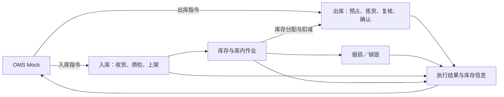

# 强盛WMS需求分析总览

## 一、一期目标与范围

一期交付可操作的课程演示系统，覆盖香港、美西、美东、德国四仓；四仓共用功能框架，并分别跑通收存发主链。自营与模拟外部货主使用共同能力，商品可按配置启用质检、批次、效期和SN。

管理端与PDA共用业务记录，上游由OMS Mock模拟，打印机、电子秤及承运商使用模拟或手工数据。分批开发服务于完整一期目标，完成页面不等于完成业务。

一期不包含真实OMS客户端、客户退货接收与重新入库、换标换包装、商业计费结算、深圳仓、人员派工及大促产能方案。集团库存协同、正式财务核算和仓外运输配送分别由业务ERP、财务ERP和物流系统承担。完整边界见[项目定位与范围](../../01-全局背景信息/02-项目定位与范围.md)。

## 二、核心业务链路

OMS Mock推送资料与指令，仓库完成入库形成库存，再按出库指令预占、拣货、复核和确认出库；WMS将执行结果及库存信息交回上游。

仓库还可在管理端认领无主件，或按线下邮件手工创建不良品其他出库。调拨调入归入库、调出归出库，WMS分别执行两端指令，不维护跨仓调拨主单、关联、在途账或差异对账。

## 三、功能概览

一期按 **MD、IN、INV、OUT、INT、COM** 六模块维护需求；主链为资料与指令输入 → 入库形成库存 → 出库预占拣发 → 结果回传，库内移库／盘点／处置与公共能力横切各域。各模块 FR 与规则正文见 [README 模块表](../README.md#模块文档)，不在总览重复罗列。

## 四、共同约束

- **归属与权限：**资料、库存和单据按仓库与货主分别记录；用户权限按仓库分配，在授权仓库可查看全部货主数据，动作另按角色授权。
- **库存与追溯：**实收进度与在库数量分开；批次、效期和SN按商品配置启用，箱托仅作为作业容器。预占、扣减、释放及冻结统一引用库存模块规则。
- **输入与执行：**常规上游指令由OMS Mock提供，WMS维护自有资料；管理端与PDA使用同一记录，重复消息或提交不能重复影响库存。
- **语言与时间：**支持中文、英文；业务时间以UTC+0存储，展示及导出可切换时区，履约与效期按所属仓库当地时区判断。

各模块维护具体适用条件和异常分支。上游输入由INT负责，库存口径由INV负责，权限与时间由COM负责。

## 五、应用设计与验证输入

免检残损由授权仓库人员登记并判定品质，不生成质检任务；已接收缺货单库存补齐后由仓库人工重试预占与分配。两项已于2026-10-08由用户确认，正式规则分别见[IN-FR-004](../02-入库业务/入库业务需求分析.md#in-fr-004-质检)与[OUT-FR-009](../03-出库业务/出库业务需求分析.md#out-fr-009-缺货处理)。

字段、状态、页面及接口继续由应用设计落实；所需样例见[调研总览的资料缺口](01-需求调研总览.md#四待补资料)。关键验证场景见[业务场景设计](../../04-业务分析和设计/06-海外仓典型业务场景与方案.md#84-关键走查场景)。

## 六、未决规则、走查与开放输入

### 6.1 业务规则未决

当前没有单独登记的「待确认业务规则」；新产生的未决项在本节补充，并同步[业务蓝图第八节](../../04-业务分析和设计/00-业务蓝图.md#八规则确认与后续输入)。

### 6.2 走查状态（规则已确认）

| 项 | 规则依据 | 演示/PDA验收 | 文档逻辑走查 |
| --- | --- | --- | --- |
| 免检残损登记与分品质上架 | IN-FR-004；[02§8.5](../../04-业务分析和设计/02-入库业务设计.md#85-模拟补充分支免检残损不生成质检任务) | 待执行 | **通过**（见§6.4） |
| 已接收缺货单人工重试预占 | OUT-FR-009；[03§9.6](../../04-业务分析和设计/03-出库业务设计.md#96-模拟补充分支已接收缺货单补货后人工恢复) | 待执行 | **通过**（见§6.4） |

其余 [06§8.4](../../04-业务分析和设计/06-海外仓典型业务场景与方案.md#84-关键走查场景) 场景尚未登记走查结果。

### 6.3 仅应用设计或样例缺口（不算业务规则未决）

| 项 | 承接位置 |
| --- | --- |
| 质检项目、原因明细与表单 | 各域分析稿第四节；商品样例见调研总览待补资料 |
| 字段、状态、页面、权限矩阵 | [系统架构设计](../../05-应用设计方案/20261002-MVP版本/系统架构设计/00-系统与模块地图.md) |
| 消息标识、版本与 Mock 细节 | [06-接口与OMS Mock消息设计](../../05-应用设计方案/20261002-MVP版本/系统架构设计/06-接口与OMS Mock消息设计.md) |
| 各渠道真实时效 | 一期仍按 [COM-FR-002](../07-公共能力/公共能力需求分析.md#com-fr-002-语言存储时间与业务时区) 统一 48 小时参数，渠道差异后续评估 |

### 6.4 文档逻辑走查记录（2026-10-08）

在**未连接演示系统**前提下，按需求→业务设计→应用设计权限链核对两条已确认规则；结论为规则自洽、可追溯，**不能替代**管理端/PDA 实操验收。

| 场景（06§8.4） | 核对路径 | 核对要点 | 结果 |
| --- | --- | --- | --- |
| 免检残损 | IN 分析稿示例 → [02§8.5](../../04-业务分析和设计/02-入库业务设计.md#85-模拟补充分支免检残损不生成质检任务) → [05§四免检残损登记](../../05-应用设计方案/20261002-MVP版本/系统架构设计/05-全局机制与权限配置.md#四权限点与默认角色矩阵) | 不生成质检任务；实收 10 件分正常 8、不良 2 上架；可用 8、品质锁 2 | 通过 |
| 已接收缺货单人工恢复 | OUT 分析稿示例 → [03§9.6](../../04-业务分析和设计/03-出库业务设计.md#96-模拟补充分支已接收缺货单补货后人工恢复) → 05§四缺货单人工重试 | 补货不自动恢复；人工重试后满足 5/5/0；取消、结案、盘点阻断下不恢复 | 通过 |

走查方式：文档逻辑走查（需求→业务设计→权限一致）。环境：课程沙盘资料链。演示验收待补：单据号、前后库存、操作留痕。
