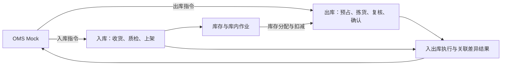

# 强盛WMS需求分析总览

本目录整理强盛 WMS 一期的业务问题、功能需求与取舍。项目为课程沙盘，尚未开展真实企业访谈或生产验证。

**阅读顺序：**先读本文了解范围、业务链路与模块入口；需要需求缘由时读[需求调研总览](01-需求调研总览.md)与[竞品参考与需求取舍](03-竞品参考与需求取舍.md)。写作与编号约定见 [AGENTS.md](../AGENTS.md) 与[项目根 AGENTS.md](../../AGENTS.md)。具体规则在负责模块维护；资料缺口留在各模块调研稿；未决规则、走查待执行与仅设计缺口见本文第六节。

### 按问题查阅

| 目的 | 入口 |
| --- | --- |
| 了解业务全景、角色与交接 | [业务蓝图](../../04-业务分析和设计/00-业务蓝图.md)及对应业务域 |
| 查功能编号、准入和业务规则 | 本文第三节模块表 → 各模块需求分析 |
| 查系统流程、对象和状态 | [MVP 应用设计入口](../../05-应用设计方案/20261002-MVP版本/系统架构设计/README.md) |
| 核对数量案例和验收覆盖 | [关键走查场景](../../04-业务分析和设计/06-海外仓典型业务场景与方案.md#84-关键走查场景)及各域案例索引 |

主链按基础资料 → 入库 → 库存 → 出库阅读；目录保留原编号，因此库存目录 04 在出库目录 03 之后。

## 一、一期目标与范围

一期交付可操作的课程演示系统，覆盖香港、美西、美东、德国四仓；四仓共用功能框架，并分别跑通收存发主链。自营与模拟外部货主使用共同能力，商品可按配置启用质检、批次、效期和SN。

管理端与PDA共用业务记录，上游由OMS Mock模拟，打印机、电子秤及承运商使用模拟或手工数据。分批开发服务于完整一期目标，完成页面不等于完成业务。

一期不包含报损／销毁及报损后非库存暂存跟踪、真实OMS客户端、客户退货接收与重新入库、换标换包装、商业计费结算、深圳仓、人员派工及大促产能方案。集团库存协同、正式财务核算和仓外运输配送分别由业务ERP、财务ERP和物流系统承担。完整边界见[项目定位与范围](../../01-全局背景信息/01-项目定位与范围.md)。

## 二、核心业务链路

OMS Mock推送资料与指令，仓库完成入库形成库存，再按出库指令预占、拣货、复核和确认出库；WMS将已有入出库执行结果及关联差异处理结果交回上游。盘点、品质转换等独立库存变化回传留待后续。

仓库还可登记无主货信息，或按线下邮件手工创建不良品其他出库。无主货认领待OMS上线，由客户在OMS发起或确认，再向WMS下发入库指令。调拨调入归入库、调出归出库，WMS分别执行两端指令，不维护跨仓调拨主单、关联、在途账或差异对账。

## 三、功能概览与模块文档

一期按 **MD、IN、INV、OUT、INT、COM** 六模块维护需求；主链为资料与指令输入 → 入库形成库存 → 出库预占拣发 → 结果回传，库内移库／盘点与公共能力横切各域。各模块 FR 只在对应分析稿第二节总表及分条标题维护，总览不重复罗列。

| 模块 | 调研 | 分析 |
| --- | --- | --- |
| 基础资料（MD） | [业务背景与诉求](../01-基础资料/基础资料需求调研.md) | [功能与规则](../01-基础资料/基础资料需求分析.md) |
| 入库业务（IN） | [业务背景与诉求](../02-入库业务/入库业务需求调研.md) | [功能与规则](../02-入库业务/入库业务需求分析.md) |
| 库存与库内业务（INV） | [业务背景与诉求](../04-库存与库内业务/库存与库内业务需求调研.md) | [功能与规则](../04-库存与库内业务/库存与库内业务需求分析.md) |
| 出库业务（OUT） | [业务背景与诉求](../03-出库业务/出库业务需求调研.md) | [功能与规则](../03-出库业务/出库业务需求分析.md) |
| 系统集成与对接（INT） | [业务背景与诉求](../06-系统集成与对接/系统集成与对接需求调研.md) | [功能与规则](../06-系统集成与对接/系统集成与对接需求分析.md) |
| 公共能力（COM） | [调研：仓库授权、语言时间、留痕与双端](../07-公共能力/公共能力需求调研.md) | [分析：RBAC、三层时间与操作留痕](../07-公共能力/公共能力需求分析.md) |

**基础资料（MD）一期对象：**下列七类主数据，规则见[基础资料需求分析](../01-基础资料/基础资料需求分析.md)；字段初稿见[字段清单合集／01-基础资料](../../05-应用设计方案/20261002-MVP版本/字段清单合集/01-基础资料/)。物流资料分承运商与物流渠道两层维护，出库单引用渠道。

| 对象 | 主要维护方 | 简要用途 |
| --- | --- | --- |
| 货主 | OMS Mock 推送；自营预置 | 单据与库存归属、指令匹配 |
| 商品 | OMS Mock 推送；WMS 补充仓内属性 | 收货、质检、追溯与出库配置 |
| 仓库 | 系统预置四仓 | 按仓作业、业务时区与默认收货方式 |
| 库区 | 管理端 | 位置分区与库区类型 |
| 货位 | 管理端 | 上架、拣货、移库与盘点落点 |
| 承运商 | 管理端 | 渠道归属、交接展示 |
| 物流渠道 | 管理端 | 出库引用、模拟交接与默认交接方式 |

调拨调入归 IN、调出归 OUT，未设独立模块；目录 06、07 编号保留。范围以[项目定位与范围](../../01-全局背景信息/01-项目定位与范围.md)和[阶段规划与一期交付标准](../../01-全局背景信息/03-阶段规划与一期交付标准.md)为依据；业务设计展开执行与结果，应用设计落实字段、状态、页面和接口。

## 四、共同约束

- **归属与权限：**资料、库存和单据按仓库与货主分别记录；用户权限按仓库分配，在授权仓库可查看全部货主数据，动作另按角色授权。
- **库存与追溯：**实收进度与在库数量分开；批次、效期和SN按商品配置启用，箱托仅作为作业容器。预占、扣减、释放及冻结统一引用库存模块规则。
- **输入与执行：**常规上游指令由OMS Mock提供，WMS维护自有资料；管理端与PDA使用同一记录，重复消息或提交不能重复影响库存。
- **语言与时间：**支持中文、英文；业务时间以UTC+0存储，展示及导出可切换时区，履约与效期按所属仓库当地时区判断。

各模块维护具体适用条件和异常分支。上游输入由INT负责，库存口径由INV负责，权限与时间由COM负责。

## 五、应用设计与验证输入

免检残损由授权仓库人员登记并判定品质，不生成质检任务；已接收缺货单库存补齐后由仓库人工重试预占与分配。正式规则分别见[IN-FR-004](../02-入库业务/入库业务需求分析.md#in-fr-004-质检)与[OUT-FR-009](../03-出库业务/出库业务需求分析.md#out-fr-009-缺货处理)。

对象、状态、权限和消息已有应用设计草案，字段清单与页面交互待补；所需样例见[调研总览的资料缺口](01-需求调研总览.md#四待补资料)。关键验证场景见[业务场景设计](../../04-业务分析和设计/06-海外仓典型业务场景与方案.md#84-关键走查场景)。

## 六、未决规则、走查与开放输入

### 6.1 当前确认规则

无主货一期只登记、暂存，不生成入库单。OMS上线后，WMS将信息推送给所有OMS客户查看；客户在OMS认领，再由OMS下发入库指令。

零实收且确定不再接收时，WMS保留待收货及到货／拒收记录，仓库线下通知上游。取消须由OMS发起，功能待OMS上线；一期不提供WMS取消或OMS Mock取消结案。

平台仓转运与B2B零实发不得结案，继续等待或合法取消。规则分别见IN-FR-007／008／011／012、OUT-FR-006。后续阶段及资料输入见[业务蓝图第八节](../../04-业务分析和设计/00-业务蓝图.md#八规则确认与后续输入)。

2026-10-11确认：疑似短少按仓库＋货主＋SKU限制新出库接单，主管确认校准后解除；已拣丢失以实际返库及关联盘亏分别收口取消；盘点准备收尾当前已开始任务，不等待整张分批入库单；停用承运商下属渠道不得用于新业务。规则已同步对应需求分析，业务展开见库存第5.3、7.2节、出库第7.5节及基础资料第7.4节，演示验证待执行。

### 6.2 走查状态（规则已确认）

| 项 | 规则依据 | 演示/PDA验收 | 文档逻辑走查 |
| --- | --- | --- | --- |
| 免检残损登记与分品质上架 | IN-FR-004；[02§8.5](../../04-业务分析和设计/02-入库业务设计.md#85-模拟补充分支免检残损不生成质检任务) | 待执行 | **通过**（见§6.4） |
| 已接收缺货单人工重试预占 | OUT-FR-009；[03§9.6](../../04-业务分析和设计/03-出库业务设计.md#96-模拟补充分支已接收缺货单补货后人工恢复) | 待执行 | **通过**（见§6.4） |

零实收、零实发与取消分段释放的文档核对见第6.4节；[关键走查场景](../../04-业务分析和设计/06-海外仓典型业务场景与方案.md#84-关键走查场景)的管理端／PDA演示验收均待执行。

### 6.3 仅应用设计或样例缺口（不算业务规则未决）

| 项 | 承接位置 |
| --- | --- |
| 质检项目、原因明细与表单 | 各域分析稿第五节；商品样例见调研总览待补资料 |
| 字段清单与页面交互 | [MVP应用设计入口](../../05-应用设计方案/20261002-MVP版本/系统架构设计/README.md)：架构草案已形成，WMS字段与页面需求的对齐待完成 |
| 完整Mock表单与输入／结果样例 | 消息标识、版本、顺序和内置收发台已在[06-接口与OMS Mock消息设计](../../05-应用设计方案/20261002-MVP版本/系统架构设计/06-接口与OMS Mock消息设计.md)定义；已有消息信封、部分字段映射和正常输入样例，其他类型、异常案例及联调验证待补 |
| 各渠道真实时效 | 一期仍按 [COM-FR-002](../07-公共能力/公共能力需求分析.md#com-fr-002-语言存储时间与业务时区) 统一 48 小时参数，渠道差异后续评估 |

### 6.4 文档逻辑走查记录（2026-10-08）

本轮核对需求、业务设计与应用设计中的规则、数量示例、状态和权限；未连接演示系统。下表记录主要结论，管理端／PDA实操仍待执行。

| 场景（06§8.4） | 核对路径 | 核对要点 | 结果 |
| --- | --- | --- | --- |
| 免检残损 | IN 分析稿示例 → [02§8.5](../../04-业务分析和设计/02-入库业务设计.md#85-模拟补充分支免检残损不生成质检任务) → [05§四免检残损登记](../../05-应用设计方案/20261002-MVP版本/系统架构设计/05-全局机制与权限配置.md#四权限点与默认角色矩阵) | 不生成质检任务；实收 10 件分正常 8、不良 2 上架；可用 8、品质锁 2 | 通过 |
| 已接收缺货单人工恢复 | OUT 分析稿示例 → [03§9.6](../../04-业务分析和设计/03-出库业务设计.md#96-模拟补充分支已接收缺货单补货后人工恢复) → 05§四缺货单人工重试 | 补货不自动恢复；人工重试后实际5、预占5、可用0，本单缺货0；取消、结案、盘点阻断下不恢复 | 通过 |
| 无主货登记与后续认领 | IN-FR-011／012 → 入库设计第3.5、8.2节 → 应用流程第3节、权限第四节 | 一期只有登记，不生成入库单、实收或库存，无WMS认领权限；认领与指令由后续OMS承接 | 文档通过；OMS链路后续验证 |
| 零实收等待上游取消 | IN-FR-007／008 → 入库设计第3.2、8.3节 → 应用状态第二节 | 一期保持待收货，保留到货／拒收并线下通知；无WMS取消或零实收完成入口 | 文档通过；OMS取消后续验证 |
| 零实发不结案 | OUT-FR-006／008 → 出库设计第9.1节 → 应用状态第三节 | 平台仓转运／B2B须实发大于0；零实发等待或合法取消，不生成确认出库扣库 | 通过 |
| 取消分段释放 | OUT-FR-008 → 出库设计第9.2节 → 应用状态第三节与消息第六篇 | 未拣2立即释放、已拣3返库上架后释放；其他订单占3保留，取消不改变实际8 | 通过 |

库存三量示例满足实际＝锁定合计＋可用；本地文件链接与章节锚点检查通过。演示验收还需记录单据号、前后库存、流水与操作留痕。
