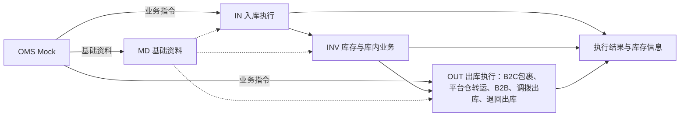

# 强盛WMS需求分析总览

> 状态：项目级分析总览。六组模块已有BR／FR／AC初稿；本轮业务规则已经收口，当前没有待业务确认的功能分叉，仍需补沙盘样例和真实作业证据。本文不表示验收已执行。

## 一、项目级分析结论

强盛WMS服务强盛自有仓网，为自营和外部货主管理仓内实物作业与库存。一期在可运行、可操作、可学习的演示系统中覆盖香港、美西、美东、德国四仓，四仓使用相同功能框架并分别跑通入库、库存、出库主链。系统兼容轻小件、大件、异形货及需要批次效期管理的商品，完成按商品配置的质检、正常品／不良品库存、库存与库内作业，以及B2C包裹履约、平台仓转运、B2B批发、调拨出库和异常货物退回出库。调拨入库按入库业务处理，不建立跨仓调拨主单。外部货主作为多货主数据隔离的演示对象，不提供货主自助端；一个货位只能存放一个货主的实物。生产目标链路为ERP或货主业务进入OMS，再由OMS向WMS推送资料和单据；一期由OMS Mock模拟。管理端和PDA共用同一业务记录；一期支持中文／英文和展示时区切换，底层时间以UTC+0存储，业务判断按仓库当地时区；所有出库类型以仓库“确认出库”为扣库节点。一期支持B2C基础波次，不建设人员派工和大促产能方案。

以上依据[项目定位与范围](../../01-全局背景信息/02-项目定位与范围.md)“一期范围”和[阶段规划与交付边界](../../01-全局背景信息/05-阶段规划与交付边界.md)“一期交付方式”。[竞品与业务场景分析](强盛WMS竞品与业务场景分析.md)说明沙盘场景和取舍；[竞品原始手册取舍与证据清单](竞品原始手册取舍与证据清单.md)记录核读范围及逐项依据。OMS客户端在二期建设；客户退货入库与增值服务、深圳仓及商业计费不进入一期。集团全局库存协同归业务ERP，正式财务核算归财务ERP，仓外运输与配送归物流系统。

## 二、模块职责与核心链路

| 模块／前缀 | 需求职责 | 双文档索引名称 | 当前阶段 |
| --- | --- | --- | --- |
| 基础资料 MD | 货主、商品、仓库及库区货位等前置资料的需求；资料变化对下游的影响见 MD-FR-006、MD-FR-007 | [基础资料需求调研](../01-基础资料/基础资料需求调研.md)／[基础资料需求分析](../01-基础资料/基础资料需求分析.md) | 初稿已建立，见 MD-BR/FR/AC |
| 入库业务 IN | 正常入库与调拨入库从接收需求到收货、质检、上架的仓库执行要求 | [入库业务需求调研](../02-入库业务/入库业务需求调研.md)／[入库业务需求分析](../02-入库业务/入库业务需求分析.md) | 初稿已建立；已收退回与超收处置规则已确认 |
| 出库业务 OUT | 研究B2C包裹履约、平台仓转运、B2B批发、调拨出库、退回出库，以及B2C基础波次的执行要求 | [出库业务需求调研](../03-出库业务/出库业务需求调研.md)／[出库业务需求分析](../03-出库业务/出库业务需求分析.md) | 初稿已建立；B2C可选波次，B2B按单摘果拣货 |
| 库存与库内业务 INV | 实物库存记录、查询及仓内业务需求；库存影响的共同定义由本模块维护，执行模块引用 | [库存与库内业务需求调研](../04-库存与库内业务/库存与库内业务需求调研.md)／[库存与库内业务需求分析](../04-库存与库内业务/库存与库内业务需求分析.md) | 初稿已建立；盘点锁定规则已确认 |
| 系统集成与对接 INT | OMS Mock基础资料与完整表单指令、重复处理、变更／取消、结果交接及外部服务模拟边界 | [系统集成与对接需求调研](../06-系统集成与对接/系统集成与对接需求调研.md)／[系统集成与对接需求分析](../06-系统集成与对接/系统集成与对接需求分析.md) | 初稿已建立，见INT-FR／AC |
| 公共能力 COM | 仓库权限、货主归属、RBAC、中英文、时间口径和关键操作留痕 | [公共能力需求调研](../07-公共能力/公共能力需求调研.md)／[公共能力需求分析](../07-公共能力/公共能力需求分析.md) | 初稿已建立；动作权限规则已确认 |

上表为文档职责划分。六组双文档均有初稿。管理端与PDA作业端是同一业务的两个使用端，不各自维护单据和库存。

图表示需求研究的主链与依赖，不规定具体页面和接口协议。调拨不是独立模块：调出按OUT处理，调入按IN处理，WMS不维护两端衔接。OMS Mock输入与执行结果回传属INT的职责范围，公共能力COM作为跨模块机制不单独成节点。

## 三、一期范围与共同原则

一期包含四仓、多货主、多品类及上述入库、库存、出库和调拨执行能力，以及支撑演示的基础资料、OMS Mock和承运商Mock协作。公共能力按主链需要分析，不能因设立目录就默认审批、导入或全部权限功能均已纳入。

一期明确不包含OMS客户端、客户退货接收与退货质检、换标换包装及客户退货重新入库、商业计费与结算、深圳仓。排除客户退货入库不等于排除正常入库，也不排除已收货物按新指令退回仓外。WMS不承担渠道经营、ERP层面的全局库存协同、仓外运输管理或法定财务核算。

以下PRJ编号为项目级原则索引，不代替模块BR、FR、AC。适用条件、实现行为和例外在对应模块形成后引用回来。

| 编号 | 共同原则 | 依据与承接模块 |
| --- | --- | --- |
| PRJ-01 | 一期共同覆盖四仓，四仓使用相同功能框架并分别跑通入库、库存、出库主链；不采用先单仓试点再扩仓的阶段方案 | SRC-02“一期范围”、SRC-05“一期交付方式”；MD、INV及各执行模块 |
| PRJ-02 | 自营作为普通货主使用共同能力；数据按货主记录归属，但一期用户权限按仓库分配，有仓库权限即可查看该仓全部货主数据 | SRC-02“一期范围”；MD、COM |
| PRJ-03 | 包裹履约、平台仓转运、B2B、调拨出库和异常货物退回出库均需获得需求覆盖；调拨入库按入库业务处理，不建立跨仓调拨主单 | SRC-02“一期范围”；OUT、IN |
| PRJ-04 | 生产目标链路为ERP或货主业务进入OMS，再由OMS向WMS推送基础资料与业务单据；一期由OMS Mock按完整表单模拟，暂不提供WMS自行导入上游业务指令的能力 | SRC-02“一期范围”、SRC-03“一期演示架构”；MD、INT、IN、OUT |
| PRJ-05 | 一期库存支持批次、效期和SN追溯；箱、托作为作业容器，不启用箱库存，不设托盘库存 | SRC-02“一期范围”；MD、IN、INV、OUT |
| PRJ-06 | 管理端与PDA共用同一业务记录；打印机、电子秤使用模拟或手工数据，承运商通过Mock参与演示 | SRC-02“使用端”；INT、COM及各执行模块 |
| PRJ-07 | 一期B2C包裹可选择基础波次，不跨仓、不跨货主；B2B按单摘果拣货，不进入波次；不建设人员派工和大促产能方案，演示通过不代表峰值性能已验证 | SRC-04“作业量级”、SRC-05“交付边界”；OUT |
| PRJ-08 | 分批交付服务于完整一期目标；演示业务必须可运行，不能把静态页面或已有样板当成一期完成 | SRC-05“一期交付方式”“一期完成的宏观判断”；全部模块 |
| PRJ-09 | 界面支持中文、英文；业务时间以UTC+0存储，页面可切换展示时区；履约时限和效期判断按仓库当地时区计算，不随展示时区切换而改变 | COM-FR-002；全部页面与导出 |

SRC具体文件与性质见[调研总览第一节](强盛WMS需求调研总览.md#一定位范围与事实来源)。PRJ-04不自动规定基础资料或仓内业务能否手工维护；不得扩展解释为WMS内任何对象都不能创建。

## 四、剩余证据缺口

本轮已确认问题均已移出待决策清单，当前没有会阻塞一期需求设计的业务分叉。尚未补齐的沙盘表单、仓库作业样例和真实现状证据见[需求调研总览第四节](强盛WMS需求调研总览.md#四项目级待核实事项)。这些材料用于细化字段、页面和验收数据，不再改变已经确认的一期范围。客户退货属于二期还是三期、深圳仓扩展时点及计费归属仍由[阶段规划](../../01-全局背景信息/05-阶段规划与交付边界.md)维护，不作为一期阻塞项。

## 五、整体验收与阅读顺序

这里列需求体系的完成条件和演示覆盖维度，不是已经执行的测试记录，也不代替模块AC。

| 维度 | 需求体系完成时应满足的条件 |
| --- | --- |
| 来源与分层 | 现状证据、沙盘设定、目标决定和竞品参考可区分，结论能定位到具体来源；没有把Mock当生产证据 |
| 诉求处理 | 每条原始诉求都有采纳、不采纳或后置结论及理由 |
| 需求追溯 | 每条已采纳的系统类BR关联FR，每条FR关联可判定的AC，跨模块编号和依赖一致 |
| 业务覆盖 | 四仓分别跑通入库、库存、出库主链；多货主、轻小件／大件／异形货、批次效期商品以及一期各业务类型均有对应模块需求和验收，不要求虚构每个仓库经营全部品类的事实 |
| 业务衔接 | OMS Mock基础资料与业务指令、管理端／PDA仓内执行、库存影响及结果交接可以对应；调拨出入库各自独立执行，不在WMS内做两端衔接 |
| 阶段边界 | 不将二期OMS、客户退货入库或计费设为一期完成前提；一期退回出库不冲销原入库记录 |
| 验收可执行 | 模块AC按“条件与操作→预期结果”书写，列明演示方式及模拟范围，不能只写“正确”“合理” |
| 未决项 | 影响范围、数量、责任或算法的未决项已说明影响和最迟时点；到对应设计阶段前完成确认 |

当前六组模块与项目级场景分析均有初稿；跨模块验收维度尚需在业务设计和演示案例中逐条落实，不能只凭本表宣布一期可验收。尤其要核对待认领、超收异常暂存、已收拒绝取消与退回出库、质检不合格、批次效期、货位换位、盘点锁定、未收与短少、已拣取消回库的数量关系。

阅读顺序：先读全局背景中的项目定位与阶段规划，再读调研总览了解来源和缺口，接着读本分析总览。模块按基础资料、入库、库存与库内、出库展开；调拨入库、调拨出库分别在入库与出库模块阅读。集成与公共能力随主链同步阅读和维护。每个模块先读调研稿，再读分析稿。
