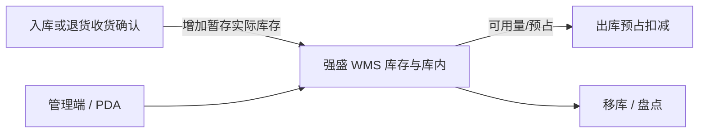

# 库存与库内业务需求调研

> 文档状态：调研初稿（案头整理，课程沙盘）
> 调研范围：四仓实物库存的数量、品质、位置与追溯；查询、占用与流水、移库、盘点及与收发作业的衔接；财务核算与货主账单不在本期
> 系统需求与已确认规则见[库存与库内业务需求分析](库存与库内业务需求分析.md)

| 版本 | 本次变化 | 状态 |
| --- | --- | --- |
| V0.1 | 按项目背景形成场景与诉求初稿 | 已完成 |
| V0.2 | 对齐入库、出库调研结构：范围、现状、证据状态、诉求与待补清单 | 已完成 |
| V0.3 | 走查：合并盘点相关场景、去掉调研层「见分析稿」表述、收紧角色与引言重复 | 已完成 |
| V0.4 | 区分现状与目标场景，补充竞品依据并更新诉求与资料状态 | 已完成 |

## 一、调研范围与资料来源

本次调研要弄清楚：3PL 转自营后，账实与占用如何对齐、移库与盘点如何留痕、效期与 SN 如何追溯，以及一期演示覆盖哪些库内场景。**一期库存能力边界**以[项目定位与范围](../../01-全局背景信息/01-项目定位与范围.md#22-仓内业务与上游协作)库存行为准；下表只列调研环节，不重复项目级「不做什么」全文。

| 环节 | 本次关注内容 | 主要交接 |
| --- | --- | --- |
| 库存查询 | 按仓、货主、SKU、库位、批次、SN 等视角查看；汇总与明细对应 | 业务安排发货、现场找货 |
| 数量与品质口径 | 实际、预占、可用；正常品与不良品；预占＝订单占用＋不良品；分配与预占分开 | 收货确认形成暂存库存，上架提交移库；出库预占与扣减 |
| 在库环节区分 | 已收未上架、已拣未出、已确认待交接等待遇不同 | 与入库、出库模块分界，避免混记 |
| 预占与库位分配 | SKU 级预占与库存明细已分配分开；换位不增占用总量 | 细则在出库分析；本模块维护三量与流水 |
| 流水与调整 | 变化须关联业务与操作者；禁止无依据改数 | 盘点或经确认的业务单据调整 |
| 移库 | 只改位置，不改归属、品质与三量总量 | PDA 扫描源位与目标位 |
| 盘点 | 按 SKU 冻结、快照、实盘、差异确认；与进行中收发冲突 | 盘点中 SKU 的出库单可接单，作业等盘点完成 |
| 批次效期与 SN | 临期标记、过期转不良、SN 轨迹 | 商品配置在基础资料；出库推荐批次 |
| 不良品在库 | 隔离存放、整体不可用；实际移出交出库其他出库 | 不报损销毁一期能力 |

**不在本模块调研范围：**报损／销毁及报损后非库存暂存跟踪；箱库存、托盘库存、库位容量与占用率；货主对账与账单；财务 ERP 与 WMS 库存自动同步；跨仓库存调度与在途账（调拨仍按各仓独立入出库执行）。

主要依据：

- [竞品参考与需求取舍](../00-项目总览/03-竞品参考与需求取舍.md)：库存视角、流水、批次与SN的采用理由；盘点和效期的具体差异见[库存业务设计的竞品对照](../../04-业务分析和设计/04-库存与库内业务设计.md#12-依据与竞品对照)。

- [公司背景与业务概况](../../01-全局背景信息/00-公司背景与业务概况.md)、[项目定位与范围](../../01-全局背景信息/01-项目定位与范围.md)、[阶段规划与一期交付标准](../../01-全局背景信息/03-阶段规划与一期交付标准.md)
- [需求调研总览](../00-项目总览/01-需求调研总览.md)、[基础资料需求调研](../01-基础资料/基础资料需求调研.md)、[入库业务需求调研](../02-入库业务/入库业务需求调研.md)、[出库业务需求调研](../03-出库业务/出库业务需求调研.md)
- [库存与库内业务需求分析](库存与库内业务需求分析.md)：设计确认记在分析稿，本文只写**现状、问题、诉求与证据缺口**

尚未取得真实海外仓访谈、库存报表或生产级盘点样表。课程演示使用标明性质的模拟样例。

## 二、当前使用方与系统分工

### 2.1 现有职责与规划分工

| 使用方 | 已知职责 | 仍需确认 |
| --- | --- | --- |
| 跨境与渠道业务 | 向海外仓要库存与履约结果；多渠道争用同一 SKU | 3PL 时期能否区分可用量、占用与库位明细 |
| 第三方海外仓（3PL） | 代运营在库实物与本地库存账 | 强盛是否持有库位、批次、占用明细 |
| 仓储物流（规划） | 租仓后组织四仓存放、移库、盘点 | 盘点频率与范围习惯、PDA 使用、差异确认流程 |
| 外部品牌货主（规划） | 关心自有商品数量与归属 | 一期由 Mock 货主演示；对账方式待二期 |
| 数字化／项目组 | 建设 WMS | 库存查询与流水展示范围；与入出库联调样例 |

自营阶段：**入库／退货收货确认**增加暂存库位实际库存，**上架提交**移到目标库位；**出库预占、扣减**使用本模块三量口径；**移库、盘点**在本模块执行；业务端通过 OMS Mock 看执行结果，不经营 WMS 内库存账。

### 2.2 当前系统与作业流转

立项前海外库存由3PL维护，强盛通过双方交接获取结果。现有资料尚未说明结果是否包含占用、库位分布、批次效期与盘点调整明细，需通过样表核实，不能据此判断服务商库存信息不透明。

一期课程演示目标形态：

| 载体 | 与本期库存的关系 | 已知问题或空白 |
| --- | --- | --- |
| 3PL | 立项前海外账实 | 占用与库位明细可获取程度待核实；自营后建立流水与盘点 |
| 强盛 WMS | 三量、位置、品质、流水 | 新建；四仓独立，不合并跨仓可用 |
| 入库 / 出库 | 收货入暂存、上架移库；出库预占与扣减 | 进度与库存分界见各模块分析 |
| 基础资料 | 货主、商品、库位 | 效期阈值、SN/批次开关来自商品配置 |

## 三、核心场景与业务问题

以下为课程沙盘的目标场景，已确认方向与待补证据分别列出，不作为现有3PL作业情况的结论。

| 场景 | 业务情形 | 主要问题 | 证据状态 |
| --- | --- | --- | --- |
| 发货前看库存 | 订单要量、系统可用、库位实物可能不一致 | 须区分实际、预占、可用；不跨仓合并 | 方向已确认；查询样例待补 |
| 找货与核对位置 | 同 SKU 多库位、多批次 | 汇总与明细须能对应 | 视角方向已确认；沙盘分布待补 |
| 多货主同仓 | 目标四仓需支持自营与模拟外部货主 | 归属混记会导致错发、错盘 | 库位不混货主已确认；案例待走查 |
| 在库环节与占用争用 | 未上架、已拣未出、待交接等待遇不同；多笔出库争用同一 SKU | 不能把进度当成库存；总量不等于仍可分配量 | 方向已确认；与入出库联动的沙盘待补 |
| 移库 | 现场常调整存放位置 | 须留痕且不改变品质与三量总量 | PDA 样例待补 |
| 盘点 | 盘点时仍有收发货；新出库指令须与冻结规则一致 | 范围、快照、差异依据清楚；盘点中 SKU 不动库存 | 方向已确认；冻结与接单联合案例待走查 |
| 流水与改数 | 仅有最新数不足以解释差异；提交须防负库存 | 变化关联业务与操作者；禁止无依据改数 | 方向已确认 |
| 批次效期与 SN | 3C 等存在批次、效期、SN | 临期、过期、轨迹须可辨；过期转不良 | 配置在基础资料；效期/SN 样例待补 |
| 不良品在库与移出 | 不可用但仍占实物与位置 | 不良品不可用，实际移出交出库其他出库 | 一期纳入；移出样例待补 |

## 四、业务诉求（案头整理）

以下诉求依据背景与第三节场景归纳，不是访谈原话；采纳范围与规则由分析稿维护。

| 场景（见第三节） | 业务诉求 |
| --- | --- |
| 发货前看库存、找货与核对位置、多货主同仓 | 能分清每个仓、每个货主有哪些货、存在哪里，汇总数量与库位明细能核对 |
| 在库环节与占用争用 | 能区分未上架、已占用和可发数量，避免把未入账或已被其他订单占用的货再次分配 |
| 移库 | 搬动后能查到新位置，保留原位置、数量与操作依据 |
| 盘点 | 清点时避免数量继续变化；发现差异后能核实、处理并追到调整依据 |
| 流水与禁止无依据改数 | 能解释数量为什么变化、由谁操作、关联哪笔业务 |
| 批次效期与 SN、不良品在库与移出 | 能识别临期、过期和受损实物，查到批次或单品去向，避免误发不良品 |

上表对应的系统规则写在[库存与库内业务需求分析](库存与库内业务需求分析.md)。收货入账与上架移库见[入库业务需求分析](../02-入库业务/入库业务需求分析.md)；预占、扣减与缺量见[出库业务需求分析](../03-出库业务/出库业务需求分析.md)；仓库权限与效期日期见[公共能力需求分析](../07-公共能力/公共能力需求分析.md)。

## 五、待补资料与确认清单

| 确认方向 | 重点问题 | 需要提供的资料 |
| --- | --- | --- |
| 查询与展示 | 业务方看汇总还是库位明细；多货主切换习惯 | 库存查询与库位分布样例（可用沙盘） |
| 三量与占用 | 可用不足、多单争用时的现场理解 | 含预占数字的出库沙盘案例 |
| 在库环节 | 未上架、已拣未出、待交接如何区分展示 | 与入库、出库联动的完整链说明 |
| 移库 | 源位、目标位、批次/SN 扫描步骤 | PDA 移库操作样例 |
| 盘点 | 范围选择、冻结感受、差异确认谁签字 | 盘点单与差异确认样例 |
| 效期与 SN | 临期、过期转不良、SN 状态 | 至少一批效期商品 + 若干 SN 沙盘数据 |
| 不良品 | 在库位置与其他出库衔接 | 不良品库存 + 移出依据样例 |

建议优先补齐**一条含上架后库存查询的案例**、**一条盘点期间出库接单联动案例**，以及**一条效期临期/过期转不良案例**。走查组织见[关键走查场景](../../04-业务分析和设计/06-海外仓典型业务场景与方案.md#84-关键走查场景)。竞品仅作参考，见[竞品原文入口](../../02-竞品调研和分析/00-双边能力对比矩阵.md#四资料入口与证据边界)；箱库存转换、盲盘、自动循环盘点不自动纳入一期。
