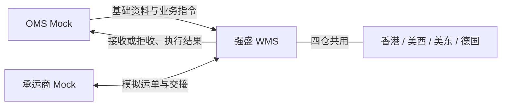

# 系统集成与对接需求调研

> 文档状态：调研初稿（案头整理，课程沙盘）
> 调研范围：一期 OMS Mock 与 WMS 之间的资料与业务消息、执行结果回传，以及承运商 Mock、打印与称重的模拟边界；真实生产接口不在本期
> 系统需求与已确认规则见[系统集成与对接需求分析](系统集成与对接需求分析.md)

| 版本 | 本次变化 | 状态 |
| --- | --- | --- |
| V0.1 | 按项目背景整理场景与诉求初稿 | 已完成 |
| V0.2 | 对齐入库、出库调研结构：范围、角色分工、证据状态、诉求与待补清单 | 已完成 |

## 一、调研范围与资料来源

本次调研要弄清楚：3PL 转自营后，**上游资料与入出库指令如何进入 WMS、拒收与执行结果如何交回业务侧、重复或变更消息如何不破坏仓内事实**，以及一期演示要先覆盖哪些对接场景。香港、美西、美东、德国四仓共用同一套 WMS，**对接面一致**，不因仓别拆多套集成逻辑。

| 环节 | 本次关注内容 | 主要交接 |
| --- | --- | --- |
| 基础资料推送 | 货主、商品等先于或并行业务指令 | OMS Mock → WMS 建档或更新；匹配失败拒收 |
| 业务指令接收 | 入库、六类出库相关完整表单 | 生成或拒收仓内单据；保留上游指令号 |
| 拒收与原因 | 资料非法、盘点阻断、B2C 不足量等 | 不生成可执行单；原因可查 |
| 幂等与变更 | 重发、明细变更、出库取消 | 同一消息只生效一次；按节点接受或拒绝 |
| 结果回传 | 收货、上架、出库结案及差异表达 | WMS → OMS Mock；失败可重试交接 |
| 外部协作模拟 | 运单、面单、重量、交接登记 | 承运商 Mock 与手工／模拟数据；不冒充生产服务 |
| 消息留痕 | 原始输入、接收时间、回传状态 | 演示与走查时可追溯，便于联调 |

**不在本模块调研范围：**真实 ERP、OMS、承运商接口协议、鉴权、吞吐与生产级可靠性；WMS 内入库、出库、库存作业规则本身（见各业务模块调研）；跨仓调拨主单、在途账与两端差异对账；WMS与财务ERP（金蝶）的直接对接。

主要依据：

- [竞品参考与需求取舍](../00-项目总览/03-竞品参考与需求取舍.md#二后续参考与一期舍弃)：真实设备与货主自助端不纳入一期；竞品生态接入仅作后续参考，一期按项目范围使用Mock，消息规则由项目设计维护。

- [公司背景与业务概况](../../01-全局背景信息/00-公司背景与业务概况.md)、[项目定位与范围](../../01-全局背景信息/01-项目定位与范围.md)、[能力蓝图与系统协作](../../01-全局背景信息/02-能力蓝图与系统协作.md)、[阶段规划与一期交付标准](../../01-全局背景信息/03-阶段规划与一期交付标准.md)
- [需求调研总览](../00-项目总览/01-需求调研总览.md)、[基础资料](../01-基础资料/基础资料需求调研.md)、[入库业务需求调研](../02-入库业务/入库业务需求调研.md)、[出库业务需求调研](../03-出库业务/出库业务需求调研.md)
- [系统集成与对接需求分析](系统集成与对接需求分析.md)：设计确认记在分析稿，本文只写**现状、问题、诉求与证据缺口**

尚未取得真实 OMS／ERP 接口文档、生产级消息样例或联调环境。课程演示使用标明性质的 OMS Mock、承运商 Mock 与内置收发能力。

## 二、当前角色与系统分工

### 2.1 现有职责与规划分工

| 角色 | 已知职责 | 仍需确认 |
| --- | --- | --- |
| 跨境与渠道业务 | 向海外仓要入出库与库存结果 | 3PL 时期能否区分「指令已收／已拒」与分批执行明细 |
| 第三方海外仓（3PL） | 代运营仓内作业 | 强盛能否拿到与 WMS 同粒度的接收、拒收与回传记录 |
| 仓储物流（规划） | 租仓后组织四仓现场作业 | 不良品邮件通知、线下补单等如何与系统来源区分 |
| 外部品牌货主（规划） | 经 OMS 推送资料与指令 | 一期由 Mock 模拟；变更、取消协同方式待样例 |
| 数字化／项目组 | 建设 WMS、OMS Mock 与联调样例 | 完整表单字段、消息标识与走查数据范围 |

自营阶段：**业务端（一期 OMS Mock）**推送资料与指令；**WMS**执行仓内作业并交回结果；**承运商 Mock**补充模拟运单与交接信息。PDA 属于 WMS 内部作业端，不视为外部集成对象。

### 2.2 当前系统与作业流转

立项前海外履约结果由3PL交回业务侧。当前缺少消息及结果样例，尚不能判断是否能追溯指令拒收、回传时间和重发处理，需进一步核实。

一期课程演示目标形态（与[能力蓝图第二节](../../01-全局背景信息/02-能力蓝图与系统协作.md#二一期演示系统协作)一致）：

| 载体 | 与本期对接的关系 | 已知问题或空白 |
| --- | --- | --- |
| 3PL | 立项前结果交接 | 消息级追溯能力待核实；自营后建立接收与回传留痕 |
| OMS Mock | 一期唯一常规指令与资料来源 | 已有部分资料与正常收发样例；变更、取消、拒收及回传失败案例待补 |
| 承运商 Mock | 模拟运单与出仓交接 | 字段习惯与出库单引用方式待应用设计对齐 |
| 强盛 WMS | 拒收、执行、回传 | 新建；与入出库、库存模块分界见各分析稿 |

## 三、核心场景与业务问题

以下为课程沙盘的目标场景，已确认方向与待补证据分别列出，不作为现有3PL作业情况的结论。

| 场景 | 业务情形 | 主要问题 | 证据状态 |
| --- | --- | --- | --- |
| 资料先于指令 | 货主、商品须能匹配入出库单 | 资料缺失或冲突时不能静默建单 | 方向已确认；Mock 推送顺序待走查 |
| 上游重试同一消息 | 网络或人工可能重复发送 | 重复建单、预占或扣库 | 消息身份与版本已有设计；重复、冲突及错序样例待验证 |
| 变更与取消 | 明细调整、出库取消与「重发」含义不同 | 须识别业务对象与单条消息，并按仓内节点决定 | 节点规则在分析稿；Mock 案例待补 |
| 拒收可见 | 格式错误与 B2C 不足量等 | 业务侧须知道「未接单」及原因 | 与出库调研衔接；拒收展示待样例 |
| 仓内完成后回传失败 | 收货、上架、出库事实已发生 | 不能为回传再执行一次仓内动作 | 方向已确认；重试状态展示待补 |
| 进度与结案结果 | 业务要阶段性进度与最终结案 | 回传粒度须与入出库模块一致，且不重复生效 | 方向已确认；完整回传表单待补 |
| 邮件来源其他出库 | 不良品处置有时只有线下通知 | 须保留线下来源，不伪造上游指令关联 | 一期纳入；依据字段待样例 |
| 运单、面单与重量 | 演示需要可操作数据 | 模拟数据易被误认为真实服务 | 模拟范围须明示；见公共能力履约展示约定 |
| 多仓共用对接 | 四仓同一 WMS | 仓库字段须在一期范围内可识别 | 四仓预置见基础资料；跨仓调度不在一期 |

## 四、业务诉求（案头整理）

以下诉求依据背景与第三节场景归纳，不是访谈原话；系统规则与范围取舍见分析稿。

| 场景（见第三节） | 业务诉求摘要 | 当前判断 |
| --- | --- | --- |
| 资料先于指令 | 资料与单据可匹配，无法接收时有明确原因 | 一期核心 |
| 上游重试 | 同一消息只生效一次，重发可得已有结果 | 一期核心 |
| 变更与取消 | 能识别对象与消息，按节点接受或拒绝 | 一期核心；入库取消、无主货认领待真实 OMS |
| 拒收可见 | 拒收原因可查，与执行中缺货区分 | 一期核心；细则在入出库与对接分析 |
| 回传失败重试 | 已有结果可再次交接，库存与业务不重复生效 | 一期核心 |
| 进度与结案回传 | 上游能看执行进度与结案表达 | 一期核心 |
| 邮件其他出库 | 线下依据可查，来源与 Mock 指令区分 | 一期核心 |
| 外部模拟 | 有足够数据完成作业演示，范围明示 | 一期核心 |
| 多仓对接 | 各仓指令与回传在同一协作模型下处理 | 一期核心 |

上表对应的系统规则写在[系统集成与对接需求分析](系统集成与对接需求分析.md)。仓内作业细则见[入库](../02-入库业务/入库业务需求分析.md)、[出库](../03-出库业务/出库业务需求分析.md)、[库存与库内](../04-库存与库内业务/库存与库内业务需求分析.md)各分析稿第二节。

## 五、待补资料与确认清单

| 确认方向 | 重点问题 | 需要提供的资料 |
| --- | --- | --- |
| 完整业务表单 | 按现有字段映射补齐业务表单，后续与PRD核对 | 各入出库类型的 OMS Mock 推送样例 |
| 消息标识与顺序 | 重发、变更、冲突如何演示 | 新建、变更、取消、重复输入案例 |
| 拒收与回传展示 | 业务方在哪里看拒收原因、回传失败与重试 | OMS Mock／管理端展示草图或 Demo 范围 |
| 回传失败走查 | 仓内已完成后仅重试交接 | 至少一条入库、一条出库回传失败沙盘 |
| 承运商 Mock | 运单与交接字段如何挂出库单 | 与物流渠道、出库交接字段对齐样例 |
| 架构级约定 | 消息版本、内置收发台 | 见[接口与 OMS Mock 消息设计](../../05-应用设计方案/20261002-MVP版本/系统架构设计/06-接口与OMS Mock消息设计.md)；消息信封、部分映射与正常输入样例已在[OMS Mock资料目录](../../05-应用设计方案/20261002-MVP版本/字段清单合集/05-系统集成与对接/OMS-Mock/)形成，仍需补齐其他业务类型与异常案例并验证 |

建议优先补齐**一条「资料不匹配拒收」**、**一条「同消息重发」**、**一条「出库取消＋回传失败重试」**联调案例。演示数据组织见[关键走查场景](../../04-业务分析和设计/06-海外仓典型业务场景与方案.md#84-关键走查场景)。

真实接口协议、鉴权、吞吐与生产可靠性在后续真实集成阶段处理，不在本期调研收口范围。
