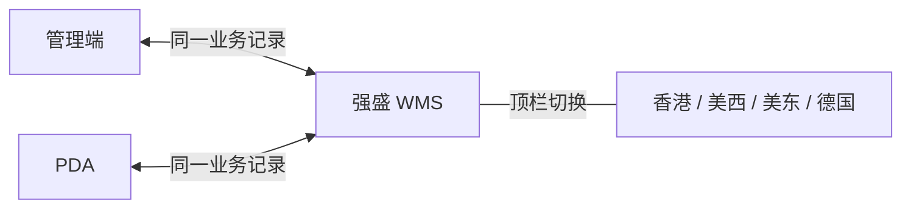

# 公共能力需求调研

> 文档状态：调研初稿（案头整理，课程沙盘）
> 调研范围：四仓共用的演示仓库范围、动作可见性、中英文界面、存储／业务／展示时间口径、关键操作留痕，以及管理端与 PDA 共用记录；登录审计、货主门户与扩展语言不在本期
> 系统需求与已确认规则见[公共能力需求分析](公共能力需求分析.md)

| 版本 | 本次变化 | 状态 |
| --- | --- | --- |
| V0.1 | 按项目背景整理场景与诉求初稿 | 已完成 |
| V0.2 | 对齐入库、出库调研结构：范围、使用方分工、证据状态、诉求与待补清单 | 已完成 |
| V0.3 | 区分现状与目标场景，补充竞品依据并更新诉求与资料状态 | 已完成 |

## 一、调研范围与资料来源

本次调研要弄清楚：3PL 转自营后，**演示如何按仓库查看与操作、关键动作如何留痕、跨地区使用时语言与时间如何表达才不误导业务判断**，以及管理端与 PDA 如何共用同一批作业结果。香港、美西、美东、德国四仓共用同一套 WMS，**时间规则不因仓别拆多套逻辑**。

| 环节 | 本次关注内容 | 主要衔接 |
| --- | --- | --- |
| 仓库数据范围 | 用户可进哪些仓、仓内可见哪些货主数据 | 与多货主同仓、单据货主字段一致 |
| 动作可见性 | 菜单与具体操作是否默认可见 | 不按角色裁剪；只看业务状态 |
| 语言 | 现场与管理端界面语言 | 中英文切换；标识符不本地化改写 |
| 时间三层 | 存储、业务判断、页面展示与导出 | 履约截止、效期与展示时区分开 |
| 操作记录 | 影响责任与库存的关键动作 | 可按模块、对象、人员查询 |
| 双端一致 | 管理端与 PDA 同一任务 | 同一记录；重复提交不重复动库存 |
| 演示边界 | 打印、称重与外部 Mock | PDA 为作业端；模拟范围明示 |

**不在本模块调研范围：**货主级数据权限与货主自助门户；复杂审批流与全量报表体系；中文、英文以外的语言；独立登录审计（登录时间、账号、来源端）；入出库、库存、集成消息等业务规则本身（见各业务模块调研）；承运商与 OMS 接口细节（见[系统集成与对接需求调研](../06-系统集成与对接/系统集成与对接需求调研.md)）。

主要依据：

- 竞品参考：[员工角色与权限](../../02-竞品调研和分析/极风WMS/01-原始页面/JF-BAS-016-员工角色与权限设置.md)、[仓库时区](../../02-竞品调研和分析/极风WMS/01-原始页面/JF-BAS-011-仓库注册时国际化时区的设置【仓库注册必看】.md)、[OMS操作日志](<../../02-竞品调研和分析/极风WMS/01-原始页面/JF-OMS-GEN-014-查看OMS 操作日志.md>)。借鉴按模块查日志的思路；演示仓库范围、展示时区切换及WMS留痕动作按项目规则确定，不能由竞品OMS能力直接推定。

- [公司背景与业务概况](../../01-全局背景信息/00-公司背景与业务概况.md)、[项目定位与范围](../../01-全局背景信息/01-项目定位与范围.md)、[能力蓝图与系统协作](../../01-全局背景信息/02-能力蓝图与系统协作.md)、[阶段规划与一期交付标准](../../01-全局背景信息/03-阶段规划与一期交付标准.md)
- [需求调研总览](../00-项目总览/01-需求调研总览.md)、[基础资料需求调研](../01-基础资料/基础资料需求调研.md)、[入库](../02-入库业务/入库业务需求调研.md)、[出库](../03-出库业务/出库业务需求调研.md)、[库存与库内](../04-库存与库内业务/库存与库内业务需求调研.md)业务需求调研
- [公共能力需求分析](公共能力需求分析.md)：设计确认记在分析稿，本文只写**现状、问题、诉求与证据缺口**

一期 Demo 不做登录、账号或角色权限；课程演示使用预置四仓与固定操作者，所有满足业务状态的动作默认可见。

## 二、当前使用方与系统分工

### 2.1 现有职责与规划分工

| 使用方 | 已知职责 | 仍需确认 |
| --- | --- | --- |
| 跨境与渠道业务 | 查看履约进度与出库结果 | 3PL 时期能否区分「谁操作的、何时截止」 |
| 第三方海外仓（3PL） | 代运营现场作业 | 服务商可提供哪些操作者、时间与处理结果记录 |
| 仓储物流（规划） | 租仓后组织四仓作业与现场管理 | 准备各仓演示数据与PDA作业样例 |
| 外部品牌货主（规划） | 关心自有货物执行结果 | 一期无货主登录 WMS；可见性待 OMS 二期 |
| 数字化／项目组 | 建设 WMS 与演示环境 | 演示数据、固定操作者与操作留痕 |

自营阶段：**仓储人员**在同一套功能内执行作业；**业务管理人员**通过 OMS Mock 等看结果；一期 Demo 不区分登录账号或角色。**管理端与 PDA** 共用业务记录，不由两端各记一套库存。

### 2.2 当前系统与作业流转

立项前海外作业由3PL执行。当前尚未取得关键操作交接样例，不能认定只有汇总或口头交接。目标四仓尚未运营，统一仓库范围和动作留痕是租仓自营后的设计要求。

一期课程演示目标形态：

| 载体 | 与本期公共能力的关系 | 已知问题或空白 |
| --- | --- | --- |
| 3PL | 立项前关键操作与留痕的交接粒度待核实 | 自营后需自建仓库范围与关键动作记录 |
| 管理端 | 查询、确认类动作入口 | 与 PDA 分工见各模块分析；双端一致规则待走查 |
| PDA | 现场扫描与确认 | 重复提交防护需与库存流水一致 |
| 操作记录 | 关键动作的操作者、时间与结果 | 查询样例待补 |

## 三、核心场景与业务问题

以下为课程沙盘的目标场景，已确认方向与待补证据分别列出，不作为现有3PL作业情况的结论。

| 场景 | 业务情形 | 主要问题 | 证据状态 |
| --- | --- | --- | --- |
| 多货主同仓 | 目标四仓需支持自营与模拟外部货主 | 顶栏仓库切换查看，单据与库存仍分货主 | 方向已确认 |
| 动作与数据可见分离 | 能看库存不等于能改库存 | 取消、差异确认、调整等只由状态和业务规则控制 | 一期不按角色裁剪 |
| 关键动作留痕 | 丢失、品质、盘点差异等影响责任 | 记录操作者、时间、原单与结果 | 不设审批或岗位权限 |
| 中英文界面 | 目标四仓的现场与管理人员需使用同一系统 | 一期须支持中英切换 | 方向已确认；界面走查样例待补 |
| 跨时区查看与导出 | 用户可能不在仓库当地 | 展示须可换算并标注；不改变履约与效期判断 | 三层时间方向已确认；导出样例待补 |
| 履约时间展示 | 出库有截止要求 | 起算、等待计入、超时后果须统一口径 | 48 小时为沙盘参数；见分析稿 |
| 管理端与 PDA 同一任务 | 现场与管理端都可能操作 | 不能形成两套结果或重复扣增库存 | 方向已确认；双端走查待执行 |
| 打印、称重演示 | 一期无真实硬件 | 易误以为已接入生产服务 | 模拟范围与集成模块分工见分析稿 |

## 四、业务诉求（案头整理）

以下诉求依据背景与第三节场景归纳，不是访谈原话；系统规则与范围取舍见分析稿。

| 场景（见第三节） | 业务诉求摘要 | 当前判断 |
| --- | --- | --- |
| 多货主同仓 | 顶栏当前仓内可见各货主数据，切换仓库改变数据范围 | 一期核心 |
| 动作与数据可见分离 | 按职责执行，关键动作可追到人 | 一期核心 |
| 关键动作留痕 | 重大确认与日常作业都记录操作者、时间与结果 | 一期核心 |
| 中英文界面 | 界面可切换语言 | 一期核心 |
| 跨时区与履约展示 | 时间看得懂，且不误导截止与效期 | 一期核心 |
| 双端一致 | 同一任务结果一致，重复提交不重复生效 | 一期核心 |
| 演示边界 | 模拟与真实作业端区分清楚 | 一期核心 |
| 货主自助、登录审计、多语言扩展 | 业务侧潜在诉求 | 不纳入一期 |

上表对应的系统规则写在[公共能力需求分析](公共能力需求分析.md)。履约与缺货处理衔接见[出库业务需求分析](../03-出库业务/出库业务需求分析.md)；效期与商品配置见[基础资料需求分析](../01-基础资料/基础资料需求分析.md)；外部 Mock 范围见[系统集成与对接需求分析](../06-系统集成与对接/系统集成与对接需求分析.md)。

## 五、待补资料与确认清单

| 确认方向 | 重点问题 | 需要提供的资料 |
| --- | --- | --- |
| 演示仓库范围 | 顶栏切换四仓的演示数据是否齐全 | 四仓样例数据与截图 |
| 动作可见性 | 是否还有按角色隐藏的入口 | 所有满足状态的动作默认可见；不再准备角色/权限映射 |
| 中英文与术语 | 字段名、状态名是否随语言变化 | 中英各一套列表／详情截图或 Demo 范围 |
| 时间与导出 | 导出是否标明时区；截止时间与列表时间关系 | 含时区标注的导出样例各一份 |
| 操作记录查询 | 业务方如何按单、按人查留痕 | 操作记录页面范围与查询条件样例 |
| 双端走查 | 同一入库或出库任务两端操作 | 至少一条管理端 + PDA 共用记录案例 |

建议优先补齐**一套四仓演示数据**、**一条含履约截止展示的出库样例**、**一条关键确认动作的留痕查询样例**。走查组织见[关键走查场景](../../04-业务分析和设计/06-海外仓典型业务场景与方案.md#84-关键走查场景)。竞品仅作参考，见[竞品原文入口](../../02-竞品调研和分析/00-双边能力对比矩阵.md#四资料入口与证据边界)；竞品的客户授权或「时区不可改」等限制不自动成为本项目规则。
