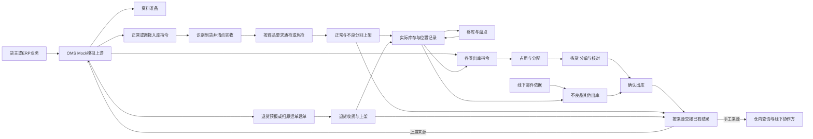

# 强盛WMS一期业务蓝图

> 本文描述课程沙盘的目标业务，供走查与应用设计使用，尚未完成演示验收。各域的角色与主流程从第二节开始；第一节提供依据与范围。

强盛计划先租赁仓库，再自研WMS，先服务自营业务，之后拓展外部货主。本蓝图描述香港、美西、美东、德国目标四仓及多货主经营所需的业务。共享的是仓内场地与作业能力，每批实物仍有自己的货主、商品、位置和履约指令。WMS从到货前接收指令开始，把到仓识别、收货、质检、上架、库存持有、拣货和出仓交接连接起来，使上游能区分“要求做什么”“仓库实际做了什么”和“哪些结果已经交回”。

本文维护全局关系和共同原则。具体执行条件由01—05展开；06把这些条件放回海外仓完整场景中比较。字段清单、系统状态枚举、页面、接口和技术机制由05-应用设计方案承接。

## 输入资料与依据

- [公司背景与业务概况](../01-全局背景信息/00-公司背景与业务概况.md)：从第三方海外仓转向租仓自营的计划、参与方、目标四仓定位和样例量级。
- [项目定位与范围](../01-全局背景信息/01-项目定位与范围.md)、[能力蓝图与系统协作](../01-全局背景信息/02-能力蓝图与系统协作.md)：一期范围及ERP、OMS、WMS、物流的职责。
- [阶段规划与一期交付标准](../01-全局背景信息/03-阶段规划与一期交付标准.md)：后续边界。
- [需求分析总览](../03-需求调研和分析/00-项目总览/02-需求分析总览.md)（含模块索引）、[需求调研总览](../03-需求调研和分析/00-项目总览/01-需求调研总览.md)：来源分层、模块分工及共同原则。
- [竞品原文入口](../02-竞品调研和分析/00-双边能力对比矩阵.md#四资料入口与证据边界)、[竞品参考与需求取舍](../03-需求调研和分析/00-项目总览/03-竞品参考与需求取舍.md)：仅作原文导航与取舍定位；具体原文核验见各域及06。
- [公共能力需求分析](../03-需求调研和分析/07-公共能力/公共能力需求分析.md)、[公共能力走查串联](#61-公共能力走查串联)、[关键走查场景](06-海外仓典型业务场景与方案.md#84-关键走查场景)：权限、时间与已有案例索引。

## 一、业务全景与一期范围

### 1.1 四仓共用框架，各自在所属仓内执行

香港仓兼顾集货中转和当地履约，美西、美东、德国仓承担海外仓储与履约。四仓都需要运行入库、库存和出库主链；背景没有规定每仓必须经营全部品类，也没有给出真实库区布局、设备和人员数量。

上游业务决定货物送往哪个仓、发给谁、发什么和多少。仓库负责识别实际到货、核对实物、安排仓内位置并记录执行结果。自营货主与外部货主采用共同业务规则：不能因属于强盛自营就借用第三方货主库存，也不能只按相同商品编码合并归属。

共享仓里，拼柜到货、大货存放、包裹拣货和平台仓补货可能同时发生。业务设计因此从“仓库＋货主＋SKU”确认归属，再向货位、批次、SN及品质细分。箱唛可以帮助识别到货，箱托可以帮助搬运与交接，但库存仍按内部SKU件数核对。

### 1.2 一期闭环与后续业务

| 业务范围 | 一期要完成的结果 | 责任终点及后续边界 |
| --- | --- | --- |
| 业务准备 | 可识别的货主、商品、四仓、库区、货位及物流渠道；按商品明确作业要求 | 上游资料身份由OMS Mock提供，仓内配置由WMS维护 |
| 正常／调拨入库 | 到货识别、分批实收、按配置质检、正常／不良分别上架、差异结果 | 上架形成实际库存 |
| 库存与库内 | 数量、位置、占用、批次效期和SN可追溯；移库、盘点有业务依据 | 不承接ERP全局库存决策、财务成本、货主账单 |
| 出库 | B2C、平台仓转运、当地B2B、调拨、退回出库（正常品已收退回）、不良品其他出库的执行结果 | 仓库确认出库为扣库与WMS完成节点；实际揽收另记；退回出库用语与[01-项目定位与范围](../01-全局背景信息/01-项目定位与范围.md)一致 |
| 退货 | 派送失败退回、客户退货、平台仓退件的识别、收货、上架与结果回传 | 上架后良品恢复可出库库存；FBA移除退仓不在一期 |
| 上游协作 | 输入接受／拒绝、变更取消处理、已有结果交接可区分 | 一期OMS Mock与承运商Mock；真实OMS客户端二期设计 |

FBA逆向处理、换标换包装、商业计费、深圳仓、人员派工和自动产能调度不进入一期。已收货物从本仓退回仓外是出库域的退回出库；买家或平台退回本仓是退货域，方向相反，不能混为一条流程。

## 二、业务域地图与阅读导航

先读蓝图，再按基础资料→入库→退货→库存→出库→上游协作阅读。按场景走查时，从06的场景索引进入负责域的规则与案例；本目录05指上游协作设计，应用设计中的同号文件是权限配置。

| 文档 | 回答的问题 | 上游给什么 | 这个域交出什么／交给谁 |
| --- | --- | --- | --- |
| [01-基础资料业务设计](01-基础资料业务设计.md) | 何时具备可识别、可作业的条件，资料变化影响什么 | 货主商品身份、仓内空间与商品作业要求 | 可用的资料关系及限制，交给收发存执行域 |
| [02-入库业务设计](02-入库业务设计.md) | 到了什么、收了多少、品质如何、放到哪里 | 正常／调拨入库指令、到货实物；无主货另行登记暂存 | 实收、质检、上架与差异，交给库存域和上游 |
| [07-退货业务设计](07-退货业务设计.md) | 退回本仓如何认单、收货、上架 | 退货预报或原出库运单线索、到件实物 | 实收、拒收、良品／不良与上架结果，交给库存域和上游 |
| [03-出库业务设计](03-出库业务设计.md) | 哪些货为哪张单占用、怎么拣、如何交出和收口 | 出库指令、现有库存、物流与交接要求；其他出库可有邮件依据 | 需求、实发、未发、取消返库上架与交接结果，交给库存域和上游 |
| [04-库存与库内业务设计](04-库存与库内业务设计.md) | 账上数量和现场位置怎样对应，库内变化如何留痕 | 上架、订单占用、出库和库内作业事实 | 当前数量与限制、移动／盘点／处置记录及流水，供执行域与协作域使用 |
| [05-上游协作与结果交接设计](05-上游协作与结果交接设计.md) | 谁发指令、仓库如何答复、结果怎样交回 | 资料、新建／变更／取消请求、仓内已有结果 | 接收或拒绝、执行结果、未送达原因，交给OMS Mock或对应线下协作方 |
| [06-海外仓典型业务场景与方案](06-海外仓典型业务场景与方案.md) | 各域如何共同解决完整海外仓业务 | 背景、域内规则与已核读竞品原文 | 综合处理路径、覆盖缺口和条件候选，供业务走查及应用设计取舍 |

## 三、参与方与业务责任

参与方与角色职责在各业务域第二节展开，蓝图不重复整张责任表。阅读时按场景进入对应域；关键确认权限集中于仓库主管、作业与常规收发确认独立配置，见[应用权限配置第四节](../05-应用设计方案/20261002-MVP版本/系统架构设计/05-全局机制与权限配置.md)（不表示真实岗位已访谈）。

| 域 | 角色与交接正文 |
| --- | --- |
| 基础资料 | [01 §二](01-基础资料业务设计.md#二谁准备资料准备后交给谁) |
| 入库 | [02 §二](02-入库业务设计.md#二参与角色与责任) |
| 退货 | [07 §二](07-退货业务设计.md#二参与角色与责任) |
| 出库 | [03 §二](03-出库业务设计.md#二角色与交接责任) |
| 库存与库内 | [04 §二](04-库存与库内业务设计.md#二角色与交接) |
| 上游协作 | 见上游协作与结果交接设计第二节（业务目录 05，非应用设计「全局机制」） |

## 四、主要业务链路及交接

图中的箭头表达业务依赖，未把仓外运输画成WMS内部流程。调拨出库只在调出仓执行到确认出库，调拨入库只在调入仓执行到上架完成；上游自行跟进两端，不存在WMS跨仓主单、在途账、调拨号配对或两端差异结案。

| 交接点 | 上游给什么 | 这个域交出什么 | 交给谁 |
| --- | --- | --- | --- |
| 准备→执行 | 已匹配的仓库、货主、商品身份及作业配置 | 指令可接收，或具体资料拒收原因；位置在使用节点再校验 | 入库／退货／出库组织者与上游 |
| 到货→收货 | 实物、箱唛与已有预报线索 | 各单清点事实、满足准入的实收、未匹配／超收／拒收情况 | 质检／上架及差异协作方 |
| 退回本仓→退货上架 | 退货预报或原 B2C 运单、到件实物 | 退货实收内良品／不良、拒收与上架落位 | 库存域；结案结果交 OMS Mock |
| 收货→上架 | 已收数量和对应品质／追溯信息 | 本次实际落位数量、剩余已收未上架数量 | 库存域；上游接收相应结果 |
| 库存→出库 | 本仓本货主库存及其有效限制 | 本单占用、任务分配与可核对的实物 | 拣货／复核人员 |
| 拣货→确认出库 | 实拣、复核、容器明细、异常／返库上架结果 | 满足该类型数量条件的实发与未发、完成事实 | 库存域、上游和实际接货方 |
| 仓内完成→结果送达 | 已生效的业务记录 | 原结果及其送达情况 | OMS Mock；手工其他出库保留线下来源与可查询结果 |

## 五、公共业务对象与术语

### 5.1 对象如何归属和追溯

| 对象 | 业务含义与关系 | 可选性与追溯 |
| --- | --- | --- |
| 仓库、库区、货位 | 每个库区属于一个仓库，每个货位属于一个库区；仓库可有多个库区，库区可有多个货位 | 某项具体作业前必须有有效位置；入库预报可不指定货位 |
| 货主、SKU | 每个商品档案属于一个货主，货主可有多个SKU；显示编码不能替代货主商品身份 | 同编码可分别属于不同货主；库存、单据始终保留归属 |
| 入库／退货／出库单 | 每张单属于一个仓库、一个货主；入库与出库各一种业务类型，退货单标明退货来源 | 一单可有多次执行记录；入库/退货预报追溯原指令，派送失败退货关联原出库，邮件来源其他出库保留线下依据 |
| 作业任务与实际记录 | 组织要做的工作和保存已经发生的事实 | 未执行不产生实际结果；重复提交不新增同一事实；单据分层在应用设计细化 |
| 库存明细 | 同一仓库、货主、SKU在位置、批次、SN和品质上的持有记录 | 未启用的批次／SN维度可无；沿上架、库内、出库流水追溯 |
| 批次／SN | 批次识别一组货物，SN识别单件，随商品配置贯穿收发存 | 唯一身份为货主＋SKU＋SN，跨四仓判断；不同货主或SKU可同文本，数量相同不能替代身份核对 |
| 箱／托 | 识别、清点、搬运、暂存、装箱及出仓交接的作业容器 | 可不用托或箱；使用时记录内部SKU数量及对应作业；不形成箱／托库存 |
| 无主货登记记录 | 无法判断货主实物的到货、暂存及识别线索 | 一期不认领、不建入库单；OMS上线后展示给所有OMS客户，由OMS认领并下发指令 |

### 5.2 首次走查必须区分的概念

走查前先分清下列概念；**权威叙述与数量公式在负责域**，此处只作索引。

| 概念组 | 要点 | 展开位置 |
| --- | --- | --- |
| 入库节点 | 到货、收货、上架分批发生；收货确认即进收货暂存库位库存，暂存库位不参与出库分配 | [02 §四、§六](02-入库业务设计.md#四主流程与完成条件) |
| 库存三量 | 实际＝预占＋可用；货位分配不新增预占；锁定并集计量 | [04 §四](04-库存与库内业务设计.md#四数量品质与锁定的共同口径) |
| 品质与效期 | 正常／不良 vs 临期／过期；准入、转换、出库资格分开判断 | [02 §6.2](02-入库业务设计.md#62-效期准入只用允许入库天数)、[04 §8.1](04-库存与库内业务设计.md#81-效期判断和品质转换)、[03 §四起](03-出库业务设计.md#四普通出库主流程与完成条件) |
| 出库用语 | 「分单」=波次分回原单；「缺量一次结案」=平台/B2B；WMS完成≠承运商揽收 | [03 §五、§七](03-出库业务设计.md#五基础波次分单与防混单) |
| 已退出库存的实物 | 已确认出库待揽收的实物可能仍在场地，不得再计实际 | [04 §三、§九](04-库存与库内业务设计.md#32-暂存库位上的已收未上架量和已拣量) |

## 六、跨域共同原则

| 原则 | 各域共同遵守什么 | 完整规则与运行解释 |
| --- | --- | --- |
| 归属与位置 | 按本仓、本货主执行，同编码不合量、不跨仓借量；同一货位同一时点仅供一个货主使用 | 01第五节；04第三节 |
| 库存生效 | 收货确认增加收货暂存库位实际，上架、拣货与返库只在库位间移动，确认出库扣实际；暂存库位不参与出库分配；已收未上架或已拣后丢失，按应上架、应返库数量提交后盘点调整 | 02第四、五、八节；03第七节；04第五节 |
| 占用与释放 | 库位分配不新增预占，重叠锁因按并集计量；取消一次释放本单占用，已拣实物退拣、经返库上架单回到库位后才重新可出库 | 03第六、七节；04第四节 |
| 接单与结案 | B2C全SKU足量才接单；其他普通类型可部分预占，确认时另按类型判断足量或缺量；盘点阻断新单则拒收 | 03第一、四节；04第七节 |
| 变更与处置 | 保留既有实物事实，按节点接受或拒绝变更取消；不良处置与真实盘点差异分别记录，同件只扣一次 | 02第七节；03第七、八节；04第九节 |
| 时间与权限 | 按仓库当地时间判断履约与效期；数据按仓库授权、动作按RBAC控制 | 见下文 §6.1；[公共能力需求分析](../03-需求调研和分析/07-公共能力/公共能力需求分析.md) |
| 两端与交接 | 管理端／PDA共用记录，重复提交不重复生效；结果未送达只重交已有结果 | 05第六节；§6.1 |

当前规则以负责模块的需求分析为依据，业务设计展开执行、责任和结果。候选集中在06第8.2节，后续输入见第八节。

### 6.1 公共能力走查串联

功能真源见[公共能力需求分析](../03-需求调研和分析/07-公共能力/公共能力需求分析.md)。业务设计不在此重复 FR 条文；演示或联调时按下列链条核对「谁能看、谁能做、时间怎么判、能否追溯」，细节以各执行域异常表为准。

| 核对项 | 业务上应看到什么 | 展开位置 |
| --- | --- | --- |
| 仓库数据范围 | 仅授权仓内可见全部货主资料、库存与单据；未授权仓不可操作 | 各域 §二角色表；COM-FR-001 |
| 动作权限 | 无权限不展示或不可执行；关键确认与常规作业分开配置 | 入库、出库、库存域文首权限句；应用设计权限矩阵 |
| 语言与时区 | 中英文可切换；业务判断用所属仓库当地日期，展示时区不改变准入与效期结论 | 基础资料效期引用；入库 §6.2；库存 §8.1；COM-FR-002 |
| 履约计时 | 有效接收出库指令后起算 48 小时（课程参数）；超时不自动改数量资格或强制缺量 | 出库 §7.3；COM-FR-002 |
| 操作留痕 | 差异、取消、其他出库、盘点调整、品质转换等关键动作可追到操作者、时间、原单与结果 | COM-FR-003；应用设计操作记录 |
| 管理端与 PDA | 同一任务共用记录与流水；重复提交不重复占扣或改库存 | 入库、出库、库存流程段；上游协作 §六；COM-FR-004 |

## 七、数量走查与场景覆盖

### 7.1 各域数量案例

以下是独立模拟，分别验证资料、入库、出库和库存规则；不同案例不能拼成同一批实物的时间线。

| 场景 | 核对重点 | 完整案例 |
| --- | --- | --- |
| 同编码、多货主资料与位置准备 | 建资料不增库存，归属与追溯开关分别校验 | 基础资料业务设计第 8.1 节 |
| 同柜多货主、分批收货与上架 | A 预计 20、最终实收 19，其中不良 3；B 独立实收 6 | 入库业务设计第 8.1 节 |
| B2C 波次与逐单确认 | 各单足量接收，汇总拣货后按原单复核和扣库 | 出库业务设计第 5.2 节 |
| 平台仓缺量一次结案 | 期初 8、需求 10、预占 8、实发 6、未发 4；已拣未发 2 退拣返库，结存 2，无本单残锁 | 出库业务设计第 9.1 节 |
| 不良品处置与真实盘亏 | 期初 5＝不良品其他出库 3＋真实盘亏 1＋期末 1 | 库存与库内业务设计第 9.4 节 |

其余盘点、取消、效期、协作幂等与锁定重叠案例见各域索引；综合验收清单见《海外仓典型业务场景与方案》8.4 节。

### 7.2 下一阶段输入

应用设计需准备正式资料、完整表单与操作样例；关键走查场景统一见综合场景文档 8.4 节。已有数量走查不代表业务验证已经执行。

## 八、规则确认与后续输入

报损／销毁及报损后非库存暂存跟踪后置，一期保留不良品在库、其他出库和真实盘点差异处理。

当前确认规则与验证状态见[需求分析总览第六节](../03-需求调研和分析/00-项目总览/02-需求分析总览.md#六未决规则走查与开放输入)。收货品质与上架前残损见[入库第6.4节](02-入库业务设计.md#64-收货品质与上架前发现残损)，缺货单人工恢复见[出库第7.4节](03-出库业务设计.md#74-已接收缺货单人工恢复)。无主货一期只登记，认领及下发指令由后续 OMS 承接；零实收（含全单拒收）通知上游取消，一期 Mock 受理后已取消，不设 WMS 手工取消或零实收完成结案。规则见入库第 3.2、3.5、8.2～8.3 节；零实发不结案见出库第九节。

资料准备统一见[调研总览](../03-需求调研和分析/00-项目总览/01-需求调研总览.md#四待补资料)，各域仅补本域所需的输入和用途。课程演示可以使用标明性质的模拟位置、商品、检验和交接样例，不以真实企业样表为完成前提。

字段、系统状态、页面、权限配置及接口由应用设计承接。实收误记、已实收归属错误的一期能力边界已确定，按02第七节保留异常和未完成部分；它们不混入待决策清单。

已确认：发现疑似短少即限制受影响仓库＋货主＋SKU的新出库接单，由仓库主管确认差异排除或校准完成后解除；已拣后丢失不在出库单上单独收口，退拣后按应返库数量提交，再盘点调整；盘点准备只收尾已开始的当前任务；停用承运商的下属渠道不能用于新业务。完整规则见库存第5.3、7.2节、出库第7.5节及基础资料第7.4节。相关演示仍待执行。
