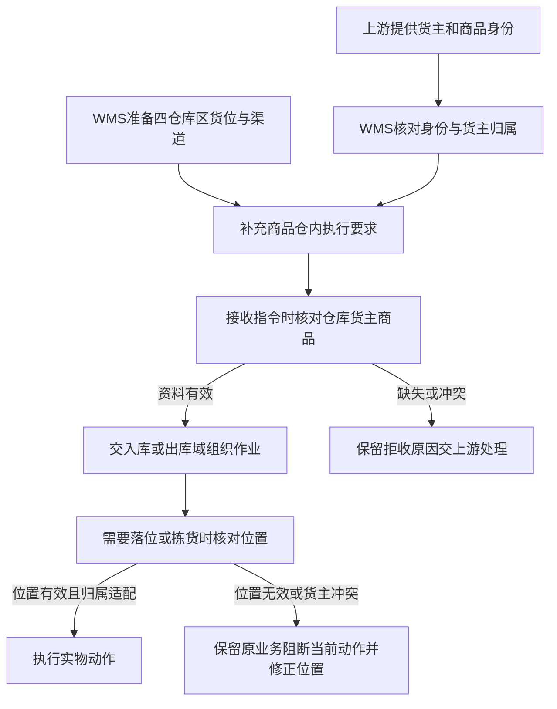

# 基础资料与业务准备设计

> 沙盘基础资料域设计；**顺读从 §二 起**。范围与验收见 [业务蓝图](00-业务蓝图.md)。

定义货主、商品、仓内位置与渠道等前置条件，不执行收发货；下游见 [02](02-入库业务设计.md)、[03](03-出库业务设计.md)、[04](04-库存与库内业务设计.md)，协作见 [05](05-上游协作与结果交接设计.md)。

## 一、依据与业务范围

本文的目标规则以[项目定位与范围](../01-全局背景信息/02-项目定位与范围.md)、[基础资料需求分析](../03-需求调研和分析/01-基础资料/基础资料需求分析.md)（MD-FR-001～011）、[公共能力需求分析](../03-需求调研和分析/07-公共能力/公共能力需求分析.md)（COM-FR-001～004）为依据。[基础资料调研](../03-需求调研和分析/01-基础资料/基础资料需求调研.md)说明业务场景与资料缺口，不作为真实现场记录。

一期覆盖货主、商品、仓库、库区、货位和物流渠道六类资料。四仓共用一套框架，自营按普通货主使用。仓库预置四仓，业务人员在一期不新增仓库。这里不维护商品价格、供应商供货关系、货主收费方案，也不建设货主自助维护或批量文件导入。

商品身份、位置用途和实物数量是三个不同问题。建立商品档案不增加库存；维护一个货位不代表它已经有货；为某货主安排上架任务，也不表示货物已经上架。入库过程数量和库存生效节点仍由入库与库存域维护。箱、托是作业容器，容器中仍需知道SKU及件数，本域不建立箱库存或托盘库存资料。

准备域竞品对照见 [双边矩阵](../02-竞品调研和分析/00-双边能力对比矩阵.md#四资料入口与证据边界)与 [竞品取舍](../03-需求调研和分析/00-项目总览/03-竞品参考与需求取舍.md)（代表页：LX-001/012、JF-BAS-017/016）。可借鉴「先仓区位与商品、角色与仓范围分离」；代理仓、导入、计费、时区不可改等**不自动**写入强盛规则。

## 二、谁准备资料，准备后交给谁

一期由OMS Mock模拟未来OMS提供货主和商品身份，WMS管理端维护仓内空间与渠道，并补充仓内执行属性。资料名称可以更新，身份标识必须能持续指向同一对象，WMS不得静默改写上游身份。

以下是业务责任，不是固定岗位、组织层级或权限清单；当前资料没有指定具体任职人。谁可以执行某项维护由RBAC授权，数据范围按仓库授权。有某仓权限的人可看该仓全部货主，仍须按货主分别记录商品、库存与单据。

| 参与方／责任角色 | 提供或处理什么 | 交出什么，交给谁 |
| --- | --- | --- |
| 自营业务与外部货主 | 提供货主归属、商品识别资料和作业要求；身份有误时负责核对来源 | 经上游整理的身份与商品资料；一期由OMS Mock送入WMS |
| 上游资料提供方（一期为OMS Mock） | 发送货主、商品及其更新，保留与业务指令可对应的身份 | 可匹配的货主与商品身份，交WMS接收；拒收原因交回上游核对 |
| WMS资料维护责任方（具体岗位未指定） | 准备库区、货位与渠道，补充商品形态、质检和追溯要求；变更前检查影响 | 启用且可用于相应动作的资料，交仓内作业使用 |
| 仓库管理与现场作业人员 | 确认记录中的位置能指向现场位置；发现货主、商品或位置不符时停止相应动作并反馈 | 已定位的实物与异常依据，交资料维护方或上游协作方处理 |
| 项目业务确认方（未指定） | 决定仍会影响准入、追溯和责任的边界，准备演示样例 | 已确认规则和样例，交应用设计与演示准备使用 |

| 上游给什么 | 本域交出什么 | 交给谁 |
| --- | --- | --- |
| 货主、商品身份及商品要求 | 已匹配的货主商品关系、可读取的仓内作业配置 | 入库、出库、库存域 |
| 四仓背景及各仓位置样例 | 仓库—库区—货位关系和位置用途 | 到货暂存、上架、拣货、移库、盘点 |
| 物流服务模拟资料 | 可引用的承运商、渠道最小资料 | 出库交接与承运商Mock |
| 当前库存、入库进度和未完结业务 | 能否变更或停用的结论及阻断依据 | 资料维护方；不在本域重做实物作业 |

## 三、共享海外仓的业务准备场景

### 3.1 新货主与商品接入，先建立归属再接业务

外部货主准备把一批货发到美西仓时，上游先提供货主与商品资料。WMS匹配身份并确认商品属于该货主；仓内维护方再为商品准备相应质检、追溯和形态要求。有效入库指令到达后可以进入待执行业务，不要求上游预先决定最终货位。

若货已到但身份资料未齐，仓库不能用外观相似的自营商品代替。能判断货主的到货按入库域联系补资料、补单；货主未知的实物放专门待认领位置。两种情况都不能借“资料先补一个”直接增加库存。认领路径的具体入口按当前IN需求和[入库业务设计](02-入库业务设计.md)执行。

### 3.2 两家货主使用同一个商品编码，分别接收与分配位置

自营和外部货主都使用“CABLE-01”时，WMS按货主各建一个商品身份。同仓查询可能同时看见两条商品记录，但收货、预占与扣库必须引用正确货主的记录。货主A的10件不能满足货主B的需求，两个商品名称相同也不能合并。

仓内维护方为两家货主准备可用位置。某货位已有货主A实物或相关未完结作业时，货主B不能使用它；货主A可以在同一货位放多SKU，并在作业和库存中保留各SKU数量。具体箱唛与混合到货识别见入库域。

### 3.3 大货存储与零散拣货使用共同商品身份

同一货主的一批商品既可能向平台仓补货，也可能逐件发给消费者。基础资料用存储、拣货等位置用途支持两种作业，不为每种出库方式另建一个商品，也不把箱内货转成另一套库存。仓库可以为大货安排存储位置，为零散拣货安排拣货位置；存储区有货而拣货位不足时，后续按库存域移库及出库域换位规则处理。

极风JF-BAS-017文字明确备货区可向拣货区移货，并说明小型仓可只用拣货区。强盛据此分析两类位置的业务价值，但不要求四仓全部商品强制拣储分离，也不新增自动补货或货位容量管理。

### 3.4 多品类按商品准备不同要求

轻小件、大件和异形货需要可解释的放置选择；需SN追踪的商品需要逐件身份；批次效期商品需要批次与日期；需质检商品需要相应检验流程。准备人员应让现场在收货前能读取这些要求，再由各执行域落实。

带电属性是已确认的商品资料要求，但当前没有具体运输限制或危险品处理资料。不得仅凭“带电”在本层编造禁发国家、承运商限制或合规审批。四仓也不需要经营全部品类，演示应按[关键走查场景](06-海外仓典型业务场景与方案.md#84-关键走查场景)准备足以走查各类要求的样例。

### 3.5 名称更新、追溯开关切换与停用分别处理

货主通知商品改名时，新资料可显示新名称，原收发记录仍保留当时引用的名称。若要切换SN、批次或效期开关，必须先看该货主商品四仓是否有库存，以及是否有已开始作业的入库单。若要停用商品、货主或货位，则还须检查实物与全部未完结业务，不能只看实际库存是否为0。具体影响见第七节。

## 四、准备流程与分节点准入

业务准备分三个节点判断，不能把“入库指令没有货位”与“现场无法上架”混成同一种失败。

| 判断节点 | 必须知道什么 | 不满足的后果与恢复 |
| --- | --- | --- |
| 指令接收 | 指令指向一期有效仓库；货主、商品可匹配并启用；商品属于该货主 | 不生成可执行单据，保留原因；上游补齐或纠正资料后再处理，见[05协作设计](05-上游协作与结果交接设计.md) |
| 收货及按配置执行质检 | 已定位业务与实物归属；能按商品要求采集SN、批次和日期，执行准入与质检 | 阻断不满足条件的收货或后续动作；不能以免检绕过效期准入，见[02入库设计](02-入库业务设计.md) |
| 上架、拣货和移库等位置动作 | 位置属于业务仓库且启用；货主占用、形态与品质适配；相关业务冻结允许当前动作 | 原有效指令保留，实物停留在可追查位置；改用有效位置或按业务域消除阻断后继续 |

分节点准入只说明资料条件。可见某仓数据不等于拥有全部动作权限；接收成功也不等于现在可以开始作业。例如盘点准备或实际盘点会限制任务执行，必须继续遵守库存域规则。

## 五、业务对象、关系与追溯

### 5.1 商品身份始终带货主

货主是库存和单据的归属主体，商品编码是货主范围内的识别方式。一个货主可有多个商品，每个商品只属于一个货主。同一货主内同编码不可另建第二个商品身份；上游发送同一商品更新与发送另一个身份占用同编码应分别判断，重复、更新和冲突的交接见[05](05-上游协作与结果交接设计.md)。

仓库中的商品并非新商品档案。一个货主商品可以在0至4个一期仓库有业务或库存，也可能只是资料已建立、尚未到货。跨仓库存分别记录，不因共享商品资料而共享可用量。

| 关系 | 基数与可选性 | 追溯用途 |
| --- | --- | --- |
| 货主—商品 | 1对0至多；每个商品必须归属1个货主 | 从任何商品或作业记录追到货主，不以名称猜归属 |
| 商品—仓内配置 | 商品按其启用要求具备相应配置；SN、批次、效期和质检不要求全部开启 | 从任务追到该商品应执行的采集与检验要求 |
| 仓库—库区—货位 | 仓库可有多个库区；每个库区属1仓；库区可有多个货位，每个货位属1库区并据此确定仓库 | 从实物位置追到所在仓与用途，不能跨仓使用位置 |
| 货位—当前货主占用 | 空位且无入库过程实物、报损后暂存实物及未完结任务时可无货主占用；被使用时同一时点最多1个货主 | 判断新上架或移入是否会混入其他货主 |
| 货位—商品实物 | 可为0至多SKU；有实物时各SKU属于同一货主 | 货位总件数不能代替SKU、品质及配置要求的批次／SN数量 |
| 商品—作业与库存 | 商品可暂时没有业务；发生业务后可关联多条作业、库存与流水 | 从库存追到来源上架、后续移动、锁定和出库 |
| 渠道—出库交接 | 一个渠道可被多笔交接引用；具体出库可按其交接方式引用渠道或司机、客户自提等对象 | 保留实际交接对象；不将渠道资料等同真实承运商接入 |

### 5.2 一货位一货主不能仅看库存余额

某位置的实际库存清零后，仍可能有该货主已收未上架实物、报损扣账后仍暂存的实物、尚未结束的上架任务或盘点等业务。只要这些当前占用仍在，其他货主不能进入该位置。报损后暂存量不计库存，但仍保留原货主、位置及跟进责任，不能只凭库存为0就把位置交给其他货主。历史流水只证明曾被使用；当前实物和任务均清零后，不因历史记录永久占位。

未知货主到货使用专门待认领位置，与已识别货主实物分开。待认领位置中的识别线索用于找到货主，不能作为一个虚构货主承接库存。异常处理位置则承接超收等尚未进入库存的实物，不能把其暂存数量计入正常可用。

箱或托可以帮助对应同次交接的实物，混合到货必须继续拆到货主、入库单与SKU核对。箱数、托数与件数不存在本项目统一换算关系；容器内部明细由作业域记录，本域不以“1箱”创建一个独立商品库存身份。

## 六、商品配置怎样贯穿收、存、发

| 配置 | 准备目的 | 收货与上架 | 在库与出库 |
| --- | --- | --- | --- |
| 形态 | 区分轻小件、大件、异形及适配位置 | 推荐避开不适配位置；人工改位仍按入库域校验 | 移库和取货继续识别形态；不计算体积、承重或占用率 |
| 是否质检及质检流程 | 明确该商品收货后是否需检、走哪类检验 | 需检的已收数量先完成相应检验，正常、不良分别上架；免检不生成质检任务 | 品质延续到库存，不良品不能因出库需要先转普通可用 |
| SN | 追到单件身份 | 按配置采集并跟随上架 | 移库、拣货、回库、盘点与出库继续追踪；唯一身份为货主＋SKU＋SN，跨四仓共用判断 |
| 批次 | 保留一批实物的共同来源与去向 | 收货记录批次，后续品质与上架数量可对应 | 拣货与处置核对批次，不以同SKU总数替代批次归属 |
| 效期、生产日期和保质期 | 判断来货能否进入收货及在库效期等级 | 采集日期、拒绝倒置日期，按允许入库天数判断准入 | 临期正品可出库，过期自动转不良；推荐未过期可用正品中的较早有效期批次 |
| 带电 | 让商品作业资料可识别该属性 | 现场可读取属性；具体动作规则待样例细化 | 不从本属性自行推导真实物流合规限制 |

上述配置作用分别依据MD-FR-002／005及IN、OUT、INV对应需求。不能把配置开关理解为“补齐一个字段”；它决定现场采集什么、如何追到具体实物、哪些数量进入哪类后续作业。

### 效期配置引用共同规则

三个商品配置须满足`允许入库天数≥临期天数≥过期天数`，允许相等；具体阈值按商品样例提供。配置规则由MD-FR-002维护，收货准入与等值案例见[02第6.2节](02-入库业务设计.md#62-效期准入只用允许入库天数)，在库效期与品质转换见[04第7.1节](04-库存与库内业务设计.md#71-效期判断和品质转换)。展示时区不改变所属仓库的业务判断。

## 七、资料变更、停用与历史保留

### 7.1 先看变化影响，再区分三类处理

| 变化 | 已确认处理 | 必须保留或核对什么 |
| --- | --- | --- |
| 名称等资料更新 | 上游身份持续指向原对象；关键变更留记录，历史业务保留引用快照 | 原单上的名称和发生时资料，不能被新名称回写覆盖 |
| SN、批次、效期开关切换 | 任一仓有该货主商品实际库存，或入库单已开始作业时禁止；各仓库存清零且无正在作业入库单才可切换 | 包括正常、不良、锁定、已拣未出库数量；实际0但已开始入库也不能改 |
| 商品、货主、货位停用 | 存在实际库存、入库过程数量或未完结业务时拒绝；当前实物与任务清零后可停用 | 阻断原因能追到数量或业务；报损后非库存暂存实物也须保留位置和归属，不能因库存清零移除仍在使用的现场位置；仅有历史流水不阻断停用，历史仍可查 |

依据为MD-FR-006／007。开关切换与停用不能共用一句“有单就不允许”：尚未开始作业的预报单不一律阻断追溯开关切换，但停用仍要按未完结业务检查。不同货主恰好使用同编码，不构成同一商品库存；跨仓开关检查针对同一货主商品，不针对文字相同的所有SKU。

### 7.2 配置生效与被阻断后的处理

未开始的单据在开始作业时采用最新有效配置；已开始作业及历史结果保留原要求。四仓的库存与正在作业入库单共同参与第7.1节的开关检查，美西清零而德国尚有不良库存仍不能切换。

资料维护方把阻断数量或单据交回请求方，由对应业务域合法处理，再重新检查。不得为了改配置删单、清数量或删除历史批次和SN。

### 7.3 停用关闭的是后续使用资格

资料停用前必须先处理当前实物和未完结业务。空货位若还有未结束任务，不允许停用来迫使任务失去来源或目标；不良品可用为0也仍是实际实物，不能据此停用商品。停用成功后，新业务不能再使用该停用对象；历史单据、流水和变更记录继续保留，不能使过去结果变成“商品不存在”。

## 八、完整数量走查

独立模拟；数量口径由 [04](04-库存与库内业务设计.md) 维护。与 [06§8.4「商品配置与追溯」](06-海外仓典型业务场景与方案.md#84-关键走查场景) 对照。

| 编号 | 场景 | 结论要点 | 详表 |
| --- | --- | --- | --- |
| 8.1 | 同编码多货主、共位阻断、预占与追溯开关 | 建资料不增库存；同编码按货主隔离；开关/停用受实物与任务约束 | [§8.1](#81-从同编码到跨仓开关检查) |

### 8.1 从同编码到跨仓开关检查

设货主 A（自营）、B（外部）均有编码「CABLE-01」；美西位 P-A/P-B 拣货、S-A 存储、D-B 不良隔离（模拟布局）。无其他业务锁定。

| 时间顺序 | 动作与判断 | 实物、数量及交接结果 |
| --- | --- | --- |
| 1 | OMS Mock先推A、B及各自商品 | 形成两个货主商品身份；库存均为0。A、B同编码不冲突，同货主再建另一身份占同编码则拒收 |
| 2 | WMS准备位置与商品配置；A商品启用SN，B商品需质检 | 可接收有效指令，尚无位置的入库预报仍有效；尚未产生库存 |
| 3 | A入库实收8件，未上架；尝试停用A商品 | 已收货未上架8、实际0；存在入库过程数量，停用被阻断 |
| 4 | A分批上架：P-A放3，S-A放5 | A实际8、预占0、可用8；位置分布为3＋5，不产生两份商品身份 |
| 5 | B收货6件，质检正常5、不良1；尝试将正常5放P-A | P-A仍有A实物，B上架被阻断；B已收货未上架6、实际仍0。原B入库有效 |
| 6 | B正常5上P-B，不良1上D-B | B实际6，其中不良1全量锁定；总预占1、可用5。A仍实际8，二者不合量 |
| 7 | A需求4件出库，生成SKU预占4 | A实际8、预占4、可用4。P-A只有3件不等于整仓缺货，取货组织引用03、04规则；本域不自动生成补货 |
| 8 | A已拣4件未确认出库，此时尝试关闭追溯开关 | 实际仍8、预占仍4；开关不能改。拣离货位不代表库存清零 |
| 9 | A后续合法出库使美西实际归0，但德国同商品仍有2件不良品 | 美西清零不能单独解除限制；德国实际2仍阻断开关切换，且不能以其可用0视作无货 |
| 10 | 各仓A库存均合法清零，只剩尚未开始作业的预报单；无正在作业入库 | 此预报单不一律阻断追溯开关切换。若请求停用A商品，仍须核对该未完结预报业务，不能沿用开关结论 |

走查核对三件事：建资料不增库存；同编码按货主隔离；不同变更采用各自的影响检查。库存共同数量口径由04维护，预占包括有效业务与品质锁定，同一实物不重复计量。

## 九、准备异常、资料缺口与候选

### 9.1 异常由谁恢复

| 触发 | 当前业务后果 | 处理责任与恢复 |
| --- | --- | --- |
| 缺货主、商品或身份与编码冲突 | 指令无法准入，不用相似商品代替 | 上游资料提供方核对身份并补齐；WMS保留拒收依据，具体协作岗位未指定 |
| 记录位置与现场位置不符 | 当前落位或取货无法可靠执行 | 仓库确认实物位置，资料维护方修正位置资料；涉及库存差异时交04处理，不能仅改位置名称抹掉差异 |
| 目标位已有其他货主实物或任务 | 阻断上架／移入，原单据和已有数量保留 | 仓内作业与资料维护方确认另一有效位置，不能清空原货主占用后强行混放 |
| 形态或品质位置不适配 | 不采用不适配推荐；人工改位仍须通过业务域位置校验 | 仓内维护方提供可用位置；不良品不能落正常位后被当成普通可用 |
| 追溯开关切换或停用被当前业务阻断 | 保留原配置与使用资格，显示关联依据 | 请求方与对应业务域合法处理存量及任务；资料维护方随后重新检查，不直接改库存 |
| 配置缺失或三个效期天数顺序不符 | 无法形成有效作业要求，不以默认值替代 | 资料维护责任方依据货主商品资料修正；具体阈值由商品样例提供 |

### 9.2 资料缺口与后续输入

| 资料缺口 | 影响与承接 |
| --- | --- |
| 四仓当地时区、库区货位及形态适配样例；至少两货主与多品类配置样例，见MD调研及[项目资料缺口](../03-需求调研和分析/00-项目总览/01-需求调研总览.md#四待补资料) | 影响位置准备与演示输入；可以用明确标注的演示样例补齐，不能声称为真实仓库规则 |
| 具体检验项目、带电作业要求及渠道资料样例 | 影响实际检验和交接可执行性；由相关业务确认方提供，不自行扩展运输合规或审批 |

已确认的等值准入、SN身份及配置生效时点以正文规则为准，不在此重复。

仓库暂停收货／接单、同货主混放与路径配置、库存初始化导入的候选及采用条件，统一见[06第8.2节](06-海外仓典型业务场景与方案.md#82-有原文依据的新增候选与后续方案)。应用设计据本文落实资料表单、配置引用、变更校验和异常定位。
