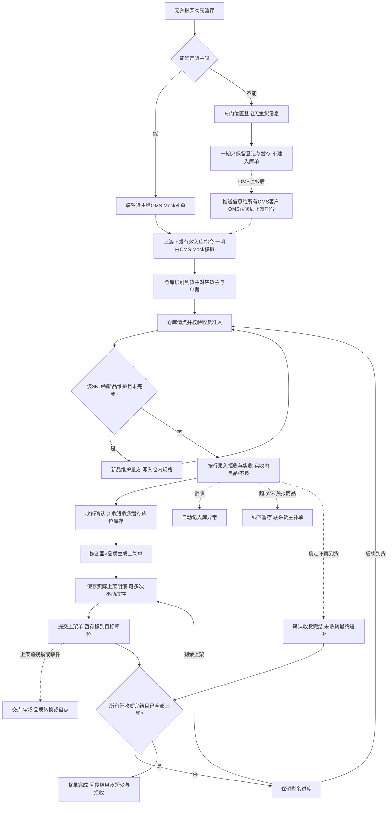

# 入库业务设计

> 课程沙盘「入库」域：到仓识别、收货（拒收与实收、实收内良品/不良）、上架与结果交接。顺读从第二节起；依据与交接表在第一节。

本篇在《入库业务需求分析》与[入库模块宏观系统架构](../01-全局背景信息/04-入库模块宏观系统架构.md)已确认规则上展开场景、流程、对象关系与走查。四仓接收自营与模拟外部货主货物；混合到货须先对应仓库、货主与指令，再分批收货、**实收进入收货暂存库位库存**、按容器×品质生成上架单并提交落位；**一期不设质检任务与质检单**。覆盖正常入库、独立调拨入库及无主货登记；认领由后续 OMS 承接，状态与页面由应用设计承接。

## 一、依据与交接范围

### 1.1 依据与竞品对照

功能真源见 [入库业务需求分析](../03-需求调研和分析/02-入库业务/入库业务需求分析.md)；调研背景见同名调研稿；项目范围见全局背景中的项目定位。与基础资料、库存、系统集成相关的 FR 在各自分析稿第二节维护，本文不重复长表。竞品核读索引见本文第九节；取舍与原文导航见项目总览与双边能力对比矩阵第四节。

### 1.2 业务入口与输出

一期入库单全部由OMS Mock下发正常或调拨入库指令后生成，WMS不提供手工新建。无主货只登记和暂存，不确认认领、不生成入库单。OMS上线后由客户在OMS认领，再推送有效入库指令，WMS才执行清点、收货与上架。（IN-FR-001、IN-FR-011、IN-FR-012）

| 上游给什么 | 本域交出什么 | 交给谁 |
| --- | --- | --- |
| OMS Mock提供货主、商品和有效入库指令 | 对应仓库、货主的可执行入库安排，或明确的拒收原因 | 仓库作业人员；接收结果交回OMS Mock |
| 送货方提供实物、箱唛、运单及随货线索 | 到货识别、与入库指令的匹配关系；无法匹配时的暂存线索 | 收货人员；无预报问题交仓库协作责任人 |
| 收货人员交付拒收、实收及批次、日期、SN | 实收内良品/不良拆分；收货确认后暂存库位库存 | 上架人员（按上架单继续） |
| 上架人员保存并提交上架单 | 目标库位上的实际库存与移库流水 | 库存与库内业务；结果交回OMS Mock |
| 仓库完成收货完结与上架 | 实收、拒收（入库异常）、良品/不良、已上架、最终短少（未收数量）分项可查 | 仓库管理人员、OMS Mock及其代表的上游业务方 |

调拨入库的上游给出本仓接收安排，WMS按普通入库执行；无需调出仓单号，不核对调出量，不建立跨仓主单、在途账和两端差异结案。调出仓结果与本仓实收不同，由上游业务组织解释，WMS交出本仓事实。（IN-FR-001、INT-FR-004）

货从仓外退回本仓由退货域承接，本域只处理正常／调拨入库指令。FBA移除退仓及换标换包装不在一期。已收货物按后续指令向仓外退回属于出库域采购退货出库：先完成本次入库，再交独立出库处理。仓外运输、计费和货主自助协作端亦不由本域承担。

## 二、参与角色与责任

下表按业务责任区分，不增加审批层级。同一人可以承担多项责任；动作只要单据状态和业务规则允许即默认可见；一期不做角色权限。常规入库作业与收货完结确认不设岗位权限（应用设计中的全局机制与操作留痕）。（COM-FR-001）

| 业务角色 | 负责什么 | 必须交出什么 |
| --- | --- | --- |
| 上游业务方／货主，由OMS Mock模拟指令 | 提供正确货主、商品、预计数量及到货线索；处理补单、允许节点的变更取消及后续处置安排 | 可匹配的指令、差异处理意见；需要退回时提供独立出库指令 |
| 到货与收货人员 | 识别本仓实物，按货主和单据区分；对需维护的首次到仓 SKU 完成或配合新品量方；按行录入拒收与实收，实收内分良品/不良；采集配置要求的追溯信息 | 拒收原因与数量（自动记入库异常）、实收及容器内 SKU 数量；仓内规格（经新品维护写入）；超收、未预报商品的识别线索交协作责任人 |
| 上架人员 | 按上架单填写实际上架明细，保存进度或提交落位；发现未登记残损或缺件时报告，按原品质、应上架数量提交后交库存域处理 | 可追到入库、收货明细、批次的目标库位、实际采集的SN记录与上架结果 |
| 仓库协作责任人，具体岗位未指定 | 联系货主补单（含超收、未预报商品）、组织差异核对、登记无主货识别线索、线下通知上游处理零实收单、确认是否还有后续到货 | 可追溯的归属与差异沟通依据；收货完结判断；未解决问题及责任交接 |
| 库存与出库业务执行人员 | 接手上架后的库存；按独立业务处理正常品退回或其他出库 | 独立业务结果及相应库存变化，保留与原入库的追溯 |

仓库记录发现时的数量、品质和位置；货主负责补充业务指令及其业务处理意见。记录“到货破损”并不能据此裁定承运人、供应方或仓库应赔偿，损失责任与赔付不属于已确认的一期规则。

## 三、海外仓入库场景

### 3.1 拼柜和混合到货：同批搬入，按归属记录

强盛共享仓模式下，一次卸货可能既有自营3C箱，也有第三方货主的大件和效期商品。同一托上的箱不等于属于同一货主，更不等于一张入库单。到货人员用入库单号、运单号或箱唛定位指令，收货事实仍要归到各自单据、货主和SKU。

有两种现场组织方式可服务同一目标。单据明确、货物已分开的，按单逐项核对；拼柜且箱唛可识别的，可在连续识别各箱后分别归到对应单据。领星LX-WMS-022正文明确说明了按单先分单及按箱混扫多货主、多入库单的差别，说明“作业可以同时组织，结果必须分别归属”的业务价值。强盛采用按单、箱或商品识别和收货，不直接照搬其盲扫自动填入预报数的行为：每次实收应以现场清点为据。（IN-FR-002、IN-FR-003、IN-FR-009）

同一箱的标识与箱内内容不符、只能找到多个可能单据，不能凭同名SKU或外箱外观把数量记给任一货主。先隔开疑问实物，核对随货信息与上游指令；已能准确对应的其他箱继续执行。整柜只是到货组织线索，不能由一个货主的收货结果替另一货主结案。

### 3.2 分批到货与分批上架：收货未完结，已收部分可继续往下走

一张入库单可以多次到货，也可以每次只接收其中一部分。每次收货确认后，实收按品质进入本仓收货暂存库位库存，并生成对应上架单；已收部分可并行保存或提交上架，无需等最后一批到齐才记暂存库存。后续到货仍归原单累计，已提交上架量不能再次当作待上架量。

收货人员与仓库协作责任人要区分“当前没有更多实物”和“这张单不再继续接收”。预计 10、实收 8、拒收 0 且还在等后续到货，未收 2；每行实收＋拒收＝预计时自动收货完结，或有行少收时由授权人员确认整单收货完结，此时未收数量即最终短少（预计－实收－拒收）。部分上架不代表整单完成。常规入库完成须：整单实收大于 0、所有行收货完结且已上架＝实收。全单拒收等零实收不作已完成：仓库通知上游取消，一期 OMS Mock 受理后原单已取消。暂存期间真实丢失按第 8.4 节先上架再盘点。（IN-FR-003、IN-FR-005、IN-FR-007）

### 3.3 多品类混合：同一张单按商品配置分路

一张货主入库单可以同时有线缆、需 SN 的设备及需批次效期的商品。良品与不良品均在收货实收内录入，一期不设质检任务；商品资料一期不设质检配置。同单不意味着同一品质结果，同 SKU 不同批次也不能只留一组日期。

SN 用于识别具体单件，批次和日期用于解释该批实物的来源与效期。收货采集后，这些信息随暂存库存、上架单提交和后续出库继续保留。箱数与托数只能说明搬运和交接容器：一箱可有多个 SKU，同 SKU 可分布在多箱；容器不能代替 SKU 件数或 SN 身份。大件、异形先按形态适配选择目标位置；带电要求由商品配置及样例解释。（MD-FR-002、MD-FR-005、IN-FR-003～IN-FR-005）

### 3.4 到货受损与装箱变化：先查清实物，保留比较依据

箱唛还在而外箱破损，或预报两箱实际拆成三箱，都会影响识别和交接，但不必然改变SKU总件数。仓库应把随货预报、实际容器与其内SKU数量对应起来，区分“箱数变了”、“商品件数变了”和“商品品质变了”。这些是不同事实，不应合写为一个差异数量。

收货时发现残损，由现场判断记入拒收（不进仓）或实收内不良品；上架前才发现未登记残损，一期先按原品质上架，再交库存域做品质转换，见第 6.4 节。缺失实物不能按不良品收货；效期不满足准入须记入拒收，不能改记不良品绕过。对破损外箱、错误箱唛、实际清点和品质结果，交接证据应能指回对应入库单和实物。证据组织与一期能力边界见第七节。

### 3.5 无预报：已知货主补单，未知货主登记暂存

没有匹配指令，但送货单或收件信息能确定货主的，实物先暂存，仓库联系货主经OMS Mock补推入库单；有效指令到达后再接收，不在WMS手工补建入库单。

货主无法确定的，记录所在仓库、暂存位置及箱唛／运单等识别线索，实物放在专门无主货暂存位置。一期到登记为止，不确认货主、不生成入库单、实收或库存。（IN-FR-002、IN-FR-011、IN-FR-012）

OMS上线后，WMS将登记信息推送给所有OMS客户查看，客户在OMS发起或确认认领，再由OMS下发入库指令。WMS收到有效指令后才清点、校验收货准入并上架；认领本身不证明数量或品质。

经核实属于客户退货或平台仓退件的，应交退货域按预报收货，不套正常入库指令。FBA移除退仓特征的一期不执行退货收货，保留识别线索线下协调。领星LX-WMS-030和极风JF-IN-013的认领公海与认领后销毁不纳入一期；无主货仍只登记暂存。

### 3.6 独立调拨入库与已收退回

其他仓调入的实物，仍要在本仓识别、清点、收货与上架，链路与正常入库相同。本仓只有“本指令预计多少、本次实际接收多少”的数量，不能把调出仓实发直接当本仓实收；运输差异不由本仓入库单补造在途账或跨仓差异单。

上游在本仓已实收后提出取消或退回，走第七节的已收拒取消与独立处置交接。客户或平台从仓外退回本仓走退货域，两者方向、库存起点和责任均不同。

开始入库作业时引用商品最新有效配置；已经开始作业及历史结果保留原要求。无主混箱保留可识别的实物线索，不能在一期管理端拆分认领或擅自指定货主。后续OMS认领与入库指令须与实际实物对应。

### 3.7 新品维护：首次到仓量方后再收该 SKU

同一货主商品首次进入本 WMS 仓网、尚无新品维护记录时，须在该 SKU **本单首次收货提交前**完成新品维护：量方称重（长宽高、毛重等），结果写入该货主商品的**仓内规格**，交[基础资料业务设计](01-基础资料业务设计.md)与上游身份资料衔接。维护成功后，四仓共用该规格，同仓网后续入库不再重复量方；多仓并发首次维护以先确认提交为准。

入库单或明细可展示「需新品维护」及 OMS 预报尺寸重量供对照，**实测以仓库提交为准**写入仓内规格；与预报差异可留操作记录，是否回写上游不在一期验证范围。按商品或入库规则，可在签收验收前对外箱、标签、破损等拍照并关联本次到货或收货记录；一期落实关键节点留痕与差异可关联原单，完整附件产品与在线沟通不纳入一期。

需维护且未完成时，**阻断该 SKU 在本单的后续收货与上架**，其他 SKU 与环节不受影响。新品维护不替代效期准入、追溯采集或收货品质录入，也不直接增加库存。量方数据一期可用手工或模拟录入；DWS／电子秤对接留待集成。（IN-FR-014）

### 3.8 作业容器：按容器或按 SKU，数量仍记商品明细

作业容器指现场一箱、一托或等价装载单元，建立独立容器档案，记录容器号、类型、所属货主、容量、状态、当前库位和内容明细；容器是批次库存的维度，可按容器查询、预占、分配和盘点，但不替代SKU库存汇总（与[项目定位](../01-全局背景信息/01-项目定位与范围.md)一致）。

每次清点可在以下方式中择一（一张入库单可混用，例如部分 SKU 按容器收、部分做无容器收货）：

| 方式 | 现场做什么 | 数量落在哪 | 上架怎么确认 |
| --- | --- | --- | --- |
| 按容器收货 | 为容器绑定可扫描的**作业容器编号**（货主箱唛／托唛或 WMS 生成），登记容器类型及容器内各 SKU 数量（含按配置采集的批次、效期、SN） | 实收累计在商品明细上，容器明细记录分 SKU 件数；**不重复记账** | 可扫容器编号确认目标库位，将容器内当前可上架数量落位；支持同一容器分次保存到同一或不同库位，整张上架单录满后提交 |
| 按 SKU 收货（不绑容器） | 直接在商品明细上登记实收 | 仅商品明细实收 | 按 SKU（及库位）扫描上架，与容器路径共用同一套已收货未上架口径 |

各仓**默认收货方式**在[基础资料需求分析](../03-需求调研和分析/01-基础资料/基础资料需求分析.md)仓库资料中配置，PDA 可按次改选。容器归属本入库单货主，**同一容器不混记不同货主**。收货确认后按容器×品质生成上架单，容器内良品与不良品分别进入对应上架单。回传上游以 SKU 汇总为主，是否附带容器明细由应用设计与集成约定。编号规则、箱／托层级展示见第十节待输入。（IN-FR-015）

## 四、主流程与完成条件

图中的继续执行包括后续收货、保存或提交上架单，实际回到尚未完成的节点，已完成动作不重做。不能把待上架实物再次提交为收货。

新品维护分支按**单行 SKU**判断：该行需维护且未完成时，先走量方写入仓内规格再回到清点节点，**不记实收、不增库存**；同单其他 SKU 可并行收货。规则见[§3.7](#37-新品维护首次到仓量方后再收该-sku)、走查见[§8.6](#86-模拟补充分支新品维护与容器分次上架)。

| 环节 | 谁做什么 | 实物在哪里 | 判断与交出的结果 |
| --- | --- | --- | --- |
| 接收安排 | 上游推送；仓库接收有效安排 | 可以仍在仓外，预报并不形成库存 | 仓库、货主、商品有效才形成可执行入库；无库位不阻断有效指令 |
| 到货识别 | 到货人员核对单号、运单、箱唛和随货信息 | 卸货／到货暂存现场 | 将确定的实物归到各单；疑问、已知未预报和未知货主分别隔开 |
| 清点与收货 | 收货人员按行录入拒收与实收，实收内分良品/不良；需新品维护的 SKU 先完成量方或阻断本行收货 | 拒收、超收与未预报实物隔开；实收在收货暂存库位 | 实收＋拒收≤预计；拒收自动记入库异常；收货确认即增暂存库位库存；生成上架单 |
| 上架作业 | 上架人员填写实际上架明细，可多次保存；提交时一次性移库 | 提交前在暂存库位；提交后在目标存储或不良隔离库位 | 保存不动库存；提交时各库位合计须等于应上架数量；缺件或残损按 8.4、8.5 交库存域 |
| 收货完结与整单完成 | 授权人员确认不再到货（或有行自动收货完结）并核对进度 | 目标库位上的实收实物 | 未收数量即最终短少；所有行已上架＝实收后整单已完成 |

整单可以带短少和拒收完成。“有短少”不抹去已收的数量；“有不良”不妨碍正常品上架后出库；超收、未预报商品线下隔开，不计入该单实收。若某部分已收实物还没有可上架位置，保留剩余并继续处理，不能靠结束单据消失。

已收未上架的真实丢失，一期仍按应上架数量提交上架单，再由上架人员对该 SKU 发起盘点调整，见第 8.4 节。实收误记不适用此路径。

盘点与入库的交接按 INV-FR-006 执行：这些 SKU 有进行中的上架单时不能建盘点单；建单后到盘点完成前，不能收这些 SKU 的货，含它们的上架单不能开始。收货暂存库位上的货不盘，跟着上架单走。详细数量与任务组织见[库存与库内业务设计](04-库存与库内业务设计.md)。

## 五、业务对象、关系与追溯

### 5.1 对象关系不等于应用单据分层

这里描述需要保留的业务事实。一期上架单按「容器×品质」生成，单内含应上架明细与实际上架明细；提交后的上架单即上架结果，不另建独立上架记录对象。

| 对象关系 | 基数与可选性 | 用途与追溯要求 |
| --- | --- | --- |
| 货主／仓库 → 入库单 | 每张入库单各归属1个货主、1个仓库；一个货主或仓库可有0～多张入库单 | 自营与外部货主使用同一模型；不能在原单把归属变为另一主体 |
| OMS Mock指令 → 入库单 | 一条有效新建指令对应1张入库单；被拒收时为0张；同一指令重发不增加单据 | 全部入库单追到上游指令，不存在认领手工入口 |
| 入库单 → 商品明细 | 可执行单据有1～多项商品；每项归属该单货主的1个SKU | 每项预计、拒收、实收、上架进度独立累计 |
| 同批到货 → 入库单 | 一次到货可涉及0～多张单；一张单可在0～多次到货中出现 | 通过识别记录关联，支持拼柜与分批；无匹配时为0张，先暂存 |
| 容器档案 → 商品实物 | 箱内可有1～多项SKU数量；一个SKU可分在多箱，托可承载多箱 | 保留实际内容与归属线索；托上多货主箱仍分别记账，容器作为批次库存维度，不另建独立箱／托库存账 |
| 入库商品明细 → 收货记录 | 未收时为0次；分批后为1～多次 | 拒收与实收分录；实收内良品/不良在收货明细录入 |
| 收货明细 → 入库异常 | 有拒收的收货明细行对应1条拒收类入库异常；无拒收为0 | 收货确认时自动生成，数量与原因引用收货记录 |
| 收货明细 → 上架单应上架行 | 一条收货明细行在本品质上架单内1条应上架行 | 应上架量生成后不可修改，不改原收货记录 |
| 上架单 → 实际上架明细 | 一条应上架行可对应多条实际上架行（多库位） | 保存可多次；提交时从暂存库位移到目标库位 |
| 收货确认 → 暂存库位库存 | 每次收货确认按品质增库存 | 多货主可混放暂存库位，按货主+SKU+品质+批次记账 |
| 无主货登记记录 → 后续OMS指令 | 一期只有到货与暂存线索，无入库单、实收或库存 | OMS上线后推送信息、在OMS认领并下发指令，WMS再关联原登记与普通入库 |
| 入库结果 → 后续独立处置 | 没有退回或处置时为0；有后续指令时可关联1～多次独立业务 | 原入库事实保留，以实际库存为处置起点；数量不能沿不同路径重复扣减 |

追溯有两条方向。查询某张入库单时，向下看每次收货、上架单与目标库位库存；查询某批或某个 SN 的库存、退回或处置时，向上找到原收货明细和入库来源。

### 5.2 数量怎样累计

数量以“入库单商品明细＋必要追溯维度”为基础计算；整单按相同单位汇总。不同SKU单位不同的时候，不能简单相加解释为一组商品数量。不新增库存数量类型。

| 数量 | 落在哪个业务事实 | 累计或变化方式 |
| --- | --- | --- |
| 预计 | 有效入库安排的商品明细 | 未实收时可接受合法明细变更；实收后不再用改预计抹掉差异 |
| 实收 | 收货记录 | 各次实收之和 |
| 拒收 | 收货记录；同步生成入库异常 | 各次拒收之和；不计实收；约束实收＋拒收≤预计 |
| 未收 | 入库单商品明细 | 预计－实收－拒收；收货完结后即为最终短少，拒收不与短少重复相加 |
| 良品／不良品 | 收货实收内拆分 | 良品＋不良品＝实收；只取收货录入，入库内不再调整 |
| 已上架 | 已提交上架单 | 从暂存移到目标库位；不超过实收；实收－已上架即待上架 |

超收、未预报商品一期不在系统登记，不计实收、拒收或库存。目标库位的已上架与暂存库位结余共同解释实收去向；收货确认时暂存库位已增加实收，提交上架单后相应数量离开暂存、进入目标库位。

库存形成沿用 INV-FR-002：良品实际库存＝订单预占库存＋可用库存。收货确认后良品、不良品先计入收货暂存库位实际库存（不良品整体不可用，不计入订单预占）；上架单提交后进入目标库位，良品可用量按占用规则计算。入库预计与未收不占库存。保存实际上架明细时仅占用目标库位货主规则，不重复计库存。

## 六、收货准入与库存形成

### 6.1 先有可识别的商品，再确认接收

有效入库安排必须匹配启用的仓库、货主和商品（基础资料域分节点准入）。到货只定位指令，不替代清点。需新品维护的 SKU 在首次收货提交前须完成量方并写入仓内规格，见第三节新品维护。按容器或按 SKU 收货及上架共用商品明细实收与待上架口径，见第三节作业容器。批次／效期与 SN 采集要求见商品配置与需求分析收货条；收货确认与上架单提交幂等，重复提交不重复增库存。

商品已有实际库存，或入库单已开始作业，包括实收但未上架的数量，禁止切换SN、批次和效期开关。仅推送且未开始作业的预报单不一律阻断。资料变更不得回写历史实收和追溯记录。（MD-FR-007）

### 6.2 效期准入只用允许入库天数

按业务所属仓库的当地业务日期计算剩余保质期，剩余保质期大于或等于商品允许入库天数时可收，小于时拒收。界面展示时区切换不改变该结果。三个商品配置值须满足“允许入库天数≥临期天数≥过期天数”，配置项可以相等；收货准入等值经用户确认后允许。（MD-FR-002）

临期、过期描述效期等级，不能再加一条“临期一律拒收”的准入。低于允许入库天数的数量，即使尚未临期也记入拒收；拒收记录批次、日期、数量与原因，不计实收、不进暂存库存，也不能改记不良品接收。

**模拟示例：**某商品允许入库60天、临期30天、过期0天。同一当地业务日到仓的四批分别剩70、40、20、−1天：70天批可收；40天批虽然尚未临期仍低于准入而拒收；20天和−1天批同样因低于准入拒收，并可分别识别为临期和过期。剩60天批按等值准入允许收货。这些数值用于演示，不是四仓统一阈值。

### 6.3 收货进暂存，提交上架进目标库位

收货确认后，实收内良品、不良品分别增加收货暂存库位库存（不良品整体不可用）。上架单保存实际上架明细时不动库存，但已填目标库位时占用该库位货主规则；提交时一次性从暂存移到目标库位。推荐位置先满足形态和品质适配，再按同货主同商品库位优先选择。正常品可放正常存储或拣货位置，不良品放该货主的不良隔离位置。（IN-FR-005、MD-FR-004～MD-FR-005）

收货暂存库位允许多货主混放；目标库位同一时点只能存放一个货主的实物。未知货主使用专门无主货暂存位置，不与已识别货主实物混放。

提交上架单时，各库位数量合计须等于应上架数量；应上架数量生成后不可修改。大件和异形可人工改位，但一期没有容量、体积、承重和占用率控制。

大货首先落到存储位置还是把部分直接放拣货位置，应结合适配位置和后续业务组织。两者上架都只搬动已在暂存入账的SKU库存，整托搬运也不形成托盘库存；以后拣货库位不足的移库由[库存与库内业务设计](04-库存与库内业务设计.md)承接。本域不新增自动补货或强制拣储分离。

### 6.4 收货品质与上架前发现残损

收货时由现场判断：拒收（不进仓，自动记入库异常）或实收内不良品。入库单的良品、不良品数量只取收货录入的数量。

一期上架单不做品质转换。上架前发现收货未登记的残损，上架人员仍按原品质、应上架数量提交，再报库存域对目标库位做品质转换（正常转不良，移到不良隔离位置）；**不改原收货记录**，也不回改入库单良品、不良品数量。已形成目标库位库存后才发现受损，同样按库存域处理。实收误记、未知混箱和货主认错按第七节一期边界；真实丢失按第 8.4 节处理。依据为[IN-FR-004 收货品质分流](../03-需求调研和分析/02-入库业务/入库业务需求分析.md#in-fr-004-收货品质分流)。

## 七、差异、变更、取消与异常恢复

### 7.1 差异事实和处置结果分开交接

仓库向上游交接时，要能说明预报对应哪批到货、实际接受了哪些SKU和追溯信息、哪些数量未接受、正常和不良怎样分流、已经放在哪个位置。短少、超收、外包装破损、品质不良和装箱变化各说明自己的事实；不能以一条“有差异”替代。

领星LX-WMS-022正文有收货拍照留言，极风JF-IN-010正文明确入库备注、拍照和仓库与卖家的沟通记录。它们证明收货证据随业务交接有价值。强盛一期已确认拒收类入库异常与操作者记录、结果查询和OMS Mock回传（短少取未收数量，超收与未预报商品线下沟通）；照片按异常需要提供，线下证据可对应原业务。完整图片附件产品能力、货主聊天和取证模板没有因此获准。以下是走查与应用设计的证据组织要求：

| 需要解释的事实 | 应能对应的依据 | 谁交给谁 |
| --- | --- | --- |
| 实收与预计不同 | 原指令、实际清点数量、容器内SKU和本次接收记录 | 收货人员交仓库协作责任人，再交上游核对 |
| 外箱或商品受损 | 发现位置与时间、涉及实物、品质结论和原因；有现场图片时关联，尚未提供的样例标为资料缺口 | 收货／上架人员交协作责任人和货主；赔付裁定不在本域 |
| 箱数、装箱明细变化 | 预报与实际容器内容对应、SKU总量是否改变 | 收货人员交上架人员，差异交上游；不给箱数增加一笔库存 |
| 已知货主漏推单或无主货到仓 | 运单、箱唛、随货线索与暂存位置 | 已知货主联系补单；无主货一期登记，后续信息交OMS客户查看及认领 |
| 最终短少结案 | 累计实收、剩余量、不再继续收货的判断及沟通依据 | 负责完结的授权人员交上游；不假定新增审批流程 |

每份证据的业务作用是核对数量与实物，不能自动证明赔偿责任或计费金额。具体附件字段、载体和上传操作交应用设计；四仓真实样表和取证习惯仍是资料缺口。

### 7.2 已实收之后保留事实，处置走独立业务

一期未实收时可接受 OMS Mock 明细变更与入库取消；实收后拒绝变更与取消；仓库、货主和业务类型不得在原单更换。零实收且不再接收（含全单拒收）时，仓库通知上游，Mock 取消受理后原单已取消。实收后即使未上架也不能取消、改明细或删除原事实。（IN-FR-008、INT-FR-006）

已收后确需退回，正常可用品由 OMS Mock 下发独立采购退货出库指令，引用原入库来源执行；货还在收货暂存库位时也能接单预占，上架单提交后才能分配、拣货。退回不支持缺量，不足时不能确认出库。不良品实际移出时按其他出库交接，核对指定实物后扣对应不良品的实际库存，不先转正常可用。同一实物数量只扣减一次；其他出库必须指定数量足量，不足时禁止确认，先处理差异或合法取消，不套用批发出库缺量结案。（OUT-FR-013、OUT-FR-014）

未进入实收的实物仍属暂存，不形成库存，也不进入 WMS 采购退货出库；零实收单由上游取消受理后已取消，仓库按货主线下安排拒收实物。这与已入库存的正常品退回必须区分。

### 7.3 异常如何恢复

| 触发条件 | 数量与实物后果 | 责任与恢复方式 |
| --- | --- | --- |
| 指令缺失或货主／商品无法匹配 | 无有效常规单，暂存不计实收或库存 | 上游修正资料并补推；收货人员核对已暂存实物，不凭名称另建商品或常规单 |
| 识别线索指向多张单或内容不符 | 不把疑问数量记到任意单据；已识别部分可以继续 | 收货人员隔开疑问实物，协作责任人联系上游核对；按确定对应关系再收 |
| 尚未完结时实收不足 | 保留未收，不提前结最终短少 | 有实收且确定不再接收时，授权人员确认收货完结；零实收通知上游取消，受理后已取消 |
| 超出该单预报剩余量，或到了本单没有的商品 | 一期不在系统登记；实物放本仓异常处理区，不计实收、拒收或库存 | 协作责任人线下记录并联系货主补发新的入库单；新单到达后重新校验并接收。货主要求直接退还或处置则在线下完成，不建出库单 |
| 需新品维护的 SKU 尚未完成量方 | 该 SKU 在本单不能提交收货或上架；其他 SKU 可继续 | 收货人员完成新品维护写入仓内规格后再收；不凭预报尺寸替代实测提交 |
| 批次／日期缺失或倒置，SN信息不完整 | 对应数量不能完成收货，不能先上架再补身份 | 收货人员与上游核对实物信息后继续；SN按货主＋SKU＋SN跨四仓判断，不能随意改码绕过 |
| 按容器上架超过容器内可上架量或商品行已收未上架 | 阻断本次落位，库存不变 | 上架人员按容器内剩余与商品行 U 核对；分次落位不重复增库存 |
| 剩余保质期低于允许入库天数 | 记入拒收，不计实收、不进暂存库存 | 仓库记录批次、数量和原因交上游；不能靠改品质或切展示时区恢复准入 |
| 上架前发现未登记残损 | 一期上架单不调整品质，按原品质提交后移到目标库位 | 上架人员报库存域做品质转换并移到隔离位置；不改原收货记录 |
| 推荐位置现场不适用、停用或被其他货主占用 | 待上架量保留在暂存库位；保存中的目标库位占用可调整 | 上架人员选择经校验的本仓适配位置；没有位置时由仓库管理责任人解决 |
| 部分上架单已提交后作业中断 | 已提交的整张上架单数量已在目标库位；其他未提交上架单的数量仍在暂存 | 从剩余上架单继续保存，逐张录满后整单提交；单张不部分提交，重复提交不重复移库 |
| 结果回传失败 | 仓内事实及库存已经发生，不因此回退 | 交接责任人处理已有结果的再次交接，不重做收货或上架；技术机制见应用设计 |
| 已实收后发现记录错误 | 一期不支持实收更正，受影响数量保持未完成，不补造正常上架或删除原实收 | 仓库协作责任人记录错误与证据、停止问题部分；后续更正能力另行设计，不把误记当真实丢失 |
| 实收正确但未上架实物真实丢失 | 原实收保留；一期上架单仍按应上架数量提交，目标库位账上暂时多出丢失数量 | 上架人员提交上架单后对该 SKU 发起盘点，盘亏丢失数量；回传的已上架数量不反映丢失，由仓库线下告知货主 |
| 已实收后发现原货主认错 | 一期不增加已实收归属更正，不修改原单货主；受影响作业停止 | 保留实物、原归属和异常证据，仓库与上游跟进；未提供恢复决定前不向另一货主生成库存 |

## 八、完整数量走查

本节为**独立模拟**；先读索引再打开对应小节详表。走查表用简写：E 预计、R 实收、J 拒收、G／B 良品／不良品、P 已上架（PG／PB 分品质）、U 待上架（R－P）。跨域串联见 [06§8.4](06-海外仓典型业务场景与方案.md#84-关键走查场景)。

| 编号 | 场景 | 结论要点 | 详表 |
| --- | --- | --- | --- |
| 8.1 | 同柜多货主、分批收货、部分上架 | A 最终 R19、G16/B3、P19、短少 1；B 独立 6；托盘不计入 SKU 增量 | [§8.1](#81-模拟示例一同柜多货主分批收货与部分上架恢复) |
| 8.2 | 无主货登记、零实收等待与已收独立退回 | 登记不建单；零实收不完成；已收后正常品退回6＋其他出库2 | [§8.2](#82-模拟示例二无主货登记零实收等待与已收独立退回) |
| 8.3 | 超收补单、效期准入拒收 | 超收 2 线下暂存、另单或线下退；拒收 4 记入库异常，不叠加入短少 8 | [§8.3](#83-模拟补充分支超收补新单与准入拒收不混入原实收) |
| 8.4 | 实收正确、未上架真实丢失 | 按 10 提交上架；发起盘点，盘亏 2；净库存 8 | [§8.4](#84-模拟补充分支实收正确未上架真实丢失先上架再盘点) |
| 8.5 | 收货录入残损 | 实收内 G8/B2；不同上架单先后足量提交；上架前新发现残损交库存域 | [§8.5](#85-模拟补充分支收货录入残损与上架前发现残损) |
| 8.6 | 新品维护阻断、容器路径分次上架 | 未量方不收；容器与 SKU 路径不双计；扫容器分两次保存、整张提交后R＝P | [§8.6](#86-模拟补充分支新品维护与容器分次上架) |

### 8.1 模拟示例一：同柜多货主、分批收货与部分上架恢复

**以下全部为模拟数据。**美西仓期初本例商品无库存、无其他出入库或占用。共享到货中有货主 A 入库单 A-1，预计效期商品 20 件，启用批次；日期满足准入。另有货主 B 入库单 B-1，预计线缆 6 件。托盘为搬运容器；收货确认后实收进入各仓收货暂存库位，上架单提交后进入目标库位。

表内数量均为累计。G／B 为实收内良品／不良（收货录入），PG／PB 为已提交上架量，U 为待上架。库存按“总实际／订单预占／良品可用”表达，含暂存库位与目标库位合计；不良品独立记数，不计入订单预占。

| 时间与业务动作 | A-1：E／R／未收或短少 | A-1：G／B | A-1：PG／PB／U | A 商品库存 | 现场与交接 |
| --- | --- | --- | --- | --- | --- |
| 第1天：A第一批实收12（G10、B2），容器A1装G7/B2、A2装G3；B实收6 | 20／12／未收 8 | 10／2 | 0／0／12 | 12／0／10 | 收货确认后 A 暂存 12；B 生成上架单 |
| B 上架单提交 6 | 20／12／未收 8 | 10／2 | 0／0／12 | 12／0／10 | B 目标库位 6／0／6，B 单完成 |
| A整张提交A1的良品单7件、不良品单2件 | 20／12／未收 8 | 10／2 | 7／2／3 | 12／0／10 | 目标 9＋暂存 3；U＝3 |
| 作业中断后整张提交A2良品单3件 | 20／12／未收 8 | 10／2 | 10／2／0 | 12／0／10 | 第一批实收 12 已全部提交上架；仍等第二批 |
| 第2天：A第二批实收7（G6、B1），容器A3装G4、A4装G2/B1 | 20／19／未收 1 | 16／3 | 10／2／7 | 19／0／16 | 暂存新增 7；U＝19−12＝7 |
| 第二批整张提交A3良品单4件 | 20／19／未收 1 | 16／3 | 14／2／3 | 19／0／16 | U＝3 |
| 整张提交A4良品单2件、不良品单1件；收货未自动完结 | 20／19／未收 1 | 16／3 | 16／3／0 | 19／0／16 | 已收均有库位，未收 1 不能自动当短少 |
| 确认不再到货，收货完结 | 20／19／短少 1 | 16／3 | 16／3／0 | 19／0／16 | A 带差异完成；回传 R19、G16、B3、P19、短少 1 |

A总实际19＝良品16＋不良3，订单预占0、可用16；B独立6。整批 SKU 增量 25 件，托盘数不计入。该案例为模拟走查，尚未执行。

### 8.2 模拟示例二：无主货登记、零实收等待与已收独立退回

**以下为模拟数据。**德国仓期初本例商品无库存，三段使用不同实物。

| 时间与动作 | 该段数量变化 | 实物位置与结果 |
| --- | --- | --- |
| U段：一箱无预报且货主未知，登记识别线索 | 无入库单、实收或任何货主库存；箱上写“8”不证明实收8件 | 放无主货暂存位置；一期没有认领入口，后续由OMS认领并下发指令 |
| C段：另一已知货主入库单预计5，到货但零实收且不再接收 | R＝0、P＝0、库存增量0；上游取消受理后已取消 | 保留到货与拒收事实；不交入库完成结果；暂存实物按货主线下安排 |
| R段：另一入库单预计10，已实收8（G6、B2）未提交上架，上游提出退回 | E＝10，R＝8，未收2，U＝8；原单保留 | 不取消原单，继续上架后独立退回 |
| 收货确认后暂存8；分批提交上架 | 先保存PG4，目标库存仍0、暂存8、U＝8；良品6件录满后整张提交，再提交不良品2件，P＝8、U＝0 | 正常6在正常位，不良2在隔离位；目标库位合计8／0／6 |
| 确认本单收货完结 | 最终短少2，原入库带差异完成，累计R与P保持8 | 交接正常6、不良2及最终短少2，等待独立处置指令 |
| OMS Mock另发退回正常品6，足量确认出库 | 预占后8／6／0，不良品2独立记数；确认后2／0／0 | 退回引用原入库；原实收8、上架8不改为2 |
| 另按通知核对指定不良2，足量确认其他出库 | 2／0／0变为0／0／0；本段入库8，正常品退回6、其他出库2，结存0 | 保留指定实物、通知来源、实发与交接流水，同一2件不能重复出库 |

U段在一期始终没有库存，不与R段混算。R段满足8＝正常品退回6＋其他出库2；两类出库都必须足量，分别保留原入库及本次出库记录。

### 8.3 模拟补充分支：超收补新单与准入拒收不混入原实收

**以下为模拟数据。**某商品预计10、现场清点12，其中12均满足其他收货条件。原单只实收10并上架10，原单最终短少0；超收2不在系统登记，由仓库线下放在异常处理区并联系货主，原单库存增量仍是10。OMS Mock另发预计2的新单后，暂存2重新校验、实收及上架，新增库存2；两单累计入库增量12。若货主选择直接线下退还这2件，原单库存仍10，WMS不生成2件出库、库存扣减或后续处置结果。

另一个效期商品预计 10，到货 10 件：6 件满足准入实收，4 件效期拒收记入 J＝4，同时生成一条拒收 4 的入库异常。实收＋拒收＝10，行自动收货完结，**最终短少 0**；不能把拒收 4 再叠加为短少 8。提交上架 6 件后目标库位净 6。等值分支：剩余保质期等于允许入库天数的 10 件可全部实收 G10，提交上架后可用 10。

**独立零实收模拟例：**预计 10 件全部效期拒收，R＝0、J＝10，无暂存库存。仓库通知上游取消，Mock 受理后单据已取消；拒收与入库异常可查，不交入库完成结果。

### 8.4 模拟补充分支：实收正确、未上架真实丢失，先上架再盘点

**独立模拟前提：**美西仓货主 A 商品 X 预计 10、实收 10（G10）；收货确认后暂存库位库存 10。未上架前真实丢失 2，现场剩 8。本例与实收误记不同。一期上架单不做丢失收口。

| 时间 | 仓库动作与现场事实 | R／P／U | 暂存＋目标库存（实际／预占／可用） | 交接及完成判断 |
| --- | --- | --- | --- | --- |
| T0 | 收货确认 10 件 | 10／0／10 | 暂存 10／0／10 | 实收成立 |
| T1 | 上架时只找到 8 件，仍按应上架 10 提交到目标库位 P1 | 10／10／0 | 目标 10／0／10，暂存 0；实物只有 8 | 入库单所有行已上架＝实收，整单完成并回传 R10、P10、短少 0 |
| T2 | 上架人员对 X 发起盘点，主管确认 P1 盘亏 2 | 不变 | 目标 8／0／8 | 盘点结果由库存域记录；入库单不回改 |

实收 10 不改为 8；丢失 2 不计入短少，也不体现在入库回传里，由仓库线下告知货主。T1 到 T2 之间 P1 账上多出 2 件实物不存在的可用库存，可能被分配出去，所以提交后要马上发起盘点；盘点期间 X 不能收货、上架和拣货，见[库存与库内业务设计](04-库存与库内业务设计.md)第 5.3 节。

### 8.5 模拟补充分支：收货录入残损与上架前发现残损

**独立模拟前提：**美西仓货主 A 商品 X 预计并实收 10，收货录入 G8、B2，R＝10；收货确认后暂存 G8、B2。

收货分两个容器：C1装G5，C2装G3/B2，生成三张上架单。先整张提交C1良品单5件，目标5／0／5、U＝5；再整张提交C2良品单3件和不良品单2件，合计10／0／8、U＝0。每张上架单都足量提交。

若上架时发现尚未提交的 2 件残损（收货未录），一期仍按良品上架单提交到正常库位，再由库存域对这 2 件做品质转换（正常转不良）并移到隔离位置；入库单仍为 G8、B2，不改原收货记录。

### 8.6 模拟补充分支：新品维护与容器分次上架

**以下为模拟数据。**美西仓货主 A 商品 X 预计 6 件，系统判定该货主商品尚无仓内规格，页面联查无新品维护记录，提示先维护。期初无库存。

| 时间顺序 | 动作与判断 | 数量与结果 |
| --- | --- | --- |
| 1 | 尝试直接收货 6 件 | 阻断；R=0，须先完成新品维护 |
| 2 | 提交量方（演示数据），写入仓内规格 | 仍 R=0；四仓共用该规格，本单可继续收 X |
| 3 | 按容器收货 CTN-01，实收 6（G6） | R=6，U=6；收货确认后暂存 6 |
| 4 | 同一张上架单保存4件到P1，尚未提交 | P＝0、U＝6；已录4、待录2，暂存库存仍6 |
| 5 | 再保存2件到P2，各行录满后整张提交 | P＝6、U＝0；目标合计6／0／6，暂存0 |

**混用分支（同单另一行）：**商品 Y 默认按 SKU 收货，不生成容器记录，实收 2 直接记在明细上，后续仅按 SKU 扫库位上架 2；与 X 的容器路径**不重复累计** Y 的数量。走查核对：新品阻断只限该 SKU；容器编号进入批次库存维度；分次容器上架与 §5.2 的 U、P 一致。

## 九、竞品原文索引

竞品取舍与跨域候选见[综合场景 §8.2 与文末引用](06-海外仓典型业务场景与方案.md#82-有原文依据的新增候选与后续方案)；下表只保留入库域高频对照，其余在双边能力对比矩阵第四节检索（留存正文可能与官网不一致，不据此改写已确认异常规则）。

| 主题 | 代表原文 | 本项目取舍 |
| --- | --- | --- |
| 混合到货与实收 | [LX-WMS-022](../02-竞品调研和分析/领星WMS/01-原始页面/LX-WMS-022_使用PDA实现收货.md) | 分归属、按实数清点；不接超收开关下的超出量 |
| 分批收货与完结 | [LX-WMS-031](../02-竞品调研和分析/领星WMS/01-原始页面/LX-WMS-031_使用WMS操作入库管理.md)、[JF-IN-016](../02-竞品调研和分析/极风WMS/01-原始页面/JF-IN-016-标准入库流程.md) | 收货完结≠库存；不以竞品「强制完成」替代强盛完成条件 |
| 上架与部分进度 | [LX-WMS-032](../02-竞品调研和分析/领星WMS/01-原始页面/LX-WMS-032_使用WMS操作上架管理.md) | 收货入暂存、上架提交移库；合并单/费用节点不定为强盛规则 |

无主货认领、SN／批次追溯及清分打托、预选库位、差异附件等跨域主题见综合场景 §7.1～7.2 与 §8.2，不在此重复链原文。

## 十、资料缺口与应用设计输入

### 10.1 资料缺口与应用设计输入

- 四仓的收货样表、差异沟通依据、实际暂存与适配库位样例尚未提供；常规作业的具体人员与演示账号尚未指定，关键确认权限岗位已定。它们用于完善交接示例，不能写成已完成现场访谈或凭空增加审批层级。
- 破损原因枚举、拒收原因及带电作业样例需补充；收货品质在实收内录入已确认，样板缺口不表示一期范围未定。
- **新品维护：**量方字段与单位、与 OMS 预报同屏比对方式、拍照必填项与附件存储、联查新品维护记录的页面表达由应用设计细化；业务阻断节点以[§3.7](#37-新品维护首次到仓量方后再收该-sku)为准。
- **作业容器：**容器档案的编号、类型、容量、状态、库位与内容摘要，默认收货方式与 PDA 按次改选交互，容器上架与上架任务界面关系，与收货明细行的容器号、SKU、批次和追溯字段对齐；业务数量口径以[§3.8](#38-作业容器按容器或按-sku数量仍记商品明细)与 §5.2 为准。
- SN唯一身份按货主＋SKU＋SN跨四仓判断，不同货主或不同SKU可同文本；日期采集表达和任务分组由应用设计细化；单件身份、批次、日期须随实物流转保留。
- 收货完结的业务责任落在仓库经办人；具体人员、证据载体和操作方式结合样例落实，不自行规定货主批准、固定时限或强制完结审批。

应用设计承接有效指令、准入、新品维护、按容器／按 SKU 收货与上架、上架单保存与提交、拒收自动生成入库异常、正常退回及不良处置的当前规则，并落实原收货记录、暂存与目标库位流水的分别追溯。
