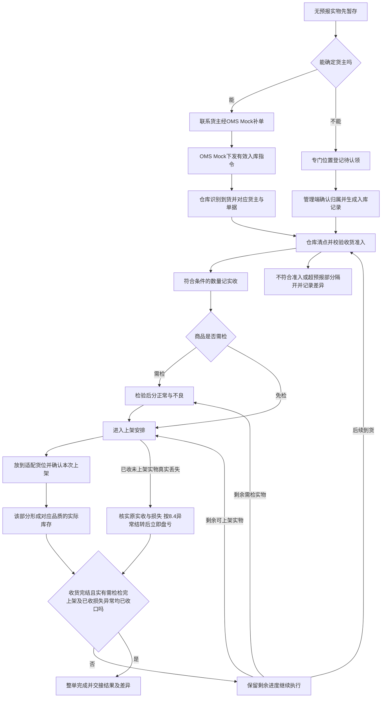

# 入库业务设计

> 沙盘入库域设计；**顺读从 §二 起**。范围与验收见 [业务蓝图](00-业务蓝图.md)。

四仓接收自营与模拟外部货主货物；混合到货须先对应仓库、货主与指令，再分批实收、按配置质检、分品质上架。覆盖正常入库、独立调拨入库及管理端无主件认领；状态与页面由 05 应用设计承接。

## 一、依据与交接范围

### 1.1 当前依据怎样使用

规则编号与调研背景见 [入库业务需求分析](../03-需求调研和分析/02-入库业务/入库业务需求分析.md)、[入库业务需求调研](../03-需求调研和分析/02-入库业务/入库业务需求调研.md)；范围见 [项目定位](../01-全局背景信息/02-项目定位与范围.md)。关联 MD／INV／INT 在分析稿中按条引用，本文不重复列 FR 长表。竞品核读索引见 §九；原文导航见 [双边能力对比矩阵](../02-竞品调研和分析/00-双边能力对比矩阵.md#四资料入口与证据边界)与 [竞品取舍](../03-需求调研和分析/00-项目总览/03-竞品参考与需求取舍.md)。

### 1.2 业务入口与输出

常规入库由OMS Mock下发正常入库或调拨入库指令，管理端不另建常规入库单。唯一的手工入库入口是已确认的一期管理端无主件认领：先确认归属，生成对应入库记录，再清点和执行入库。它不替代已知货主补推单，也不用于绕过客户退货入库的阶段边界。（IN-FR-001、IN-FR-011、IN-FR-012）

| 上游给什么 | 本域交出什么 | 交给谁 |
| --- | --- | --- |
| OMS Mock提供货主、商品和有效入库指令 | 对应仓库、货主的可执行入库安排，或明确的拒收原因 | 仓库作业人员；接收结果交回OMS Mock |
| 送货方提供实物、箱唛、运单及随货线索 | 到货登记、与入库指令的匹配关系；无法匹配时的暂存线索 | 收货人员；无预报问题交仓库协作责任人 |
| 收货人员交付实收及批次、日期、SN记录 | 需检数量与对应实物；免检数量的上架安排 | 质检或上架人员 |
| 质检人员交付正常、不良及原因 | 按品质分开的可上架实物及结果 | 上架人员 |
| 上架人员交付实际位置和数量 | 对应货主、SKU、品质及追溯维度的库存增量和流水 | 库存与库内业务；结果交回OMS Mock |
| 仓库完成该单的收货、质检和上架 | 实收、正常／不良、上架、最终短少及其他差异分别可查 | 仓库管理人员、OMS Mock及其代表的上游业务方 |

调拨入库的上游给出本仓接收安排，WMS按普通入库执行；无需调出仓单号，不核对调出量，不建立跨仓主单、在途账和两端差异结案。调出仓结果与本仓实收不同，由上游业务组织解释，WMS交出本仓事实。（IN-FR-001、INT-FR-004）

客户退货接收、退货质检、FBA退货及换标换包装不在一期。已收货物按后续指令向仓外退回属于另一方向的业务：先完成本次入库，再交独立出库处理。仓外运输、计费和货主自助协作端亦不由本域承担。

## 二、参与角色与责任

下表按业务责任区分，不增加审批层级。同一人可以承担多项责任；按仓库范围与角色权限判断能否操作。无主件归属、已收未上架丢失异常确认由仓库主管持有权限，常规入库作业与收货完结确认独立配置，见[应用权限配置第四节](../05-应用设计方案/20261002-MVP版本/系统架构设计/05-全局机制与权限配置.md)。具体人员与演示账号仍需配置。（COM-FR-001）

| 业务角色 | 负责什么 | 必须交出什么 |
| --- | --- | --- |
| 上游业务方／货主，由OMS Mock模拟指令 | 提供正确货主、商品、预计数量及到货线索；处理补单、允许节点的变更取消及后续处置安排 | 可匹配的指令、差异处理意见；需要退回时提供独立出库指令 |
| 到货与收货人员 | 识别本仓实物，按货主和单据区分；清点符合准入的数量，采集配置要求的追溯信息 | 本次实收与容器内SKU数量；差异事实、所在位置和识别线索 |
| 质检人员 | 对需检的已收实物执行商品指定流程，区分正常与不良；不以质检动作增加库存 | 可对应实收的品质结果、原因及分开的实物 |
| 上架人员 | 按实际实物和品质选择适配位置，确认实际放置数量，继续完成剩余上架 | 可追到入库、实收、批次／SN的实际位置与上架结果 |
| 仓库协作责任人，具体岗位未指定 | 联系货主补单、组织差异核对、准备无主件归属依据并交仓库主管确认、确认是否还有后续到货 | 可追溯的归属与差异沟通依据；收货完结判断；未解决问题及责任交接 |
| 仓库主管 | 确认无主件归属；核实已收未上架真实丢失并确认关联结转与盘亏 | 归属依据、异常数量与损失依据、确认人和时间；不代替常规作业权限 |
| 库存与出库业务执行人员 | 接手上架形成的库存；按独立业务处理正常品退回、不良品其他出库或报损／销毁 | 独立业务结果及相应库存变化，保留与原入库的追溯 |

仓库记录发现时的数量、品质和位置；货主负责补充业务指令及其业务处理意见。记录“到货破损”并不能据此裁定承运人、供应方或仓库应赔偿，损失责任与赔付不属于已确认的一期规则。

## 三、海外仓入库场景

### 3.1 拼柜和混合到货：同批搬入，按归属记录

强盛共享仓模式下，一次卸货可能既有自营3C箱，也有第三方货主的大件和效期商品。同一托上的箱不等于属于同一货主，更不等于一张入库单。到货人员用入库单号、运单号或箱唛定位指令，收货事实仍要归到各自单据、货主和SKU。

有两种现场组织方式可服务同一目标。单据明确、货物已分开的，按单逐项核对；拼柜且箱唛可识别的，可在连续识别各箱后分别归到对应单据。领星LX-WMS-022正文明确说明了按单先分单及按箱混扫多货主、多入库单的差别，说明“作业可以同时组织，结果必须分别归属”的业务价值。强盛采用按单、箱或商品识别和收货，不直接照搬其盲扫自动填入预报数的行为：每次实收应以现场清点为据。（IN-FR-002、IN-FR-003、IN-FR-009）

同一箱的标识与箱内内容不符、只能找到多个可能单据，不能凭同名SKU或外箱外观把数量记给任一货主。先隔开疑问实物，核对随货信息与上游指令；已能准确对应的其他箱继续执行。整柜只是到货组织线索，不能由一个货主的收货结果替另一货主结案。

### 3.2 分批到货与分批上架：收货未完结，已收部分可继续往下走

一张入库单可以多次到货，也可以每次只接收其中一部分。需检商品的该部分完成质检后、免检商品完成收货后，就可以继续上架；无需等待最后一批到齐才让已收部分形成库存。后续到货仍归原单累计，已上架量不能再次当作待上架量。

收货人员与仓库协作责任人要区分“当前没有更多实物”和“这张单不再继续接收”。预计10、实收8且还在等后续到货，是未收2；明确收货完结后，才是最终短少2。常规过程的部分上架不代表整单完成；收货已完结、需检已收数量全部检完、正常与不良已收数量全部上架，三个条件同时满足才结束本次入库。真实丢失按第8.4节的特殊完成条件判断。（IN-FR-003、IN-FR-005、IN-FR-007）

### 3.3 多品类混合：同一张单按商品配置分路

一张货主入库单可以同时有免检线缆、需要SN的设备及需要批次效期和质检的商品。免检部分不生成质检任务；需检部分进入指定质检流程。同单不意味着同一检验要求，同SKU不同批次也不能只留一组日期。

SN用于识别具体单件，批次和日期用于解释该批实物的来源与效期。收货采集后，这些信息随质检分流、部分上架和后续出库继续保留。箱数与托数只能说明搬运和交接容器：一箱可有多个SKU，同SKU可分布在多箱；容器不能代替SKU件数或SN身份。大件、异形先按形态适配选择位置；带电要求由商品配置及样例解释，不凭“带电”自行增加危险品认证、设备或运输规则。（MD-FR-002、MD-FR-005、IN-FR-003～IN-FR-005）

### 3.4 到货受损与装箱变化：先查清实物，保留比较依据

箱唛还在而外箱破损，或预报两箱实际拆成三箱，都会影响识别和交接，但不必然改变SKU总件数。仓库应把随货预报、实际容器与其内SKU数量对应起来，区分“箱数变了”、“商品件数变了”和“商品品质变了”。这些是不同事实，不应合写为一个差异数量。

需检商品的已收受损实物按商品配置完成品质判定，正常与不良分别上架；免检商品发现残损由授权仓库人员登记并判定品质，执行见第10.1节。缺失实物不能按不良品收货；效期不满足准入的商品也不能改记不良品绕过拒收。对破损外箱、错误箱唛、实际清点和品质结果，交接证据应能指回对应入库单和实物。证据组织与一期能力边界见第七节，额外拆箱重组、换标换包装服务不自动加入本流程。

### 3.5 无预报：已知货主补单，未知货主确认归属后再清点

没有匹配指令，但送货单或收件信息能确定货主的，实物先放在对应暂存位置，仓库联系该货主经OMS Mock补推入库单；到单且资料有效后再接收，不能为赶上架而在WMS新建常规单。

连货主都无法确定的，使用专门待认领位置并建立待认领记录。此时记录所在仓库、暂存位置及识别线索，不能据箱上数量形成任何货主的实收或库存。管理端确认归属后生成对应入库记录，仓库再核对商品、清点数量、执行准入及按配置的质检、上架。认领动作只解决“归谁”，不证明“里面有多少、品质如何”。（IN-FR-002、IN-FR-011、IN-FR-012）

认领货物经核实属于客户退货或FBA退货的，继续保留识别与暂存事实，但不能套正常入库认领流程转为一期库存。领星LX-WMS-030主要处理未预报退件，极风JF-IN-013覆盖FBA退货或漏推单；强盛取其隔离和归属问题，不取公开货主认领池、退货入库或认领后的直接销毁流程。

### 3.6 独立调拨入库与已收退回

其他仓调入的实物，仍要在本仓识别、清点、执行质检配置和上架。本仓只有“本指令预计多少、本次实际接收多少”的数量，不能把调出仓实发直接当本仓实收；运输差异不由本仓入库单补造在途账或跨仓差异单。

上游在本仓已实收后提出取消或退回，走第七节的已收拒取消与独立处置交接。客户从消费端退回仓库则是一期外的逆向入库，两者方向、库存起点和责任均不同。

开始入库作业时引用商品最新有效配置；已经开始作业及历史结果保留原要求。无主混箱必须先线下拆清归属再分别认领；一期管理端不提供一箱线上拆分认领。

## 四、主流程与完成条件

图中的继续执行包括后续收货、质检或上架，实际回到尚未完成的节点，已完成动作不重做。不能把需要继续上架的实物再次提交为收货。

| 环节 | 谁做什么 | 实物在哪里 | 判断与交出的结果 |
| --- | --- | --- | --- |
| 接收安排 | 上游推送；仓库接收有效安排 | 可以仍在仓外，预报并不形成库存 | 仓库、货主、商品有效才形成可执行入库；无货位不阻断有效指令 |
| 到货识别 | 到货人员核对单号、运单、箱唛和随货信息 | 卸货／到货暂存现场 | 将确定的实物归到各单；疑问、已知未预报和未知货主分别隔开 |
| 清点与准入 | 收货人员确认SKU件数和必需追溯信息 | 收货暂存位置 | 符合准入且未超预报的数量计实收，交给质检或上架；其他实物记录差异，不增库存 |
| 品质分流 | 质检人员执行商品流程；免检不生成质检任务，残损先按第10.1节登记判定再交上架 | 已收货暂存，正常与不良分开 | 检验结果解释已收数量；未检仍是已收货未上架的一部分 |
| 上架落位 | 上架人员核对货主、品质、形态和实际目标位置 | 从已收暂存移到正常存储／拣货位置或不良隔离位置 | 确认的SKU数量从已收货未上架减去，形成相应实际库存；部分上架留下剩余 |
| 收货完结与整单完成 | 具备动作授权的仓库责任人确认收货完结并核对进度，具体岗位未指定 | 实有已收实物在已确认货位；真实丢失量须有异常收口依据，不编落位 | 不再以未收描述余量；实有需检检完且上架完成，已收损失按8.4立即盘亏收口后交接结果与差异 |

整单可以带差异完成。“有短少”不抹去已收的数量；“有不良”不妨碍已上架正常品形成库存；“超收已隔开”不把那部分计入该单实收。若某部分已收实物还没有可上架位置或品质结果，保留剩余并继续处理，不能靠结束单据消失。

已收未上架的真实丢失按第8.4节异常结转与立即盘亏收口，缺失件不补造质检、落位或扫描。实收误记不适用此路径。

盘点与入库的交接按INV-FR-006执行：盘点准备时，命中范围尚未开始的任务整单不得开始；符合规则的已开始任务允许执行至整单完成。生成盘点快照后，本范围其他业务引起库存变化的上架不能提交；盘点结束再继续。不得用暂存数量冒充已上架数量规避冻结，详细数量与任务组织见[库存与库内业务设计](04-库存与库内业务设计.md)。

## 五、业务对象、关系与追溯

### 5.1 对象关系不等于应用单据分层

这里描述需要保留的业务事实。是否采用独立执行单、怎样合并任务，由应用设计决定；不能因为竞品“一次收货生成一张上架单”就把它定为强盛唯一结构。

| 对象关系 | 基数与可选性 | 用途与追溯要求 |
| --- | --- | --- |
| 货主／仓库 → 入库单 | 每张入库单各归属1个货主、1个仓库；一个货主或仓库可有0～多张入库单 | 自营与外部货主使用同一模型；不能在原单把归属变为另一主体 |
| OMS Mock指令 → 常规入库单 | 一条有效新建指令对应1张常规入库单；被拒收时为0张；同一指令重发不增加单据 | 从单据追到上游安排与接收结果；认领手工入口不伪造上游指令 |
| 入库单 → 商品明细 | 可执行单据有1～多项商品；每项归属该单货主的1个SKU | 每项预计、实收和剩余独立累计，整单汇总不能掩盖SKU差异 |
| 同批到货 → 入库单 | 一次到货可涉及0～多张单；一张单可在0～多次到货中出现 | 通过识别记录关联，支持拼柜与分批；无匹配时为0张，先暂存 |
| 容器 → 商品实物 | 箱内可有1～多项SKU数量；一个SKU可分在多箱，托可承载多箱 | 保留实际内容与归属线索；托上多货主箱仍分别记账，不产生箱／托库存 |
| 入库商品明细 → 实收事实 | 未收时为0次；分批后为1～多次；每次可归到对应SKU及其批次／SN | 实收是接收事实，各次相加得到累计量；不能用到货箱数替代 |
| 实收事实 → 质检结果 | 免检时为0；需检时覆盖该实收的1～多次品质判定 | 每份结果指向已收实物，累计正常＋不良不能超过待检的实收 |
| 实收事实 → 免检品质与残损记录 | 免检不产生质检任务；发现残损时可有1～多次登记 | 指向原实收及对应未上架实物，品质调整不改实收，正常／不良各自交适配位置 |
| 已收且具备上架条件的实物 → 上架任务及结果 | 可先未生成任务；可分组安排和多次执行；一个执行结果可含多项可追溯实物 | 每项确认数量必须能归回入库、SKU、品质和批次／SN；不规定任务一对一 |
| 上架结果 → 库存变化 | 一次上架结果可形成1～多项按库存维度分开的增量 | 从库存流水查上架、实收和入库来源；相同结果不重复生效 |
| 已收未上架损失 → 异常结转及盘亏 | 无损失时为0；同一入库可出现多次有依据的损失，每次收口对应其异常账面结转及立即盘亏 | 原实收、损失身份、现场剩余及两笔数量依据关联；同一损失不能重复结转或扣减 |
| 待认领记录 → 归属及入库记录 | 未认领时无货主库存和入库结果；归属确认后保留与对应入库记录的关联 | 同一实物不能重复认领并重复收货；一期不支持线上拆分认领，混合归属先线下拆清，再分别处理 |
| 入库结果 → 后续独立处置 | 没有退回或处置时为0；有后续指令时可关联1～多次独立业务 | 原入库事实保留，以实际库存为处置起点；数量不能沿不同路径重复扣减 |

追溯有两条方向。查询某张入库单时，向下看每次收货、需检结果、实际货位和库存增量；查询某批或某个SN的库存、退回或处置时，向上找到原实收和入库来源。因包装变化重新组织箱或托，不应切断SKU、批次和SN的来源。

### 5.2 数量怎样累计

数量以“入库单商品明细＋必要追溯维度”为基础计算；整单按相同单位汇总。不同SKU单位不同的时候，不能简单相加解释为一组商品数量。以下公式适用于未发生已收实物损失的常规过程，不新增库存数量类型；真实丢失的特殊收口在表后单独说明。

| 数量 | 落在哪个业务事实 | 累计或变化方式 |
| --- | --- | --- |
| 预计数量E | 有效入库安排的商品明细 | 未实收时可接受合法明细变更；实收后不再用改预计抹掉差异 |
| 累计实收R | 各次已接收的商品数量 | R＝各次有效实收之和；超收及准入拒收不纳入R |
| 未收数量 | 尚未完结收货的商品明细 | E－R，表示该单仍未接收的安排量；尚未到、已拒收但尚未完结均不提前定性为最终短少 |
| 最终短少 | 收货完结时的差异结果 | E－R，完成判断后记录；可附未到、准入拒收等原因，不能把原因数量再加一次当总短少 |
| 未完成质检T | 需检的已收实物 | 已收需检量－累计已检量；免检数量不纳入T |
| 正常数量N／不良数量B | 需检的品质结果，或免检的正常／不良上架安排 | 对同一组实收，R＝T＋N＋B；检验从T移到N或B，不改变R，也不形成库存 |
| 正常已上架PN／不良已上架PB | 各次实际落位结果 | 随确认上架累计；PN≤N、PB≤B，所需质检未完的部分不能上架 |
| 已收货未上架U | 实收与上架之间的进度 | U＝R－PN－PB＝T＋（N－PN）＋（B－PB）；涵盖未检，不能再加一遍未检量 |
| 已上架总量P | 入库来源对应的累计上架事实 | P＝PN＋PB；一次上架U减多少，同一次库存增量就是多少 |
| 超收／准入拒收数量 | 单独的差异事实及现场暂存线索 | 不计R、N、B或P，不形成实际库存；拒收原因不可与实收相加 |

所有已收正常品和不良品都上架后，本次入库的累计库存增量为P＝R。这里的“累计入库增量”不等于以后查询时的当前结存：后续出库、报损、销毁或盘点调整会改变结存，原入库累计量保留。

真实丢失时，实际落位量、异常账面结转量和损失量分别解释，不能把异常账面结转算成现场落位。已核实并完成立即盘亏收口的过程损失计入已收数量的去向：`实收＝实际正常落位＋实际不良落位＋已收损失已收口量＋尚待处理量`。8.4中为10＝8＋0＋2＋0；异常账面上架10、立即盘亏2，净库存增量8。原实收和已经发生的检验结果不改写，剩余实际需检量依现场及损失对应核对，缺失件不生成虚构检验结果；尚未完成异常收口的损失不能提前当作进度已完成。

库存形成沿用INV-FR-002：实际库存＝预占库存＋可用库存。正常品上架后，未被其他有效业务占用的数量可用；不良品上架后仍计实际库存，但全量品质锁定、可用为0。入库单的预计和未收不占用库存，已收货未上架也不加入该公式。上架位置上的货主占用用于防混放，不能把它再次计成一份库存预占。锁定原因重叠时按同一实物计量，不重复相加。

## 六、收货准入与库存形成

### 6.1 先有可识别的商品，再确认接收

有效入库安排必须匹配启用的仓库、货主和商品（MD-FR-011 分节点准入）。到货只定位指令，不替代清点；免检只免去配置中的质检环节，不免商品、数量、追溯及效期准入。批次／效期与 SN 采集要求见 MD-FR-002、IN-FR-003；PDA 重复提交不重复增库存见 IN-FR-013。

商品已有实际库存，或入库单已开始作业，包括实收但未上架的数量，禁止切换SN、批次和效期开关。仅推送且未开始作业的预报单不一律阻断。资料变更不得回写历史实收和追溯记录。（MD-FR-007）

### 6.2 效期准入只用允许入库天数

按业务所属仓库的当地业务日期计算剩余保质期，剩余保质期大于或等于商品允许入库天数时可收，小于时拒收。界面展示时区切换不改变该结果。三个商品配置值须满足“允许入库天数≥临期天数≥过期天数”，配置项可以相等；收货准入等值经用户确认后允许。（MD-FR-002）

临期、过期描述效期等级，不能再加一条“临期一律拒收”的准入。低于允许入库天数的数量，即使尚未临期也拒收；拒收记录批次、日期、数量与原因，不计实收，不生成质检或上架，也不能把效期不合准入来货改记不良品接收。

**模拟示例：**某商品允许入库60天、临期30天、过期0天。同一当地业务日到仓的四批分别剩70、40、20、−1天：70天批可收；40天批虽然尚未临期仍低于准入而拒收；20天和−1天批同样因低于准入拒收，并可分别识别为临期和过期。剩60天批按等值准入允许收货。这些数值用于演示，不是四仓统一阈值。

### 6.3 正常和不良分别放实，再形成库存

需检商品先得到对应品质结果；未发现残损的免检商品直接进入上架。免检残损不得无记录按正常品落位，处理路径见第10.1节。推荐位置先满足形态和品质适配，再按同货主同商品货位优先、该货主其他可用货位的次序选择。正常品可放正常存储或拣货位置，不良品放该货主的不良隔离位置。人工改位仍要校验本仓归属、启用、货主占用与品质适配。（IN-FR-005、MD-FR-004～MD-FR-005）

一个货位同一时点只能存放一个货主的实物，该货主可有多个SKU。同货位已有其他货主的实际实物、入库过程数量或未完结任务时，即使尚未形成库存也不能混入另一货主。未知货主使用专门待认领位置，不与已识别货主实物混放。

本次上架不能超过对应已收且具备上架条件的剩余量。位置推荐不表示实物已经放入，也不形成库存；实际落位确认才增加对应品质的实际数量并记录来源。大件和异形可人工改位，但一期没有容量、体积、承重和占用率控制，不能把推荐描述成已经检验承重安全的保证。

大货首先落到存储位置还是把部分直接放拣货位置，应结合适配位置和后续业务组织。两者上架都形成SKU库存，整托搬运也不形成托盘库存；以后拣货位不足的移库由[库存与库内业务设计](04-库存与库内业务设计.md)承接。本域不新增自动补货或强制拣储分离。

## 七、差异、变更、取消与异常恢复

### 7.1 差异事实和处置结果分开交接

仓库向上游交接时，要能说明预报对应哪批到货、实际接受了哪些SKU和追溯信息、哪些数量未接受、正常和不良怎样分流、已经放在哪个位置。短少、超收、外包装破损、品质不良和装箱变化各说明自己的事实；不能以一条“有差异”替代。

领星LX-WMS-022正文有收货拍照留言，极风JF-IN-010正文明确入库备注、拍照和仓库与卖家的沟通记录。它们证明收货证据随业务交接有价值。强盛一期已确认差异与操作者记录、结果查询和OMS Mock回传；照片按异常需要提供，线下证据可对应原业务。完整图片附件产品能力、货主聊天和取证模板没有因此获准。以下是走查与应用设计的证据组织要求：

| 需要解释的事实 | 应能对应的依据 | 谁交给谁 |
| --- | --- | --- |
| 实收与预计不同 | 原指令、实际清点数量、容器内SKU和本次接收记录 | 收货人员交仓库协作责任人，再交上游核对 |
| 外箱或商品受损 | 发现位置与时间、涉及实物、品质结论和原因；有现场图片时关联，尚未提供的样例标为资料缺口 | 收货／质检人员交协作责任人和货主；赔付裁定不在本域 |
| 箱数、装箱明细变化 | 预报与实际容器内容对应、SKU总量是否改变 | 收货人员交上架人员，差异交上游；不给箱数增加一笔库存 |
| 已知货主漏推单或认领归属 | 运单、箱唛、随货线索及归属确认依据 | 协作责任人交补单方或管理端归属确认人员 |
| 最终短少结案 | 累计实收、剩余量、不再继续收货的判断及沟通依据 | 负责完结的授权人员交上游；不假定新增审批流程 |

每份证据的业务作用是核对数量与实物，不能自动证明赔偿责任或计费金额。具体附件字段、载体和上传操作交应用设计；四仓真实样表和取证习惯仍是资料缺口。

### 7.2 已实收之后保留事实，处置走独立业务

尚未产生任何实收，可以接受OMS Mock明细变更或取消；仓库、货主和业务类型这些身份不能在原单改，需在可取消时取消原单再重新下发。入库已产生实收，即使尚未质检或上架，也拒绝取消和明细变更并交回原因，不能删除实收或把已知货主实物转成无主件。（IN-FR-008、INT-FR-006）

已收后确需退回，先完成商品配置要求的检验及正常、不良各自上架。正常可用品再由OMS Mock下发独立退回出库指令，引用原入库来源执行；退回不支持缺量，不足时不能确认出库。不良品按其他出库或报损／销毁交接，直接扣对应实际库存与品质锁定，不先转正常可用。两条处置路径各有记录，同一实物数量只扣减一次；其他出库必须指定数量足量，不足时禁止确认，先处理差异或合法取消，不套用B2B缺量结案。（OUT-FR-013、OUT-FR-014、INV-FR-012）

未进入实收的实物仍属暂存：取消指令后不形成入库，也不进入WMS退回出库。仓库按货主线下安排处理；这与已入库存的正常品退回必须区分。

### 7.3 异常如何恢复

| 触发条件 | 数量与实物后果 | 责任与恢复方式 |
| --- | --- | --- |
| 指令缺失或货主／商品无法匹配 | 无有效常规单，暂存不计实收或库存 | 上游修正资料并补推；收货人员核对已暂存实物，不凭名称另建商品或常规单 |
| 识别线索指向多张单或内容不符 | 不把疑问数量记到任意单据；已识别部分可以继续 | 收货人员隔开疑问实物，协作责任人联系上游核对；按确定对应关系再收 |
| 尚未完结时实收不足 | 保留未收，不提前结最终短少 | 等后续到货继续累计；明确不再继续后由授权人员完结收货并保留差异 |
| 超出该单预报剩余量 | 超出部分在本仓异常处理区，不计实收、质检、上架或库存 | 协作责任人联系货主补发新的入库单；新单到达后重新校验并接收。货主要求直接退还或处置则在线下完成，不建出库单，不补造WMS“已移出／已处理”结果 |
| 批次／日期缺失或倒置，SN信息不完整 | 对应数量不能完成收货，不能先上架再补身份 | 收货人员与上游核对实物信息后继续；SN按货主＋SKU＋SN跨四仓判断，不能随意改码绕过 |
| 剩余保质期低于允许入库天数 | 拒收不计实收或库存，也不作为质检不良收进 | 仓库记录批次、数量和原因交上游；不能靠改品质或切展示时区恢复准入 |
| 质检判不良 | 该量仍是实收，尚未上架不计实际库存 | 质检交不良隔离上架；形成库存后交OUT或INV处置。不能删去不良量让入库看起来全部正常 |
| 推荐位置现场不适用、停用或被其他货主占用 | 对应已收货未上架量保留，库存不变 | 上架人员选择经校验的本仓适配位置；没有位置时由仓库管理责任人解决，不强行混放 |
| 部分上架后作业中断 | 已确认部分保留库存增量；剩余U不变，不自动再收一次 | 对照已确认记录与现场实物从剩余节点继续；重复提交不重复增加库存 |
| 结果回传失败 | 仓内事实及库存已经发生，不因此回退 | 交接责任人处理已有结果的再次交接，不重做收货或上架；技术机制见应用设计 |
| 已实收后发现记录错误 | 一期不支持实收更正，受影响数量保持未完成，不补造正常上架或删除原实收 | 仓库协作责任人记录错误与证据、停止问题部分；后续更正能力另行设计，不把误记当真实丢失 |
| 实收正确但未上架实物真实丢失 | 原实收保留，损失走第8.4节异常收口，不补造落位 | 仓库核实实收、现场剩余和损失，具备对应权限和仓库授权的仓库主管确认关联结转与盘亏，完整结果交上游 |
| 已实收后发现原货主认错 | 一期不增加已实收归属更正，不修改原单货主；受影响作业停止 | 保留实物、原归属和异常证据，仓库与上游跟进；未提供恢复决定前不向另一货主生成库存 |

## 八、完整数量走查

本节为**独立模拟**；先读索引再打开对应小节详表。跨域串联见 [06§8.4](06-海外仓典型业务场景与方案.md#84-关键走查场景)。

| 编号 | 场景 | 结论要点 | 详表 |
| --- | --- | --- | --- |
| 8.1 | 同柜多货主、分批收货、需检/免检、部分上架 | A 最终 19/3/16、短少 1；B 独立 6/0/6；托盘不计入 SKU 增量 | [§8.1](#81-模拟示例一同柜多货主分批收货需检与免检部分上架恢复) |
| 8.2 | 认领、未实收取消、实收拒取消与退回/报损 | 认领不增库存；未实收取消无库存；实收后独立退回 6+报损 2 | [§8.2](#82-模拟示例二认领不增库存未实收可取消实收后拒取消并独立退回) |
| 8.3 | 超收补单、效期准入拒收 | 超收 2 另单或线下退；拒收 4 不叠加入短少 8 | [§8.3](#83-模拟补充分支超收补新单与准入拒收不混入原实收) |
| 8.4 | 实收正确、未上架真实丢失 | 落位 8；账面结转 10 与同次盘亏 2；净增 8 | [§8.4](#84-模拟补充分支实收正确未上架真实丢失立即盘亏收口) |
| 8.5 | 免检残损 | 不生成质检任务；N8+B2 分上架；文档逻辑走查已通过 | [§8.5](#85-模拟补充分支免检残损不生成质检任务) |

### 8.1 模拟示例一：同柜多货主、分批收货、需检与免检、部分上架恢复

**以下全部为模拟数据。**美西仓期初本例商品无库存、无其他出入库或锁定。共享到货中有货主A入库单A-1，预计效期商品20件，启用批次与质检；其日期满足准入。另有货主B入库单B-1，预计免检线缆6件。托盘作为搬运容器，上面分别标识A、B的箱；各货主使用自己的暂存和上架位置。

表内数量均为累计；“未收／短少”在收货完结前后含义不同。T为未检，N／B为累计正常／不良，PN／PB为累计正常／不良上架，U为已收货未上架。库存三项按“实际／预占／可用”表达。

| 时间与业务动作 | A-1：E／R／未收或短少 | A-1：T／N／B | A-1：PN／PB／U | A商品库存 | 现场与交接 |
| --- | --- | --- | --- | --- | --- |
| 第1天，到货识别并清点：A第一批12，B到6 | 20／12／未收8 | 12／0／0 | 0／0／12 | 0／0／0 | A交质检；B实收6直接交上架；共同到货不合并两单 |
| A第一批检完：正常10、不良2；B上架6并完结 | 20／12／未收8 | 0／10／2 | 0／0／12 | 0／0／0 | B单完成，B库存6／0／6；A的12仍在已收暂存，品质分开 |
| A先正常上架7、不良上架2，剩3正常待上架 | 20／12／未收8 | 0／10／2 | 7／2／3 | 9／2／7 | 不良2在A的不良隔离位并全量锁定；正常3仍不在库存 |
| 作业中断后核对记录，继续正常上架3 | 20／12／未收8 | 0／10／2 | 10／2／0 | 12／2／10 | 只处理剩3；第一批已全部上架，A整单仍在等第二批 |
| 第2天，A第二批实际到7并符合准入 | 20／19／未收1 | 7／10／2 | 10／2／7 | 12／2／10 | 第二批保留自己的批次；已经上架的12不重复收货 |
| 第二批检完：正常6、不良1 | 20／19／未收1 | 0／16／3 | 10／2／7 | 12／2／10 | 19＝0＋16＋3；剩正常6、不良1分别可上架 |
| 第二批先正常上架4 | 20／19／未收1 | 0／16／3 | 14／2／3 | 16／2／14 | U＝19－14－2＝3，其中正常2、不良1 |
| 余下正常2、不良1上架；尚未完结收货 | 20／19／未收1 | 0／16／3 | 16／3／0 | 19／3／16 | 已收全部有位置，但不能把未收1自动改成短少并完成整单 |
| 确认不再继续接收，完结收货并交接 | 20／19／最终短少1 | 0／16／3 | 16／3／0 | 19／3／16 | A单带差异完成；回传实收19、正常16、不良3、上架19、短少1 |

A库存满足19＝3＋16；B库存独立为6＝0＋6，不参与A的可用量。整批共形成SKU入库增量25件，但A、B各自的归属和品质仍分别保留；托盘数量不加进这25件。该案例为模拟数量走查，尚未执行。

### 8.2 模拟示例二：认领不增库存、未实收可取消、实收后拒取消并独立退回

**以下全部为模拟数据。**德国仓期初本例商品无库存，三段使用不同实物，不把互斥分支连成同一件货的经历。

| 时间与动作 | 该段数量变化 | 实物位置与结果 |
| --- | --- | --- |
| U段：一箱无预报，货主未知，登记待认领 | 无任何货主的E、R或库存；箱上写“8”不形成实收 | 专门待认领位置，仅保留箱和识别线索 |
| 管理端确认属于货主A，形成对应入库记录 | 归属成立；R＝0，实际＝0。为本例安排预计8，不代表认领动作证明8件 | 仍在暂存，交仓库清点；商品免检 |
| 清点并收货8，符合准入 | E＝8，R＝8，T＝0，N＝8，B＝0，P＝0，U＝8 | 归属记录与实际清点相连；仍无实际库存 |
| 分两次上架5、3，确认收货完结 | 第一次P＝5、U＝3、库存5／0／5；第二次P＝8、U＝0、库存8／0／8，最终短少0 | 认领记录可追到完成的入库；库存只增加两次实际上架数量 |
| C段：另一已知货主入库单预计5，货到但未实收；上游取消 | 原单关闭，R＝0、P＝0、库存增量0；不把取消的5写成已收短少 | 已暂存实物由货主线下安排，不生成WMS退回出库或库存扣减 |
| R段：另一需检入库单预计10，已实收8未上架，上游要求取消 | E＝10，R＝8，未收2，T＝8，U＝8；取消被拒，所有量保持 | 原实收保留，仓库继续质检；不能改为待认领或删除这8件 |
| 质检8：正常6、不良2 | T＝0，N＝6，B＝2，P＝0，U＝8；实际仍0 | 正常、不良各自暂存，交上架 |
| 正常先上架4，再上架2；不良上架2 | 第一次库存4／0／4、U＝4；全部上架后P＝8、U＝0、库存8／2／6 | 正常6在正常位，不良2在隔离位；入库增量8 |
| 确认本单收货完结 | 最终短少2，原入库带差异完成，累计R与P均保持8 | 交接正常6、不良2及最终短少2，等待独立处置安排 |
| OMS Mock另发正常品退回6，足量执行并确认出库 | 预占后库存8／8／0，其中正常订单锁定6、不良品质锁定2；确认出库后库存2／2／0 | 正常6离仓，退回记录引用原入库；原入库实收8、上架8不回写为2 |
| 另以独立报损记录处置不良2，确认实际处置 | 库存从2／2／0变为0／0／0；该批累计入库8，退回6、报损2，结存0 | 保留报损记录及流水；同一2件不能再用其他出库扣一次 |

U段为货主A形成的8件库存仍独立存在；R段的变化不得扣到U段同名商品。以来源追溯核对R段：8件入库＝6件正常退回＋2件不良报损，原入库事实完整。退回6足量结案，不能把不足作为缺量退回；报损与其他出库为可选的独立处置路径，表中只采用报损。

### 8.3 模拟补充分支：超收补新单与准入拒收不混入原实收

**以下为模拟数据。**某免检商品预计10、现场清点12，其中12均满足其他收货条件。原单只实收10并上架10，原单最终短少0；超收2在异常处理区，原单库存增量仍是10。OMS Mock另发预计2的新单后，暂存2重新校验、实收及上架，新增库存2；两单累计入库增量12。若货主选择直接线下退还这2件，原单库存仍10，WMS不生成2件出库、库存扣减或后续处置结果。

另一个效期商品预计10，实际到货10，其中6件满足准入、4件低于允许入库天数：实收6，拒收4不进入品质检验量；收货未完结时未收4，完结后最终短少4并说明其中4因效期拒收，不能把“短少4＋拒收4”再汇总为短少8。后续上架6只形成6件库存。独立模拟等值分支：允许入库30天、来货剩余30天的10件允许实收10；未上架实际0，全部正常上架后实际10、预占0、可用10。

### 8.4 模拟补充分支：实收正确、未上架真实丢失，立即盘亏收口

**独立模拟前提：**美西仓货主A的正常品X预计10、实际实收10，商品免检；未上架前真实丢失2。原实收有依据，现场只剩8，无其他锁定或盘点阻断。本例与实收误记不同，也不将丢失2改成不良品实物。

| 时间 | 仓库动作与现场事实 | 累计实收／账面已收未上架 | 实际／预占／可用 | 交接及完成判断 |
| --- | --- | --- | --- | --- |
| T0 | 清点接受10，实物在已收暂存区 | 10／10 | 0／0／0 | 已实收但未形成库存 |
| T1 | 核实原实收正确、真实丢失2，现场仅8 | 10／10 | 0／0／0 | 记录原实收、现场8及损失2；过程记录10不表示仍有10件实物 |
| T2 | 实有8落到适配位；按原实收做异常账面上架10，立即关联盘亏2，同次异常收口 | 10／0 | 8／0／8 | 账面增10、减2的依据分开且相互关联；缺失2没有现场落位或扫描事实 |
| T3 | 收货完结并交回异常收口结果 | 10／0 | 8／0／8 | 实收10、现场落位8、过程丢失2、异常账面结转10及盘亏2可分别追溯；未收短少0 |

对外交接的是完整异常结果，不能只报告“10件实物上架完成”。上架结转10与立即盘亏2同次收口，未扣差异2的中间账面量不可向新单承诺；最终净增库存8。已确认的实收10不改成8，损失2也不再计入未收短少。涉及批次／SN时保留原身份及损失对应，不补造缺失件的落位记录。

这是已确认的特殊异常处理，命中实盘冻结时仍须遵守既有作业限制。若原实收记错，一期不支持更正，受影响部分保持未完成。库存侧只扣同一损失一次，见[库存与库内业务设计](04-库存与库内业务设计.md)第四节。

### 8.5 模拟补充分支：免检残损不生成质检任务

**独立模拟前提：**美西仓货主A的免检X预计并实收10，均满足准入，无初始库存、其他锁定或盘点。收货时发现残损2，授权仓库人员登记原因并判为不良，形成正常N＝8、不良B＝2、未检T＝0，原实收R＝10不变。

先上架正常5，实际／锁定／可用为5／0／5，已收未上架U＝5（正常3、不良2）；再分别上架正常3与不良2，成为10／2／8、U＝0。收货完结后交正常8、不良2及残损依据，不生成质检任务，也不把不良2写成未收或盘亏。

若到上架时才发现尚未落位的2件残损，先登记并调整该部分品质与目标位，再分别确认；不改原实收，不补造检验记录。已在库受损使用库存域的独立分支。

## 九、竞品原文索引

需求层取舍见 [竞品参考与需求取舍](../03-需求调研和分析/00-项目总览/03-竞品参考与需求取舍.md)；扩展候选见 [06§8.2](06-海外仓典型业务场景与方案.md#82-有原文依据的新增候选与后续方案)。下表只保留**最常回到入库规则**的主题；其余核读页按主题在 [双边矩阵](../02-竞品调研和分析/00-双边能力对比矩阵.md#四资料入口与证据边界) 检索（留存正文可能与官网不一致，不据此改写已确认异常规则）。

| 主题 | 代表原文 | 强盛一句 |
| --- | --- | --- |
| 混合到货与实收 | [LX-WMS-022](../02-竞品调研和分析/领星WMS/01-原始页面/LX-WMS-022_使用PDA实现收货.md) | 分归属、按实数清点；不接超收开关下的超出量 |
| 分批收货与完结 | [LX-WMS-031](../02-竞品调研和分析/领星WMS/01-原始页面/LX-WMS-031_使用WMS操作入库管理.md)、[JF-IN-016](../02-竞品调研和分析/极风WMS/01-原始页面/JF-IN-016-标准入库流程.md) | 收货完结≠库存；不以竞品「强制完成」替代强盛完成条件 |
| 上架与部分进度 | [LX-WMS-032](../02-竞品调研和分析/领星WMS/01-原始页面/LX-WMS-032_使用WMS操作上架管理.md) | 落位增 SKU 库存；合并单/费用节点不定为强盛规则 |
| 认领边界 | [LX-WMS-030](../02-竞品调研和分析/领星WMS/01-原始页面/LX-WMS-030_使用WMS进行入库认领.md)、[JF-IN-013](../02-竞品调研和分析/极风WMS/01-原始页面/JF-IN-013-仓库入库认领流程.md) | 仅管理端归属确认；客户/FBA 退货与认领销毁不进一期 |
| SN／批次 | [LX-WMS-043](../02-竞品调研和分析/领星WMS/01-原始页面/LX-WMS-043_使用WMS和OMP实现批次库存管理.md)、[JF-BAS-013](../02-竞品调研和分析/极风WMS/01-原始页面/JF-BAS-013-商品序列号管理（商品序列号开启、入库、出库操作）.md) | 入库采集并追踪；不复制仅出库采 SN |

清分打托、预选货位、差异附件等待选项见 06§8.2。

## 十、执行规则与应用设计输入

### 10.1 免检残损处理

收货或上架时发现免检商品残损，由授权仓库人员登记对应实物、残损数量和原因，直接判定正常／不良并分别交适配位置上架，不生成质检任务，也不增加普遍的货主批准步骤。记录关联原入库与实收，保留配置要求的批次／SN、操作者和时间，差异随原单交回上游。依据为[IN-FR-004](../03-需求调研和分析/02-入库业务/入库业务需求分析.md#in-fr-004-质检)。

已实收后发现残损不改原实收；上架时发现的先调整尚未上架部分的品质和目标位置，再确认落位。已形成库存后才发现受损按04第7.4节执行。实收误记、未知混箱和已实收归属错误按第七节的一期边界处理，真实丢失按第8.4节处理。

### 10.2 资料缺口与应用设计输入

- 四仓的收货样表、差异沟通依据、实际暂存与适配货位样例尚未提供；常规作业的具体人员与演示账号尚未指定，关键确认权限岗位已定。它们用于完善交接示例，不能写成已完成现场访谈或凭空增加审批层级。
- 商品质检流程、检验项目、破损原因及带电作业样例需补充；按商品配置决定需检／免检和品质分流已经确认，样板缺口不表示一期范围未定。
- SN唯一身份按货主＋SKU＋SN跨四仓判断，不同货主或不同SKU可同文本；日期采集表达和任务分组由应用设计细化；单件身份、批次、日期须随实物流转保留。
- 收货完结的业务责任落在授权仓库责任人；具体人员、证据载体和操作方式结合样例落实，不自行规定货主批准、固定时限或强制完结审批。

应用设计承接有效指令、准入、分批收货、质检、上架、立即盘亏异常收口、正常退回及不良处置的当前规则，并落实原实收、真实落位和异常账面结果的分别追溯。
