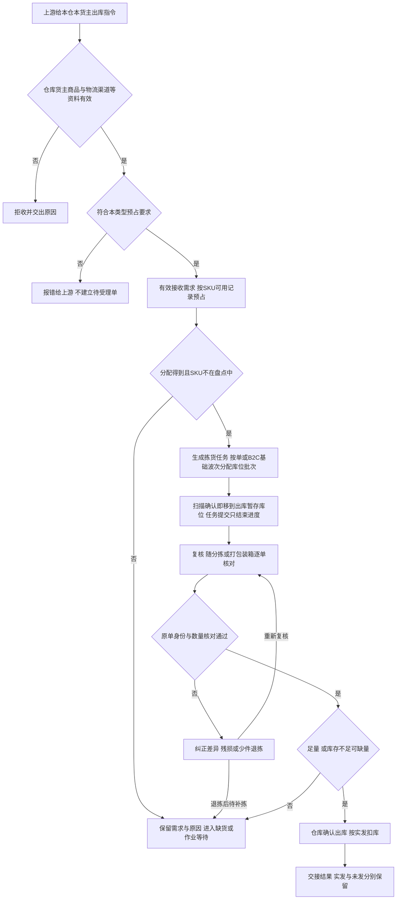

# 出库业务设计

> 课程沙盘「出库」域：指令接收、预占、拣货、复核、确认出库与交接。顺读从第二节起；类型与依据在第一节。

本篇在《出库业务需求分析》与[出库模块宏观系统架构](../01-全局背景信息/05-出库模块宏观系统架构.md)已确认规则上展开类型差异、主流程、波次防混单与走查。普通出库按预占、拣货、复核和确认出库执行；其他出库核对指定实物后足量确认。三量口径与库存域一致，不在本篇重定义。

## 一、业务定位、依据与类型边界

### 1.1 本域负责的结果

WMS出库完成点是仓库执行“确认出库”。拣货和打包完成不提前扣减实际库存，承运商是否已经揽收也不改变此完成点。确认后实发、未发及库存变化形成确定事实，仓外运输、平台仓签收、渠道经营和上游补发计划由仓外业务负责。

| 类型 | 为什么从海外仓发出 | 指令与实物前提 | 仓库交出什么 | 缺量边界 |
| --- | --- | --- | --- | --- |
| B2C出库 | 自营或外部货主向当地消费者履约 | OMS Mock指令；每个SKU须有足量可用并完成足量预占 | 按原订单复核的商品、包裹记录、实发及交接结果 | 不支持缺量预占或缺量出库，不更换商品 |
| FBA转运出库 | 海外仓向电商平台仓补货 | OMS Mock指令；可用库存和目的地／交接信息 | SKU实发量，实际箱／托及其内部SKU明细 | 库存不足时可缺量，一次确认整单完结 |
| 批发出库 | 当地客户大货交付、自提或交司机 | OMS Mock指令；日常缺货可按可用部分预占并接收 | 按单核对的件数及箱／托容器、交接对象与凭证 | 库存不足时可缺量，一次确认整单完结 |
| 调拨出库 | 本仓向上游指定的另一仓移交货物，含自营仓和第三方海外仓 | 本仓独立出库指令；可用库存 | 本仓实发和交接结果 | 不允许缺量 |
| 采购退货出库 | 已收入库正常品按后续指令退回仓外 | 独立指令引用原入库；拟退回的正常品有可用，货还在收货暂存的上架后才能拣 | 独立退回结果与原入库追溯 | 不允许缺量，不冲销原入库 |
| 其他出库 | 按通知将指定不良品移出仓库 | 上游通知或线下邮件手工来源；指定在库实物 | 指定不良品的处置量、原因、来源及出库结果 | 必须足量；不足禁止确认，先处理差异或合法取消 |

接单看SKU层的可用（正常品实际－订单占用），收货暂存、出库暂存库位上的正常品也算；分配看库存明细的可分配，只取存储、拣货库位上没被分配的正常品。货还在暂存的，接了单要等上架或返库上架后才能分配、拣货。

调拨出库与调拨入库独立执行，WMS不建立跨仓主单、两端单据关联、在途账或差异对账。不良品不走普通销售或正常品退回路径；独立报损／销毁及报损后非库存暂存跟踪后置。

### 1.2 依据与竞品对照

功能真源见 [出库业务需求分析](../03-需求调研和分析/03-出库业务/出库业务需求分析.md)；调研背景见同名调研稿；项目范围见全局背景中的项目定位。库存三量、盘点规则及系统集成去重等在各自分析稿维护，本文不重复长表。跨域综合走查见《海外仓典型业务场景与方案》8.4 节。

竞品取舍与跨域候选见[综合场景 §8.2 与文末引用](06-海外仓典型业务场景与方案.md#82-有原文依据的新增候选与后续方案)；下表为出库域高频对照，BOL／POD、包装视频等见 8.2 候选表。

| 主题 | 代表原文 | 本项目取舍 |
| --- | --- | --- |
| B2C 汇总拣货与复核 | [LX-WMS-055](../02-竞品调研和分析/领星WMS/01-原始页面/LX-WMS-055_使用WMS处理一件代发出库单.md) | 订单对应、每单复核与返库上架；不复制快捷出库/打印即出库 |
| 平台/B2B 容器 | [LX-WMS-049](../02-竞品调研和分析/领星WMS/01-原始页面/LX-WMS-049_使用WMS处理备货中转出库订单.md) | 记实际容器与内部 SKU 量；不复制箱库存、预约、BOL/POD 计费链 |
| 波次与分配 | [JF-OUT-022](../02-竞品调研和分析/极风WMS/01-原始页面/JF-OUT-022-波次发货_波波次业务设置、生成波次.md)、[JF-OUT-007](../02-竞品调研和分析/极风WMS/01-原始页面/JF-OUT-007-出库分配策略.md) | 手工基础波次且还原原单；SKU 预占后分配，不复制竞品策略树 |
| 缺货表达 | [JF-OUT-008](../02-竞品调研和分析/极风WMS/01-原始页面/JF-OUT-008-订单标记商品缺货.md) | 落到 SKU 与数量，不只整单标签 |

## 二、角色与交接责任

角色表示业务责任，不是固定岗位权限。有仓库权限的用户可查看该仓全部货主；动作授权见公共能力 COM-FR-001。手工其他出库确认及在库受损品质确认权限集中于仓库主管，常规出库确认与作业权限独立配置（应用设计中的全局机制与权限配置）；各仓具体人员与演示账号仍需配置。

| 角色 | 在什么对象上做什么 | 必须交给下一环节什么 |
| --- | --- | --- |
| 上游业务／货主协作方，一期由OMS Mock模拟 | 给本仓、货主、商品需求、类型及交接安排；决定合法变更、取消或新单 | 可执行指令；对缺货、未发、取消拒绝的回应 |
| 仓库组织责任角色，具体岗位未指定 | 组织按单或B2C波次；跟进短拣、返库上架、待交接和超时 | 每单执行依据、异常去向及未发结果 |
| 拣货作业角色 | 按任务核对库位、货主、SKU、批次／SN 和数量；分次扫描确认即下架，全部有结果后提交任务 | 已确认实拣与原单归属、缺货上报和短拣；任务提交不重复移库 |
| 分单复核／大货核对角色 | 复核随分拣或打包装箱完成：B2C按原单分货或装包时逐件核对，大货核对件数和容器；差异停止向下交货，残损或少件退拣 | 复核记录（每单可实发明细、包裹或箱托）及退拣 |
| 返库上架执行角色 | 按返库上架单把退拣实物从出库暂存库位送回适配库位，核对数量、身份、品质和目标位置 | 已提交的返库上架单，实物回到存储、拣货库位后可以再分配 |
| 有确认出库权限的仓库角色 | 核对本单实际发出量、资格和交接，使一次出库事实生效 | 扣库事实、整单结果及交接记录 |
| 承运商Mock／司机／客户自提方 | 承接仓外实物；一期登记模拟信息 | 已登记交接对象和凭证；运输不由WMS执行 |

| 上游给什么 | 本域交出什么 | 交给谁 |
| --- | --- | --- |
| 基础资料、出库指令、已有物流信息 | 接收／拒绝原因及可执行依据 | 上游协作域、仓库组织角色 |
| 本仓本货主的可用、可分配、位置、品质／效期 | 本单占用、分配及异常实物范围 | 库存域、现场角色 |
| 拣货实物、原订单及差异 | 逐单复核、实装量、箱托与SKU对应 | 确认出库角色、交接方 |
| 确认出库或取消事实 | 需求、实发、未发、整单结果及交接 | OMS Mock；手工其他出库保留仓内结果 |

结果交接失败由上游协作域承接，不能再拣货或再扣库。

## 三、海外仓各类出库怎样组织

### 3.1 平台仓补货：先核对SKU，再解释箱和托

货主决定从海外仓向平台仓补货，仓库接收该仓独立指令，找到可用于本单的正常品、拣出、核对实际装箱后确认出库。平台仓不是强盛四仓，WMS完成本仓出库，不把平台仓签收当成本单完成条件。

箱数和托数解释装载与交接。一箱可含多种SKU，同一SKU可分布多箱，一托可承载多箱，必须从交接容器还原实发SKU量，不能用“3箱”代替“SKU-A 24件、SKU-B 6件”。装箱变化后按当前容器重核SKU合计和箱托对应，不沿用失真的装箱说明；这是实际作业记录变化，开始拣货后不能借改箱明细改变商品需求或增加新SKU。

仅箱数或组托方式变化、SKU和件数不变时，只更新复核记录里的容器。影响货主已提供的箱唛、预约或运输资料的，线下交货主确认后再交接，期间实物仍在出库暂存库位、原单占用不变；一期不建设预约或文件交换能力。

FBA转运出库只在库存不足时缺量结案，且至少有实际发出量；已拣到的货须全部发出。零实发继续等待或合法取消，货主仍需未发部分时另发新单，不保留原单续发任务。箱唛申请、卡派预约、附件往返及BOL／POD协作属文末候选，不成为一期必经步骤。

### 3.2 批发出库：按单摘果、按实际交付核对

当地客户大货由上游下发。仓库以该单为单位按单摘果，拣后核对SKU、批次／SN、件数及实际箱托，记录司机或客户自提信息。不同货主即使商品编码相同，仍分别占用、核对，不因同车交付合并库存。

批发出库不进入B2C波次。库存不足时按已复核数量一次缺量结案；已拣到的货须全部发出，装车放不下或箱数变化属于交接安排，只更新容器或交接记录，不算缺量。

### 3.3 B2C：组织可以集中，责任仍逐单

消费者单可逐单拣，也可将同仓、同货主、整单能分配足的多单手工组基础波次；货还在暂存的单等上架后再拣。单品订单只有一种SKU，仍可能多件；多品单要同时满足每种SKU。都须还原原单复核，波次汇总量足够不能证明每个包裹正确。

轻小件可集中拣；大件或异形货仍需对应原单，不因搬运形式改变数量规则。带电等属性来自商品配置；当前未确定据此自动拆波、换渠道或运输合规校验，不凭品类名称推导规则。

### 3.4 调拨和已收入库退回：保留独立事实

调拨出库执行本仓占用、拣货、核对及足量出库。即使上游告知目的仓，WMS仍只交本仓结果，不要求另一仓实收或建立两端追溯链。

采购退货出库用于已产生实收的正常品。货物尚在收货暂存库位时，原单不能取消；由上游发引用原入库的新退回单，货还在暂存也能按可用预占，上架后才能分配、拣货。新单正常预占、足量扣库，原收货、上架及流水不冲销。未进入库存的超收、效期拒收实物在线下处理，不伪造采购退货出库。不良品或过期转不良品实际移出时走其他出库。买家或平台退回本仓由退货域处理；FBA移除退仓不在一期。均不等同于本条采购退货出库（仓内→仓外）。

## 四、普通出库主流程与完成条件

有效接收须匹配启用的仓库、货主、商品及指令所要求的物流渠道（分节点准入见基础资料域第四节）。拣货与复核再校验库位、SKU、批次／SN 等现场身份；确认出库与交接登记沿用接单时的渠道引用，承运商 Mock 登记不替代渠道资料校验。指令引用已停用渠道或其所属承运商已停用时整单拒收；已有效接收的单据不因渠道后续停用而自动取消，但新交接登记不得再选用该停用渠道（渠道停用见基础资料第七节）。PDA 与管理端共用业务记录与占用，现场重复提交不重复形成实发、不重复扣减库存；上游重复消息去重与结果回传不重复预占、扣库由系统集成域承接。（OUT-FR-001、OUT-FR-016）

含盘点中SKU的出库请求照常接收并预占，不因盘点拒收；盘点完成前，这张单和已经接收的同SKU订单一样只能受理取消，分配、组波、拣货、复核、确认出库都等盘点完成。

日常B2B缺货允许接收并按可用部分预占，需求、已占和缺货分别保留。B2C所有SKU必须足量预占才能接收；任一SKU不足，整单报错，不生成可执行单，也不留下其他SKU的部分占用。已足量接收后发生短拣、受损或过期，仍属执行异常，保留原有效占用并按第七节恢复，不能据此倒推接单时允许部分预占。

FBA转运出库、调拨和退回按OUT-FR-002以min（需求、max（可用,0））预占，不足进入缺货处理；确认出库时FBA转运出库与批发出库可一次缺量结案，调拨和退回须足量。其他出库按OUT-FR-014选择指定实物，计入已分配，不从可用预占。

| 环节 | 谁执行、依据什么 | 实物位置及数量后果 | 完成并交出什么 |
| --- | --- | --- | --- |
| 接收预占 | 核对仓库、货主、商品、物流渠道及本类型要求；B2C所有SKU须足量，B2B日常可部分占 | 成功时实物仍原位（可以还在暂存），预占增、可用减、实际不变；拒收不留下本单占用 | 有效接收及需求、已占、不足量，或整单拒收原因 |
| 组织分配 | 仓库组织者生成拣货任务（按单或B2C波次），在已占量内分配有效库位批次，只取存储、拣货库位上没被分配的正常品；B2C整单能分配足才生成 | 尚未搬出，分配不另加预占，计入库存明细的已分配；生成任务即算开始拣货 | 拣货任务的应拣明细 |
| 拣货 | 现场扫描核对库位、SKU、批次／SN 和数量，分次确认 | 每次确认即将新增数量移到出库暂存，减少来源已分配并增加原单已拣；任务提交只结束进度，实际总量和预占不变 | 已确认实拣与原单归属、缺货上报和短拣 |
| 复核（随分拣或打包装箱） | 依据原单，不仅依据汇总拣货单 | 还原每单或每箱托SKU，实际不变；残损或少件退拣 | 复核记录、容器及差异结论 |
| 确认出库 | 确认角色核本单有效、数量及类型资格；已拣的须全部复核 | 实发扣出库暂存库位实际及本单预占，同时释放剩余预占 | 整单完成无本单残锁，实发未发明确 |
| 返库上架 | 上架执行角色按返库上架单 | 从出库暂存库位移回存储、拣货库位，之后可以再分配；不良品回不良隔离库位 | 已提交的返库上架单 |
| 结果及实物交接 | 登记承运商Mock／司机／自提及凭证，上游协作交结果 | 可已交或确认后待揽收；已确认量不再计实际 | 可追到单据、数量、确认人和时间的结果 |

普通出库从未过期正常品分配。效期商品优先推荐有效期更早的可用批次，临期正品可出，不另设最短剩余效期门槛。错误批次／SN不能凭件数相同放行。确认前核对取消、重复、品质和数量；一期已拣货不追加过期转换或二次效期阻断，照常复核、发出。

## 五、基础波次、分单与防混单

### 5.1 波次如何服务原订单

波次是多单拣货组织，不取代出库单，也不新增库存。仓库选择同仓同货主、待处理且整单能分配足的B2C单手工组波，生成一张波次拣货任务，汇总相同SKU供集中拣货，再按原单重新区分。扫描确认时按波次内顺序把新增实拣归属未取消的原单，已确认归属不重排；任务提交只确定剩余短拣，短拣落在未分满的靠后单上；生成波次任务后成员不能移出，只能取消；取消只释放该单未拣份额，已确认归属该单的实物退拣。波次拣完，各单仍分别复核、确认和回传，一单异常不能被汇总进度掩盖。

要持续识别当前波次、此件所对应原单、原单每种SKU是否配齐。分单保持订单与分拣容器对应；复核可在分拣时逐件完成，也可在打包时完成，都按原单逐种核对；交接不把未配齐或取消单混入已完成单。分拣筐、分拣位与扫描顺序由应用设计结合样例落实，不预定播种墙、拣货车等设备。

| 组织方式 | 适用讨论 | 防混单的业务要求 | 一期结论 |
| --- | --- | --- | --- |
| 逐单拣货 | 单量少或实物适合独立搬运 | 保持本单身份，交本单复核 | 已有通路 |
| 边拣边分 | 从取货时保持订单对应 | 实物直接归对应原单，SKU相同也不能替代订单身份 | 竞品核实的选项，一期不做 |
| 先拣后分 | 多单同SKU适合集中拣出 | 汇总后再次逐单分配、核对，不能按总量宣告逐单完成 | 一期基础波次采用；复核可随分拣进行 |

选分拣方式不改变同仓同货主、逐单复核、缺量资格和扣库。自动组波、派工、产能计算、爆款抽样复核及打印即发货不纳入一期。

### 5.2 模拟走查：单品和多品同时处理

**模拟前提：**美西仓货主A，正常品X实际10、Y实际6，无其他占用。O1为X×1，O2为X×2，O3为X×1＋Y×2，O4为Y×1，四单可组一波；另一货主B的X订单不入本波。

| 时间 | 动作与实物 | X实际／预占／可用 | Y实际／预占／可用 | 订单结果 |
| --- | --- | --- | --- | --- |
| T0 | 原位在库 | 10／0／10 | 6／0／6 | 无四单 |
| T1 | 接四单分别预占 | 10／4／6 | 6／3／3 | O1占X1；O2占X2；O3占X1、Y2；O4占Y1 |
| T2 | 组波生成拣货任务，集中扫描确认X4、Y3，即移到出库暂存库位；任务提交只结束进度 | 10／4／6 | 6／3／3 | 波次不新增预占，实物仍计实际 |
| T3 | 分拣到O1：X1；O2：X2；O3：X1、Y2；O4：Y1，分拣时逐件复核 | 10／4／6 | 6／3／3 | O3两种SKU均核对，不能拿X补Y |
| T4 | 依次确认O1、O2 | 7／1／6 | 6／3／3 | 两单各自足量完成 |
| T5 | 确认O3 | 6／0／6 | 4／1／3 | O3实发X1、Y2 |
| T6 | 确认O4 | 6／0／6 | 3／0／3 | O4实发Y1，各单分别交结果 |

合计实发X4、Y3等于汇总实拣。若O3复核只有Y1，该单不得确认；把短少归到O3处理，其他单按自己的足量结果执行，不能从O4拿Y1后仍声称两单齐量。

**独立取消分支：**德国仓B货主X实际10、Y实际6，无其他占用。P1需X1、P2需X2、P3需X1＋Y1、P4需X1＋Y2，合计预占X5、Y3。集中拣货并分回原单后，P4取消：其预占X1、Y2随取消一次释放，已拣实物自动退拣，经返库上架单回到库位。其余三单确认实发X4、Y1，共5件；期末X6、Y5，共11件，满足16＝5＋11。取消返库上架3件不增加实际库存，也不再混入其他单的实发；需要重新使用时经合法分配和取货执行。

## 六、业务对象、关系与数量

### 6.1 关系与追溯

本表描述业务关系，不指定表结构、任务拆分层级或状态枚举。

| 关系 | 基数与可选性 | 业务含义及追溯 |
| --- | --- | --- |
| 上游指令→出库单 | 一条有效新建指令对应1单，重复消息仍指原单；手工其他出库可无上游指令 | 上游追来源；手工追邮件，不伪造指令号 |
| 出库单→仓库、货主、明细 | 各属1仓1货主，有1至多条明细 | 身份不可原单改写；在对应归属内处理量 |
| 波次→B2C单 | 波次含多单；按单拣的单可无波次；一次有效组织不可重复计入同单 | 查各单进度与组织；历史记录不增加需求 |
| 单／波次→拣货任务 | 1张单可有多张拣货任务（首次拣货、补拣）；1个波次可有多张波次拣货任务（一期为 1 张），各任务汇总部分应拣并保留原单份额；任务分应拣与实拣明细 | 扫描确认即下架并记原单实拣；波次按顺序即时归属，任务提交只结束进度；波次头状态为已分配／已下发任务／已完成／已取消，不表达任务拣货中 |
| 出库明细→占用及分配 | SKU总量预占合计在SKU层；一明细可分配多处库位／批次，记为库存明细的已分配；SN按配置存在 | 分配是占用落点，换位不新增量 |
| 单→复核记录、交接 | 随分拣复核时按单一条，随打包装箱复核时一个包裹或箱托一条，不用容器时容器为空；交接可随确认登记或后补 | 从复核记录还原件数，不形成箱托库存或第二次扣库 |
| 采购退货出库→原入库 | 必须引用原入库；原入库可被不同后续指令引用 | 追原事实及新退回量；当前未定义多来源合并引用 |
| 退拣→返库上架单 | 每次退拣生成1张，记退拣原因（取消、残损、少件）；正常完成可无 | 追已拣实物回到哪个库位；缺货上报与短拣留在拣货任务，一期不设出库异常单据 |

### 6.2 数量分别落在哪里

需求、预占、已拣、已复核和实发在出库单明细；实拣在拣货任务，退拣在返库上架单；实际、预占、可用在SKU库存，已分配在库存明细。它们互相解释，不能全部相加为库存。

| 数量 | 累计或变化 | 判断用途 |
| --- | --- | --- |
| 需求 | 生成拣货任务前随合法变更更新，之后不静默改量 | 本单应执行数量 |
| 本单预占 | B2C有效接收须各SKU足量；B2B、FBA转运出库、调拨和退回按min（需求、max（可用,0））占用；确认出库扣实发并释放剩余，取消一次释放 | 保护需求，不等于已经搬出；B2C准入失败时不产生部分占用 |
| 库位分配 | 在占用内落位，只取存储、拣货库位上的正常品，计入库存明细的已分配；换位解旧再分新 | 指导找货，不加到预占上 |
| 已拣 | 拣货扫描确认时增加，退拣时减少；普通出库确认前已拣不超过本单预占；其他出库不计订单占用，以指定不良品数量为上限 | 普通出库待拣＝预占－已拣；其他出库待拣＝指定数量－已拣；已拣实物在出库暂存库位，确认时须全部复核，已拣等于实发 |
| 实发 | 确认出库时取已复核数量，按SKU、批次／SN解释 | 本仓扣库、交结果 |
| 未发 | 缺量结案时＝需求－实发；未结案不足仍是未履约量 | 上游了解差异另发新单，不保留原单续发额度 |
| 缺货／短拣 | 缺货＝需求－预占；短拣记在拣货任务应拣行上 | 解释原因，不能相加扩大未发 |

确认出库按实发减出库暂存库位实际；普通出库同时扣本单预占并释放剩余预占，其他出库不扣订单占用，最终本单占用与分配为零。取消一次释放本单全部占用；已拣实物退拣，返库上架单提交、回到存储、拣货库位后才能再分配。已拣后丢失或残损按第7.5节退拣处理。其他单的占用和不良品不受影响。

## 七、缺货、短拣、变更和取消怎样恢复

### 7.1 位置不足和整仓不足分开

库位实物少于应拣时，拣货人员在应拣行上报缺货数量和原因，系统解除该位分配并重新分配其他可拣位（换位），SKU预占不变。存储区有同仓同货主合格实物但拣货库位不足，走库存域存拣协同（第六节），不能直接报整仓缺货。存储区和拣货区都分配不到时，未拣部分在任务提交时记为短拣。

已接收缺货单或短拣单在库存补齐或货上架后，由仓库按第7.4节人工重新分配；库存增加或上架本身不自动恢复。

换位不自动修正原库位账面。账有货而现场无货，库存责任角色继续查移位、流水或通过真实盘点确认；不能在换位时悄悄抹掉数量。缺货上报与短拣留在拣货任务上，一期不另建出库异常单据。

### 7.2 异常四要素

| 触发 | 业务后果 | 谁处理 | 恢复方式 |
| --- | --- | --- | --- |
| 指令身份／数量非法，或引用已停用物流渠道 | 拒收，不建可执行单、不占用 | 上游协作联系提供方 | 补正确资料、选用启用渠道并重提指令；区分输入错误与盘点／库存准入不足，不将缺货写成商品不存在 |
| B2C任一SKU无法足量预占 | 整单拒收，库存不新增本单占用，不进入待受理 | 上游协作交回原因，仓库处理库存问题 | 条件补齐后由上游重提可处理请求；成功受理才开始履约计时 |
| 出库单含盘点中的SKU | 照常接单预占；分配、组波、拣货、复核、确认出库都等盘点完成 | 仓库组织、盘点执行角色 | 盘点完成后按原规则继续，盘亏后好货不够的按缺货处理 |
| 已接收缺货单或短拣单库存补齐，原单仍有效且未取消或结案 | 补货本身不恢复，原需求和有效占用保留 | 有权限的仓库人员 | 按第7.4节人工重新分配并核当前缺口，未足量继续保留缺货；各类型完成条件不变 |
| 扫错库位、SKU、批次／SN | 拣货或复核不能完成 | 现场角色 | 找正确实物重核，件数同也不能替身份 |
| 库位少货、其他位有货 | 原分配失效，预占有效 | 拣货在应拣行上报，库存查差异 | 系统换位继续；拣货人员提交任务后对该SKU发起盘点（库存第5.3节） |
| 已足量接收的B2C执行中整仓不足／短拣，含多品单任一SKU不足 | 整单不能缺量发，原有效占用保留，已拣仍在出库暂存库位 | 仓库组织跟进并人工恢复，上游决定合法变更或取消 | 补货后按第7.4节重新分配补拣；生成拣货任务后不能改明细；取消时预占一次释放，已拣自动退拣返库 |
| 平台／B2B库存不足且至少一项明细实发大于0 | 未发交上游，原单不续发 | 仓库组织、复核和确认角色 | 已拣的全部复核后确认结案，扣实发并释放未发占用，一次完成；继续发需新单 |
| 调拨／退回不足 | 不确认、不扣库、不完结 | 仓库组织、上游 | 补货后重新分配；不能足量则合法取消，已拣自动退拣，不套B2B |
| 复核实装不符 | 阻断确认，不静默按实装结束 | 复核／大货核对角色 | 纠正分拣或装箱后重核；残损或少件按第7.5节退拣后重新分配补拣，补不上时按类型缺量结案 |
| 生成拣货任务前收到明细变更 | 需求与预占需一起重算 | 上游协作、仓库组织 | 成功一同更新，失败保留原单原占用，不遗留空档 |
| 身份拟变更、已开始拣货后拟改明细 | 原单拒变更 | 上游协作 | 允许取消时取消原单（已拣自动退拣），另发新单 |
| 已开始拣货、未确认时收到取消 | 受理即已取消，释放本单预占与未拣分配 | 上游协作、返库上架执行角色 | 拿了未扫描确认的人工放回；已扫描确认的自动退拣，经返库上架单返回；波次只处理本单份额，差异待核对不因取消解除 |
| 已分配未拣的商品过期或受损，已拣的商品受损 | 该实物不能普通发出；已分配的先不转品质，换位释放后，过期的由系统转不良，受损的由仓库主管核实转不良并通知货主；已拣的不做过期转换，照常发出 | 拣货、复核角色；仓库主管 | 未拣的拣货时按库位缺货上报、换位；已拣受损的先转不良，再按第7.5节退拣回不良隔离库位，本单重新分配补拣、按类型缺量结案或等上游取消；实际移出走其他出库，赔偿另处理 |
| 复核时已拣少件（疑似丢失） | 本单不能足量发出 | 复核角色；库存域盘点 | 退拣少件数量，按第7.5节提交返库上架单后对该SKU发起盘点；本单重新分配补拣，或按类型缺量结案、等上游取消 |
| 已确认拟撤销、重复确认；PDA／管理端重复提交同一确认或交接 | 事实保留，重复不再扣库、不重复实发 | 确认与上游协作角色 | 拒原单取消变更，后续由上游其他业务承接，不反向恢复；现场动作以首次生效记录为准 |
| 结果交接失败、确认后未揽收 | 完成与扣库不回滚，待交接事实可查 | 上游协作或实物交接角色 | 补交原结果或交接信息，不再出库；仓外后续由上游负责 |

### 7.3 超时不改变数量或完成资格

履约 48 小时起算、计时与超时后果以公共能力 COM-FR-002 为准；本域只强调：超时不改变拣货、复核、确认出库的数量资格，也不自动取消或强制缺量。

### 7.4 已接收缺货单人工恢复

普通出库仍有效的缺货单或短拣单，由授权人员人工“重新分配”：先补预占缺口，再为剩余待拣量分配并生成补拣任务。B2C 首次整单分足，补拣只须剩余量分足；已有未完成补拣任务时返回原任务。SKU 待核对或盘点中时等待，补货、上架和移库不自动恢复原单。其他出库不补占、不重新分配。

恢复时核对原需求、未履约量、已有有效占用及已拣实物，只对当前尚未占足的缺口补占，已有占用不重复累计；重新校验本仓本货主的可用、可分配、盘点、品质、效期及作业节点，再定位合法可拣实物。重复重试按当前缺口计算，不重复锁量。仍不足时保留有效占用与缺货，不改需求；已取消或结案单不恢复。原位账实差异继续由库存域核实，换位或补货不冲销差异。

该操作不改变各类型足量／缺量确认资格，也不允许更改已开始拣货的需求明细；记录操作者、时间和重试结果。

### 7.5 已拣后丢失、残损：退拣后交库存收口

已拣未确认出库的实物在出库暂存库位发现残损或少件时，一期不在出库单上单独做损失确认或关联盘亏，按退拣收口：

- 残损：残损件先由仓库主管在出库暂存库位核实转不良，再退拣，返库上架单把它送回不良隔离库位，不回到存储、拣货库位。已拣的货不做过期转换，照常复核、发出。
- 少件：发现时即暂停本仓本货主该 SKU 的新分配，退拣找不到的数量，返库上架单仍按应返库数量提交；已有任务收尾或取消后盘点调整。待核对期间不新增分配，盘点完成后才解除并允许补拣。
- 复核时退拣的，本单预占保留；少件先盘点完成解除待核对，再按第7.4节补拣；补不上时FBA转运出库、批发出库可按已复核数量缺量结案，其余类型等补齐或上游取消。取消后返库时才发现的，本单预占已随取消释放，同样按上两条处理。

不伪造实发，也不冲销原拣货事实；同一损失只由盘点调整一次。

## 八、其他出库的独立通路

本节说明其他出库的执行条件；数量案例见第九节。

两条来源为OMS Mock通知、线下邮件通知后有权限仓库角色手工创建。含盘点中SKU的同样可以新建，但盘点完成前不能拣货和确认出库。均须说明仓、货主、SKU、品质、库位、批次／SN、处置量及原因；上游追指令，手工追邮件，不建设自动收发邮件。

本次指定已上架且 SKU 不处于待核对状态的在库不良品，不套可用预占，不加订单占用；指定数量计入这些库存明细的已分配，同件因此不能再给另一处置单或任务。拣货任务直接按指定实物生成，不换位、不重新分配；指定实物找不到时只能取消后重新指定。核对指定实物、品质与数量，足量确认后直接减实际，剩余不良品仍不可用。取消未执行处置只解除指定、释放已分配，不良品仍不可用。

业务顺序为核通知依据→找本次可承接的指定在库实物→登记指定实物→按指定实物扫描确认拣货（即移到出库暂存库位，提交只结束进度）→复核→仓库确认足量出库→留结果流水→上游来源交结果，手工来源可查。确认前不扣库，重复确认不重复扣库。货主明确处置意图，仓库授权责任人核实指定实物与实际结果；线下邮件来源的手工其他出库由具备对应权限及仓库授权的仓库主管确认，创建与现场作业权限另配；保留通知来源、原因、商品及配置要求的批次／SN、数量、操作人和时间，照片按异常需要提供，不新增固定审批层级或强制附件。数量不足禁止确认，先处理差异或合法取消；取消尚未完成出库的单时只解除指定，不良品仍不可用，已拣实物自动退拣，经返库上架单回到不良隔离库位；已拣后丢失按第7.5节收口。

其他出库只引用仍计实际库存的指定实物，已确认出库的同一数量不能再次分配或扣减。保留原确认及交接事实，剩余不良品仍不可用。

## 九、其他完整数量走查

以下均为独立模拟例，按本仓本货主同 SKU 计算，箱托不另加库存。先读索引再打开详表。

| 编号 | 场景 | 结论要点 | 详表 |
| --- | --- | --- | --- |
| 9.1 | 平台仓装箱与缺量一次结案 | 缺货 2 时可一次结案：实发 8 扣占 8，未发 2 由上游另发新单 | [§9.1](#91-平台仓装箱交接与缺量一次结案) |
| 9.2 | B2C 拒收与足量后短拣取消 | 不足整单拒收；取消即释放，已拣退拣返库后才能再分配 | [§9.2](#92-b2c不足拒收与足量接收后的短拣取消) |
| 9.3 | 换位不多占 | 10/5/5 全程，换位不重复预占 | [§9.3](#93-换位不多占库存) |
| 9.4 | 正常品退回 | 原入库 8 不变，独立退回 3 | [§9.4](#94-正常品退回保留原入库) |
| 9.5 | 其他出库 | 锁不重复累计，足量 2 后 3/3/0 | [§9.5](#95-不良品足量其他出库) |
| 9.6 | 已接收缺货单人工恢复 | 补货不自动恢复；重新分配后 5/5/0；文档逻辑走查已通过 | [§9.6](#96-模拟补充分支已接收缺货单补货后人工恢复) |
| 9.7 | 已拣后少件 | 少件暂停新分配；返库后盘亏1、解除待核对，再补拣1足量出库 | [§9.7](#97-已拣后少件退拣补拣与盘点调整) |
| 9.8 | 向第三方海外仓调拨 | 本仓足量出库，不新增本WMS仓库或等待两端对账 | [§9.8](#98-第三方海外仓作为调拨对手方) |

### 9.1 平台仓装箱交接与缺量一次结案

**模拟前提：**美西仓货主A的X正常品在存储库位实际8、无锁；平台单需10，按可用预占8、缺货2。拣出8件，复核装两箱共8件、放一托。

| 时间 | 动作、位置和结论 | 实际／总预占／可用 | 本单量及容器 |
| --- | --- | --- | --- |
| T0 | X在存储库位 | 8／0／8 | 未接单 |
| T1 | 接需10，预占8、缺货2 | 8／8／0 | 需求10、预占8 |
| T2 | 扫描确认8件即移到出库暂存库位，随后提交任务 | 8／8／0 | 已拣8 |
| T3 | 复核：C1装X5、C2装X3，两箱放P1 | 8／8／0 | 已复核8 |
| T4 | 确认出库：实发8扣实际及占用8 | 0／0／0 | 实发8、未发2；两箱一托含X8，原单无残锁 |
| T5 | 交结果，后需2由上游发新单 | 0／0／0 | 原单不续发，新单独立处理 |

缺货2来自接单时库存不足，所以可以一次缺量结案；已拣的8件须全部复核发出，车辆装不下属于交接安排，不能据此少发。这里不规定页面或数据库动作。装箱改为C1：X4、C2：X4不改实发合计，需更新箱托对应，不能把箱数2当实发件数2；若货主已提供的箱唛、预约或运输资料因此失配，线下交货主确认后再交接。B2B同样按实发扣库，但按单摘果。

**独立零实发模拟例：**FBA转运出库或批发出库需求5，库存不足、一件未拣到。即使该类型允许缺量，也不能确认出库或结案；继续等待补货，或接受合法取消，取消受理即释放本单占用，不生成确认出库扣库流水。

### 9.2 B2C不足拒收与足量接收后的短拣、取消

**独立模拟一：接单不足。**德国仓货主A的X实际8，其他订单占5，可用3，新B2C需求5。库存准入不足时整单报错，不创建可执行单，不占这3；结果仍为实际8、预占5、可用3。它没有已拣或返库上架过程，也不开始WMS履约计时。多品单有一个SKU不足时，其他SKU也不留下该请求的占用。

**独立模拟二：足量接收后短拣。**重新设X在存储库位账面实际8，其他订单占3，可用5，本B2C需5并足量接收。拣货时原分配库位只有3件，上报缺货2且换位不到，任务提交时短拣2；仓库停止该单确认并查差异，不把原需求改3。

| 时间 | 动作与实物 | 实际／总预占／可用 | 本单情况 |
| --- | --- | --- | --- |
| T0 | 原位在库 | 8／3／5 | 未接本单 |
| T1 | 全量预占5并有效接收 | 8／8／0 | 本单占5，无接单缺量 |
| T2 | 扫描确认3件即下架；上报缺货2、换位不到，标记待核对；提交记短拣2 | 8／8／0 | 原需求5与占用5保留，已拣3仍计实际 |
| T3 | 上游合法取消：受理即已取消，本单预占5一次释放，已拣3自动退拣 | 8／3／5 | 3件在出库暂存库位，算可用、新单可以占，但不能分配；可用5中有2件是现场找不到的账面量 |
| T4 | 返库上架单提交，3件回到存储库位 | 8／3／5 | 3件已返库但 X 仍待核对，不能新分配；其他订单占用3仍在，随后盘点 |

T3、T4的可用5中有2件是现场找不到的账面量。拣货人员在T2提交任务后应对X发起盘点（库存第5.3节），盘亏2后实际6、可用3；本表为看清取消的影响，只画到返库上架。取消本身不改实际。返库时若3件已经过期，返库上架回存储库位后由系统转不良，再移库到不良隔离库位，不能得到可用5。本节各表的“预占”＝订单占用＋不良品。

### 9.3 换位不多占库存

**模拟前提：**香港仓A货主X账面10：A位5、B位5，本单需5、已占5。建议A位现场无货，B位核有5。接单后10／5／5，分配A位仍10／5／5；拣货人员在A位上报缺货5，系统解A改分B位5，仍10／5／5。本次换位同时标记X待核对，B位扫描确认5件即移到出库暂存库位，提交不再移库，三量不变；足量确认后账面5／0／5。A位差异不能直接改账，拣货人员提交任务后对X发起盘点，实盘A为0，经差异确认才将账面5调为0并留记录。

### 9.4 正常品退回保留原入库

**模拟前提：**美东仓原入库实收8未上架，上游要退其中正常品3。此时8件在收货暂存库位，实际8、预占0、可用8，取消原单被拒。上游另发引用原入库的退回单需3，货还在暂存也能预占，成为8／3／5，但要等上架后才能分配。上架8件到存储库位后生成拣货任务，拣货扫描确认后3件在出库暂存库位、三量不变，足量确认后5／0／5。原入库仍实收8、上架8，新单实发3，不能把原实收改5。

### 9.5 不良品足量其他出库

**模拟前提：**货主A的X不良实际5、预占5、可用0，无订单占用。邮件通知指定位置及批次2件移出。建手工其他出库指定这2件，计入它们所在库存明细的已分配，不加订单占用，仍为5／5／0。按指定实物拣货、复核后仍5／5／0，确认足量2后为实际3、预占3、可用0，来源及流水可查。重复确认仍3／3／0，已出2不能再次其他出库扣减。若不足，禁止确认并保留指定和差异，先处理差异或合法取消，不按B2B少发完结。

### 9.6 模拟补充分支：已接收缺货单补货后人工恢复

**独立模拟前提：**美西仓货主A的X正常实际3、无其他占用或盘点，B2B需求5已接收、占3、缺货2，尚未拣货。

| 时间 | 动作与结果 | 实际／总预占／可用 | 本单情况 |
| --- | --- | --- | --- |
| T0 | 接单后保留缺货 | 3／3／0 | 需求5、占3、缺货2 |
| T1 | 合格补货2实际上架，未触发重试 | 5／3／2 | 原单仍占3、缺货2，不自动恢复 |
| T2 | 仓库人工重新分配，当前缺口2足量补占；尚未拣货，等生成拣货任务时分配库位 | 5／5／0 | 需求5、占5、缺货0；分配不另增预占 |
| T3 | 再次重新分配 | 5／5／0 | 无未占缺口，不重复占2 |
| T4 | 生成拣货任务拣5、复核5，足量确认出库 | 0／0／0 | 实发5、未发0、原单完结 |

若T1只补入1件，人工重新分配后为4／4／0、缺货1，仍按类型决定等待或缺量结案。SKU在盘点中、品质或效期不合格时不据此补占；原单已取消或结案时不恢复。原拒收请求没有有效单据，须由上游重提。

### 9.7 已拣后少件：退拣补拣与盘点调整

独立模拟：本仓本货主X正常品在存储库位实际5，无其他占用。B2C单需求并预占3，扫描确认3件并结束任务后，3件在出库暂存库位；复核时只找到2件，少1件。本例起初不在盘点中，发现少件后先完成盘点再补拣。

| 动作 | 实际／预占／可用 | 原单与现场结果 |
| --- | --- | --- |
| 扫描确认3件即下架，随后提交任务 | 5／3／2 | 3件在出库暂存库位，仍计实际和本单预占 |
| 复核发现少1：标记 X 待核对，退拣1并生成返库上架单 | 5／3／2 | 本单已拣2、预占3、待拣1；暂停新分配 |
| 返库上架单按应返库数量1提交；随后盘点确认盘亏1 | 4／3／1 | 账面暂时返库1后盘亏1，主管确认完成解除待核对；已拣2保留 |
| 重新分配只补拣1件，扫描确认后已拣3；复核并足量确认出库 | 1／0／1 | 实发3；任务提交不重复移库，原单完结 |
| 重试原盘点确认、补拣扫描确认或出库确认 | 1／0／1 | 返回已有结果，不重复盘亏、下架或扣库 |
| 数量守恒 | 期初5＝实发3＋盘亏1＋期末1 | 返库和补拣只换位置，盘亏与实发各扣一次 |

期初5＝实发3＋盘亏1＋期末1。退拣不伪造实发，返库按应返库数量提交只是让账面先归位，损失由盘点调整一次；提交到盘点之间账上多1件，待核对标记持续阻断新分配，须尽快盘点。若是取消后返库时才发现少件，同样按应返库数量提交，再盘点。

### 9.8 第三方海外仓作为调拨对手方

独立模拟：美西仓本货主X实际4、无锁；上游指定第三方海外仓为调拨目的方，需求4。预占后4／4／0，足量确认出库后0／0／0，交回本仓实发4。第三方仓无需建为本WMS的第五仓，不要求其入库单或签收结果才能完成本仓出库。

## 十、资料缺口与应用设计输入

### 10.1 资料缺口与后续方案

需准备各类型拣货／交接样例、箱规、单品多品订单及承运商凭证；应用设计落实单据层次、状态、字段、扫描次序与波次分拣载体。一期基础波次采用先拣后分，复核可随分拣或打包装箱进行，见第五节。

物流渠道各节点字段、停用提示及承运商 Mock 与渠道资料的引用关系由应用设计与基础资料需求共同承接；业务阻断规则以第四节首段与基础资料域渠道停用约定为准。PDA 菜单与扫描步骤在公共能力与应用设计中落实，业务后果见第四节与第七节。

平台预约、箱唛、BOL／POD 附件协作及补货建议属 06 文档 8.2 候选，不成为一期必经步骤。
