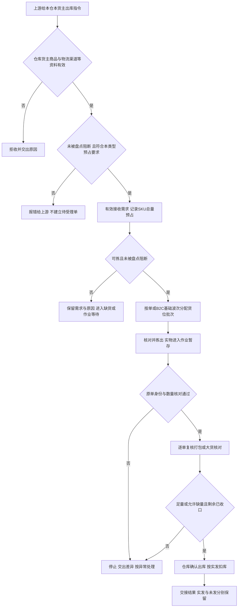

# 出库业务设计

> 课程沙盘「出库」域：指令接收、预占、拣货、复核、确认出库与交接。顺读从第二节起；类型与依据在第一节。

本篇在《出库业务需求分析》已确认规则上展开类型差异、主流程、波次防混单与走查。普通出库按预占、拣货、复核和确认出库执行；不良品其他出库核对指定实物后足量确认。三量与锁定口径与库存域一致，不在本篇重定义。

## 一、业务定位、依据与类型边界

### 1.1 本域负责的结果

WMS出库完成点是仓库执行“确认出库”。拣货和打包完成不提前扣减实际库存，承运商是否已经揽收也不改变此完成点。确认后实发、未发及库存变化形成确定事实，仓外运输、平台仓签收、渠道经营和上游补发计划由仓外业务负责。

| 类型 | 为什么从海外仓发出 | 指令与实物前提 | 仓库交出什么 | 缺量边界 |
| --- | --- | --- | --- | --- |
| B2C包裹履约 | 自营或外部货主向当地消费者履约 | OMS Mock指令；每个SKU须有足量正常品可用库存并完成足量预占 | 按原订单复核的商品、包裹记录、实发及交接结果 | 不支持缺量预占或缺量出库，不更换商品 |
| 平台仓转运 | 海外仓向电商平台仓补货 | OMS Mock指令；正常品可用库存和目的地／交接信息 | SKU实发量，实际箱／托及其内部SKU明细 | 可缺量，一次确认整单完结 |
| 当地B2B批发 | 当地客户大货交付、自提或交司机 | OMS Mock指令；日常缺货可按正常品可用量部分预占并接收 | 按单核对的件数及箱／托容器、交接对象与凭证 | 可缺量，一次确认整单完结 |
| 调拨出库 | 本仓向强盛另一仓移交货物 | 本仓独立出库指令；正常品可用库存 | 本仓实发和交接结果 | 不允许缺量 |
| 退回出库 | 已收入库正常品按后续指令退回仓外 | 独立指令引用原入库；拟退回货物已按配置完成必要质检与上架并形成可用品 | 独立退回结果与原入库追溯 | 不允许缺量，不冲销原入库 |
| 不良品其他出库 | 按通知将指定不良品移出仓库 | 上游通知或线下邮件手工来源；指定在库实物 | 指定不良品的处置量、原因、来源及出库结果 | 必须足量；不足禁止确认，先处理差异或合法取消 |

调拨出库与调拨入库独立执行，WMS不建立跨仓主单、两端单据关联、在途账或差异对账。不良品不走普通销售或正常品退回路径；独立报损／销毁及报损后非库存暂存跟踪后置。

### 1.2 依据与竞品对照

功能真源见 [出库业务需求分析](../03-需求调研和分析/03-出库业务/出库业务需求分析.md)；调研背景见同名调研稿；项目范围见全局背景中的项目定位。库存三量、盘点阻断及系统集成去重等在各自分析稿维护，本文不重复长表。跨域综合走查见《海外仓典型业务场景与方案》8.4 节。

竞品取舍与跨域候选见[综合场景 §8.2 与文末引用](06-海外仓典型业务场景与方案.md#82-有原文依据的新增候选与后续方案)；下表为出库域高频对照，BOL／POD、包装视频等见 8.2 候选表。

| 主题 | 代表原文 | 本项目取舍 |
| --- | --- | --- |
| B2C 汇总拣货与复核 | [LX-WMS-055](../02-竞品调研和分析/领星WMS/01-原始页面/LX-WMS-055_使用WMS处理一件代发出库单.md) | 订单对应、每单复核与回库；不复制快捷出库/打印即出库 |
| 平台/B2B 容器 | [LX-WMS-049](../02-竞品调研和分析/领星WMS/01-原始页面/LX-WMS-049_使用WMS处理备货中转出库订单.md) | 记实际容器与内部 SKU 量；不复制箱库存、预约、BOL/POD 计费链 |
| 波次与分配 | [JF-OUT-022](../02-竞品调研和分析/极风WMS/01-原始页面/JF-OUT-022-波次发货_波波次业务设置、生成波次.md)、[JF-OUT-007](../02-竞品调研和分析/极风WMS/01-原始页面/JF-OUT-007-出库分配策略.md) | 手工基础波次且还原原单；SKU 预占后分配，不复制竞品策略树 |
| 缺货表达 | [JF-OUT-008](../02-竞品调研和分析/极风WMS/01-原始页面/JF-OUT-008-订单标记商品缺货.md) | 落到 SKU 与数量，不只整单标签 |

## 二、角色与交接责任

角色表示业务责任，不是固定岗位权限。有仓库权限的用户可查看该仓全部货主；动作授权见公共能力 COM-FR-001。手工其他出库确认及在库受损品质确认权限集中于仓库主管，常规出库确认与作业权限独立配置（应用设计中的全局机制与权限配置）；各仓具体人员与演示账号仍需配置。

| 角色 | 在什么对象上做什么 | 必须交给下一环节什么 |
| --- | --- | --- |
| 上游业务／货主协作方，一期由OMS Mock模拟 | 给本仓、货主、商品需求、类型及交接安排；决定合法变更、取消或新单 | 可执行指令；对缺货、未发、取消拒绝的回应 |
| 仓库组织责任角色，具体岗位未指定 | 组织按单或B2C波次；跟进短拣、回库、待交接和超时 | 每单执行依据、异常去向及未发结果 |
| 拣货作业角色 | 核对来源货位、货主、SKU、批次／SN并搬出实物；现场无货上报 | 实拣、暂存位置、未拣齐明细 |
| 分单复核／大货核对角色 | B2C按原单分货；大货核对件数和容器；差异停止向下交货 | 每单可实发明细、包裹或箱托记录及差异 |
| 取消回库执行角色 | 找到已拣实物，核对数量、身份、品质和目标位置，完成回库 | 可解除本单占用的实物回库依据 |
| 有确认出库权限的仓库角色 | 核对本单实际发出量、资格和交接，使一次出库事实生效 | 扣库事实、整单结果及交接记录 |
| 承运商Mock／司机／客户自提方 | 承接仓外实物；一期登记模拟信息 | 已登记交接对象和凭证；运输不由WMS执行 |

| 上游给什么 | 本域交出什么 | 交给谁 |
| --- | --- | --- |
| 基础资料、出库指令、已有物流信息 | 接收／拒绝原因及可执行依据 | 上游协作域、仓库组织角色 |
| 本仓本货主可用量、位置、品质／效期 | 本单占用、分配及异常实物范围 | 库存域、现场角色 |
| 拣货实物、原订单及差异 | 逐单复核、实装量、箱托与SKU对应 | 确认出库角色、交接方 |
| 确认出库或取消回库事实 | 需求、实发、未发、短拣、整单结果及交接 | OMS Mock；手工其他出库保留仓内结果 |

结果交接失败由上游协作域承接，不能再拣货或再扣库。

## 三、海外仓各类出库怎样组织

### 3.1 平台仓补货：先核对SKU，再解释箱和托

货主决定从海外仓向平台仓补货，仓库接收该仓独立指令，找到可用于本单的正常品、拣出、核对实际装箱后确认出库。平台仓不是强盛四仓，WMS完成本仓出库，不把平台仓签收当成本单完成条件。

箱数和托数解释装载与交接。一箱可含多种SKU，同一SKU可分布多箱，一托可承载多箱，必须从交接容器还原实发SKU量，不能用“3箱”代替“SKU-A 24件、SKU-B 6件”。装箱变化后按当前容器重核SKU合计和箱托对应，不沿用失真的装箱说明；这是实际作业记录变化，开始拣货后不能借改箱明细改变商品需求或增加新SKU。

仅箱数或组托方式变化、SKU和件数不变时，仓库先判断是否影响货主已经提供的箱唛、预约或运输资料。影响这些资料则将新容器结构交货主／上游，等待确认资料已能承接当前实装后继续交接；不影响则仓库自行更新并通知，不增加普遍的货主批准步骤。等待期间未确认出库的实物仍在记录的待交接位置，实际库存和原单占用保持。此条件不表示一期建设真实预约或文件交换能力，具体依据可来自线下交接。

平台仓转运至少有实际发出量才可缺量一次结案；零实发继续等待或合法取消，货主仍需未发部分时另发新单，不保留原单续发任务。箱唛申请、卡派预约、附件往返及BOL／POD协作有竞品依据，但属文末候选，不成为一期必经步骤。

### 3.2 当地B2B：按单摘果、按实际交付核对

当地客户大货由上游下发。仓库以该单为单位按单摘果，拣后核对SKU、批次／SN、件数及实际箱托，记录司机或客户自提信息。不同货主即使商品编码相同，仍分别占用、核对，不因同车交付合并库存。

B2B不进入B2C波次。缺量时，实发、未发与已拣未发去向一并收口再结案。装车箱数减少并不当然等于需求变更：商品少发走缺量规则，重装但商品足量只更新容器记录。

### 3.3 B2C：组织可以集中，责任仍逐单

消费者单可逐单拣，也可将同仓、同货主、具备可拣条件的多单手工组基础波次。单品订单只有一种SKU，仍可能多件；多品单要同时满足每种SKU。都须还原原单复核，波次汇总量足够不能证明每个包裹正确。

轻小件可集中拣；大件或异形货仍需对应原单，不因搬运形式改变数量规则。带电等属性来自商品配置；当前未确定据此自动拆波、换渠道或运输合规校验，不凭品类名称推导规则。

### 3.4 调拨和已收入库退回：保留独立事实

调拨出库执行本仓占用、拣货、核对及足量出库。即使上游告知目的仓，WMS仍只交本仓结果，不要求另一仓实收或建立两端追溯链。

退回出库用于已产生实收的正常品。货物尚在入库暂存时，原单不能取消；先完成按配置的质检、正常品上架并形成实际库存，再由上游发引用原入库的新退回单。新单正常预占、足量扣库，原收货、上架及流水不冲销。未进入库存的超收、效期拒收实物在线下处理，不伪造退回出库。不良品或过期转不良品实际移出时走其他出库。消费者退货、FBA退货是仓外重新入仓的逆向业务，均不等同于本条退回出库。

## 四、普通出库主流程与完成条件

有效接收须匹配启用的仓库、货主、商品及指令所要求的物流渠道（分节点准入见基础资料域第四节）。拣货与复核再校验货位、SKU、批次／SN 等现场身份；确认出库与交接登记沿用接单时的渠道引用，承运商 Mock 登记不替代渠道资料校验。指令引用已停用渠道时整单拒收；已有效接收的单据不因渠道后续停用而自动取消，但新交接登记不得再选用该停用渠道（渠道停用见基础资料第七节）。PDA 与管理端共用业务记录与占用，现场重复提交不重复形成实发、不重复扣减库存；上游重复消息去重与结果回传不重复预占、扣库由系统集成域承接。（OUT-FR-001、OUT-FR-016）

新出库请求命中盘点范围而被阻断时，整单拒收并报错上游，不预占、不建立待受理单；盘点结束后须由上游重新提出可处理的请求，不自动把原拒收变成有效单据。已经有效接收的订单另按盘点准备、收尾和实盘规则处理，不能把新单拒收写成取消原订单。

日常B2B缺货允许接收并按可用量部分预占，需求、已占和缺货分别保留。B2C所有SKU必须足量预占才能接收；任一SKU不足，整单报错，不生成可执行单，也不留下其他SKU的部分占用。已足量接收后发生短拣、受损或过期，仍属执行异常，保留原有效占用并按第七节恢复，不能据此倒推接单时允许部分预占。

平台仓转运、调拨和退回按OUT-FR-002以min（需求、可用）预占，不足进入缺货处理；确认出库时平台仓转运与B2B可一次缺量结案，调拨和退回须足量。不良品其他出库按OUT-FR-014选择指定实物，不从正常可用量预占。

| 环节 | 谁执行、依据什么 | 实物位置及数量后果 | 完成并交出什么 |
| --- | --- | --- | --- |
| 接收预占 | 核对仓库、货主、商品、物流渠道及本类型要求，并校验盘点阻断；B2C所有SKU须足量，B2B日常可部分占 | 成功时实物仍原位，预占增、可用减、实际不变；拒收不留下本单占用 | 有效接收及需求、已占、不足量，或整单拒收原因 |
| 组织分配 | 按单或B2C波次，在已占量内推荐有效货位批次 | 尚未搬出，分配不另加预占 | 任务、来源、身份和应拣量 |
| 拣货 | 现场核对货位、SKU、批次／SN | 搬至本单或波次暂存；实际和预占不变，记录当前位置 | 实拣、短拣；换位先解旧分配再指新位 |
| 分单复核／大货核对 | 依据原单，不仅依据汇总拣货单 | 还原每单或每箱托SKU，实际不变 | 可实发量、容器及差异结论 |
| 剩余收口及确认 | 确认角色核本单有效、数量及类型资格 | 实发扣实际及本单预占；缺量单已拣未发先回库核对；确认结案时释放未发占用 | 整单完成无本单残锁，实发未发明确 |
| 结果及实物交接 | 登记承运商Mock／司机／自提及凭证，上游协作交结果 | 可已交或确认后待揽收；已确认量不再计实际 | 可追到单据、数量、确认人和时间的结果 |

普通出库从未过期正常品分配。效期商品优先推荐有效期更早的可用批次，临期正品可出，不另设最短剩余效期门槛。错误批次／SN不能凭件数相同放行。确认前仍核对取消、重复、品质和效期，避免等待期间过期或已取消仍误发。

## 五、基础波次、分单与防混单

### 5.1 波次如何服务原订单

波次是多单拣货组织，不取代出库单，也不新增库存。仓库选择同仓同货主可拣的B2C单，汇总相同SKU供集中拣货，再按原单重新区分。波次拣完，各单仍分别复核、确认和回传，一单异常不能被汇总进度掩盖。

要持续识别当前波次、此件所对应原单、原单每种SKU是否配齐。分单保持订单与暂存容器对应，复核按原单逐种核对，交接不把未配齐或取消单混入已完成单。分拣筐、分拣位与扫描顺序由应用设计结合样例落实，不预定播种墙、拣货车等设备。

| 组织方式 | 适用讨论 | 防混单的业务要求 | 一期结论 |
| --- | --- | --- | --- |
| 逐单拣货 | 单量少或实物适合独立搬运 | 保持本单身份，交本单复核 | 已有通路 |
| 边拣边分 | 从取货时保持订单对应 | 实物直接归对应原单，SKU相同也不能替代订单身份 | 竞品核实的选项，具体动作待应用设计选择 |
| 先拣后分 | 多单同SKU适合集中拣出 | 汇总后再次逐单分配、核对，不能按总量宣告逐单完成 | 竞品核实的选项，具体动作待应用设计选择 |

选分拣方式不改变同仓同货主、逐单复核、缺量资格和扣库。自动组波、派工、产能计算、爆款抽样复核及打印即发货不纳入一期。

### 5.2 模拟走查：单品和多品同时处理

**模拟前提：**美西仓货主A，正常品X实际10、Y实际6，无其他锁定。O1为X×1，O2为X×2，O3为X×1＋Y×2，O4为Y×1，四单可组一波；另一货主B的X订单不入本波。

| 时间 | 动作与实物 | X实际／预占／可用 | Y实际／预占／可用 | 订单结果 |
| --- | --- | --- | --- | --- |
| T0 | 原位在库 | 10／0／10 | 6／0／6 | 无四单 |
| T1 | 接四单分别预占 | 10／4／6 | 6／3／3 | O1占X1；O2占X2；O3占X1、Y2；O4占Y1 |
| T2 | 组波分配，集中拣X4、Y3至暂存 | 10／4／6 | 6／3／3 | 波次不新增预占，实物仍计实际 |
| T3 | 分到O1：X1；O2：X2；O3：X1、Y2；O4：Y1，分别复核 | 10／4／6 | 6／3／3 | O3两种SKU均核对，不能拿X补Y |
| T4 | 依次确认O1、O2 | 7／1／6 | 6／3／3 | 两单各自足量完成 |
| T5 | 确认O3 | 6／0／6 | 4／1／3 | O3实发X1、Y2 |
| T6 | 确认O4 | 6／0／6 | 3／0／3 | O4实发Y1，各单分别交结果 |

合计实发X4、Y3等于汇总实拣。若O3复核只有Y1，该单不得确认；把短少归到O3处理，其他单按自己的足量结果执行，不能从O4拿Y1后仍声称两单齐量。

**独立取消分支：**德国仓B货主X实际10、Y实际6，无其他锁定。P1需X1、P2需X2、P3需X1＋Y1、P4需X1＋Y2，合计预占X5、Y3。集中拣货并分回原单后，P4取消，其X1、Y2核对回库后释放。其余三单确认实发X4、Y1，共5件；期末X6、Y5，共11件，满足16＝5＋11。取消回库3件不增加实际库存，也不再混入其他单的实发；需要重新使用时经合法分配和取货执行。

## 六、业务对象、关系与数量

### 6.1 关系与追溯

本表描述业务关系，不指定表结构、任务拆分层级或状态枚举。

| 关系 | 基数与可选性 | 业务含义及追溯 |
| --- | --- | --- |
| 上游指令→出库单 | 一条有效新建指令对应1单，重复消息仍指原单；手工其他出库可无上游指令 | 上游追来源；手工追邮件，不伪造指令号 |
| 出库单→仓库、货主、明细 | 各属1仓1货主，有1至多条明细 | 身份不可原单改写；在对应归属内处理量 |
| 波次→B2C单 | 波次含多单；按单拣的单可无波次；一次有效组织不可重复计入同单 | 查各单进度与组织；历史记录不增加需求 |
| 单／波次→拣货执行 | 可有多条货位、批次／SN记录；未可拣时无执行结果 | 汇总执行还原各原单，具体任务拆分由应用设计承接 |
| 出库明细→占用及分配 | SKU总量预占；一明细可分配多处货位／批次；SN按配置存在 | 分配是占用落点，换位不新增量 |
| 单→包裹、箱托及交接 | 未打包或不用容器可无容器；有容器保留商品对应；交接可随执行补充 | 从容器还原件数，不形成箱托库存或第二次扣库 |
| 退回出库→原入库 | 必须引用原入库；原入库可被不同后续指令引用 | 追原事实及新退回量；当前未定义多来源合并引用 |
| 异常／回库→单及实物 | 一单可有多次异常／回库，正常完成可无异常 | 追短拣、暂存及释放依据，不用备注代实物去向 |

### 6.2 数量分别落在哪里

需求在商品明细；实拣和回库在作业记录；实发、未发在结果；实际、预占、可用在库存。它们互相解释，不能全部相加为库存。

| 数量 | 累计或变化 | 判断用途 |
| --- | --- | --- |
| 需求 | 未开始拣货前随合法变更更新，开始后不静默改量 | 本单应执行数量 |
| 本单预占 | B2C有效接收须各SKU足量；B2B、平台仓转运、调拨和退回按min（需求、可用）占用，取消、实发、缺量收口减少 | 保护需求，不等于已经搬出；新单被盘点阻断或B2C准入失败时不产生部分占用 |
| 货位分配 | 在占用内落位，换位解旧再分新 | 指导找货，不加到预占上 |
| 累计拣出／回库 | 分别记每次动作，回库后再拣保留两次事实 | 当前已拣未发暂存量＝累计拣出－累计回库－累计实发；累计拣出不是实发 |
| 实发 | 仓库确认时形成，按SKU、批次／SN解释 | 本仓扣库、交结果 |
| 未发 | 缺量结案时＝需求－实发；未结案不足仍是未履约量 | 上游了解差异另发新单，不保留原单续发额度 |
| 缺货／短拣 | 接单时不足与现场实拣不足分别记录，可指同一未履约部分 | 解释原因，不能相加扩大未发 |

普通足量确认同时减实际和本单预占。取消只解除本单占用，已拣先回库后释放，无其他锁定才恢复可用。平台／B2B缺量完结还须处理所有未发，最终本单占用与分配为零，其他单、品质和盘点锁定保留。

## 七、缺货、短拣、变更和取消怎样恢复

### 7.1 位置不足和整仓不足分开

建议位无货，现场上报具体差异，解除该位分配并重新推荐其他可拣位，SKU预占不变。存储区有同仓同货主合格实物但拣货位不足，走库存域存拣协同（第六节），不能直接报整仓缺货。存储区和拣货区都无可拣实物，才上报整仓缺货。

已接收缺货单在库存补齐后，由仓库按第10.1节人工重试预占与分配；库存增加本身不自动恢复。

换位不自动修正原货位账面。账有货而现场无货，库存责任角色继续查移位、流水或通过真实盘点确认；不能在换位时悄悄抹掉数量。

### 7.2 异常四要素

| 触发 | 业务后果 | 谁处理 | 恢复方式 |
| --- | --- | --- | --- |
| 指令身份／数量非法，或引用已停用物流渠道 | 拒收，不建可执行单、不占用 | 上游协作联系提供方 | 补正确资料、选用启用渠道并重提指令；区分输入错误与盘点／库存准入不足，不将缺货写成商品不存在 |
| 新单被盘点阻断或B2C任一SKU无法足量预占 | 整单拒收，库存不新增本单占用，不进入待受理 | 上游协作交回原因，仓库处理盘点或库存问题 | 条件补齐后由上游重提可处理请求；成功受理才开始履约计时 |
| 已接收缺货单库存补齐，原单仍有效且未取消或结案 | 补货本身不恢复，原需求和有效占用保留 | 有权限的仓库人员 | 按第10.1节人工重试并核当前缺口，未足量继续保留缺货；各类型完成条件不变 |
| 扫错货位、SKU、批次／SN | 拣货或复核不能完成 | 现场角色 | 找正确实物重核，件数同也不能替身份 |
| 建议位无货、其他位有货 | 原分配失效，预占有效 | 拣货上报，库存查差异 | 改分新位继续；原位账实另查 |
| 已足量接收的B2C执行中整仓不足／短拣，含多品单任一SKU不足 | 整单不能缺量发，原有效占用保留、已拣仍在库 | 仓库组织交异常并人工恢复，上游决定合法变更或取消 | 补货后按第10.1节人工重试；未开始可合法变更，开始后不能改明细；取消时未拣释放、已拣回库后释放，关闭异常 |
| 平台／B2B不足且至少一项明细实发大于0 | 未发交上游，原单不续发 | 仓库组织、核对和确认角色 | 先核对已拣未发回库；确认结案时扣实发并释放未发占用，一次完成；继续发需新单 |
| 调拨／退回不足 | 不确认、不扣库、不完结 | 仓库组织、上游 | 查实物；不能足量则合法取消回库，不套B2B |
| 复核实装不符 | 阻断确认，不静默按实装结束 | 复核／大货核对角色 | 重核原单、暂存、容器，补齐或走缺货处理 |
| 未开始拣货收到明细变更 | 需求与预占需一起重算 | 上游协作、仓库组织 | 成功一同更新，失败保留原单原占用，不遗留空档 |
| 身份拟变更、已开始拟改明细 | 原单拒变更 | 上游协作 | 允许取消时取消回库，另发新单 |
| 已拣未确认收到取消 | 实物仍暂存，不能只释放账面 | 回库执行与确认角色 | 核原单、批次／SN、数量和适配位置，回库后解本单锁；其他锁保留 |
| 已占／已拣转过期 | 自动不良，保留原关联及锁定原因，普通出库阻断 | 仓库组织通知上游，库存跟踪 | 按类型取消或已允许缺量收口；已拣回适配位置，订单解锁后品质锁保留，实际移出按不良品其他出库处理 |
| 拣货／复核发现非效期受损 | 停该实物普通出库并记差异 | 具备对应权限与仓库授权的仓库主管核实品质，通知货主 | 核实后转不良，原订单关联保留、锁定原因去重，再按取消／已允许缺量类型恢复；普通移库不改品质，赔偿另处理 |
| 已确认拟撤销、重复确认；PDA／管理端重复提交同一确认或交接 | 事实保留，重复不再扣库、不重复实发 | 确认与上游协作角色 | 拒原单取消变更，后续由上游其他业务承接，不反向恢复；现场动作以首次生效记录为准 |
| 结果交接失败、确认后未揽收 | 完成与扣库不回滚，待交接事实可查 | 上游协作或实物交接角色 | 补交原结果或交接信息，不再出库；仓外后续由上游负责 |

### 7.3 超时不改变数量或完成资格

履约 48 小时起算、计时与超时后果以公共能力 COM-FR-002 为准；本域只强调：超时不改变拣货、复核、确认出库的数量资格，也不自动取消或强制缺量。

## 八、不良品其他出库的独立通路

本节说明不良品其他出库的执行条件；数量案例见第九节。

两条来源为OMS Mock通知、线下邮件通知后有权限仓库角色手工创建。均须说明仓、货主、SKU、品质、货位、批次／SN、处置量及原因；上游追指令，手工追邮件，不建设自动收发邮件。

本次占用指定不良品，不套正常可用预占。不良品已有全量品质锁，增加处置关联不再加一次锁定；同件不能再给另一处置单或任务。核对指定实物、品质与数量，足量确认后直接减实际、对应品质锁和本次处置占用，剩余不良可用0。取消未执行处置只解该关联，品质锁保留。

业务顺序为核通知依据→找本次可承接的指定在库实物→登记处置占用→现场核对和准备交出→仓库确认足量出库→留结果流水→上游来源交结果，手工来源可查。确认前不扣库，重复确认不重复扣库。货主明确处置意图，仓库授权责任人核实指定实物与实际结果；线下邮件来源的手工其他出库由具备对应权限及仓库授权的仓库主管确认，创建与现场作业权限另配；保留通知来源、原因、商品及配置要求的批次／SN、数量、操作人和时间，照片按异常需要提供，不新增固定审批层级或强制附件。数量不足禁止确认，先处理差异或合法取消；取消尚未完成出库的占用时保留品质锁，已拣实物仍须先核对回库。

其他出库只引用仍计实际库存的指定实物，已确认出库的同一数量不能再次分配或扣减。保留原确认及交接事实，剩余不良品继续品质锁定。

## 九、其他完整数量走查

以下均为独立模拟例，按本仓本货主同 SKU 计算，箱托不另加库存。先读索引再打开详表。

| 编号 | 场景 | 结论要点 | 详表 |
| --- | --- | --- | --- |
| 9.1 | 平台仓装箱与缺量一次结案 | 实发 6 扣占 6、释放未发 4，整单一次完结 | [§9.1](#91-平台仓装箱交接与缺量一次结案) |
| 9.2 | B2C 拒收与足量后短拣取消 | 不足整单拒收；已拣取消须回库后释放 | [§9.2](#92-b2c不足拒收与足量接收后的短拣取消) |
| 9.3 | 换位不多占 | 10/5/5 全程，换位不重复预占 | [§9.3](#93-换位不多占库存) |
| 9.4 | 正常品退回 | 原入库 8 不变，独立退回 3 | [§9.4](#94-正常品退回保留原入库) |
| 9.5 | 不良品其他出库 | 锁不重复累计，足量 2 后 3/3/0 | [§9.5](#95-不良品足量其他出库) |
| 9.6 | 已接收缺货单人工恢复 | 补货不自动恢复；重试后 5/5/0；文档逻辑走查已通过 | [§9.6](#96-模拟补充分支已接收缺货单补货后人工恢复) |

### 9.1 平台仓装箱交接与缺量一次结案

**模拟前提：**美西仓货主A的X正常品实际12、无锁；平台单需10。拣出8，核对实发6，另2已拣不发、2尚未拣。

| 时间 | 动作、位置和结论 | 实际／总预占／可用 | 本单量及容器 |
| --- | --- | --- | --- |
| T0 | X在正常位 | 12／0／12 | 未接单 |
| T1 | 接需10并占用 | 12／10／2 | 需求10 |
| T2 | 拣8至本单暂存，其余2未拣 | 12／10／2 | 暂存8、未拣2 |
| T3 | 准备发6，C1装X4、C2装X2，两箱放P1；已拣未发2核对回库，原订单占用仍保留 | 12／10／2 | 待发6、拟未发4；回库2、未拣未发2；尚未整单完结 |
| T4 | 确认实发6扣实际及占用6，同时释放未发4的本单占用，一次整单完成 | 6／0／6 | 实发6、未发4；两箱一托含X6，原单无残锁 |
| T5 | 交结果，后需4由上游发新单 | 6／0／6 | 原单不续发，新单独立处理 |

T3完成回库核对但不提前解除原订单占用；T4在缺量确认结案时扣实发并释放未发，数量收口与整单完成对应。这里不规定页面或数据库动作。已拣未发2未回库，不能宣告整单收口。装箱改为C1：X3、C2：X3不改实发合计，需更新箱托对应，不能把箱数2当实发件数2。若货主已提供的箱唛、预约或运输资料因此失配，先交货主确认更新；否则仓库自行更新并通知。B2B同样按实发扣库并释放未发占用，但按单摘果。

**独立零实发模拟例：**平台仓转运或B2B需求5，实际发出0。即使该类型允许缺量，也不能确认出库或结案；继续等待补货／异常处理，或接受合法取消。若尚未拣货，取消释放本单占用；已有拣出但全部不发，先按第七节核对回库，再完成取消，不生成确认出库扣库流水。

### 9.2 B2C不足拒收与足量接收后的短拣、取消

**独立模拟一：接单不足。**德国仓货主A的X实际8，其他订单占5，可用3，新B2C需求5。库存准入不足时整单报错，不创建可执行单，不占这3；结果仍为实际8、预占5、可用3。它没有已拣或回库过程，也不开始WMS履约计时。多品单有一个SKU不足时，其他SKU也不留下该请求的占用。

**独立模拟二：足量接收后短拣。**重新设X账面实际8，其他订单占3，可用5，本B2C需5并足量接收。执行时只拣出3，原分配剩2在现场未找到，仓库停止该单确认并查差异，不把原需求改3。

| 时间 | 动作与实物 | 实际／总预占／可用 | 本单情况 |
| --- | --- | --- | --- |
| T0 | 原位在库 | 8／3／5 | 未接本单 |
| T1 | 全量预占5并有效接收 | 8／8／0 | 本单占5，无接单缺量 |
| T2 | 本单3已拣至暂存，剩2短拣，不能确认出库 | 8／8／0 | 原需求5与占用5保留，已拣仍计实际 |
| T3 | 上游合法取消，未拣2直接释放；已拣3尚未完成回库核对 | 8／6／2 | 本单仍占已拣3，不能提前解除；可用2为待校准账面量 |
| T4 | 3件核身份、品质及适配位，回库后解除剩余本单3，完成取消 | 8／3／5 | 本单累计释放5；其他订单3仍锁，现场差异继续处理 |

T4的5是尚待差异校准的账面可用，不能将已知未找到的2件重新承诺给新单；库存责任角色按真实盘点等既有路径核实并调整，取消本身不改实际。回库时若3件已经过期，释放本单订单占用后品质锁继续有效，不能得到可用5，见库存域过期例。本节各表的“预占”按有效锁定合计，包含订单占用及品质、盘点、处置等其他原因，重叠部分不重复计量。

### 9.3 换位不多占库存

**模拟前提：**香港仓A货主X账面10：A位5、B位5，本单需5、已占5。建议A位现场无货，B位核有5。接单后10／5／5，分配A位仍10／5／5；解A改分B位5仍10／5／5。B位实拣5并足量确认后账面5／0／5。A位差异继续查，不能声称余下5实物已核实；后续实盘A为0，经差异确认才将账面5调为0并留记录。

### 9.4 正常品退回保留原入库

**模拟前提：**美东仓原入库实收8未上架，上游要退其中正常品3。此时实际0、已收货未上架8，取消原单被拒。质检和正常品上架8后为8／0／8；另发引用原入库退回单需3，预占后8／3／5，拣核不改三量，足量确认后5／0／5。原入库仍实收8、上架8，新单实发3，不能把原实收改5。

### 9.5 不良品足量其他出库

**模拟前提：**货主A的X不良实际5、品质锁5、可用0，无其他占用。邮件通知指定位置及批次2件移出。建手工其他出库关联处置2后，实际5、锁合计5、可用0，不能按品质5＋处置2算锁7。核对准备交出仍5／5／0，确认足量2后为实际3、品质锁3、可用0，处置占用清零，来源及流水可查。重复确认仍3／3／0，已出2不能再次其他出库扣减。若不足，禁止确认并保留占用和差异，先处理差异或合法取消，不按B2B少发完结。

### 9.6 模拟补充分支：已接收缺货单补货后人工恢复

**独立模拟前提：**美西仓货主A的X正常实际3、无其他锁定或盘点，B2B需求5已接收、占3、缺货2，尚未拣货。

| 时间 | 动作与结果 | 实际／总预占／可用 | 本单情况 |
| --- | --- | --- | --- |
| T0 | 接单后保留缺货 | 3／3／0 | 需求5、占3、缺货2 |
| T1 | 合格补货2实际上架，未触发重试 | 5／3／2 | 原单仍占3、缺货2，不自动恢复 |
| T2 | 仓库人工重试，当前缺口2足量补占，按任务节点分配货位 | 5／5／0 | 需求5、占5、缺货0；分配不另增预占 |
| T3 | 再次重试 | 5／5／0 | 无未占缺口，不重复占2 |
| T4 | 实拣复核5，足量确认出库 | 0／0／0 | 实发5、未发0、原单完结 |

若T1只补入1件，人工重试后为4／4／0、缺货1，仍按类型决定等待或缺量结案。库存存在盘点阻断、品质或效期不合格时不据此补占；原单已取消或结案时不恢复。原拒收请求没有有效单据，须由上游重提。

## 十、执行规则与应用设计输入

### 10.1 已接收缺货单人工恢复

普通出库仍有效、未取消或结案的已接收缺货单，库存补齐后由有权限的仓库人员人工触发重新预占与货位分配。入库或移库完成本身不恢复原单，不自动受理原拒收请求（OUT-FR-009）。不良品其他出库仍按第八节核对指定实物，不从正常可用量补占。

恢复时核对原需求、未履约量、已有有效占用及已拣实物，只对当前尚未占足的缺口补占，已有占用不重复累计；重新校验本仓本货主可用量、盘点、品质、效期及作业节点，再定位合法可拣实物。重复重试按当前缺口计算，不重复锁量。仍不足时保留有效占用与缺货，不改需求；已取消或结案单不恢复。原位账实差异继续由库存域核实，换位或补货不冲销差异。

该操作不改变各类型足量／缺量确认资格，也不允许更改已开始拣货的需求明细；记录操作者、时间和重试结果。

### 10.2 资料缺口与后续方案

需准备各类型拣货／交接样例、箱规、单品多品订单及承运商凭证；应用设计落实单据层次、状态、字段、扫描次序与波次分拣载体。边拣边分与先拣后分属于既有基础波次内的组织选择，见第五节。

物流渠道各节点字段、停用提示及承运商 Mock 与渠道资料的引用关系由应用设计与基础资料需求共同承接；业务阻断规则以第四节首段与基础资料域渠道停用约定为准。PDA 菜单与扫描步骤在公共能力与应用设计中落实，业务后果见第四节与第七节。

平台预约、箱唛、BOL／POD 附件协作及补货建议属 06 文档 8.2 候选，不成为一期必经步骤。
