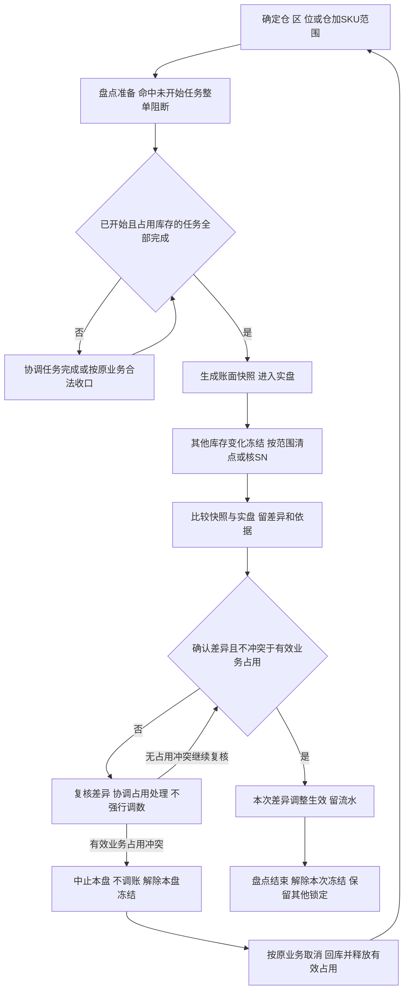

# 库存与库内业务设计

> 沙盘库存与库内域设计；**顺读从 §二 起**。范围与验收见 [业务蓝图](00-业务蓝图.md)。

维护仓内数量定义与移库、盘点、效期/SN、报损／销毁；收发执行见 [02](02-入库业务设计.md)、[03](03-出库业务设计.md)。

## 一、管理范围、来源和责任

### 1.1 本域管理仓内实物，不建立全局库存账

库存以仓库＋货主＋SKU为基础，进一步按货位、批次、SN、品质及效期观察。香港、美西、美东、德国各自独立；同一商品在别仓或别货主有货，不代表本单可借用。集团全局库存协同、成本、财务核算、货主账单和跨仓调拨在途不在本域。

箱和托只作为搬运、清点及交接的作业容器使用，内部SKU件数进入作业和库存记录；箱数、托数不是另一份库存。同一批货可以从原箱拆出或重装，不发生箱库存转件库存。一期不提供箱库存、托盘库存、货位容量、承重或占用率管理。

### 1.2 业务依据与竞品限制

规则见 [INV 需求分析](../03-需求调研和分析/04-库存与库内业务/库存与库内业务需求分析.md) 及关联 MD/IN/OUT；调研缺口见 [INV 调研](../03-需求调研和分析/04-库存与库内业务/库存与库内业务需求调研.md)。走查见 [06§8.4](06-海外仓典型业务场景与方案.md#84-关键走查场景)。

需求层取舍见 [竞品参考与需求取舍](../03-需求调研和分析/00-项目总览/03-竞品参考与需求取舍.md)；扩展候选见 [06§8.2](06-海外仓典型业务场景与方案.md#82-有原文依据的新增候选与后续方案)。下表为库存域**高频对照**；更多页见 [双边矩阵](../02-竞品调研和分析/00-双边能力对比矩阵.md#四资料入口与证据边界)。

| 主题 | 代表原文 | 强盛一句 |
| --- | --- | --- |
| 库存视角与品质 | [LX-WMS-036](../02-竞品调研和分析/领星WMS/01-原始页面/LX-WMS-036_使用WMS查询或处理产品库存.md) | 取维度与流水；普通移库不改品质 |
| 预占与分配 | [LX-WMS-044](../02-竞品调研和分析/领星WMS/01-原始页面/LX-WMS-044_使用WMS设置库存锁定和分配逻辑.md) | SKU 总量预占后货位分配；效期排序按已确认规则，不复制全算法 |
| 盘点冻结 | [LX-WMS-045](../02-竞品调研和分析/领星WMS/01-原始页面/LX-WMS-045_使用WMS进行盘点.md)、[JF-PDA-008](../02-竞品调研和分析/极风WMS/01-原始页面/JF-PDA-008-PDA库存盘点.md) | 已开始任务收尾后快照；按项目范围冻结，不照搬「锁全部归零」 |
| 效期 | [JF-INV-007](../02-竞品调研和分析/极风WMS/01-原始页面/JF-INV-007-商品有效期管理.md) | 临期可出、过期转不良；不采用竞品过期仍售卖 |

### 1.3 角色与交接

角色按业务责任区分；盘点差异、在库受损品质及报损／销毁确认权限集中于仓库主管，作业权限独立配置，见[应用权限配置第四节](../05-应用设计方案/20261002-MVP版本/系统架构设计/05-全局机制与权限配置.md)。系统按仓库授权和RBAC判断，不按岗位名称硬编码动作权限，见[公共能力需求分析](../03-需求调研和分析/07-公共能力/公共能力需求分析.md) COM-FR-001～004。

| 角色 | 负责什么 | 交出什么 |
| --- | --- | --- |
| 仓库组织责任角色，岗位未指定 | 选盘点范围、协调进行中任务收尾、跟进移库和差异 | 可实盘的范围、任务收尾结论、异常处理责任 |
| 库存执行角色 | 现场核对源位、商品、批次／SN、品质和数量，移至适配目标位 | 成对的源／目标变化及实物当前位置 |
| 盘点执行角色 | 按盘点范围清点或扫描SN，不把入库暂存当在库 | 实盘数量、位置和差异证据 |
| 仓库主管（具备盘点差异确认权限及本仓授权） | 复核实盘和历史业务，确认调整数量，检查有效占用 | 经确认的差异、库存调整和原因；不是无依据改数 |
| 仓库主管（具备报损／销毁确认权限及本仓授权） | 核原因、指定实物及报损确认量／实际完成销毁量，避免重复 | 货主处置意图及仓库核实结果，保留来源、原因、指定实物、数量、人员、时间；照片按异常提供 |
| 入库／出库执行角色 | 入库交上架事实；出库交占用、实发、回库与释放 | 数量变化所依的原业务记录 |
| 上游／货主协作方，一期由OMS Mock模拟 | 对订单取消、处置通知等作业务决定，接收收发结果 | 合法业务指令及异常处理结论 |

| 上游给什么 | 本域交出什么 | 交给谁 |
| --- | --- | --- |
| 商品追溯、品质、位置及仓库时间配置 | 可执行判断，缺资料或冲突的原因 | 收发与库内执行角色 |
| 正常／不良品上架结果 | 对应归属与位置的实际、预占、可用及流水 | 入库域、仓库管理 |
| 出库占用、分配、回库和确认出库 | 可用量及一次变化，按原单可追溯 | 出库域、上游协作域 |
| 现场移位、实盘或处置结果 | 移库、盘点差异或报损／销毁事实 | 仓库管理；需要对货主解释时由协作责任方提供，现阶段不建设货主门户 |

## 二、库存对象与观察维度

### 2.1 这些视角看的是同一批实物

| 观察对象 | 关系与可选性 | 业务用途及追溯 |
| --- | --- | --- |
| 仓库、货主、SKU | 每笔在库实物属于1仓、1货主、1SKU；同一商品可分多仓多位，但不共享可用 | 判断本仓本货主能安排多少；同编码不同货主仍是不同商品归属 |
| 仓、区、货位 | 仓含多区，区含多位；在库及入库实物按作业可追位置 | 从汇总找到实物；一位同一时点只能被一个货主使用，同货主可多SKU |
| 批次和货位 | 启用批次／效期时存在；同批可多位，同位可多批 | 拣货、移库、盘点与处置明确操作哪批，汇总不丢日期 |
| SN | 商品启用时采集；每个SN轨迹对应具体商品及归属，当前位置或已出仓结果可查 | 追到具体单件；未启用不能凭总量补造SN，按货主＋SKU＋SN跨四仓共用身份判断 |
| 品质与效期等级 | 品质正常／不良分开；效期启用时标等级，临期不是第三种品质 | 判断普通出库资格；不良仍实际在库但不可普通分配 |
| 库存占用及原因 | 同一实物可叠加订单、盘点、品质或处置原因，原因可多条 | 数量合计按不重复实物；解除某原因不抹掉其他限制 |
| 入库／出库／库内记录→流水 | 一笔业务可产生多条归属、位置、批次或数量流水；未生效作业不产生已生效库存结果 | 从原单查前后量，从商品、位置、批次／SN查变化原因 |
| 作业容器→SKU内容 | 容器可无记录；有箱托时内部可多SKU，同SKU可多容器 | 定位混合到货、搬运及交接；内部数量还原商品，不另加箱托库存 |

一个货位改给另一货主前，原货主的实际库存、入库过程实物、报损后暂存实物及未完结任务均要清零。只看实际为0还不够：已收未上架、待回库、报损后仍在场的实物或其他未完任务仍能占用该位置。无法识别货主的到货放专门待认领位置，不能并入某货主库存。

### 2.2 入库过程量和已拣量处在不同边界

已收货未上架包括尚未完成质检及已判正常／不良但未落位的实物，两者都不计实际库存。正常品和不良品分别上架后都增加实际；正常品按锁定与可用计算，不良品默认全量锁定、可用0。

已拣未确认出库与此不同：它已经形成过库存，只是从原货位搬至本单或波次作业位置，仍计实际并保持预占。不能因为原货架空了就扣库，也不能取消时先把系统可用恢复而实物仍在打包台。待认领、超收或效期拒收实物尚未进入库存，不可在本域当库存移库、盘亏或出库处置。

已经确认出库但等待揽收的商品可能仍在仓内交接位置，已不计实际库存。已确认报损且仍暂存的实物也已退出库存，按独立非库存暂存记录管理。现场清点时应依据原单与确认事实区分它和仍计实际的已拣未发实物，不能因都在同一作业场地就再次计入在库或实盘数量。

## 三、数量、品质与锁定的共同口径

### 3.1 实际库存＝预占库存＋可用库存

预占库存即锁定数量，是实际库存中的一部分；可用是当前可再分配部分。正常／不良描述品质，实际／预占／可用描述数量，两组维度分别使用。正常品可能被订单占用，不良品默认全部品质锁定。

**模拟静态例：**正常实际8、订单预占3、可用5；不良实际2、品质锁2、可用0，合计实际10＝预占5＋可用5。不能在此之外再加“待拣库存3”“箱库存2”扩大实际。

SKU订单预占按本仓本货主总可用保护需求，不在接单时定货位。日常B2B可按可用量部分预占，B2C须全单各SKU足量预占才能接收；B2C准入失败或新单被盘点阻断时，不留下本请求的部分占用，详见03。拣货分配才指向货位、批次／SN，并且只在已有占用量内分配；它是作业关系，不是多锁一份实物。建议位无货换位时只改分配，原位解、新位分，SKU总占用不变。

### 3.2 锁定合计取并集，原因单独保留

| 原因 | 业务含义 | 解除后怎样判断可用 |
| --- | --- | --- |
| 订单占用 | 保护已接收需求，已拣仍占用 | 未拣取消可解，已拣取消先回库，实发按量扣；还要检查其他原因 |
| 盘点冻结 | 固定实盘范围，避免边数边变 | 只解除本次盘点原因，其他订单／品质继续有效 |
| 品质锁定 | 不良品不可普通分配 | 普通移库、取消处置或取消订单都不将其转普通可用 |
| 不良品处置占用 | 指定实物交本次其他出库或处置，防别单重复使用 | 解处置关系仍保留品质锁；其他出库按实发、报损按确认量、独立销毁按实际完成量扣减 |

同一件先被订单占用，后过期增加品质原因，仍只是一件锁定；整批进入盘点也不再次加件数。没有SN的商品仍须按同一库存明细及数量范围识别重叠，不能简单相加各原因的汇总。

解除一个原因后，可用只增加“不再被任何有效原因限制”的部分。模拟不良品5件，其中指定处置2，锁合计仍5；取消处置2后仍锁5、可用0。再沿用3.1的模拟库存：盘点期间正常8与不良2全范围锁定，合计锁10；盘点结束仍留订单3与品质2，合计锁5、可用5。

## 四、库存变化与业务追溯

### 4.1 什么事实改变什么量

| 业务事实 | 实际 | 预占／可用及品质 | 位置及追溯 |
| --- | --- | --- | --- |
| 到货、认领、收货、质检但未上架 | 不变 | 未形成库存结构 | 留入库过程位置、实收及品质结论 |
| 正常品上架 | 增加上架量 | 无其他锁定时可用同增 | 原入库、上架、位、批次／SN相连 |
| 不良品上架 | 增加上架量 | 品质锁同增，可用0 | 适配位置及原质检结果保留 |
| 已收未上架真实丢失的异常收口 | 按原实收异常账面上架后立即盘亏核实损失，同次收口，净增真实剩余量 | 未扣损失的过渡量不供普通预占；不良品按原品质同步调整锁定 | 02维护原实收、现场落位、异常结转及损失依据，不能伪造缺失实物落位 |
| 普通出库预占 | 不变 | 锁增加，可用减少 | 来源单及SKU总量占用；此时可未定具体位 |
| 分配／换位、拣出 | 总量不变 | 不额外加锁 | 分配落点、实拣及暂存位置保留 |
| 未拣取消／已拣回库释放 | 不变 | 解除本单占用，仅无其他锁时恢复可用 | 已拣回库保留批次／SN与实际目标位 |
| 确认出库 | 减实发量 | 减对应占用，其他原因保留 | 原单、实发、交接、流水只生效一次 |
| 普通移库 | 总量不变 | 总预占／可用及品质不变 | 源减目标增，数量身份成对追溯 |
| 过期自动转不良 | 不变 | 不良全量品质锁，按并集计锁 | 保留原位、批次／SN、原单关联及转换原因 |
| 本次盘点差异确认 | 按确认差异增减 | 校验结束后仍有效占用；不良短少同步减品质锁 | 差异、快照、实盘、原因及调整关联 |
| 报损确认 | 减确认报损量 | 对应品质锁同步减，剩余不良可用0 | 独立报损记录及指定实物流水；仍在场实物另追非库存暂存 |
| 独立销毁实际完成并确认 | 减实际完成销毁量 | 对应品质锁同步减，剩余不良可用0 | 独立销毁记录及指定实物流水；已报损量后续销毁不再扣库 |

各次实际、预占、可用或品质变化均留关联流水，移库还保留源目标变化。原业务记录解释做了什么，流水解释哪组库存如何变。库存数字只能由已确认业务或盘点调整改变，不提供无依据改数；重复提交同一已完成动作不再影响数量。

### 4.2 查差异的顺序

先限定仓库与货主，明确是总量不足、位置不符、品质失效还是占用未释放，再追关联业务。对“账有货、现场无货”，检查该批的上架、移位、已拣暂存、确认出库、回库及盘点记录；对“实物在、可用为0”，检查有效订单、盘点、品质及处置原因。不能仅因为可用为0就调增实际，也不能用一次普通移库修复不知道原因的总量差异。

## 五、移库与大货存储、零散拣货协同

### 5.1 基本移库的完整运行

移库触发包括同仓货物挪位、存储位置转入适合零散拣货的位置，以及不良品的适配位置调整。执行角色先核源位真实商品、归属、批次／SN、品质及拟移动量，再核目标位属于本仓、有效且适配；目标为空或为同一货主使用才可移入。

拟移量不得超过源实际；已被拣货任务分配的货位数量不能直接移走。SKU级订单占用不随位改变且本身不要求禁止全部移库，先判断拟移部分是否命中具体任务分配或盘点冻结。现场搬完并核对目标实物后确认源减、目标增的同次结果，结束条件是身份、品质、数量及位置都对应，不能只把账面位置改过去。

普通移库不改变品质、仓库或货主，不用于调拨，也不将不良品变为正常品可用库存。过期转换保留原位，需搬至不良适配位置时另做符合上述条件的移库。

### 5.2 整仓有货但拣货位不足

共享海外仓的大货存储与零散包裹可能使用不同位置。订单总可用足够，不代表当前拣货位够用。处理顺序为：核本仓本货主库存及品质／效期→区分已有任务分配和可移动实物→按当前基本移库搬到适配拣货位置，或在现有允许的可拣来源中重新推荐→核实际位置后继续拣货。不能把商品总量、箱数或未上架来货当成补货已到位。

当前规则没有确定存储区一律不可拣，也没有自动补货任务。是否从存储位直接拣，应依据该位置与商品的实际可执行条件；具体可拣范围和动作在应用设计结合四仓样例细化。若所有可拣来源都没有合格实物，才交出库域整仓缺货，不自动释放B2C占用。

**模拟时间线：**货主A的X实际100，存储S位90、拣货P位10；本单需20并已SKU预占20，总量100／20／80。若P位10已分配给该单，不能直接移走这10；核S位拟移20未被具体任务分配，移至同货主适配P位后S70、P30，总仍100／20／80。原P位10继续本单分配，再从新增位置分配本单其余10，不新增预占。拣出20仍100／20／80，足量确认后实际80、预占0、可用80。多搬的10留P位供后续作业，不因移库直接扣库。

### 5.3 与补货候选及缺货恢复的边界

一期用基本移库和合法换位解决位置不足。独立补货任务、拣货区下限和自动建议的采用条件统一见[06第8.2节](06-海外仓典型业务场景与方案.md#82-有原文依据的新增候选与后续方案)。

库存补齐后，已接收缺货单由仓库人工重试预占与分配，见[03第10.1节](03-出库业务设计.md#101-已接收缺货单人工恢复)；移库或入库完成本身不恢复原单。

## 六、盘点业务：准备、快照、实盘与差异

### 6.1 盘点要先让实物和记录稳定

按仓库、库区、库位或SKU选择范围；SKU范围是所选仓库＋SKU，不影响其他仓同SKU。范围内仍按货主、位、批次／SN、品质辨认，不能用汇总掩盖跨货主差异。实盘核的是当前计入实际库存的实物，入库未上架另查作业进度，已确认出库待交接量及已报损非库存暂存量依据原单另行清点与区分，不能盘入实际库存或形成虚假盘盈。

### 6.2 各阶段谁做什么、何时算完成

| 阶段 | 责任与执行 | 实物和数量后果 | 完成条件 |
| --- | --- | --- | --- |
| 选范围、准备 | 组织责任角色明确范围及命中任务 | 尚未开始的收货、上架、拣货、移库等任务整单不启动；不是只停命中明细 | 未开始任务被阻断，已有进行中任务清楚 |
| 进行中任务收尾 | 已开始且已锁定或占用库存的任务可执行至整单完成 | 仍可按原业务产生该任务的库存结果，不能提前用不稳定快照 | 这类任务全部完成，或按合法原业务处理并收口 |
| 生成快照 | 以收尾后的实际及归属、位置、品质明细为账面依据 | 范围全部冻结，锁定按并集计量 | 账面范围固定，进入实盘 |
| 现场实盘 | 执行角色按位、货主、SKU、批次／SN、品质清点 | 不接受范围内上架、确认出库、移库等变化；本盘差异调整及即时过期品质转换是已确认例外 | 实盘对象与快照可对应，差异及无法识别实物记录明确 |
| 差异核对、确认调整 | 有权限角色核实实盘、历史动作及结束后仍有效占用 | 正式差异才调整，不能以本次即将解除的冻结为永久下限 | 调整依据成立，不产生负实际／负可用，原订单未被抹掉 |
| 结束 | 解除本次盘点原因，交结果 | 订单、品质或其他有效锁继续；无其他锁的部分恢复可用 | 本次差异处理完成，本次冻结解除，结果可追原盘点 |

已预占但尚未开始拣货，不等于任务已经开始；已有有效订单保留原占用，命中盘点后不能开始任务。新出库请求命中盘点范围而被阻断时整单拒收并报错上游，不预占、不建立待受理单；未命中范围按所属类型的日常准入处理。盘点结束后由上游重新提出可处理请求，原拒收不自动变成有效单据；已开始任务仍按准备阶段收尾规则处理。

### 6.3 差异不能盖过有效业务占用

盘点调减校验的是盘点结束后仍有效的订单或其他业务占用，而不是快照后为实盘增加的临时冻结。模拟账面10、订单占3，实盘9，可调减1并留订单3；不能因为盘点锁10就永远不许减1。

若实盘2而有效订单仍占3，不能直接调成实际2、预占3、可用−1。核实冲突后中止本轮盘点，不确认调整，保留旧快照、实盘及中止原因，解除本盘冻结而保留订单／品质等其他锁。随后交出库与上游按原业务合法取消、核对回库并释放对应占用，再重新选范围生成新快照、实盘和确认。中止与重盘连续组织，校准完成前不把已知有差异的账面量承诺给新单；不能直接抹订单锁或把旧盘点记为正常完成。

不良品账面2、实盘1时，核实短少后实际与对应品质锁同步减1，剩余仍全锁、可用0；品质锁不能成为无法盘亏的理由。若只是发现商品受损或计划销毁、实物并未短少，不能伪造实盘0，改走独立处置；非效期受损由仓库授权责任人核实转不良并通知货主，见7.4。

### 6.4 模拟数量时间线：任务收尾后快照

**模拟前提：**同仓同货主X正常实际12；任务A已开始且占2，订单B占3但尚未开始，其余7可用。此例不跨效期临界日期。

| 时间 | 动作与现场 | 实际 | 锁定合计／可用 | 业务解释 |
| --- | --- | --- | --- | --- |
| T0 | 创建范围盘点、进入准备 | 12 | 5／7 | A可收尾，B整单不开始；尚未生成快照 |
| T1 | A核对足量确认出库2 | 10 | 3／7 | A扣实际及自己的占用，B的3仍有效 |
| T2 | A完成后快照、进入实盘 | 10 | 10／0 | 订单3＋本次冻结覆盖10取并集，不能算13 |
| T3 | 现场清点9，禁止其他上架、移库、出库 | 10 | 10／0 | 实盘9待差异确认，还不能直接覆盖账面 |
| T4 | 核实短少1，确认本次调整 | 9 | 9／0 | 盘点调整是冻结例外，订单3仍在 |
| T5 | 本次盘点结束 | 9 | 3／6 | 仅解本次冻结，B之后可按正常出库继续 |

本例最终实际比T0少3：任务A实发2＋盘点确认短少1，来源各自明确。B未实发不能算扣库。按库位或SKU范围盘点，同样处理命中任务及数量；不影响未命中仓库的库存。

### 6.5 模拟分支：盘盈与不良品短少

**独立模拟盘盈例：**正常品快照实际9、有效订单占3，实盘核对同仓同货主同SKU为10。确认多出1件的身份、批次／SN及差异依据后，本盘调整实际增1至10；实盘期间锁合计10、可用0，结束解除本次冻结后订单仍占3、可用7。多出的实物若归属或商品身份尚不能确认，先核实，不直接加到某货主商品，也不借盘盈绕过待认领。

**独立模拟不良短少例：**不良品快照实际2、品质锁2，实盘核实只有1件。确认真实短少1后实际和品质锁同步减为1；结束盘点仅解盘点原因，仍是实际1、品质锁1、可用0。不能先把品质锁全部释放后再盘亏，也不能把剩余1件转为可销售。

### 6.6 模拟分支：占用冲突后中止与重盘

**独立模拟前提：**同仓同货主X账面正常品10，订单B占3但未拣，其他任务已收尾。实盘只有2，核实后确认真实短少；本例不跨效期日期，也不涉及已拣回库。

| 时间 | 动作与现场 | 实际 | 锁定合计／可用 | 业务解释 |
| --- | --- | --- | --- | --- |
| T0 | 原盘快照10，进入实盘 | 10 | 10／0 | 盘点冻结与订单3按并集计量 |
| T1 | 实盘2，与有效订单占3冲突 | 10 | 10／0 | 不调整为实际2、占3；留下差异与冲突依据 |
| T2 | 中止原盘，不调账，仅解本盘冻结 | 10 | 3／7 | 订单占用保留；7是尚未校准的账面可用，不据此向新单承诺已知短少的货 |
| T3 | 上游合法取消未拣订单B，解除本单3 | 10 | 0／10 | 实际尚未调整；中止与重盘连续组织，仍不将已知差异量供新单使用 |
| T4 | 新盘快照10，再核现场2 | 10 | 10／0 | 新盘留独立快照、实盘，并关联原盘中止依据 |
| T5 | 核实短少8，确认新盘差异 | 2 | 2／0 | 盘亏8有真实依据；取消订单本身没有扣减库存 |
| T6 | 新盘完成，仅解新盘冻结 | 2 | 0／2 | 原盘保持中止记录，新盘完成后2件可用 |

若涉及已拣订单，T3必须先按出库域核对回库及批次／SN，再释放该单；不能用中止盘点代替回库。原盘不产生调整流水，最终盘亏8只由新盘确认一次。

## 七、批次、效期与SN贯穿收存发

### 7.1 效期判断和品质转换

商品配置满足允许入库天数≥临期天数≥过期天数，允许相等。收货准入为剩余保质期≥允许入库天数，等值允许；不把临期等级作为另一个收货门槛。

在库按所属仓库当地日期判断：低于过期天数时过期；未过期且低于临期天数时临期，过期优先。临期仍正常品，允许普通出库，不增临期锁；原仅因临期或最短出库剩余效期的限制解除，其他原因不受影响。

过期自动转不良，实际不变，品质锁覆盖该批，原批次、SN、位置及转换流水保留。自动转换不自动搬货；当前在存储位或已拣暂存位都继续可追，后续按适配移库或取消回库处理。普通出库不再使用它，其他出库或报损／销毁才承接处置。

已占或已拣过期时，原单关联保留，订单与品质原因按同一实物去重。B2C、调拨、退回按不能缺量的取消／回库规则收口；平台／B2B可在其他可发实物明确后按已有缺量规则一次结案，已拣未发过期件先核对回适配位置，取消完成或缺量结案时解除本单订单占用，品质锁仍保留。不能为了继续发而把它改回正常。

实盘期间跨当地日期过期，立即转不良作为冻结例外，只改变品质和有效锁定原因，不改变实际数量与位置。保留原快照和转换原因、时间、批次／SN对应；与实盘比较时区分品质转换与真实数量差异，不因旧快照为正常品再次转正或重复转换。普通出库过期资格始终阻断。

### 7.2 模拟走查：已拣商品等待期间过期

**模拟前提：**货主A的X正常实际10，其中批次E的3件已被B2C订单占用并拣至暂存，另一批次正常7无锁。模拟配置临期30、过期0。

| 时间 | 事件 | 品质及位置 | 实际／锁定合计／可用 |
| --- | --- | --- | --- |
| T0 | E剩余1天，3件已拣未出 | E正常，暂存3；另一批正常7 | 10／3／7 |
| T1 | 当地日期变化后E剩余−1天 | E自动不良，仍暂存；留原订单和品质原因 | 10／3／7，不能按订单3＋品质3算锁6 |
| T2 | 普通确认被阻断，上游取消，尚未回库 | E仍不良且订单关联保留 | 10／3／7 |
| T3 | 3件核对回不良适配位，再解订单占用 | E不良3、品质锁3，其他批正常7 | 10／3／7，不因取消恢复3可用 |
| T4 | 独立报损／销毁或足量其他出库处置E中的2 | 剩余E不良1，仍全锁 | 8／1／7 |

临期例另行模拟：正常E剩余20天且无其他锁时不因临期占用，优先推荐早到期批次，并核正确批次后正常出库。本例0天是模拟过期阈值，不是所有商品的统一值。

### 7.3 SN逐件追溯

SN管理按商品配置启用，贯穿收货、上架、移库、拣货、取消回库、盘点、处置和确认出库。现场记录不仅要能回答SKU减少几件，还要知道哪些SN离开原位置、是否回库、最终交给哪笔出库或处置。批次与SN可同时启用，不以扫描到SN为由丢掉其批次和品质。

**模拟轨迹：**货主A的3C商品SN-A001在美西仓收货，属于原入库I1、批次B1；正常品上架L1形成实际1；从L1移至L2仍实际1；出库O1拣出至暂存仍实际1、预占1；O1取消后核回L2并释放，实际1、可用1；盘点扫描到该SN，无差异；新单O2拣货复核该SN并确认，实际0，历史保留I1→上架→移库→O1回库→盘点→O2实发。若最终走不良品处置，则轨迹指向该处置，不伪造销售出库。

SN身份为货主＋SKU＋SN，四仓共用判断；不同货主或不同SKU允许相同SN文本，不要求全集团文本永久唯一。追溯开关的切换条件与配置生效时点见[01第七节](01-基础资料与业务准备设计.md#七资料变更停用与历史保留)，本域保留配置要求的历史轨迹。

### 7.4 非效期受损与冻结期间过期的模拟走查

在库或拣货时发现受损，先停止该实物普通出库，具备对应权限及本仓授权的仓库主管核实后转不良并通知货主。保留原位置、批次／SN、订单关联与品质转换依据，普通移库不代替转换，通知不代表赔偿责任裁定。转换不得用来绕过实盘冻结；当前冻结例外只明确本盘差异调整和自动过期转换。

**独立受损模拟：**正常品实际10、订单占3、可用7，发现2件受损，其中1件已被该订单占用。核实转不良后实际仍10，锁定为订单3＋品质2－重叠1＝4，可用6。该订单不能普通发出受损件；合法取消未拣单后仅解订单锁，实际10、品质锁2、可用8。已拣情形先核对回库，品质锁不因取消解除。

**独立跨日盘点模拟：**正常品实际10、订单占3；进入实盘后合计锁10、可用0。此时批次E的4件过期，其中2件与订单占用重叠，立即转不良但实际仍10、位置不变，冻结期间仍10／10／0。实盘核正常6、不良4，无数量差异，结束仅解本盘冻结后锁定3＋4－2＝5、可用5。原快照正常10与当前正常6／不良4的变化由过期转换解释，不制造盘亏4。

## 八、报损和销毁怎样承接不良品处置

**数量模拟**分散在第六节、第七节；先读下表再跳转。处置规则以本节 §8.1～8.2 为准。

### 8.0 数量走查案例索引

| 编号 | 场景 | 结论要点 | 正文 |
| --- | --- | --- | --- |
| — | 盘点：任务收尾后快照 | 快照前不实盘；三量以收尾后为准 | [§6.4](#64-模拟数量时间线任务收尾后快照) |
| — | 盘点：盘盈与不良短少 | 不良短少同步减品质锁 | [§6.5](#65-模拟分支盘盈与不良品短少) |
| — | 盘点：占用冲突中止重盘 | 不调账，解除本盘冻结后重建 | [§6.6](#66-模拟分支占用冲突后中止与重盘) |
| — | 拣货等待跨日过期 | 转不良后锁并集重算，取消不解品质锁 | [§7.2](#72-模拟走查已拣商品等待期间过期) |
| — | 在库受损与冻结期过期 | 实际不变，冻结例外含自动过期转换 | [§7.4](#74-非效期受损与冻结期间过期的模拟走查) |
| 8.3 | 报损后暂存移出/销毁 | 库存只扣报损 2，后续只更新暂存去向 | [§8.3](#83-报损后暂存实物怎样交接) |
| 8.4 | 报损+销毁+盘点短少 | 5＝报损2+销毁1+盘亏1+期末1，不重复扣 | [§8.4](#84-模拟处置与盘点短少分别记账) |

### 8.1 与其他出库、真实盘点差异分开

| 路径 | 触发及目的 | 数量依据 | 完成后保留什么 |
| --- | --- | --- | --- |
| 不良品其他出库 | 上游或线下邮件通知指定不良品移出，见出库域 | 核对指定在库实物，必须足量；不足禁止确认，先处理差异或合法取消 | 出库事实、来源、原因、实发及交接 |
| 报损 | 仓库按货主明确意图核实，确认指定不良品退出库存 | 按确认报损量扣减；实物可非库存隔离暂存 | 报损记录及指定批次／SN流水，仍在场实物另留暂存去向 |
| 独立销毁 | 指定不良品实际销毁完成后确认库存调减 | 按实际完成销毁量扣减 | 销毁记录及指定批次／SN流水；已报损量后续销毁不再扣库 |
| 真实盘点差异 | 清点证明账实短少或多出 | 快照、实盘及差异核对 | 盘点事实、差异与调整，不伪造报损或销毁 |

仅有销毁计划且未确认报损的实物仍为不良实际，销毁实际完成后才扣账，不能先伪造盘亏。已确认报损的实物可继续非库存隔离暂存，后续实际移出或销毁只更新该暂存记录，不再扣库存。已由任一路径扣减的同一批同一数量不能在另一条重复扣减。

### 8.2 报损与独立销毁的执行顺序

1. 货主明确处置意图，有对应权限的仓库角色登记报损或销毁原因、通知来源及本仓本货主指定商品、品质、位置、批次／SN和拟处置量；未确认记录不扣库。
2. 现场找到对应实物，核可处置数量及品质。数量不能超过在库实物，不能与另一处置单重复，也不能扣掉其他订单或任务占用的实物；命中盘点实盘冻结不能绕过。
3. 有其他占用时先按原业务取消／回库等规则收口，保留品质锁。不能为了处置先转正常或解成普通可用。
4. 仓库授权责任人核实结果：报损确认时按确认量同时减实际与对应品质锁，生成独立流水；实物仍留仓时转入非库存隔离暂存并保留指定身份、数量、位置及负责跟进者。独立销毁须实际完成后才确认扣减。一封计划邮件不代替仓库实物核对；来源、原因、指定实物、数量、人员、时间为基本依据，照片按异常需要提供。
5. 核剩余不良实物与库存，剩余全量品质锁、可用0；保存来源、原因、确认人、时间及结果，重复确认不再扣减。

基本依据与确认责任已确定，具体人员、证据载体和操作方式由应用设计结合样例落实。这里不新增复杂审批、销毁服务商、危险品设备或法定凭证要求。

### 8.3 报损后暂存实物怎样交接

报损确认退出库存与实际移出场地是两个事实。一条报损记录可对应多次后续移出／销毁，暂存实物也可为0；保留原货主、SKU、配置要求的批次／SN、实际位置、剩余实物及经手责任，不为它再建“非库存库存”。这部分不能普通预占、拣发、盘入实际或再次报损扣账，仍需与其他货主实物隔开。

**独立模拟：**不良品在库5、品质锁5；确认报损2后实际3、品质锁3、可用0，另有已报损暂存实物2。后来先移出1，暂存剩1，库存仍3；再实际销毁剩1，暂存归0，库存仍3。退出库存共2而非4，后续两次只完成现场处置交接。它与未先报损的独立销毁不同，后者在实际完成时扣库。

### 8.4 模拟处置与盘点短少分别记账

**模拟前提：**不良X实际5、品质锁5、可用0，无其他占用。先独立报损2，确认后实际3／锁3／可用0；再对剩余在库实物中的指定1件独立销毁，实际完成并确认后2／2／0，重复确认销毁仍2／2／0。三件分别追两条处置；销毁1不是对已报损2的再次扣减，不再用其他出库扣。

之后对剩余2件做真实盘点，实盘只有1件，查证短少1后盘点调减实际与品质锁各1，结束后1／1／0。这一件是实盘短少，与前面报损2、销毁1分开。初始5＝报损2＋销毁1＋真实短少1＋期末不良1；全过程没有将不良释放为普通可用。

## 九、其他异常与恢复责任

本节为**责任矩阵**（无数量时间线）；数量案例见 [§8.0](#80-数量走查案例索引) 与 [06§8.4](06-海外仓典型业务场景与方案.md#84-关键走查场景)。

| 触发条件 | 业务后果 | 责任方 | 恢复方式 |
| --- | --- | --- | --- |
| 实物在入库暂存、待认领或超收区却被当在库 | 不可普通预占、库存移库或扣库 | 入库与库存责任角色 | 按入库识别、准入、质检、上架形成库存；不能直接调增代替 |
| 源位不足、批次／SN或货主不符 | 本次移库不能完成 | 移库执行角色 | 找正确实物，核流水及位置；账实差异走盘点，不造量 |
| 目标位被其他货主使用或品质不适配 | 阻断移入，原分布不被静默改写 | 执行角色、仓库组织 | 选同货主有效适配位；不改货主或品质绕过 |
| 拟移量被拣货任务分配 | 不能直接搬走，原订单执行受保护 | 库存与出库组织角色 | 按出库既有换位／取消规则收口分配后再处理，不能边移边给另一任务 |
| 盘点创建时有未开始／已开始任务 | 未开始整单阻断，已开始占用任务先完成 | 盘点组织与任务执行角色 | 等进行中收尾再快照，不能先数后补快照 |
| 快照后提交上架、确认出库、移库等 | 范围内库存变化阻断 | 原作业角色、盘点组织 | 等盘点结束再按原业务有效条件继续，不补造冻结期间流水 |
| 实盘低于有效业务占用 | 不确认负可用，本盘中止不调账 | 差异确认、出库及上游协作角色 | 解除本盘锁保留其他锁；按原业务取消、回库和释放后重新盘点，旧快照与中止原因留存 |
| 不良品实盘短少 | 实际与品质锁同步减，不留下锁大于实际 | 差异确认角色 | 依据真实差异调整，剩余全锁；不能用计划销毁假造短少 |
| 已占／已拣跨效期转过期 | 普通出库失效，原关联与品质锁保留 | 库存、出库及上游角色 | 已允许缺量或取消回库路径，之后独立处置 |
| 处置量超在库或与别单重叠 | 不能确认扣减 | 处置确认角色 | 重核指定实物，处理有效占用或改正依据，不解除品质绕过 |
| 同记录重复确认或管理端／PDA重复提交 | 不增加第二次库存影响 | 各动作有权限执行者 | 返回原结果，核原流水；两端共用业务事实 |
| 拟切换追溯开关或停用资料仍有实物／任务 | 阻断资料变化，历史维持 | 资料维护、仓库责任角色 | 先收口实际、入库过程量和未完业务，按MD准入处理 |

## 十、资料缺口与应用设计输入

### 10.1 资料缺口

缺四仓平面图、源目标位和动销样例、现场盘点表、真实差异证据、处置凭证、批次日期及SN样例；SN身份按货主＋SKU＋SN跨四仓共用判断。本文模拟例支撑口径走查，不证明现场习惯和数据质量。

### 10.2 应用设计需保留的要点

- 入库上架才增实际；分配和拣货不再加锁或扣实际；取消已拣先核回库。
- 盘点快照与有效占用分开；处置直接减实物及品质锁，不重复扣减。
- 临期可出与过期不良不得被界面状态合并。
- 盘点差异确认动作、系统状态、字段、库存查询和流水展示、权限配置及技术机制由应用设计落实；不新增库存初始化导入、动态循环盘点或货主账单。

与[业务蓝图](00-业务蓝图.md)和[综合场景](06-海外仓典型业务场景与方案.md)共同核对这些条件。
