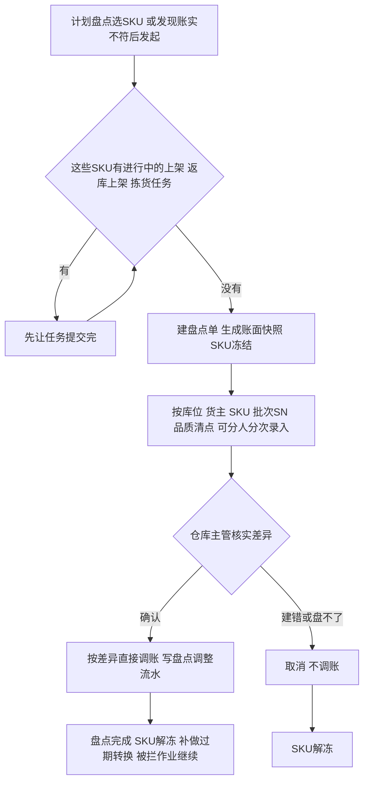

# 库存与库内业务设计

> 课程沙盘「库存与库内」域：三量口径、流水、移库、盘点与效期／SN。顺读从第二节起；第一节为范围与依据索引。

本篇在《库存与库内业务需求分析》已确认规则上展开口径、协同与走查。上架与入库过程量由入库域承接；退回本仓的收货暂存与上架落位与入库同三量口径，由退货域写入、本域记账，见[退货业务需求分析](../03-需求调研和分析/05-退货业务/退货业务需求分析.md) RT-FR-010。预占、扣减与缺货恢复由出库域承接。对象与状态骨架见[库存模块宏观系统架构](../01-全局背景信息/07-库存模块宏观系统架构.md)。

## 一、管理范围与依据

### 1.1 本域管理仓内实物，不建立全局库存账

库存以仓库＋货主＋SKU为基础，进一步按库位、批次、SN、品质及效期观察。香港、美西、美东、德国各自独立；同一商品在别仓或别货主有货，不代表本单可借用。集团全局库存协同、成本、财务核算、货主账单和跨仓调拨在途不在本域。

箱和托只作为搬运、清点及交接的作业容器使用，内部SKU件数进入作业和库存记录；箱数、托数不是另一份库存。同一批货可以从原箱拆出或重装，不发生箱库存转件库存。一期不提供箱库存、托盘库存、库位容量、承重或占用率管理。

### 1.2 依据与竞品对照

库存规则依据见 [库存与库内业务需求分析](../03-需求调研和分析/04-库存与库内业务/库存与库内业务需求分析.md)；调研背景与资料缺口见同名调研稿；项目范围见全局背景中的项目定位。基础资料、入库、退货、出库规则分别见各模块需求分析第二节。跨模块综合走查见[海外仓典型业务场景与方案](06-海外仓典型业务场景与方案.md)第8.4节。

竞品取舍与后续候选能力见《海外仓典型业务场景与方案》第8.2节及其原文引用；下表列出与库存业务直接相关的参考，其余见双边能力对比矩阵第四节。

| 主题 | 代表原文 | 本项目取舍 |
| --- | --- | --- |
| 库存视角与品质 | [LX-WMS-036](../02-竞品调研和分析/领星WMS/01-原始页面/LX-WMS-036_使用WMS查询或处理产品库存.md) | 取维度与流水；普通移库不改品质 |
| 预占与分配 | [LX-WMS-044](../02-竞品调研和分析/领星WMS/01-原始页面/LX-WMS-044_使用WMS设置库存锁定和分配逻辑.md) | SKU 总量预占后库位分配；效期排序按已确认规则，不复制全算法 |
| 盘点 | [LX-WMS-045](../02-竞品调研和分析/领星WMS/01-原始页面/LX-WMS-045_使用WMS进行盘点.md)、[JF-PDA-008](../02-竞品调研和分析/极风WMS/01-原始页面/JF-PDA-008-PDA库存盘点.md) | 按 SKU 冻结库存变动，有进行中任务不建单；不照搬「锁全部归零」 |
| 效期 | [JF-INV-007](../02-竞品调研和分析/极风WMS/01-原始页面/JF-INV-007-商品有效期管理.md) | 临期可出、存储拣货库位上的过期品转不良；不采用竞品过期仍售卖 |

## 二、使用方与交接

按业务责任区分操作场景；一期不做账号/角色权限，盘点差异确认、在库受损品质确认与常规作业入口都默认可见（应用设计中的全局机制与操作留痕），能否执行只由业务状态和业务规则决定。

| 使用方 | 负责什么 | 交出什么 |
| --- | --- | --- |
| 仓库组织责任方，岗位未指定 | 选计划盘点的SKU，建单前协调这些SKU的进行中任务提交完，跟进移库 | 可实盘的范围、作业停顿安排 |
| 库存执行方 | 现场核对源位、商品、批次／SN、品质和数量，移至适配目标位 | 成对的源／目标变化及实物当前位置 |
| 盘点执行方 | 按盘点单在存储、拣货、不良隔离库位上清点或扫描SN | 实盘数量、位置和差异证据 |
| 仓库主管（具备盘点差异确认权限及本仓授权） | 复核实盘和历史业务，确认调整数量；建错或暂时盘不了时取消盘点 | 经确认的差异、库存调整及依据 |
| 入库／出库执行方 | 入库交收货与上架事实；出库交占用、拣货移库、实发、退拣返库与释放；发现账实不符时，提交手上单据后对该SKU发起盘点 | 数量变化所依的原业务记录、盘点发起依据 |
| 上游／货主协作方，一期由OMS Mock模拟 | 对订单取消、处置通知等作业务决定，接收收发结果 | 合法业务指令及异常处理结论 |

| 上游给什么 | 本域交出什么 | 交给谁 |
| --- | --- | --- |
| 商品追溯、品质、位置及仓库时间配置 | 可执行判断，缺资料或冲突的原因 | 收发货与库内执行方 |
| 收货与上架结果（正常／不良） | 对应归属与位置的实际、预占、可用及流水 | 入库域、仓库管理 |
| 出库占用、分配、拣货与返库上架移库、确认出库 | 对应的库存与占用变化，按原单可追溯 | 出库域、上游协作域 |
| 现场移位、实盘或发现的账实不符 | 移库事实、盘点单及差异调整 | 仓库管理；需要对货主解释时由协作责任方提供，现阶段不建设货主门户 |

## 三、库存对象与观察维度

### 3.1 这些视角看的是同一批实物

| 观察对象 | 关系与可选性 | 业务用途及追溯 |
| --- | --- | --- |
| 仓库、货主、SKU | 每笔在库实物属于1仓、1货主、1SKU；同一商品可分多仓多位，但不共享可用 | 判断本仓本货主能安排多少；同编码不同货主仍是不同商品归属 |
| 仓、区、库位 | 仓含多区，区含多位；在库及入库实物按作业可追位置 | 从汇总找到实物；一位同一时点只能被一个货主使用，同货主可多SKU；收货暂存、出库暂存库位除外 |
| 批次及其库位分布 | 启用批次／效期时记录批次信息；同批可多位，同位可多批 | 拣货、移库、盘点与处置明确操作哪批，汇总不丢日期 |
| SN | 商品启用时采集；每个SN另记当前位置、批次和品质，不按SN拆库存明细；轨迹对应具体商品及归属，当前位置或已出仓结果可查 | 追到具体单件；未启用不能凭总量补造SN，按货主＋SKU＋SN跨四仓共用身份判断 |
| 品质与效期等级 | 品质正常／不良分开；效期启用时标等级，临期不是第三种品质 | 判断普通出库资格；不良仍实际在库但整体不可用 |
| SKU库存与库存明细 | 同一货主SKU在SKU层一行，在库存明细按库位、批次、品质分多行；SKU层的实际等于库存明细按品质加总 | 接单看SKU层可用；分配看库存明细可分配（实际－已分配） |
| 订单占用 | 出库单明细上的预占数量，合计在SKU层；拣货时才分配到库位、批次，记为库存明细的已分配 | 判断还能接多少新单；分配不另加占用 |
| 入库／出库／库内记录→流水 | 一笔业务可产生多条归属、位置、批次或数量流水，一行只记一个数的一次变化，搬动记一减一加两行；未生效作业不产生已生效库存结果 | 从原单查前后量，从商品、位置、批次／SN查变化原因 |
| 作业容器→SKU内容 | 容器可无记录；有箱托时内部可多SKU，同SKU可多容器 | 定位混合到货、搬运及交接；内部数量还原商品，不另加箱托库存 |

一个库位改给另一货主前，原货主的实际库存、保存未提交的上架或返库上架占用及其他未完结任务均要清零。只看实际为0还不够：保存中的上架单、返库上架单或其他未完任务仍能占用该位置。收货暂存、出库暂存库位允许多货主混放，不受此限。无法识别货主的到货放专门无主货暂存位置，不能并入某货主库存。

### 3.2 暂存库位上的已收未上架量和已拣量

收货确认后，实收按良品、不良品计入收货暂存库位的实际库存（不良品整体不可用），上架单提交时移到目标库位。暂存库位允许多货主混放；上面的良品计入可用，接单可以预占，但不参与分配：已收未上架的货要等上架后才能分配、拣货。

已拣未确认出库的货在拣货扫描确认时从原库位移到出库暂存库位，仍计实际并保持本单订单占用，确认出库时才扣库。取消时本单订单占用一次释放，已拣实物退拣，退拣的良品算可用、新单可以占，但要经返库上架单回到存储、拣货库位后才能再被分配。无主货暂存、超收或效期拒收实物尚未进入库存，不可在本域当库存移库、盘亏或出库处置。

暂存库位上的货跟着上架单、出库单走：不移库、不盘点，也不做过期转换；只有复核发现已拣残损时，在出库暂存库位转不良再退拣。暂存期间丢的货，上架或返库时按应上架、应返库数量提交，落到目标库位后再盘出来。

已经确认出库但等待揽收的商品可能仍在出库暂存库位或交接位置，已不计实际库存。

## 四、数量与品质的共同口径

### 4.1 实际库存＝预占库存＋可用库存

三量按仓库＋货主＋SKU看。预占＝订单占用＋不良品：订单占用是各出库单明细上的预占数量，不良品整体不可用，全部算在预占里。可用＝正常品实际－订单占用，记在SKU层。收货暂存、出库暂存库位上的正常品同样算可用，接单可以占；但它们只是作业中的停放位置，不参与分配。分配看库存明细的可分配（实际－已分配），只取存储、拣货库位上的正常品。正常／不良描述品质，实际／预占／可用描述数量，两组维度分别使用。

**模拟静态例：**正常实际8、订单占用3，不良2：合计实际10＝预占5（3＋2）＋可用5（8－3）。不能在此之外再加“待拣库存3”“箱库存2”扩大实际。

SKU订单占用按本仓本货主的可用保护需求，不在接单时定库位。日常B2B可按可用部分预占，B2C须全单各SKU足量预占才能接收；B2C准入失败时不留下本请求的部分占用（接单规则见出库域第四节）。拣货分配才指向库位、批次／SN，并且只在已有占用量内分配，记为库存明细的已分配；它是作业关系，不是多占一份实物。库位少货换位时只改分配，原位解、新位分，SKU总占用不变。货还在暂存的，接了单要等上架或返库上架后才能分配；B2C整单能分配足才生成拣货任务。

### 4.2 拣货分配和其他出库指定不另加占用

- 拣货分配：分到的数量记在库存明细的已分配，不能再分给其他任务，也不能移库或做品质转换；三量不变。
- 其他出库：在出库单明细上指定库位、批次／SN，计入这些库存明细的已分配，不另加订单占用；同一批货因此不会被两张其他出库重复指定。取消只解除指定、释放已分配，不良品仍不可用。
- 已分配的货残损或过期，等拣货时上报库位缺货、换位释放后再转不良；已拣的货在出库暂存库位转不良后退拣。两种情况订单占用都照算：订单还要另找好货，不能拿这件不良品抵。

**模拟例：**正常品10、订单占用3，系统已把存储库位上3件分给这张单、还没拣。这3件当天过期，因已分配先不转，三量仍为10／3／7。拣货人员不拣过期品，上报库位缺货，换位到另外3件好货；原来3件的分配释放后转不良：正常7、不良3，预占＝3＋3＝6，可用＝7－3＝4。

### 4.3 可用为负说明好货不够

接单和补占只在可用范围内占，不会让可用变负。盘点调减或品质转换会减少正常品，剩下的正常品不够订单占用时，可用为负，表示订单占着的好货不够了；这些单分配时差的部分留作待拣，按出库缺货规则处理。可用为负时，新单不能再占这个SKU。

## 五、库存变化与业务追溯

### 5.1 什么事实改变什么量

| 业务事实 | 实际 | 预占／可用及品质 | 位置及追溯 |
| --- | --- | --- | --- |
| 到货、无主货登记、拒收 | 不变 | 未形成库存结构 | 留到货、暂存位置与拒收记录 |
| 收货确认 | 按实收增加收货暂存库位实际 | 良品计可用、接单可以占，但上架前不能分配；不良品计入预占 | 原入库、收货记录、批次／SN相连 |
| 上架单提交（良品、不良品） | 总量不变 | 预占／可用及品质不变；良品进入存储、拣货库位后才能分配，不良品进不良隔离库位 | 暂存库位减、目标库位增，原入库、上架单、批次／SN相连 |
| 已收未上架真实丢失 | 一期入库不做丢失收口：上架单按应上架数量提交（暂存移到目标库位，总量不变），再由发现人员对该SKU发起盘点、盘亏 | 提交到盘亏之间，丢失数量会暂时计入可用，须尽快发起盘点 | 入库业务保留原实收与上架结果；盘点单记录发现依据 |
| 上架前发现未登记残损 | 一期入库不做品质转换：按原品质上架后，由本域做正常转不良 | 不良品增加、可用减少 | 关联原入库与品质转换依据，之后移到不良隔离位置 |
| 普通出库预占 | 不变 | 订单占用增加、可用减少；只在可用范围内占，暂存库位上的良品也算 | 来源单及SKU总量占用；此时可未定具体位 |
| 其他出库建单 | 不变 | 三量不变；指定的不良品计入已分配 | 出库单明细记指定库位、批次／SN |
| 分配／换位 | 不变 | 不增加预占；库存明细的已分配增加，换位时原位减、新位加 | 分配落点保留在拣货任务上 |
| 拣货扫描确认 | 总量不变 | 普通出库订单占用不变，来源已分配按本次新增实拣量减少 | 来源库位减、出库暂存增；关联本次实拣、批次／SN与原单，任务提交不重复移库 |
| 取消出库单 | 不变 | 一次释放本单订单占用和未拣部分的已分配；已拣实物在出库暂存库位，返库上架后才能再分配 | 原单、退拣与返库上架单相连 |
| 退拣与返库上架单提交 | 总量不变 | 取消退拣时本单占用已释放；复核退拣时本单占用保留；残损件退拣前已转不良 | 出库暂存库位减、目标库位增，不良品进不良隔离库位；找不到的仍按应返库数量提交，再对该SKU发起盘点 |
| 确认出库 | 出库暂存库位减实发量 | 扣实发对应占用并释放本单剩余占用 | 原单、实发、交接、流水只生效一次 |
| 普通移库 | 总量不变 | 预占／可用及品质不变；只能移没被分配的 | 源减目标增，一减一加两行流水成对追溯 |
| 存储、拣货库位上没被分配的过期品自动转不良 | 不变 | 不良品增加、可用减少 | 保留原位、批次／SN、转换原因 |
| 盘点差异确认 | 按确认差异增减 | 不良品差异同步调整；正常品不够订单占用时可用为负 | 盘点单、快照、实盘、发现依据及调整关联 |

SKU层和库存明细共用一本流水，一行只记一个数的一次变化：实际的变化记在库存明细那一行，订单占用的变化记在SKU层；上架、拣货扫描确认、返库上架、移库和品质转换记一减一加两行；分配和指定只改已分配，不写流水，追溯看拣货任务和出库单明细。原业务记录解释做了什么，流水解释哪组库存如何变。库存数字只能由已确认业务或盘点调整改变，不提供无依据改数。PDA与管理端共用库存记录与流水，移库、盘点实盘等重复提交不重复改量。

### 5.2 查差异的顺序

先限定仓库与货主，明确是总量不足、位置不符、品质失效还是占用未释放，再追关联业务。对“账有货、现场无货”，检查该批的收货、上架、移位、拣货扫描确认、确认出库、退拣返库及盘点记录；对“实物在、可用为0或为负”，检查有效订单占用和不良品数量。不能仅因为可用为0就调增实际，也不能用一次普通移库修复不知道原因的总量差异；查不清的对该SKU发起盘点。

### 5.3 发现账实不符就发起盘点

拣货短拣或换位、复核少件、上架或返库上架时找不到，说明账上的货比现场多。发现人员不另做差异登记，先把手上的单据按规则提交，再对这个SKU发起盘点：

| 发现环节 | 先做什么 | 账上暂时的情况 |
| --- | --- | --- |
| 拣货时库位缺货，换位或短拣 | 上报库位缺货，提交拣货任务 | 原库位账上还挂着少掉的数量 |
| 复核发现少件 | 按「少件」退拣，返库上架单按应返库数量提交 | 目标库位账上多出找不到的数量 |
| 上架或返库上架时找不到 | 上架单、返库上架单按应上架、应返库数量提交 | 目标库位账上多出找不到的数量 |

发现差异即按本仓本货主 SKU 标记待核对，暂停新分配、组波、补拣及其他出库指定；缺货上报的本次合法换位与标记同时生效，此后不扩大分配。接单仍按可用预占，已有任务收尾或取消，退拣返库可继续。盘点单记录发现环节、库位、少了多少和发现人；主管确认盘点完成才解除待核对，补货、原单取消或盘点取消不解除。不另建锁定单据，按应返库、应上架量提交的账面量在等待期间不能新分配。

已拣后丢失按出库第7.5节处理，已收未上架丢失按入库第8.4节处理：都按应返库、应上架数量提交，再由本域盘点调整，同一损失只扣一次。

## 六、移库与大货存储、零散拣货协同

### 6.1 基本移库的完整运行

移库触发包括同仓货物挪位、存储位置转入适合零散拣货的位置，以及不良品移到不良隔离位置。移库只在PDA上一次提交：执行角色扫源位、商品、批次／SN、品质和拟移动量，搬到目标位后扫目标位提交，系统一次完成源减、目标增并写流水；没有预先下达的移库任务，也没有执行中的中间状态。

提交时校验：拟移量不超过源位上未被分配的实际（实际－已分配）；目标位属于本仓、启用、品质适配，空着或已归同一货主；收货暂存、出库暂存库位不作源或目标；SKU不在盘点中。SKU级订单占用不随位改变，本身不禁止移库，只看拟移部分是否已被具体任务分配。

普通移库不改变品质、仓库或货主，不用于调拨，也不将不良品变为正常品可用库存。过期转换保留原位，需搬至不良隔离位置时另做一次移库。

### 6.2 整仓有货但拣货库位不足

共享海外仓的大货存储与零散包裹可能使用不同位置。订单总可用足够，不代表当前拣货库位够用。处理顺序为：核本仓本货主库存及品质／效期→区分已有任务分配和可移动实物→按当前基本移库搬到适配拣货位置，或在现有允许的可拣来源中重新推荐→核实际位置后继续拣货。不能把商品总量、箱数或未上架来货当成补货已到位。

当前规则没有确定存储区一律不可拣，也没有自动补货任务。是否从存储位直接拣，应依据该位置与商品的实际可执行条件；具体可拣范围和动作在应用设计结合四仓样例细化。若所有可拣来源都没有合格实物，才由出库域在拣货任务上记短拣，不自动释放B2C占用。

**模拟时间线：**货主A的X实际100，存储S位90、拣货P位10；本单需20并已SKU预占20，总量100／20／80。若P位10已分配给该单，不能直接移走这10；核S位拟移20未被具体任务分配，移至同货主适配P位后S70、P30，总仍100／20／80。原P位10继续本单分配，再从新增位置分配本单其余10，不新增预占。扫描确认20件即移到出库暂存库位，任务提交不再移库，仍100／20／80，足量确认后实际80、预占0、可用80。多搬的10留P位供后续作业，不因移库直接扣库。

### 6.3 与补货候选及缺货恢复的边界

一期用基本移库和合法换位解决位置不足；独立补货任务、拣货区下限和自动建议列为后续候选能力，见《海外仓典型业务场景与方案》第8.2节。

库存补齐后，已接收缺货单或短拣单由仓库人工重新分配（出库域第7.4节）；移库或入库上架完成本身不恢复原单。

## 七、盘点业务：冻结、实盘与差异

### 7.1 盘点让这些SKU先停下

盘点按SKU建单：计划盘点由仓库组织责任角色在管理端选SKU创建，想盘某个库区就选出这个库区的SKU；拣货、复核、上架时发现账实不符，由发现人员在PDA上对这个SKU发起（第5.3节）。盘的是这些SKU在本仓存储、拣货、不良隔离库位上的库存，收货暂存、出库暂存库位上的货跟着单据走，不盘。范围内仍按货主、位、批次／SN、品质辨认，不能用汇总掩盖跨货主差异。

建盘点单时，这些SKU不能有进行中的上架单、返库上架单或拣货任务，否则做到一半的货会让实盘对不上账；有就先让任务提交完。建单即生成账面快照，盘点单进入盘点中，这些SKU从这一刻起不动库存：

| 环节 | 盘点期间怎么处理 |
| --- | --- |
| 收货、上架、返库上架 | 不能收这些SKU的货；含这些SKU的上架单、返库上架单不能开始 |
| 出库 | 含这些SKU的出库单照常推进来、照常预占，也能受理取消；其他作业（分配、组波、拣货、复核、确认出库、重新分配）都等盘点完成 |
| 移库、品质转换 | 不能移库，不能人工转品质；过期转换暂停，盘点完成后补做 |

### 7.2 各阶段谁做什么、何时算完成

| 阶段 | 责任与执行 | 实物和数量后果 | 完成条件 |
| --- | --- | --- | --- |
| 建单 | 组织责任角色按计划建，或发现人员发起 | 生成快照，SKU冻结；新出库单仍可进来并预占 | 这些SKU没有进行中的任务 |
| 现场实盘 | 执行角色按位、货主、SKU、批次／SN、品质清点 | 只记数，不动库存；发现残损的按不良品录 | 实盘与快照可对应，差异及无法识别实物记录明确 |
| 差异确认 | 仓库主管核实实盘和历史动作 | 按差异直接调账，不因订单占用中止；不良品差异同步调整 | 调整依据成立，实际不为负 |
| 完成或取消 | 主管确认完成，或建错、暂时盘不了时取消 | 完成即调账、解冻并解除已核实差异的待核对；取消不调账，只解除盘点冻结，未核实差异继续待核对 | 冻结解除，被拦作业恢复，暂停的过期转换补做 |

### 7.3 差异确认直接调账

差异确认不看订单占用和已分配。盘亏后剩下的正常品不够订单占用时，可用为负，表示订单占着的好货不够了；这些出库单分配时差的部分留作待拣，按出库缺货规则处理：补货后人工重新分配，FBA转运出库、批发可按已有规则缺量结案，其余类型等补齐或上游取消。其他出库指定的不良品盘亏了，这张其他出库只能取消后重新指定。不能为了让可用不为负而拒绝确认真实的盘亏。

不良品实盘短少时，实际与不良品数量同步减少，剩下的不良品仍整体不可用。只是发现商品受损或计划移出、实物并未短少的，不能伪造实盘0：受损的按不良品录实盘，移出走其他出库。盘盈的实物先确认归属和商品身份，认不出货主的按无主货登记，不直接加到某货主库存。

### 7.4 模拟时间线：盘点期间接单、盘亏后缺货

**模拟前提：**美西仓货主A的X，存储库位S1正常5，不良隔离库位Q1不良2；B2C单O1已预占4、还没拣。

| 时间 | 动作与现场 | 实际／预占／可用 | 业务解释 |
| --- | --- | --- | --- |
| T0 | 起始 | 7／6／1 | 预占＝订单占用4＋不良品2 |
| T1 | 按X建盘点单 | 7／6／1 | 没有进行中的任务，可以建；快照S1正常5、Q1不良2，X冻结 |
| T2 | B2C单O2推进来，需求1 | 7／7／0 | 照常接单预占；O1、O2都不能分配、拣货 |
| T3 | 实盘S1正常4、Q1不良2 | 7／7／0 | 只记数，不动库存 |
| T4 | 主管确认差异，S1盘亏1，盘点完成 | 6／7／－1 | 订单占着5件好货，实际只有4件；X解冻 |
| T5 | 生成拣货任务 | 6／7／－1 | 一共只能分到4件：O1整单分到4件，生成拣货任务；O2分不到，留在待拣货 |

本例期初7＝期末6＋盘亏1。盘点期间照常接单，盘亏后就可能有单缺货，这是「单可以进来」的代价；B2C不能缺量结案，差的那张等补货后重新分配或上游取消。

### 7.5 模拟分支：盘盈与不良品短少

**独立模拟盘盈例：**正常品快照9、订单占用3，实盘核对同仓同货主同SKU为10。确认多出1件的身份、批次／SN及差异依据后，主管确认调整实际增1至10：预占3、可用7。多出的实物若归属或商品身份尚不能确认，先核实，不直接加到某货主库存；无法识别货主的到货按无主货登记与暂存处理。

**独立模拟不良短少例：**不良品快照2、无订单占用，实盘核实只有1件。确认真实短少1后实际和不良品同步减为1：实际1、预占1、可用0。不能把剩余1件转为可销售。

## 八、批次、效期与SN贯穿收存发

### 8.1 效期判断和品质转换

商品配置满足允许入库天数≥临期天数≥过期天数，允许相等。收货准入为剩余保质期≥允许入库天数，等值允许；不把临期等级作为另一个收货门槛。

在库按所属仓库当地日期判断：低于过期天数时过期；未过期且低于临期天数时临期，过期优先。临期仍为正常品，允许普通出库，不增加占用，也不另设最短出库剩余效期门槛。

过期自动转不良只转存储、拣货库位上没被分配的货：实际不变，原批次、SN、位置及转换流水保留；自动转换不自动搬货，后续按适配移库到不良隔离位置。收货暂存库位上的货上架后再判断；出库暂存库位上已拣的货不转，照常复核、发出；盘点中的SKU暂停转换，盘点完成后补做。普通出库不再使用转换后的不良品，实际移出由其他出库承接。

已分配未拣的货过期后不再拣出，先不转：拣货时按库位缺货换位，分配释放后再转不良；订单占用不变，换不到的按出库缺货规则处理。不能为了继续发而把它当正常品拣出。

### 8.2 SN逐件追溯

SN管理按商品配置启用，贯穿收货、上架、移库、拣货、退拣返库上架、盘点、处置和确认出库。现场记录不仅要能回答SKU减少几件，还要知道哪些SN离开原位置、是否返库上架、最终交给哪笔出库或处置。批次与SN可同时启用，不以扫描到SN为由丢掉其批次和品质。

**模拟轨迹：**货主A的3C商品SN-A001在美西仓收货，属于原入库I1、批次B1；收货确认后在收货暂存库位形成实际1，上架到L1仍实际1；从L1移至L2仍实际1；出库O1拣货扫描确认后到出库暂存库位，仍实际1、预占1；O1取消即释放，退拣后经返库上架单回到L2，实际1、可用1；盘点扫描到该SN，无差异；新单O2拣货复核该SN并确认，实际0，历史保留I1→收货暂存→上架→移库→O1拣货→O1退拣返库→盘点→O2实发。若最终走不良品处置，则轨迹指向该处置，不伪造销售出库。

SN 身份为货主＋SKU＋SN，四仓共用判断；不同货主或不同 SKU 允许相同 SN 文本，不要求全集团文本永久唯一。追溯开关的切换条件与配置生效时点由基础资料域约定，本域保留配置要求的历史轨迹。

### 8.3 非效期受损的模拟走查

在库发现受损（含拣货时发现不拣、复核时发现的已拣件），先停止该实物普通出库，具备对应权限及本仓授权的仓库主管核实后转不良并通知货主（已分到拣货任务上的，由拣货人员上报库位缺货、换位释放后再转）；已拣件在出库暂存库位转不良后，再退拣回不良隔离库位；收货暂存库位上发现的先按原品质上架再转。保留原位置、批次／SN与品质转换依据，普通移库不代替转换，通知不代表赔偿责任裁定。盘点中的SKU不能人工转换，盘点时发现的残损按不良品录实盘，确认差异时一起调整。

**独立受损模拟：**正常品实际10、订单占用3、可用7，存储库位上发现2件受损，其中1件已分给该订单。没分配的那件主管核实后直接转不良；已分配的那件不能拣，拣货时上报库位缺货、换位到其他好货，释放后再转。两件转完后实际仍10：正常8、不良2，预占＝3＋2＝5，可用＝8－3＝5。之后合法取消这张未拣单，只释放订单占用：实际10、预占2、可用8。

## 九、不良品管理与一期边界

### 9.0 数量走查案例索引

| 场景 | 结论要点 | 正文 |
| --- | --- | --- |
| 已分配的货过期 | 订单占用照算，可用＝正常品－订单占用 | [§4.2](#42-拣货分配和其他出库指定不另加占用) |
| 发现账实不符 | 先提交手上单据，再对SKU发起盘点 | [§5.3](#53-发现账实不符就发起盘点) |
| 盘点期间接单、盘亏后缺货 | 单可以进来，盘亏后可用为负、按缺货处理 | [§7.4](#74-模拟时间线盘点期间接单盘亏后缺货) |
| 盘点：盘盈与不良品短少 | 不良短少同步减不良品 | [§7.5](#75-模拟分支盘盈与不良品短少) |
| 在库受损 | 实际不变，订单另找好货 | [§8.3](#83-非效期受损的模拟走查) |
| 其他出库与真实盘亏 | 5＝其他出库3＋真实盘亏1＋期末1，不重复扣 | [§9.4](#94-模拟处置与盘点短少分别记账) |

### 9.1 不良品仍属于实际库存

不良品实际移出或确认真实盘亏前，仍计入实际库存并整体不可用（计入预占）。品质转换见第八节。

### 9.2 实际移出由其他出库承接

根据上游通知或线下邮件，在出库模块登记并核对本仓本货主的指定不良品。确认足量实发时扣对应实际数量，保留来源、原因、批次／SN、人员、时间与交接结果。不得引用已退出库存的数量，也不得指定已被其他其他出库指定的实物。完整执行路径见出库域第八节。

真实盘点差异按第七节核对、确认调整；实物仍在场时继续计入实际库存，不能以计划移出或处置伪造盘亏。

### 9.3 后续阶段范围

一期不包含独立报损、仓内销毁及报损后的非库存暂存跟踪。后续开展时，需明确扣账时点及剩余实物的管理方式。

### 9.4 模拟处置与盘点短少分别记账

**模拟前提：**不良X实际5、预占5、可用0，无订单占用。货主通知指定3件实际移出，核对并足量确认其他出库后，实际2、预占2、可用0；重复确认仍为2／2／0，保留原单、指定实物及交接记录。

之后对X盘点，实盘只有1件，核实短少1后调减实际与不良品各1，完成后为1／1／0。初始5＝其他出库3＋真实盘亏1＋期末不良1；盘亏依据是实物短少，不能把计划移出的3件再次计为盘亏。

## 十、其他异常与恢复责任

数量案例见第九节索引表；与综合场景文档 8.4 节对照验收时，以各域详表数字为准。

| 触发条件 | 业务后果 | 责任方 | 恢复方式 |
| --- | --- | --- | --- |
| 未形成库存的到货被当作在库实物 | 不可普通预占、库存移库或扣库 | 入库与库存责任角色 | 符合入库条件的实物继续按入库流程处理；无主货一期只登记、暂存，认领由后续OMS承接；超收线下暂存并联系货主，效期不符记为拒收 |
| 源位不足、批次／SN或货主不符 | 本次移库不能完成 | 移库执行角色 | 核对实物、流水及位置；存在账实差异时对该SKU发起盘点 |
| 目标位被其他货主使用或品质不适配 | 阻断移入，保留原位置记录 | 执行角色、仓库组织 | 选同货主有效适配位；不改货主或品质绕过 |
| 拟移量被拣货任务分配 | 不能直接搬走，原订单执行受保护 | 库存与出库组织角色 | 由出库处理换位或取消，解除原分配后再移库 |
| 拟盘SKU有进行中的上架、返库上架或拣货任务 | 不能建盘点单 | 盘点组织与任务执行角色 | 先让任务提交完，再建盘点单 |
| 盘点期间要收货、上架、拣货、确认出库或移库 | 这些SKU的作业被拦住，出库单仍可接单预占 | 原作业角色、盘点组织 | 等盘点完成或取消后继续 |
| 盘亏后正常品少于订单占用 | 可用为负，相关出库单缺货 | 出库与上游协作角色 | 补货后人工重新分配，或按类型缺量结案、等上游取消 |
| 不良品实盘短少 | 实际与不良品同步减少 | 差异确认角色 | 按第7.5节调整，剩余不良品仍不可用 |
| 已分配未拣的货过期 | 不再拣出，先不转不良，订单占用保留 | 库存、出库角色 | 拣货时换位，释放后再转不良；换不到的按出库缺货规则处理；不良实物移出按第九节执行 |
| 拣货、复核、上架时发现账实不符 | 账上多出现场没有的数量 | 发现人员、仓库主管 | 提交手上单据后对该SKU发起盘点，按第5.3节处理 |
| 其他出库指定量超过该批没被指定的在库量 | 不能建单 | 其他出库创建角色 | 核对指定实物和已有指定，改正数量或另选实物 |
| 同记录重复确认或管理端／PDA重复提交 | 不增加第二次库存影响 | 各动作有权限执行者 | 返回原结果，核原流水；两端共用业务事实 |
| 拟切换SN、批次或效期管理开关 | 任一仓有该货主商品实际库存，或该商品入库单正在作业时禁止切换 | 资料维护、仓库责任角色 | 各仓库存清零且无正在作业的入库单后可切换；仅有未开始、无库存的预报单不阻断，历史轨迹保留 |
| 拟停用商品、货主或库位 | 存在实物或未完结业务时禁止停用 | 资料维护、仓库责任角色 | 核清实际库存（含收货暂存、出库暂存库位）、已确认出库待交接实物和未完结业务；符合基础资料停用条件后处理，历史记录保留 |

## 十一、资料缺口与应用设计输入

### 11.1 资料缺口

待补四仓平面图、源目标位与动销样例、现场盘点表、真实差异证据、其他出库凭证，以及批次日期和SN样例。本文数量案例为课程模拟，用于核对规则与计算；现场作业习惯和数据质量需结合这些资料核实。

### 11.2 应用设计输入

- 库存查询与流水展示需能区分SKU层的订单占用、库存明细的已分配和不良品，可用为负时有明确提示，并追溯原业务。数量变化以第五节为依据。
- 盘点需保留来源（计划盘点或发现账实不符）、发现依据、快照、实盘、差异确认与取消记录。
- 品质与效期等级分别展示，能区分临期正常品和过期不良品。
- PDA移库、发起盘点、实盘扫描与管理端共用业务记录，按顶栏当前仓库和业务状态执行；具体字段、页面、状态和重复提交处理由应用设计落实。

本次应用设计不包含库存初始化导入、动态循环盘点和货主账单。
