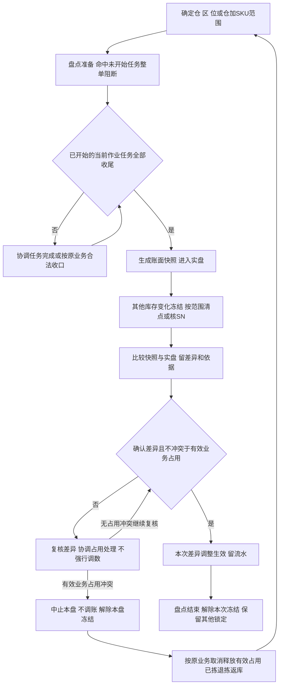

# 库存与库内业务设计

> 课程沙盘「库存与库内」域：三量口径、锁定并集、流水、移库、盘点与效期／SN。顺读从第二节起；第一节为范围与依据索引。

本篇在《库存与库内业务需求分析》已确认规则上展开口径、协同与走查。上架与入库过程量由入库域承接；退回本仓的收货暂存与上架落位与入库同三量口径，由退货域写入、本域记账，见[退货业务需求分析](../03-需求调研和分析/05-退货业务/退货业务需求分析.md) RT-FR-010。预占、扣减与缺货恢复由出库域承接。

## 一、管理范围与依据

### 1.1 本域管理仓内实物，不建立全局库存账

库存以仓库＋货主＋SKU为基础，进一步按货位、批次、SN、品质及效期观察。香港、美西、美东、德国各自独立；同一商品在别仓或别货主有货，不代表本单可借用。集团全局库存协同、成本、财务核算、货主账单和跨仓调拨在途不在本域。

箱和托只作为搬运、清点及交接的作业容器使用，内部SKU件数进入作业和库存记录；箱数、托数不是另一份库存。同一批货可以从原箱拆出或重装，不发生箱库存转件库存。一期不提供箱库存、托盘库存、货位容量、承重或占用率管理。

### 1.2 依据与竞品对照

库存规则依据见 [库存与库内业务需求分析](../03-需求调研和分析/04-库存与库内业务/库存与库内业务需求分析.md)；调研背景与资料缺口见同名调研稿；项目范围见全局背景中的项目定位。基础资料、入库、退货、出库规则分别见各模块需求分析第二节。跨模块综合走查见[海外仓典型业务场景与方案](06-海外仓典型业务场景与方案.md)第8.4节。

竞品取舍与后续候选能力见《海外仓典型业务场景与方案》第8.2节及其原文引用；下表列出与库存业务直接相关的参考，其余见双边能力对比矩阵第四节。

| 主题 | 代表原文 | 本项目取舍 |
| --- | --- | --- |
| 库存视角与品质 | [LX-WMS-036](../02-竞品调研和分析/领星WMS/01-原始页面/LX-WMS-036_使用WMS查询或处理产品库存.md) | 取维度与流水；普通移库不改品质 |
| 预占与分配 | [LX-WMS-044](../02-竞品调研和分析/领星WMS/01-原始页面/LX-WMS-044_使用WMS设置库存锁定和分配逻辑.md) | SKU 总量预占后货位分配；效期排序按已确认规则，不复制全算法 |
| 盘点冻结 | [LX-WMS-045](../02-竞品调研和分析/领星WMS/01-原始页面/LX-WMS-045_使用WMS进行盘点.md)、[JF-PDA-008](../02-竞品调研和分析/极风WMS/01-原始页面/JF-PDA-008-PDA库存盘点.md) | 已开始任务收尾后快照；按项目范围冻结，不照搬「锁全部归零」 |
| 效期 | [JF-INV-007](../02-竞品调研和分析/极风WMS/01-原始页面/JF-INV-007-商品有效期管理.md) | 临期可出、过期转不良；不采用竞品过期仍售卖 |

## 二、角色与交接

角色按业务责任区分；盘点差异、在库受损品质确认权限集中于仓库主管，常规作业权限独立配置（应用设计中的全局机制与权限配置）。实际操作须同时具备本仓授权和对应动作权限。

| 角色 | 负责什么 | 交出什么 |
| --- | --- | --- |
| 仓库组织责任角色，岗位未指定 | 选盘点范围、协调进行中任务收尾、跟进移库和差异 | 可实盘的范围、任务收尾结论、异常处理责任 |
| 库存执行角色 | 现场核对源位、商品、批次／SN、品质和数量，移至适配目标位 | 成对的源／目标变化及实物当前位置 |
| 盘点执行角色 | 按盘点范围清点或扫描SN；收货暂存、出库暂存库位上的库存与其他库位一样按库位清点 | 实盘数量、位置和差异证据 |
| 仓库主管（具备盘点差异确认权限及本仓授权） | 复核实盘和历史业务，确认调整数量，检查有效占用 | 经确认的差异、库存调整及依据 |
| 入库／出库执行角色 | 入库交收货与上架事实；出库交占用、拣货移库、实发、退拣返库与释放 | 数量变化所依的原业务记录 |
| 上游／货主协作方，一期由OMS Mock模拟 | 对订单取消、处置通知等作业务决定，接收收发结果 | 合法业务指令及异常处理结论 |

| 上游给什么 | 本域交出什么 | 交给谁 |
| --- | --- | --- |
| 商品追溯、品质、位置及仓库时间配置 | 可执行判断，缺资料或冲突的原因 | 收发与库内执行角色 |
| 收货与上架结果（正常／不良） | 对应归属与位置的实际、预占、可用及流水 | 入库域、仓库管理 |
| 出库占用、分配、拣货与返库上架移库、确认出库 | 对应的库存与占用变化，按原单可追溯 | 出库域、上游协作域 |
| 现场移位或实盘结果 | 移库或盘点差异事实 | 仓库管理；需要对货主解释时由协作责任方提供，现阶段不建设货主门户 |

## 三、库存对象与观察维度

### 3.1 这些视角看的是同一批实物

| 观察对象 | 关系与可选性 | 业务用途及追溯 |
| --- | --- | --- |
| 仓库、货主、SKU | 每笔在库实物属于1仓、1货主、1SKU；同一商品可分多仓多位，但不共享可用 | 判断本仓本货主能安排多少；同编码不同货主仍是不同商品归属 |
| 仓、区、货位 | 仓含多区，区含多位；在库及入库实物按作业可追位置 | 从汇总找到实物；一位同一时点只能被一个货主使用，同货主可多SKU；收货暂存、出库暂存库位除外 |
| 批次及其货位分布 | 启用批次／效期时记录批次信息；同批可多位，同位可多批 | 拣货、移库、盘点与处置明确操作哪批，汇总不丢日期 |
| SN | 商品启用时采集；每个SN轨迹对应具体商品及归属，当前位置或已出仓结果可查 | 追到具体单件；未启用不能凭总量补造SN，按货主＋SKU＋SN跨四仓共用身份判断 |
| 品质与效期等级 | 品质正常／不良分开；效期启用时标等级，临期不是第三种品质 | 判断普通出库资格；不良仍实际在库但不可普通分配 |
| 库存占用及原因 | 同一实物可叠加订单、盘点、品质或处置原因，原因可多条 | 数量合计按不重复实物；解除某原因不抹掉其他限制 |
| 入库／出库／库内记录→流水 | 一笔业务可产生多条归属、位置、批次或数量流水；未生效作业不产生已生效库存结果 | 从原单查前后量，从商品、位置、批次／SN查变化原因 |
| 作业容器→SKU内容 | 容器可无记录；有箱托时内部可多SKU，同SKU可多容器 | 定位混合到货、搬运及交接；内部数量还原商品，不另加箱托库存 |

一个货位改给另一货主前，原货主的实际库存、保存未提交的上架或返库上架占用及其他未完结任务均要清零。只看实际为0还不够：保存中的上架单、返库上架单或其他未完任务仍能占用该位置。收货暂存、出库暂存库位允许多货主混放，不受此限。无法识别货主的到货放专门无主货暂存位置，不能并入某货主库存。

### 3.2 暂存库位上的已收未上架量和已拣量

收货确认后，实收按良品、不良品计入收货暂存库位的实际库存（不良品全量品质锁定），上架单提交时移到目标库位。暂存库位允许多货主混放，不参与出库预占和分配：已收未上架的货虽然计实际库存，也不能被出库使用。

已拣未确认出库的货在拣货任务提交时从原库位移到出库暂存库位，仍计实际并保持本单预占，确认出库时才扣库。取消或缺量结案时本单预占一次释放，没发出的实物退拣，经返库上架单回到存储库位后才重新可出库。无主货暂存、超收或效期拒收实物尚未进入库存，不可在本域当库存移库、盘亏或出库处置。

已经确认出库但等待揽收的商品可能仍在出库暂存库位或交接位置，已不计实际库存。现场清点出库暂存库位时，依据原出库单与确认事实区分它和仍计实际的已拣未发实物，不能因都在同一作业场地就再次计入在库或实盘数量。

## 四、数量、品质与锁定的共同口径

### 4.1 实际库存＝预占库存＋可用库存

预占库存即锁定数量，是实际库存中的一部分；可用是当前可再分配部分。正常／不良描述品质，实际／预占／可用描述数量，两组维度分别使用。正常品可能被订单占用，不良品默认全部品质锁定。

**模拟静态例：**正常实际8、订单预占3、可用5；不良实际2、品质锁2、可用0，合计实际10＝预占5＋可用5。不能在此之外再加“待拣库存3”“箱库存2”扩大实际。

SKU 订单预占按本仓本货主可出库库存（存储、拣货库位上未被占用的正常品）保护需求，不在接单时定货位。日常 B2B 可按可出库库存部分预占，B2C 须全单各 SKU 足量预占才能接收；B2C 准入失败或新单被盘点阻断时，不留下本请求的部分占用（接单规则见出库域第四节，盘点拒收见本文第七节）。拣货分配才指向货位、批次／SN，并且只在已有占用量内分配；它是作业关系，不是多锁一份实物。库位少货换位时只改分配，原位解、新位分，SKU 总占用不变。

### 4.2 锁定合计取并集，原因单独保留

| 原因 | 业务含义 | 解除后怎样判断可用 |
| --- | --- | --- |
| 订单占用 | 保护已接收需求，已拣在出库暂存库位仍占用 | 取消一次释放，确认出库按实发扣、剩余释放；退拣实物返库上架后才重新可出库；还要检查其他原因 |
| 盘点冻结 | 固定实盘范围，避免边数边变 | 只解除本次盘点原因，其他订单／品质继续有效 |
| 品质锁定 | 不良品不可普通分配 | 普通移库、取消处置或取消订单都不将其转普通可用 |
| 不良品处置占用 | 指定实物交本次不良品其他出库，防别单重复使用 | 解处置关系仍保留品质锁；其他出库按确认实发量扣减 |

同一件先被订单占用，后过期增加品质原因，仍只是一件锁定；整批进入盘点也不再次加件数。没有SN的商品仍须按同一库存明细及数量范围识别重叠，不能简单相加各原因的汇总。

解除一个原因后，可用只增加“不再被任何有效原因限制”的部分。模拟不良品5件，其中指定处置2，锁合计仍5；取消处置2后仍锁5、可用0。再沿用4.1的模拟库存：盘点期间正常8与不良2全范围锁定，合计锁10；盘点结束仍留订单3与品质2，合计锁5、可用5。

## 五、库存变化与业务追溯

### 5.1 什么事实改变什么量

| 业务事实 | 实际 | 预占／可用及品质 | 位置及追溯 |
| --- | --- | --- | --- |
| 到货、无主货登记、拒收 | 不变 | 未形成库存结构 | 留到货、暂存位置与拒收记录 |
| 收货确认 | 按实收增加收货暂存库位实际 | 良品无其他锁定时可用同增，但不参与出库分配；不良品全量品质锁 | 原入库、收货记录、批次／SN相连 |
| 上架单提交（良品、不良品） | 总量不变 | 预占／可用及品质不变；良品进入存储、拣货库位后才可出库，不良品进不良隔离库位仍全量锁定 | 暂存库位减、目标库位增，原入库、上架单、批次／SN相连 |
| 已收未上架真实丢失 | 一期入库不做丢失收口：上架单按应上架数量提交（暂存移到目标库位，总量不变），再经本域盘点盘亏丢失数量 | 提交到盘亏之间，丢失数量会暂时计入可用，须尽快盘点 | 入库业务保留原实收与上架结果；盘点记录损失依据 |
| 上架前发现未登记残损 | 一期入库不做品质调整：按原品质上架后，由本域做正常转不良 | 转不良后品质锁同增，可用减少 | 关联原入库与品质调整依据，移到不良隔离位置 |
| 普通出库预占 | 不变 | 锁增加，可用减少；只占可出库库存 | 来源单及SKU总量占用；此时可未定具体位 |
| 分配／换位 | 不变 | 库位分配不增加预占总量 | 分配落点保留 |
| 拣货任务提交 | 总量不变 | 预占不变，已拣仍为本单占用 | 来源库位减、出库暂存库位增；实拣、批次／SN相连 |
| 取消出库单 | 不变 | 一次解除本单占用，仅无其他锁时恢复可用；已拣实物在出库暂存库位，返库上架后才可出库 | 原单、退拣与返库上架单相连 |
| 退拣与返库上架单提交 | 总量不变 | 取消或结案退拣时本单占用已释放；复核退拣时本单占用保留 | 出库暂存库位减、目标库位增；找不到的仍按应返库数量提交，再由本域盘点盘亏 |
| 确认出库 | 出库暂存库位减实发量 | 减实发对应占用并释放本单剩余占用，其他原因保留 | 原单、实发、交接、流水只生效一次 |
| 普通移库 | 总量不变 | 总预占／可用及品质不变 | 源减目标增，数量身份成对追溯 |
| 过期自动转不良 | 不变 | 不良全量品质锁，按并集计锁 | 保留原位、批次／SN、原单关联及转换原因 |
| 本次盘点差异确认 | 按确认差异增减 | 校验结束后仍有效占用；不良短少同步减品质锁 | 差异、快照、实盘、原因及调整关联 |

各次实际、预占、可用或品质变化均留关联流水，移库还保留源目标变化。原业务记录解释做了什么，流水解释哪组库存如何变。库存数字只能由已确认业务或盘点调整改变，不提供无依据改数。PDA 与管理端共用库存记录与流水，移库、盘点实盘等重复提交不重复改量。

### 5.2 查差异的顺序

先限定仓库与货主，明确是总量不足、位置不符、品质失效还是占用未释放，再追关联业务。对“账有货、现场无货”，检查该批的收货、上架、移位、拣货提交、确认出库、退拣返库及盘点记录；对“实物在、可用为0”，检查有效订单、盘点、品质及处置原因。不能仅因为可用为0就调增实际，也不能用一次普通移库修复不知道原因的总量差异。

### 5.3 已知账实差异在校准前限制新单

短拣、换位或盘点发现疑似短少时，发现人员登记原业务、涉及位置、商品及差异依据，受影响“仓库＋货主＋SKU”立即暂停新出库接单，交仓库主管跟进。新请求含任一受限SKU时整单拒收，不新增占用，返回差异核实中的原因；含指定不良品的其他出库及手工新建也遵守此限制。未受影响的仓库、货主、SKU按原规则处理。

该限制是业务准入限制，不另造库存数量或叠加一份锁定。已有订单和锁定保留；原单取消、退拣返库及重新盘点可以在各自作业条件下继续，实盘冻结仍生效。账面可用恢复、补货到仓或原单取消完成均不自动解除限制。

仓库主管负责接收差异、协调出库及库存执行人员处理，并在确认差异已排除或库存校准完成、该SKU无未解决差异后解除；记录发现人、限制范围、依据、主管、解除时间和结论。解除后原拒收请求由上游重新提出，不能自动生成订单。盘点中止只解除本盘冻结，不解除本项限制。

已拣后丢失按出库第7.5节处理：退拣后返库上架单按应返库数量提交，再由本域对目标库位盘点调整，同一损失只扣一次。

## 六、移库与大货存储、零散拣货协同

### 6.1 基本移库的完整运行

移库触发包括同仓货物挪位、存储位置转入适合零散拣货的位置，以及不良品的适配位置调整。执行角色先核源位真实商品、归属、批次／SN、品质及拟移动量，再核目标位属于本仓、有效且适配；目标为空或为同一货主使用才可移入。

拟移量不得超过源实际；已被拣货任务分配的货位数量不能直接移走。SKU级订单占用不随位改变且本身不要求禁止全部移库，先判断拟移部分是否命中具体任务分配或盘点冻结。现场搬完并核对目标实物后确认源减、目标增的同次结果，结束条件是身份、品质、数量及位置都对应，不能只把账面位置改过去。

普通移库不改变品质、仓库或货主，不用于调拨，也不将不良品变为正常品可用库存。过期转换保留原位，需搬至不良适配位置时另做符合上述条件的移库。

### 6.2 整仓有货但拣货位不足

共享海外仓的大货存储与零散包裹可能使用不同位置。订单总可用足够，不代表当前拣货位够用。处理顺序为：核本仓本货主库存及品质／效期→区分已有任务分配和可移动实物→按当前基本移库搬到适配拣货位置，或在现有允许的可拣来源中重新推荐→核实际位置后继续拣货。不能把商品总量、箱数或未上架来货当成补货已到位。

当前规则没有确定存储区一律不可拣，也没有自动补货任务。是否从存储位直接拣，应依据该位置与商品的实际可执行条件；具体可拣范围和动作在应用设计结合四仓样例细化。若所有可拣来源都没有合格实物，才由出库域在拣货任务上记短拣，不自动释放B2C占用。

**模拟时间线：**货主A的X实际100，存储S位90、拣货P位10；本单需20并已SKU预占20，总量100／20／80。若P位10已分配给该单，不能直接移走这10；核S位拟移20未被具体任务分配，移至同货主适配P位后S70、P30，总仍100／20／80。原P位10继续本单分配，再从新增位置分配本单其余10，不新增预占。拣出20提交后移到出库暂存库位，仍100／20／80，足量确认后实际80、预占0、可用80。多搬的10留P位供后续作业，不因移库直接扣库。

### 6.3 与补货候选及缺货恢复的边界

一期用基本移库和合法换位解决位置不足；独立补货任务、拣货区下限和自动建议列为后续候选能力，见《海外仓典型业务场景与方案》第8.2节。

库存补齐后，已接收缺货单或短拣单由仓库人工重新分配（出库域第7.4节）；移库或入库上架完成本身不恢复原单。

## 七、盘点业务：准备、快照、实盘与差异

### 7.1 盘点要先让实物和记录稳定

按仓库、库区、货位或SKU选择范围；SKU范围是所选仓库＋SKU，不影响其他仓同SKU。范围内仍按货主、位、批次／SN、品质辨认，不能用汇总掩盖跨货主差异。实盘核的是当前计入实际库存的实物，含收货暂存、出库暂存库位上的库存；已确认出库待交接量已不计实际，依据原单另行清点与区分，不能盘入实际库存或形成虚假盘盈。

### 7.2 各阶段谁做什么、何时算完成

| 阶段 | 责任与执行 | 实物和数量后果 | 完成条件 |
| --- | --- | --- | --- |
| 选范围、准备 | 组织责任角色明确范围及命中任务 | 尚未开始的收货、上架、拣货、移库等任务整单不启动；不是只停命中明细 | 未开始任务被阻断，已有进行中任务清楚 |
| 进行中任务收尾 | 已开始的收货、上架、拣货、移库任务允许完成当前任务 | 仍可按原业务产生该任务的库存结果，不能提前用不稳定快照 | 当前任务完成或按原业务异常收口；不等待整张分批入库单 |
| 生成快照 | 以收尾后的实际及归属、位置、品质明细为账面依据 | 范围全部冻结，锁定按并集计量 | 账面范围固定，进入实盘 |
| 现场实盘 | 执行角色按位、货主、SKU、批次／SN、品质清点 | 不接受范围内上架、确认出库、移库等变化；本盘差异调整及即时过期品质转换是已确认例外 | 实盘对象与快照可对应，差异及无法识别实物记录明确 |
| 差异核对、确认调整 | 有权限角色核实实盘、历史动作及结束后仍有效占用 | 正式差异才调整，不能以本次即将解除的冻结为永久下限 | 调整依据成立，不产生负实际／负可用，原订单未被抹掉 |
| 结束 | 解除本次盘点原因，交结果 | 订单、品质或其他有效锁继续；无其他锁的部分恢复可用 | 本次差异处理完成，本次冻结解除，结果可追原盘点 |

已预占但尚未开始拣货，不等于任务已经开始；已有有效订单保留原占用，命中盘点后不能开始任务。新出库请求命中盘点范围而被阻断时整单拒收并报错上游，不预占、不建立待受理单；未命中范围按所属类型的日常准入处理。盘点结束后由上游重新提出可处理请求，原拒收不自动变成有效单据；已开始任务仍按准备阶段收尾规则处理。

盘点准备中的“整单阻断”指命中的未开始作业任务整体不启动，不把整张分批入库单作为等待单位。当前任务收尾不自动放行尚未开始的后续任务。

| 已开始的任务 | 收尾边界 | 快照时如何处理 |
| --- | --- | --- |
| 收货 | 完成本次收货确认，不等待后续批次到货 | 实收在收货暂存库位，按库位进入快照 |
| 上架、返库上架 | 完成当前上架单或返库上架单提交 | 按提交后的库位进入快照；后续未开始的上架单等待 |
| 拣货 | 完成当前拣货任务提交 | 已拣未出在出库暂存库位，仍计实际，按库位纳入快照；尚未确认出库的后续动作等待盘点结束 |
| 移库 | 核对当前任务源、目标实物，完成成对位置记录 | 按收尾后的实际位置快照 |

已开始任务不能正常完成时，按对应异常路径收口，不强行记任务完成；必要时中止本盘保留原因，处理后重新快照。

### 7.3 差异不能盖过有效业务占用

盘点调减校验的是盘点结束后仍有效的订单或其他业务占用，而不是快照后为实盘增加的临时冻结。模拟账面10、订单占3，实盘9，可调减1并留订单3；不能因为盘点锁10就永远不许减1。

SKU级订单预占应按本仓本货主同SKU全部位置的拟调整后实际量校验，包含本盘范围外位置；具体分配或指定实物还按原关系核对，不能把SKU总占用复制到每个货位。下例假定所述实盘量就是该SKU本仓全部实物。

若实盘2而有效订单仍占3，不能直接调成实际2、预占3、可用−1。核实冲突后中止本轮盘点，不确认调整，保留旧快照、实盘及中止原因，解除本盘冻结而保留订单／品质等其他锁。随后交出库与上游按原业务合法取消、释放对应占用（已拣实物退拣返库），再重新选范围生成新快照、实盘和确认。校准完成前，已知差异量不得供新单使用。从发现差异起即按第5.3节限制受影响SKU的新单；中止本盘不解除该限制，由仓库主管在校准完成后确认解除。

不良品账面2、实盘1时，核实短少后实际与对应品质锁同步减1，剩余仍全锁、可用0；品质锁不能成为无法盘亏的理由。若只是发现商品受损或计划移出、实物并未短少，不能伪造实盘0；实际移出须走不良品其他出库；非效期受损由仓库授权责任人核实转不良并通知货主，见8.4。

### 7.4 模拟数量时间线：任务收尾后快照

**模拟前提：**同仓同货主X正常实际12；拣货任务A已开始且订单占2，订单B占3但拣货未开始，其余7可用。此例不跨效期临界日期。

| 时间 | 动作与现场 | 实际 | 锁定合计／可用 | 业务解释 |
| --- | --- | --- | --- | --- |
| T0 | 创建范围盘点、进入准备 | 12 | 5／7 | A只收尾当前拣货任务；B任务整体不开始 |
| T1 | A的拣货任务提交，2件移到出库暂存库位，不继续确认出库 | 12 | 5／7 | 已拣仍计实际，A的2与B的3继续占用 |
| T2 | 当前任务收尾后生成快照、进入实盘 | 12 | 12／0 | 范围包括出库暂存库位上A的2件；订单与冻结取并集，不算17 |
| T3 | 实盘11，含出库暂存库位上A的2件，发现其他位置少1 | 12 | 12／0 | 登记差异并按第5.3节限制新单，不直接覆盖账面 |
| T4 | 主管核实短少1，确认调整 | 11 | 11／0 | A、B合计占5仍有效，不产生负可用 |
| T5 | 结束本盘；主管确认该SKU差异已校准并解除新单限制 | 11 | 5／6 | A之后可继续确认出库，B可开始拣货，各按原业务执行 |

本例期初12＝期末11＋盘亏1。A只是完成拣货，没有实发，不扣实际；盘点快照按库位纳入出库暂存库位上的已拣量，收货暂存库位上的已收未上架量也同样按库位纳入。任务收尾不要求整张业务单提前完成。

### 7.5 模拟分支：盘盈与不良品短少

**独立模拟盘盈例：**正常品快照实际9、有效订单占3，实盘核对同仓同货主同SKU为10。确认多出1件的身份、批次／SN及差异依据后，本盘调整实际增1至10；实盘期间锁合计10、可用0，结束解除本次冻结后订单仍占3、可用7。多出的实物若归属或商品身份尚不能确认，先核实，不直接加到某货主库存；无法识别货主的到货按无主货登记与暂存处理。

**独立模拟不良短少例：**不良品快照实际2、品质锁2，实盘核实只有1件。确认真实短少1后实际和品质锁同步减为1；结束盘点仅解盘点原因，仍是实际1、品质锁1、可用0。不能先把品质锁全部释放后再盘亏，也不能把剩余1件转为可销售。

### 7.6 模拟分支：占用冲突后中止与重盘

**独立模拟前提：**同仓同货主X账面正常品10，订单B占3但未拣，其他任务已收尾。实盘只有2，核实后确认真实短少；本例不跨效期日期，也不涉及已拣返库上架。

| 时间 | 动作与现场 | 实际 | 锁定合计／可用 | 业务解释 |
| --- | --- | --- | --- | --- |
| T0 | 原盘快照10，进入实盘 | 10 | 10／0 | 盘点冻结与订单3按并集计量 |
| T1 | 实盘2，与有效订单占3冲突 | 10 | 10／0 | 不调整为实际2、占3；留下差异与冲突依据 |
| T2 | 中止原盘，不调账，仅解本盘冻结 | 10 | 3／7 | 订单占用保留；7是待校准的账面可用，已知差异量不得供新单使用 |
| T3 | 上游合法取消未拣订单B，解除本单3 | 10 | 0／10 | 实际尚未调整；第5.3节的新单限制继续有效，不能仅按账面可用接单 |
| T4 | 新盘快照10，再核现场2 | 10 | 10／0 | 新盘留独立快照、实盘，并关联原盘中止依据 |
| T5 | 核实短少8，确认新盘差异 | 2 | 2／0 | 盘亏8有真实依据；取消订单本身没有扣减库存 |
| T6 | 新盘完成，仅解新盘冻结 | 2 | 0／2 | 原盘保持中止记录，账面可用2；主管确认校准并解除限制后才恢复新单准入 |

本例展示账面数量变化；从发现差异到主管确认解除，按第5.3节持续限制新单，不能把表中7件、10件直接作为接单依据。若涉及已拣订单，T3取消时已拣实物退拣，返库上架单提交后再重盘；已拣后丢失按出库第7.5节处理，重盘使用处理后的账面量，不再重复扣同一损失。原盘不产生调整流水，最终盘亏8只由新盘确认一次。

## 八、批次、效期与SN贯穿收存发

### 8.1 效期判断和品质转换

商品配置满足允许入库天数≥临期天数≥过期天数，允许相等。收货准入为剩余保质期≥允许入库天数，等值允许；不把临期等级作为另一个收货门槛。

在库按所属仓库当地日期判断：低于过期天数时过期；未过期且低于临期天数时临期，过期优先。临期仍为正常品，允许普通出库，不增加临期锁，也不另设最短出库剩余效期门槛；订单、盘点及品质等其他有效锁定仍保留。

过期自动转不良，实际不变，品质锁覆盖该批，原批次、SN、位置及转换流水保留。自动转换不自动搬货；当前在存储位或出库暂存库位都继续可追，后续按适配移库或退拣返库上架处理。普通出库不再使用它，实际移出由不良品其他出库承接。

已占或已拣过期时，订单与品质原因按同一实物去重。已占未拣的过期件不再分配，拣货时按库位少货换位；已拣的过期件不能发出，先退拣回不良隔离库位，本单可重新分配补拣，B2C、调拨、退回不能缺量，平台／B2B可按已有缺量规则一次结案；取消或结案时解除本单订单占用，品质锁仍保留。不能为了继续发而把它改回正常。

实盘期间跨当地日期过期，立即转不良作为冻结例外，只改变品质和有效锁定原因，不改变实际数量与位置。保留原快照和转换原因、时间、批次／SN对应；与实盘比较时区分品质转换与真实数量差异，避免按旧快照将过期品转回正常或重复转换。

### 8.2 模拟走查：已拣商品等待期间过期

**模拟前提：**货主A的X正常实际10，其中批次E的3件已被B2C订单占用，拣货提交后在出库暂存库位，另一批次正常7无锁。模拟配置临期30、过期0。

| 时间 | 事件 | 品质及位置 | 实际／锁定合计／可用 |
| --- | --- | --- | --- |
| T0 | E剩余1天，3件已拣未出 | E正常，出库暂存库位3；另一批正常7 | 10／3／7 |
| T1 | 当地日期变化后E剩余−1天 | E自动不良，仍在出库暂存库位；留原订单和品质原因 | 10／3／7，不能按订单3＋品质3算锁6 |
| T2 | 普通确认被阻断，上游取消：订单占用一次释放，3件自动退拣 | E仍不良，品质锁3保留 | 10／3／7 |
| T3 | 返库上架单提交，3件回不良隔离库位 | E不良3、品质锁3，其他批正常7 | 10／3／7，不因取消恢复3可用 |
| T4 | 核对指定E中的2并足量确认其他出库 | 剩余E不良1，仍全锁 | 8／1／7 |

临期例另行模拟：正常E剩余20天且无其他锁时不因临期占用，优先推荐早到期批次，并核正确批次后正常出库。本例0天是模拟过期阈值，不是所有商品的统一值。

### 8.3 SN逐件追溯

SN管理按商品配置启用，贯穿收货、上架、移库、拣货、退拣返库上架、盘点、处置和确认出库。现场记录不仅要能回答SKU减少几件，还要知道哪些SN离开原位置、是否返库上架、最终交给哪笔出库或处置。批次与SN可同时启用，不以扫描到SN为由丢掉其批次和品质。

**模拟轨迹：**货主A的3C商品SN-A001在美西仓收货，属于原入库I1、批次B1；收货确认后在收货暂存库位形成实际1，上架到L1仍实际1；从L1移至L2仍实际1；出库O1拣货提交后到出库暂存库位，仍实际1、预占1；O1取消即释放，退拣后经返库上架单回到L2，实际1、可用1；盘点扫描到该SN，无差异；新单O2拣货复核该SN并确认，实际0，历史保留I1→收货暂存→上架→移库→O1拣货→O1退拣返库→盘点→O2实发。若最终走不良品处置，则轨迹指向该处置，不伪造销售出库。

SN 身份为货主＋SKU＋SN，四仓共用判断；不同货主或不同 SKU 允许相同 SN 文本，不要求全集团文本永久唯一。追溯开关的切换条件与配置生效时点由基础资料域约定，本域保留配置要求的历史轨迹。

### 8.4 非效期受损与冻结期间过期的模拟走查

在库发现受损（含拣货时发现不拣、复核时退拣返库的），先停止该实物普通出库，具备对应权限及本仓授权的仓库主管核实后转不良并通知货主。保留原位置、批次／SN与品质转换依据，普通移库不代替转换，通知不代表赔偿责任裁定。转换不得用来绕过实盘冻结；当前冻结例外只明确本盘差异调整和自动过期转换。

**独立受损模拟：**正常品实际10、订单占3、可用7，发现2件受损，其中1件已被该订单占用。核实转不良后实际仍10，锁定为订单3＋品质2－重叠1＝4，可用6。该订单不能普通发出受损件；合法取消未拣单后仅解订单锁，实际10、品质锁2、可用8。已拣情形先退拣返库再转不良，品质锁不因取消解除。

**独立跨日盘点模拟：**正常品实际10、订单占3；进入实盘后合计锁10、可用0。此时批次E的4件过期，其中2件与订单占用重叠，立即转不良但实际仍10、位置不变，冻结期间仍10／10／0。实盘核正常6、不良4，无数量差异，结束仅解本盘冻结后锁定3＋4－2＝5、可用5。原快照正常10与当前正常6／不良4的变化由过期转换解释，不制造盘亏4。

## 九、不良品管理与一期边界

### 9.0 数量走查案例索引

| 场景 | 结论要点 | 正文 |
| --- | --- | --- |
| 盘点：任务收尾后快照 | 快照前不实盘；三量以收尾后为准 | [§7.4](#74-模拟数量时间线任务收尾后快照) |
| 盘点：盘盈与不良品短少 | 不良短少同步减品质锁 | [§7.5](#75-模拟分支盘盈与不良品短少) |
| 盘点：占用冲突中止重盘 | 不调账，解除本盘冻结后重建 | [§7.6](#76-模拟分支占用冲突后中止与重盘) |
| 拣货等待跨日过期 | 转不良后锁并集重算，取消不解品质锁 | [§8.2](#82-模拟走查已拣商品等待期间过期) |
| 在库受损与冻结期过期 | 实际不变，冻结例外含自动过期转换 | [§8.4](#84-非效期受损与冻结期间过期的模拟走查) |
| 不良品其他出库与真实盘亏 | 5＝其他出库3＋真实盘亏1＋期末1，不重复扣 | [§9.4](#94-模拟处置与盘点短少分别记账) |

### 9.1 不良品仍属于实际库存

不良品实际移出或确认真实盘亏前，仍计入实际库存并保持品质锁定。品质转换见第八节，订单与处置占用的释放按第4.2节处理。

### 9.2 实际移出由不良品其他出库承接

根据上游通知或线下邮件，在出库模块登记并核对本仓本货主的指定不良品。确认足量实发时扣对应实际数量、品质锁及本单指定实物占用，保留来源、原因、批次／SN、人员、时间与交接结果。不得引用已退出库存的数量，也不得占用其他订单或任务正在使用的实物。完整执行路径见出库域第八节。

真实盘点差异按第七节核对、确认调整；实物仍在场时继续计入实际库存，不能以计划移出或处置伪造盘亏。

### 9.3 后续阶段范围

一期不包含独立报损、仓内销毁及报损后的非库存暂存跟踪。后续开展时，需明确扣账时点及剩余实物的管理方式。

### 9.4 模拟处置与盘点短少分别记账

**模拟前提：**不良X实际5、品质锁5、可用0，无其他占用。货主通知指定3件实际移出，核对并足量确认其他出库后，实际2、品质锁2、可用0；重复确认仍为2／2／0，保留原单、指定实物及交接记录。

之后对剩余2件做真实盘点，实盘只有1件，核实短少1后调减实际与品质锁各1，结束后为1／1／0。初始5＝其他出库3＋真实盘亏1＋期末不良1；盘亏依据是实物短少，不能把计划移出的3件再次计为盘亏。

## 十、其他异常与恢复责任

数量案例见第九节索引表；与综合场景文档 8.4 节对照验收时，以各域详表数字为准。

| 触发条件 | 业务后果 | 责任方 | 恢复方式 |
| --- | --- | --- | --- |
| 未形成库存的到货被当作在库实物 | 不可普通预占、库存移库或扣库 | 入库与库存责任角色 | 符合入库条件的实物继续按入库流程处理；无主货一期只登记、暂存，认领由后续OMS承接；超收线下暂存并联系货主，效期不符记为拒收 |
| 源位不足、批次／SN或货主不符 | 本次移库不能完成 | 移库执行角色 | 核对实物、流水及位置；存在账实差异时交盘点核实 |
| 目标位被其他货主使用或品质不适配 | 阻断移入，保留原位置记录 | 执行角色、仓库组织 | 选同货主有效适配位；不改货主或品质绕过 |
| 拟移量被拣货任务分配 | 不能直接搬走，原订单执行受保护 | 库存与出库组织角色 | 由出库处理换位或取消，解除原分配后再移库 |
| 盘点创建时有未开始／已开始任务 | 未开始任务整体阻断，已开始当前任务先收尾 | 盘点组织与任务执行角色 | 协调进行中任务完成或按原业务处理后，再生成快照 |
| 快照后提交上架、确认出库、移库等 | 范围内库存变化阻断 | 原作业角色、盘点组织 | 本盘差异调整及自动过期转换按第七节例外执行；其余作业等盘点结束后继续 |
| 实盘低于有效业务占用 | 不确认负可用，本盘中止不调账 | 差异确认、出库及上游协作角色 | 按第7.3节处理原订单并重新盘点；中止至重盘的新单限制见第5.3节 |
| 不良品实盘短少 | 实际与品质锁同步减，不留下锁大于实际 | 差异确认角色 | 核实短少后按第7.5节调整，剩余不良品继续锁定 |
| 已占／已拣跨效期转过期 | 普通出库失效，品质锁保留 | 库存、出库及上游角色 | 未拣的不再分配；已拣的退拣回不良隔离库位，再按出库类型重新分配、缺量结案或取消；不良实物移出按第九节执行 |
| 不良品其他出库指定量超在库或与别单重叠 | 不能确认扣减 | 其他出库确认角色 | 核对指定实物和已有占用，处理冲突或改正数量依据 |
| 同记录重复确认或管理端／PDA重复提交 | 不增加第二次库存影响 | 各动作有权限执行者 | 返回原结果，核原流水；两端共用业务事实 |
| 拟切换SN、批次或效期管理开关 | 任一仓有该货主商品实际库存，或该商品入库单正在作业时禁止切换 | 资料维护、仓库责任角色 | 各仓库存清零且无正在作业的入库单后可切换；仅有未开始、无库存的预报单不阻断，历史轨迹保留 |
| 拟停用商品、货主或货位 | 存在实物或未完结业务时禁止停用 | 资料维护、仓库责任角色 | 核清实际库存（含收货暂存、出库暂存库位）、已确认出库待交接实物和未完结业务；符合基础资料停用条件后处理，历史记录保留 |

## 十一、资料缺口与应用设计输入

### 11.1 资料缺口

待补四仓平面图、源目标位与动销样例、现场盘点表、真实差异证据、不良品其他出库凭证，以及批次日期和SN样例。本文数量案例为课程模拟，用于核对规则与计算；现场作业习惯和数据质量需结合这些资料核实。

### 11.2 应用设计输入

- 库存查询与流水展示需能区分SKU总量预占、货位分配和各类锁定原因，并追溯原业务。数量变化以第五节为依据。
- 盘点需保留快照、实盘、差异确认、中止及重盘的关联记录；差异新单限制及解除按第5.3节落实。
- 品质与效期等级分别展示，能区分临期正常品和过期不良品。
- PDA移库、盘点扫描与管理端共用业务记录，按仓库授权和动作权限执行；具体字段、页面、状态和重复提交处理由应用设计落实。

本次应用设计不包含库存初始化导入、动态循环盘点和货主账单。
