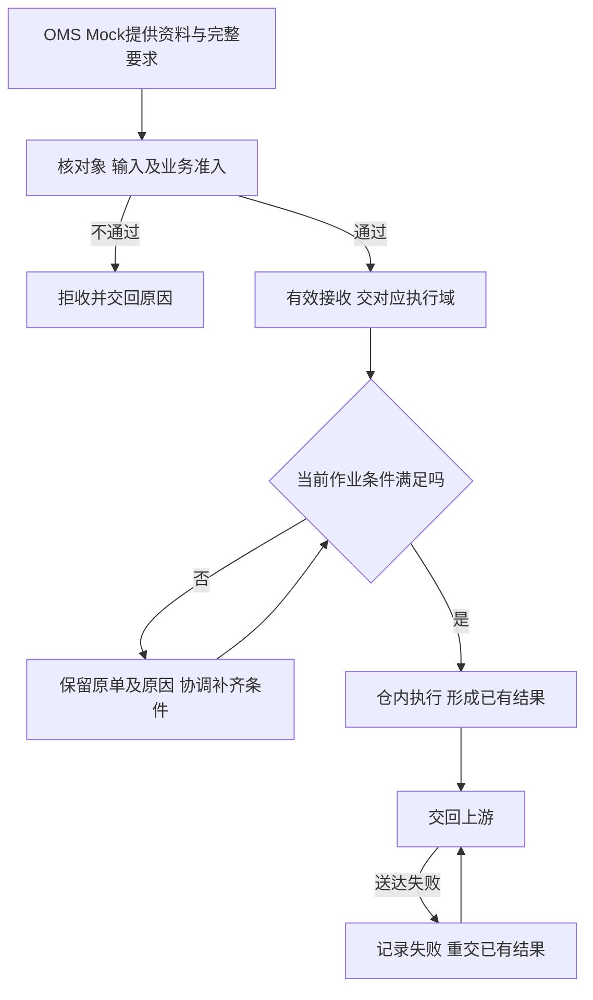

# 上游协作与结果交接设计

> 课程沙盘「上游协作」域：请求是否接受、仓内结果如何交回、送达失败如何重试。顺读从第二节起；一期以 OMS Mock 与承运商 Mock 为协作方。

本篇在《系统集成与对接需求分析》已确认规则上展开对象关系、接收与变更取消分工、结果表达及走查。本域记录接受／拒绝、结果送达与幂等后果；实际收发、预占扣库与库存口径由入库、出库、库存域维护，不在本篇重定义。

## 一、协作范围、依据与责任

### 1.1 一期协作边界

目标链路为 ERP 或货主业务 → OMS → WMS → OMS → 对应业务侧。一期由 OMS Mock 发送基础资料与完整业务指令、接收处理结果；承运商 Mock 提供模拟运单和交接信息，打印及称重使用模拟或手工数据。PDA 与管理端属于 WMS，共用业务记录。

WMS 不自行导入上游业务指令。邮件依据的不良品其他出库是手工例外，由出库域执行。无主货一期只登记、暂存；后续由 OMS 客户认领，再由 OMS 下发入库指令，不提供 WMS 手工认领或入库入口。

功能真源见 [系统集成与对接需求分析](../03-需求调研和分析/06-系统集成与对接/系统集成与对接需求分析.md)（INT-FR-001～006）；项目范围见全局背景中的项目定位；仓库数据权限与动作授权见公共能力 COM-FR-001～004。以下职责不等于固定岗位或审批层级。

| 责任方 | 提供或确认什么 | 交出什么 |
| --- | --- | --- |
| 自营业务、未来外部货主及上游业务侧 | 商品归属、仓库、数量、业务目的及处理意图 | 业务要求、合法变更取消或后续独立指令 |
| OMS 协作方，一期为 Mock | 基础资料与可区分的请求，接收 WMS 结果 | 原始输入、请求身份与已收到的处理结论 |
| 仓库管理与现场人员 | 当前作业节点、实物数量、品质、位置与交接 | 接受／拒绝依据、实际执行和差异结果 |
| 交接异常处理方，具体岗位未指定 | 区分输入、执行和送达问题，协调对应责任方 | 已有结论、失败原因与后续交接，不补造现场动作 |
| 承运商、司机或自提方 | 实际接货对象与已有交接信息 | 对应业务的交接记录；演示信息注明模拟 |

### 1.2 竞品与扩展边界

取消、认领、装箱资料、拍照和工单等竞品做法只用于方案比较；具体证据与候选集中在综合场景文档 8.2 节。不据此增加一期货主客户端、在线留言、面单服务或计费。

## 二、协作对象与每次请求分开追踪

### 2.1 输入与输出各自指向业务来源

| 上游给什么 | WMS 交出什么 | 交给谁 |
| --- | --- | --- |
| 货主、商品身份及更新 | 接收／拒绝及匹配结果，仓内补充配置由基础资料域维护 | OMS Mock 与执行域 |
| 正常或调拨入库指令 | 收货、质检、实际落位、差异与完成结果 | OMS Mock |
| 无主货到货信息 | 所在仓库、暂存位置和实物识别线索，不形成入库执行结果 | 一期 WMS 内查询；OMS 上线后推送给所有 OMS 客户查看与认领 |
| 各类上游出库指令 | 接收／拒绝、需求、预占、实发、未发及已登记交接结果 | OMS Mock |
| 变更或取消请求 | 该次请求是否接受、原因、执行中的回库或最终收口结果 | 原请求来源 |
| 邮件其他出库通知 | 标明手工来源的可查询执行结果及线下依据 | 仓内管理，线下沟通方 |
| 模拟物流信息 | 可引用运单及已登记交接对象、凭证 | 出库域与结果查询 |

调拨调出和调入分别交回各自结果，WMS 不建立两端匹配、在途账或差异结案。库存信息按库存域的仓库、货主、商品口径交出；上游如何用于销售承诺、全局调配或核算不由本域决定。

### 2.2 同一业务可以收到多次不同要求

「来源＋业务类型＋上游指令号」定位同一上游业务对象。新建、变更、取消是围绕该对象发生的不同请求；同单由 3 件合法改成 5 件，不能仅因与新建内容不同就判为重发冲突。

| 关系 | 基数与追溯要求 |
| --- | --- |
| 业务对象—请求 | 一个对象可有多次请求及重发，每次请求能区分新要求与原样重发 |
| 业务对象—WMS 单据 | 有效接收后定位同一笔业务，拒收时无可执行单据；合法变更不新建第二笔相同业务 |
| 单据—仓库、货主、明细与执行 | 单据各属 1 仓 1 货主，含 1 至多条明细，可有多次实际执行，归属持续保留 |
| 请求—处理结论 | 同请求重发沿用当时已有结论，不以单据最新进度覆盖旧请求结果 |
| 仓内事实—结果送达 | 一次事实可多次交接，库存只生效一次 |
| 手工其他出库—线下依据 | 无上游指令关联，追到邮件来源及处置原因 |

消息标识、版本与顺序控制由应用设计落实，同一次请求只生效一次，新的合法要求继续按业务节点判断。

## 三、接收流程：接受要求与具备执行条件分开

身份资料缺失、仓库超范围、数量非法、内容不完整或引用已停用物流渠道时，不建立可执行业务。入库接收不要求预先指定货位，作业位置在使用节点校验。

出库接收按出库域第四节判断：盘点阻断新单或 B2C 任一 SKU 无法足量预占时整单拒收，不留部分占用或待受理单；其他普通类型按其部分预占规则处理。已接收后的短拣、位置异常与盘点等待属于执行问题，交对应领域处理。

原拒收请求须由上游重新提出可处理请求；补资料或补库存不表示旧请求自动生效。已接收缺货单补货后由仓库人工重试预占与分配（出库域第十节）。

## 四、变更与取消怎样交给仓库判断

### 4.1 每次请求交回对应节点的结论

| 请求 | 负责判断的执行规则 | 应交回什么 |
| --- | --- | --- |
| 入库明细变更 | 入库域 7.2 节：一期未实收可接受，已实收拒绝 | 更新要求或拒绝原因，原事实保留 |
| 入库取消（OMS 上线后） | 入库域 7.2 节：由 OMS 发起，WMS 只在无实收时接受；一期不实现 | 保留到货／拒收与取消结果；一期零实收保持待收货，仓库线下通知上游 |
| 出库明细变更 | 出库域 7.2 节：开始拣货前可重算，失败保留原需求与占用 | 本次变更成功后的量，或失败原因 |
| 出库取消 | 出库域第七节：未拣直接释放，已拣先回库，已确认出库拒绝 | 是否接受、仍需回库还是已完成释放，不能提前报取消完成 |
| 更换仓库、货主或类型 | 原单不改身份，允许取消时先取消再下发 | 原单取消与新单接收各自的结论 |

发出请求不等于仓库已接受，接受取消也不等于实物已回库。关键处理保留原请求、原单、操作者、时间与结果。

### 4.2 已收退回交接独立业务

已实收后取消被拒，需要退回的货物先按入库域处理并形成库存，再交独立退回出库或不良处置。原入库事实保留。未形成库存的超收、拒收等实物按入库域线下边界处理；客户／FBA 退货入库属于后续阶段，不因取消而自动创建。

## 五、仓内事实、结案结果与送达分别表达

### 5.1 结果能说明数量处在哪个环节

| 结果 | 交接时需要区分什么 | 数量案例 |
| --- | --- | --- |
| 入库过程与结案 | 每次及累计实收、品质、真实落位、已收未上架；未收与收货完结后的最终短少 | 入库域 8.1 节 |
| 已收未上架损失 | 原实收、现场剩余、损失、异常账面结转与盘亏分别可追，不只报告「全部上架」 | 入库域 8.4 节 |
| 出库结案 | 原需求、实发、未发、整单完结及交接；原单是否能续发按出库域执行 | 出库域 9.1 节 |
| 取消 | 请求已接受、实物已回库、占用已释放分别可查 | 出库域 9.2 节 |
| 手工其他出库 | 线下来源、指定实物和执行结果，不虚构上游指令 | 出库域 9.5 节 |

过程量、累计量与本次增量不能互相冒充。结果组织和字段由应用设计细化，事实须能回查原单及实际动作。

### 5.2 未送达不改变仓内事实

上架或确认出库已经生效，结果未送达只说明交接失败。保留原结果与失败原因，只重交已有结果，不回滚库存或再做一次作业。

确认出库与实际揽收分别表达，未揽收不改变 WMS 完成及扣库节点；仅交已有凭证，不用模拟运单补造真实运输或平台签收。手工其他出库保留仓内查询与线下依据，不强制回传不存在的上游对象。

## 六、重复、冲突与交接失败的恢复

| 情况 | 处理后果 | 责任与恢复 |
| --- | --- | --- |
| 同一次请求原样重发 | 返回已有结果，不重复建单、预占、扣库或释放 | 交接方定位原请求，上游查已有结论 |
| 同一请求标识带不同内容 | 保留冲突，不静默覆盖 | 上游核对并纠正为可区分的新请求，再按节点判断 |
| 同一业务的新变更／取消 | 正常判断新要求，不当作重发冲突 | 上游提供新请求，仓库交该次结论 |
| 原请求缺资料被拒收 | 补资料不自动建单，旧拒收保留 | 按应用设计的纠正提交方式重新接收，保留追溯 |
| 出库变更重算失败 | 原需求与原占用一起保留 | 返回原因，上游决定后续请求 |
| 已拣取消未完成回库 | 保留相应占用，不报释放完成 | 仓库核对回库后交最终结果 |
| 结果交接失败 | 已有事实和流水不变 | 定位失败，重交原结果，不重做仓内动作 |
| 两端重复提交 | 引用同一业务结果，不产生第二次库存影响 | 查询原动作与流水 |

重试次数、协议和顺序实现交应用设计；业务要求是请求、执行和送达各自可追，且同一事实只生效一次。

## 七、特殊来源、差异及证据怎样交接

### 7.1 手工其他出库追线下通知

邮件提供处置要求，仓库核实指定不良实物及执行结果。来源、原因、商品与配置要求的批次／SN、数量、人员和时间可追，照片按异常需要提供。具体执行见出库域第八节，不建设自动收发邮件，也不把邮件当实际出库证明。

### 7.2 仓库提供事实，上游提供业务安排

| 场景 | 仓库交出的依据 | 上游需要提供什么 |
| --- | --- | --- |
| 拼柜归属或未预报 | 实物识别线索、暂存位置、各单数量 | 核对货主，补资料／指令；未知归属按入库域登记、暂存，认领待 OMS 上线 |
| 未收与最终短少 | 预计、累计实收、是否完结及原因 | 核后续到货与差异安排，仓库按授权确认收货完结 |
| 超收、效期拒收或受损 | 对应商品、数量、日期／品质、位置及原单 | 补新单或提出线下／独立处置安排，赔付裁定另处理 |
| 平台仓装箱变化 | 实际箱托 SKU 内容及对既有资料的影响 | 影响已提供箱唛、预约或运输资料时确认更新，否则接收通知 |
| 取消或缺量结案 | 实发／未发、已拣去向和占用收口 | 接收最终结果，后续仍需发货时另下新单 |

证据与业务对象对应。线上附件、留言、视频和工单的新增能力见综合场景 8.2 节；具体责任人员与证据载体尚需样例，不能仅凭图片裁定赔偿。

### 7.3 认领与逆向入库分别交接

已知货主无预报联系补推；未知货主一期只登记和暂存。OMS 上线后，将信息推送给所有 OMS 客户，客户在 OMS 发起或确认认领，再下发入库指令；WMS 按有效指令清点、校验、质检及上架。已实收归属错误按入库域异常边界停止受影响作业。

识别为客户或 FBA 退货的实物不能借认领转为一期正常库存，仓库保留暂存依据并线下协调，后续逆向范围见综合场景第七节。

## 八、完整数量走查

本节用模拟案例核对请求重发与结果重交；收发数量见各执行域案例，跨域验收时以各域详表数字为准。

| 编号 | 场景 | 结论要点 | 详表 |
| --- | --- | --- | --- |
| 8.1 | 新建/变更/取消原样重发 | 同请求返回已有结论，不重复占/释 | 见 8.1 节 |
| 8.2 | 取消完成后结果重交 | 只增送达记录，不二次回库或释放 | 见 8.2 节 |

### 8.1 新建、变更、取消各自原样重发

模拟美西仓 A 货主 X 正常实际 10，无其他锁定和盘点。

| 顺序 | 请求与处理 | 实际／预占／可用 | 应交回什么 |
| --- | --- | --- | --- |
| 1 | 新建 B2C 需求 3 | 10／3／7 | 接收同一业务 |
| 2 | 同一新建原样重发 | 10／3／7 | 原接收结果 |
| 3 | 未拣，新的变更将需求改 5 且重算成功 | 10／5／5 | 本次变更成功 |
| 4 | 同一变更原样重发 | 10／5／5 | 原变更结果 |
| 5 | 新取消请求，尚未拣，释放 5 | 10／0／10 | 取消完成 |
| 6 | 同一取消原样重发 | 10／0／10 | 原取消结果，不再释放 |

第 3 步若重算失败，则需求 3、占用 3 均保留，返回失败。请求不同与原样重发分别判断。

### 8.2 取消完成后的送达失败

独立模拟实际 10、本单已占且已拣 4，仍为 10／4／6。上游取消后，仓库核 4 件回位并释放，成为 10／0／10。取消结果回传失败，再重交成功，仍为 10／0／10；只新增送达记录，不再次回库增库存或释放占用。

其他完整数量案例引用入库、出库、库存域：本域检查入库损失是否交完整结果、缺量结案是否只交一次、手工来源是否有真实依据、盘点拒收是否仍由上游重提，不另造一组相似数字。

## 九、资料缺口与应用设计输入

完整资料、指令、变更取消和结果表单按需求调研总览待补清单准备。应用设计落实请求标识／版本、顺序控制、处理与送达展示及两端一致性。

免检残损由仓库登记判定品质、有效缺货单由仓库人工恢复，执行规则分别由入库、出库域维护。线上附件、装箱文件交换、在线沟通及特殊工单的候选统一见综合场景 8.2 节。
