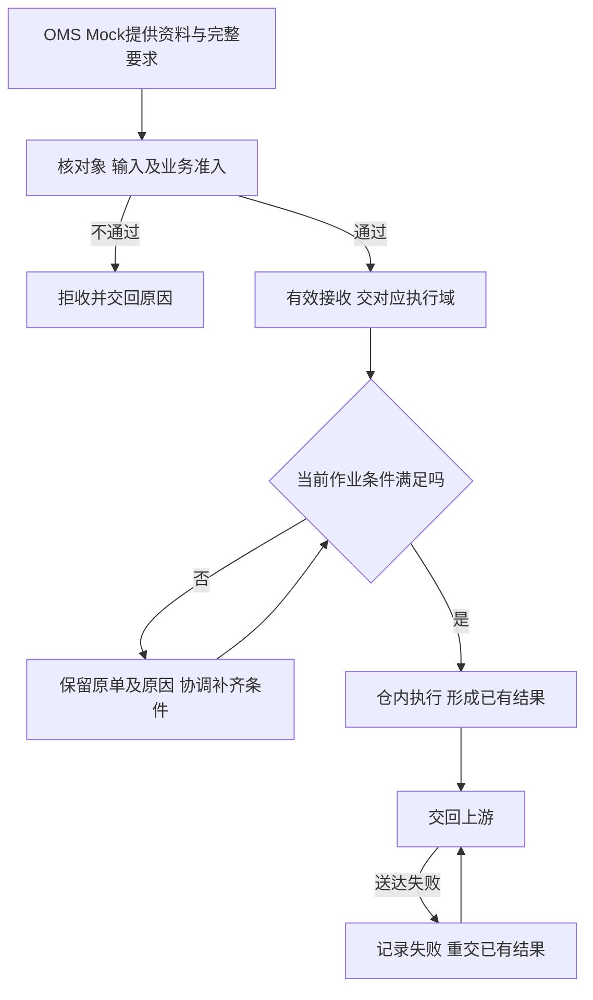

# 上游协作与结果交接设计

> 课程沙盘「上游协作」域：请求是否接受、仓内结果如何交回、送达失败如何重试。顺读从第二节起；一期以 OMS Mock 与承运商 Mock 为协作方。

本篇在《系统集成与对接需求分析》已确认规则上展开对象关系、接收与变更取消分工、结果表达及走查。本域说明请求接受或拒绝、结果送达及重复提交的处理；实际收发、预占扣库与库存口径由入库、出库、库存域维护，不在本篇重定义。

## 一、协作范围、依据与责任

### 1.1 一期协作边界

一期由OMS Mock发送基础资料与完整业务指令，并接收WMS处理结果。后续外部货主经OMS接入；自营ERP直连WMS或经OMS接入的路径待定，WMS沿实际指令来源交回结果。

承运商Mock提供模拟运单和交接信息，打印及称重使用模拟或手工数据。PDA与管理端属于WMS，共用业务记录。

一期入库及普通出库由OMS Mock指令生成；邮件通知的不良品其他出库可在管理端手工创建。无主货一期只登记、暂存，认领由后续OMS承接。

协作规则依据见[系统集成与对接需求分析](../03-需求调研和分析/06-系统集成与对接/系统集成与对接需求分析.md)；项目范围见全局背景中的项目定位。操作须具备仓库授权和对应动作权限，按公共能力规则执行。下表按业务责任分工，具体岗位尚需明确。

| 责任方 | 提供或确认什么 | 交出什么 |
| --- | --- | --- |
| 自营业务、未来外部货主及上游业务侧 | 商品归属、仓库、数量、业务目的及处理意图 | 业务要求、合法变更取消或后续独立指令 |
| OMS 协作方，一期为 Mock | 基础资料与可区分的请求，接收 WMS 结果 | 原始输入、请求身份与已收到的处理结论 |
| 仓库管理与现场人员 | 当前作业节点、实物数量、品质、位置与交接 | 接受／拒绝依据、实际执行和差异结果 |
| 交接异常处理方，具体岗位未指定 | 区分输入、执行和送达问题，协调对应责任方 | 已有结论、失败原因与后续处理安排 |
| 承运商、司机或自提方 | 实际接货对象与已有交接信息 | 对应业务的交接记录；演示信息注明模拟 |

### 1.2 竞品与扩展边界

取消、认领、装箱资料、拍照和工单等竞品做法只用于方案比较；具体证据与候选见[海外仓典型业务场景与方案](06-海外仓典型业务场景与方案.md)第8.2节。一期不包含真实货主客户端、在线留言、真实面单服务或计费。

## 二、业务对象、请求与结果的关系

### 2.1 输入与输出各自指向业务来源

| 信息来源与输入 | WMS交出什么 | 交给谁 |
| --- | --- | --- |
| OMS Mock：货主、商品身份及更新 | 接收／拒绝及匹配结果，仓内补充配置由基础资料域维护 | OMS Mock 与执行域 |
| OMS Mock：正常或调拨入库指令 | 入库单已完成时的整单结果，实收、拒收与短少分项 | OMS Mock |
| 仓库现场：无主货登记信息 | 所在仓库、暂存位置和实物识别线索 | 一期供仓内查询；后续OMS交接见第7.3节 |
| OMS Mock：各类出库指令 | 接收／拒绝、需求、预占、实发、未发及已登记交接结果 | OMS Mock |
| OMS Mock：明细变更或出库取消请求 | 该次请求是否接受及原因；出库取消受理即为已取消 | 原请求来源 |
| 线下邮件：不良品其他出库通知 | 标明手工来源的可查询执行结果及线下依据 | 仓内管理，线下沟通方 |
| 承运商Mock：模拟运单与交接信息 | 可引用运单及已登记交接对象、凭证 | 出库域与结果查询 |

调拨调出和调入分别交回各自结果，WMS 不建立两端匹配、在途账或差异结案。一期只交回已有入出库执行结果及关联差异处理记录，盘点、品质转换等独立库存变化回传留待后续。上游如何利用执行结果进行销售承诺、全局调配或核算不由本域决定。

### 2.2 同一业务可以收到多次不同要求

「来源＋业务类型＋上游指令号」定位同一上游业务对象。新建、变更、取消是围绕该对象发生的不同请求；同单由 3 件合法改成 5 件，不能仅因与新建内容不同就判为重发冲突。

| 关系 | 基数与追溯要求 |
| --- | --- |
| 业务对象—请求 | 一个对象可有多次请求及重发，每次请求能区分新要求与原样重发 |
| 业务对象—WMS 单据 | 有效接收后定位同一笔业务，拒收时无可执行单据；合法变更不新建第二笔相同业务 |
| 单据—仓库、货主、明细与执行 | 单据各属 1 仓 1 货主，含 1 至多条明细，可有多次实际执行，归属持续保留 |
| 请求—处理结论 | 同请求重发沿用当时已有结论，不以单据最新进度覆盖旧请求结果 |
| 仓内事实—结果送达 | 一次事实可多次交接，库存只生效一次 |
| 手工其他出库—线下依据 | 无上游指令关联，追到邮件来源及处置原因 |

消息标识、版本与顺序控制由应用设计落实，同一次请求只生效一次，新的合法要求继续按业务节点判断。

## 三、接收流程：接受要求与具备执行条件分开

身份资料缺失、仓库超范围、数量非法、内容不完整或引用已停用物流渠道／所属承运商时，不建立可执行业务。入库接收不要求预先指定货位，作业位置在使用节点校验。

出库接收按出库域第四节判断：B2C 任一 SKU 无法足量预占时整单拒收，不留部分占用或待受理单；含盘点中 SKU 的出库请求照常接收；其他普通类型按其部分预占规则处理。已接收后的短拣、位置异常与盘点等待属于执行问题，交对应领域处理。

原拒收请求须由上游重新提出可处理请求；补资料或补库存不表示旧请求自动生效。已接收缺货单补货后由仓库人工重新分配（出库域第7.4节）。

## 四、变更与取消怎样交给仓库判断

### 4.1 每次请求交回对应节点的结论

| 请求 | 负责判断的执行规则 | 应交回什么 |
| --- | --- | --- |
| 入库明细变更 | 入库域 7.2 节：一期未实收可接受，已实收拒绝 | 更新要求或拒绝原因，原事实保留 |
| 入库取消 | 入库域：由上游发起，WMS 只在无实收时接受；一期 Mock 可演示 | 交回取消请求接受/拒绝结论；零实收不交入库完成结果；拒收事实仓内可查 |
| 出库明细变更 | 出库域 7.2 节：生成拣货任务前可重算，失败保留原需求与占用 | 本次变更成功后的量，或失败原因 |
| 出库取消 | 出库域第七节：确认出库前受理，受理即已取消并一次释放本单占用，已拣实物退拣返库；已确认出库拒绝 | 接受（已取消）或拒绝原因；退拣返库是仓内作业，不另交结果 |
| 更换仓库、货主或类型 | 原单不改身份；出库在允许节点先取消再下发；入库零实收可受理上游取消 | 身份变更不接受；允许取消重建时，分别交回取消与新单接收结论 |

发出请求不等于仓库已接受；接受取消后本单即已取消，已拣实物由仓库另行退拣返库，不影响取消结论。关键处理保留原请求、原单、操作者、时间与结果。

### 4.2 已收货物退回时的交接

已实收后提出退回要求，原入库及实收事实保留。正常品由OMS Mock下发独立退回出库指令，货还在收货暂存库位时也能接单预占，上架后才能分配、拣货；不良品移出按其他出库处理。

未进入实收的超收、拒收实物按入库业务的线下处理方式交接。货从仓外退回本仓的预报与结案结果见退货域及第7.3节；FBA移除退仓不在一期。

## 五、仓内事实、结案结果与送达分别表达

### 5.1 结果能说明数量处在哪个环节

| 结果 | 交接时需要区分什么 | 数量案例 |
| --- | --- | --- |
| 入库过程与结案 | 每次及累计实收、品质、真实落位、已收未上架；未收与收货完结后的最终短少 | 入库域 8.1 节 |
| 退货过程与结案 | 退货来源、实收内良品/不良、拒收与短少；派送失败关联原出库 | 退货域第八节 |
| 已收未上架损失 | 一期按应上架数量提交后盘点调整，入库结果不反映这部分丢失，由仓库线下告知货主；盘点记录仓内可追 | 入库域 8.4 节 |
| 出库结案 | 原需求、实发、未发、整单完结及交接；原单是否能续发按出库域执行 | 出库域 9.1 节 |
| 取消 | 请求接受或拒绝；受理即已取消、本单占用一次释放；已拣实物的退拣返库仓内可查，已拣后丢失由盘点调整，不报为返库或实发 | 出库域9.2、9.7节 |
| 手工其他出库 | 线下来源、指定实物和执行结果，不虚构上游指令 | 出库域 9.5 节 |

交回结果时区分当前作业进度、累计数量与本次增量。结果组织和字段由应用设计细化，事实须能回查原单及实际动作。

### 5.2 未送达不改变仓内事实

上架或确认出库已经生效，结果未送达只说明交接失败。保留原结果与失败原因，只重交已有结果，不回滚库存或再做一次作业。

确认出库与实际揽收分别表达，未揽收不改变 WMS 完成及扣库节点；仅交已有凭证，不用模拟运单补造真实运输或平台签收。手工其他出库保留仓内查询与线下依据，不强制回传不存在的上游对象。

## 六、重复、冲突与交接失败的恢复

| 情况 | 处理后果 | 责任与恢复 |
| --- | --- | --- |
| 同一次请求原样重发 | 返回已有结果，不重复建单、预占、扣库或释放 | 交接方定位原请求，上游查已有结论 |
| 同一请求标识带不同内容 | 记录内容冲突，保留原请求及处理结论 | 上游核对并纠正为可区分的新请求，再按节点判断 |
| 同一业务的新变更／取消 | 正常判断新要求，不当作重发冲突 | 上游提供新请求，仓库交该次结论 |
| 原请求缺资料被拒收 | 补资料不自动建单，旧拒收保留 | 按应用设计的纠正提交方式重新接收，保留追溯 |
| 出库变更重算失败 | 原需求与原占用一起保留 | 返回原因，上游决定后续请求 |
| 已拣取消后返库上架未完成 | 取消已生效、本单占用已释放；退拣实物在出库暂存库位，不参与分配 | 仓库按返库上架单完成返库，不另交结果 |
| 结果交接失败 | 已有事实和流水不变 | 定位失败，重交原结果，不重做仓内动作 |
| 管理端与PDA重复提交同一动作 | 引用同一业务结果，不产生第二次库存影响 | 查询原动作与流水 |

重试次数、协议和顺序实现交应用设计；业务要求是请求、执行和送达各自可追，且同一事实只生效一次。

## 七、特殊来源、差异及证据怎样交接

### 7.1 手工其他出库追线下通知

线下协作方通过邮件提出处置要求，仓库核实指定不良品，按出库业务第八节创建并执行其他出库。手工来源由具备对应权限及本仓授权的仓库主管确认，执行结果供仓内查询，并供协作方线下沟通使用。

记录邮件来源、处置原因、商品、数量、人员、时间，以及商品配置要求的批次／SN；照片按异常需要提供。邮件说明处置意图，实际移出以仓库执行记录为依据，一期不建设自动收发邮件。

### 7.2 仓库提供事实，上游提供业务安排

| 场景 | 仓库交出的依据 | 上游需要提供什么 |
| --- | --- | --- |
| 拼柜归属或未预报 | 实物识别线索、暂存位置、各单数量 | 核对货主，补资料／指令；未知归属按入库域登记、暂存，认领待 OMS 上线 |
| 未收与最终短少 | 预计、累计实收、是否完结及原因 | 有实收且不再接收时，仓库按授权确认收货完结。零实收走上游取消，不按最终短少完成入库 |
| 超收且需要继续接收 | 超收商品、数量、暂存位置及原单 | 补发新的入库指令，仓库按新单重新校验并接收 |
| 效期拒收、未进入实收 | 商品、数量、效期、拒收原因及暂存位置 | 安排线下处理，拒收实物不进入WMS退回出库 |
| 已实收商品受损 | 实收、受损数量、品质结论、位置及原单 | 明确后续处置要求；仓库保留实收并按入库规则处理，需移出时按不良品其他出库交接 |
| 平台仓装箱变化 | 实际箱托 SKU 内容及对既有资料的影响 | 影响线下已提供的箱唛、预约或运输资料时确认更新，否则接收通知；一期不建设预约或装箱文件交换功能 |
| 取消或缺量结案 | 实发／未发与占用释放结果；取消时另有已拣实物的退拣去向 | 接收最终结果，后续仍需发货时另下新单 |

交接证据应能对应原业务与实物。具体责任人员与证据载体待补，赔偿责任由相关方另行处理。线上附件、留言、视频和工单列为后续候选能力。

### 7.3 认领、退货与入库分别交接

**正常来货无预报：**已知货主联系补推入库指令；未知货主一期只登记无主货并暂存。OMS 上线后推送信息供客户认领，再下发入库指令，WMS 按第二节正常入库执行。

**退回本仓（一期）：**客户退货与平台仓退件由 OMS Mock 退货预报生成退货单；派送失败退回可由现场扫原 B2C 运单建单，结案结果同样回传 Mock。收货、上架规则见退货业务设计；不建设退件认领公海。

**FBA 移除退仓：**一期不执行退货收货，保留识别线索并线下协调，见项目定位第 4.1 节。

已实收归属错误按各域异常边界停止受影响作业；无主货不能借认领直接形成一期库存。

## 八、请求重发与结果重交案例

本节用模拟案例核对请求重发与结果重交；收发数量见各执行域案例，跨域验收时以各域详表数字为准。

| 编号 | 场景 | 结论要点 | 详表 |
| --- | --- | --- | --- |
| 8.1 | 新建/变更/取消原样重发 | 同请求返回已有结论，不重复预占或释放 | 见 8.1 节 |
| 8.2 | 取消完成后结果重交 | 只增送达记录，不二次退拣或释放 | 见 8.2 节 |

### 8.1 新建、变更、取消各自原样重发

模拟美西仓 A 货主 X 正常实际 10，无其他占用和盘点。

| 顺序 | 请求与处理 | 实际／预占／可用 | 应交回什么 |
| --- | --- | --- | --- |
| 1 | 新建 B2C 需求 3 | 10／3／7 | 接收同一业务 |
| 2 | 同一新建原样重发 | 10／3／7 | 原接收结果 |
| 3 | 未拣，新的变更将需求改 5 且重算成功 | 10／5／5 | 本次变更成功 |
| 4 | 同一变更原样重发 | 10／5／5 | 原变更结果 |
| 5 | 新取消请求，尚未拣，释放 5 | 10／0／10 | 取消完成 |
| 6 | 同一取消原样重发 | 10／0／10 | 原取消结果，不再释放 |

第3步若重算失败，则需求3、占用3均保留，返回失败。

完成第6步后，若再次原样重发第1步的新建请求，仍返回该请求原先的接收结论，不重新建单或预占；订单当前进度另行显示为已取消，库存保持10／0／10。请求的历史结论与订单最新进度分别查询。

### 8.2 取消完成后的送达失败

独立模拟实际 10、本单已占且已拣 4，仍为 10／4／6。上游取消受理后本单占用 4 一次释放，成为 10／0／10；已拣 4 件自动退拣，返库上架单提交后才能再分配。取消结果回传失败，再重交成功，仍为 10／0／10；只新增送达记录，不再次退拣或释放占用；返库上架本身不增加实际库存。

其他收发数量案例见入库、出库和库存业务设计。本篇侧重核对交回结果是否完整、重复交接是否保持数量不变，以及拒收后是否由上游重新提出请求。

## 九、资料缺口与应用设计输入

后续需准备以下资料，用于细化交接展示和演示样例：

- 基础资料、入出库指令、明细变更与出库取消的完整请求样例。
- 缺资料、承运商停用、B2C库存不足等拒收样例，以及同请求重发、内容冲突和合法新请求的对照。
- 入库完成、出库结案与取消的结果样例，包含拒收、短少、缺量结案和取消后的数量。
- 结果回传失败与重试记录，能对应原业务结果、失败原因及送达情况。
- 承运商Mock运单与交接信息、手工其他出库邮件依据，以及异常交接的责任岗位和线下沟通载体。

应用设计据此落实请求标识与版本、顺序控制、处理结论与送达情况展示，并区分请求的历史结论和单据的最新进度。线上附件、装箱文件交换、在线沟通及特殊工单仍按后续候选能力管理。
