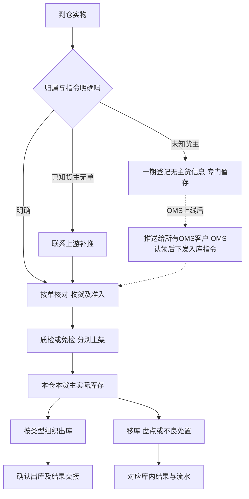

# 海外仓典型业务场景与方案

> 课程沙盘跨域场景与走查索引：串联 01～05 各域规则，不另立法。具体数量与异常后果以各域正文为准；8.2 节候选未纳入一期。

场景覆盖拼柜到货、六类出库、存拣协同、盘点与异常交接、上游消息与结果送达。阅读顺序建议先业务蓝图，再按基础资料→入库→库存→出库→上游协作；本篇用于验收清单与方案取舍。

## 输入资料与依据

背景与一期范围见全局背景中的项目定位；需求结论与未决事项见需求分析总览。各域职责见业务蓝图第二节域地图。

竞品证据来自本地留存原始操作页，不声称官网当前版本，未核验截图不作为规则依据。需求层取舍见项目总览《竞品参考与需求取舍》；扩展候选及采用条件见本文 8.2 节。

## 一、场景地图与分析方式

| 业务处境 | 跨域交接 | 完整规则与案例 |
| --- | --- | --- |
| 拼柜、多货主、多单、分批入库 | 01确认身份与位置，02实收／质检／上架，04形成库存，05交回各单结果 | 02第8.1节 |
| 平台仓补货与当地B2B | 03逐单核SKU及箱托，04按实发扣库，05交装箱结构和未发结果 | 03第3.1、3.2、9.1节 |
| 单品多品包裹与取消 | 03组织基础波次，按原单复核／回库，04保护占用，05交逐单结果 | 03第5.2、9.2节 |
| 整仓有货、拣货位置不足 | 01提供适配位置，04移库，03重新分配，原位差异另核 | 04第6.2节；03第9.3节 |
| 无预报、无主货登记与已收退回 | 02区分补单／登记；认领由后续OMS承接，已收后交03或04独立处置 | 02第8.2节 |
| 效期、受损、盘点和不良品移出 | 04区分品质、数量和实物去向，03收口订单，05交已有结果 | 04第7.6、8.2、8.4、9.2节 |
| 调拨与非在途账 | 调入按入库、调出按出库各自执行；05分别交回，不建跨仓主单与差异结案 | 入库、出库域第一节；上游协作域第二节 |
| 首到仓新品与作业容器 | 01商品身份；02首次收货前量方、按容器或按 SKU 收货上架；04仍按 SKU 三量 | 基础资料域；入库域第3.7、3.8节 |
| 资料准入、渠道与上游消息 | 接单校验含物流渠道；停用渠道拒收新单；05区分请求重发与结果重交，不重复占扣 | 基础资料第七节；出库域第四节；上游协作第六、八节 |

同一规则只在负责域展开。同一数量案例引用负责域的输入和结果，不在此换一组数字再写完整时间线。

## 二、拼柜、混合到货与分批入库

一柜涉及多个货主和入库单时，先确认身份，再分别清点、质检与上架；库存按归属形成，各单进度分别交回。完整流程见入库域第三、四节，混柜数量见第 8.1 节，已收损失见第 8.4 节。[LX022] 提供按单／按箱组织参考，实收仍以清点为准；[JF011] 的清分打托引导属于 8.2 节候选。

## 三、海外仓向平台仓补货与当地B2B交付

平台仓补货交接 SKU 实发量与箱托结构，B2B 按单摘果并核对接货方。两类均至少有实际发出量才可缺量一次结案，未发量交上游另发新单，库存只扣 SKU 实发件数。装箱或装车结构变化不等于需求变更，具体条件与数量见出库域第 3.1～3.2、9.1 节。[LX049]、[JFB2B] 仅作参考，BOL／POD 等文件能力见 8.2 节候选。

## 四、一件代发的订单组织、分单与防混单

### 4.1 波次组织方式的比较

B2C全SKU足量接收后，可按单或以同仓同货主基础波次组织，结果仍逐单复核、确认与回传。单品多件要核数量，多品要核组合，启用批次／SN时核具体身份。

[LX-WMS-055][LX055]与[JF-OUT-022][JF022]提供下列组织选择；具体载体和扫描顺序由应用设计选择。

| 方式 | 控制点 | 适用讨论 |
| --- | --- | --- |
| 按单拣 | 全程保持原单身份 | 单量少、组合复杂或独立搬运 |
| 边拣边分 | 取货即放入对应订单容器 | 订单与容器对应可靠，途中取消能定位 |
| 先拣后分 | 汇总取货后还原每单组合再复核 | 有可靠分拣位置、原单对应和异常隔离 |

自动分波、派工、产能计算和打印即出库不纳入一期。

### 4.2 单据取消不由波次进度替代

取消时未拣部分直接释放，已拣部分先回库核对再释放，其他单独立继续；数量走查见出库域第 5.2、9.2 节。短拣或批次／SN 不符仍阻断该单确认。

## 五、大货存储与零散拣货协同

### 5.1 位置不足和整仓不足分别处理

拣货位不足时，先核本仓本货主的合格实物与任务分配，再决定移库或换位，不能直接报整仓无货。规则见库存域第六节与出库域第 7.1 节。存拣与补货相关原文见文末 [LX026][LX026]、[JFFAQ][JFFAQ]，不能据此推导存储位一律不可拣。

### 5.2 移库保总量，重新分配保原占用

完整数量与核对要点见库存域第 6.2 节与出库域第 9.3 节：移库只改位置、不改 SKU 预占总量；已分配给拣货任务的数量不得直接移走；换位不证明原位账实正确。

### 5.3 补货建议与缺货单恢复是两项不同能力

独立补货、下限与建议量属于第8.2节效率候选；现有有效缺货单库存补齐后由仓库人工重试预占与分配，执行见03第10.1节。移库或入库完成不自动说明原单已经重新分配，原拒收请求仍由上游重提。

## 六、仓库与货主之间的差异确认及证据交接

### 6.1 事实与处理意图由不同责任方提供

仓库交原指令、实收／品质／位置或装箱差异，上游提供补单、是否继续等货及独立处置安排；具体责任与输出见上游协作域第 7.2 节。未收、不良、未上架和未发是不同量，不重复相加成损失。等待期间保留实物位置与既有占用。

### 6.2 证据载体按业务需要评估

[JF-IN-010][JF010]与[LX-WMS-049][LX049]说明拍照、沟通和装箱文件的价值；[JF-OUT-001][JFVIDEO]只明确可开启包装录像，不能据此推导保存期限、索引、权限或争议裁定。当前保留差异、来源和关键操作依据，照片按异常提供；线上附件、视频和双向沟通见第8.2节候选。

## 七、无预报到货与逆向业务辨别

### 7.1 先辨别归属，再辨别业务方向

| 实物来源 | 一期处理 | 负责规则 |
| --- | --- | --- |
| 已知货主正常来货无预报 | 联系OMS Mock补推，再按正常入库 | 02第3.5节 |
| 未知货主正常来货 | 一期登记、专门暂存；OMS上线后认领并下发指令，再清点准入及上架 | 02第3.5、8.2节 |
| 已实收后需要退回仓外 | 保留原入库，形成库存后独立正常退回或不良处置 | 02第7.2节；03第3.4节 |
| 买家退货／拒收包裹回仓 | 保留识别和暂存依据，逆向入库留后续 | 后续客户退货业务 |
| FBA移除或退货回仓 | 一期不执行FBA退货、换标及再入库 | 后续逆向与增值服务 |

[LX-WMS-030][LX030]与[JF-IN-013][JF013]主要含退件认领，不能把其公有认领池、认领后销毁或退货入库复制到一期。逆向来源参考[JF-OMS-RET-002][JFRET]、[JF-FBA-001][JFFBA]，后续阶段尚待确定。

### 7.2 认领不替代实收，退回不冲销原入库

无主货一期登记到货与暂存线索，不形成入库单或库存；OMS上线后由客户认领并下发入库指令，WMS再正常入库。登记、零实收等待及已收独立退回案例见02第8.2节；已实收归属错误停止受影响作业，不自动修改货主或生成另一货主库存。免检残损由授权仓库人员登记并判定品质，不生成质检任务，见02第10.1节。

### 7.3 跨域异常按所属规则收口

在库受损由具有对应权限及本仓授权的仓库主管核实转不良；盘点占用冲突中止后处理原业务再重盘；实盘跨日过期是即时品质转换例外；不良品实际移出仍按其他出库指定实物核对。完整规则与案例见库存域第 7.6、8.4、9.2 节，本篇仅检查与订单、协作结果是否衔接。

## 八、贯穿规则、方案取舍与覆盖检查

### 8.1 商品要求贯穿各域

| 要求 | 跨域检查重点 | 完整依据 |
| --- | --- | --- |
| 形态与位置 | 收货、上架、拣货和移库引用相同商品身份与适配位置，不增加容量／承重控制 | 基础资料第六节；入库域第 6.3 节 |
| 资料与渠道 | 分节点准入；物流渠道接单校验，停用渠道拒收新单；库区／货位／渠道停用受占用约束 | 基础资料第四、七节；出库域第四节 |
| 批次效期 | 收货准入、在库等级和品质、出库资格分别判断；展示时区不改业务日期 | 入库域第 6.2 节；库存域第 8.1 节 |
| SN | 货主＋SKU＋SN 跨四仓判断，逐件身份随收存发和取消回库保留 | 库存域第 8.3 节 |
| 品质与处置 | 正常／不良不与临期／过期混同，指定实物不重复处置或扣库 | 出库域第八节；库存域第九节 |

批次与SN的竞品参考为[LX-WMS-043][LX043]和[JF-BAS-013][JFSN]；[JF-INV-007][JFEXP]中的过期售卖或免二次效期校验不覆盖强盛规则。

### 8.2 有原文依据的新增候选与后续方案

报损／销毁及报损后非库存暂存跟踪已按一期范围决定后置，边界见库存域第 9.3 节。

以下每项均未纳入一期，不进入前述主流程的必经节点。是否增加应根据样例和明确业务价值决定，不因为竞品有功能就复制。

| 候选／后续方向与原文 | 对强盛的业务价值判断 | 现有覆盖、缺口与采用条件 |
| --- | --- | --- |
| 仓库暂停收货与暂停接单：[JF-BAS-017][JFBAS] | 只暂停一类业务时仍允许另一类继续 | 当前按仓库及执行域准入；新增需决定已接单、进行中任务与恢复责任，不改变既有盘点阻断 |
| 同货主SKU／批次混放及路径优先级：[JF-BAS-017][JFBAS]、[LX-WMS-012][LX012] | 对共位实物与取货顺序作更细限制 | 当前允许同货主多SKU共位，已有形态／品质适配；新增需确定约束层级和存量处理，不改变一货位一货主 |
| 库存初始化导入：[LX-WMS-001][LX001] | 旧系统切换时承接已有库存 | 一期用预置模拟库存或完整入库链；真实切换有账实核对需要时再评估，不新增一期导入入口 |
| 收货阶段预选目标货位：[JF-IN-003][JF003] | 减少收货与上架交接时重复找位 | 当前已有上架推荐和人工改位；新增需位置计划与交接样例，预选不等于上架、库存或容量预锁 |
| 特殊要求工单：[JF-WO-002][JFWO] | 把普通收发单无法表达的要求交给明确执行方 | 当前常规指令和邮件其他出库已有入口；新增需需求类别、执行责任、结果与原单关系，增值服务仍属后续 |
| 清分打托引导：[JF-INV-011][JF011] | 多SKU整柜卸货时帮助现场把箱／SKU分到正确托，减少归属与内容核对压力 | 已有混合识别、SKU实数、容器记录；新增需组托工作组织、区域样例和容器重组追溯；体积预估、语音及自动打印另评估，不将组托替代上架或新增托库存 |
| 拣货区补货建议：[LX-WMS-026][LX026]、[JF-INV-018][JF018] | 把拣货位缺口交成可执行补货工作，而非每次临时找货 | 现有基本移库／换位可处理；新增需位置布局、动销与缺口样例、下限和进度／占用衔接；不强制全仓存拣分离，不推导统一补货量 |
| 差异及出库照片／附件：[JF-IN-010][JF010]、[JF-PDA-024][JFPHOTO]、[LX-WMS-049][LX049] | 外部货主跨时区核对短少、受损、包裹和装箱变化时有可定位事实 | 已有差异、动作记录及结果，照片按异常提供；线上附件需证据关联、采集节点、查看范围和保留时长；不照搬竞品15天限制，上传不自动证明责任 |
| BOL／POD及箱唛文件交换：[LX-WMS-049][LX049] | 大货交付需要把装箱、实际交接或已取得签收凭据交给货主 | 基本容器结构和模拟交接已有；需资料交接对象、文件关联和既有结果补充方式；预约属上游，不以POD到达为本仓扣库前置 |
| 在线双向沟通：[JF-IN-010][JF010] | 减少货主与仓库的散落解释，使决定对应同一单据 | 一期用Mock及线下依据；依赖真实OMS与对客责任规则，作为二期能力候选 |
| 包装视频证据：[JF-OUT-001][JFVIDEO] | 高价值SN货或包装争议可评估记录关键作业现场 | 现有逐单复核与轨迹；新增需视频与订单对应、使用目的和证据管理；设备、存储、权限另设计，不能默认自动证明完整装箱 |
| 快进快出／多目的地转运：[LX-WMS-046][LX046] | 香港集货中转若确有到仓后不长期存储、再送多个地点，可评估减少重复仓内安排 | 现行可经正常入库上架再独立出库；新增需先确认场景，另定义接收、暂存、分目的地交接与数量事实，不得直接复制竞品箱级转运 |
| 效期转不良后的移位建议：[JF-INV-007第10节][JFEXP] | 让品质变化后的实物隔离可组织、可追踪 | 当前自动品质转换保留原位置，普通移库可移至适配隔离位；自动移位建议不得绕过移动冻结 |
| 客户退货识别及重新入库：[JF-OMS-RET-002][JFRET] | 判断退回是否对应原发货、是否具备再销售条件 | 一期明确排除；后续设计原订单、退件、实收检验和处置关系，阶段待定；不照搬原包裹免建单路径 |
| FBA退货处理意见与转换：[JF-FBA-001][JFFBA] | 平台移除货回仓后，区别暂存、直接上架和换标再销售 | 一期排除FBA逆向、换标换包装与专属库存类型；后续补平台标识、处理意见变化、品质与追溯 |
| 整箱持有及箱转件库存：[LX-WMS-041][LX041]、[JF-INV-021][JF021] | 讲明箱库存转产品库存、B2B箱库存转一件代发库存的产品模型 | 强盛一直按内部SKU件数持有，拆箱或重装不需要库存类型转换；只有后续明确需要整箱管理时再评估，会改变当前库存模型 |

[LX-WMS-046“操作场景”“拆单”“补充说明”][LX046]描述箱数／托盘实收、暂存、多目的地拆单及部分转运，与强盛平台仓补货、仓网调拨含义不同。香港仓“集货中转”的背景不代表已经批准无需上架、不形成SKU库存的越库模式。

### 8.3 中断和异常恢复应回到实际进度

| 中断 | 恢复时核对什么 | 负责正文 |
| --- | --- | --- |
| 分批收货／上架中断 | 已确认累计量与现场剩余，只继续未完成部分 | 02第四、八节 |
| 集中拣后取消或短拣 | 原单实物、批次／SN与占用，不按波次汇总掩盖异常 | 03第五、七节 |
| 移库中断或建议位无货 | 源目标实际位置、已确认移动和具体分配，不重复移量 | 04第六节；03第7.1节 |
| 效期或盘点占用冲突 | 当地日期、品质与各有效锁因，按例外或中止重盘路径处理 | 04第七、八节 |
| 仓内完成、结果未送达 | 原结果和流水，只重交已有结果 | 05第五、六节 |

跨端继续作业不产生另一套记录；离线、自动续单、任务转交和后台更正不由中断场景自动获得一期授权。

### 8.4 关键走查场景

后续用模拟资料、完整Mock表单及管理端／PDA操作检查以下场景，记录单据号、前后数量和异常结果；具体规则引用负责模块，不另维护一套验收编号。

| 场景 | 重点核对 |
| --- | --- |
| 四仓主链与多货主 | 各仓独立跑通入库→库存→出库；两货主同编码不混归属，跨货主共位被阻断 |
| 到货、收货与品质 | 混批匹配、未推单和无主件分别处理；分批未收与最终短少分开，超收补单后收货；免检／需检及正常／不良分别记录 |
| 商品配置与追溯 | 大件异形位置适配、带电属性读取、效期准入等值和低于边界、临期可出、过期转不良；SN贯穿收发存，追溯开关受库存及作业限制 |
| 各类出库与作业组织 | 六类出库及独立调拨入库；箱托不另计库存，B2C波次不跨仓／货主，B2B按单摘果，复核与结果仍按原单 |
| 接单、短拣与取消 | B2C任一SKU不足整单拒收；预占竞争不超占，合法换位不重复预占；已拣取消先回库；允许缺量的类型至少有实际发出量才一次结案，零实发等待或取消；零实收入库一期保持待收货，保留拒收并线下通知上游，取消待OMS上线；已实收事实保留，退回走独立出库 |
| 邮件其他出库（不良品处置） | 线下邮件为来源依据；仓内登记、核对指定不良实物、足量确认扣库；结果可查询但不冒充上游指令；与盘点短少、计划移出分别记账 | 出库域第八节、第九节 §9.5；上游协作 §7.1；库存域第九节 §9.2、§9.4 |
| 移库、盘点与处置 | 移库保归属和总量；盘点准备与快照、阻断新单、冻结去重、自动过期例外及占用冲突中止重盘；不良品其他出库与真实盘点差异分别留依据，不重复扣库 |
| 已收未上架真实丢失 | 模拟正确实收10、实物剩8、丢失2：实际落位8、异常账面上架10后立即盘亏2同次处理，净库存8；实收误记不套此路径 |
| 免检残损与缺货单人工恢复 | 规则见入库第 10.1 节、出库第 10.1 节；数量分别按入库第 8.5 节、出库第 9.6 节核对；文档逻辑走查已通过（2026-10-08，见需求分析总览 6.4），演示／PDA 待执行 |
| 首到仓新品与容器收货 | 该 SKU 首次收货提交前完成量方；容器不形成箱库存，数量仍记商品明细 | 入库域第 3.7、3.8 节 |
| 输入、权限、协作与两端 | 资料与渠道准入拒收；盘点阻断与 B2C 不足拒收；合法变更取消；同请求重发与回传失败不重做仓内动作；PDA／管理端重复提交不重复占扣；仓库／动作权限与时间展示符合公共能力 | [业务蓝图 §6.1](00-业务蓝图.md#61-公共能力走查串联)；上游协作第六、八节；各执行域异常表 |
| 调拨两端独立 | 调出确认出库、调入上架完成分别回传，无在途主单与配对结案 | 入库、出库域第一节；上游协作域第二节 |

上述场景尚未完成管理端／PDA 演示验收，正式样例、页面操作和验证记录由应用设计与后续测试补齐。文档逻辑核对记录见需求分析总览 6.4 节。

## 原始操作页引用

[LX022]: ../02-竞品调研和分析/领星WMS/01-原始页面/LX-WMS-022_使用PDA实现收货.md
[LX031]: ../02-竞品调研和分析/领星WMS/01-原始页面/LX-WMS-031_使用WMS操作入库管理.md
[LX032]: ../02-竞品调研和分析/领星WMS/01-原始页面/LX-WMS-032_使用WMS操作上架管理.md
[LX049]: ../02-竞品调研和分析/领星WMS/01-原始页面/LX-WMS-049_使用WMS处理备货中转出库订单.md
[LX055]: ../02-竞品调研和分析/领星WMS/01-原始页面/LX-WMS-055_使用WMS处理一件代发出库单.md
[LX026]: ../02-竞品调研和分析/领星WMS/01-原始页面/LX-WMS-026_使用WMS实现存拣分离.md
[LX030]: ../02-竞品调研和分析/领星WMS/01-原始页面/LX-WMS-030_使用WMS进行入库认领.md
[LX043]: ../02-竞品调研和分析/领星WMS/01-原始页面/LX-WMS-043_使用WMS和OMP实现批次库存管理.md
[LX046]: ../02-竞品调研和分析/领星WMS/01-原始页面/LX-WMS-046_使用WMS处理转运.md
[JF022]: ../02-竞品调研和分析/极风WMS/01-原始页面/JF-OUT-022-波次发货_波波次业务设置、生成波次.md
[JF018]: ../02-竞品调研和分析/极风WMS/01-原始页面/JF-INV-018-仓库商品安全库存建议移货.md
[JFFAQ]: ../02-竞品调研和分析/极风WMS/01-原始页面/JF-FAQ-OUT-006-为什么订单推送过来在待移货而不是在待生成_待打单.md
[JF010]: ../02-竞品调研和分析/极风WMS/01-原始页面/JF-IN-010-海外仓收货入库，WMS和卖家OMS沟通.md
[JF013]: ../02-竞品调研和分析/极风WMS/01-原始页面/JF-IN-013-仓库入库认领流程.md
[JF011]: ../02-竞品调研和分析/极风WMS/01-原始页面/JF-INV-011-入库清分打托.md
[JFB2B]: ../02-竞品调研和分析/极风WMS/01-原始页面/JF-OMS-B2B-001-B2B大货中转入库、拣货、扫码换标、装箱出库全流程.md
[JFRET]: ../02-竞品调研和分析/极风WMS/01-原始页面/JF-OMS-RET-002-客户退货入库流程.md
[JFFBA]: ../02-竞品调研和分析/极风WMS/01-原始页面/JF-FBA-001-新版FBA退货快速入库、换标入库、上架、出库全流程.md
[JFVIDEO]: <../02-竞品调研和分析/极风WMS/01-原始页面/JF-OUT-001-WMS 扫描包装页面增加了视频录制开启按钮.md>
[JFSN]: ../02-竞品调研和分析/极风WMS/01-原始页面/JF-BAS-013-商品序列号管理（商品序列号开启、入库、出库操作）.md
[JFEXP]: ../02-竞品调研和分析/极风WMS/01-原始页面/JF-INV-007-商品有效期管理.md
[LX041]: ../02-竞品调研和分析/领星WMS/01-原始页面/LX-WMS-041_使用WMS查询或处理箱库存.md
[JF021]: ../02-竞品调研和分析/极风WMS/01-原始页面/JF-INV-021-B2B的库存转换成一件代发库存.md

[JFBAS]: ../02-竞品调研和分析/极风WMS/01-原始页面/JF-BAS-017-设置仓库、货区、货架位.md
[LX012]: ../02-竞品调研和分析/领星WMS/01-原始页面/LX-WMS-012_使用wms创建库位.md
[LX001]: ../02-竞品调研和分析/领星WMS/01-原始页面/LX-WMS-001_WMS初始化操作.md
[JF003]: ../02-竞品调研和分析/极风WMS/01-原始页面/JF-IN-003-扫描收货预选货架位.md
[JFWO]: ../02-竞品调研和分析/极风WMS/01-原始页面/JF-WO-002-工单处理与管理.md
[JFPHOTO]: ../02-竞品调研和分析/极风WMS/01-原始页面/JF-PDA-024-如何使用PDA扫描包裹确定发货出库并拍照记录.md
