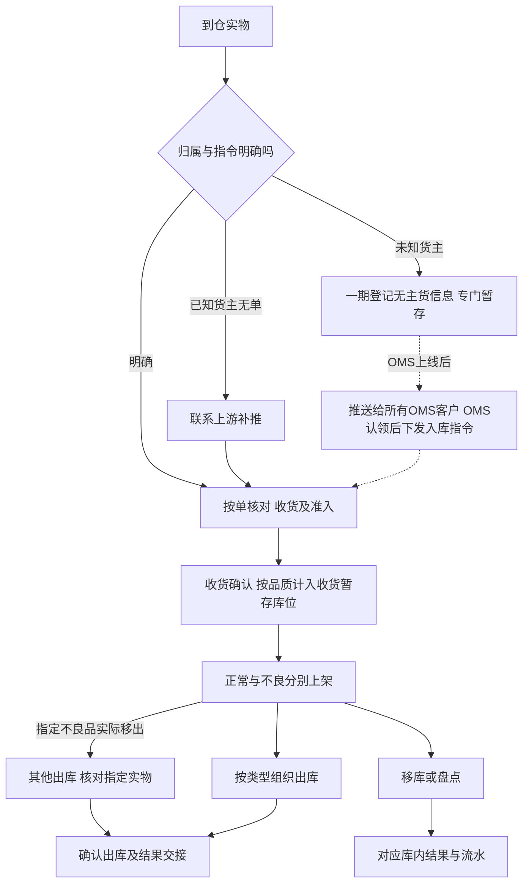

# 海外仓典型业务场景与方案

> 课程沙盘综合场景：串联基础资料、入库、库存、出库与上游协作。具体规则和数量案例由对应业务文档维护；第8.2节候选未纳入一期。

场景覆盖拼柜到货、六类出库、存拣协同、盘点与异常交接、上游消息与结果送达。阅读顺序建议先业务蓝图，再按基础资料→入库→库存→出库→上游协作；本篇用于验收清单与方案取舍。

## 输入资料与依据

背景与一期范围见全局背景中的项目定位；需求结论与未决事项见需求分析总览。各域职责见业务蓝图第二节域地图。

竞品参考采用本地留存的原始操作页，版本以留存资料为准。需求层取舍见项目总览《竞品参考与需求取舍》；扩展候选及采用条件见本文 8.2 节。

## 一、场景地图与分析方式

| 业务处境 | 跨域交接 | 完整规则与案例 |
| --- | --- | --- |
| 拼柜、多货主、多单、分批入库 | 基础资料业务确认身份与位置，入库业务实收与上架，库存业务按库位记账，上游协作交回各单结果 | 入库业务第8.1节 |
| 平台仓补货与批发出库 | 出库业务逐单核SKU及箱托，库存业务按实发扣库，上游协作交装箱结构和未发结果 | 出库业务第3.1、3.2、9.1节 |
| 单品多品包裹与取消 | 出库业务组织基础波次，按原单复核／返库上架，库存业务保护占用，上游协作交逐单结果 | 出库业务第5.2、9.2节 |
| 整仓有货、拣货位置不足 | 基础资料业务提供适配位置，库存业务移库，出库业务重新分配，原位差异另核 | 库存业务第6.2节；出库业务第9.3节 |
| 无预报、无主货登记与已收退回 | 入库业务区分补单／登记；认领由后续OMS承接，已收退回的正常品走采购退货出库，货在暂存时可先接单预占、上架后再拣，不良品移出走其他出库 | 入库业务第8.2节 |
| 效期、受损、盘点和不良品移出 | 库存业务区分品质、数量和实物去向，出库业务收口订单，上游协作交已有结果 | 库存业务第七节、第8.1、8.3、9.2节 |
| 调拨入库与出库分别执行 | 调入按入库、调出按出库各自执行；上游协作分别交回，不建跨仓主单与差异结案 | 入库、出库域第一节；上游协作域第二节 |
| 首到仓新品与作业容器 | 基础资料提供商品身份；入库业务在同一货主商品尚无仓内实测规格时，于首次收货提交前量方；按容器或按SKU收货上架；库存业务按SKU记录实际、预占和可用数量 | 基础资料域；入库域第3.7、3.8节 |
| 资料准入、渠道与上游消息 | 接单校验含物流渠道；停用渠道拒收新单；上游协作区分请求重发与结果重交，不重复占扣 | 基础资料第七节；出库域第四节；上游协作第六、八节 |

各场景说明模块之间如何交接；完整规则及数量时间线见表中对应业务文档。

## 二、拼柜、混合到货与分批入库

一柜涉及多个货主和入库单时，仓库先依据箱唛、运单及实物线索匹配归属与指令，再按各入库单清点。已知货主但缺指令的，由上游补推；未知货主只登记并专门暂存，后续认领路径见第七节。超收部分单独记录，补发新单后重新校验接收，或按货主安排线下处理。

收货时现场在实收内区分良品、不良品，不生成质检任务。收货确认即按品质计入收货暂存库位的实际库存；上架只把库存移到存储、拣货或不良隔离库位。良品在暂存时就算可用、可被接单预占，上架后才能分配拣货。

同柜各单可以分批推进，协作结果分别说明累计实收、已上架、未上架及差异。整单完成条件由入库业务判断，不能以一柜卸完代替各单完成。数量案例见入库业务第8.1节，已收未上架真实丢失见第8.4节，收货残损见第8.5节。

[按单／按箱收货][LX022]提供组织参考；[清分打托引导][JF011]列为第8.2节候选。

## 三、海外仓向平台仓补货与批发出库交付

上游提供出库需求及交接信息，仓库按类型接收并预占库存，再按单拣货、核对商品及数量。平台仓补货需说明实际装箱或装托的SKU内容，B2B需核对接货方；箱托用于组织交付，库存始终按SKU件数计算。

两类出库的跨域交接重点是实发和未发。缺量只因库存不足，缺量资格与占用释放由出库第9.1节维护，上游依据最终未发量决定是否另下新单。

仓库将原需求、实发、未发和已登记交接信息交回上游。装箱或装车结构变化只更新实际交付情况，不等于修改订单需求；确认出库与承运商揽收分别记录。完整规则和数量见出库业务第3.1、3.2及9.1节。

[平台仓备货中转][LX049]和[B2B大货交付][JFB2B]作组织参考，BOL／POD等文件交换见第8.2节候选。

## 四、一件代发的订单组织、分单与防混单

### 4.1 波次组织方式的比较

B2C全SKU足量接收后，可按单或以同仓同货主基础波次组织，结果仍逐单复核、确认与回传。单品多件要核数量，多品要核组合，启用批次／SN时核具体身份。

[LX-WMS-055][LX055]与[JF-OUT-022][JF022]提供下列组织选择；具体载体和扫描顺序由应用设计选择。

| 方式 | 控制点 | 适用讨论 |
| --- | --- | --- |
| 按单拣 | 全程保持原单身份 | 单量少、组合复杂或独立搬运 |
| 边拣边分 | 取货即放入对应订单容器 | 订单与容器对应可靠，途中取消能定位 |
| 先拣后分 | 汇总取货后还原每单组合再复核 | 有可靠分拣位置、原单对应和异常隔离 |

自动分波、派工、产能计算和打印即出库不纳入一期。

### 4.2 单据取消不由波次进度替代

取消受理即释放本单占用，已拣实物退拣、经返库上架单回到库位，已拣后丢失按出库第7.5节收口，其他单独立继续；数量走查见出库域第 5.2、9.2 节。短拣或批次／SN 不符仍阻断该单确认。

## 五、大货存储与零散拣货协同

### 5.1 位置不足和整仓不足分别处理

拣货库位不足时，先核本仓本货主的合格实物与任务分配，再决定移库或换位，不能直接报整仓无货。规则见库存域第六节与出库域第 7.1 节。存拣与补货相关原文见文末 [LX026][LX026]、[JFFAQ][JFFAQ]，不能据此推导存储位一律不可拣。

### 5.2 移库保总量，重新分配保原占用

完整数量与核对要点见库存域第 6.2 节与出库域第 9.3 节：移库只改位置、不改 SKU 预占总量；已分配给拣货任务的数量不得直接移走；换位不证明原位账实正确。

### 5.3 补货建议与缺货单恢复是两项不同能力

独立补货、下限与建议量属于第8.2节后续效率改进；现有有效缺货单库存补齐后由仓库人工重新分配，执行见出库业务第7.4节。移库或入库完成不自动说明原单已经重新分配，原拒收请求仍由上游重提。

## 六、仓库与货主之间的差异确认及证据交接

### 6.1 事实与处理意图由不同责任方提供

仓库交原指令、实收／品质／位置或装箱差异，上游提供补单、是否继续等货及独立处置安排；具体责任与输出见上游协作域第 7.2 节。未收、不良、未上架和未发是不同量，不重复相加成损失。等待期间保留实物位置与既有占用。

### 6.2 证据载体按业务需要评估

[JF-IN-010][JF010]与[LX-WMS-049][LX049]说明拍照、沟通和装箱文件的价值；[JF-OUT-001][JFVIDEO]只明确可开启包装录像，不能据此推导保存期限、索引、权限或争议裁定。当前保留差异、来源和关键操作依据，照片按异常提供；线上附件、视频和双向沟通见第8.2节候选。

## 七、无预报到货与逆向业务辨别

### 7.1 先辨别归属，再辨别业务方向

| 实物来源 | 一期处理 | 负责规则 |
| --- | --- | --- |
| 已知货主正常来货无预报 | 联系OMS Mock补推，再按正常入库 | 入库业务第3.5节 |
| 未知货主正常来货 | 一期登记、专门暂存；OMS上线后认领并下发指令，再清点准入及上架 | 入库业务第3.5、8.2节 |
| 已实收后需要退回仓外 | 保留原入库，独立退回；货在暂存时可先接单预占，上架后再拣；不良品走其他出库 | 入库业务第7.2节；出库业务第3.4节 |
| 买家退货／派送失败退回／平台仓退件 | 退货预报或扫原运单建单，收货上架后恢复可售库存 | [退货业务设计](07-退货业务设计.md) |
| FBA移除或退货回仓 | 一期不执行FBA退货、换标及再入库 | 后续逆向与增值服务 |

[LX-WMS-030][LX030]与[JF-IN-013][JF013]的公有认领池、认领后销毁不复制到一期；一期退货走独立退货单，无预报时催补或无主货登记。FBA全流程参考[JF-FBA-001][JFFBA]，见第8.2节。

### 7.2 认领不替代实收，退回不冲销原入库

无主货一期登记到货与暂存线索，不形成入库单或库存；OMS上线后由客户认领并下发入库指令，WMS再正常入库。登记、零实收等待及已收独立退回案例见入库业务第8.2节；已实收归属错误停止受影响作业，不自动修改货主或生成另一货主库存。

## 八、贯穿规则、方案取舍与覆盖检查

### 8.1 商品要求贯穿各域

| 要求 | 跨域检查重点 | 完整依据 |
| --- | --- | --- |
| 形态与位置 | 收货、上架、拣货和移库引用相同商品身份与适配位置，不增加容量／承重控制 | 基础资料第六节；入库域第 6.3 节 |
| 资料与渠道 | 分节点准入；物流渠道接单校验，停用渠道拒收新单；库区／库位／渠道停用受占用约束 | 基础资料第四、七节；出库域第四节 |
| 批次效期 | 收货准入、在库等级和品质、出库资格分别判断；展示时区不改业务日期 | 入库域第 6.2 节；库存域第 8.1 节 |
| SN | 货主＋SKU＋SN 跨四仓判断，逐件身份随收存发和退拣返库上架保留 | 库存域第 8.2 节 |
| 品质与处置 | 正常／不良不与临期／过期混同，指定实物不重复处置或扣库 | 出库域第八节；库存域第九节 |

批次与SN的竞品参考为[LX-WMS-043][LX043]和[JF-BAS-013][JFSN]；[JF-INV-007][JFEXP]中的过期售卖或免二次效期校验不覆盖强盛规则。

### 8.2 有原文依据的新增候选与后续方案

报损／销毁及报损后非库存暂存跟踪已按一期范围决定后置，边界见库存域第 9.3 节。

以下每项均未纳入一期，不进入前述主流程的必经节点。是否增加应根据样例和明确业务价值决定，不因为竞品有功能就复制。

**仓内作业与效率**

| 候选／后续方向与原文 | 对强盛的业务价值判断 | 现有覆盖、缺口与采用条件 |
| --- | --- | --- |
| 仓库暂停收货与暂停接单：[JF-BAS-017][JFBAS] | 只暂停一类业务时仍允许另一类继续 | 当前按仓库及执行域准入；新增需决定已接单、进行中任务与恢复责任，不改变既有盘点规则 |
| 同货主SKU／批次混放及路径优先级：[JF-BAS-017][JFBAS]、[LX-WMS-012][LX012] | 对共位实物与取货顺序作更细限制 | 当前允许同货主多SKU共位，已有形态／品质适配；新增需确定约束层级和存量处理，不改变一库位一货主 |
| 收货阶段预选目标库位：[JF-IN-003][JF003] | 减少收货与上架交接时重复找位 | 当前已有上架推荐和人工改位；新增需位置计划与交接样例，预选不等于上架、库存或容量预锁 |
| 清分打托引导：[JF-INV-011][JF011] | 多SKU整柜卸货时帮助现场把箱／SKU分到正确托，减少归属与内容核对压力 | 已有混合识别、SKU实数、容器记录；新增需组托工作组织、区域样例和容器重组追溯；体积预估、语音及自动打印另评估，不将组托替代上架或新增托库存 |
| 拣货区补货建议：[LX-WMS-026][LX026]、[JF-INV-018][JF018] | 把拣货库位缺口交成可执行补货工作，而非每次临时找货 | 现有基本移库／换位可处理；新增需位置布局、动销与缺口样例、下限和进度／占用衔接；不强制全仓存拣分离，不推导统一补货量 |
| 效期转不良后的移位建议：[JF-INV-007第10节][JFEXP] | 让品质变化后的实物隔离可组织、可追踪 | 当前自动品质转换保留原位置，普通移库可移至适配隔离位；自动移位建议不得绕过移动冻结 |

**协作与证据交接**

| 候选／后续方向与原文 | 对强盛的业务价值判断 | 现有覆盖、缺口与采用条件 |
| --- | --- | --- |
| 特殊要求工单：[JF-WO-002][JFWO] | 把普通收发单无法表达的要求交给明确执行方 | 当前常规指令和邮件其他出库已有入口；新增需需求类别、执行责任、结果与原单关系，增值服务仍属后续 |
| 差异及出库照片／附件：[JF-IN-010][JF010]、[JF-PDA-024][JFPHOTO]、[LX-WMS-049][LX049] | 外部货主跨时区核对短少、受损、包裹和装箱变化时有可定位事实 | 已有差异、动作记录及结果，照片按异常提供；线上附件需证据关联、采集节点、查看范围和保留时长；保留时长按业务需要确定，责任认定另行处理 |
| BOL／POD及箱唛文件交换：[LX-WMS-049][LX049] | 大货交付需要把装箱、实际交接或已取得签收凭据交给货主 | 基本容器结构和模拟交接已有；需资料交接对象、文件关联和既有结果补充方式；预约属上游，不以POD到达为本仓扣库前置 |
| 在线双向沟通：[JF-IN-010][JF010] | 减少货主与仓库的散落解释，使决定对应同一单据 | 一期用Mock及线下依据；依赖真实OMS与对客责任规则，作为二期能力候选 |
| 包装视频证据：[JF-OUT-001][JFVIDEO] | 高价值SN货或包装争议可评估记录关键作业现场 | 现有逐单复核与轨迹；新增需视频与订单对应、使用目的和证据管理；设备、存储、权限另设计，视频用于辅助核对实际作业 |

**业务扩展**

| 候选／后续方向与原文 | 对强盛的业务价值判断 | 现有覆盖、缺口与采用条件 |
| --- | --- | --- |
| 快进快出／多目的地转运：[LX-WMS-046][LX046] | 香港集货中转若确有到仓后不长期存储、再送多个地点，可评估减少重复仓内安排 | 现行可经正常入库上架再独立出库；新增需先确认场景，另定义接收、暂存、分目的地交接与数量事实，不得直接复制竞品箱级转运 |
| 退件认领公海与代建加速：[JF-OMS-RET-002][JFRET]、[LX-WMS-006] | 无预报到件时货主线上认领或仓库扫面单代建 | 一期不建公海；派送失败允许扫原运单建单，客户／平台仓须预报，见退货业务设计 |
| FBA退货处理意见与转换：[JF-FBA-001][JFFBA] | 平台移除货回仓后，区别暂存、直接上架和换标再销售 | 一期排除FBA逆向、换标换包装与专属库存类型；后续补平台标识、处理意见变化、品质与追溯 |

**库存迁移与模型变化**

| 候选／后续方向与原文 | 对强盛的业务价值判断 | 现有覆盖、缺口与采用条件 |
| --- | --- | --- |
| 库存初始化导入：[LX-WMS-001][LX001] | 未来若接管已有库存，可用于迁移经核实的期初数量 | 当前自营海外仓处于规划阶段，并非替换已运行的海外仓WMS。一期使用模拟资料或完整入库链；未来出现库存迁移需求时，再确定盘点核对与导入方式 |
| 整箱持有及箱转件库存：[LX-WMS-041][LX041]、[JF-INV-021][JF021] | 当前SKU件数模型已满足需求；仅在出现必须按整箱持有及转换的业务时评估 | 本项目按内部SKU件数记录库存，拆箱或重装不需要库存类型转换；只有后续明确需要整箱管理时再评估，会改变当前库存模型 |

[LX-WMS-046“操作场景”“拆单”“补充说明”][LX046]描述箱数／托盘实收、暂存、多目的地拆单及部分转运，与强盛平台仓补货、仓网调拨含义不同。香港仓“集货中转”的背景不代表已经批准无需上架、不形成SKU库存的越库模式。

### 8.3 中断和异常恢复应回到实际进度

| 中断 | 恢复时核对什么 | 负责正文 |
| --- | --- | --- |
| 分批收货／上架中断 | 已确认累计量与现场剩余，只继续未完成部分 | 入库业务第四、八节 |
| 集中拣后取消或短拣 | 原单实物、批次／SN与占用，不按波次汇总掩盖异常 | 出库业务第五、七节 |
| 移库中断或建议位无货 | 源目标实际位置、已确认移动和具体分配，不重复移量 | 库存业务第六节；出库业务第7.1节 |
| 在库受损或过期 | 在库受损由具备权限及本仓授权的仓库主管核实转不良；过期只自动转存储、拣货库位上的货，盘点中的SKU暂停转换、完成后补做 | 库存业务第8.1、8.3节 |
| 盘亏后正常品低于订单占用 | 直接调账，可用为负，相关出库单按缺货规则处理 | 库存业务第7.3、7.4节 |
| 不良品需要实际移出 | 按其他出库核对指定实物，指定不另加占用，实发后扣减库存 | 库存业务第9.2节；出库业务第八节 |
| 仓内完成、结果未送达 | 原结果和流水，只重交已有结果 | 上游协作第五、六节 |

管理端与PDA继续处理同一业务记录。离线作业、自动续单、任务转交及后台更正不在本节范围。

发现账实不符的人提交手上单据后，对该SKU发起盘点；盘点期间该SKU冻结，主管确认差异后调账，详见[库存业务第5.3节](04-库存与库内业务设计.md#53-发现账实不符就发起盘点)。

### 8.4 关键走查场景

后续用模拟资料、完整Mock表单及管理端／PDA操作检查以下场景，记录单据号、前后数量和异常结果；具体规则引用负责模块，不另维护一套验收编号。

| 场景 | 重点核对 | 依据 |
| --- | --- | --- |
| 四仓主链与多货主 | 各仓跑通入库→库存→出库；两货主同编码不混归属，跨货主共位被阻断 | 基础资料业务第五节；各业务主流程 |
| 到货、收货与品质 | 混批、未推单和无主货分别处理；分批未收与最终短少分开，超收补新单；实收内正常与不良分别记录 | 入库业务第三、四节及第8.1、8.3节 |
| 商品配置与追溯 | 形态适配、带电属性读取、效期准入边界、临期可出、过期转不良；SN贯穿收发存，开关按库存与作业条件切换 | 基础资料业务第六、七节；库存业务第八节 |
| 各类出库与作业组织 | 六类出库分别执行；箱托不另计库存，B2C波次不跨仓／货主，非B2C按单拣货，逐单复核与交回结果 | 出库业务第一、三、五节 |
| 出库接单与占用 | B2C任一SKU不足整单拒收；盘点中的SKU照常接单、不分配拣货；预占竞争不超占，换位不重复预占 | 出库业务第四节及第9.2、9.3节；库存业务第七节 |
| 短拣、取消与缺量结案 | 取消受理即释放，已拣退拣返库后才能再分配；FBA转运出库与批发出库只在库存不足时缺量结案，且至少有实际发出量，已拣的须全部发出；零实发等待或合法取消 | 出库业务第七节及第9.1、9.2节 |
| 零实收入库与已收退回 | 零实收通知上游取消，Mock 受理后已取消；已实收事实保留，退回走独立出库，货在暂存时可先接单预占、上架后再拣 | 入库业务第 7.2、8.2 节；上游协作第四节 |
| 邮件其他出库 | 线下邮件为来源依据；核对指定不良实物并足量确认扣库；保留可查询结果，与真实盘亏分别记账 | 出库业务第八节及第9.5节；上游协作第7.1节；库存业务第9.4节 |
| 移库、盘点与品质变化 | 移库保归属和总量；盘点按SKU冻结、建单即快照、直接调账；过期只转存储、拣货库位，盘点期间暂停 | 库存业务第六、七、八节 |
| 已收未上架真实丢失 | 沿用实收10、剩余8、丢失2案例：一期按10提交上架，再发起盘点盘亏2，净增8；实收误记不套此路径 | 入库业务第8.4节 |
| 收货残损 | 收货时录入不良品，不生成质检任务；正常品与不良品分别上架；上架前新发现的残损按原品质上架后由库存域转不良 | 入库业务第8.5、6.4节 |
| 缺货单人工恢复 | 库存补齐后人工重新分配，只补合法缺口；取消、结案或仍在盘点中的单据不能直接恢复 | 出库业务第9.6、7.4节 |
| 首到仓新品与容器收货 | 同一货主商品首次进入四仓且无仓内实测规格时，在首次收货提交前量方；四仓共用规格，不重复量方；容器数量仍按SKU记录 | 入库业务第3.7、3.8节 |
| 输入、权限与两端作业 | 资料与渠道准入；仓库及动作授权；业务日期与展示时间；管理端／PDA重复提交不重复改变库存 | [业务蓝图第6.1节](00-业务蓝图.md#61-公共能力走查串联)；各业务异常表 |
| 请求与结果交接 | 合法变更取消；重发旧请求保留历史结论，单据进度另查；回传失败只重交结果 | 上游协作第四、六、八节 |
| 调拨两端独立 | 对手方可为自营仓或第三方海外仓；本仓分别记录出入库，不新增跨仓主单、在途账或配对结案 | 出库第9.8节；上游协作第二节 |
| 已拣后少件 | 复核退拣1后补拣足量出库；退拣按应返库数量提交，再盘亏1；不伪造实发或重复盘亏 | 出库第7.5、9.7节 |
| 发现账实不符 | 短拣、换位、复核少件、上架或返库找不到时，提交手上单据后对该SKU发起盘点 | 库存第5.3节 |
| 盘点建单的任务边界 | 这些SKU有进行中的上架、返库上架、拣货任务时不能建单；建单后收货、上架、拣货、移库都等盘点完成 | 库存第7.1节 |
| 承运商与渠道 | 父承运商停用、渠道仍启用时，新单和新增交接引用均阻断；历史保留 | 基础资料第7.4节 |

### 8.5 模拟案例覆盖安排

以下为演示准备安排，不代表四仓真实货盘或已执行结果。四仓各跑一条完整收存发主链，差异场景分配如下；沿用负责域已有数量案例，独立案例不拼成同一批实物。

| 演示仓 | 主链样例 | 分配的差异与组合场景 |
| --- | --- | --- |
| 香港 | 轻小件正常入库、移库、B2C出库 | 存储与拣货位置不足、换位差异后发起盘点；管理端与PDA重复提交 |
| 美西 | 自营与外部货主同编码、良品不良品同单收货、平台仓出库 | 新品维护、混合品质容器分次保存、按单提交、缺量结案、已拣后少件退拣补拣及盘点调账、第三方仓调拨出库 |
| 美东 | 大件／异形入库与批发出库交接 | 形态推荐与人工改位、已收正常品独立退回、承运商停用但渠道启用的准入阻断 |
| 德国 | 批次效期与SN入库、正常出库 | 无主货与零实收、过期转不良及其他出库、盘点期间接单与盘亏后缺货；跨仓同货主同SKU的SN身份检查 |

两货主商品、带电属性读取、仓库与动作授权、中英文及展示时区检查随上述案例配套；带电属性不新增运输限制。容器混合品质需核对正常、不良分别落到适配位置；跨仓SN案例只核身份及轨迹，不建立调拨两端关联。

上述场景尚未完成管理端／PDA 演示验收，正式样例、页面操作和验证记录由应用设计与后续测试补齐。文档逻辑核对记录见需求分析总览 6.4 节。

## 原始操作页引用

[LX022]: ../02-竞品调研和分析/领星WMS/01-原始页面/LX-WMS-022_使用PDA实现收货.md
[LX031]: ../02-竞品调研和分析/领星WMS/01-原始页面/LX-WMS-031_使用WMS操作入库管理.md
[LX032]: ../02-竞品调研和分析/领星WMS/01-原始页面/LX-WMS-032_使用WMS操作上架管理.md
[LX049]: ../02-竞品调研和分析/领星WMS/01-原始页面/LX-WMS-049_使用WMS处理备货中转出库订单.md
[LX055]: ../02-竞品调研和分析/领星WMS/01-原始页面/LX-WMS-055_使用WMS处理一件代发出库单.md
[LX026]: ../02-竞品调研和分析/领星WMS/01-原始页面/LX-WMS-026_使用WMS实现存拣分离.md
[LX030]: ../02-竞品调研和分析/领星WMS/01-原始页面/LX-WMS-030_使用WMS进行入库认领.md
[LX043]: ../02-竞品调研和分析/领星WMS/01-原始页面/LX-WMS-043_使用WMS和OMP实现批次库存管理.md
[LX046]: ../02-竞品调研和分析/领星WMS/01-原始页面/LX-WMS-046_使用WMS处理转运.md
[JF022]: ../02-竞品调研和分析/极风WMS/01-原始页面/JF-OUT-022-波次发货_波波次业务设置、生成波次.md
[JF018]: ../02-竞品调研和分析/极风WMS/01-原始页面/JF-INV-018-仓库商品安全库存建议移货.md
[JFFAQ]: ../02-竞品调研和分析/极风WMS/01-原始页面/JF-FAQ-OUT-006-为什么订单推送过来在待移货而不是在待生成_待打单.md
[JF010]: ../02-竞品调研和分析/极风WMS/01-原始页面/JF-IN-010-海外仓收货入库，WMS和卖家OMS沟通.md
[JF013]: ../02-竞品调研和分析/极风WMS/01-原始页面/JF-IN-013-仓库入库认领流程.md
[JF011]: ../02-竞品调研和分析/极风WMS/01-原始页面/JF-INV-011-入库清分打托.md
[JFB2B]: ../02-竞品调研和分析/极风WMS/01-原始页面/JF-OMS-B2B-001-B2B大货中转入库、拣货、扫码换标、装箱出库全流程.md
[JFRET]: ../02-竞品调研和分析/极风WMS/01-原始页面/JF-OMS-RET-002-客户退货入库流程.md
[JFFBA]: ../02-竞品调研和分析/极风WMS/01-原始页面/JF-FBA-001-新版FBA退货快速入库、换标入库、上架、出库全流程.md
[JFVIDEO]: <../02-竞品调研和分析/极风WMS/01-原始页面/JF-OUT-001-WMS 扫描包装页面增加了视频录制开启按钮.md>
[JFSN]: ../02-竞品调研和分析/极风WMS/01-原始页面/JF-BAS-013-商品序列号管理（商品序列号开启、入库、出库操作）.md
[JFEXP]: ../02-竞品调研和分析/极风WMS/01-原始页面/JF-INV-007-商品有效期管理.md
[LX041]: ../02-竞品调研和分析/领星WMS/01-原始页面/LX-WMS-041_使用WMS查询或处理箱库存.md
[JF021]: ../02-竞品调研和分析/极风WMS/01-原始页面/JF-INV-021-B2B的库存转换成一件代发库存.md

[JFBAS]: ../02-竞品调研和分析/极风WMS/01-原始页面/JF-BAS-017-设置仓库、货区、货架位.md
[LX012]: ../02-竞品调研和分析/领星WMS/01-原始页面/LX-WMS-012_使用wms创建库位.md
[LX001]: ../02-竞品调研和分析/领星WMS/01-原始页面/LX-WMS-001_WMS初始化操作.md
[JF003]: ../02-竞品调研和分析/极风WMS/01-原始页面/JF-IN-003-扫描收货预选货架位.md
[JFWO]: ../02-竞品调研和分析/极风WMS/01-原始页面/JF-WO-002-工单处理与管理.md
[JFPHOTO]: ../02-竞品调研和分析/极风WMS/01-原始页面/JF-PDA-024-如何使用PDA扫描包裹确定发货出库并拍照记录.md
