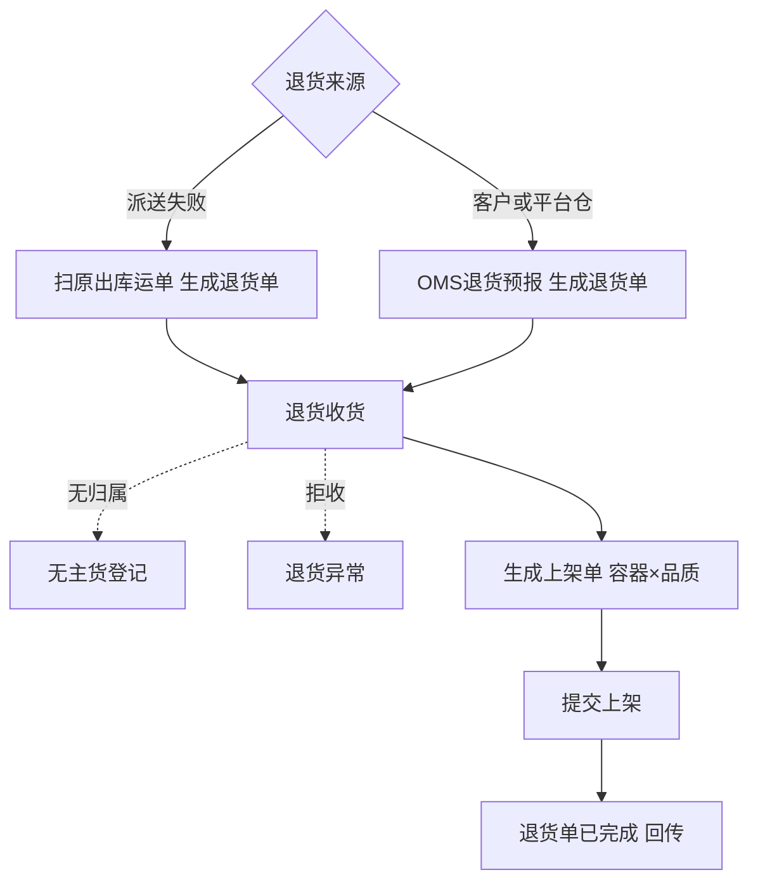

# 退货业务设计

> 课程沙盘「退货」域：到件识别、退货收货（拒收与实收、实收内良品／不良）、上架与结果交接。顺读从第二节起；依据与交接表在第一节。

本篇在《退货业务需求分析》与[退货模块宏观系统架构](../01-全局背景信息/06-退货模块宏观系统架构.md)已确认规则上展开场景、流程、对象关系与走查。覆盖派送失败退回、客户退货、平台仓退件；FBA 移除退仓与换标不在一期。退货上架复用入库上架单对象；与退回出库、正常入库指令分属不同模块。

## 一、依据与交接范围

### 1.1 依据与竞品对照

功能真源见 [退货业务需求分析](../03-需求调研和分析/05-退货业务/退货业务需求分析.md)；调研背景见同名调研稿；项目范围见全局背景中的项目定位与退货宏观架构。与基础资料、库存、出库、系统集成相关的 FR 在各自分析稿第二节维护，本文不重复长表。竞品核读索引见本文第九节。

### 1.2 业务入口与输出

| 上游给什么 | 本域交出什么 | 交给谁 |
| --- | --- | --- |
| OMS Mock 退货预报（客户退货、平台仓退件） | 待收货退货单，或拒收建档原因 | 退货收货人员；接收结果交回 OMS Mock |
| 已确认 B2C 出库及原运单号（派送失败） | 现场扫运单生成的退货单及关联原出库 | 退货收货人员；建单与结案交回 OMS Mock |
| 退货到件实物与运单线索 | 拒收、实收、良品／不良、SN；收货确认后暂存库位库存 | 上架人员（按上架单继续） |
| 上架人员保存并提交上架单 | 存储或不良隔离库位上的实际库存与流水 | 库存与库内；出库可预占良品 |
| 仓库完成收货完结与上架 | 实收、拒收（退货异常）、良品／不良、已上架、最终短少分项 | 仓库管理人员、OMS Mock |

货从仓外退回本仓（本域）与已收货物从本仓退回仓外（出库域采购退货出库等）方向相反，名称不可混用。认不出货主的到件交出无主货登记线索，交给入库域登记对象，不生成退货库存。

## 二、参与角色与责任

| 业务角色 | 负责什么 | 必须交出什么 |
| --- | --- | --- |
| 上游业务方／货主（OMS Mock） | 客户退货、平台仓退件预报；差异处理意见 | 可匹配的退货预报；派送失败可选预报 |
| 退件／收货人员 | 识别来源；派送失败扫原运单建单；按行录入拒收与实收及 SN | 拒收原因、实收内良品／不良；SN 核对结果 |
| 上架人员 | 按退货来源上架单落位 | 可追到退货单、收货明细的目标库位结果 |
| 仓库协作责任人（岗位未指定） | 催补预报、登记无主货线索、确认收货完结 | 沟通依据与未决问题交接 |

仓库记录发现时的数量、品质与位置；货主负责预报准确性与业务争议。一期不因货主未回复而无限期占用收货暂存库位存放良品。

## 三、海外仓退货场景

### 3.1 派送失败退回：原运单即身份

B2C 包裹未妥投时，外包装往往未拆，承运商贴回的原运单号即可指向本仓发出的出库单与模拟运单。现场扫原运单号建退货单，货主与 SKU 由系统带出，预计数量对齐原包裹实发或复核数量。

领星将此类归入服务商退件并可按原跟踪号判定；极风在部分网络下支持扫退货运单直建入库。强盛一期**单独退货单**承接，不写入库类型，且对 SN 商品执行与原出库复核一致的强核对，降低 3C 调包风险。（RT-FR-002、RT-FR-011）

### 3.2 客户退货：预报驱动，新运单

买家用新运单寄回，仓库到件时若无预报则无法知悉内容与货主。货主须在 OMS Mock 提交退货预报（退货运单、SKU 与数量；可选原销售单号）。到仓扫退货运单或退货单号开工。

竞品普遍提供 PDA 扫面单代建或扫 SKU 带出货主以提速；强盛一期**不建设认领公海**，货主已知但无预报时催补预报，避免 WMS 代货主虚构指令。极风 PDA 带客户、领星免认领白名单仅作能力参考。（RT-FR-001、RT-FR-003）

### 3.3 平台仓退件：移除单号与混箱

非 FBA 平台仓（如 WFS）移除退回常整箱到货，箱内可售与不可售混合。预报除退货运单外应带平台移除单号；收货时按 SKU 行录入实收内良品／不良，不假设「整箱同品质」。

须与 FBA 移除（FNSKU、换标）区分：识别为 FBA 退仓特征的到件一期不执行退货收货，保留线索线下协调。（RT-FR-003）

### 3.4 无预报与无主货

对不上退货单且无法扫原出库运单的，不能生成退货库存。货主可辨别的催补预报；货主不可辨别的登记无主货（入库域），实物进专门暂存位。不复制极风公有认领池、领星 D 级错寄公海的一期产品能力。（RT-FR-003）

### 3.5 收货品质与竞品「到仓暂存」

领星常规退件可选「到仓暂存」暂不拆包清点；强盛一期**不设**到仓停单状态，到件后进入退货收货录入拒收与实收（可分批）。退货后独立质检任务、极风退货视频、领星四级质检计费均不纳入一期；品质在收货实收内一次录入。（RT-FR-004、RT-FR-005）

### 3.6 良品上架与再销售

良品收货确认后即计入可用，可被后续 B2C 预占；上架单提交、进入存储库位后才能分配拣货，用于演示「发出—退回—再发」闭环。不良品进不良隔离库位，不参与正常出库分配；销毁／退运留后续。一期不等货主「处理意见」再移库。（RT-FR-006、RT-FR-010）

## 四、业务流程

与入库域相同：收货确认即暂存库位增库存；上架提交才进目标库位。收货完结、短少与拒收分项规则对齐入库完成条件，见宏观架构第五节交接表。

## 五、对象关系与数量口径

| 对象 | 与其他对象关系 | 数量要点 |
| --- | --- | --- |
| 退货单 | 1 货主、1 仓；派送失败关联 1 原 B2C 出库单；预报类关联 1 预报 | 明细：预计、实收、拒收、未收、良品、不良、已上架 |
| 退货收货记录 | 1 退货单多条；行上容器、批次、SN | 拒收＋实收≤预计 |
| 上架单（来源退货） | 指回退货收货记录；规则同入库上架单 | 已上架≤实收 |
| 库存 | 货主＋SKU＋品质＋库位 | 良品收货确认后即计入可用，上架后才能分配 |

追溯：派送失败 **原出库单 → 复核 SN → 退货收货 SN**；预报类 **退货预报 → 退货单 → 收货 → 上架 → 流水**。

## 六、异常与边界

| 情况 | 业务后果 | 一期处理 |
| --- | --- | --- |
| SN 与原出库不符（派送失败或可对核预报） | 防调包 | 阻断计实收；拒收或记不良并备注 |
| 实物多于预报 | 对不上单 | 超出部分不收，线下暂存 |
| 错 SKU、空包 | 类似竞品 D 级 | 拒收或拒收整件；无预报且无主则登记无主货 |
| 实收误记 | 无法 truthful 结案 | 无更正路径，与入库一致 |
| FBA 到件 | 范围外 | 不收货，线下协调 |

## 七、与邻域衔接

- **出库域：**仅派送失败需要读原 B2C 出库单、运单与复核 SN；不退冲原出库库存（出库已扣）。
- **入库域：**共用上架单与无主货登记；不入库类型枚举。
- **库存域：**暂存、存储、不良隔离口径与入库一致；退回良品可被 OUT 预占。
- **系统集成：**退货预报入、结案出；派送失败建单与结案同样回传。

## 八、数量走查

### 8.1 案例索引

| 场景（一句） | 结论（一句） | 锚点 |
| --- | --- | --- |
| 派送失败 1 件 SN 一致退回 | 实收 1 良品，上架后可再发 | [§8.2](#82-派送失败退回sn-一致) |
| 客户退货预报 1 件无可对核原单 | 采集 SN 入账，提示无可对核 | [§8.3](#83-客户退货无可对核-sn) |
| 预报 2 件实到 1 件良品 1 件拒收 | 实收 1、拒收 1，短少 0 | [§8.4](#84-实收与拒收分项) |

### 8.2 派送失败退回（SN 一致）

**模拟数据。**美西仓 B2C 出库单已确认，模拟运单 TRK-001，SKU 手机 1 件，复核 SN=S100。承运商退回，扫 TRK-001 生成退货单，预计 1。

| 步骤 | 动作 | 结果 |
| --- | --- | --- |
| 1 | 退货收货扫 SN=S100 | 良品实收 1；暂存库位 +1 正常 |
| 2 | 提交良品上架单至 P-A | 存储库位 +1；退货单已完成 |
| 3 | 回传 | 良品实收 1、拒收 0、短少 0 |

若扫 SN=S999：阻断计实收，现场记拒收 1（原因待枚举）或实收内不良并备注，不产生可售库存。

### 8.3 客户退货（无可对核 SN）

预报退货运单 RTN-88，SKU 耳机 1 件，无原销售单链。到仓扫 RTN-88 收货，商品要求 SN。

| 步骤 | 动作 | 结果 |
| --- | --- | --- |
| 1 | 扫 SN=E200 入账 | 提示无可对核原单；良品实收 1 |
| 2 | 上架 | 存储库位 +1，可后续出库 |

### 8.4 实收与拒收分项

预报 2 件，实到 1 件完好、1 件外包装严重破损拒收。

| 维度 | 数量 |
| --- | --- |
| 预计 | 2 |
| 拒收 | 1（自动退货异常） |
| 实收 | 1（良品 1） |
| 未收 | 0 |
| 结案回传 | 拒收 1 分项；良品实收 1 |

## 九、竞品原文索引

| 主题 | 代表依据 | 本项目取舍 |
| --- | --- | --- |
| 常规退件正次分流 | [领星知识库：逆向退件 §能力项1](../02-竞品调研和分析/领星WMS/02-竞品知识库/04-逆向退件与FBA换标.md) | 实收内良品／不良；不做到仓暂存停单与计费联动 |
| 免认领／PDA 建单 | 领星 LX-WMS-006、极风 JF-PDA-027 | 仅派送失败 WMS 建单；预报类不代货主虚构 |
| 退货预报与验货 | 极风 JF-IN-014、JF-OMS-RET | 预报驱动；不做退货视频必选 |
| 认领池 | 极风 JF-IN-013、JF-OMS-RET-001 | 一期无主货登记，不做公海认领 |
| 派送失败跨仓 | 极风 JF-IN-005 | 候选后续；一期单仓扫原运单 |
| FBA 退货库存 | 领星 LX-WMS-007、极风 JF-FBA 系列 | 一期排除 |

跨域候选与综合场景见[海外仓典型业务场景与方案](06-海外仓典型业务场景与方案.md)第七节、第八节。

## 十、资料缺口与应用设计输入

- 三类来源各一套 Mock 预报与到件样例；派送失败与原出库多包裹关系待演示数据。
- 拒收原因、破损判定与备注字段结合 3C 样例细化。
- PDA 退货入口与入库上架合并展示的交互由应用设计承接。
- 岗位与退件区物理布局未访谈，不虚构审批层级。

应用设计承接退货单、退货收货、退货异常、上架单来源标记、预报与结案消息及 PDA 流程，不得改变第二节交接中的数量与 SN 核对责任。
