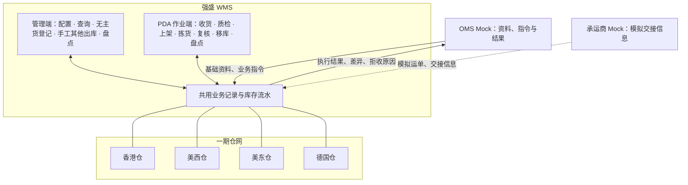
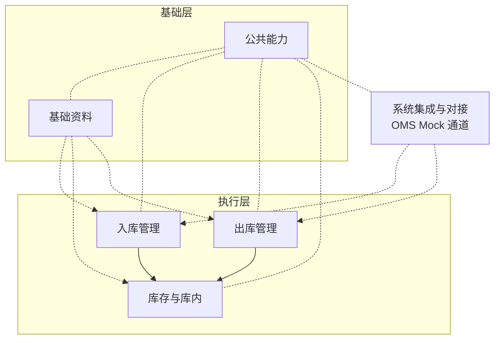

# 系统与模块地图

> 本文提供系统分工、模块功能、资料来源和管理端菜单索引，供研发与测试定位范围。
> 业务依据见全局背景、需求分析与业务设计当前确认结论；阅读顺序与本目录真源分工见 [README](README.md)。

| 版本 | 本次变化 | 状态 |
| --- | --- | --- |
| 2026-10-02 | 由 ERP 参考结构改写为 WMS 口径；补使用端分工与文档索引 | 应用设计初稿 |
| 2026-10-08 | 对齐规则与流程；明确字段与页面缺口及维护职责 | 应用设计修订稿 |
| 2026-10-11 | 收敛链接与对象对齐；范围与真源说明收敛至 README、04；菜单附录免责缩短 | 应用设计修订稿 |

## 一、系统分工

强盛 WMS 是仓内执行系统：维护仓内位置与存放资格，承接上游推送的基础资料和入库、出库业务指令，用管理端和 PDA 记录现场作业，形成可回传、可追溯的库存与执行结果。业务决策在 OMS 与 ERP、仓外运输在物流系统、核算在财务 ERP，都不在这套系统内。一期为可演示、可操作的课程沙盘，上游与承运商由 Mock 模拟；形态与演示边界见本目录《系统边界与上下游链路总览》。

四仓是一期目标仓网／课程规划，不代表立项前已有自营实体仓；立项前由第三方海外仓履约，经营目标是先租仓自营、再拓展外部货主。用户按仓库授权访问数据，授权仓内可见全部货主，一期不做货主级账号隔离。外部系统的输入输出与阶段边界见本目录《系统边界与上下游链路总览》。

### 使用端与系统动作分工

一期就两个使用端；按「哪一步在哪个端发生」把动作收口，双端对同一业务动作共用一条记录、不重复记账，详细机制见本目录《全局机制与权限配置》：

| 类别 | 覆盖动作 | 说明 |
| --- | --- | --- |
| PDA 作业端（现场） | 到货登记、收货、质检、上架、拣货、取消返库上架、复核打包、大货核对、移库、盘点实盘录入 | 现场作业默认在 PDA；与下行「双端共用」不重复计账 |
| 管理端（后台） | 基础资料维护（仓库、库区货位、承运商与渠道、商品作业属性）、无主货登记、手工其他出库创建与确认、盘点创建与差异确认、波次创建、查询与追溯 | 组织、配置与确认端 |
| 系统自动（不依赖端） | 指令接收校验与建档、出库预占与释放、货位分配推荐、库存三量与流水、盘点快照生成、结果回传、送达状态 | 由合法指令或授权作业触发；补货后缺货单须人工重试，不随库存增加自动恢复 |
| 双端共用（同一动作同一记录） | 收货完结确认、确认出库、质检结果记录 | 具体落在哪一端随页面设计；确认结果只有一份 |

## 二、WMS 模块与功能清单

入库和出库各自把作业事实交给库存，不另设中间汇总层；系统集成是与 OMS Mock 交换资料、指令、结果与异常的唯一通道，本身不产生业务事实。各模块功能真源见对应模块《需求分析》第二节；下文只列地图级摘要。

| 模块 | 解决什么问题 | 功能范围（摘要） | 本目录展开位置 |
| --- | --- | --- | --- |
| 基础资料 | 识别货主、商品与位置，提供作业资格 | 上游资料接收；商品作业配置；仓库、库区货位、承运商与物流渠道；变更留痕与停用校验 | 《系统流程与单据交互》资料准备；《实体对象关系》主数据对象 |
| 入库管理 | 记录实收、品质、落位和入库差异 | 正常／调拨入库；新品维护；容器或按件收货与上架；分批实收与上架；需检与免检品质；无主货登记（认领待 OMS 上线）；收货完结；已收未上架丢失收口 | 《系统流程与单据交互》入库链路；《单据与状态流转》入库与任务 |
| 出库管理 | 组织预占、拣核、交接及剩余收口 | 六类出库；按类型准入预占；B2C 基础波次；拣货与返库上架；缺货人工重试；复核与容器核对；确认出库；变更与取消 | 《系统流程与单据交互》出库链路；《单据与状态流转》出库与任务 |
| 库存与库内 | 对应库存数量、品质和现场位置 | 多维库存与流水；预占、分配与锁定；移库；盘点；批次、效期与 SN 追溯；PDA 与管理端共用记录 | 《实体对象关系》数量公式；《系统流程与单据交互》库内链路 |
| 系统集成与对接 | 接收上游输入，交回结论与结果 | OMS Mock 资料与指令、明细变更与出库取消；拒收可查；消息去重与顺序；结果送达与重交；承运商 Mock | 《接口与 OMS Mock 消息设计》 |
| 公共能力 | 各模块共用机制 | 仓库数据范围与角色权限；中英文；时间存储与展示；关键操作留痕；双端共用记录 | 《全局机制与权限配置》 |

按模块归并的一级、二级菜单和期次见文末附录《管理端菜单基线》。功能划分与菜单导航不是同一套层级：前者划业务范围，后者是管理端展示。

## 三、模块依赖

| 模块 | 依赖谁 | 依赖什么 |
| --- | --- | --- |
| 基础资料 | 外部（OMS Mock） | 货主、商品身份及其更新 |
| 入库管理 | 基础资料、系统集成、库存与库内 | 有效的仓、货主、商品、货位资料；上游指令与结果回传；库存口径、流水与库存形成节点 |
| 出库管理 | 基础资料、库存与库内、系统集成 | 同入库，另加物流渠道与承运商 Mock 交接信息；缺量资格按类型的出库结果 |
| 库存与库内 | 基础资料 | 商品配置（品质、效期、SN、形态）、位置资料与货主占用 |
| 系统集成 | 基础资料、入库、出库、库存与库内 | 资料匹配资格、各段业务结果与操作记录 |
| 公共能力 | （被全部模块引用） | 仓库数据范围与角色权限配置 |

表中列的是业务依赖，不是技术调用顺序。执行与库存模块不反向改写上游资料身份；库存数量口径以库存与库内需求及《实体对象关系》为准，入库、出库引用不重定义；调拨两端分别落在入库、出库模块内，互不依赖。

## 四、资料流：谁提供、谁维护、谁使用

| 资料 | 提供或维护 | 更新约束 | 使用 |
| --- | --- | --- | --- |
| 货主 | OMS Mock 推送，自营预置 | 身份标识不得静默改写；停用前校验实物与未完结业务 | 全部仓内业务与记录 |
| 商品 | OMS Mock 提供身份；WMS 补充仓内执行属性 | 关键变更留痕；业务单据引用快照；追溯开关切换与停用须校验在库与未完结作业 | 入库、出库、库存 |
| 仓库 | 系统预置四仓 | 一期不提供业务侧新增 | 全部 |
| 库区与货位 | 管理端维护，可系统预置 | 一货位一货主；有实物、入库过程量或未完结任务时不得停用 | 到货暂存、上架、拣货、移库、盘点 |
| 承运商 | 管理端维护 | 最小档案；停用前校验是否被渠道或交接引用 | 物流渠道归属、出库交接模拟 |
| 物流渠道 | 管理端维护，归属承运商 | 最小资料；一期不接真实生产服务 | 出库交接 |
| 库存与占用 | 只能由已确认业务事实和盘点调整产生 | 不提供直接改数；重复提交幂等 | 全部查询与后续作业 |
| 上游业务对象（指令） | OMS Mock 推送 | 仓库、货主、业务类型身份不得原单改，允许节点内走取消后重下发 | 入库、出库执行 |
| 无主货登记记录 | 仓内登记到货与暂存线索 | 一期不确认认领、不建入库单或库存；OMS 上线后推送信息供客户认领并下发指令 | 到货查询与后续 OMS 协作 |

## 五、本期范围

本期覆盖四仓同框架的收存发主链、六类出库、基础波次、无主货登记和库内处置；管理端与 PDA 共用记录，通过 OMS Mock 与承运商 Mock 演示协作。模块功能见第二节，菜单期次见附录。

一期不做项、后置项及跨系统约定见《项目定位与范围》（全局背景）与本目录《系统边界与上下游链路总览》。本目录范围内另约定：入库过程量不另建「待质检／待上架」单据状态或独立库存类型；字段清单对象名不一定对应一级菜单，部分在出库单、库存查询等下钻展示。

## 六、详细设计输入

本目录已有应用架构草案；字段与页面进度见同版本「字段清单合集」与 [README](README.md)。后续详细设计须沿用 README「真源分工」中的对象、状态、数量、权限和消息语义。

| 设计域 | 可继续的内容 | 需要补充的输入 |
| --- | --- | --- |
| 入库 | 入库单、收货与质检、上架与新品维护、丢失异常页面与字段 | 检验项目、到货与损失依据样例 |
| 出库 | 六类出库单、波次先拣后分、拣货与复核、交接与装箱结果展示 | 包裹与箱托、交接凭证样例 |
| 库存 | 库存与流水查询、移库、盘点页面 | 库存追溯及差异依据样例 |
| 协作 | 内置 Mock 收发台、拒收与重交演示 | 按完整业务表单准备输入与结果样例 |
| 公共 | 仓库主管关键确认权限与收发作业权限的配置稿、操作记录查询 | 演示账号与仓库授权样例；四仓业务时区在仓库资料中配置 |

研发交接前核对字段、状态操作与业务验收一致；本次文档检查不等于演示验收。

---

## 附录：管理端菜单基线

> 定位：管理端导航基线；菜单结构尚待页面设计确认。原型占位与范围关系见下表「说明」列及文末差异说明；演示与原型核验口径见 [README](README.md) 与《系统边界与上下游链路总览》第六节。PDA 导航由 PDA 设计单独维护。
> 期次：一期、后置（未排期）、不做。

| 一级菜单 | 二级菜单 | 对应模块 | 期次 | 说明 |
| --- | --- | --- | --- | --- |
| 工作台 | 工作台 | — | 一期 | 演示聚合入口；不是需求模块，内容随演示范围裁剪 |
| 入库管理 | 入库单 | 入库 | 一期 | 正常入库、调拨入库共用，均由上游指令生成；分批收货与新品维护状态可查 |
| 入库管理 | 收货记录 | 入库 | 一期 | 各次实收与差异事实；待认领、超收不在此记账 |
| 入库管理 | 质检任务 | 入库 | 一期 | 需检商品任务与进度；免检残损在收货侧登记，不生成任务 |
| 入库管理 | 上架任务 | 入库 | 一期 | 正常品／不良品上架任务与进度 |
| 入库管理 | 无主货登记 | 入库 | 一期（登记） | 记录到货、暂存与识别线索；客户认领与下发指令待 OMS 上线 |
| 库存管理 | 库存查询 | 库存与库内 | 一期 | 多视角查询，实际／预占／可用、品质、效期；下钻订单预占与锁定来源 |
| 库存管理 | 库存流水 | 库存与库内 | 一期 | 每次三量或品质变化，可点进关联单据 |
| 库存管理 | 移库作业 | 库存与库内 | 一期 | 作业记录及其流水，不增加独立移库单据层 |
| 库存管理 | 盘点单 | 库存与库内 | 一期 | 准备→快照→实盘→差异确认→结束；占用冲突中止重盘 |
| 出库管理 | 出库单 | 出库 | 一期 | 六类出库类型共用；手工其他出库按线下邮件在此创建 |
| 出库管理 | 波次管理 | 出库 | 一期 | B2C 基础波次（同仓同货主）组织与进度 |
| 出库管理 | 拣货任务 | 出库 | 一期 | 按单或按波次拣货任务与进度；与 PDA 共用记录 |
| 出库管理 | 出库交接 | 出库 | 一期 | 承运商 Mock、司机、自提交接登记与凭证 |
| 系统集成 | 指令与结果 | 系统集成 | 一期 | OMS Mock 收发记录、拒收原因、变更取消结论、送达状态 |
| 基础资料 | 货主 | 基础资料 | 一期 | OMS Mock 推送；自营预置不可删 |
| 基础资料 | 商品 | 基础资料 | 一期 | 上游身份＋仓内作业属性配置 |
| 基础资料 | 仓库 | 基础资料 | 一期 | 预置四仓，一期不新增 |
| 基础资料 | 库区货位 | 基础资料 | 一期 | 五种库区类型；一货位一货主 |
| 基础资料 | 承运商 | 基础资料 | 一期 | 承运商最小档案 |
| 基础资料 | 物流渠道 | 基础资料 | 一期 | 归属承运商的渠道资料 |
| 系统设置 | 用户与角色 | 公共能力 | 一期 | 仓库授权与角色权限 |
| 系统设置 | 操作记录 | 公共能力 | 一期 | 关键确认动作留痕查询 |
| 系统设置 | 系统参数 | 公共能力 | 后置 | 一期参数由技术配置维护 |
| 系统设置 | 消息与待办 | 公共能力 | 后置 | 一期不做 |
| — | 退货管理／退件单（原型占位） | — | 不做（一期） | 客户退货入库、退货质检属后续阶段；原型导航保留占位不作为范围依据 |
| — | 计费结算／费用流水／计费方案（原型占位） | — | 不做（一期） | 商业计费后续评估 |

菜单差异说明：

- 菜单顺序跟随原型动线：业务菜单在前（入库→库存→出库→集成），基础资料与系统设置在后；PDA 端导航另由 PDA 设计维护。
- 原型的「退货管理」「计费结算」为占位：一期不建设，导航中应标注不可用或不展示，以本表为准。
- 原型入库类型中的「FBA 退货」不是一期范围；入库类型收敛为正常入库、调拨入库；无主货登记不作为入库类型。
- 原型曾按 B2C 单独建「出库包裹」页；本表以「出库单」覆盖六类类型，包裹复核是 B2C 内的动作。装箱结果、出库异常记录、返库上架记录等挂在出库单或相关任务下钻，不强制独立一级菜单。
- 收货记录、质检任务、上架任务、拣货任务与 PDA 作业共用同一业务记录；管理端菜单是查询与组织入口，不形成第二套账。
- 菜单增删先改本表，再同步产品原型导航；模块范围变化回到正文「WMS 模块与功能清单」及对应需求分析。
