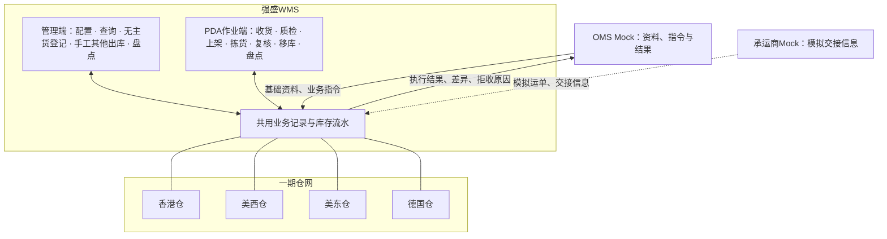
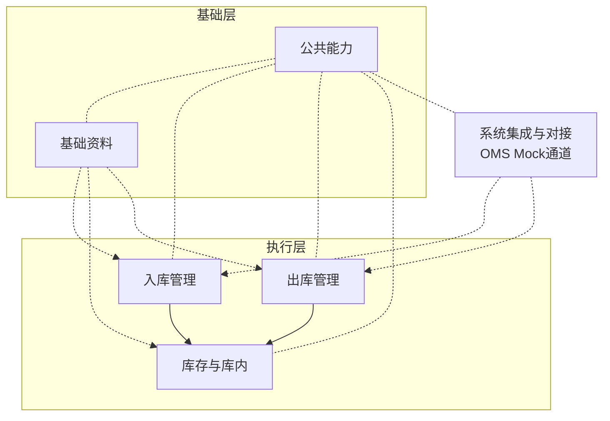

# 系统与模块地图

> 本文提供系统分工、模块功能、资料来源和管理端菜单索引，供研发与测试定位范围。
> 业务依据见[项目定位](../../../01-全局背景信息/01-项目定位与范围.md)、[需求分析总览](../../../03-需求调研和分析/00-项目总览/02-需求分析总览.md)与[业务蓝图](../../../04-业务分析和设计/00-业务蓝图.md)。应用设计各篇的维护职责见第六节。

| 版本 | 本次变化 | 状态 |
| --- | --- | --- |
| 2026-10-02 | 依据01-全局背景信息、03-需求调研和分析、04-业务分析和设计当前确认结论，由ERP参考结构改写为WMS口径；补使用端分工节，文档索引收齐04～06 | 应用设计初稿 |
| 2026-10-08 | 对齐当前规则与流程编号；补MVP入口，明确字段／页面缺口及维护职责 | 应用设计修订稿 |

## 版本与验收状态

当前为2026-10-08应用设计修订稿。已有文档、待补内容及验证状态统一见[本目录README](README.md#版本与验收状态)。

## 一、系统分工

强盛WMS是仓内执行系统：维护仓内位置与存放资格，承接上游推送的基础资料和入库、出库业务指令，用管理端和PDA记录现场作业，形成可回传、可追溯的库存与执行结果。业务决策在OMS与ERP、仓外运输在物流系统、核算在财务ERP，都不在这套系统内。

四仓是一期目标仓网／课程规划，不代表立项前已有自营实体仓；立项前由第三方海外仓履约，经营目标是先租仓自营、再拓展外部货主。外部系统的输入输出与阶段边界集中见[04-系统边界与上下游链路总览](04-系统边界与上下游链路总览.md)。

### 使用端与系统动作分工

一期就两个使用端；按「哪一步在哪个端发生」把动作收口，双端共用的动作写同一记录（COM-FR-004），详细机制见[05-全局机制与权限配置](05-全局机制与权限配置.md)：

| 类别 | 覆盖动作 | 说明 |
| --- | --- | --- |
| PDA作业端（现场） | 到货登记、收货、质检、上架、拣货、取消回库、复核打包、大货核对、移库、盘点实盘录入 | 现场作业默认在PDA，双端共用的结果与确认见下行；共用同一业务记录 |
| 管理端（后台） | 基础资料维护（仓库、库区货位、渠道、商品作业属性）、无主货登记、手工其他出库创建与确认、盘点创建与差异确认、波次创建、查询与追溯 | 组织、配置与确认端 |
| 系统自动（不依赖端） | 指令接收校验与建档、出库预占与释放、货位分配推荐、库存三量与流水、盘点快照生成、结果回传、送达状态 | 由合法指令或授权作业触发；库存增加不自动恢复缺货单，恢复入口见03第三节 |
| 双端共用（同一动作同一记录） | 收货完结确认、确认出库、质检结果记录 | 具体端选择随各单据页面设计确认；无论在哪端确认都是同一记录，不双计 |

## 二、WMS 模块与功能清单

入库和出库各自把作业事实交给库存，不另设中间汇总层；系统集成是OMS Mock交换的唯一通道（资料、指令、结果、异常），本身不产生业务事实。

| 模块 | 解决什么问题 | 功能入口 | 依据 |
| --- | --- | --- | --- |
| 基础资料（MD） | 识别货主、商品与位置，提供作业资格 | 上游资料接收；商品作业配置；仓库、库区货位、物流渠道；资料变更与停用校验。节点细节见01第1节 | MD-FR-001～011 |
| 入库管理（IN） | 记录实收、品质、落位和入库差异 | 正常／调拨入库；新品维护；作业容器收货与上架；分批实收；需检与免检品质记录；分批上架；无主货登记（认领待OMS上线）；收货完结；已收未上架丢失异常收口。流程见01第2～3节 | IN-FR-001～015 |
| 出库管理（OUT） | 组织预占、拣核、交接及剩余收口 | 六类出库；按类型准入预占；B2C基础波次；拣货与回库；已接收缺货单人工重试；复核与容器核对；确认出库；变更取消。流程见01第4节 | OUT-FR-001～014 |
| 库存与库内（INV） | 对应库存数量、品质和现场位置 | 多维库存与流水；占用与分配；移库；盘点；批次、效期与SN追溯。数量见02第4节，流程见01第5～7节 | INV-FR-001～008、INV-FR-010～011 |
| 系统集成与对接（INT） | 接收上游输入，交回结论与结果 | OMS Mock资料、指令、明细变更与出库取消；拒收可查；消息去重与顺序；结果送达与重交；承运商Mock。消息设计见06 | INT-FR-001～006 |
| 公共能力（COM） | 提供各模块共用能力 | 仓库数据范围与RBAC；中英文；存储、业务及展示时间；关键操作留痕；管理端与PDA共用记录。机制见05 | COM-FR-001～004 |

按模块归并的一级、二级菜单和期次见文末附录《管理端菜单基线》。功能点的一级、二级和菜单的一级、二级不是一回事：前者划范围，后者是导航展示。

## 三、模块依赖

| 模块 | 依赖谁 | 依赖什么 |
| --- | --- | --- |
| 基础资料 | 外部（OMS Mock） | 货主、商品身份及其更新 |
| 入库管理 | 基础资料、系统集成、库存与库内 | 有效的仓、货主、商品、货位资料；上游指令与结果回传；库存口径、流水与库存形成节点 |
| 出库管理 | 基础资料、库存与库内、系统集成 | 同入库，另加物流渠道与承运商Mock交接信息；缺量资格按类型的出库结果 |
| 库存与库内 | 基础资料 | 商品配置（品质、效期、SN、形态）、位置资料与货主占用 |
| 系统集成 | 基础资料、入库、出库、库存与库内 | 资料匹配资格、各段业务结果与操作记录 |
| 公共能力 | （被全部模块引用） | 仓库数据范围与RBAC角色配置 |

表中列的是业务依赖，不是技术调用顺序。执行与库存模块不反向改写上游资料身份；业务库存口径由INV需求维护，应用数量公式由本目录02展开，入库、出库引用；调拨两端分别落在入库、出库模块内，互不依赖。

## 四、资料流：谁提供、谁维护、谁使用

| 资料 | 提供或维护 | 更新约束 | 使用 |
| --- | --- | --- | --- |
| 货主 | OMS Mock推送，自营预置 | 身份标识不得静默改写；停用前校验实物与未完结业务 | 全部仓内业务与记录 |
| 商品 | OMS Mock提供身份；WMS补充仓内执行属性 | 关键变更留痕；业务单据引用快照；开关切换与停用按MD-FR-006／007校验 | 入库、出库、库存 |
| 仓库 | 系统预置四仓 | 一期不提供业务侧新增 | 全部 |
| 库区与货位 | 管理端维护，可系统预置 | 一货位一货主；有实物、入库过程量或未完结任务时不得停用 | 到货暂存、上架、拣货、移库、盘点 |
| 物流渠道 | 管理端维护 | 最小资料；一期不接真实生产服务 | 出库交接 |
| 库存与占用 | 只能由已确认业务事实和盘点调整产生 | 不提供直接改数；重复提交幂等 | 全部查询与后续作业 |
| 上游业务对象（指令） | OMS Mock推送 | 仓库、货主、业务类型身份不得原单改，允许节点内走取消后重下发 | 入库、出库执行 |
| 无主货登记记录 | 仓内登记到货与暂存线索 | 一期不确认认领、不建入库单或库存；OMS上线后推送信息供客户认领并下发指令 | 到货查询与后续OMS协作 |

## 五、本期范围

本期覆盖四仓同框架的收存发主链、六类出库、基础波次、无主货登记和库存处置；管理端与PDA共用记录，通过OMS Mock与承运商Mock演示协作。模块功能见第二节，菜单期次见附录。

范围取舍完整清单由[项目定位与范围](../../../01-全局背景信息/01-项目定位与范围.md)维护。本目录不增加客户退货、计费结算、跨仓主单与在途账、真实ERP／物流／设备接入、箱托库存、自动派工与产能、容量承重管理、指令或批量文件导入、审批流程。入库过程量不另建库存类型或“待质检／待上架”单据状态。

报损／销毁及报损后非库存暂存跟踪后置，不提供一期菜单、状态及确认权限。库存字段按库存明细、订单预占关系、库存锁定记录、库存流水、移库作业、盘点单维护；字段清单对象不等同于独立菜单。

## 六、文档索引与权威声明

本目录阅读顺序见 [README](README.md)。

| 文件 | 回答什么 |
| --- | --- |
| 本文 | 系统组成、模块功能、依赖、资料来源、使用端与菜单基线 |
| [01-系统流程与单据交互](01-系统流程与单据交互.md) | 链路中的角色、动作、单据交互与异常路径 |
| [02-实体对象关系](02-实体对象关系.md) | 对象、基数、数量公式、占用与分配、一致性约束 |
| [03-单据与状态流转](03-单据与状态流转.md) | 完整状态、允许操作、前置条件、校验与联动 |
| [04-系统边界与上下游链路总览](04-系统边界与上下游链路总览.md) | 外部系统、输入输出、一期模拟与后续接入边界 |
| [05-全局机制与权限配置](05-全局机制与权限配置.md) | 时间、语言、权限点、操作留痕与配置生效 |
| [06-接口与OMS Mock消息设计](06-接口与OMS Mock消息设计.md) | 消息身份与顺序、拒收、回执、结果送达与Mock形态 |

状态以03为维护位置，数量与对象以02为维护位置，权限以05为维护位置，消息交接以06为维护位置；流程与地图只保留节点所需摘要。业务依据与冲突处理遵循[资料分层约定](../../../04-业务分析和设计/AGENTS.md)。09原型用于展示实现或讨论交互，不能反向覆盖已确认设计。

### 详细设计输入

本目录已有应用架构草案；字段与页面详细设计的当前状态见[MVP入口](../README.md)。后续详细设计须引用本目录的对象、状态、数量、权限和消息语义。

| 设计域 | 可继续的内容 | 需要补充的输入 |
| --- | --- | --- |
| 入库 | 单据、品质记录、上架与丢失异常处理的页面与字段 | 检验项目、到货与损失依据样例 |
| 出库 | 六类单据、波次先拣后分、PDA与交接页面 | 包裹与箱托、交接凭证样例 |
| 库存 | 库存与流水查询、移库、盘点、处置页面 | 库存追溯及差异依据样例 |
| 协作 | 内置Mock收发台、消息字段、拒收与重交演示 | 按完整业务表单准备输入与结果样例 |
| 公共 | 按05第四节已确认的仓库主管关键确认权限与独立作业／常规收发权限起草配置和操作记录查询 | 演示账号与仓库授权样例；四仓业务时区在仓库资料中配置 |

研发交接前核对字段、状态操作与业务验收一致；本次文档检查不等于演示验收。

---

## 附录：管理端菜单基线

> 定位：管理端导航的基线。本表按一期范围和[原型资料](../../../09-产品原型/qs-wms-demo/README.md)拟定，菜单结构尚待页面设计确认。原型超出一期的入口仅作占位，不作为范围依据；本次未核验原型当前实现。PDA作业端是另一套导航（收货、质检、上架、拣货、复核、移库、盘点等），由PDA设计单独维护，不列在本表。
> 期次用“一期、后置（未排期）、不做”三档，与项目阶段口径一致，不使用原型自身的M0～M4里程碑号。

| 一级菜单 | 二级菜单 | 对应模块 | 期次 | 说明 |
| --- | --- | --- | --- | --- |
| 工作台 | 工作台 | — | 一期 | 演示聚合入口；不是需求模块，内容随演示范围裁剪 |
| 入库管理 | 入库单 | 入库 | 一期 | 正常入库、调拨入库共用，均由上游指令生成；分批收货进度可查 |
| 入库管理 | 收货记录 | 入库 | 一期 | 各次实收与差异事实；待认领、超收不在此记账 |
| 入库管理 | 上架任务 | 入库 | 一期 | 正常品／不良品上架任务与进度 |
| 入库管理 | 无主货登记 | 入库 | 一期（登记） | 记录到货、暂存与识别线索；面向OMS客户展示、认领及下发指令待OMS上线 |
| 库存管理 | 库存查询 | 库存与库内 | 一期 | 多视角查询，实际／预占／可用、品质、效期等级；下钻订单预占与锁定来源 |
| 库存管理 | 库存流水 | 库存与库内 | 一期 | 每次三量或品质变化，可点进关联单据 |
| 库存管理 | 移库作业 | 库存与库内 | 一期 | 作业记录及其流水，不增加独立移库单据层 |
| 库存管理 | 盘点单 | 库存与库内 | 一期 | 准备→快照→实盘→差异确认→结束；占用冲突中止重盘 |
| 出库管理 | 出库单 | 出库 | 一期 | 六类出库类型共用；手工其他出库入口在此按线下邮件建单 |
| 出库管理 | 波次管理 | 出库 | 一期 | B2C基础波次（同仓同货主）组织与进度 |
| 出库管理 | 出库交接 | 出库 | 一期 | 承运商Mock、司机、自提交接登记与凭证 |
| 系统集成 | 指令与结果 | 系统集成 | 一期 | OMS Mock收发记录、拒收原因、变更取消结论、送达状态；本表拟定项，随集成界面与06消息设计收敛 |
| 基础资料 | 货主 | 基础资料 | 一期 | OMS Mock推送；自营预置不可删 |
| 基础资料 | 商品 | 基础资料 | 一期 | 上游身份＋仓内作业属性配置 |
| 基础资料 | 仓库 | 基础资料 | 一期 | 预置四仓，一期不新增 |
| 基础资料 | 库区货位 | 基础资料 | 一期 | 五种库区类型；一货位一货主 |
| 基础资料 | 物流渠道 | 基础资料 | 一期 | 承运商与渠道最小资料 |
| 系统设置 | 用户与角色 | 公共能力 | 一期 | 仓库授权＋RBAC |
| 系统设置 | 操作记录 | 公共能力 | 一期 | 关键确认动作留痕查询（COM-FR-003） |
| 系统设置 | 系统参数 | 公共能力 | 后置 | 一期参数由技术配置维护 |
| 系统设置 | 消息与待办 | 公共能力 | 后置 | 一期不做 |
| — | 退货管理／退件单（原型占位） | — | 不做（一期） | 客户退货入库、退货质检属后续阶段；原型导航保留占位入口不作为范围依据 |
| — | 计费结算／费用流水／计费方案（原型占位） | — | 不做（一期） | 商业计费后续评估 |

菜单差异说明：

- 菜单顺序跟随原型动线：业务菜单在前（入库→库存→出库→集成），基础资料与系统设置在后；PDA端导航另由PDA设计维护。
- 原型的“退货管理”、“计费结算”两组是占位：一期不建设，导航中应标注不可用或不展示，以本表为准。
- 原型入库业务类型枚举中的“FBA退货”不是一期范围；入库类型收敛为正常入库、调拨入库；无主货登记不作为入库类型；枚举随应用设计与字段清单校订。
- 原型把“出库包裹（packages）”按B2C包裹建页；本表把菜单改称“出库单”，覆盖六类出库类型，包裹复核是B2C类型内的动作。
- 收货记录、上架任务与PDA作业共用同一业务记录，管理端菜单只是查询与组织入口，不形成第二套账。
- 维护方式：菜单增删先改本表，再同步09-产品原型的导航；模块范围变化回到正文“WMS模块与功能清单”和对应模块需求稿。
