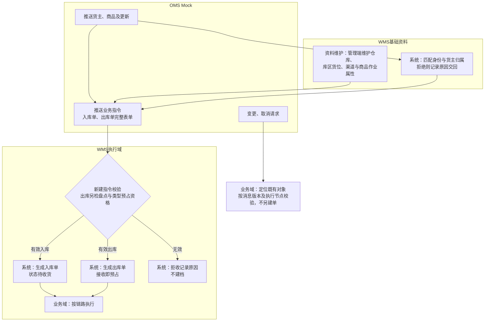
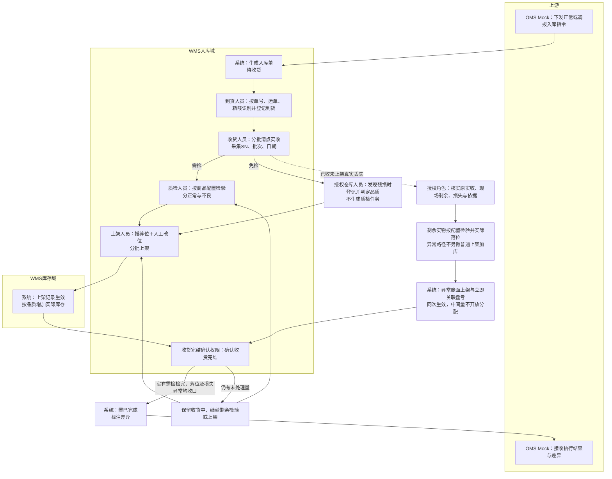
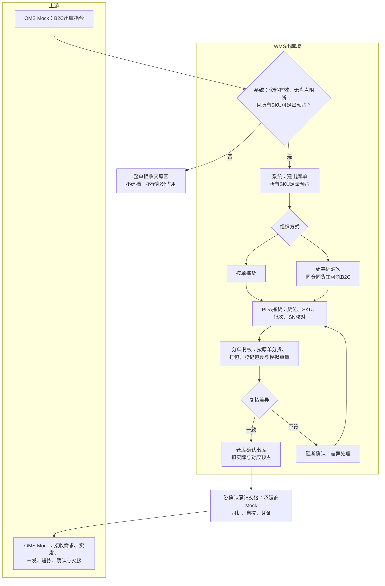
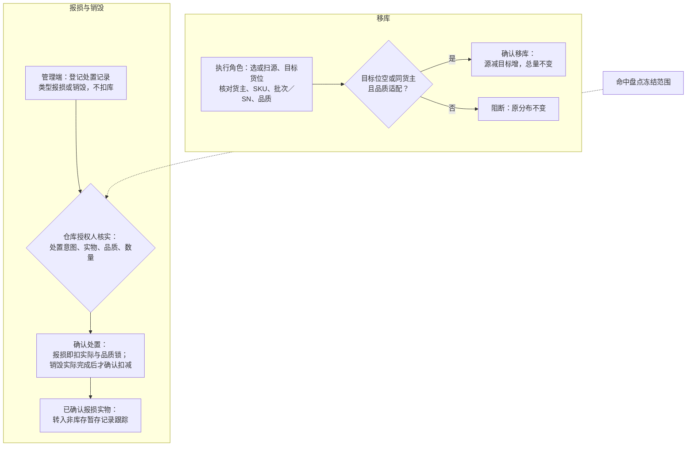
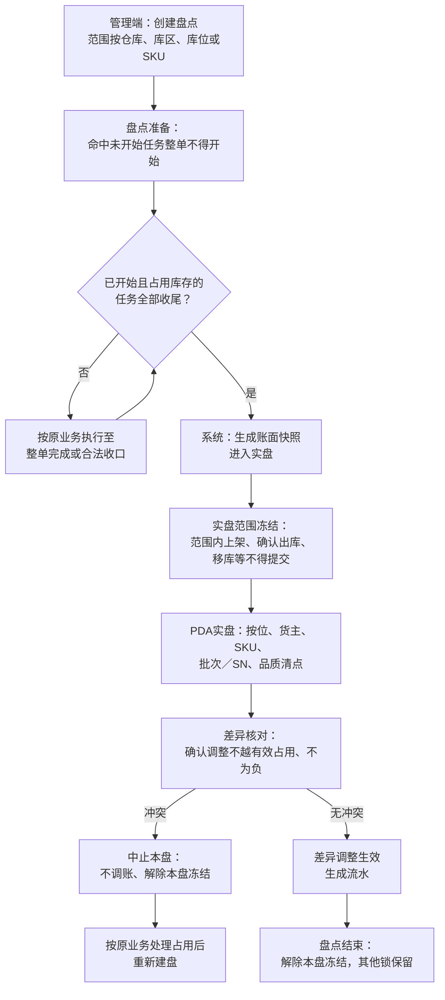

# 系统流程与单据交互

> 各链路**系统流程**（谁操作、对象与状态、端与 Mock）。字段见 `../字段清单合集`（骨架）；对象见 [02](02-实体对象关系.md)，状态全集见 [03](03-单据与状态流转.md)；规则见 [04 各域](../../../04-业务分析和设计/00-业务蓝图.md)。图：矩形为角色/系统+动作；标「系统」为自动动作。版本见 [00 版本与验收状态](00-系统与模块地图.md#版本与验收状态)。

## 0 执行端怎么读

流程表中的“谁”是业务角色，不是已指定岗位。使用端分工集中见[00第一节](00-系统与模块地图.md)，权限与留痕见[05第四～五节](05-全局机制与权限配置.md)。标“系统”的动作自动执行；双端提交同一动作共用记录、不重复生效。Mock采用管理端内置收发台，见[06第七节](06-接口与OMS Mock消息设计.md)。

## 1 资料准备与指令接收

业务单能不能建、建得对不对，取决于资料与身份预设。OMS Mock先提供身份资料，WMS再补仓内执行属性，指令按当前节点准入。

| 阶段 | 要点 | 状态与校验详表 |
| --- | --- | --- |
| OMS 身份资料 | 货主、商品推送与更新；身份标识稳定、冲突拒收 | [01 基础资料设计](../../../04-业务分析和设计/01-基础资料与业务准备设计.md)；消息形态 [06](06-接口与OMS Mock消息设计.md) |
| WMS 仓内配置 | 预置四仓、库区货位、渠道；商品形态/质检/SN/批次/效期 | 同上 §五～§七；效期三天数顺序见 MD 规则 |
| 业务指令准入 | 有效入库→待收货；有效出库→接收即预占；无效→拒收记录 | [03 §二 入库](03-单据与状态流转.md#二状态与操作入库单正常调拨共用认领记录同样进入本链)、[03 §三 出库](03-单据与状态流转.md#三状态与操作出库单六类共用差异另列)；盘点阻断与 B2C 足量拒收见 [04 边界§三](04-系统边界与上下游链路总览.md#三跨系统结果约定) |
| 变更与取消 | 定位既有对象，按节点接受或拒绝；不另建单 | [05 上游协作](../../../04-业务分析和设计/05-上游协作与结果交接设计.md) §二～§四；幂等与回执 [06](06-接口与OMS Mock消息设计.md) |

## 2 正常入库与调拨入库

正常入库和调拨入库是同一链路的两种业务类型：上游下发指令，本仓识别到货、分批实收、按配置质检、正常不良分别上架，差异如实交回。调拨入库只表达本仓事实，不提供调出仓单号、不核对调出端、不建两端关联。

| 阶段 | 要点 | 状态与校验详表 |
| --- | --- | --- |
| 指令～上架 | 混合到货分单；分批实收与效期准入；需检/免检残损分支；上架增实际库存 | [03 §二 入库单](03-单据与状态流转.md#二状态与操作入库单正常调拨共用认领记录同样进入本链)、[02 入库设计](../../../04-业务分析和设计/02-入库业务设计.md) |
| 丢失与完结 | 已收未上架真实丢失：异常结转+同次盘亏，不重复普通上架；收货完结转最终短少 | [02§8.4](../../../04-业务分析和设计/02-入库业务设计.md#84-模拟补充分支实收正确未上架真实丢失立即盘亏收口)；完结权限 [05§四](05-全局机制与权限配置.md#四权限点与默认角色矩阵) |
| 结果回传 | 检完、落位与损失均收口后已完成；差异分项可查 | 本节 §10；业务差异见 02 §七 |

普通上架以确认落位量增加库存；丢失分支见上图虚线。收货完结只关闭继续接收，不妨碍已收部分继续检验与上架。

## 3 无主件认领（唯一手工入库入口）

无法匹配指令且**无法判断货主**的到货：登记待认领 → 管理端确认归属 → 生成入库记录 → 走 §2。已知货主漏推单是补单，不走认领；混箱先线下拆清再分别认领。规则与边界见 [02§1.2 与 §认领相关节](../../../04-业务分析和设计/02-入库业务设计.md#12-业务入口与输出)；待认领状态见 [03 §二](03-单据与状态流转.md#二状态与操作入库单正常调拨共用认领记录同样进入本链)。

## 4 出库（六类）

六类出库共用骨架：**接单与预占 → 拣货分配 → 复核（按类型）→ 确认出库 → 结果回传**。状态、操作与类型差异以[03第三节](03-单据与状态流转.md#三状态与操作出库单六类共用差异另列)为准；业务规则与数量走查见[出库业务设计](../../../04-业务分析和设计/03-出库业务设计.md)。跨类型约定（盘点阻断整单拒收、B2C足量拒收、平台/B2B缺量一次结案、调拨/退回足量、不良品指定实物）见[04边界§三](04-系统边界与上下游链路总览.md#三跨系统结果约定)。

| 类型 | 本篇图示 | 详表与状态 |
| --- | --- | --- |
| B2C＋基础波次 | §4.1 | 03 §三 B2C 段 |
| 平台仓转运、当地B2B | — | 03 §三；缺量结案见 04 边界 |
| 调拨出库、退回出库 | — | 03 §三；退回引用原入库 |
| 不良品其他出库 | — | 03 §三；§4.4 摘要 |

### 4.1 B2C出库与基础波次

B2C所有SKU足量预占才接收，逐单复核、足量确认；基础波次采用先拣后分。逐单拣货通路保留，不增加播种墙、拣货车等设备能力。

| # | 谁 | 动作与对象 | 状态变化 | 触发与校验 | 异常与处理 |
| --- | --- | --- | --- | --- | --- |
| 1 | 系统 | 接收B2C出库指令并按本仓本货主SKU预占 | 出库单：— → 已预占；可用减、预占增 | 所有SKU足量预占才接收；接单不绑定货位 | 任一SKU不足或命中盘点阻断整单拒收，无单据、无部分占用，返回原因 |
| 2 | 仓库组织者 | 选择按单拣或手工组基础波次；B2B订单不能进波次 | 波次：— → 进行中 | 同仓、同货主、可拣状态的B2C单才能组波；波次不新增预占 | 成员未开始拣货可移出；取消未拣直接释放，已拣先回库核对后释放，波次进度同步 |
| 3 | PDA拣货 | 按建议货位、批次、SN取货；扫错阻断、建议位无货上报换位 | 拣货记录＋已拣未发暂存；拣出不扣库 | 分配是预占落点，换位解旧分新，SKU预占不变 | 存储区与拣货区均无货为整仓缺货：B2C不允许缺量，等上游取消或补货；取消前预占持续锁定 |
| 4 | 分单复核 | 把集中拣的货分回原出库单，逐单核SKU、批次、SN、数量并打包 | 不改库存三量 | 波次汇总量足够不能证明每个包裹正确 | 复核差异阻断确认；短拣归到具体单据处理，不从别的单挪量 |
| 5 | 确认出库权限（见[05§四](05-全局机制与权限配置.md#四权限点与默认角色矩阵)） | 足量确认出库；登记承运商Mock、司机、自提与凭证 | 执行中 → 已出库；扣实际与对应本单预占 | 承运商未揽收不阻止仓库确认；确认依据逐单复核 | 不足禁止确认（报错不扣库）；确认后不允许再取消或变更 |
| 6 | 系统 | 结果回传OMS Mock：需求、实发、未发（0）、短拣、确认出库、交接 | 送达状态可查 | 已出库事实只交一次，重交不重扣 | 送达失败只重交已有结果，不重做仓内动作 |

### 4.2 平台仓转运与当地B2B

可部分预占接单，按实发**一次结案**；未发量回传上游另发新单，原单不续发。已拣未发须先回库再结案。已接收缺货单在库存补齐后由有权限人员**人工**重试预占与分配（不自动恢复、不叠占），见[出库业务设计§9.6](../../../04-业务分析和设计/03-出库业务设计.md#96-模拟补充分支已接收缺货单补货后人工恢复)与[03 §三](03-单据与状态流转.md#三状态与操作出库单六类共用差异另列)。

### 4.3 调拨出库与退回出库

两类均**不允许缺量**确认出库；退回须引用原入库且不冲销原入库事实。调拨只交本仓结果，不建跨仓主单或在途账。流程节点与校验见 03 §三对应段落。

### 4.4 不良品其他出库

不走正常可用预占路径；上游通知或邮件手工来源，须指定在库不良品实物并**足量**确认。与报损／销毁互斥扣库。见[出库业务设计§八](../../../04-业务分析和设计/03-出库业务设计.md#八不良品其他出库的独立通路)与 03 §三。

## 7a 在库受损与品质转换

在库或拣货时发现非效期受损、或盘点冻结期间批次跨日过期转不良，走品质转换而非普通移库「改品质」。业务后果与数量见[库存业务设计第7.4节](../../../04-业务分析和设计/04-库存与库内业务设计.md#74-非效期受损与冻结期间过期的模拟走查)；权限见[05第四节约在库受损品质确认](05-全局机制与权限配置.md#四权限点与默认角色矩阵)。

| # | 谁 | 动作与对象 | 状态变化 | 触发与校验 | 异常与处理 |
| --- | --- | --- | --- | --- | --- |
| 1 | 现场／拣货 | 发现受损或系统判定过期转不良 | 停止该实物普通出库 | 转不良前不当作正常可发；过期自动转换保留位置与流水 | 不得借移库绕过转换 |
| 2 | 仓库主管（权限点） | 核实受损实物，确认转不良并通知货主 | 品质状态更新；锁定并集重算 | 与订单占用重叠时按并集计量，不重复累计 | 不得绕过实盘冻结（盘点例外见第9节） |
| 3 | 系统 | 写品质转换流水；订单／盘点等既有锁按规则保留 | 实际数量不变（过期转换）或按业务设计 | 详表与状态见[03第五节品质相关操作](03-单据与状态流转.md) | 已拣未确认须先回库再按品质处理 |

## 8 移库、报损与销毁（库内作业）

移库只改位置不改品质总量；报损／销毁是库存调减，经确认才扣账，实物退场不用出库单造扣减。

| 类型 | 要点 | 详表 |
| --- | --- | --- |
| 移库 | 源减目标增，总量与品质不变；已分配量不可直接移走 | [03 移库相关操作](03-单据与状态流转.md)、[04 库存设计 §移库](../../../04-业务分析和设计/04-库存与库内业务设计.md) |
| 报损／销毁 | 先登记待确认；报损确认即扣账，销毁以实际完成为扣账点；命中盘点冻结不得绕过 | 同上 §报损销毁 |

## 9 盘点

盘点范围冻结、按范围实盘，差异经确认才调账；有效占用冲突时中止本盘、不调账、重盘。

| 阶段 | 要点 | 详表 |
| --- | --- | --- |
| 准备～快照 | 范围内未开始任务阻断；已开始占用任务须收尾后再快照 | [03 盘点单](03-单据与状态流转.md)、[04 §盘点](../../../04-业务分析和设计/04-库存与库内业务设计.md) |
| 实盘～结案 | 范围内业务冻结；差异确认不越有效占用；冲突则中止本盘、解除冻结后重盘 | 同上；跨日过期转不良见 §7a |

## 10 结果交接与请求幂等

作业事实生效后形成单据累计、状态与可查结果，送达失败只重交已有结果。接受变更或取消的回执，与实际动作完成的结果分开；取消中不得当作已释放。入库异常交回原实收、现场剩余、实际落位、损失及相互关联的结转／盘亏，不用“全部实物上架”概括。

消息类别、顺序与请求结论统一见[06第一～四节](06-接口与OMS Mock消息设计.md)，结果送达与重交见该文第五节。手工其他出库只在WMS保留执行结果与线下依据，不伪造上游关联。
