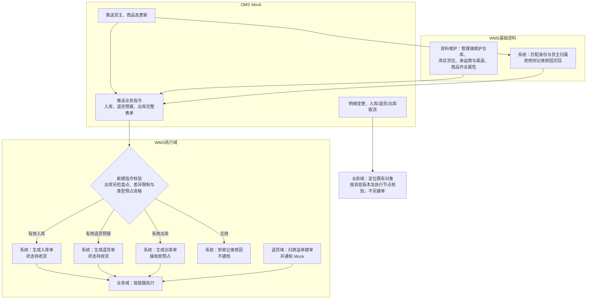
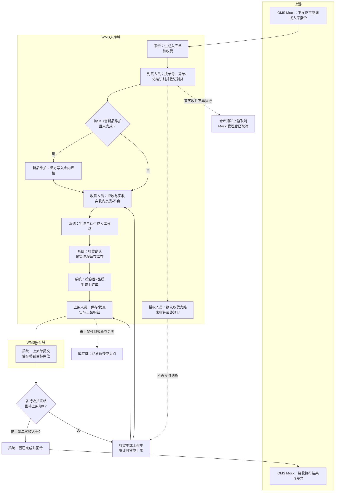
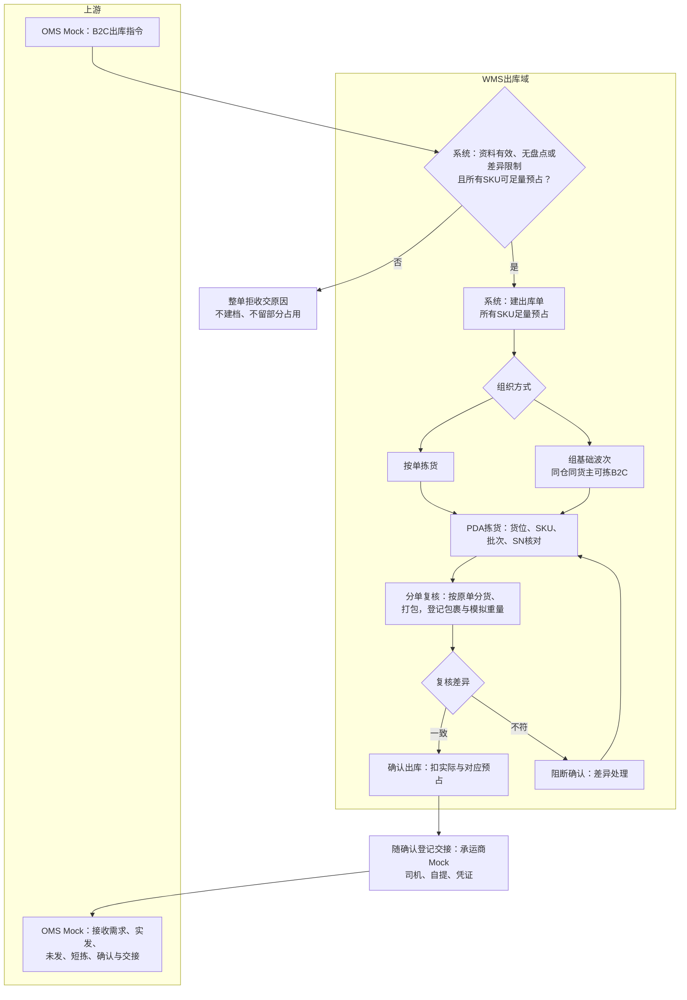
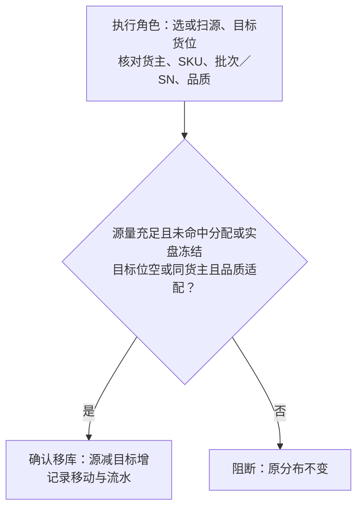
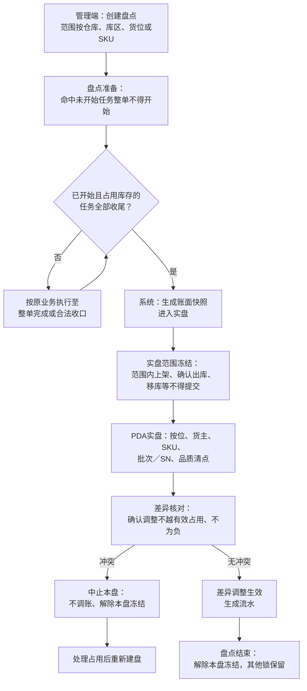

# 系统流程与单据交互

> 本文说明各链路由谁操作、经过哪些对象与状态。图中标「系统」的节点为自动动作；字段清单与页面说明仍待补。
> 对象与数量见本目录《实体对象关系》，状态与允许操作见《单据与状态流转》；业务场景与后果见业务设计各域。使用端分工见《系统与模块地图》。

| 版本 | 本次变化 | 状态 |
| --- | --- | --- |
| 2026-10-02 | 由 ERP 参考结构改写为 WMS 口径各链路流程图 | 应用设计初稿 |
| 2026-10-08 | 对齐免检残损、丢失异常、波次与取消分段释放等规则 | 应用设计修订稿 |
| 2026-10-11 | 补新品维护等链路；第八节交接收敛，细节以 03、06 为准 | 应用设计修订稿 |
| 2026-10-12 | 资料接收图与三之一退货链路 | 应用设计修订稿 |

## 阅读说明

流程表中的「谁」是业务角色，不是已指定岗位。标「系统」的动作自动执行；管理端与 PDA 对同一动作共用一条记录、不重复生效。Mock 与权限分别见《接口与 OMS Mock 消息设计》《全局机制与权限配置》。

## 一、资料准备与指令接收

业务单能不能建、建得对不对，取决于资料与身份预设。OMS Mock 先提供身份资料，WMS 再补仓内执行属性，指令按当前节点准入。一期不接真实 ERP 直连；自营业务指令同样经 Mock 演示。

| 阶段 | 要点 |
| --- | --- |
| OMS 身份资料 | 货主、商品推送与更新；身份标识稳定、冲突拒收 |
| WMS 仓内配置 | 预置四仓、库区货位、承运商与物流渠道；商品形态、质检、SN、批次、效期；效期相关天数顺序按商品与基础资料规则 |
| 业务指令准入 | 有效入库→待收货；有效退货预报→退货单待收货；派送失败可由退货域扫原运单建单并通知 Mock；有效出库→接收即预占；无效→拒收记录；盘点阻断、B2C 不足等整单拒收见《系统边界与上下游链路总览》跨系统约定 |
| 变更与取消 | 定位既有对象，按节点接受或拒绝，不另建单；入库/退货零实收可受理取消；请求结论与执行结果分开保存 |

## 二、正常入库与调拨入库

正常入库和调拨入库共用一条执行链，仅业务类型不同：上游下发指令，本仓识别到货、按行拒收与实收（实收内良品/不良）、收货确认进暂存库位库存、按容器×品质生成上架单并提交落位，差异如实交回。调拨入库只表达本仓事实，不提供调出仓单号、不核对调出端、不建两端关联。

**混合到货**：同一物理批次可能对应多张入库单（拼柜、多单同批到仓）。到货人员用单号、运单、箱唛等把实物归到对应指令，各单分别进入下文链路。能判断货主但上游尚未推单时，仓库线下联系补推指令，**系统不建待补单或疑问实物单据**；无法匹配且货主未知的实物走第三节无主货登记，不走本链。

**新品维护**：货主商品首次进入本仓网、尚无仓内实测规格时，须在该 SKU 本单首次收货提交前完成量方并写入仓内规格；未完成则阻断该 SKU 本行收货与上架，其他 SKU 不受影响。不直接增库存。

**作业容器**：可按配置选择按件收货，或按箱/托容器清点后再落到 SKU 实收；容器标识只服务作业与交接，不形成箱托库存。容器路径与按件路径共用实收与已收未上架口径，不得双计。

| 阶段 | 要点 |
| --- | --- |
| 指令～上架 | 混合到货分单；已知货主待补单仅线下；新品维护阻断本 SKU；拒收自动生成入库异常，超收一期线下；实收确认增暂存库存；累计实收＋拒收≤预计；上架单保存不动库存、提交移库 |
| 丢失与完结 | 暂存丢失：先按应上架量提交，再由库存域盘点盘亏，不回传入库丢失分项；零实收走上游取消转已取消；收货完结关闭继续接收，未收转为最终短少 |
| 结果回传 | 入库单**已完成时一次性**回传整单结果与差异分项；收货与上架过程不回传进度，见本文第八节与《接口与 OMS Mock 消息设计》 |

收货确认形成暂存库位库存；上架单提交形成目标库位库存。收货完结只关闭继续接收，不妨碍已收部分继续上架。

## 三、无主货登记与后续 OMS 认领

无法匹配指令且无法判断货主的到货，一期只登记仓库、暂存位置与实物识别线索（无主货登记，状态暂存中）。不生成入库单、实收或库存，管理端和 PDA 均无认领入口。已知货主但指令未到：仓库线下联系上游补推，WMS 不登记此类实物。

与退回本仓不同：无主货是「不知道归属」的暂存；客户退货、平台仓退件须退货预报，派送失败退回扫原 B2C 运单建退货单，均见下文「三之一」。

OMS 上线后的链路为：WMS 登记信息 → 推送给 OMS 客户查看 → 客户在 OMS 认领 → OMS 下发入库指令 → WMS 按第二节执行普通入库。认领及指令交接不由一期 Mock 代做。登记对象与状态见《单据与状态流转》无主货登记段。

## 三之一、退货（三类来源）

货从仓外退回本仓走**退货单**，不入库业务类型枚举。三类来源：派送失败退回（扫原出库运单建单并关联 B2C 出库单）、客户退货与平台仓退件（OMS Mock 退货预报）。收货（拒收＋实收内良品／不良）、暂存库位库存、按容器×品质生成上架单及提交规则与第二节入库链路一致；上架单对象共用，单头标明来源退货单。FBA 移除退仓一期不执行退货收货。

| 阶段 | 要点 |
| --- | --- |
| 预报或建单 | 预报类校验货主商品后生成待收货退货单；派送失败扫原运单带出原出库线索 |
| 收货～上架 | SN 按来源核对（派送失败强核对原出库复核）；拒收自动生成退货异常；结案一次性回传 |
| 无单 | 催补预报或无主货登记；不伪造入库指令 |

规则真源见[退货模块宏观系统架构](../../../01-全局背景信息/06-退货模块宏观系统架构.md)与《退货业务需求分析》；消息见《接口与 OMS Mock 消息设计》。

## 四、出库（六类）

六类出库共用骨架：**接单与预占 → 拣货分配 → 复核（按类型）→ 确认出库 → 结果回传**。类型差异（足量/缺量、能否进波次、能否部分预占）见《单据与状态流转》出库单段；数量走查见《出库业务设计》。跨类型边界（盘点阻断、B2C 足量拒收、平台/B2B 缺量一次结案、调拨/退回足量、不良品指定实物）见《系统边界与上下游链路总览》。

| 类型 | 本篇展开 | 复核形态（摘要） |
| --- | --- | --- |
| B2C 包裹履约 + 基础波次 | 4.1 图示与流程表 | 逐单分货、包裹复核与模拟称重 |
| 平台仓转运、当地 B2B | 4.2 | 按单摘果；箱/托容器核对与大货核对，容器只记作业不实盘库存 |
| 调拨出库、退回出库 | 4.3 | 按指令备货与数量核对；退回须引用原入库 |
| 不良品其他出库 | 4.4 | 指定在库不良品实物，足量确认 |

出库取消与返库上架见 4.5（各类出库共用，确认出库后不可取消）。

### 4.1 B2C 出库与基础波次

B2C 所有 SKU 足量预占才接收，逐单复核、足量确认；基础波次采用先拣后分。逐单拣货通路保留，不增加播种墙、拣货车等设备能力。

| 步骤 | 谁 | 动作与对象 | 状态变化 | 触发与校验 | 异常与处理 |
| --- | --- | --- | --- | --- | --- |
| 1 | 系统 | 接收 B2C 指令并按本仓本货主 SKU 预占 | 出库单→已预占；可用减、预占增 | 所有 SKU 足量才接收；接单不绑定货位 | 任一 SKU 不足、盘点或差异限制：整单拒收，无单据、无部分占用 |
| 2 | 仓库组织者 | 按单拣或手工组基础波次；非 B2C 不得进波次 | 波次→进行中 | 同仓、同货主、可拣 B2C；波次不新增预占 | 成员未开始拣货可移出；取消时未拣释放，已拣按第4.5节实际返库或损失收口 |
| 3 | PDA 拣货 | 按建议货位、批次、SN 取货；错扫阻断、无货可换位 | 拣货记录与已拣未发暂存；拣出不扣库 | 换位解旧分新，SKU 预占不变 | 执行中拣货区/存储区仍无货：保留缺货标记，补货后人工重试或上游取消 |
| 4 | 分单复核 | 集中拣货后按原单分货，核 SKU、批次、SN、数量并打包 | 不改库存三量 | 波次总量对不能替代逐单正确 | 差异阻断确认；短拣归原单，不挪用他单实物 |
| 5 | 确认出库权限 | 足量确认；登记承运商 Mock、司机、自提与凭证 | 执行中→已出库；扣实际与本单预占 | 承运商未揽收不阻止仓内确认 | 不足禁止确认；确认后不可取消或改需求；可新增关联交接记录，不再次扣库 |
| 6 | 系统 | 回传需求、实发、未发、短拣、确认与交接 | 送达状态可查 | 已出库事实只交一次 | 送达失败只重交已有结果，不重做仓内动作 |

### 4.2 平台仓转运与当地 B2B

可部分预占接单。至少一项明细实发大于 0 才可按实发一次结案；零实发继续等待或合法取消。未发量回传上游，由上游另发新单，原单不续发。已拣未发须先返库上架再结案。

拣货后按单做箱/托容器核对或大货核对（与管理端/PDA 分工随页面定），记录作业容器与实发数量，不建立箱托库存。已接收缺货单在库存补齐后由授权人员**人工**重试预占与分配，不自动恢复、不叠占。

### 4.3 调拨出库与退回出库

两类均**不允许缺量**确认出库。调拨出库只交本仓调出结果，不建跨仓主单或在途账。

**退回出库**指向已收货物按上游新指令从本仓退回仓外，与退回本仓（退货模块）方向相反。须引用有效原入库及拟退回品的库存来源；拟退回正常品须已按配置完成必要质检与上架并形成实际库存。原入库的实收、上架与流水不冲销。流程节点与校验见《单据与状态流转》对应类型说明。

### 4.4 不良品其他出库

不走正常可用预占路径。来源为上游通知，或仓库依据线下邮件在管理端手工创建。须指定在库不良品实物并**足量**确认出库；同一指定实物只扣减一次，其余不良品锁定保留。结果可仓内查询，邮件来源保留依据，不伪造上游指令关联。

### 4.5 出库取消与返库上架（六类共用）

上游发出库取消或明细变更后，系统先按节点给出接受或拒绝结论，再驱动物理收口；回执不等于实物已返库或占用已释放。

```mermaid
flowchart TB
    R[上游：出库取消或明细变更] --> V{执行节点是否允许？}
    V -->|拒绝| J[记录拒绝原因<br/>保持原需求与原占用]
    V -->|未开始拣货且接受取消| L[释放预占<br/>出库单→已取消]
    V -->|已开始拣货且接受取消| K[出库单→取消中<br/>禁止继续拣货/确认出库]
    K --> H[实际找到部分：返库上架后释放对应占用]
    K --> X[真实丢失部分：主管确认<br/>关联盘亏与占用释放同次生效]
    H --> Z{未拣、返库与损失对应占用均已收口？}
    X --> Z
    Z -->|是| F[出库单置已取消]
```

未拣部分接受取消时直接释放预占。实际找到的已拣部分核对身份、数量与位置并返库上架后释放；真实丢失部分由仓库主管确认，关联盘亏与对应占用释放同时生效，不伪造返库。各部分均收口后才完成取消。损失处理不要求先完成常规盘点，但实盘冻结时须等待结束或中止本盘后处理，同一损失不得重复盘亏。取消中不得当作已全部释放。任何类型在**确认出库之后**不得取消；撤销须走上游其他业务，不回写已出库事实。波次成员退出规则与上表 4.1 步骤 2 一致。

### 4.6 发现账实差异后的新单限制

短拣、换位或盘点发现疑似短少时，登记原业务、位置和依据，立即限制受影响仓库＋货主＋SKU的新出库接单，交仓库主管跟进。上游及手工其他出库均校验；解除条件见《单据与状态流转》出库段。已有订单按原规则处理，发现差异不直接改数或重复锁量。

## 五、在库受损与品质转换

非效期受损由仓库主管核实后确认转不良；在库跨日过期由系统自动转不良。两者都不改变实际数量，均保留原位置、批次/SN、订单关联及转换流水，锁定按并集重算。

| 触发 | 谁执行 | 校验与联动 |
| --- | --- | --- |
| 在库或拣货时发现非效期受损 | 现场停止该实物普通出库；具备权限及本仓授权的仓库主管核实并通知货主 | 不得绕过实盘冻结；原单取消或缺量结案时，已拣受损件先回适配位置再释放订单占用，品质锁保留 |
| 当地业务日期变化后批次过期 | 系统立即转不良 | 实盘冻结的例外；数量与位置不变，保留转换原因 |

## 六、移库（库内作业）

移库只改位置，不改仓库、货主、品质及三量合计。

独立报损/销毁及报损后非库存暂存跟踪后置。

## 七、盘点

盘点按范围冻结、实盘，差异经确认才调账；与有效占用冲突时中止本盘、不调账、重盘。

跨日过期转不良见第五节（实盘冻结例外）。盘点准备中的任务因已拣损失无法收尾时，可保留原因中止本盘，处理损失后重新建盘。中止仅解除本盘冻结，不解除差异新单限制。

## 八、结果交接（摘要）

仓内作业形成的事实与状态见上文各节；**何时可交、交什么**见《单据与状态流转》第十节；**消息怎么认、怎么拒、怎么重交**见《接口与 OMS Mock 消息设计》。协作业务分工见业务设计《上游协作与结果交接设计》。

本篇只保留流程侧口径：入库仅在整单已完成时形成可交接的整单结果（一次回传）；出库等按各篇约定；送达失败只重交已有结果，不重做仓内动作；入库结果须分项交清实收、落位与各类差异，不可用「全部已上架」概括。

更多文稿索引见本目录 [README](README.md)。
