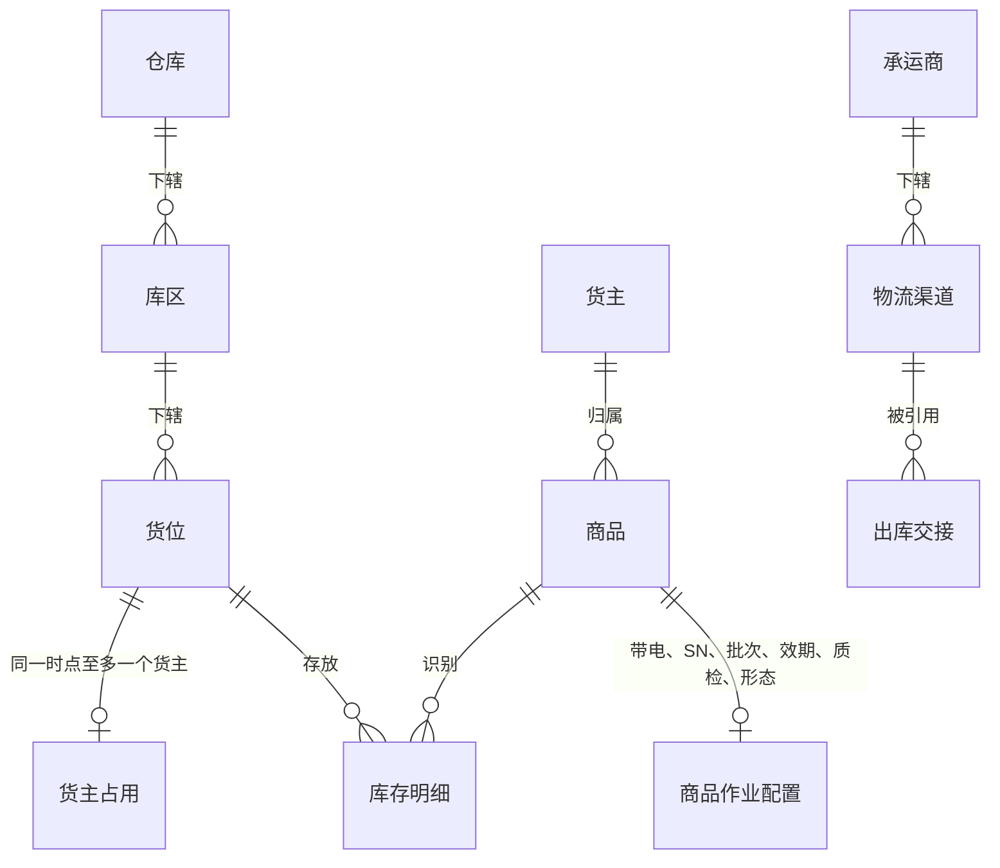
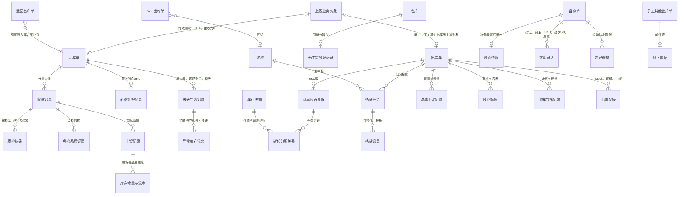

# 实体对象关系

> 本文维护对象关系、数量公式与一致性约束，供研发设计数据关系、测试核对数量与追溯。
> 对象按上游业务对象、WMS 执行单据、作业任务与事实记录组织；任务与事实挂靠所属业务，不另建执行单据，波次用于组织 B2C 拣货。完整状态与操作见《单据与状态流转》，流程见《系统流程与单据交互》。
> 对象为应用设计草案；字段与展示名在字段清单与页面设计中细化，表结构与接口协议由技术设计确定。进度见同版本「字段清单合集」与本目录 README。

| 版本 | 本次变化 | 状态 |
| --- | --- | --- |
| 2026-10-02 | 由 ERP 参考结构改写为 WMS 口径：对象重列、数量按入库／出库／库存三段重写 | 应用设计初稿 |
| 2026-10-08 | 分开预占与分配，修正到货方式及盘点增减 | 历史修订记录 |
| 2026-10-09 | 库存相关字段收敛为 6 个对象；报损／销毁及报损后非库存暂存跟踪整体后置 | 应用设计修订稿 |
| 2026-10-11 | 与字段清单对象对齐；索引收敛至 README | 应用设计修订稿 |

## 一、对象清单

下表为架构层对象枚举；与字段清单「一个对象一份初稿」大体对应，合并行处见括号说明。

| 对象 | 层 | 识别口径（唯一性） | 业务阶段（摘要；完整状态见《单据与状态流转》） |
| --- | --- | --- | --- |
| 货主 | 主数据 | 货主编码唯一；自营预置不可删 | 建立（OMS Mock 推送）→ 启用／停用 |
| 商品 | 主数据 | 货主内商品编码唯一；同编码可属不同货主 | 建立 → 配置补齐 → 停用；有库存或作业已开始时禁切追溯开关 |
| 仓库 | 主数据（预置） | 仓库编码唯一 | 一期固定四仓，不新增 |
| 库区 | 主数据 | 所属仓库内编码唯一 | 建立 → 启用／停用 |
| 货位 | 主数据 | 编码唯一，归属唯一库区（据此定位仓库） | 建立 → 启用／被占用 → 停用（占用清零后） |
| 承运商 | 主数据 | 承运商编码唯一 | 建立 → 启用／停用 |
| 物流渠道 | 主数据 | 渠道编码唯一；归属唯一承运商 | 建立 → 启用／停用 |
| 上游业务对象（入库／出库指令） | 上游证据 | 来源＋业务类型＋上游指令号 | 新建 →（合法变更 → 取消）；消息结论逐条留痕 |
| 上游消息记录 | 交互记录 | 来源＋消息标识去重；预期对象版本校验顺序见《接口与 OMS Mock 消息设计》 | 原输入与原结论保留；重复及冲突接收另留尝试明细 |
| 回传记录 | 交互记录 | 固定结果序号关联原消息／事实；发送尝试挂本结果 | 待发送 → 待重试／已送达；重交不重做业务 |
| 用户 | 账号与授权配置 | 用户标识唯一；角色关系及仓库授权挂用户 | 配置细节见公共能力字段清单 |
| 角色 | 权限配置 | 角色标识唯一；菜单与动作授权挂角色 | 默认组合见《全局机制与权限配置》 |
| 操作记录 | 事实记录 | 操作记录号唯一，关联原对象与实际结果 | 系统留痕，只读查询，不复制库存账 |
| 入库单 | 执行单据 | 单号唯一 | 待收货 → 收货中（分批）→ 已完成；零实收保留待收货，入库取消待 OMS 上线 |
| 出库单 | 执行单据 | 单号唯一；业务类型区分六类 | 已预占 → 执行中 →（取消中）→ 已出库／已取消 |
| 波次 | 组织对象 | 波次号唯一；只含同仓同货主可拣 B2C 单 | 汇总拣货、先拣后分；成员分别复核确认 |
| 盘点单 | 执行单据 | 盘点号唯一 | 准备中 → 实盘中 → 已结束；占用冲突中止重盘 |
| 无主货登记记录 | 到货信息（尚无入库指令） | 登记号唯一，保留仓库、位置与识别线索 | 一期仅「已登记」，等待 OMS 认领，不流转为已认领 |
| 新品维护记录 | 入库过程记录（挂入库单明细） | 关联货主商品与本次到货/收货上下文 | 量方结果写入商品仓内规格；阻断该 SKU 首次收货，不增库存 |
| 质检任务、上架任务 | 作业任务（挂入库单） | 任务号唯一 | 分批执行；未执行量随原单合法结束关闭 |
| 拣货任务、移库作业 | 作业任务（挂出库单或波次／库存管理） | 任务号唯一 | 拣货随原单收口；移库记录源目标变化 |
| 收货记录 | 事实记录（挂入库单） | 每次实收一条；承载累计实收 R | 写入即事实；超收与效期拒收不入 R |
| 免检品质／残损记录 | 事实记录（挂实收） | 记录号及原实收明细 | 正常／不良判定，不生成质检任务 |
| 已收未上架丢失异常记录 | 事实与异常依据（挂入库） | 记录号＋原实收及损失身份 | 核实后关联异常账面上架与立即盘亏，缺失件不造现场事实 |
| 拣货记录、返库上架记录 | 事实记录（挂出库单） | 每次拣出或返库一条 | 含换位、短拣；拣出不扣库，确认出库时扣库 |
| 装箱结果 | 事实记录（挂出库单） | 按复核/装箱动作留痕 | B2C 包裹或平台仓箱托核对；还原 SKU 件数，不建箱托库存 |
| 出库异常记录 | 事实记录（挂出库单） | 接单缺货与现场短拣等分别留痕 | 不得相加冒充未发或掩盖预占 |
| 出库交接 | 事实记录（挂出库单） | 随确认出库登记或后补关联 | 承运商 Mock、司机、自提与凭证；可后挂不二次扣库 |
| 作业事实（其余） | 事实记录 | 质检结果、实际落位、货位分配、确认出库等 | 分别留痕，不覆盖既有事实；一期不提供往回改 |
| 库存明细 | 数量事实 | 仓库＋货主＋SKU＋货位＋批次＋SN＋品质 | 随已确认业务事实与盘点调整变化 |
| 库存流水 | 事实记录 | 流水号唯一；同次库存影响按变化明细关联 | 已确认事实生成，保留变化前后与来源；不手工编辑 |
| 批次 | 数量维度 | 货主＋SKU 内批次号；同批可存多位 | 收货建立，沿流转保留 |
| SN | 数量维度 | 货主＋SKU＋SN，四仓共用判断 | 收货起逐件轨迹 |
| 箱、托 | 作业容器 | 标识只进作业明细与交接/装箱记录 | 使用 → 交出；不形成库存对象 |
| 订单预占关系 | 数量关系（挂出库单明细） | 出库明细＋仓库＋货主＋SKU；接单时不含货位 | 类型准入后建立，恢复只补缺口；出库或合法取消释放 |
| 货位分配关系 | 任务与库存明细的关系 | 原订单预占＋任务明细＋货位／批次／SN | 在订单预占内分配，换位解旧分新，不另增预占 |
| 库存锁定记录 | 数量关系 | 盘点、品质、不良品其他出库指定占用等 | 与订单占用对同一实物取并集，解一个原因不解其他 |

「业务阶段」列仅供快速识别；系统状态字段与完整枚举以《单据与状态流转》为准。SN 轨迹展示在库存查询与字段清单中细化，枚举不得覆盖真实丢失或已退出库存的事实。

基础资料字段按货主、商品、仓库、库区、货位、承运商、物流渠道维护；商品作业配置挂商品。集成按上游消息记录、回传记录维护。公共能力按用户、角色、操作记录维护。字段初稿按模块分布在「字段清单合集」，不为此另增执行单据层。

## 二、主数据之间的关系

- 一货位一货主：占用判断不只看库存余额，还包括入库过程实物、已确认出库待交接实物与未完结任务；全部清零后可换货主。
- 每个商品只属于一个货主；自营与外部货主资料结构相同，不因自营而合并归属。
- 未知货主的到货使用专门无主货暂存位置，不并入任何货主；认领前不产生货主库存。

## 三、单据与事实的关系

图中「B2C 出库单」「退回出库单」等仅为关系示意，执行层仍是一张出库单按业务类型区分。

一期全部入库单均有上游指令；无主货登记不生成入库单。OMS 上线后认领产生的指令可关联原登记再按普通入库执行。盘点准备时没有快照，实盘后有唯一快照。到货登记、混合到货分单在流程层区分指令，对象层以入库单与收货记录承载。

三条读法：**指令建单**——有效新建指令对应一张执行单据，重复消息返回已有结论；**一单多事实**——入库分批收货、多次质检与上架，出库多次拣货与返库上架，事实相加得累计；**可选关联**——退回引用原入库、B2C 可选入波次、手工其他出库保留线下依据。订单预占在 SKU 层，再生成货位分配；分配不是第二份订单占用。

## 四、数量在对象之间怎么流动

需求、实收和订单预占按单据商品明细累计；实际库存及现场作业按必要追溯维度（货位、批次、SN、品质）记录。接单预占不提前绑定货位，不同单位不相加。

### 入库侧

下表为未发生已收损失的常规公式；真实丢失按表后异常口径计算，不能套用 R＝T＋N＋B 或用账面结转冒充现场落位。按容器收货时，容器明细还原为 SKU 实收，与按件路径共用 R、U 口径，不得双计。

| 数量 | 落在哪 | 怎么变 |
| --- | --- | --- |
| 预计数量 E | 入库单明细 | 接收时按指令建档；未实收时可接受合法明细变更，实收后不变 |
| 累计实收 R | 收货记录 | 每次有效实收求和；超收和效期拒收不入 R |
| 未收数量 | 明细 | E−R；收货完结前表达剩余接收，不是损失 |
| 最终短少 | 明细（完结后） | E−R；收货完结确认时定型 |
| 未检 T | 已收需检实物 | 收货时进入，检验后移出 |
| 正常 N／不良 B | 需检结果或免检品质记录 | 同一组实收满足 R＝T＋N＋B；免检残损直接登记；品质分流不改变 R |
| 已上架 PN／PB | 上架记录 | 累计；PN≤N、PB≤B；所需质检未完的部分不能上架 |
| 已收货未上架 U | 明细进度 | U＝R−PN−PB；不另设待质检、待上架状态 |
| 累计上架 P | 来源累计 | P＝PN＋PB；一次上架 U 减多少，同次库存增量就是多少 |
| 超收／拒收 | 差异事实与暂存线索 | 不入 R、不入库存；超收补新单后在新单收货 |

### 已收未上架真实丢失的特殊口径

原实收 R 保留。实际正常落位 PN、实际不良落位 PB、已完成异常收口的损失 L、尚待处理量 U 分别记录：R＝PN＋PB＋L＋U。未完成异常收口的损失仍在尚待处理中；缺失件不生成检验、落位或 SN 扫描事实。

异常记录分别关联实际落位、异常账面上架增量 Q 与立即盘亏量 D。对本次尚未入账部分，Q−D 等于本次实际落位的净增量；Q 与 D 同次生效，中间账面量不可用于新单预占。完整时间线见《入库业务设计》已收未上架丢失走查案例。

### 出库侧

| 数量 | 落在哪 | 怎么变 |
| --- | --- | --- |
| 需求量 | 出库单明细 | 接收时建档；未开始拣货的合法变更一次性重算，开始后不静默改 |
| 本单预占 | 订单预占关系（SKU 级） | B2C 全 SKU 足量才接收，其余按 min（需求、可用）接收；盘点阻断整单拒收；人工重试只补未占足缺口；取消、实发、缺量结案时减少 |
| 指定实物处置占用 | 不良品其他出库与库存明细 | 指定在库不良品实物，不从正常可用量计算；原品质锁保留，按并集计量 |
| 货位分配 | 任务明细与库存明细 | 合计不超本单有效预占；换位解旧分新；同一分配不得复用给其他任务 |
| 累计拣出／累计返库上架 | 拣货记录、返库上架记录 | 每次动作分别记录 |
| 已拣未发 | 计算 | 累计拣出−累计返库上架−累计实发 |
| 实发 | 确认出库 | 仓库确认时形成；同时扣实际与本单预占 |
| 未发量 | 结案记录 | 平台仓、B2B 结案时＝需求−实发；一次结案后不续发 |
| 缺货／短拣 | 出库异常记录 | 接单不足与现场拣不足分别记录，不得相加冒充未发 |

扣库发生在**确认出库**；交接信息可随确认登记或后补关联记录，不再次扣库。

### 库存侧

| 数量 | 公式与约束 |
| --- | --- |
| 实际库存 | ＝预占库存＋可用库存；上架或异常收口增，确认出库减，盘点按确认差异增减；已确认出库待揽收实物不计实际，已拣未发仍按作业进度与锁定规则处理 |
| 预占库存 | 即锁定数量，含订单占用、盘点冻结、品质锁定、处置占用；对同一实物取并集，不超实际库存 |
| 锁定合计 | 并集计量；同一件多原因仍按一份实物计锁 |
| 可用库存 | ＝实际−锁定合计；不为负；导致负数的操作阻断 |
| 品质状态 | 正常／不良，与三量分开；过期自动转不良、数量不变 |
| 效期阈值 | 允许入库天数≥临期天数≥过期天数；收货按剩余保质期与仓库当地日期判断 |

本节是本目录**数量口径**的维护位置。业务运行解释见业务设计中的入库、出库、库存与库内域。库存流水类型包括：正常/不良上架、品质转换、移库、盘点调整、确认出库扣减、预占与释放、异常账面上架与关联盘亏等；异常流水不得冒充普通落位。

## 五、单据引用哪些资料

| 单据或记录 | 引用 | 说明 |
| --- | --- | --- |
| 入库单 | 仓库、货主、商品明细、业务类型、到货方式及上游指令号 | 均引用上游指令；认领后可关联原无主货登记；调拨入库不要求调出仓信息 |
| 收货、质检、上架 | 入库单明细＋SN、批次、日期、品质、货位 | 采集随商品配置；收货记录承载 R |
| 新品维护 | 货主商品、入库上下文、实测规格 | 写入商品仓内规格，不增库存 |
| 出库单 | 仓库、货主、商品明细、业务类型、上游指令或邮件依据 | 退回另引用原入库；手工其他出库保留线下依据 |
| 拣货、返库、装箱、交接 | 出库单明细＋货位、批次/SN、容器、交接对象 | 容器与装箱还原 SKU 件数 |
| 丢失异常 | 原入库及实收、现场剩余、损失依据、Q/D 流水 | 不以其他出库代替丢失收口 |
| 波次 | 成员 B2C 出库单 | 只同仓同货主 |
| 盘点单 | 范围＋快照、实盘、差异依据 | 快照含归属、位置、品质 |
| 库存明细 | 仓库、货主、SKU、货位、批次、SN、品质 | 全部变化经流水 |

## 六、追溯路径

| 从哪里 | 能追问到什么 |
| --- | --- |
| 库存流水 | 关联单据 → 作业事实 → 来源依据；上游指令或邮件按实际来源关联 |
| 确认出库、短拣与差异 | 单明细、拣货与返库轨迹、装箱与异常、变更与结案 |
| 出库单（退回） | 原入库单；原入库实收、上架与流水不冲销 |
| SN 轨迹 | 收货 → 质检或免检品质 → 上架 → 移库 → 拣货 → 返库 → 确认出库（只记实际环节） |
| 无主货登记 | 一期追到货到、暂存与线索；OMS 上线后追到认领与指令 |
| 盘点单 | 快照、实盘、差异流水与本盘冻结期 |
| 已收损失异常 | 原实收 → 核实与现场剩余 → 实际落位 → Q/D 结转 |
| 上游消息 | 请求结论、原因与送达状态 |

## 七、一致性约束

- 一货位一货主：判断含实际库存、入库过程实物、已确认出库待交接实物与未完结任务；换货主前全部清零。
- 身份不可原单改写：仓库、货主、业务类型须取消后重下发；上游资料身份不得被 WMS 静默改写；业务单据引用资料快照。
- 不重复记账：重发、重复提交、重复确认返回已有结果；上架、扣库、锁定每次只生效一次；其他出库与真实盘亏对同一数量不得重复扣减。
- 锁定并集：订单、盘点、品质、处置原因分别留痕；解一个原因不自动解其他；锁定合计不超过实际库存。
- 不允许负库存：扣库、移库、盘点调整提交时校验；不跨仓借量。
- 事实不回写：确认出库后不撤销；实收后入库不可取消；一期不提供实收误记更正入口。
- 无主货不形成库存：未收到有效入库指令前不得实收、上架、出库或计入实盘。

## 八、对象的形态与边界

- **上游业务对象不是 WMS 单据**：拒收无执行单据，只有拒收记录。
- **单据与事实不同层**：单据承载需求与累计，事实承载每次动作；汇总由事实相加。
- **任务与记录**：任务组织「要做的事」，记录保存「已发生的动作」；质检/上架/拣货均按此分层。
- **波次是组织不是量**：组波不新增预占、不改需求；成员单分别确认出库。
- **已收货未上架是进度**：由 U 表达，不另设待质检/待上架库存类型。
- **箱托不是库存**：只进作业、装箱与交接记录。
- **待认领不是货主**：认领前只留仓库与位置事实。
- **一期库存域六个字段对象**：库存明细、订单预占关系、库存锁定记录、库存流水、移库作业、盘点单。货位分配挂在拣货任务分配明细。报损/销毁等后置对象见《系统边界与上下游链路总览》；已收未上架丢失按上文异常口径在一期收口。

更多文稿索引见本目录 [README](README.md)；业务走查案例见业务设计入库、出库、库存与库内域。
