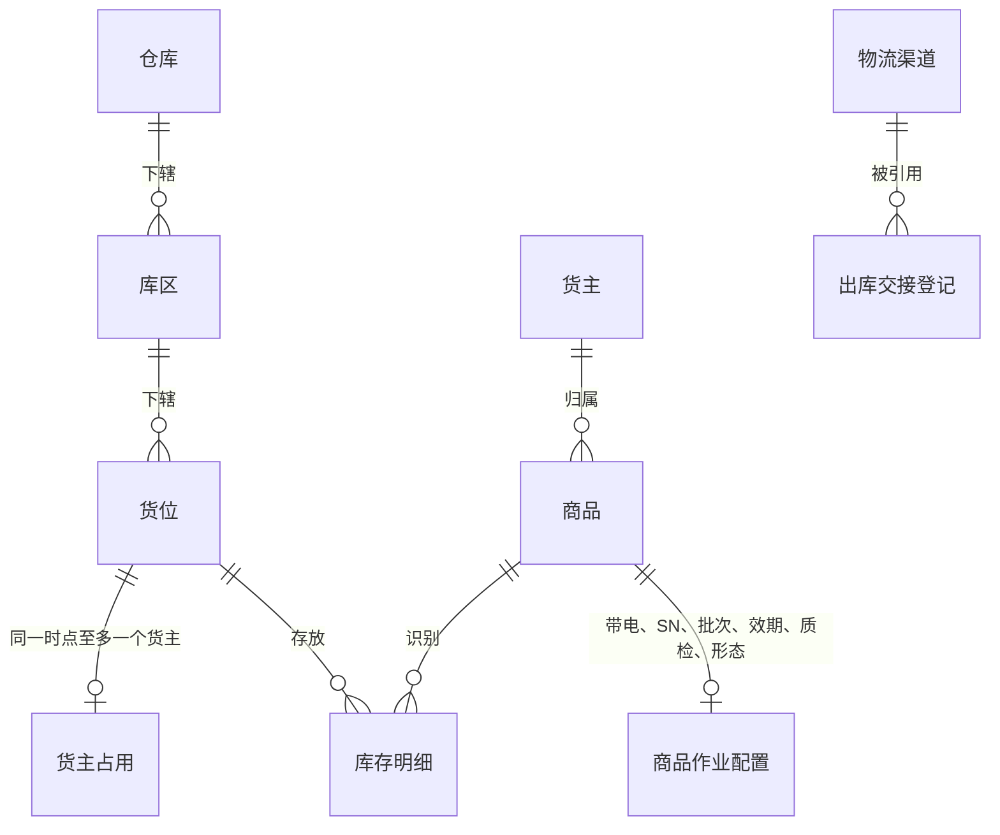
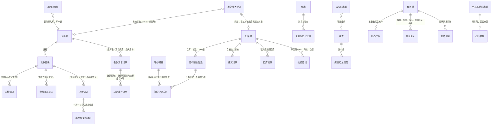

# 实体对象关系

> 本文维护对象关系、数量公式与一致性约束，供研发设计数据关系、测试核对数量与追溯。
> 对象按上游业务对象、WMS执行单据、作业任务与事实记录组织；任务与事实挂靠所属业务，不另建执行单据，波次用于组织B2C拣货。状态与操作见[03](03-单据与状态流转.md)，字段与页面详细设计状态见[MVP入口](../README.md)。
> 对象关系为应用设计草案；字段与展示名在字段清单、页面设计中细化，表结构与接口协议由技术设计确定。

| 版本 | 本次变化 | 状态 |
| --- | --- | --- |
| 2026-10-02 | 由ERP参考结构改写为WMS口径：对象重列、数量关系按入库／出库／库存三段重写 | 应用设计初稿 |
| 2026-10-08 | 分开预占与分配，补损失和非库存暂存关联；修正类型／到货方式及盘点增减 | 历史修订记录；当前范围以下一行及正文为准 |
| 2026-10-09 | 库存字段收敛为6个对象；报损／销毁与报损后非库存暂存跟踪后置 | 应用设计修订稿；[验收状态](00-系统与模块地图.md#版本与验收状态) |

## 一、对象清单

| 对象 | 层 | 识别口径（唯一性） | 业务阶段（摘要示意，完整状态见《单据与状态流转》） |
| --- | --- | --- | --- |
| 货主 | 主数据 | 货主编码唯一；自营预置不可删 | 建立（OMS Mock推送）→ 启用／停用 |
| 商品 | 主数据 | 货主内商品编码唯一；同编码可属不同货主 | 建立 → 配置补齐 → 停用；有库存或作业已开始时禁切追溯开关 |
| 仓库 | 主数据（预置） | 仓库编码唯一 | 一期固定四仓，不新增 |
| 库区 | 主数据 | 所属仓库内编码唯一 | 建立 → 启用／停用 |
| 货位 | 主数据 | 编码唯一，归属唯一库区（据此定位仓库） | 建立 → 启用／被占用 → 停用（占用清零后） |
| 物流渠道 | 主数据 | 渠道编码唯一 | 建立 → 启用／停用 |
| 上游业务对象（入库／出库指令） | 上游证据 | 来源＋业务类型＋上游指令号 | 新建 →（合法变更 → 取消）；消息结论逐条留痕 |
| 上游消息记录 | 交互记录 | 来源＋消息标识去重；预期对象版本校验顺序（见06） | 原输入与原结论保留；重复及冲突接收另留尝试明细 |
| 回传记录 | 交互记录 | 固定结果序号关联原消息／事实；发送尝试挂本结果 | 待发送 → 待重试／已送达；重交不重做业务 |
| 用户 | 账号与授权配置 | 用户标识唯一；角色关系及仓库授权挂用户 | 使用状态及配置细节见公共能力字段清单 |
| 角色 | 权限配置 | 角色标识唯一；菜单与动作授权挂角色 | 默认组合见05第四节，权限点字典只读注册 |
| 操作记录 | 事实记录 | 操作记录号唯一，关联原对象与实际结果 | 系统留痕，只读查询，不复制库存账 |
| 入库单 | 执行单据 | 单号唯一 | 待收货 → 收货中（分批）→ 已完成；零实收保留待收货，OMS取消待上线 |
| 出库单 | 执行单据 | 单号唯一；业务类型区分六类 | 已预占 → 执行中 → 已出库；未确认可取消 |
| 波次 | 组织对象 | 波次号唯一；只含同仓同货主可拣B2C单 | 汇总拣货、先拣后分；成员分别复核确认 |
| 盘点单 | 执行单据 | 盘点号唯一 | 准备中 → 实盘中 → 已结束；占用冲突中止重盘 |
| 无主货登记记录 | 到货信息（尚无入库指令） | 登记号唯一，保留仓库、位置与识别线索 | 一期只有“已登记”，等待后续OMS认领，不流转为已认领 |
| 质检／上架任务 | 作业任务（挂入库单） | 任务号唯一 | 分批执行，记录实际结果；状态与未执行量关闭见03第四节 |
| 拣货任务／移库作业 | 作业任务（挂出库单或波次／库存管理） | 任务号唯一 | 拣货任务随原单合法结束收口；移库记录源目标变化，状态见03第四节 |
| 免检品质／残损记录 | 事实记录（挂实收） | 记录号及原实收明细 | 正常／不良判定，不生成质检任务 |
| 已收未上架丢失异常记录 | 事实与异常处理依据（挂入库） | 记录号＋原实收及损失身份 | 核实后关联异常账面上架与立即盘亏，缺失件不造现场事实 |
| 作业事实记录：实收、质检结果、实际落位、分配、拣出、回库、确认出库、交接登记 | 事实记录（挂单据） | 动作结果分别留痕，不覆盖既有事实 | 写入即事实；错误纠偏见各域异常，一期不提供往回改 |
| 库存明细 | 数量事实 | 仓库＋货主＋SKU＋货位＋批次＋SN＋品质 | 随已确认业务事实与盘点调整变化 |
| 库存流水 | 事实记录 | 流水号唯一；同次库存影响按变化明细关联 | 已确认事实生成，保留变化前后与来源；不手工编辑 |
| 批次 | 数量维度 | 货主＋SKU内批次号；同批可存多位 | 收货建立，沿流转保留 |
| SN | 数量维度 | 货主＋SKU＋SN，四仓共用判断 | 收货起逐件轨迹 |
| 箱、托 | 作业容器 | 标识只进作业明细与交接记录，不形成库存对象 | 使用 → 交出 |
| 订单预占关系 | 数量关系（挂出库单明细） | 出库明细＋仓库＋货主＋SKU；接单时不含货位 | 类型准入后建立，恢复只补缺口；出库或合法取消释放 |
| 货位分配关系 | 任务与库存明细的关系 | 原订单预占＋任务明细＋货位／批次／SN | 在订单预占内分配，换位解旧分新，不另增预占 |
| 库存锁定记录 | 数量关系 | 盘点、品质、不良品其他出库指定占用分别关联来源及范围／库存明细 | 与订单占用映射到不重复实物取并集，解一个原因不解其他 |

「业务阶段」列用于快速识别，系统状态字段与完整枚举以[《单据与状态流转》](03-单据与状态流转.md)为准。SN轨迹状态由应用设计按INV-FR-011在库存查询与字段清单细化，不作为业务待决策；枚举不得覆盖真实丢失或已退出库存的事实。

基础资料字段按货主、商品、仓库、库区、货位、物流渠道维护，商品作业配置和承运商信息分别挂商品、物流渠道。集成按上游消息记录、回传记录维护，拒收并入消息处理，重交并入发送尝试。公共能力按用户、角色、操作记录维护，角色分配与仓库授权挂用户，授权及字典挂角色。各对象初稿／详细稿入口见[MVP字段目录](../README.md#当前内容)，不新增执行单据层。

## 二、主数据之间的关系

- 一货位一货主：占用判断不只看库存余额，还包括入库过程实物、已确认出库待交接实物与未完结任务；全部清零后可换货主。
- 每个商品只属于一个货主；自营与外部货主的商品资料结构相同，不因自营而合并归属。
- 未知货主的到货使用专门无主货暂存位置，不并入任何货主；认领前不产生货主库存。

## 三、单据与事实的关系

图表达一期对象关系：全部入库单均有上游指令，无主货登记不生成入库单；OMS上线后认领产生的指令可关联原登记，再按普通入库执行。盘点准备时没有快照，实盘后有唯一快照；邮件手工其他出库不补造上游业务对象。

三条读法：**指令建单**：一条有效新建指令只对应一张执行单据，重复消息返回已有结论；**一单多事实**：入库分批实收、多次质检与上架，出库多次拣货与回库，事实相加得累计；**可选关联**：退回引用原入库、B2C可选入波次、手工其他出库保留线下依据。订单预占建立在SKU层，之后生成货位分配；库存明细与分配不是第二份订单占用。

## 四、数量在对象之间怎么流动

需求、实收和订单预占按单据商品明细累计；实际库存及现场作业按必要追溯维度（货位、批次、SN、品质）记录。接单预占不提前绑定货位，不同单位不相加。

### 入库侧

下表为未发生已收损失的常规公式；真实丢失按表后异常口径计算，不能套用R＝T＋N＋B或用账面结转冒充现场落位。

| 数量 | 落在哪 | 怎么变 |
| --- | --- | --- |
| 预计数量E | 入库单明细 | 接收时按指令建档；未实收时可接受合法明细变更，实收后不变 |
| 累计实收R | 各次收货记录 | 每次有效实收求和；超收和效期拒收不入R |
| 未收数量 | 明细 | E−R；收货完结前表达剩余接收，不是损失 |
| 最终短少 | 明细（完结后） | E−R；收货完结确认时定型 |
| 未检T | 已收需检实物 | 收货时进入，检验后移出 |
| 正常N／不良B | 需检结果或免检品质记录 | 同一组实收满足R＝T＋N＋B；免检残损直接登记判定，不生成质检结果；品质分流不改变R |
| 已上架PN／PB | 上架记录 | 累计；PN≤N、PB≤B；所需质检未完的部分不能上架 |
| 已收货未上架U | 明细进度 | U＝R−PN−PB；不另设待质检、待上架状态 |
| 累计上架P | 来源累计 | P＝PN＋PB；一次上架U减多少，同次库存增量就是多少 |
| 超收／拒收 | 差异事实与暂存线索 | 不入R、不入库存；超收补新单后在新单收货，线下退还或处置不建单 |

### 已收未上架真实丢失的特殊口径

原实收R保留。实际正常落位PN、实际不良落位PB、已完成异常收口的损失L、尚待处理量U分别记录：R＝PN＋PB＋L＋U。未完成异常收口的损失仍在尚待处理中，不提前清零进度；原已发生检验结果保留，现场剩余需检量另核对，缺失件不生成检验、落位或SN扫描事实。

异常记录分别关联实际落位结果、异常账面上架增量Q与立即盘亏量D。对本次尚未入账部分，Q−D等于本次实际落位的净增量；Q与D同次生效，中间账面量不可用于新单预占。同一数量已正常入账或已异常收口后不得再结转、再扣损失。

模拟例：R＝10，实际落位8，损失2收口，U＝0；异常账面上架Q＝10、立即盘亏D＝2，净增实际8。不能另对实际落位8再加一次库存。原实收误记不适用此分支，受影响部分保持未完成。完整时间线见[入库业务设计第8.4节](../../../04-业务分析和设计/02-入库业务设计.md#84-模拟补充分支实收正确未上架真实丢失立即盘亏收口)。

### 出库侧

| 数量 | 落在哪 | 怎么变 |
| --- | --- | --- |
| 需求量 | 出库单明细 | 接收时建档；未开始拣货的合法变更一次性重算，开始后不静默改 |
| 本单预占 | 订单预占关系（SKU级） | B2C全SKU足量才接收，其余普通类型按min（需求、可用）接收；新出库命中盘点阻断整单拒收；人工重试只对当前未履约且未占足缺口增加合法可用量，不重占已有数量；取消、实发、缺量结案时减少；重发不叠加 |
| 指定实物处置占用 | 不良品其他出库明细与实物的关系 | 按OUT-FR-014指定在库实物，不从正常可用量计算；原品质锁保留，处置占用按并集计量 |
| 货位分配 | 任务明细与库存明细的关系 | 合计不超本单有效预占；在已有占用量内锁定建议位，换位解旧分新；同一分配不得给另一任务重复使用 |
| 累计拣出／累计回库 | 拣货、回库记录 | 每次动作分别记录；回库后再拣保留两次事实 |
| 已拣未发 | 计算 | 累计拣出−累计回库−累计实发 |
| 实发 | 确认出库记录 | 仓库确认时形成；同时扣实际与本单预占 |
| 未发量 | 结案记录 | 平台仓转运、B2B结案时＝需求−实发；一次结案后不续发，余量由上游另发新单 |
| 缺货／短拣 | 异常记录 | 接单不足与现场拣不足分别记录，不得相加冒充未发 |

### 库存侧

| 数量 | 公式与约束 |
| --- | --- |
| 实际库存 | ＝预占库存＋可用库存；正常上架或异常收口形成入库增量，确认出库调减；盘点按确认差异增减；已确认出库待揽收实物不计实际 |
| 预占库存 | 即锁定数量，含订单占用、盘点冻结、品质锁定、处置占用四类原因；合计按不重复实物取并集，不超实际库存 |
| 锁定合计 | 并集计量；同一件先订单后过期转不良仍是一份锁，不重复加件数 |
| 可用库存 | ＝实际−锁定合计；不为负；负数结果的操作一律阻断 |
| 品质状态 | 正常／不良，与数量三量分开表达；过期自动转不良、数量不变；临期仍然正常品 |
| 效期阈值 | 商品配置满足允许入库天数≥临期天数≥过期天数，允许相等；收货剩余保质期≥允许入库天数可收；低于过期天数先判过期，未过期且低于临期天数判临期，按仓库当地日期计算 |

本节是本目录数量口径的维护位置。业务运行解释见[库存业务设计](../../../04-业务分析和设计/04-库存与库内业务设计.md)、[入库业务设计](../../../04-业务分析和设计/02-入库业务设计.md)和[出库业务设计](../../../04-业务分析和设计/03-出库业务设计.md)。流水类型承接INV-FR-004：正常品上架、不良品上架、品质转换、移库、盘点调整、确认出库扣减、预占、释放、异常账面上架与关联盘亏。异常流水不得冒充普通落位结果。

## 五、单据引用哪些资料

| 单据 | 引用 | 说明 |
| --- | --- | --- |
| 入库单 | 仓库、货主、商品明细、业务类型（正常入库／调拨入库）、到货方式及上游指令号 | 入库单均引用上游指令；后续OMS认领来源可关联原无主货登记，调拨入库不要求调出仓信息 |
| 收货、质检、上架记录 | 入库单明细＋SN、批次、日期、品质、货位 | 采集要求随商品配置 |
| 出库单 | 仓库、货主、商品明细、业务类型、上游指令号或邮件依据、交接要求 | 退回出库另引用原入库；手工其他出库保留线下依据 |
| 拣货、回库、交接记录 | 出库单明细＋货位、批次／SN、容器、交接对象与凭证 | 容器在交接记录中还原SKU件数 |
| 丢失异常记录 | 原入库及实收、现场剩余、损失身份与依据、实际落位、异常账面上架与盘亏流水 | 不以其他出库代替真实丢失收口 |
| 波次 | 成员B2C出库单 | 只同仓同货主；波次进度是汇总展示 |
| 盘点单 | 范围（仓库／库区／货位／SKU）＋快照、实盘录入、差异依据 | 快照含归属、位置、品质明细 |
| 库存明细 | 仓库、货主、SKU、货位、批次、SN、品质 | 全部变化经流水 |

## 六、追溯路径

| 从哪里 | 能追问到什么 |
| --- | --- |
| 库存流水 | 关联单据 → 作业事实记录 → 来源依据；上游指令或邮件依据按实际来源关联；后续OMS认领指令可继续追到无主货登记 |
| 确认出库、短拣与差异 | 该单明细、拣货与回库轨迹、变更与结案过程 |
| 出库单（退回） | 原入库单号；原入库的实收、上架与流水不冲销 |
| SN轨迹 | 收货 → 按商品配置质检或免检品质记录 → 上架 → 移库 → 拣货 → 回库 → 确认出库；只记录实际发生的环节 |
| 无主货登记记录 | 一期追到货、暂存与识别线索；OMS上线后追信息推送、OMS认领及下发指令 |
| 盘点单 | 快照、实盘录入、差异调整流水与本盘冻结期 |
| 已收损失异常 | 原实收 → 核实依据与现场剩余 → 实际落位 → 异常账面结转与关联盘亏 |
| 上游消息 | 每条请求的结论、原因与送达状态（消息身份及顺序见06） |

## 七、一致性约束

- 一货位一货主：判断含实际库存、入库过程实物、已确认出库待交接实物与未完结任务；换货主前全部清零。
- 身份不可原单改写：仓库、货主、业务类型只能在允许取消时取消原单再重下发；上游资料身份不得被WMS静默改写；业务单据引用资料快照。
- 不重复记账：同消息重发、重复提交、重复确认都返回已有结果；上架、扣库、锁定的每次生效只记一次；其他出库与真实盘亏对同一数量不得重复扣减。
- 锁定并集：订单、盘点、品质、处置原因分别留痕，合计不重复相加；解一个原因不自动解其他；预占合计不超过实际库存。
- 不允许负库存：扣库、移库、盘点调整提交时校验；导致负数的操作阻断并提示现有数量；不跨仓借量、不自动挪用其他预占。
- 事实不回写：上游结论、后续退回和处置都不冲销或改写已发生的事实；确认出库后不撤销；实收后入库不可取消；一期实收误记与已实收归属错误不提供更正入口。
- 无主货登记不形成库存：一期不确认认领、不建入库单；未收到有效入库指令前不得实收、上架、出库或计入库存实盘。

## 八、对象的形态与边界

- **上游业务对象不是WMS单据**：拒收的业务对象没有单据，只有拒收记录；有效接收才落执行单据。
- **执行单据与作业事实不同层**：单据承载需求与累计，事实记录承载每次动作；单据汇总由事实相加，不允许另立第二个账面。
- **波次是组织不是量**：组波不新增预占、不改单据需求；各成员单分别确认出库。
- **已收货未上架是进度不是状态**：不另设待质检、待上架的单据状态或库存数量类型；进度由U表达。
- **占用与分配不新增库存类型**：订单预占是SKU级关系，货位分配将其映射到具体库存明细；盘点、品质、处置原因分别关联来源，重叠数量按并集计算。
- **箱托不是库存**：容器明细服务于清点、搬运与交接，还原SKU件数；不存在箱库存转件库存。
- **待认领不是货主**：不存在虚构货主承接未知实物；认领前只留仓库与位置事实。
- **一期库存字段按6个对象维护**：库存明细、订单预占关系、库存锁定记录、库存流水、移库作业、盘点单。报损／销毁及报损后非库存暂存跟踪后置；货位分配字段归拣货任务的分配明细，库存侧引用查询。
