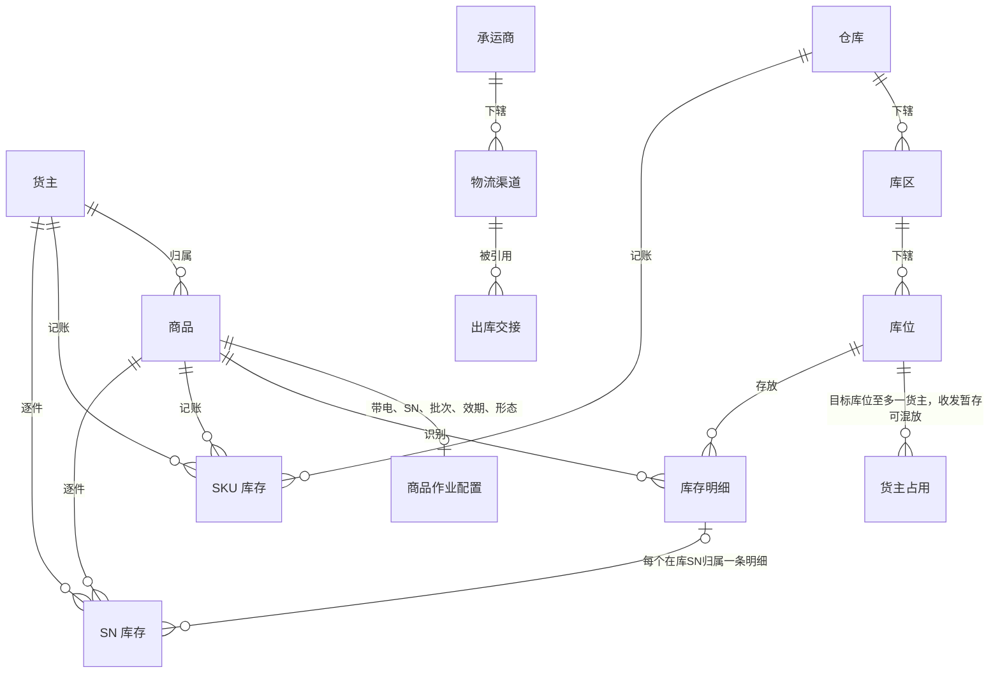
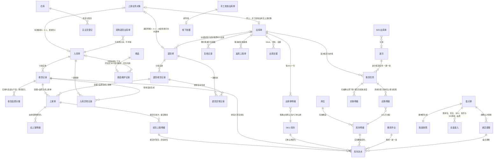

# 实体对象关系

> 本文维护对象关系、数量公式与一致性约束，供研发设计数据关系、测试核对数量与追溯。
> 对象按上游业务对象、WMS 执行单据、作业任务与事实记录组织；任务与事实挂靠所属业务，不另建执行单据，波次用于组织 B2C 拣货。完整状态与操作见《单据与状态流转》，流程见《系统流程与单据交互》。
> 对象为应用设计草案；字段与展示名在字段清单与页面设计中细化，表结构与接口协议由技术设计确定。进度见同版本「字段清单合集」与本目录 README。

| 版本 | 本次变化 | 状态 |
| --- | --- | --- |
| 2026-10-14 | 以当前全局背景校准规则、术语与跨篇引用；出库和库存字段文件本轮只读 | 文档修订，演示未验收 |
| 2026-10-02 | 由 ERP 参考结构改写为 WMS 口径：对象重列、数量按入库／出库／库存三段重写 | 应用设计初稿 |
| 2026-10-08 | 分开预占与分配，修正到货方式及盘点增减 | 历史修订记录 |
| 2026-10-09 | 库存相关字段收敛为 6 个对象；报损／销毁及报损后非库存暂存跟踪整体后置 | 应用设计修订稿 |
| 2026-10-11 | 与字段清单对象对齐；索引收敛至 README | 应用设计修订稿 |
| 2026-10-12 | 增补退货单、退货收货/异常；上架单双来源；上游退货预报 | 应用设计修订稿 |
| 2026-10-12 | 出库按出库宏观架构同步：出库单状态改为待拣货／拣货中／待出库／已出库／已取消，增返库上架单与复核记录；去掉取消中、出库异常记录与已拣损失确认 | 应用设计修订稿 |
| 2026-10-13 | 库存按库存宏观架构同步：三量直接加减（预占＝订单占用＋不良品）；去掉订单预占关系、库存锁定记录、差异新单限制记录；盘点按 SKU 冻结；移库一次提交 | 应用设计修订稿 |
| 2026-10-13 | 库存两层账字段对象：SKU 库存、库存明细、SN 库存、库存流水；三量只在 SKU 层，明细层记已分配与可分配；接单看可用、分配看可分配 | 应用设计修订稿 |
| 2026-10-13 | ER 图库位命名与两层账关系：去掉货位分配关系，应拣明细关联库存明细已分配 | 应用设计修订稿 |
| 2026-10-15 | 波次与拣货任务改为 1:N（一期实现仍为组波即 1 张）；波次头状态已分配／已下发任务／已完成／已取消 | 应用设计修订稿 |
| 2026-10-15 | 出库扫描确认即下架、波次即时归属、取消退拣；差异待核对先暂停新分配，盘点完成解除；对齐补拣与其他出库数量；出库单头状态改为待处理／待拣货／待复核／待出库 | 应用设计修订稿 |

## 一、对象清单

下表为架构层对象枚举；与字段清单「一个对象一份初稿」大体对应，合并行处见括号说明。

| 对象 | 层 | 识别口径（唯一性） | 业务阶段（摘要；完整状态见《单据与状态流转》） |
| --- | --- | --- | --- |
| 货主 | 主数据 | 货主编码唯一；自营预置不可删 | 建立（OMS Mock 推送）→ 启用／停用 |
| 商品 | 主数据 | 货主内商品编码唯一；同编码可属不同货主 | 建立 → 配置补齐 → 停用；有库存或作业已开始时禁切追溯开关 |
| 仓库 | 主数据（预置） | 仓库编码唯一 | 一期固定四仓，不新增 |
| 库区 | 主数据 | 所属仓库内编码唯一 | 建立 → 启用／停用 |
| 库位 | 主数据 | 同一仓库内编码唯一；跨仓可重码，以仓库＋库位编码定位，归属唯一库区 | 建立 → 启用／被占用 → 停用（占用清零后） |
| 承运商 | 主数据 | 承运商编码唯一 | 建立 → 启用／停用 |
| 物流渠道 | 主数据 | 渠道编码唯一；归属唯一承运商 | 建立 → 启用／停用 |
| 上游业务对象（入库／退货预报／出库指令） | 上游证据 | 来源＋业务类型＋上游指令号 | 新建 →（合法变更 → 取消）；消息结论逐条留痕；派送失败退货单可由 WMS 建单并回传 Mock，不伪造预报号 |
| 上游消息记录 | 交互记录 | 来源＋消息标识去重；预期对象版本校验顺序见《接口与 OMS Mock 消息设计》 | 原输入与原结论保留；重复及冲突接收另留尝试明细 |
| 回传记录 | 交互记录 | 固定结果序号关联原消息／事实；发送尝试挂本结果 | 待发送 → 待重试／已送达；重交不重做业务 |
| 用户 | 账号与授权配置 | 用户标识唯一；角色关系及仓库授权挂用户 | 配置细节见公共能力字段清单 |
| 角色 | 权限配置 | 角色标识唯一；菜单与动作授权挂角色 | 默认组合见《全局机制与权限配置》 |
| 操作记录 | 事实记录 | 操作记录号唯一，关联原对象与实际结果 | 系统留痕，只读查询，不复制库存账 |
| 入库单 | 执行单据 | 单号唯一 | 待收货 → 收货中 → 上架中 → 已完成；零实收可经上游取消 → 已取消（含全单拒收） |
| 退货单 | 执行单据 | 单号唯一；退货来源区分三类 | 待收货 → 收货中 → 上架中 → 已完成；零实收可经退货取消 → 已取消；派送失败关联原 B2C 出库单 |
| 出库单 | 执行单据 | 单号唯一；业务类型区分六类 | 待处理 → 待拣货 → 待复核 → 待出库 → 已出库；确认出库前受理取消 → 已取消 |
| 波次 | 组织对象 | 波次号唯一；只含同仓同货主可拣 B2C 单 | 汇总拣货、先拣后分；1 波次 0..N 张波次拣货任务（一期 N＝1）；头状态已分配／已下发任务／已完成／已取消，见出库宏观架构§3.4 |
| 盘点单 | 执行单据 | 盘点号唯一；按仓库＋SKU 建 | 盘点中 → 已完成／已取消；来源为计划盘点或发现账实不符 |
| 无主货登记 | 到货信息（尚无入库指令） | 登记号唯一，保留仓库、位置与识别线索 | 一期仅「暂存中」；二期 OMS 认领后可转入库或线下处置 |
| 新品维护记录 | 独立事实记录（可关联来源入库单） | 同一货主＋SKU仅一条，四仓共用；记录号全系统唯一 | 量方结果写入商品仓内规格；阻断该 SKU 首次收货，不增库存 |
| 上架单 | 作业单据（挂入库单或退货单） | 单号唯一 | 待上架 → 上架中 → 已完成；按容器×品质拆单；单头标明来源业务；应上架/实际上架两类明细；保存不动库存，提交移出暂存库位；提交后的上架单即上架结果，不另建上架记录 |
| 拣货任务 | 作业任务（挂出库单或波次） | 任务号唯一 | 分应拣与实拣明细，扫描确认即下架并保留原单归属，提交只结束进度，不另建拣货记录 |
| 移库作业 | 事实记录（库存管理） | 移库作业号唯一 | PDA 一次提交即完成，记录源目标变化，无中间状态 |
| 收货记录 | 事实记录（挂入库单） | 每次收货提交一条；承载累计实收 R | 写入即事实；超收不入 R；拒收数量与原因记在收货行，并生成入库异常 |
| 退货收货记录 | 事实记录（挂退货单） | 每次退货收货提交一条；口径对齐入库收货 | 写入即事实；拒收生成退货异常；SN 按退货来源核对规则见 RT-FR-011 |
| 入库异常记录 | 事实记录（挂入库单） | 异常记录号唯一；关联收货明细行 | 一期仅拒收；不计实收、不进库存；超收与未预报商品一期线下，上架前残损与暂存丢失走库存域 |
| 退货异常记录 | 事实记录（挂退货单） | 异常记录号唯一；关联退货收货明细行 | 一期以拒收为主；不计实收、不进库存 |
| 返库上架单 | 作业单据（挂出库单） | 单号唯一；每次退拣一张 | 待上架 → 上架中 → 已完成；记退拣原因（取消、残损、少件）；应返库与实际返库两类明细，规则同上架单 |
| 复核记录 | 事实记录（挂出库单） | 每次复核提交一条：随分拣按单一条，随打包装箱一个包裹或箱托一条 | 还原 SKU 件数；B2C 另记模拟运单号与重量；确认出库前可删除重做；不建箱托库存 |
| 出库交接 | 事实记录（挂出库单） | 随确认出库登记或后补关联 | 承运商 Mock、司机、自提与凭证；可后挂不二次扣库 |
| 作业事实（其余） | 事实记录 | 实际落位、拣货分配、确认出库等 | 分别留痕，不覆盖既有事实；一期不提供往回改 |
| SKU 库存 | 数量事实 | 仓库＋货主＋SKU | 记正常品实际、不良品实际、订单占用；三量由此算出；接单预占在本层 |
| 库存明细 | 数量事实 | 仓库＋货主＋SKU＋库位＋批次＋品质 | 记实际与已分配；随已确认业务事实与盘点调整变化 |
| SN 库存 | 数量事实 | 货主＋SKU＋SN | 启用 SN 的商品每件当前仓库、库位、批次、品质与在库状态 |
| 库存流水 | 事实记录 | 流水号唯一；一行一个数的一次变化 | 实际记库存明细层，订单占用记 SKU 层；搬动一减一加两行；分配不写流水 |
| 批次 | 数量维度 | 货主＋SKU 内批次号；同批可存多位 | 收货建立，沿流转保留 |
| 箱、托 | 作业容器 | 标识只进作业明细与交接/装箱记录 | 使用 → 交出；不形成库存对象 |

「业务阶段」列仅供快速识别；系统状态字段与完整枚举以《单据与状态流转》为准。SN 轨迹展示在库存查询与字段清单中细化，枚举不得覆盖真实丢失或已退出库存的事实。

基础资料字段按货主、商品、仓库、库区、库位、承运商、物流渠道维护；商品作业配置挂商品。集成按上游消息记录、回传记录维护。公共能力按用户、角色、操作记录维护。字段初稿按模块分布在「字段清单合集」，不为此另增执行单据层。

## 二、主数据之间的关系

- 目标库位一库位一货主，收货暂存、出库暂存库位允许多货主混放；目标位占用判断不只看库存余额，还包括入库过程实物、已确认出库待交接实物与未完结任务；全部清零后可换货主。
- 每个商品只属于一个货主；自营与外部货主资料结构相同，不因自营而合并归属。
- 未知货主的到货使用专门无主货暂存位置，不并入任何货主；认领前不产生货主库存。

## 三、单据与事实的关系

出库应用层在现有对象中补充以下子明细，字段见[出库详细稿](../字段清单合集/03-出库管理/)，不增加单据或菜单。

| 挂载对象 | 子明细 | 关键引用与数量 |
| --- | --- | --- |
| 出库单 | 其他出库指定实物 | 原单行号、库存明细、指定数量与SN；指定时计已分配，生成任务不再重复计 |
| 拣货任务 | 原单份额 | 汇总应拣行→原单号＋行号＋分配份额；波次保留顺序 |
| 拣货任务 | 实拣归属 | 应拣行→原单号＋行号＋实拣数量＋SN＋出库暂存库存；扫描确认即固定归属 |
| 复核记录 | 有效复核量 | 关联实拣归属；保留复核事实，退拣或取消调整有效量 |
| SKU库存 | 分配状态、待核对来源 | 按仓库＋货主＋SKU暂停新分配；主管确认盘点后解除，三量口径沿用数量节 |

动作输入与结果、页面和PDA承接见[出库单主PRD](../需求文档PRD/3-出库管理/出库单/出库单主PRD.md)，本篇继续维护对象与数量真源。

图中「B2C 出库单」「采购退货出库单」等仅为关系示意，执行层仍是一张出库单按业务类型区分。

一期全部入库单均有上游指令；客户退货与平台仓退件退货单由退货预报生成，派送失败退货单由 WMS 扫原运单建单并关联原出库。无主货登记不生成入库单或退货单。OMS 上线后认领产生的指令可关联原登记再按普通入库执行。盘点单按仓库＋SKU 建，建单即生成唯一快照；这些 SKU 有进行中任务时不能建。到货登记、混合到货分单在流程层区分指令，对象层以入库单与收货记录承载；退回本仓以退货单与退货收货记录承载。

三条读法：**指令建单**——有效新建指令对应一张执行单据，重复消息返回已有结论；**一单多事实**——入库分批收货、多张上架单保存与提交，出库多次拣货与返库上架，事实相加得累计；**可选关联**——退回引用原入库、B2C 可选入波次、手工其他出库保留线下依据。订单占用记在出库单明细的预占数量上并合计到 SKU 库存；生成拣货任务或其他出库指定时计入库存明细已分配，不另增订单占用。

## 四、数量在对象之间怎么流动

需求、实收和订单预占按单据商品明细累计并反映到 SKU 库存；库存明细按库位、批次、品质记实际与已分配，SN 商品另用 SN 库存逐件记位置。接单预占不提前绑定库位，SKU 层与明细层数量不相加混算。

### 入库侧

下表为入库数量公式；暂存丢失不改原实收和已提交上架量，另经库存盘点调整。按容器收货时，容器明细还原为 SKU 实收，与按件路径共用 R、U 口径，不得双计。收货确认即增加收货暂存库位库存；上架单提交才把库存移到目标库位。

| 数量 | 落在哪 | 怎么变 |
| --- | --- | --- |
| 预计数量 E | 入库单明细 | 接收时按指令建档；未实收时可接受合法明细变更，实收后不变 |
| 累计拒收 J | 入库单明细（自收货记录／入库异常汇总） | 不计 R、不进库存；累计实收＋累计拒收≤E |
| 累计实收 R | 收货记录 | 每次有效实收求和；超收不入 R |
| 未收数量 | 明细 | 收货完结前：E−R−J；不是损失 |
| 最终短少 | 明细（完结后） | E−R−J；自动收货完结或整单确认收货完结时定型 |
| 良品 G／不良 B | 收货记录品质分量 | 实收内录入；R＝G＋B；上架后发现残损在库存域做品质转换，不改原收货记录 |
| 已上架 PG／PB | 上架单提交结果 | 累计；仅提交时从暂存移到目标库位；PG≤G、PB≤B |
| 待上架 U | 明细进度 | U＝R−PG−PB；为0只表示已收部分上架完，不代表该行收货完结或整单完成 |
| 超收 | — | 一期不入系统登记，线下暂存 |

启用SN的实收逐件记录SN与品质；每条实际上架行关联来自对应收货行的SN，件数与SN数一致，提交时才更新SN所在库位。不同批次或不同来源行不得仅按SKU合并。

**入库进度分量（明细展示，非主状态枚举）**：宏观口径见[入库模块宏观系统架构](../../../01-全局背景信息/04-入库模块宏观系统架构.md)§2.3、§3.2。一期无质检任务。

### 退货侧

退货单明细使用与入库侧相同的数量符号（E、J、R、G/B、PG/PB、U）：**退货收货确认**增收货暂存库位库存，**上架单提交**（来源=退货单）移到存储或不良隔离库位；良品上架到存储库位后可参与分配，不另设「退货库存」类型。对象与状态见[退货模块宏观系统架构](../../../01-全局背景信息/06-退货模块宏观系统架构.md)。

### 已收未上架真实丢失的特殊口径（一期）

原实收 R 与收货录入的 G、B 保留。上架单仍按应上架数量提交；真实丢失由上架人员对该 SKU 发起盘点盘亏，不回传入库完成结果中的丢失分项。账上可能短暂多于实物，应尽快盘点。完整时间线见《入库业务设计》第 8.4 节。

### 出库侧

| 数量 | 落在哪 | 怎么变 |
| --- | --- | --- |
| 需求量 | 出库单明细 | 接收时建档；未开始拣货的合法变更一次性重算，开始后不静默改 |
| 本单预占 | 出库单明细（SKU 级），即订单占用 | B2C 全 SKU 足量才接收，FBA转运、批发、调拨、采购退货按min（需求、max（可用,0））接收；其他出库走指定不良品；含盘点中 SKU 的照常接收；人工重新分配只补未占足缺口；取消一次释放，确认出库扣实发并释放剩余 |
| 指定实物 | 其他出库明细 | 指定在库不良品的库位、批次／SN，建单计入库存明细已分配，不加订单占用；同一实物不能被两张其他出库指定 |
| 拣货分配 | 拣货任务应拣明细与库存明细 | 普通出库合计不超本单有效预占；其他出库合计不超指定不良品数量；计入库存明细已分配，不另增订单占用；换位解旧分新 |
| 已拣 | 出库单明细（自拣货任务实拣汇总） | 拣货扫描确认时增加，退拣时减少；普通出库确认前已拣不超过本单预占；其他出库不计订单占用，以指定不良品数量为上限；普通出库待拣＝预占－已拣；其他出库待拣＝指定数量－已拣，页面计算 |
| 已复核 | 出库单明细（自复核记录汇总） | 有效已复核≤已拣；退拣同步使对应复核量失效，取消后有效复核量归零并保留原记录；确认时已拣须全部复核 |
| 实发 | 确认出库 | ＝确认时已复核数量；扣出库暂存实际库存，普通出库同时扣订单预占并释放剩余，其他出库不扣订单占用 |
| 未发量 | 出库单明细 | 已出库时＝需求−实发；FBA转运出库、批发出库缺量一次结案后不续发 |
| 缺货／短拣 | 缺货页面计算（需求－预占）；短拣记在拣货任务应拣行 | 接单不足与现场拣不足分别表达，不得相加冒充未发 |

扣库发生在**确认出库**；交接信息可随确认登记或后补关联记录，不再次扣库。

### 库存侧

**SKU 库存（仓库＋货主＋SKU）**

| 数量 | 公式与约束 |
| --- | --- |
| 正常品实际／不良品实际 | 分别等于库存明细按品质加总；收货确认、确认出库、盘点调整、品质转换时变化；上架、拣货、返库、移库只在明细层搬，SKU 层合计不变 |
| 订单占用 | 各出库单明细预占数量合计；接单预占、补占、释放、确认出库扣减在本层变化 |
| 实际 | ＝正常品实际＋不良品实际 |
| 预占 | ＝订单占用＋不良品实际 |
| 可用 | ＝正常品实际－订单占用；接单、补占按可用校验，不会主动占成负；盘点调减或品质转换后可为负。收货暂存、出库暂存库位上的正常品计入正常品实际，接单可占，分配不到 |

**库存明细（仓库＋货主＋SKU＋库位＋批次＋品质）**

| 数量 | 公式与约束 |
| --- | --- |
| 实际 | 本库位本批次本品质件数；不为负 |
| 已分配 | 普通出库拣货任务分到本行未拣走数量＋其他出库指定但尚未拣走的数量；本次新增分配、指定、移库或品质转换数量不得超过当前实际－已有分配；已分配合计不是再与剩余量比较 |
| 可分配 | ＝实际－已分配；普通出库只取存储、拣货库位正常品 |

| 其他 | 说明 |
| --- | --- |
| 品质状态 | 正常／不良；存储、拣货库位过期自动转不良、数量不变 |
| 效期阈值 | 允许入库天数≥临期天数≥过期天数；收货按剩余保质期与仓库当地日期判断 |
| SN | 不按 SN 拆库存明细行；启用 SN 时 SN 库存记每件位置，明细数量等于该位在库 SN 件数 |

本节是本目录**数量口径**的维护位置。业务运行解释见业务设计中的入库、出库、库存与库内域。库存流水一行只记一个数：实际变化记明细层，订单占用变化记 SKU 层，库位或品质搬动一减一加两行；分配与指定只改已分配不写流水。类型包括：收货入暂存库位、上架移库、拣货移入出库暂存库位、返库上架、品质转换、移库、盘点调整、确认出库扣减、预占与释放。

## 五、单据引用哪些资料

| 单据或记录 | 引用 | 说明 |
| --- | --- | --- |
| 入库单 | 仓库、货主、商品明细、业务类型、到货方式及上游指令号 | 均引用上游指令；认领后可关联原无主货登记；调拨入库不要求调出仓信息 |
| 收货、上架单 | 入库单明细＋SN、批次、日期、品质、暂存库位与目标库位 | 采集随商品配置；收货记录承载 R、J；上架单含应上架与实际上架明细 |
| 新品维护 | 货主商品、入库上下文、实测规格 | 写入商品仓内规格，不增库存 |
| 出库单 | 仓库、货主、商品明细、业务类型、上游指令或邮件依据 | 退回另引用原入库；手工其他出库保留线下依据 |
| 拣货任务、复核记录、返库上架单、交接 | 出库单明细＋库位、批次/SN、容器、交接对象 | 复核记录的容器还原 SKU 件数 |
| 入库异常记录 | 拒收类型、数量、原因、关联收货明细行 | 一期仅拒收；整单完成回传分项引用 |
| 波次 | 成员 B2C 出库单 | 只同仓同货主 |
| 盘点单 | 仓库＋SKU、来源与发现依据、快照、实盘、差异 | 快照只含存储、拣货、不良隔离库位，含归属、位置、品质 |
| SKU 库存、库存明细、SN 库存 | 见上表维度；订单占用在出库单明细，已分配由拣货任务与其他出库明细汇总 | 实际与订单占用经流水；分配不写流水 |

## 六、追溯路径

| 从哪里 | 能追问到什么 |
| --- | --- |
| 库存流水 | 关联单据 → 作业事实 → 来源依据；上游指令或邮件按实际来源关联 |
| 确认出库、短拣与差异 | 单明细、拣货任务（应拣、实拣、缺货上报与短拣）、复核记录、返库上架单（退拣原因）、变更与结案 |
| 出库单（退回） | 原入库单；原入库实收、上架与流水不冲销 |
| SN 轨迹 | 收货（实收内品质）→ 收货暂存库位 → 上架单提交 → 移库 → 拣货扫描确认（出库暂存库位）→ 退拣返库 → 确认出库（只记实际环节） |
| 无主货登记 | 一期追到货到、暂存与线索（状态暂存中）；OMS 上线后追到认领与指令 |
| 盘点单 | 来源与发现依据、快照、实盘、差异流水 |
| 入库异常（拒收） | 收货明细行 → 拒收类异常记录 → 整单回传分项 |
| 暂存丢失（一期） | 原实收 → 按应上架量提交 → 对该 SKU 发起盘点、盘亏（库存域） |
| 上游消息 | 请求结论、原因与送达状态 |

## 七、一致性约束

- 存储、拣货、不良隔离等目标库位一库位一货主，收货暂存、出库暂存库位允许多货主混放。目标库位占用判断含实际库存、入库过程实物、已确认出库待交接实物与未完结任务；换货主前全部清零。
- 身份不可原单改写：仓库、货主、业务类型变更均拒绝；出库仅在允许取消的节点取消后重下发，入库取消仅允许整单零实收时由上游受理；上游资料身份不得被 WMS 静默改写；业务单据引用资料快照。
- 不重复记账：重发、重复提交、重复确认返回已有结果；收货、上架移库、扣库和占用变更每次只生效一次；其他出库与真实盘亏对同一数量不得重复扣减。
- 三量直接加减：预占＝订单占用＋不良品，可用＝正常品实际－订单占用；不按锁定原因去重。
- 差异待核对与盘点冻结：差异发生即按仓库＋货主＋SKU 暂停新分配、组波、补拣及其他出库指定；原因取原业务记录，不新增锁定单据、不改三量或接单规则。已有任务收尾或取消、返库后盘点；盘点期间库存不动。主管确认完成才解除待核对，盘点取消只解除盘点冻结。
- 实际库存不为负：扣库、移库、盘点调整提交时校验；可用只在盘点调减或品质转换后可能为负；不跨仓借量。
- 事实不回写：确认出库后不撤销；实收后入库不可取消；一期不提供实收误记更正入口。
- 无主货不形成库存：未收到有效入库指令前不得实收、上架、出库或计入实盘。

## 八、对象的形态与边界

- **上游业务对象不是 WMS 单据**：拒收无执行单据，只有拒收记录。
- **单据与事实不同层**：单据承载需求与累计，事实承载每次动作；汇总由事实相加。
- **任务与记录**：任务组织「要做的事」，记录保存「已发生的动作」；入库上架/出库拣货均按此分层；入库一期无质检任务，品质在收货录入。
- **波次是组织不是量**：组波不新增预占、不改需求；成员单分别确认出库。
- **已收货未上架是进度**：由 U 表达，不另设待质检/待上架库存类型。
- **箱托不是库存**：只进作业、复核与交接记录。
- **待认领不是货主**：认领前只留仓库与位置事实。
- **上架目标库位占用**：实际上架明细保存未提交即占用目标库位货主资格；删除或改填其他库位释放；收货暂存库位不受一库位一货主限制。
- **一期库存域字段对象**：SKU 库存、库存明细、SN 库存、库存流水、移库作业、盘点单。订单占用记在出库单明细并合计到 SKU 库存；拣货分配与其他出库指定合计到库存明细已分配。报损/销毁等后置对象见《系统边界与上下游链路总览》；已收未上架丢失一期在库存域盘点处理，不入库模块单独差异对象。

更多文稿索引见本目录 [README](README.md)；业务走查案例见业务设计入库、出库、库存与库内域。
