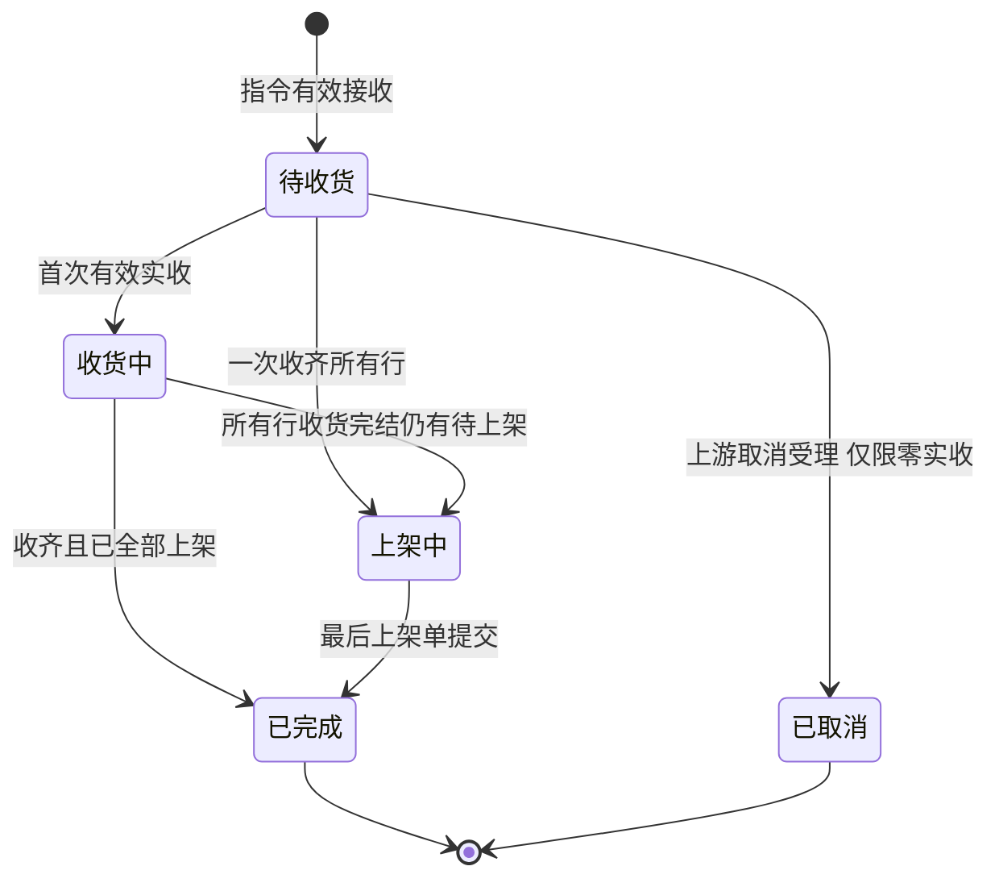
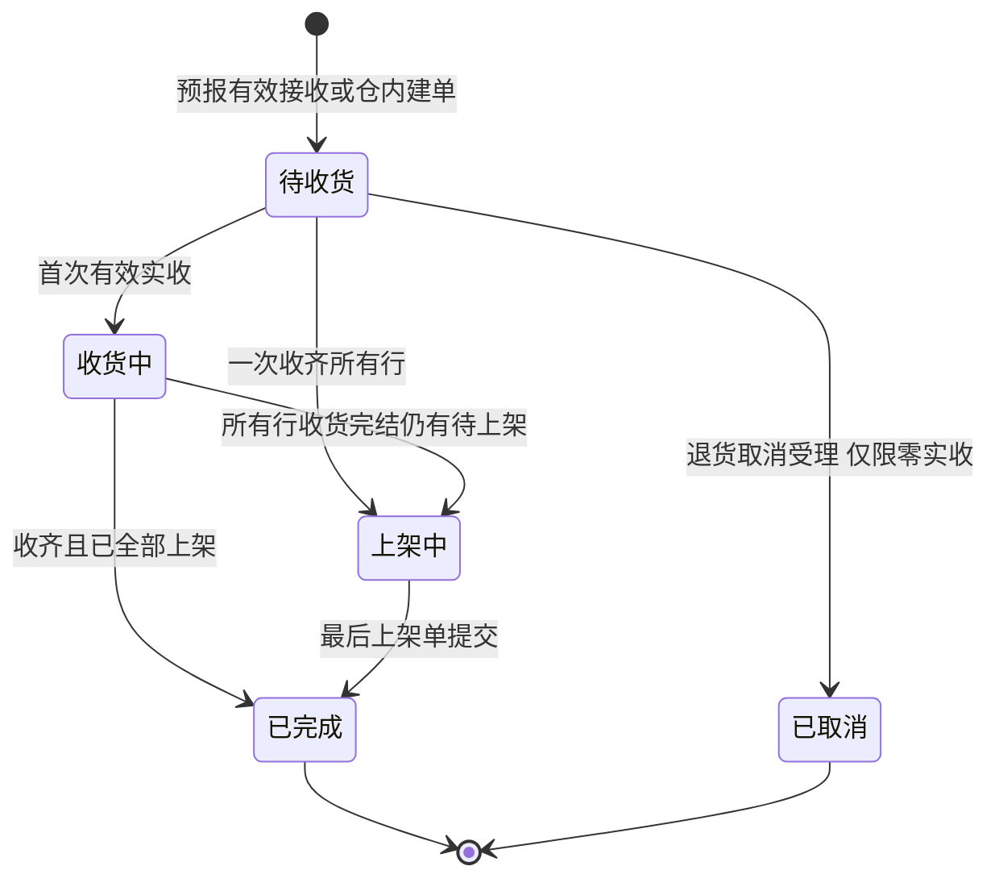
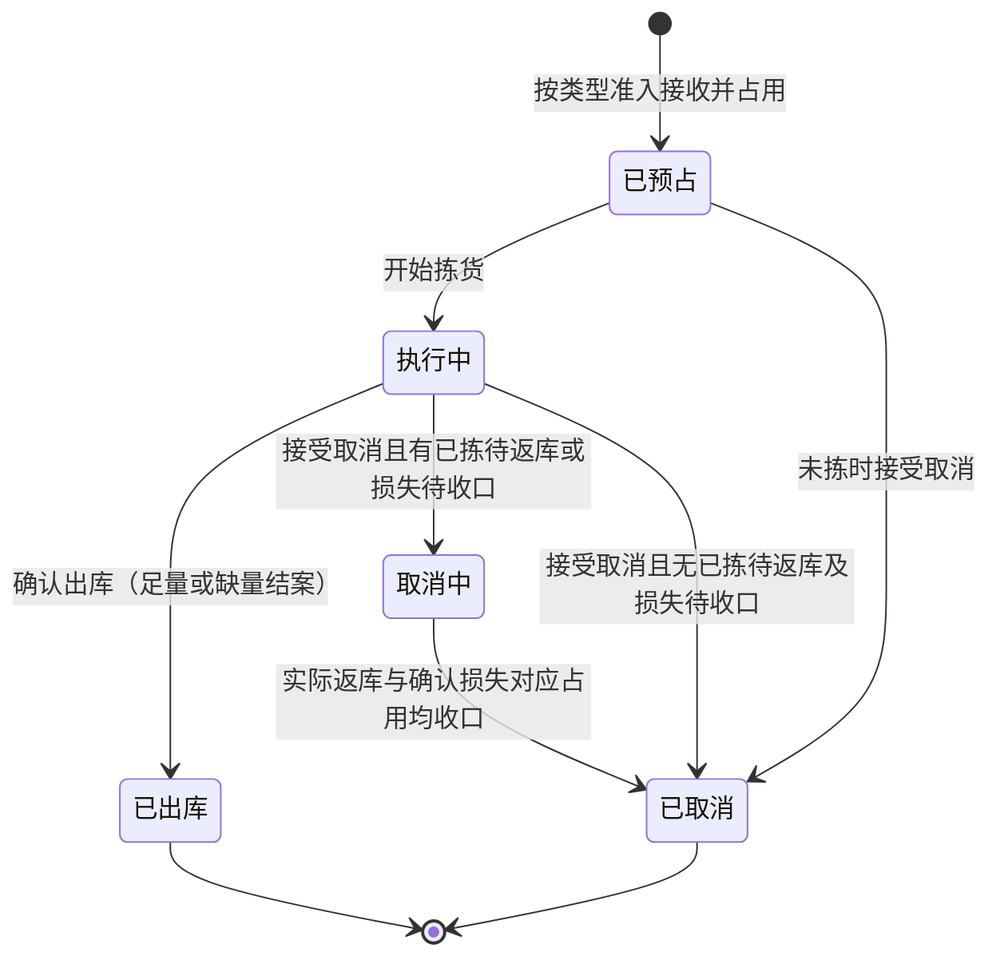
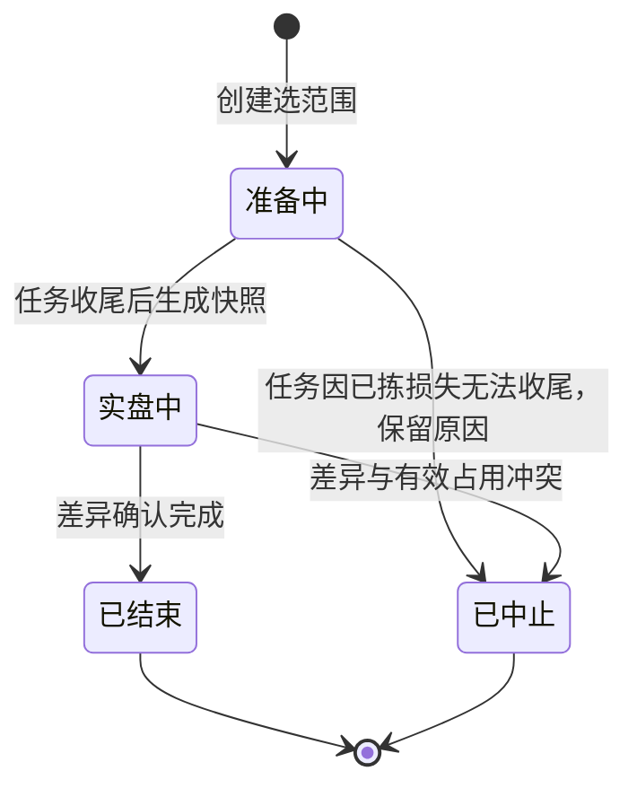
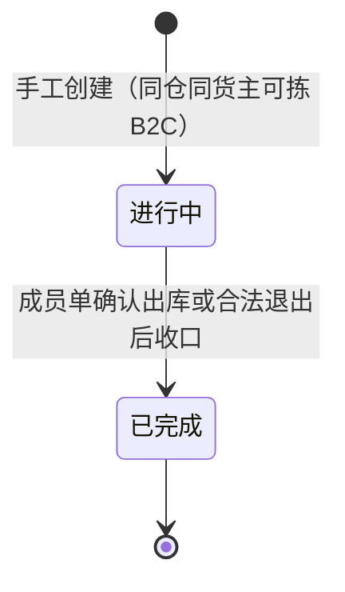

# 单据与状态流转

> 本文维护单据状态、允许操作、校验与联动，供研发与测试使用。状态与枚举命名以字段清单为准，本文管「在什么状态下能做什么」。
> 对象分层见《实体对象关系》对象清单，数量公式见该文「数量在对象之间怎么流动」，流程见《系统流程与单据交互》。仓库授权与动作权限见《全局机制与权限配置》。
> 一期无提交、审核、驳回等审批流；报损/销毁及报损后非库存暂存**不在**一期状态机内。改变账目或单据终止的人工动作命名见下文「确认动作怎么叫」。

| 版本 | 本次变化 | 状态 |
| --- | --- | --- |
| 2026-10-02 | 入库、出库、盘点等状态机按 WMS 口径重写；与实体对象关系数量节对齐 | 应用设计初稿 |
| 2026-10-08 | 无主货与入库取消边界；零实收阻断、取消分段释放及任务关闭 | 应用设计修订稿 |
| 2026-10-11 | 总表与 02 对齐；第十节交接表保留，消息层以 06 为准 | 应用设计修订稿 |
| 2026-10-11 | 入库进度分量、任务放行与宏观架构对齐；主状态仍三态 | 应用设计修订稿 |
| 2026-10-12 | 增补退货单状态机；上架单来源含退货；结果交接表补退货 | 应用设计修订稿 |

## 一、单据总表

| 对象 | 所属模块 | 层 | 状态字段（草案） | 来源 | 下游／交付 |
| --- | --- | --- | --- | --- | --- |
| 入库单 | 入库 | 执行单据 | 单据状态（待收货｜收货中｜上架中｜已完成｜已取消） | OMS Mock 指令 | 收货记录、上架单、入库异常；完成结果交回 OMS Mock |
| 退货单 | 退货 | 执行单据 | 单据状态（同入库单枚举） | OMS Mock 退货预报；派送失败可由 WMS 扫原运单建单 | 退货收货记录、上架单（来源=退货）、退货异常；结案交回 OMS Mock |
| 出库单 | 出库 | 执行单据 | 单据状态＋缺货标记＋结案标记与未发量（缺量类型） | OMS Mock 或邮件手工（其他出库） | 拣货、返库、装箱、异常、出库交接；结果交 Mock 或仓内可查 |
| 波次 | 出库 | 组织对象 | 组织状态 | 管理端手工创建 | 成员 B2C 出库单 |
| 盘点单 | 库存与库内 | 执行单据 | 盘点状态 | 管理端创建（仓库／库区／货位／SKU） | 快照、实盘、差异调整与流水 |
| 无主货登记 | 入库 | 到货信息 | 暂存中（一期仅此状态；二期已转入库、已线下处置） | 无指令且货主未知 | 一期登记查询；后续 OMS 认领与下发指令 |
| 新品维护记录 | 入库 | 过程记录 | 是否已完成量方 | 首次到仓 SKU 判定 | 写入商品仓内规格；阻断该 SKU 首次收货 |
| 上架任务（上架单）、拣货任务、移库作业 | 对应模块 | 作业任务／单据 | 任务状态 | 收货后或波次触发 | 上架单内应上架／实际上架明细；拣货等事实记录 |
| 上游消息（新建／变更／取消） | 系统集成 | 交互记录 | 请求结论 | OMS Mock 推送 | 交给对应业务对象与结果交接 |

**确认动作怎么叫**：一期没有「提交—审核」式审批，不出现驳回、撤回类流转。改变账目或终止单据的人工动作统一叫「确认」：

| 动作 | 执行对象 | 名称 | 前置与留痕 |
| --- | --- | --- | --- |
| 确认收货完结 | 入库单、退货单 | 收货完结确认 | 累计实收大于 0 且不再继续接收；留操作者、时间，未收转为最终短少；零实收不允许收货完结，应走上游/退货取消转已取消 |
| 确认出库 | 出库单 | 确认出库 | 复核及本类型数量条件通过；平台仓/B2B 至少一项明细实发大于 0，其余类型须足量；按实发扣库，留确认与交接信息 |
| 确认盘点调整 | 盘点单 | 差异确认 | 核实快照与实盘；调整不越有效占用、不为负；不良短少同步调减品质锁 |
| 接受／拒绝（上游请求） | 上游消息 | 接受、拒绝（返回原因） | 按当前执行节点判断；接受后执行对应后果 |

动作命名只区分事件，不新增状态；重复确认、重复提交幂等返回已有结果。

## 二、状态与操作：入库单（正常、调拨共用）

**一期主状态**（字段清单枚举：待收货｜收货中｜上架中｜已完成｜已取消）：收货中、上架中、已完成均要求整单累计实收大于 0。全单拒收或确定不再收货的零实收不作已完成：仓库通知上游取消，OMS Mock 取消消息受理后转已取消。仅当所有明细行收货完结且已上架等于实收后进入已完成。一期**无质检任务**；良品／不良品在收货实收内录入。明细行状态见[入库模块宏观系统架构](../../01-全局背景信息/04-入库模块宏观系统架构.md)§3.2～§3.3；头表可派生收货进度、上架进度摘要。

- 指令准入拒收不建入库单，只留拒收记录。零实收且不再接收（含全单拒收）：仓库通知上游取消；一期 Mock 下发取消并受理后原单转已取消，不回传入库完成结果。产生任何实收后不得取消。
- **收货完结确认**是动作（见上表）：须整单累计实收大于 0 且不再继续接收。确认后未收转为最终短少；不阻断上架。若所有行已收货完结且仍有待上架，主状态进入上架中，否则在仍有未完结收货行时保持收货中，直至满足上架中或已完成条件。
- 短少取未收数量；拒收在**入库异常**中查询，整单完成回传分项体现；入库单头不设差异标记。暂存丢失、上架前残损一期在库存域盘点/品质调整处理，不回传入库完成结果。

| 状态 | 可执行操作 | 前置条件与校验 | 结果与联动 |
| --- | --- | --- | --- |
| 待收货 | 查看、登记到货、收货、新品维护、接收上游明细变更、接受上游取消 | 变更与取消均须无任何实收；该 SKU 需新品维护且未完成时阻断本行收货 | 首次有效实收后进入收货中；全单拒收等零实收场景通知上游取消，受理后转已取消 |
| 收货中 | 收货（拒收与实收、实收内良品/不良）、保存上架单、新品维护、收货完结确认 | 累计实收＋累计拒收≤预计；收货完结后不再实收；效期、SN/批次/日期 | 收货确认增暂存库位库存；已实收后不得取消或明细变更 |
| 上架中 | 保存/提交上架单 | 提交校验各库位合计＝应上架量；目标库位在保存未提交时即货主占用，提交后转实际库存 | 提交时暂存库位移到目标库位；不再接收到货 |
| 已完成 | 查看、追溯 | — | 结果交回 OMS Mock；后续退回走独立出库业务 |
| 已取消 | 查看、追溯 | — | 保留拒收等收货事实；不交入库完成结果 |

**已收未上架丢失**：一期上架单仍按应上架数量提交，再由库存域盘点盘亏；不回传入库完成结果中的丢失分项。见[入库模块宏观系统架构](../../01-全局背景信息/04-入库模块宏观系统架构.md)第六节。

**调拨入库**：与正常入库同一状态机；不要求调出仓单号、不参与两端核对。

**无主货**：登记不进入本状态机；OMS 认领后按普通入库执行。

## 二之一、状态与操作：退货单（三类来源）

退货单主状态与入库单对齐（待收货｜收货中｜上架中｜已完成｜已取消），完成条件与收货完结、上架提交规则同第二节；差异在来源与建单方式。客户退货、平台仓退件须有效退货预报；派送失败由现场扫原 B2C 运单建单并关联原出库单，建单与结案回传 OMS Mock。**同一原运单在未完结的派送失败退货单已存在时阻断重复建单**（见 RT-FR-002）。FBA 移除退仓一期不进入本状态机。

| 状态 | 可执行操作 | 前置条件与校验 | 结果与联动 |
| --- | --- | --- | --- |
| 待收货 | 查看、退货收货、接收上游明细变更、接受退货取消 | 变更与取消均须无任何实收；SN 按来源核对 | 首次有效实收后进入收货中；零实收走退货取消转已取消 |
| 收货中 | 退货收货、保存/提交上架单、收货完结确认 | 累计实收＋拒收≤预计；效期、SN/批次 | 收货确认增暂存库存；已实收后不得取消或明细变更 |
| 上架中 | 保存/提交上架单 | 同入库上架单 | 提交移出暂存库位 |
| 已完成 | 查看、追溯 | — | 结案结果交回 OMS Mock |
| 已取消 | 查看、追溯 | — | 不交退货完成结果 |

规则细节见[退货模块宏观系统架构](../../01-全局背景信息/06-退货模块宏观系统架构.md)与[退货业务需求分析](../../../03-需求调研和分析/05-退货业务/退货业务需求分析.md)。

## 三、状态与操作：出库单（六类共用，差异另列）

缺货、装箱变化等用**标记与记录**，不单设单据状态。「已预占」表示有效接收并完成占用计算；允许部分预占的类型可能占 0，保留缺货等待，不因状态名虚构可拣量。

| 状态 | 可执行操作 | 前置条件与校验 | 结果与联动 |
| --- | --- | --- | --- |
| 已预占 | 查看、明细变更、分配拣货、缺货人工重试、开始拣货、取消（未拣） | 明细变更须未开始拣货；盘点范围内未开始任务不启动 | 接受取消释放预占；缺货标记不阻塞已占部分继续 |
| 执行中 | 拣货、换位、缺货重试、返库上架、复核/大货核对、装箱、确认出库、接受取消 | 开始拣货后拒绝明细变更；足量类型不足禁止确认；缺量结案前已拣未发须先返库 | 确认出库扣实际与本单预占；交接可随确认登记或后补关联，不二次扣库 |
| 取消中 | 查看、实际返库上架核对、主管确认已拣损失 | 禁止拣货、确认出库、变更、人工恢复；损失不得绕过实盘冻结 | 实际返库释放与损失盘亏、对应占用释放均收口后置已取消并交最终结果 |
| 已出库 | 查看、追溯 | — | 确认后不得取消或改需求；可后补交接记录 |
| 已取消 | 查看历史 | — | 实际返库与确认损失分别留痕，不以虚假返库收口 |

**已接收缺货单人工恢复**：库存补齐后由授权人员触发；只补未占足缺口，不叠占。取消中、已取消、已出库禁止恢复。不良品其他出库不从正常可用量补占。数量走查见《出库业务设计》缺货恢复案例。

**类型差异**：

- **B2C 包裹履约**：全 SKU 足量才接收，不足整单拒收。已接单后若执行中库存不足，保留预占与缺货标记，等待取消或人工重试；不允许缺量结案。基础波次可选（见本文「波次」），波次完成不替成员单确认出库。
- **平台仓转运、当地 B2B**：至少一项明细实发大于 0 才可缺量确认；零实发等待或合法取消。一次结案，原单不续发；已拣未发先返库；B2B 复核箱托容器。
- **调拨出库**：足量确认；本仓结果独立交付。
- **退回出库**：足量确认；引用原入库及库存来源；拟退回品须已质检上架形成库存；原入库不冲销。
- **不良品其他出库**：指定在库不良品实物，足量确认；上游通知或邮件手工创建，后者不伪造上游关联。
- 平台仓容器资料变化：影响箱唛/预约时等待确认；未确认出库前占用不变。
- 新单命中盘点或差异新单限制：整单拒收，不预占；手工其他出库同样阻断创建。

**差异新单限制**：发现疑似短少后立即限制受影响仓库＋货主＋SKU的新单，不改变库存数量或重复锁量。已有订单取消、实际返库、损失核实及重盘按各自条件继续。盘点中止、补货、可用恢复及取消均不自动解除；主管确认该SKU差异已排除或库存校准完成、无未解决差异后解除并留痕，原拒收业务须上游重提。

**已拣损失取消**：合法取消后，实际找到部分返库后释放；丢失部分经主管确认，关联盘亏与对应占用释放同次生效，已扣实物的其他锁因一并收口。不要求先完成常规盘点，但不得绕过实盘冻结，不重复扣损失；流程见《系统流程与单据交互》第4.5节。
- **取消边界**：确认出库后任何类型不得取消；揽收为仓外事实，不改变本状态机。

## 四、作业任务与现场记录

任务组织「要做的事」，记录保存「已发生的动作」。移库不另建执行单据。

| 任务 | 触发与生成 | 状态 | 说明 |
| --- | --- | --- | --- |
| 上架任务（上架单） | 入库或退货收货确认后按容器×品质自动生成；单头标明来源入库单或退货单 | 待上架 → 上架中 → 已完成 | 保存实际上架不动库存；提交一次性暂存→目标库位；残损与暂存丢失一期交库存域处理 |
| 拣货任务 | 出库单或波次 | 待拣货 → 执行中 → 已完成／已关闭 | 换位、短拣记入拣货记录与出库异常 |
| 移库作业 | 管理端或 PDA | 待执行 → 执行中 → 已完成 | 三量不变，重复提交幂等 |
| 实盘录入 | 盘点单实盘中 | — | 按位、货主、SKU、批次/SN、品质 |

「已关闭」表示原业务已取消、缺量结案或损失收口，不表示未执行量已执行。

**现场事实记录**（收货记录、上架单及实际上架明细、分配、拣货记录、返库上架、装箱结果、出库异常、确认出库、出库交接等）：

- 写入即事实，一期不提供往回改；误记按各域异常规则处理。
- 管理端与 PDA 共用记录，重复提交不重复影响库存。
- 关键确认留操作者、时间与结果（见《全局机制与权限配置》）。
- 确认出库时扣库；交接可随确认登记或后补关联，不覆盖原确认、不再次扣库。

## 五、状态与操作：盘点单

| 状态 | 可执行操作 | 前置条件与校验 | 结果与联动 |
| --- | --- | --- | --- |
| 准备中 | 查看、协调命中任务收尾；已拣损失阻塞时中止本盘 | 范围内未开始任务不得启动；已开始任务执行至完成 | 生成快照后进入实盘中 |
| 实盘中 | PDA 实盘、差异确认 | 范围内库存变化不得提交；跨日过期转不良为冻结例外 | 冲突则中止；确认后生成流水 |
| 已结束 | 查看、追溯 | 解除本盘冻结 | 其他锁定保留 |
| 已中止 | 查看；重新建盘 | 不调账、仅解除本盘冻结，差异新单限制保留 | 占用或损失收口后新建盘点 |

## 六、状态与操作：波次

- 波次不新增预占、不改需求；成员单分别复核、确认出库。
- 未开始拣货的成员可移出；已拣成员随取消流程完成实际返库或损失收口后退出。
- 成员全部移出或取消收口后，波次置已完成；成员单状态仍以各自出库单为准。

## 七、状态与操作：无主货登记

一期状态仅为「暂存中」：登记与查看，无认领、无入库单、无库存。记录仓库、暂存位置与识别线索。二期 OMS 认领后可进入「已转入库」或按货主决定「已线下处置」。

OMS 上线后由客户在 OMS 认领并下发指令，WMS 收到有效指令后进入普通入库链路。

## 八、上游消息处理结论

新建、变更、取消的**请求结论**与返库、扣库等**执行结果**分别保存；接受取消不表示已返库或占用已释放。

消息身份、版本、拒收与回执见《接口与 OMS Mock 消息设计》。执行节点按本文入库、退货、出库操作表校验；仓库、货主、业务类型不得原单改写。

## 九、数量与记账依据

完整公式与异常入库口径见《实体对象关系》「数量在对象之间怎么流动」；一致性见该文「一致性约束」。

本篇只摘要**哪个动作改数量**：拒收（入库/退货异常）与无主货登记不增库存；超收一期不入账；**入库或退货收货确认**仅实收按品质增加收货暂存库位实际库存；**上架单提交**把库存从暂存移到目标库位（来源入库或退货共用）；暂存丢失一期由目标库位盘点盘亏；确认出库、已拣损失确认及盘点差异调整改库存；拣出与分配不提前扣库，分配不另增预占。退回良品上架后参与正常出库预占，不单独设退货库存类型。

## 十、结果交接与回写规则

下列为**业务对象何时交出何内容**；消息字段、送达状态与重交规则见《接口与 OMS Mock 消息设计》。

| 从哪里 | 交出什么 | 时机与去向 |
| --- | --- | --- |
| 入库单 | 整单执行结果与差异分项（实收、品质、落位、完结、超收/拒收/品质调整/丢失等） | **入库单已完成时一次性**交 OMS Mock；收货与上架过程不回传进度；失败只重交 |
| 退货单 | 退货来源、关联原出库或预报、实收内良品/不良、拒收与短少、上架落位 | **退货单已完成时一次性**交 OMS Mock；派送失败建单与预报类共用结案形态 |
| 出库单 | 需求、预占、实发、未发、短拣、确认、交接、结案；取消损失另含实拣、实际返库、损失、盘亏及释放依据 | 同上 |
| 上游消息 | 接受／拒绝结论与原因 | 结论形成即可交 |
| 无效指令 | 拒收原因 | 处理完成即可交 |
| 无主货登记 | 到货与暂存线索 | 一期仓内可查 |
| 手工其他出库 | 结果与邮件依据 | 仓内可查，不伪造上游关联 |
| 盘点单 | 差异调整与流水 | 差异确认后仓内可查；不单独向 OMS Mock 回传 |

明细变更只改业务要求，不改写已发生事实；库存变化须关联依据与流水。

## 十一、权限怎么处理

仓库数据范围、动作权限与留痕见《全局机制与权限配置》。角色授权不替代本篇状态校验；关键确认权限集中于仓库主管，收发作业确认独立配置。

## 十二、跨对象联动的检查入口

改动状态后核对：《系统流程与单据交互》触发与异常、《实体对象关系》数量与对象、《全局机制与权限配置》权限、《接口与 OMS Mock 消息设计》消息时序。

盘点实盘冻结的例外（含跨日过期转不良）只按本文「盘点单」与流程篇「在库受损与品质转换」，其他单据不得自行绕过。

更多文稿索引见本目录 [README](README.md)。
