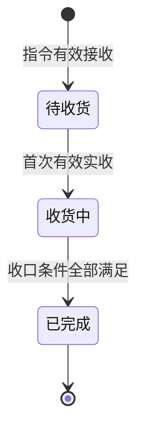
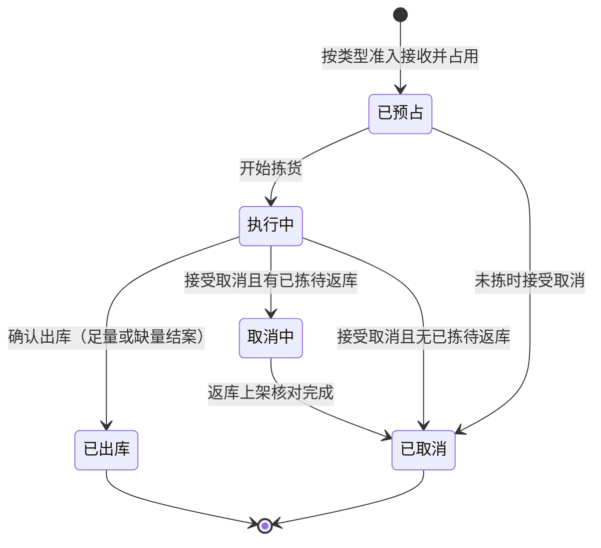
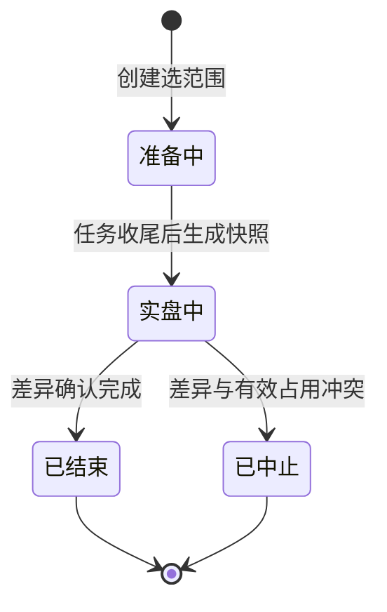
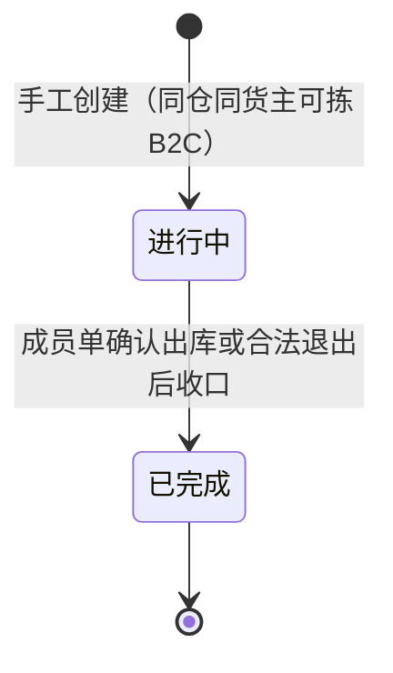

# 单据与状态流转

> 本文维护单据状态、允许操作、校验与联动，供研发与测试使用。状态与枚举命名以字段清单为准，本文管「在什么状态下能做什么」。
> 对象分层见《实体对象关系》对象清单，数量公式见该文「数量在对象之间怎么流动」，流程见《系统流程与单据交互》。仓库授权与动作权限见《全局机制与权限配置》。
> 一期无提交、审核、驳回等审批流；报损/销毁及报损后非库存暂存**不在**一期状态机内。改变账目或单据终止的人工动作命名见下文「确认动作怎么叫」。

| 版本 | 本次变化 | 状态 |
| --- | --- | --- |
| 2026-10-02 | 入库、出库、盘点等状态机按 WMS 口径重写；与实体对象关系数量节对齐 | 应用设计初稿 |
| 2026-10-08 | 无主货与入库取消边界；零实收阻断、取消分段释放及任务关闭 | 应用设计修订稿 |
| 2026-10-11 | 总表与 02 对齐；第十节交接表保留，消息层以 06 为准 | 应用设计修订稿 |

## 一、单据总表

| 对象 | 所属模块 | 层 | 状态字段（草案） | 来源 | 下游／交付 |
| --- | --- | --- | --- | --- | --- |
| 入库单 | 入库 | 执行单据 | 单据状态＋差异标记（短少／超收／不良／已收损失） | OMS Mock 指令 | 收货记录、质检/上架任务及事实；结果交回 OMS Mock |
| 出库单 | 出库 | 执行单据 | 单据状态＋缺货标记＋结案标记与未发量（缺量类型） | OMS Mock 或邮件手工（其他出库） | 拣货、返库、装箱、异常、出库交接；结果交 Mock 或仓内可查 |
| 波次 | 出库 | 组织对象 | 组织状态 | 管理端手工创建 | 成员 B2C 出库单 |
| 盘点单 | 库存与库内 | 执行单据 | 盘点状态 | 管理端创建（仓库／库区／货位／SKU） | 快照、实盘、差异调整与流水 |
| 无主货登记记录 | 入库 | 到货信息 | 已登记（一期不流转） | 无指令且货主未知 | 一期登记查询；后续 OMS 认领与下发指令 |
| 新品维护记录 | 入库 | 过程记录 | 是否已完成量方 | 首次到仓 SKU 判定 | 写入商品仓内规格；阻断该 SKU 首次收货 |
| 质检任务、上架任务、拣货任务、移库作业 | 对应模块 | 作业任务 | 任务状态 | 由单据或波次触发 | 各类事实记录 |
| 上游消息（新建／变更／取消） | 系统集成 | 交互记录 | 请求结论 | OMS Mock 推送 | 交给对应业务对象与结果交接 |

**确认动作怎么叫**：一期没有「提交—审核」式审批，不出现驳回、撤回类流转。改变账目或终止单据的人工动作统一叫「确认」：

| 动作 | 执行对象 | 名称 | 前置与留痕 |
| --- | --- | --- | --- |
| 确认收货完结 | 入库单 | 收货完结确认 | 累计实收大于 0 且不再继续接收；留操作者、时间，未收转为最终短少；零实收不允许完结，保持待收货；入库取消待 OMS 上线 |
| 确认出库 | 出库单 | 确认出库 | 复核及本类型数量条件通过；平台仓/B2B 至少一项明细实发大于 0，其余类型须足量；按实发扣库，留确认与交接信息 |
| 确认盘点调整 | 盘点单 | 差异确认 | 核实快照与实盘；调整不越有效占用、不为负；不良短少同步调减品质锁 |
| 接受／拒绝（上游请求） | 上游消息 | 接受、拒绝（返回原因） | 按当前执行节点判断；接受后执行对应后果 |

动作命名只区分事件，不新增状态；重复确认、重复提交幂等返回已有结果。

## 二、状态与操作：入库单（正常、调拨共用）

**一期单据状态**（仅当实收大于 0、收货完结、需检已检完、落位及损失异常均收口后，才从收货中进入已完成）：

- 指令准入拒收不建入库单，只留拒收记录。零实收且不再接收时保持待收货，仓库线下通知上游；WMS 不提供取消或零实收完成入口。
- 入库取消待 OMS 上线：无实收时由上游发起，原单转已取消。此流转不属于一期状态机或 Mock 演示。
- 收货完结是动作：须实收大于 0 且不再接收。完结后若仍有需检、未上架或未处理损失，**仍为收货中**。
- 差异标记独立记录；已完成单可有最终短少、超收、不良或已收损失。

| 状态 | 可执行操作 | 前置条件与校验 | 结果与联动 |
| --- | --- | --- | --- |
| 待收货 | 查看、登记到货、收货、新品维护、接收上游明细变更 | 变更须无任何实收；该 SKU 需新品维护且未完成时阻断本行收货 | 首次有效实收后进入收货中；实收为 0 且不再到货则保持待收货 |
| 收货中 | 收货（分批）、质检／免检品质登记、上架（分批）、新品维护、丢失异常确认、收货完结确认 | 收货完结后不再实收；效期、SN/批次/日期；上架不超可上架量 | 事实累计；已实收后不得取消或明细变更 |
| 已完成 | 查看、追溯 | — | 结果交回 OMS Mock；后续退回走独立出库业务 |

**真实丢失异常**：授权人员核实原实收、现场剩余与依据；剩余实物检验并落位，异常账面上架与立即盘亏同次生效。损失未收口或落位未完成时保持收货中。数量见《实体对象关系》丢失口径。

**调拨入库**：与正常入库同一状态机；不要求调出仓单号、不参与两端核对。

**无主货**：登记不进入本状态机；OMS 认领后按普通入库执行。

## 三、状态与操作：出库单（六类共用，差异另列）

缺货、装箱变化等用**标记与记录**，不单设单据状态。「已预占」表示有效接收并完成占用计算；允许部分预占的类型可能占 0，保留缺货等待，不因状态名虚构可拣量。

| 状态 | 可执行操作 | 前置条件与校验 | 结果与联动 |
| --- | --- | --- | --- |
| 已预占 | 查看、明细变更、分配拣货、缺货人工重试、开始拣货、取消（未拣） | 明细变更须未开始拣货；盘点范围内未开始任务不启动 | 接受取消释放预占；缺货标记不阻塞已占部分继续 |
| 执行中 | 拣货、换位、缺货重试、返库上架、复核/大货核对、装箱、确认出库、接受取消 | 开始拣货后拒绝明细变更；足量类型不足禁止确认；缺量结案前已拣未发须先返库 | 确认出库扣实际与本单预占；交接可随确认登记或后补关联，不二次扣库 |
| 取消中 | 查看、返库上架核对 | 禁止拣货、确认出库、变更、人工恢复 | 返库完成后置已取消并交最终结果 |
| 已出库 | 查看、追溯 | — | 确认后不得取消或改需求；可后补交接记录 |
| 已取消 | 查看历史 | — | 已拣须返库核对后才释放 |

**已接收缺货单人工恢复**：库存补齐后由授权人员触发；只补未占足缺口，不叠占。取消中、已取消、已出库禁止恢复。不良品其他出库不从正常可用量补占。数量走查见《出库业务设计》缺货恢复案例。

**类型差异**：

- **B2C 包裹履约**：全 SKU 足量才接收，不足整单拒收。已接单后若执行中库存不足，保留预占与缺货标记，等待取消或人工重试；不允许缺量结案。基础波次可选（见本文「波次」），波次完成不替成员单确认出库。
- **平台仓转运、当地 B2B**：至少一项明细实发大于 0 才可缺量确认；零实发等待或合法取消。一次结案，原单不续发；已拣未发先返库；B2B 复核箱托容器。
- **调拨出库**：足量确认；本仓结果独立交付。
- **退回出库**：足量确认；引用原入库及库存来源；拟退回品须已质检上架形成库存；原入库不冲销。
- **不良品其他出库**：指定在库不良品实物，足量确认；上游通知或邮件手工创建，后者不伪造上游关联。
- 平台仓容器资料变化：影响箱唛/预约时等待确认；未确认出库前占用不变。
- 新单命中盘点阻断：整单拒收，不预占。
- **取消边界**：确认出库后任何类型不得取消；揽收为仓外事实，不改变本状态机。

## 四、作业任务与现场记录

任务组织「要做的事」，记录保存「已发生的动作」。移库不另建执行单据。

| 任务 | 触发与生成 | 状态 | 说明 |
| --- | --- | --- | --- |
| 质检任务 | 需检商品的已收数量 | 待执行 → 执行中 → 已完成／已关闭 | 免检残损直接登记，不生成任务；未检完不能上架 |
| 上架任务 | 按品质分别生成 | 待执行 → 执行中 → 已完成／已关闭 | 部分上架；落位即事实，未落位不计库存 |
| 拣货任务 | 出库单或波次 | 待拣货 → 执行中 → 已完成／已关闭 | 换位、短拣记入拣货记录与出库异常 |
| 移库作业 | 管理端或 PDA | 待执行 → 执行中 → 已完成 | 三量不变，重复提交幂等 |
| 实盘录入 | 盘点单实盘中 | — | 按位、货主、SKU、批次/SN、品质 |

「已关闭」表示原业务已取消、缺量结案或损失收口，不表示未执行量已执行。

**现场事实记录**（收货记录、质检结果、上架落位、分配、拣货记录、返库上架、装箱结果、出库异常、确认出库、出库交接等）：

- 写入即事实，一期不提供往回改；误记按各域异常规则处理。
- 管理端与 PDA 共用记录，重复提交不重复影响库存。
- 关键确认留操作者、时间与结果（见《全局机制与权限配置》）。
- 确认出库时扣库；交接可随确认登记或后补关联，不覆盖原确认、不再次扣库。

## 五、状态与操作：盘点单

| 状态 | 可执行操作 | 前置条件与校验 | 结果与联动 |
| --- | --- | --- | --- |
| 准备中 | 查看、协调命中任务收尾 | 范围内未开始任务不得启动；已开始任务执行至完成 | 生成快照后进入实盘中 |
| 实盘中 | PDA 实盘、差异确认 | 范围内库存变化不得提交；跨日过期转不良为冻结例外 | 冲突则中止；确认后生成流水 |
| 已结束 | 查看、追溯 | 解除本盘冻结 | 其他锁定保留 |
| 已中止 | 查看；重新建盘 | 不调账、解除本盘冻结 | 占用收口后新建盘点 |

## 六、状态与操作：波次

- 波次不新增预占、不改需求；成员单分别复核、确认出库。
- 未开始拣货的成员可移出；已拣成员随取消流程返库后退出。
- 成员全部移出或取消收口后，波次置已完成；成员单状态仍以各自出库单为准。

## 七、状态与操作：无主货登记记录

一期仅有「已登记」：登记与查看，无认领、无入库单、无库存。记录仓库、暂存位置与识别线索。

OMS 上线后由客户在 OMS 认领并下发指令，WMS 收到有效指令后进入普通入库链路。

## 八、上游消息处理结论

新建、变更、取消的**请求结论**与返库、扣库等**执行结果**分别保存；接受取消不表示已返库或占用已释放。

消息身份、版本、拒收与回执见《接口与 OMS Mock 消息设计》。执行节点按本文入库、出库操作表校验；仓库、货主、业务类型不得原单改写。

## 九、数量与记账依据

完整公式与异常入库口径见《实体对象关系》「数量在对象之间怎么流动」；一致性见该文「一致性约束」。

本篇只摘要**哪个动作改数量**：收货、质检、无主货登记不增库存；上架或丢失异常收口增库存；确认出库、盘点差异调整改库存；拣出与分配不提前扣库，分配不另增预占。

## 十、结果交接与回写规则

下列为**业务对象何时交出何内容**；消息字段、送达状态与重交规则见《接口与 OMS Mock 消息设计》。

| 从哪里 | 交出什么 | 时机与去向 |
| --- | --- | --- |
| 入库单 | 实收、品质、落位、进度、完结、差异；异常含损失与盘亏 | 事实生效后交 OMS Mock；失败只重交 |
| 出库单 | 需求、预占、实发、未发、短拣、确认、交接、结案 | 同上 |
| 上游消息 | 接受／拒绝结论与原因 | 结论形成即可交 |
| 无效指令 | 拒收原因 | 处理完成即可交 |
| 无主货登记 | 到货与暂存线索 | 一期仓内可查 |
| 手工其他出库 | 结果与邮件依据 | 仓内可查，不伪造上游关联 |
| 盘点单 | 差异调整与流水 | 差异确认后 |

明细变更只改业务要求，不改写已发生事实；库存变化须关联依据与流水。

## 十一、权限怎么处理

仓库数据范围、动作权限与留痕见《全局机制与权限配置》。角色授权不替代本篇状态校验；关键确认权限集中于仓库主管，收发作业确认独立配置。

## 十二、跨对象联动的检查入口

改动状态后核对：《系统流程与单据交互》触发与异常、《实体对象关系》数量与对象、《全局机制与权限配置》权限、《接口与 OMS Mock 消息设计》消息时序。

盘点实盘冻结的例外（含跨日过期转不良）只按本文「盘点单」与流程篇「在库受损与品质转换」，其他单据不得自行绕过。

更多文稿索引见本目录 [README](README.md)。
