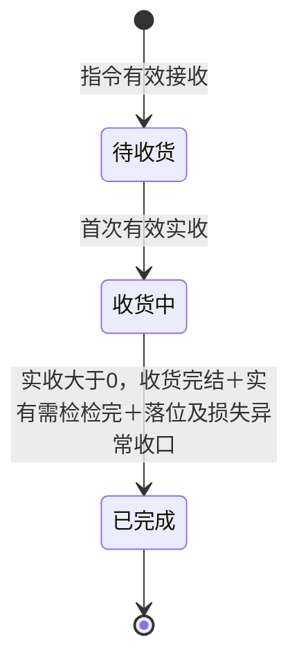
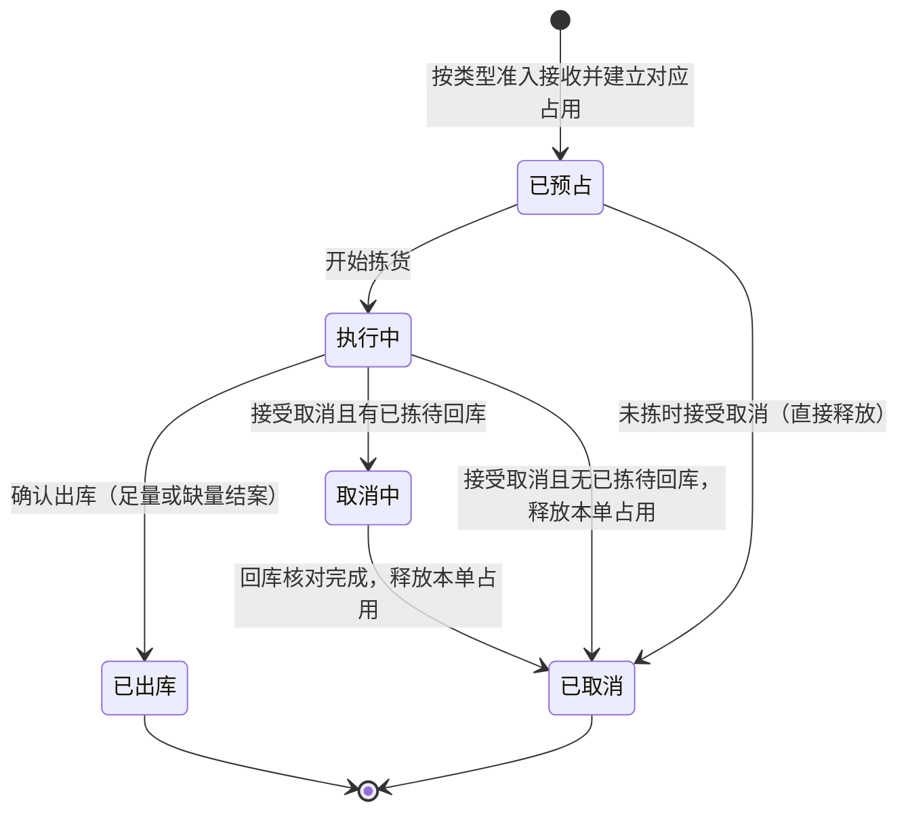
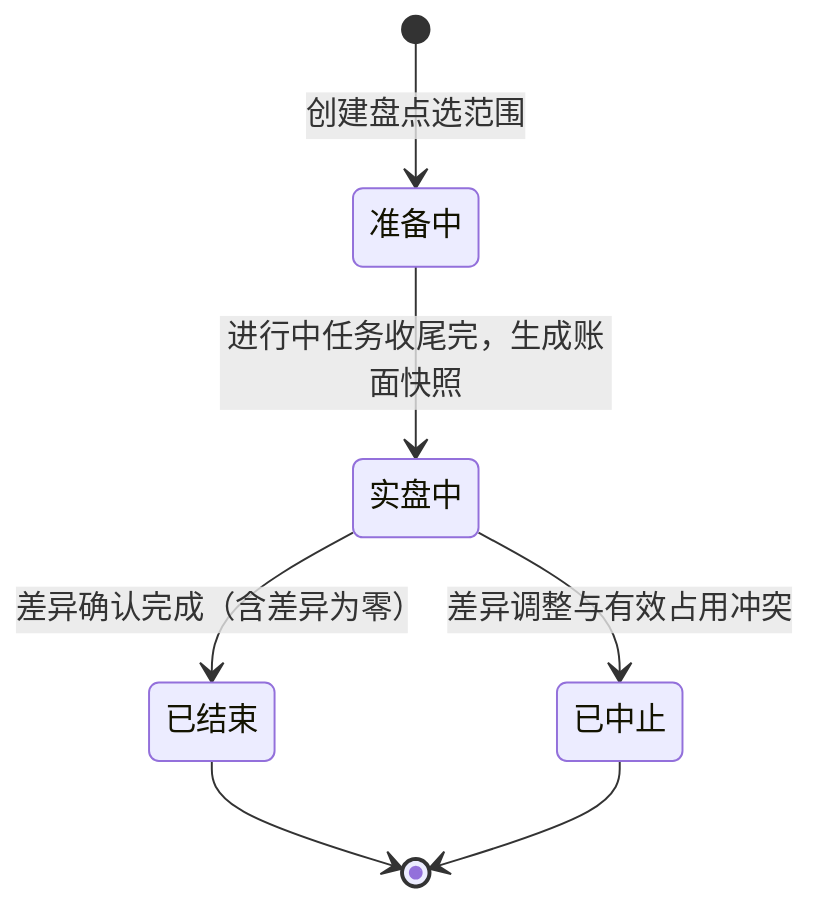
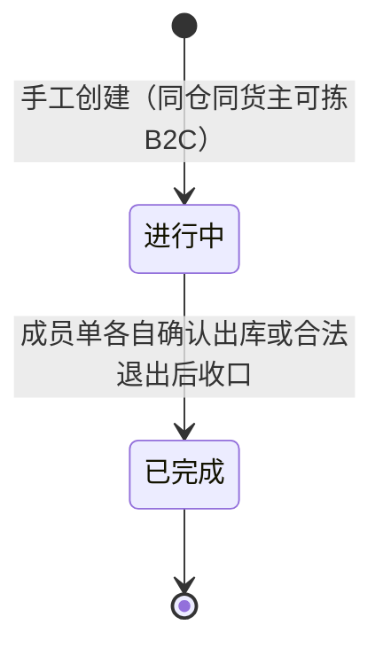

# 单据与状态流转

> 本文维护单据状态、允许操作、校验与联动，供研发与测试使用。仓库授权与动作权限见[05第四节](05-全局机制与权限配置.md#四权限点与默认角色矩阵)。
> 对象分层见[02第一节](02-实体对象关系.md#一对象清单)，业务后果见[业务设计](../../../04-业务分析和设计/00-业务蓝图.md)。一期无提交、审核、驳回等审批流，改变业务结果的人工操作按第一节命名。

| 版本 | 本次变化 | 状态 |
| --- | --- | --- |
| 2026-10-02 | 由ERP参考结构改写为WMS口径：全部状态机按入库、出库、盘点、处置等重写；数量公式按INV／IN／OUT确认口径收口 | 应用设计初稿；枚举随字段清单定名 |
| 2026-10-08 | 按OMS边界收敛无主货登记与入库取消；保留零实发阻断、取消分段释放及任务关闭 | 应用设计修订稿；[验收状态](00-系统与模块地图.md#版本与验收状态) |

## 一、单据总表

| 对象 | 所属模块 | 层 | 状态字段（草案） | 来源 | 下游／交付 |
| --- | --- | --- | --- | --- | --- |
| 入库单 | 入库 | 执行单据 | 单据状态＋差异标记（短少／超收／不良／已收损失） | OMS Mock指令 | 收货、质检、上架记录；执行结果按原指令交OMS Mock |
| 出库单 | 出库 | 执行单据 | 单据状态＋缺货标记＋结案标记与未发量（缺量类型） | OMS Mock指令；其他出库另有线下邮件手工来源 | 拣货、回库、交接记录；结果交OMS Mock或仓内可查 |
| 波次 | 出库 | 组织对象 | 组织状态 | 管理端手工创建 | 成员B2C出库单 |
| 盘点单 | 库存与库内 | 执行单据 | 盘点状态 | 管理端创建（范围：仓库／库区／货位／SKU） | 快照、实盘录入、差异调整与流水 |
| 无主货登记记录 | 入库 | 到货信息 | 已登记（等待后续OMS认领，一期不流转） | 无匹配指令且货主未知的到货 | 一期登记查询；后续推送OMS客户并由OMS认领、下发指令 |
| 质检任务、上架任务、拣货任务、移库作业 | 对应模块 | 作业任务（挂单据） | 任务状态 | 由单据触发生成 | 各类事实记录 |
| 上游消息（新建／变更／取消） | 系统集成 | 交互记录 | 请求结论 | OMS Mock推送 | 交给对应业务对象与结果交接 |

**确认动作怎么叫**：一期没有“提交-审核”审批状态，不会出现驳回、撤回这类流转。改变账目或单据行终止的人工动作统一叫“确认”：

| 动作 | 执行对象 | 名称 | 前置与留痕 |
| --- | --- | --- | --- |
| 确认收货完结 | 入库单 | 收货完结确认 | 累计实收大于0且已确认不再继续接收；留操作者、时间，未收转为最终短少；零实收不允许确认完结，保持待收货，保留到货／拒收并线下通知上游；OMS取消待上线 |
| 确认出库 | 出库单 | 确认出库 | 复核及本类型数量条件通过；平台仓转运／B2B至少一项明细实发大于0，其余类型须足量；按实发扣库，留确认与交接信息 |
| 确认盘点调整 | 盘点单 | 差异确认 | 核实快照与实盘；调整不越有效占用、不为负；不良短少同步调减品质锁 |
| 接受／拒绝（上游请求） | 上游消息 | 接受、拒绝（返回原因） | 按当前执行节点判断；接受后执行对应后果 |

动作命名只区分事件，不新增状态；重复确认、重复提交都幂等地返回已有结果。

## 二、状态与操作：入库单（正常、调拨共用）

**一期单据状态**：

- 指令准入拒收不建入库单，只留拒收记录；已建单的来货拒收保留到货与拒收事实。零实收且不再接收时仍保持待收货，仓库线下通知上游；WMS不提供取消或零实收完成入口。
- 入库取消待OMS上线，由OMS发起，WMS只在无任何实收时接受，届时原单转已取消并保留到货／拒收记录。此流转不属于一期状态机或Mock演示。
- 收货完结是动作，须实收大于0且不再接收。完结后如尚有需检、未上架或未处理的真实损失，仍为收货中；全部收口后系统置已完成。
- 差异标记独立记录，已完成的单可有最终短少、超收、不良或已收损失；短少不否定已收数量。

| 状态 | 可执行操作 | 前置条件与校验 | 结果与联动 |
| --- | --- | --- | --- |
| 待收货 | 查看、登记到货、收货、接收上游明细变更 | 变更须无任何实收；不提供取消或零实收完结操作 | 首次有效实收后进入收货中；全量拒收或不再到货且实收为0，保持待收货，保留记录并线下通知上游 |
| 收货中 | 收货（分批）、质检／免检品质登记、上架（分批）、丢失异常确认、收货完结确认 | 收货完结后不再实收；校验效期、SN／批次／日期；上架不超可上架量，货主、品质、形态适配 | 各次事实生效并累计；已实收不得取消或明细变更，原事实保留 |
| 已完成 | 查看、追溯、结果可查 | — | 结果按原指令交回OMS Mock；差异如实标注，后续退回或处置走独立业务 |

**真实丢失异常**：授权仓库人员核实原实收、现场剩余与损失依据；剩余实物按配置检验并实际落位，异常账面上架与立即关联盘亏同次生效。未收短少与已收损失分别记录，未盘亏的中间账面量不开放预占。损失尚未收口、剩余需检或落位尚未完成时，保持收货中；原实收误记不能按丢失清零进度。数量与流水见[02第四节](02-实体对象关系.md)，冻结约束仍适用。

**调拨入库差异**：与正常入库同一状态机；接收时不要求调出仓单号、不参与两端核对，本仓实收就是唯一事实。
**无主货差异**：一期登记信息不进入本状态机。OMS上线后，认领由OMS完成并下发入库指令，WMS再按普通入库执行，不提供手工入库例外。

## 三、状态与操作：出库单（六类共用，差异另列）

**单据状态**（缺货、装箱变化等是标记与记录，不单设状态）：“已预占”表示有效接收并完成占用计算；允许部分预占的类型可能占0，此时没有可执行量，保留缺货等待，不因状态名称虚构可拣量。

| 状态 | 可执行操作 | 前置条件与校验 | 结果与联动 |
| --- | --- | --- | --- |
| 已预占 | 查看、明细变更、分配拣货、缺货单人工重试、开始拣货、取消（未拣） | 明细变更须未开始拣货并按类型原子重算，失败保持原需求与原占用；盘点命中范围内未开始任务不启动；缺货时保留标记等待 | 接受取消即释放预占并回上游结论；缺货标记不阻塞已预占部分执行，可拣即继续 |
| 执行中 | 拣货、换位（解旧分新）、缺货单人工重试、回库、复核打包／大货核对、确认出库、接受取消 | 扫描不匹配阻断；明细变更开始拣货后拒绝；足量类型不足时禁止确认；缺量类型结案前已拣未发须先回库核对 | 确认出库按实发扣实际库存与对应本单预占，缺量结案同时释放未发占用；交接登记随确认记录 |
| 取消中 | 查看、回库核对、查询取消进度 | 禁止继续拣货、复核发货、确认出库、变更或人工恢复；未拣部分接受取消时释放，已拣未发部分核对身份、数量、位置并回库 | 只保留已拣待回库部分的本单占用；对应实物回库后释放剩余占用及分配，全部收口后置已取消并交最终结果，其他锁定保留 |
| 已出库 | 查看、结果与流水追溯 | — | 上游来源结果交回OMS Mock，手工来源仓内可查；允许缺量类型一次性结案含未发量；确认后不得取消或变更，撤销请求走上游其他业务，不回写已出库事实 |
| 已取消 | 查看历史 | — | 未拣直接释放；已拣必须回库核对后才释放；取消处理留痕 |

**已接收缺货单人工恢复：**普通出库库存补齐后由授权仓库人员触发，校验原单仍有效、未进入取消中、已取消或结案及本仓本货主可用量、盘点、品质、效期。只补当前未履约且未占足的缺口，既有有效占用及已拣数量不重复累计，货位分配不另增预占；库存增加本身不恢复。重试后仍不足保留缺货；取消中、已取消或已出库禁止恢复，原拒收请求由上游重提。不良品其他出库按指定实物处置，不从正常可用量补占。完整数量例见[出库业务设计第9.6节](../../../04-业务分析和设计/03-出库业务设计.md#96-模拟补充分支已接收缺货单补货后人工恢复)。

**类型差异**：

- **B2C包裹履约**：所有SKU足量预占才接收，任一不足整单拒收、不建待受理单、不留部分占用；不允许缺量。已有效接收后整仓缺货时保留预占与缺货标记，等待OMS Mock取消或补货后仓库人工恢复；取消前不释放。基础波次可选（见第六节），波次完成不替单据确认。
- **平台仓转运、当地B2B**：至少一项明细实发大于0才可缺量确认；零实发继续等待或合法取消。一次确认即整单结案（已出库＋未发量＞0的结案标记）；已拣未发须先回库核对；结案后原单不续发，余量由上游另发新单；B2B按单摘果、复核箱托容器。
- **调拨出库**：足量确认；本仓结果独立交付，不与调入仓配对、不在WMS内描述两端差异。
- **退回出库**：足量确认；引用有效原入库及拟退回正常品的库存来源，货物须已按配置完成必要质检与上架；不以整张原入库状态已完成为额外接单门槛；原入库不冲销；临期正品可以退回，不良品走其他出库。
- **不良品其他出库（上游通知）**：不走正常可用预占路径；登记指定实物处置占用（品质锁并集、不重复计）；足量确认后扣实际与对应品质锁。
- **不良品其他出库（线下邮件手工）**：入口在出库单管理页按邮件依据手工创建，记录来源；其余同上，不伪造上游指令关联。
- 平台仓容器变化：影响货主既有箱唛、预约或运输资料时等待资料确认；否则仓库更新并通知。等待期间未确认出库，实际与原占用保持。
- 新出库命中盘点阻断：整单拒收，不预占、不建待受理单；盘点结束后由上游重提。
- 取消边界：任何类型，确认出库后不得取消；上游是否已揽收不影响本状态机（揽收是仓外事实）。

## 四、作业任务与现场记录

质检、上架、拣货任务挂在执行单据或波次下；移库是库存域作业，不另建执行单据。任务状态与已发生的事实分别保存。

| 任务 | 触发与生成 | 状态 | 说明 |
| --- | --- | --- | --- |
| 质检任务 | 需检商品的已收数量 | 待执行 → 执行中 → 已完成；损失收口关闭未检缺失量 | 记录质检方式、正常／不良数量、原因、操作者；免检残损由授权人员直接登记判定，不生成任务；需检部分未完成质检不能上架 |
| 上架任务 | 正常品与不良品分别生成 | 待执行 → 执行中 → 已完成；未执行量随原业务结束时为已关闭 | 推荐位＋人工改位；支持部分上架；落位确认即上架事实；全部上架后任务完成；尚未落位量不算库存，目标位置的货主占用用于防混放，不计第二份库存预占 |
| 拣货任务 | 出库单或波次生成 | 待拣货 → 执行中 → 已完成；未执行量随原业务结束时为已关闭 | 锁定建议货位与数量；扫描校验货位、SKU、批次／SN；换位释放重推；短拣与缺货如实记录 |
| 移库作业 | 管理端或PDA发起 | 待执行 → 执行中 → 已完成 | 源位实际核对、目标位归属与品质适配；调错、重复提交幂等；三量不变 |
| 实盘录入 | 盘点单实盘期内 | — | 按位、货主、SKU、批次／SN、品质清点或扫SN；录入与差异一并留痕 |

任务取值按上表使用，“已关闭”只表示原业务已合法取消、缺量结案或损失收口，不表示未执行量已执行。关闭时保留已执行结果，并按原业务处理分配与占用；不增加独立取消任务入口。已完成或已关闭任务不再接受新执行提交，正常任务可从待执行直接确认完成，部分执行须记录执行中。

**现场事实记录**（实收、质检结果、上架、分配、拣出、回库、确认出库、交接登记）：

- 写入即事实，不设编辑与撤销；一期实收误记不提供更正，按域内异常规则处理（不再重复累计）。
- 管理端与PDA双端提交同一记录，重复提交返回已有结果，不重复生成库存影响。
- 关键确认动作留操作者、时间、原单与结果（COM留痕要求）。
- 确认出库时登记已有交接信息；后续实际交接或补充凭证以新增记录关联原单，不覆盖原确认，也不再次扣库。模拟运单不作为真实交付证明。

## 五、状态与操作：盘点单

| 状态 | 可执行操作 | 前置条件与校验 | 结果与联动 |
| --- | --- | --- | --- |
| 准备中 | 查看、范围确认、命中任务协调收尾 | 命中范围内未开始的收货、上架、拣货、移库等任务整单不得开始；已开始且已锁定或占用库存的任务执行至整单完成 | 收尾后系统生成快照（实际、归属、位置、品质明细）并进入实盘中 |
| 实盘中 | PDA实盘录入或扫SN、差异核对、差异确认 | 范围内其他业务库存变化不得提交；本盘差异调整与跨日过期即时转不良是盘点冻结的例外；调整按结束后仍有效占用校验，不为负 | 确认调整生成本次差异流水；不良短少同步减品质锁；冲突则中止 |
| 已结束 | 查看、结果追溯 | 结束时系统已经解除本盘冻结 | 订单、品质、处置等其他锁定继续保留；可用恢复以无其他锁为准 |
| 已中止 | 查看；重新建盘 | 中止不调账、解除本盘冻结；旧快照与实盘保留 | 有效占用按原业务取消、回库释放后，重新选范围建新盘 |

## 六、状态与操作：波次

- 波次不新增预占、不改单据需求；生成波次拣货任务集中拣货，各成员单仍分别复核、确认出库与回传。
- 成员增删：未开始拣货的成员可移出；已拣成员随单据取消流程回库后退出。
- 波次已完成表示组织收口，不表示所有货物已交付；成员单据以自己的状态为准。

## 七、状态与操作：无主货登记记录

**无主货登记记录**：

一期状态只有“已登记”，等待后续OMS认领，提供登记与查看，不设确认归属、认领或生成入库单的动作及状态流转。记录所在仓库、暂存位置和实物识别线索；不得计入任何货主实收或库存、上架、出库或库存实盘。

OMS上线后，信息面向所有OMS客户展示，由客户在OMS认领，再由OMS下发入库指令；WMS收到有效指令后进入普通入库链路。后续OMS认领结果及关联方式届时细化。

## 八、上游消息处理结论

新建、变更、取消的请求结论与执行结果分别保存；接受取消不表示已拣实物已经回库或全部占用已经释放。消息身份、预期版本、重复、冲突及拒收原因统一见[06第二～四节](06-接口与OMS Mock消息设计.md)。执行节点按本篇入库与出库操作表校验；身份字段（仓库、货主、业务类型）不得原单改写。

## 九、数量与记账依据

完整公式、异常入库口径及流水类型集中见[02第四节](02-实体对象关系.md)，一致性约束见该文第七节。本篇只在操作表说明哪个动作改变数量：收货、质检与无主货登记不增加库存；上架或已确认异常收口形成入库增量；确认出库、盘点差异调整产生对应库存变化。拣出与货位分配不提前扣库，分配也不另增预占。

## 十、结果交接与回写规则

| 从哪里 | 交出什么 | 时机与去向 |
| --- | --- | --- |
| 入库单 | 各次实收、品质、实际落位、未处理进度、收货完结、最终短少与差异；异常另含现场剩余、损失、账面结转及盘亏；整单完成 | 每次事实生效后按原指令交OMS Mock；送达失败只重交已有结果 |
| 出库单 | 需求、预占、实发、未发、短拣、确认出库、交接、结案（缺量类型一次性） | 同上 |
| 上游消息 | 接受／拒绝结论与原因 | 结论形成后即可交 |
| 无效指令 | 拒收原因（不下发单据） | 处理完成即可交 |
| 无主货登记 | 到货、暂存及识别线索，无入库执行结果 | 一期WMS内可查；后续推送OMS客户查看和认领 |
| 手工其他出库 | 执行结果与线下邮件依据，不伪造上游关联 | 记录生成后可查；不强制建立上游关联 |
| 盘点单 | 差异调整结果与流水 | 确认调整后生成 |

作业事实更新单据累计、状态与上游结果；允许节点内的明细变更只改变业务要求，不能改写已发生的实收、拣货或出库事实。库存变化须关联原业务或盘点依据及流水，重复传送与确认不重复生效。

## 十一、权限怎么处理

仓库数据范围、动作权限和留痕集中见[05第四～五节](05-全局机制与权限配置.md)。角色授权不替代本篇的状态与业务校验，不新增审批层级；关键确认权限集中于仓库主管，作业与常规收发确认独立配置，按该文第四节的已确认矩阵执行。

## 十二、跨对象联动的检查入口

改动状态后核对[01](01-系统流程与单据交互.md)的触发与异常路径、[02](02-实体对象关系.md)的数量／关联、[05](05-全局机制与权限配置.md)的动作权限及[06](06-接口与OMS Mock消息设计.md)的请求结论与结果时序。盘点冻结的例外只按第五节执行，不能由其他单据自行绕过。
