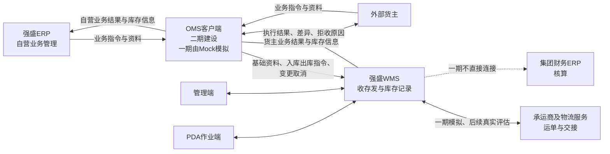

# 系统边界与上下游链路总览

> 本文说明外部系统分工、输入输出、一期模拟范围与跨系统结果约定。内部模块见[00-系统与模块地图](00-系统与模块地图.md)，执行流程见[01-系统流程与单据交互](01-系统流程与单据交互.md)。
> 依据：[项目定位与范围](../../../01-全局背景信息/01-项目定位与范围.md)、[能力蓝图与系统协作](../../../01-全局背景信息/02-能力蓝图与系统协作.md)、[阶段规划与一期交付标准](../../../01-全局背景信息/03-阶段规划与一期交付标准.md)、[系统集成与对接需求分析](../../../03-需求调研和分析/06-系统集成与对接/系统集成与对接需求分析.md)（INT-FR-001～006）、[上游协作与结果交接设计](../../../04-业务分析和设计/05-上游协作与结果交接设计.md)。

| 版本 | 本次变化 | 状态 |
| --- | --- | --- |
| 2026-10-02 | 初稿：目标协作全景与Mock边界 | 应用设计初稿 |
| 2026-10-08 | 修正退回与上游输入表述，内部流程改为引用，清理过期未决 | 应用设计修订稿；[验收状态](00-系统与模块地图.md#版本与验收状态) |

## 一、目标协作全景

目标生产链路是「ERP或货主业务先进入OMS，由OMS向WMS推送资料与指令，WMS执行仓内收存发并交回结果」。立项前由第三方海外仓履约，自营仓及外部货主业务是目标／课程设计。一期由OMS Mock扮演OMS；货主自助与ERP直连都不在WMS展开。

一期与二期的落位分工：

| 组成 | 一期形态 | 目标形态与时机 |
| --- | --- | --- |
| 强盛WMS＋管理端＋PDA | 一期建设并演示四仓多货主 | 持续演进 |
| OMS客户端 | OMS Mock模拟推送与接收 | 二期建设真实客户端，功能深度在二期设计定 |
| 货主自助端 | 一期没有外部货主自助端 | OMS上线后查看无主货信息、发起或确认认领；OMS再向WMS下发入库指令 |
| 强盛ERP | 不接入WMS | 目标经OMS间接协作；接入深度后续设计 |
| 承运商服务（运单、轨迹） | 承运商Mock提供模拟运单与交接信息 | 真实接入随后续阶段评估；演示不声称真实揽收 |
| 入库取消 | 一期不实现，零实收单保持待收货，仓库线下通知上游 | OMS上线后由上游发起，WMS按无实收条件接受；不提供WMS手工取消 |
| 客户退货接收 | 不在一期（客户退货入库、质检、重新入库） | 二期或三期再规划 |
| 商业计费 | 不在一期 | 后续评估归属 |
| 深圳国内仓 | 不在一期 | 后续扩展 |

## 二、外部系统逐个边界

| 系统 | 职责 | 与WMS交换什么 | 不交给WMS什么 | 一期形态 |
| --- | --- | --- | --- | --- |
| OMS Mock（未来的OMS客户端） | 业务接入与协作的上游角色 | 货主、商品基础资料及更新；正常入库、调拨入库指令；B2C、平台仓转运、B2B、调拨出库、退回出库、不良品其他出库指令；明细变更与出库取消消息；接收各类执行结果、差异与拒收原因 | 不模拟渠道经营、销售承诺与计费 | 后台模拟＋可查的收发记录演示（形态见06） |
| 强盛ERP | 自营采购与供应链业务的业务管理 | 一期无直接交换；目标经OMS把业务指令带进WMS | 不向WMS直推；全局库存协同决策不进入WMS | 不接入 |
| 承运商Mock | 模拟物流服务 | 模拟运单、服务产品与交接信息（面单、揽收、凭证为模拟数据） | 不提供真实运单、真实轨迹、真实揽收 | 模拟表单＋交接登记页 |
| 集团财务ERP | 存货成本、总账与正式核算 | 无直接交换 | 不因WMS结果自动触发核算；货主账单、结算、发票均不进WMS | 不接入 |
| 打印机、电子秤 | 仓内设备 | 模拟或手工数据 | 无真实设备集成 | 模拟 |
| PDA作业端 | WMS自身的现场作业端 | 与管理端共用同一业务记录与库存流水 | 不是外部系统，不属于「外部协作」 | 一期建设范围内 |

## 三、跨系统结果约定

以下约定说明当前设计中的跨系统边界，不扩展后续阶段范围：

| 约定 | 内容 | 依据 |
| --- | --- | --- |
| 调拨两端不衔接 | 调出仓按出库指令执行到确认出库，调入仓按入库指令执行到上架完成；WMS不建跨仓主单、不生成在途账、不做两端差异对账，数量差异由上游解释 | 分析总览“核心业务链路”、INT-FR-004、[出库业务设计](../../../04-业务分析和设计/03-出库业务设计.md) |
| 退回不冲销原入库 | 已收入库拒绝取消；拟退回正常品按配置完成必要质检与上架、形成实际库存后，走独立退回出库指令并引用原入库，原入库的实收、上架与流水不反向改写 | IN-FR-008、OUT-FR-013 |
| 事实不随上游回写 | 消息重复、结果送达失败或上游补充说明都不改写已发生的实物事实与库存流水；送达失败只重交已有结果 | INT-FR-003／004 |
| 缺量结案不续发 | 平台仓转运、B2B至少有实际发出量才可按实发一次结案，零实发等待或合法取消，未发量如实交上游另发新单；WMS不保留原单续发任务 | OUT-FR-006／007 |
| 财务与账单不进WMS | 存货成本、总账、货主账单与计费不属于WMS职责；WMS只交执行结果供上游使用 | [项目定位与范围](../../../01-全局背景信息/01-项目定位与范围.md) |
| 效期与履约判断不随展示时区漂移 | 展示时区切换（页面右上角）只改显示与导出；履约时限与效期判断按业务所属仓库当地时区 | COM-FR-002 |

## 四、链路阅读入口

内部流程统一见[01-系统流程与单据交互](01-系统流程与单据交互.md)：资料与指令见第1节，入库与无主货登记见第2～3节，出库见第4节，品质、库内与盘点见第5～7节，结果交接见第8节。本档不复制内部流程图、预占公式或单据完成条件。

## 五、关键走查场景

主链、异常及公共机制的演示准备统一见[业务场景设计](../../../04-业务分析和设计/06-海外仓典型业务场景与方案.md#84-关键走查场景)。执行时核对单据、库存和流水，尚未执行的场景不记为已验收。

## 六、演示形态与技术边界

一期交付目标是可运行的演示系统：管理端与PDA同一业务记录；演示数据预置；OMS Mock与承运商Mock按清单注入输入、接收结果。Mock采用管理端内置收发台，形态与数据注入边界见06，具体实现落在`09-产品原型`。本次只修订设计，未核验原型覆盖。演示跑通不等于生产部署、真实接口或并发吞吐已经验证；验收时记录实际端、单据号、前后数量与异常结果。

## 七、范围外的快捷索引

完整范围清单见[项目定位与范围](../../../01-全局背景信息/01-项目定位与范围.md)，本期功能与菜单见[00-系统与模块地图](00-系统与模块地图.md)。业务已经确认的接单拒收、已收未上架丢失和装箱资料条件按01～03及06执行，不再作为未决问题。
