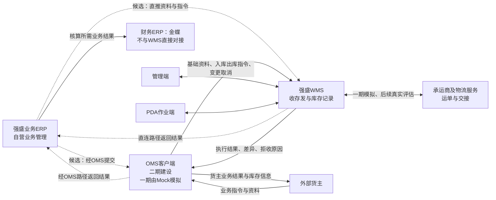

# 系统边界与上下游链路总览

> 本文说明外部系统分工、输入输出、一期模拟范围与跨系统结果约定；**不**展开仓内流程图、数量公式或单据状态表。
> 内部模块见《系统与模块地图》，仓内链路见《系统流程与单据交互》（章节索引见第四节），对象与状态见《实体对象关系》《单据与状态流转》。
> 背景与范围见全局背景信息；协作分工见业务设计《上游协作与结果交接设计》。应用设计权限与公共机制见《全局机制与权限配置》（本目录两篇「05」分工见 [README](README.md)）。

| 版本 | 本次变化 | 状态 |
| --- | --- | --- |
| 2026-10-02 | 初稿：目标协作全景与 Mock 边界 | 应用设计初稿 |
| 2026-10-08 | 修正退回与上游输入表述；内部流程改为引用 | 应用设计修订稿 |
| 2026-10-11 | 链路阅读入口改为流程篇中文章节名 | 应用设计修订稿 |
| 2026-10-12 | 收敛跨系统约定；演示边界与第七节表述与 README 对齐 | 应用设计修订稿 |

## 一、目标协作全景

目标协作中，外部货主经 OMS 接入；强盛自营业务 ERP 直连 WMS 或经 OMS 接入，两种路径尚未确定，WMS 沿实际指令来源交回结果。立项前由第三方海外仓履约；自营四仓与外部货主为课程沙盘下的目标形态。一期由 OMS Mock 扮演 OMS，承运商 Mock 扮演物流服务；货主自助、ERP/财务直连与真实设备均不在 WMS 一期展开。

图中虚线为自营业务候选路径；目标协作不表示真实接口已建成。

一期与二期的落位分工：

| 组成 | 一期形态 | 目标形态与时机 |
| --- | --- | --- |
| 强盛 WMS＋管理端＋PDA | 一期建设并演示四仓多货主 | 持续演进 |
| OMS 客户端 | OMS Mock 模拟推送与接收 | 二期建设真实客户端 |
| 货主自助端 | 一期无 | OMS 上线后查看无主货、认领；再向 WMS 下发入库指令 |
| 强盛 ERP | 不接入 WMS | 直连 WMS 或经 OMS 接入，两种路径待定 |
| 承运商服务 | 承运商 Mock 模拟运单与交接 | 真实接入后续评估；演示不声称真实揽收 |
| 入库取消 | 一期不实现；零实收保持待收货，仓内线下通知上游 | OMS 上线后上游发起，无实收方可接受 |
| 客户退货入库 | 不在一期 | 后续阶段；与「退回出库」方向不同 |
| 商业计费、深圳国内仓 | 不在一期 | 后续评估或扩展 |
| 报损/销毁及报损后非库存暂存 | 不在一期 | 后续阶段 |

## 二、外部系统逐个边界

| 系统 | 职责 | 与 WMS 交换什么 | 不交给 WMS 什么 | 一期形态 |
| --- | --- | --- | --- | --- |
| OMS Mock（未来 OMS 客户端） | 业务接入与协作的上游 | 货主、商品及更新；正常/调拨入库指令；六类出库指令；明细变更与出库取消；接收执行结果、差异与拒收原因 | 渠道经营、销售承诺、计费 | 内置收发台＋可查记录（见《接口与 OMS Mock 消息设计》） |
| 强盛 ERP | 自营供应链业务管理 | 一期无直接交换 | 全局库存协同决策、采购销售业务管理 | 不接入 |
| 承运商 Mock | 模拟物流 | 模拟运单、服务产品与交接信息 | 真实运单、轨迹、揽收 | 交接登记与模拟数据 |
| 集团财务 ERP | 成本与核算 | 无直接交换 | 自动触发核算、账单与发票 | 不接入 |
| 打印机、电子秤 | 仓内设备 | 模拟或手工数据 | 真实设备驱动 | 模拟 |
| PDA 作业端 | WMS 现场端 | 与管理端共用业务记录与流水 | （非外部协作方） | 一期建设范围内 |

## 三、跨系统结果约定

下列约定只划**系统间**责任，不扩展一期产品范围；仓内如何执行见流程篇与状态篇。

| 约定 | 内容 |
| --- | --- |
| 调拨两端不衔接 | 调出仓做到确认出库，调入仓做到上架完成；WMS 不建跨仓主单、在途账或两端对账，差异由上游解释 |
| 退回不冲销原入库 | 拟退回品须先形成可指派的在库库存；独立退回出库指令引用原入库，不改写原入库实收、上架与流水 |
| 客户退货≠退回出库 | 客户退货是货物退回仓库的入库方向，一期不做；退回出库是从仓内退回仓外，一期可做 |
| B2C 不足整单拒收 | 接单阶段任一 SKU 不可足量预占则整单拒收，不建单、不留部分占用 |
| 事实不随上游回写 | 消息重复、送达失败或上游补充说明不改写已发生事实与流水；失败只重交已有结果 |
| 缺量结案不续发 | 平台仓、B2B 须至少有实发才可一次结案；未发量交上游，原单不续发 |
| 财务与计费不进 WMS | WMS 只交执行结果，不承担成本、账单与结算 |
| 效期与履约时区 | 页面展示时区可切换；效期与履约判断按**业务所属仓库**当地时区 |
| 差异限制新出库 | 受影响仓库＋货主＋SKU的新单整单拒收；主管确认差异处理完成后解除，盘点中止不自动解除；手工其他出库同样适用 |
| 盘点阻断新出库 | 命中盘点冻结范围的新出库指令整单拒收，盘点结束后由上游重提 |

业务设计中的数量走查与协作细节，分别在出库、入库、库存与库内及上游协作各域展开；本篇不重复论证。

## 四、链路阅读入口

仓内执行见 [系统流程与单据交互](01-系统流程与单据交互.md)：

| 主题 | 对应章节 |
| --- | --- |
| 资料准备、指令接收、变更与取消 | 一、资料准备与指令接收 |
| 正常入库、调拨入库（含新品维护、混合到货） | 二、正常入库与调拨入库 |
| 无主货登记与后续 OMS 认领 | 三、无主货登记与后续 OMS 认领 |
| 六类出库、波次、取消与返库上架 | 四、出库（六类） |
| 在库受损与品质转换 | 五、在库受损与品质转换 |
| 移库 | 六、移库（库内作业） |
| 盘点 | 七、盘点 |
| 结果交接、幂等与 Mock 协作口径 | 八、结果交接与请求幂等 |

## 五、关键走查场景

主链、异常与公共能力的演示准备见业务设计《海外仓典型业务场景与方案》中的关键走查场景索引。执行时核对单据、库存与流水；未跑通的场景不记为已验收。

## 六、演示形态与技术边界

一期按**本机运行的演示系统**交付（课程沙盘）。PDA采用浏览器页面，模拟扫码输入；验收覆盖页面操作、扫码校验及与管理端的数据一致性，一期不要求实体PDA真机验收。启动、访问、数据保存及样例恢复步骤在交付说明中补齐。

管理端与 PDA 同一业务记录；演示数据可预置；OMS Mock 与承运商 Mock 按清单注入输入并接收结果。Mock 采用管理端内置收发台，消息形态见《接口与 OMS Mock 消息设计》；界面以产品原型为实现参考，**不以原型当前实现反向覆盖**本目录已确认规则。

演示跑通不等于生产部署、真实接口、设备集成或并发能力已验证；亦不等于页面、字段样例与 PDA 实操已全部验收。验收宜记录实际端、单据号、前后数量与异常结果。

## 七、范围与真源索引

| 主题 | 查阅 |
| --- | --- |
| 一期范围取舍完整清单 | 《项目定位与范围》（全局背景信息） |
| 模块、菜单、资料流 | 《系统与模块地图》 |
| 接单拒收、丢失异常、装箱资料等已确认规则 | 《系统流程与单据交互》《实体对象关系》《单据与状态流转》《接口与 OMS Mock 消息设计》 |
| 真源分工与按角色选读 | [README](README.md) |

本目录承接已确认业务规则；字段与页面落实、演示覆盖仍需继续核验，当前交付缺口见 [README](README.md#交付待补与待确认)。文档修订不代表演示验收通过。

目标协作全景图见全局背景《能力蓝图与系统协作》；协作业务规则见业务设计《上游协作与结果交接设计》。
