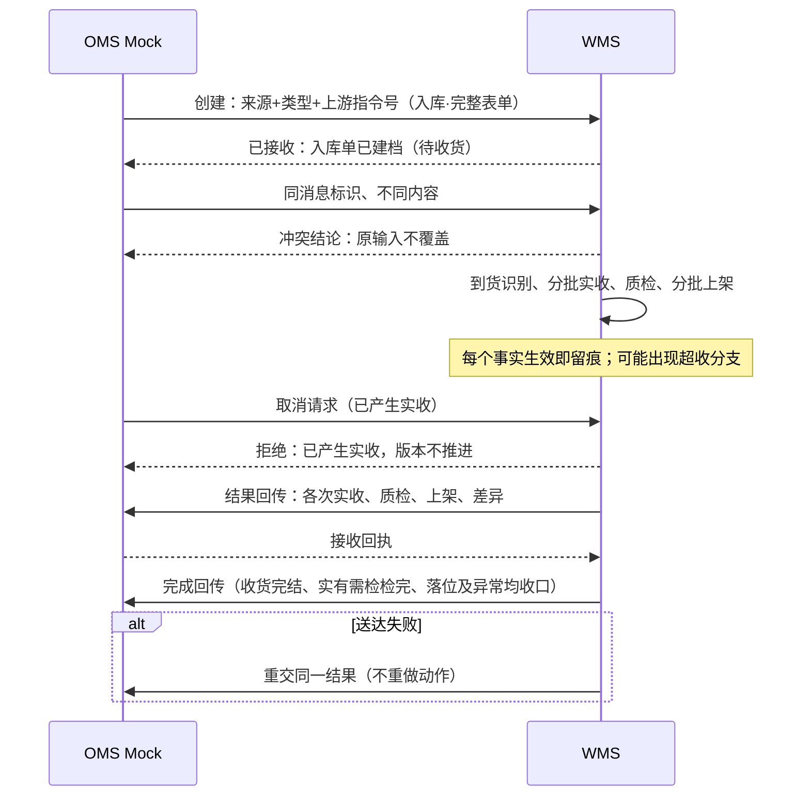
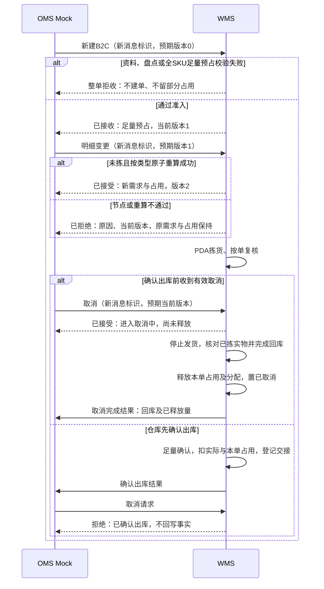

# 接口与OMS Mock消息设计

> 用途：收口OMS Mock与WMS之间的消息模型——消息类别、业务对象识别与幂等键、每条请求的结论回执、典型时序、拒收原因口径与结果重交机制。业务后果（哪条能接受、哪条拒绝）以[05-上游协作与结果交接设计](../../../04-业务分析和设计/05-上游协作与结果交接设计.md)和[03-单据与状态流转](03-单据与状态流转.md)为准，本文只定系统交接形态；字段级清单归`../字段清单合集`。真实接口协议（REST／MQ等）不在一期，演示环境按模拟表达（INT-FR-001～006）。
> 「来源＋业务类型＋上游指令号」用于定位同一上游业务对象；每条消息以消息标识去重，以预期对象版本校验顺序，见第二节（INT-FR-003）。

| 版本 | 本次变化 | 状态 |
| --- | --- | --- |
| 2026-10-02 | 初稿：消息类别、识别与幂等键、拒收原因、时序、重交、承运商Mock结构、演示形态建议 | 应用设计初稿；消息字段命名随字段清单收敛，真实接入随二期OMS设计 |
| 2026-10-08 | 明确内置Mock、消息身份与版本，补业务拒收与异常入库结果，区分取消受理和完成 | 应用设计修订稿；未执行接口或演示验收 |

## 一、消息类别总表

| 消息类别 | 方向 | 内容 | 识别键 | 结论回执 |
| --- | --- | --- | --- | --- |
| 基础资料推送 | Mock → WMS | 货主（自营预置除外）、商品及其更新；完整可匹配字段 | 来源＋消息标识；货主编码／货主内商品编码为业务身份，附预期版本 | 建立/更新；身份冲突或缺失拒收并回原因（不静默改写身份，MD-FR-009） |
| 新建业务指令 | Mock → WMS | 入库单（正常/调拨）、出库单（B2C/平台仓转运/B2B/调拨出库/退回出库/不良品其他出库）完整表单字段 | 业务对象键＋新消息标识＋预期对象版本0 | 按准入接收建档及对应占用；或整单拒收、不建档不留部分占用 |
| 明细变更 | Mock → WMS | 新明细与变更原因；指向既有业务对象 | 业务对象键＋新消息标识＋预期对象版本 | 接受（入库须无实收；出库须未开始拣货且预占原子重算成功）或拒绝（原因；原需求与原预占保持） |
| 取消 | Mock → WMS | 取消原因，指向既有业务对象 | 业务对象键＋新消息标识＋预期对象版本 | 接受回执或拒绝原因；接受后另交执行结果，已拣回库完成后才释放 |
| 重复消息（重发） | Mock → WMS | 与某条已处理消息同标识同内容 | 相同消息标识 | 返回该消息原有结论；不再建档、不重复预占、不重复扣库 |
| 同标识不同内容 | Mock → WMS | 与既有消息标识相同但内容不同 | 相同消息标识＋内容差异 | 记冲突，不静默覆盖；上游核对后按新的可区分请求提交 |
| 结果回传（入库） | WMS → Mock | 实收、品质、实际落位、未处理进度、完结与差异；异常另含现场剩余、损失、账面结转与盘亏；整单完成 | 关联原指令（业务对象键）＋结果序号 | Mock接收回执；失败留待重试 |
| 结果回传（出库） | WMS → Mock | 需求、预占、实发、未发、短拣、确认出库、交接信息、结案（缺量类型一次性） | 关联原指令＋结果序号 | 同上 |
| 请求结论回传 | WMS → Mock | 变更/取消的接受与拒绝结论及原因 | 关联对应消息标识 | 同上 |
| 拒收反馈 | WMS → Mock | 拒收原因（见第三节）与可定位的输入摘要 | 对应消息标识 | Mock侧可查；补齐后按新请求重新提交（新消息标识，版本按第二节） |
| 交接信息 | WMS → Mock（可查询） | 交接对象（承运商Mock/司机/自提）、凭证、模拟运单信息 | 关联出库单 | 随出库结果回传或查询提供 |

- 手工来源的其他出库没有上游指令与业务对象键：只保留邮件等线下依据，结果在WMS可查；不伪造上游关联（OUT-FR-014、05协作域§7.1）。
- 调拨出库与调拨入库分别按各自业务类型交换，不要求两端共用指令号，WMS不做两端衔接（INT-FR-001、分析总览“核心业务链路”）。
- 打印与称重数据为模拟或手工；PDA扫码属WMS内部功能，不是外部接口（INT-FR-005）。

## 二、消息身份、版本与处理顺序

以下是一期Mock应用约定，用于落实INT-FR-003，不指定未来真实接口协议。

| 标识 | 定义 | 作用 |
| --- | --- | --- |
| 业务对象键 | 来源＋业务类型＋上游指令号 | 定位一笔业务，有效新建后只对应一张执行单据；资料消息按货主／商品业务身份定位 |
| 消息标识 | 来源内唯一；新建、变更、取消及修正后重提各用新标识 | 同标识同内容返回原结论；同标识不同内容记冲突，不改变原单 |
| 预期对象版本 | 请求声明它基于哪个已接受版本；首次新建／资料建立为0 | 与WMS当前版本相同才进入执行节点校验，避免旧消息覆盖新状态 |
| 当前对象版本 | 首次接受新建后为1；接受一次合法变更或取消后加1 | 拒绝、冲突、重发、仓内作业或结果重交不推进；只表示上游请求的接受次序 |
| 结果序号 | 一份已发生结果的固定标识，关联原对象、事实和对应请求 | 重交使用原序号及原结果，不生成新事实 |

处理顺序：先按来源＋消息标识查原请求，重复直接返回原结论；非重复请求再定位业务对象、校验预期版本，最后按03的当前执行节点与业务条件判断。记录原输入、接收时间、接受／拒绝原因及处理前后版本，接受后返回当前版本。版本匹配不能绕过盘点、库存、品质、已实收或已拣等校验。

| 输入情况 | 处理结果 |
| --- | --- |
| 变更／取消先于有效新建到达 | 拒绝“业务对象尚未有效建立”，不缓存成待受理单；上游先完成新建后用新消息重提 |
| 预期版本低于当前版本 | 拒绝“对象版本已变化”，交当前版本与状态；上游核对后用新消息表达当前要求 |
| 预期版本高于当前版本 | 拒绝“前序请求尚未接受”，不跳版本；先核对缺失或失败的前序请求 |
| 同一旧版本并发提交不同请求 | 至多一条在校验通过后接受并推进版本，另一条重新校验后拒绝；不能均覆盖同一旧状态 |
| 已有对象再次收到新建 | 与原新建内容一致则返回原新建结论及当前状态，不再建单；内容不同提示走合法变更，不用新消息标识覆盖既有对象 |
| 原新建已拒收，条件已修正 | 尚无执行对象时以新消息标识、预期版本0重提，再做完整准入；重发旧消息仍返回旧拒收结论 |
| 已取消或结案后再发变更／恢复 | 按终态拒绝；版本更新不恢复原单。新业务另用新上游指令号；取消中的原单同样不允许变更或恢复 |

模拟例：新建预期0接受后版本1；变更预期1接受后版本2；晚到的另一变更预期1被拒。已拒消息重发仍返回该次拒绝，上游核对后以新消息标识、预期2提交才重新校验。业务单据状态与消息版本分开：仓库开始拣货不加消息版本，但会使后续明细变更不再允许。

## 三、拒收与拒绝原因

资料／格式错误、业务接单失败、已接收后的执行异常分别表达（INT-FR-002）。以下为原因类别，字段级编码在字段清单命名，不将列表冒充全部接口错误码。

| 原因类别 | 条件及结果 | 上游处置 |
| --- | --- | --- |
| 资料不存在、停用或归属不符 | 货主／商品无法匹配、商品不属该货主，不建执行单 | 补推或修正资料后以新消息重提 |
| 身份或编码冲突 | 不能匹配为同一对象，不静默改身份 | 核对业务身份，按资料规则处理 |
| 仓库范围或数量非法 | 仓库不在一期四仓、数量非正或格式非法 | 修正输入 |
| 必填字段缺失 | 按当前表单必填项校验；演示样例仍尽量填满完整表单 | 补齐后重提，不把非必填空值一律拒收 |
| 新出库命中盘点阻断 | 整单拒收，不建执行／待受理单，不留部分占用 | 盘点结束后上游重提 |
| B2C任一SKU不足 | 所有SKU足量预占失败，整单拒收且不留部分占用 | 补库存或调整业务要求后上游重提 |
| 退回来源或指定处置实物不合法 | 拟退回货物未形成合格库存来源；其他出库指定实物不在库或已被互斥处置 | 按OUT-FR-013／014解决，不用普通可用量替代指定实物 |
| 消息重复冲突、版本不符、对象不存在 | 按第二节返回对应结论，不推进业务 | 核对已接受版本与请求，再合法重提 |
| 变更／取消节点不允许 | 按03操作表拒绝并返回节点原因，原事实与有效占用保留 | 依据当前业务结果处理，不能反向改写 |

其他普通类型日常不足可部分预占接收并保留缺货；已接单后短拣或整仓缺货是执行异常，不回写为原新建拒收。拒收不扣库；变更重算失败保持原需求及原有效占用。

## 四、典型时序

**一次正常入库全链（含超收分支）**：

已收真实丢失的回传另含原实收、现场剩余、实际落位、损失身份及相互关联的异常账面上架／盘亏。不能用账面结转量表示全部实物已落位，且不补造缺失件质检或扫描。

**B2C出库的接受、变更与取消分支**：

两图是消息层的骨架示例；节点内业务动作与状态变化见01、03，不在时序图重复。

## 五、结果重交与送达状态

请求结论、执行结果和送达状态分开。接受取消的请求回执可先送达，已拣实物回库并释放后才形成取消完成结果；原请求重发返回原受理结论，当前取消进度另查，不重新释放。

| 送达状态 | 进入与退出 |
| --- | --- |
| 待发送 | 结果事实已经形成，尚未首次发送；首次发送成功转已送达，失败转待重试并留原因 |
| 待重试 | 发送失败后保留原结果、原因与尝试记录；重交成功转已送达，再失败仍待重试 |
| 已送达 | Mock已确认接收；重复接收返回已有回执，不重复生成业务结果 |

每次重交使用原结果序号和原结果内容，不重新触发收货、上架、盘亏、扣库或释放（INT-FR-004）。收发台支持人工重交与失败注入；自动重试间隔由技术设计选择。业务对象状态不因送达失败回退；按对象、请求和结果序号可查询已有事实与送达记录。

## 六、承运商Mock交接结构

| 要素 | 说明 |
| --- | --- |
| 模拟运单 | 承运商Mock提供运单号、服务方式、承运时段（均为模拟数据） |
| 交接对象 | 承运商Mock／司机／客户自提；交接类型与时间 |
| 凭证 | 交接凭据号或说明；照片按异常需要提供（不强制附件） |
| 登记位置 | 出库单的交接登记，随确认出库结果向Mock回传 |
| 边界 | 不证明真实揽收、真实配送或平台签收；揽收事实是仓外事件，不改变WMS完成与扣库节点（OUT-FR-006） |

## 七、一期Mock演示形态

本次应用设计采用管理端内置“Mock收发台”，置于“系统集成－指令与结果”入口；与仓内业务共用可追溯的演示记录，不另建设独立OMS系统（INT模块应用设计输入）。演示功能包括：

- 按完整表单推送基础资料、新建指令、变更和取消；可注入重复、冲突、版本错序及结果送达失败。
- 查看原输入、业务对象、消息结论、处理前后版本、执行结果与送达状态；支持重交已有结果。
- 承运商Mock提供模拟运单与交接数据，明确标注模拟；不宣称真实采购面单、揽收或配送。

一期不建设独立进程、真实协议或鉴权联调，后续真实OMS接入再评估。此处只确定应用形态与演示语义，数据库、API及部署方式由技术设计落实；09原型尚未据此实现，不将方案视为已验证功能。

## 八、字段级蓝图的归属

消息与表单的具体字段、值域、示例样值收在`../字段清单合集`（随各单据页面与字段清单起草）；本文档只定消息类别、识别键、结论与重交语义。字段清单的「业务表单完整字段」要求沿用INT-FR-001：演示样例尽量填满，不只发送最小建单字段。
