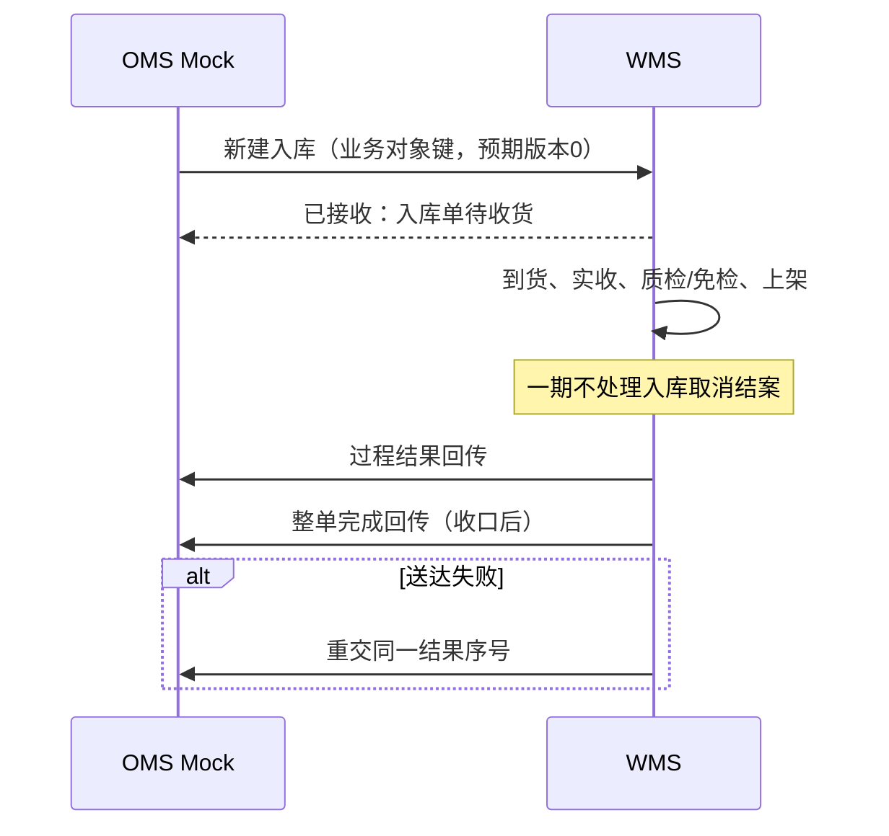
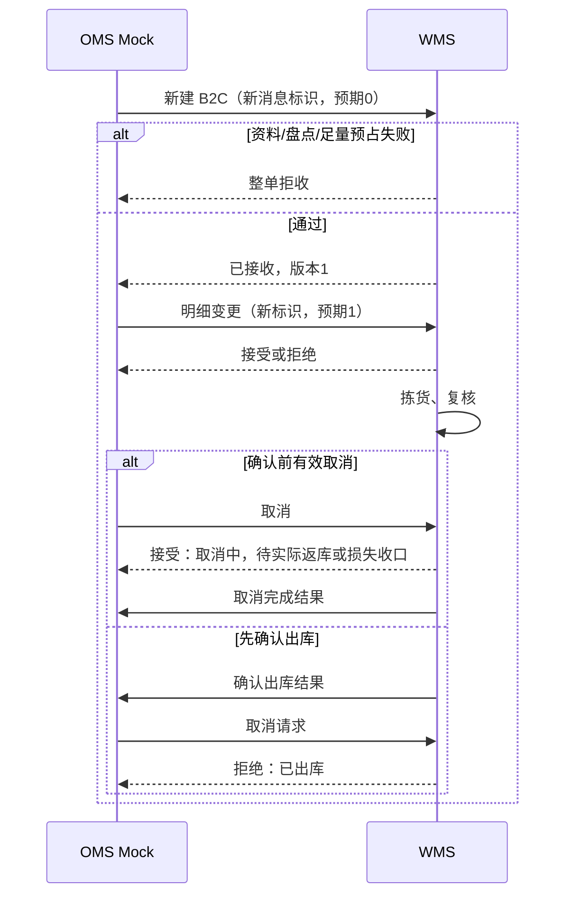

# 接口与 OMS Mock 消息设计

> 本文定义 OMS Mock 的**消息类别、身份、版本、请求回执、时序与结果重交**；一期不定义真实 OMS 接入协议。
> 接受或拒绝的**业务条件**见《单据与状态流转》与业务设计《上游协作与结果交接设计》。字段、映射与 JSON 样例见「字段清单合集·系统集成与对接 / OMS-Mock」。

| 版本 | 本次变化 | 状态 |
| --- | --- | --- |
| 2026-10-02 | 初稿：消息类别、幂等、拒收、时序、承运商 Mock、演示形态 | 应用设计初稿 |
| 2026-10-08 | 内置 Mock、消息版本；区分取消受理与取消完成；异常入库回传 | 应用设计修订稿 |
| 2026-10-12 | 风格对齐；一期边界收敛为消息侧条目，演示免责并入 04 | 应用设计修订稿 |

**两个标识（速览）**：`来源＋业务类型＋上游指令号` 定位同一上游业务对象；`消息标识` 去重，`预期对象版本` 校验顺序（详见第二节）。

## 一、维护位置与消息类别

| 主题 | 维护位置 |
| --- | --- |
| 外部系统边界、跨系统约定 | 《系统边界与上下游链路总览》 |
| 仓内执行与结果交接口径 | 《系统流程与单据交互》第八节 |
| 状态节点是否允许变更/取消 | 《单据与状态流转》 |
| **消息形态、幂等、拒收、重交、Mock 演示** | **本文** |
| 上游消息记录、回传记录字段 | 字段清单·系统集成 |

| 消息类别 | 方向 | 内容 | 识别键 | 结论回执 |
| --- | --- | --- | --- | --- |
| 基础资料推送 | Mock → WMS | 货主（自营预置除外）、商品及更新 | 来源＋消息标识；货主/商品业务身份＋预期版本 | 建立/更新；冲突或缺失拒收并回原因 |
| 新建业务指令 | Mock → WMS | 入库（正常/调拨）、出库（六类）完整表单 | 业务对象键＋新消息标识＋预期版本 0 | 准入则建档/预占；否则整单拒收、不建档、不留部分占用 |
| 明细变更 | Mock → WMS | 新明细与变更原因 | 业务对象键＋新消息标识＋预期版本 | 接受或拒绝；失败保持原需求与原占用 |
| 出库取消 | Mock → WMS | 取消原因 | 业务对象键＋新消息标识＋预期版本 | 接受/拒绝；未拣释放，实际返库后释放，确认损失盘亏与对应释放同次生效；各部分收口后交取消完成结果 |
| 重复消息 | Mock → WMS | 同标识同内容 | 相同消息标识 | 返回原结论；不重复建档、预占或扣库 |
| 同标识不同内容 | Mock → WMS | 同标识不同 payload | 相同消息标识 | 记冲突，不覆盖；上游用新可区分请求重提 |
| 结果回传（入库） | WMS → Mock | 实收、品质、落位、进度、完结与差异；异常含损失与盘亏 | 原指令＋结果序号 | Mock 回执；失败待重试 |
| 结果回传（出库） | WMS → Mock | 需求、预占、实发、未发、短拣、确认、交接、结案；取消损失含实拣、实际返库、损失、盘亏及释放依据 | 原指令＋结果序号 | 同上 |
| 请求结论回传 | WMS → Mock | 变更/取消的接受或拒绝及原因 | 关联消息标识 | 同上 |
| 拒收反馈 | WMS → Mock | 拒收原因与输入摘要 | 对应消息标识 | Mock 可查；修正后用新消息重提 |
| 交接信息 | WMS → Mock（可查询） | 承运商 Mock/司机/自提、凭证、模拟运单 | 关联出库单 | 随出库结果或查询提供 |

**一期 Mock 与消息相关边界**（系统分工与完整一期表见《系统边界与上下游链路总览》）：

- 无主货、入库取消：Mock **不**代做认领与入库取消结案；无对应执行结果回传类别。
- 手工其他出库：无上游业务对象键，保留邮件依据，结果仓内可查，不伪造上游关联。
- 调拨出/入：各自指令类型交换，WMS 不衔接两端指令号。
- 库存结果：一期仅随入出库结果交回已有的关联差异处理记录，不新增独立库存回传消息；独立盘点、品质转换等库存变化回传留待后续。
- 打印、称重：模拟或手工；PDA 扫码为 WMS 内部能力，非外部接口。

## 二、消息身份、版本与处理顺序

以下为**一期 Mock 应用约定**，不绑定未来真实接口协议。

| 标识 | 定义 | 作用 |
| --- | --- | --- |
| 业务对象键 | 来源＋业务类型＋上游指令号 | 定位一笔业务；有效新建对应一张执行单据 |
| 消息标识 | 来源内唯一；新建/变更/取消各用新标识 | 同标识同内容返回原结论；同标识不同内容记冲突 |
| 预期对象版本 | 请求基于的已接受版本；首次为 0 | 与 WMS 当前版本一致才进入节点校验 |
| 当前对象版本 | 接受合法新建后为 1；接受变更/取消后递增 | 拒绝、重发、仓内作业、结果重交不推进 |
| 结果序号 | 固定标识一份已发生结果 | 重交沿用原序号与内容，不生成新事实 |

处理顺序：先按来源＋消息标识判重；再定位业务对象、校验预期版本；最后按《单据与状态流转》当前节点与业务条件判断。记录原输入、结论、版本变化；版本匹配**不能**绕过盘点、库存、已实收或已拣等校验。

| 输入情况 | 处理结果 |
| --- | --- |
| 变更/取消先于有效新建 | 拒绝「对象尚未建立」；不缓存待受理 |
| 预期版本低于当前 | 拒绝「版本已变化」，交当前版本 |
| 预期版本高于当前 | 拒绝「前序请求尚未接受」 |
| 同旧版本并发不同请求 | 至多一条接受并推进版本 |
| 已有对象再次新建 | 内容一致返回原结论；不一致应走变更 |
| 原新建已拒收后修正 | 新消息标识、预期 0 重提；重发旧消息仍返回旧拒收 |
| 已取消/结案后再变更 | 按终态拒绝；新业务用新上游指令号 |

模拟例：新建预期 0 接受→版本 1；变更预期 1 接受→版本 2；晚到变更预期 1 被拒。业务单据状态与消息版本分开：开始拣货不增消息版本，但会阻断后续明细变更。

## 三、拒收与拒绝原因

资料/格式错误、接单失败、执行节点不允许分三类表达。下列为**原因类别**；字段级编码在字段清单命名。

| 原因类别 | 条件及结果 | 上游处置 |
| --- | --- | --- |
| 资料不存在、停用或归属不符 | 无法匹配货主/商品 | 补推资料后新消息重提 |
| 身份或编码冲突 | 不能匹配为同一对象 | 按资料规则处理，不静默改身份 |
| 仓库或数量非法 | 非四仓、数量非正等 | 修正输入 |
| 必填缺失 | 按当前表单必填项 | 补齐后重提 |
| 新出库命中差异限制 | 含受限仓库＋货主＋SKU则整单拒收，不新增占用 | 主管确认解除后用新消息重提 |
| 新出库命中盘点阻断 | 整单拒收，不预占 | 盘点结束后重提 |
| B2C 任一 SKU 不足 | 整单拒收，不留部分占用 | 补库存或调整需求 |
| 退回来源或指定实物不合法 | 退回无合格库存来源；其他出库实物不在库或已被处置 | 按出库业务规则处理 |
| 重复冲突、版本不符、对象不存在 | 按第二节返回，不推进 | 核对版本后重提 |
| 变更/取消节点不允许 | 按状态篇操作表拒绝 | 依据当前事实处理 |

普通类型可部分预占接单；已接单后短拣/缺货为执行异常，不回写为新建拒收。变更重算失败保持原需求与原占用。

## 四、典型时序

节点内业务动作与状态见《系统流程与单据交互》《单据与状态流转》；下图只表达**消息层**。

**正常入库**

已收真实丢失的回传须含原实收、现场剩余、落位、损失及关联结转/盘亏；不可用结转量冒充全部落位。

**B2C 出库：准入、变更与取消**

## 五、结果重交与送达状态

请求结论、执行结果、送达状态三者分开。接受取消的回执可先送达；取消完成须实际返库与确认损失对应占用全部收口后才形成最终结果。

| 送达状态 | 说明 |
| --- | --- |
| 待发送 | 结果已形成，尚未首次发送 |
| 待重试 | 发送失败，保留原结果与尝试记录 |
| 已送达 | Mock 已确认；重复接收返回原回执 |

重交必须使用**原结果序号与原内容**，不重新触发收货、上架、盘亏、扣库或释放。业务状态不因送达失败回退。

## 六、承运商 Mock 交接结构

| 要素 | 说明 |
| --- | --- |
| 模拟运单 | 运单号、服务方式、时段（均为模拟） |
| 交接对象 | 承运商 Mock / 司机 / 自提；类型与时间 |
| 凭证 | 凭据号或说明；照片按异常需要 |
| 登记 | 出库交接，可随确认出库回传或后补关联 |
| 边界 | 不证明真实揽收或配送；揽收为仓外事实，不改变 WMS 扣库节点 |

## 七、一期 Mock 演示形态

采用管理端内置 **Mock 收发台**（菜单「系统集成－指令与结果」），与仓内业务共用可追溯记录，不另建独立 OMS 进程。

- 支持按完整表单推送资料、新建指令、变更与出库取消；可注入重复、冲突、版本错序、送达失败。
- 不支持一期入库取消、无主货认领链路。
- 可查看输入、结论、版本、执行结果与送达状态；支持人工重交已有结果。
- 承运商 Mock 提供模拟运单与交接，标注为演示数据。

一期不做真实协议、鉴权联调；库表与 API 由技术设计落实。演示与验收边界见《系统边界与上下游链路总览》第六节。

## 八、字段与映射归属

| 对象 | 位置 |
| --- | --- |
| 上游消息记录、回传记录 | 字段清单·系统集成（初稿/详细稿） |
| 拒收、冲突、接收尝试 | 挂上游消息处理 |
| 发送与重交 | 挂回传记录明细 |
| 业务表单字段 | 引用基础资料、入库、出库清单，不另建指令层对象 |

演示样例应尽量**填满完整业务表单**，不只发最小建单字段。拒收记录、全局资料消息的界面可见范围在页面设计中细化，不因仓库为空向普通用户开放全量资料。

消息信封、映射与 JSON 样例见字段清单 `OMS-Mock/`。更多文稿索引见本目录 [README](README.md)；协作业务规则见业务设计《上游协作与结果交接设计》。
