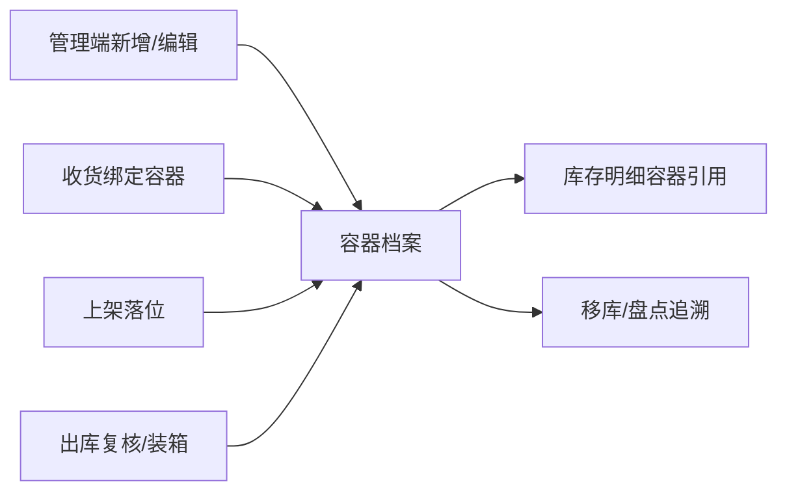

# 容器资料主PRD

> 用途：定义容器档案在 WMS 管理端的建立、查看、编辑、启停，以及容器号、类型、货主、容量、当前库位、父子关系和内容汇总的系统行为，作为研发实现和测试验收的依据。
> 定位：应用设计层基础资料真源。业务边界以[《容器档案与容器库存》](../../../系统架构设计/07-容器档案与容器库存.md)为准；字段以[《容器（详细稿）》](../../../字段清单合集/01-基础资料/容器/容器（详细稿）.tsv)为准；页面见[《容器资料页面骨架》](容器资料页面骨架.md)，交互见[《容器资料前端Demo版PRD》](容器资料前端Demo版PRD.md)。
> 不写什么：不写收货、上架、复核、移库的作业步骤（见对应主 PRD）；不把容器档案当作库存余额；不写容器类型字典维护页；不写跨仓调拨流程。

| 版本 | 本次变化 | 状态 |
| --- | --- | --- |
| WMS-V1.0（2026-10-27） | 新建基础资料容器三件制，承接已有容器页面与字段详细稿 | 待评审 |

## 1. 文档信息与阅读边界

| 项目 | 内容 |
| --- | --- |
| 读者 | 研发工程师、测试工程师、产品复核 |
| 业务依据 | [《容器档案与容器库存》](../../../系统架构设计/07-容器档案与容器库存.md) |
| 字段依据 | [《容器（详细稿）》](../../../字段清单合集/01-基础资料/容器/容器（详细稿）.tsv) |
| 状态依据 | 本文 §6；容器状态由作业驱动，停用只由管理端启停动作写入 |
| 页面依据 | [《容器资料页面骨架》](容器资料页面骨架.md)、[前端 Demo 版 PRD](容器资料前端Demo版PRD.md) |

关联资料：[《WMS基础资料PRD转换说明》](../WMS基础资料PRD转换说明.md)、[《实体对象关系》](../../../系统架构设计/02-实体对象关系.md)、[《全局机制与操作留痕》](../../../系统架构设计/05-全局机制与权限配置.md)。

## 2. 需求背景与目标

容器是箱、托、袋、笼车和包裹的档案，承接收货绑定、上架落位、出库装箱/复核和整箱移动。容器不是库存余额：库存按仓库＋货主＋SKU＋品质＋库位＋批次＋容器追溯，容器档案只回答“这个容器是谁的、什么类型、现在在哪、内容是什么”。

目标：

- 同仓容器号唯一，外部箱唛/托唛原样保存，内部容器可生成；
- 容器状态与收货、上架、复核、出库动作同步，不靠人工随意改；
- 容量、父子关系和当前库位能支持现场搬运与追溯；
- 容器停用不影响历史记录，未完结业务引用时阻断停用。

## 3. 需求范围

### 3.1 本期范围

- 容器列表、详情、新增、编辑；
- 容器号、类型、来源、所属货主、当前仓库、容量、父容器、备注维护；
- 状态只读展示；停用/启用入口；
- 内容 SKU 数、件数和内容摘要由库存与作业记录汇总；
- 当前库位按整箱落位记录，拆散后清空；
- 导出 Mock。

### 3.2 功能清单

| 编号 | 功能/位置 | 本次内容 | 需求来源 |
| --- | --- | --- | --- |
| F01 | 容器列表 | 按容器号、类型、货主、状态、当前库位查询；进入详情；导出 Mock | 容器档案 |
| F02 | 容器详情 | 基本信息、容量备注、容器内容、关联单据、操作记录 | 容器档案 |
| F03 | 新增/编辑 | 维护容器号、类型、货主、容量、父容器、备注；容器号创建后只读 | 容器档案 |
| F04 | 停用/启用 | 未完结业务引用时阻断；停用保留历史 | 容器生命周期 |
| F05 | 内容汇总 | 按库存明细与作业记录汇总 SKU 数、件数、内容摘要 | 容器库存维度 |

### 3.3 非本期范围

- 容器类型字典的独立维护页；
- 跨仓调拨、容器循环清洗、维修、报废流程；
- 按容器预占、按容器盘点的独立作业入口（后续能力）；
- 批量导入、批量启停；
- 账号、角色、用户仓库授权校验。

## 4. 对象定位与业务边界

### 4.1 业务作用

| 项目 | 内容 |
| --- | --- |
| 对象层级 | 基础资料＋可选库存追溯维度 |
| 核心职责 | 记录容器身份、类型、归属货主、容量与当前状态 |
| 数据来源 | 现场扫描/系统生成；收货绑定可自动建档；管理端可新增内部容器 |
| 被谁引用 | 收货、上架、出库复核/装箱、库存明细、移库、盘点 |
| 不负责 | 不直接记库存数量；不替代批次库存；不表达订单预占 |

### 4.2 上下游关系摘要

### 4.3 业务对象关系

| 关系 | 说明 |
| --- | --- |
| 容器 : 货主 | N:1；同一容器只属于一个货主 |
| 容器 : 当前仓库 | N:1；容器档案按仓维护，跨仓同号允许 |
| 容器 : 父容器 | N:0..1；托承载箱时最多一层 |
| 容器 : 库存明细 | 1:N；库存仍按最内层容器记账 |
| 容器 : 作业记录 | 1:N；收货、上架、复核、移库可引用 |

### 4.4 本对象不负责的事项

- 不把容器内容直接加减库存；库存变化由收货、上架、复核、移库、盘点动作写入；
- 不因移库自动改变容器档案状态、当前位置或复用资格；
- 不处理跨仓移动；跨仓按调拨出/入处理；
- 不提供删除；停用保留历史。

## 5. 核心业务场景索引

| 场景ID | 场景 | 类型 | 说明 |
| --- | --- | --- | --- |
| S01 | 新建内部容器 | 主流程 | 录入容器号、类型、货主、容量，保存为空闲 |
| S02 | 收货扫描外部箱唛自动建档 | 主流程 | 首次扫描生成档案，状态收货中 |
| S03 | 上架整箱落位 | 主流程 | 落位后当前库位有值，状态在库 |
| S04 | 出库复核/装箱 | 主流程 | 绑定容器后状态出库中/已出库 |
| S05 | 容器停用 | 支线 | 无未完结引用时停用，保留历史 |
| S06 | 拆散/部分移出 | 支线 | 当前库位清空或保留原引用，散件不带容器 |

## 6. 状态与操作

### 6.1 状态维度

| 维度 | 取值 | 说明 |
| --- | --- | --- |
| 容器状态 | 空闲、收货中、上架中、在库、出库中、已出库、已释放、停用 | 由收货、上架、复核、出库、移库动作驱动；管理端只提供停用/启用 |
| 内容汇总 | SKU 数、件数、内容摘要 | 计算值，不手工维护 |

### 6.2 状态取值说明

| 状态 | 含义 | 是否终态 |
| --- | --- | --- |
| 空闲 | 已建档、尚未绑定收货或出库 | 否 |
| 收货中 | 已绑定收货，尚未完成上架 | 否 |
| 上架中 | 已有落位但未整单提交 | 否 |
| 在库 | 整箱落位在同一库位 | 否 |
| 出库中 | 已用于出库复核/装箱，尚未出库 | 否 |
| 已出库 | 随出库单确认出库 | 是（业务维度） |
| 已释放 | 容器内容已拆散或不再保持整箱 | 否 |
| 停用 | 管理端停用，不再参与新作业 | 是（档案维度） |

### 6.3 状态—功能矩阵

| 动作 | 空闲 | 收货中 | 上架中 | 在库 | 出库中 | 已出库 | 已释放 | 停用 |
| --- | --- | --- | --- | --- | --- | --- | --- | --- |
| 查看 | ✅ | ✅ | ✅ | ✅ | ✅ | ✅ | ✅ | ✅ |
| 编辑容量/备注 | ✅ | ✅ | ✅ | ✅ | ✅ | ✅ | ✅ | ✅ |
| 停用 | ✅ | ❌ | ❌ | ✅（无引用） | ❌ | ✅ | ✅ | ❌ |
| 启用 | ❌ | ❌ | ❌ | ❌ | ❌ | ❌ | ❌ | ✅ |
| 作为新作业容器 | ✅ | ❌ | ❌ | ✅ | ❌ | ❌ | ✅ | ❌ |

### 6.4 状态流转表

| 当前状态 | 动作/事件 | 前置条件 | 结果 | 失败处理 |
| --- | --- | --- | --- | --- |
| 空闲 | 收货绑定 | 货主/仓库一致，未停用 | 收货中 | 已占用或跨货主阻断 |
| 收货中 | 上架保存 | 有落位 | 上架中 | 校验失败不动状态 |
| 上架中 | 整单提交且全部落同一库位 | 每行落满 | 在库 | 拆多库位则为已释放 |
| 在库 | 出库复核/装箱 | 出库单作业 | 出库中 | 状态不匹配阻断 |
| 出库中 | 确认出库 | 出库单已出库 | 已出库 | — |
| 在库/上架中 | 拆散/部分移出 | 库存动作完成 | 已释放 | 不自动改档案位置 |
| 任意 | 停用 | 无库存/未完结引用 | 停用 | 有引用阻断并提示对象 |

## 7. 核心业务规则

| 规则编号 | 主题 | 规则 | 边界或例外 |
| --- | --- | --- | --- |
| R01 | 容器号 | 同仓唯一，去首尾空格；外部箱唛/托唛原样保存，内部容器按规则生成；创建后不可改 | 跨仓允许同号 |
| R02 | 类型 | 箱、托、袋、笼车、包裹；停用类型不影响历史容器 | 类型与字典一致 |
| R03 | 归属 | 一个容器一个货主、一个当前仓库；跨货主使用阻断 | 货主停用不影响历史 |
| R04 | 容量 | 最大件数、最大重量、最大体积可空；为空不校验；超容按仓库配置提示/阻断 | 容量不是库存余额 |
| R05 | 当前库位 | 整箱落位时记录；拆散后清空，最近库位保留在轨迹；散件移库不自动改档案位置 | 暂存库位不作为最终当前库位 |
| R06 | 父子关系 | 托承载箱时父容器同仓、同货主，最多一层；库存仍按最内层容器记账 | 父容器停用不自动停用子箱 |
| R07 | 内容汇总 | 内容 SKU 数、件数、摘要由库存明细与作业记录汇总，不手工改 | 已拆散容器内容可为空 |
| R08 | 停用 | 有库存、未提交上架/返库、进行中拣货/盘点等引用时阻断；停用保留历史 | 停用后不可作为新作业容器 |
| R09 | 数据范围 | 列表/详情按顶栏当前仓库；一期不校验账号、角色或用户仓库授权 | 跨仓同号详情提示未找到 |

### 7.1 业务生效点

| 动作 | 容器档案影响 | 库存影响 | 外部影响 |
| --- | --- | --- | --- |
| 新建 | 生成空闲档案 | 无 | 无 |
| 收货绑定 | 状态收货中 | 实收入暂存 | 无 |
| 上架提交 | 在库/已释放 | 暂存移到目标库位 | 无 |
| 出库复核 | 出库中 | 不变 | 无 |
| 确认出库 | 已出库 | 扣减暂存 | 无 |
| 停用 | 状态停用 | 无 | 无 |

## 8. 功能需求说明（页面索引）

| 编号 | 页面/位置 | 规则依据 | Demo PRD |
| --- | --- | --- | --- |
| F01 | 容器列表 | R01～R09、§6.4 | [容器资料前端Demo版PRD](容器资料前端Demo版PRD.md) |
| F02 | 容器详情 | R05～R07 | 同上 |
| F03 | 新增/编辑 | R01～R06 | 同上 |
| F04 | 停用/启用 | R08 | 同上 |

## 9. 上下游影响与协同

| 模块 | 需要配合的变化 | 交接内容/时机 | 验收结果 |
| --- | --- | --- | --- |
| 收货 | 扫描外部箱唛自动建档 | 收货绑定时 | 容器状态收货中 |
| 上架 | 整箱落位写当前库位 | 上架提交时 | 在库或已释放 |
| 出库复核/装箱 | 绑定容器并驱动状态 | 复核提交/确认出库 | 出库中/已出库 |
| 库存明细 | 容器作为可选追溯维度 | 收货、上架、移库、盘点 | 同容器内容可汇总 |
| 移库 | 散件移出不改档案位置 | 移库提交后 | 档案状态/位置不被误改 |

## 10. 关联文档与阅读入口

| 内容 | 入口 | 边界 |
| --- | --- | --- |
| 容器架构 | [《容器档案与容器库存》](../../../系统架构设计/07-容器档案与容器库存.md) | 全局对象与库存维度 |
| 字段 | [《容器（详细稿）》](../../../字段清单合集/01-基础资料/容器/容器（详细稿）.tsv) | 字段唯一真源 |
| 页面 | [页面骨架](容器资料页面骨架.md) | 布局与线框 |
| 交互 | [Demo PRD](容器资料前端Demo版PRD.md) | 控件、反馈、Mock |

## 11. 异常与一致性

| 场景 | 处理 |
| --- | --- |
| 同仓重复容器号 | 阻断保存并提示已有容器 |
| 跨货主使用同一容器 | 阻断并提示货主不一致 |
| 停用时存在库存/未完结作业 | 阻断，列出引用对象 |
| 拆散后档案仍有旧位置 | 清空当前库位，保留轨迹 |
| 父子容器不同仓/不同货主 | 阻断 |

## 12. 验收标准与待确认事项

| 编号 | 对应功能/规则 | 条件与操作 | 预期结果 |
| --- | --- | --- | --- |
| AC01 | F03/R01 | 同仓重复容器号保存 | 阻断；跨仓同号可保存 |
| AC02 | F04/R08 | 有库存的容器停用 | 阻断并列出引用 |
| AC03 | F02/R07 | 打开有内容的容器 | SKU 数、件数、摘要与库存一致 |
| AC04 | R05 | 整箱落位后拆散移出 | 当前库位清空或保留原引用，状态已释放 |
| AC05 | R06 | 箱挂到不同货主托 | 阻断 |
| AC06 | F01/R09 | 切换顶栏仓库 | 仅显示该仓容器；跨仓同号提示未找到 |
