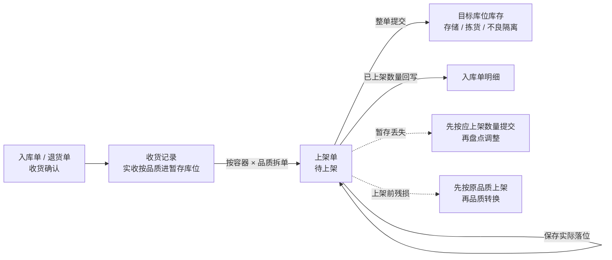
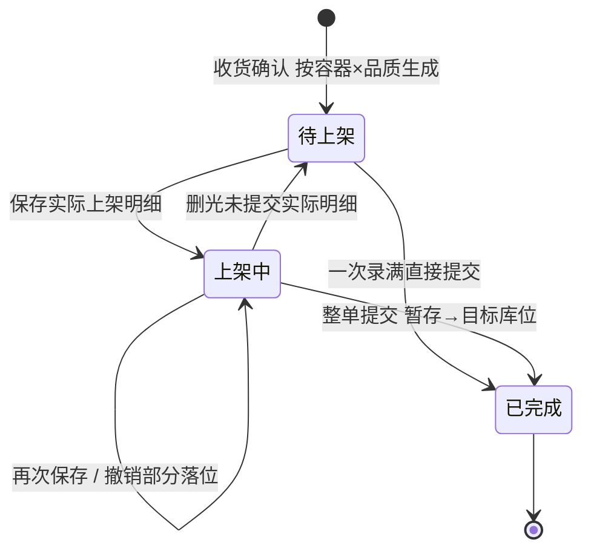

# 上架单主PRD

> 用途：定义上架单的生成与拆单、保存与撤销、整单提交移库、目标库位校验、盘点阻断，以及管理端列表/详情与 Web 端上架、PDA 上架的同一套作业规则，作为研发实现和测试验收的依据。
> 定位：应用设计层**业务真源**。规则以[《入库模块宏观系统架构》](../../../../../01-全局背景信息/04-入库模块宏观系统架构.md)第 2.1.1、2.1.2、3.4 节和[《库存模块宏观系统架构》](../../../../../01-全局背景信息/07-库存模块宏观系统架构.md)第 2.2、2.3 节为准；入库需求见[《入库业务需求分析》](../../../../../03-需求调研和分析/02-入库业务/入库业务需求分析.md)上架单、上架校验、库存影响三节（IN-FR-005、IN-FR-006、IN-FR-010）；退货来源与入库同口径，见[《退货业务需求分析》](../../../../../03-需求调研和分析/05-退货业务/退货业务需求分析.md)；字段以[《上架单（详细稿）》](../../../字段清单合集/02-入库管理/上架单/上架单（详细稿）.tsv)为准；页面见[《上架单页面骨架》](上架单页面骨架.md)；交互以[前端Demo版PRD](上架单前端Demo版PRD.md)为准，**须服从本文 §6.4 状态—功能矩阵**。
> 不写什么：不写收货怎么录入实收、拒收与良品／不良品（见[《入库单主PRD》](../入库单/入库单主PRD.md)）；不写目标库位的基础资料配置与库区类型定义；不写 PDA 扫码按键、提示文案与页面布局（见[PDA 上架套件](../../7-PDA作业端/上架作业/PDA上架前端Demo版PRD.md)）；不写库存流水字段与库存查询页面；不写退货单自身的收货规则。

| 版本 | 本次变化 | 状态 |
| --- | --- | --- |
| 2026-10-15 | 首版管理端查询；管理端只展示应上架与已上架，不展示「已录」 | 文档修订 |
| 2026-10-19 | PDA 改为按推荐库位逐站作业，一行数满自动保存，一库位完成自动跳下一库位 | 文档修订 |
| 2026-10-21 | 管理端新增 Web 端上架作业台；一张表录全部应上架行，一次确认逐条保存后整单提交 | 文档修订 |
| WMS-V1.0（2026-10-27） | 按 ERP 采购订单主 PRD 结构重构：补文档边界、范围与追溯、对象定位、场景索引、状态矩阵与流转表、规则分组、上下游与一致性；业务结论不变 | 待评审，文档修订 |

## 1. 文档信息与阅读边界

| 项目 | 内容 |
| --- | --- |
| 读者 | 研发工程师、测试工程师、产品复核；据此生成管理端原型的 AI |
| 业务依据 | 《入库业务需求分析》IN-FR-005 上架单、IN-FR-006 上架校验、IN-FR-010 库存影响；《入库模块宏观系统架构》§2.1.1 拆单、§2.1.2 两类明细 |
| 状态依据 | 《入库模块宏观系统架构》§3.4；与[《单据与状态流转》](../../../系统架构设计/03-单据与状态流转.md)第四节同步 |
| 字段依据 | [《上架单（详细稿）》](../../../字段清单合集/02-入库管理/上架单/上架单（详细稿）.tsv) |
| 页面依据 | [《上架单页面骨架》](上架单页面骨架.md)、[前端Demo版PRD](上架单前端Demo版PRD.md)、[PDA 上架套件](../../7-PDA作业端/上架作业/PDA上架前端Demo版PRD.md) |

关联资料：[《入库单主PRD》](../入库单/入库单主PRD.md)（收货与上架进度回写）、[《库存查询主PRD》](../../4-库存管理/库存查询/库存查询主PRD.md)（暂存与目标库位库存）、[《盘点单主PRD》](../../4-库存管理/盘点单/盘点单主PRD.md)（盘点阻断）、[《品质转换主PRD》](../../4-库存管理/品质转换/品质转换主PRD.md)（上架后发现残损）、[《实体对象关系》](../../../系统架构设计/02-实体对象关系.md)。本目录写法见[需求文档 PRD 写作约定](../../AGENTS.md)。

## 2. 需求背景与目标

### 2.1 背景

收货确认后，实收货物先进入本仓收货暂存库位；上架单是把这些货从暂存库位移到存储、拣货或不良隔离库位的现场工作单。上架单不是人工建的：入库或退货收货确认后，系统按「作业容器 × 品质」自动拆单。现场可能分几次搬、用 PDA 或不用 PDA，管理端还要能查到每张单应上架多少、实际落到了哪些库位、谁在什么时候提交。

如果让人手工维护“已上架多少”，很容易和库存、入库单进度对不上。所以上架单只认两种事实：保存过的实际落位，和整单提交。保存只记作业进度、不动库存；提交一次性把整张单的货从暂存库位移到目标库位。

### 2.2 目标

- 收货确认后自动生成可执行的应上架明细，现场不用再建单、拆单；
- 保存与提交的边界清楚：保存不动库存，提交才移库，重复提交不重复移库；
- 每条应上架行的各库位数量合计必须等于应上架数量，不能用整单总量掩盖某行少录或多录；
- 目标库位的启用、用途、品质适配与货主占用在保存和提交时都可判定；
- 管理端列表、详情、Web 端上架、PDA 上架看到的是同一张单和同一份已保存落位；
- 暂存丢失、上架前残损有明确出口，不在上架单里另造损失单或更正路径。

### 2.3 设计要点（给研发与测试）

| 设计点 | 做法 | 原因与影响 |
| --- | --- | --- |
| 拆单在收货确认时完成 | 按「作业容器 × 品质」生成；某品质数量为 0 不生成；无容器按收货记录 × 品质合并 | 一张单对应现场可独立搬运的一容器一品质，扫容器即可定位 |
| 应上架行只读 | 来源收货明细行带入，生成后不改 | 避免上架单与收货事实脱节 |
| 保存只记进度 | 写实际上架明细与目标库位占用，不动库存、不加已上架 | 允许分次搬、分次录、换人继续 |
| 提交整单生效 | 校验每条应上架行合计后，一次性移库 | 不接受部分行提交，避免半张单落位 |
| 已上架二值展示 | 上架单的「已上架」只在整单提交后等于应上架，未提交恒为 0 | 与入库单按已提交上架单累计的「已上架」不是同一粒度；列头注明“整单提交后才计入” |
| 推荐库位只作建议 | 推荐值按货主配置时点生成；提交仍按当前库位状态校验 | 推荐失效不影响业务，人工改到合法库位即可 |
| 无更正与作废 | 已提交是事实；保存内容可撤销、改录 | 与宏观架构“已提交上架单是事实”一致 |

## 3. 需求范围

### 3.1 本期范围

- 上架单列表：状态页签、条件查询、列展示、导出（Mock）、未完成单进入 Web 端上架或 PDA 上架；
- 上架单详情：基本信息、上架进度、应上架明细、实际上架明细、操作日志；入库单详情内只读查看同一数据；
- Web 端上架作业台：扫商品条码选行、扫库位条码填目标库位或表格直接录入，一次确认逐条保存后整单提交；
- PDA 上架：按推荐库位逐站作业，扫库位到站、扫商品计数、数满自动保存落位、一库位完成自动跳下一库位；
- 保存、撤销、改录未提交落位；整单提交移库；
- 目标库位启用、用途、品质适配、货主占用校验；盘点中 SKU 阻断作业与提交；
- 暂存丢失与上架前残损按既定路径处理：仍按应上架数量提交，再盘点或品质转换。

### 3.2 功能清单

| 编号 | 功能/位置 | 本次内容 | 需求来源 |
| --- | --- | --- | --- |
| F01 | 上架单列表 | 状态页签（全部、待上架、上架中、已完成）、筛选单号/来源单号/容器/货主/品质、列展示应上架与已上架、导出 Mock、未完成单两个作业入口 | IN-FR-005、IN-FR-006 |
| F02 | 上架单详情 | 概览卡（基本信息＋上架进度）、应上架明细、实际上架明细、操作日志、未完成单作业入口 | IN-FR-005、IN-FR-010 |
| F03 | Web 端上架 | 作业台录入全部应上架行，扫商品/库位或表格录入，撤销 PDA 已保存落位，确认后逐条保存并整单提交 | IN-FR-005、IN-FR-006 |
| F04 | PDA 上架 | 按推荐库位逐站扫描，保存落位、撤销、提交；规则与 F03 相同 | IN-FR-005、IN-FR-006 |
| F05 | 入库单详情只读页签 | 在入库单详情查看本单上架单与应上架/实际上架明细，单号跳转，不在此页操作 | IN-FR-005、IN-FR-007 |
| F06 | 导出 | 页头导出当前筛选结果（Demo 为 Mock） | — |

### 3.3 需求追溯

下表「需求分析」列写《入库业务需求分析》第二节的功能需求名称。

| 需求分析 | 本 PRD 功能与规则 | 验收 |
| --- | --- | --- |
| 上架单（按容器×品质生成、分次保存、整张提交） | F01～F04、R01～R04、R08 | AC01～AC06、AC11 |
| 上架校验（不超过已收未上架、逐应上架行合计） | F03、F04、R05、R06 | AC04、AC05、AC07 |
| 收货品质分流（良品/不良品分别上架） | R01、R06 | AC01、AC08 |
| 库存影响（提交才移库） | R09、§7 业务生效点 | AC03、AC06 |
| 多货主归属与当前仓库范围 | R12 | AC12 |
| 盘点阻断 | R10 | AC09 |
| 退货收货与上架同口径 | R01、R02 | AC01、AC13 |

### 3.4 非本期范围

- 管理端新建、编辑、删除、作废上架单；更正或重新打开已完成单；
- 单行提交、部分行提交、按行勾选批量操作；
- 上架单内直接做品质转换、损失确认或补货；
- 批量导入落位、批量撤销、批量提交；
- 目标库位容量硬校验与自动选位优化；
- 上架前残损的原品质改写、暂存丢失的损失单；
- 用户账号、角色、仓库授权与审批流。

| 范围补充 | 说明 |
| --- | --- |
| 适用对象 | 入库来源与退货来源共用同一上架单；调拨入库与正常入库同规则 |
| 数据范围 | 顶栏当前仓库决定列表范围；一期不按用户或角色裁剪；跨仓单号打开提示未找到 |

## 4. 单据定位与业务边界

### 4.1 业务作用

| 项目 | 内容 |
| --- | --- |
| 单据层级 | 作业单：承接收货结果，执行从暂存库位到目标库位的落位 |
| 核心职责 | 一张单记一个作业容器、一种品质下要上架什么、落到哪些库位、是否已提交 |
| 单据来源 | 入库或退货收货确认后系统自动生成；无手工新建入口 |
| 上游对象 | 入库单／退货单、收货记录（或退货收货记录）、作业容器档案 |
| 下游对象 | 目标库位库存、库存流水、入库单的已上架数量 |
| 数量关系 | 一张收货记录通常对应多张上架单；一条收货明细行在同一品质上架单内对应一条应上架行；一条应上架行可拆多条实际上架行 |
| 业务终结 | 已完成（整单提交并移库）；已完成不更正、不作废、不重复提交 |

### 4.2 上下游关系摘要

> 完整流程见[《入库模块宏观系统架构》](../../../../../01-全局背景信息/04-入库模块宏观系统架构.md)第四、五节；本文只保留上架单侧的交接点。

### 4.3 业务对象关系

| 关系 | 说明 |
| --- | --- |
| 上架单 : 来源入库单／退货单 | N:1；单头引用来源单号与来源收货记录号 |
| 上架单 : 作业容器 | N:1；有容器收货时一个容器一张，某品质数量为 0 不生成；无容器时容器为空 |
| 上架单 : 应上架明细 | 1:N；来源收货明细行带入，同一 SKU 不同批次分行 |
| 应上架行 : 实际上架明细 | 1:N；一行可拆到多个目标库位 |
| 实际上架行 : 目标库位 | N:1；保存即占用该库位的货主归属 |
| 上架单 : 库存流水 | 提交时按实际行写减项、加项流水；保存不写 |

### 4.4 本单据不负责的事项

- 上架单不产生或改写收货数量；实收、拒收、良品、不良品只取收货记录；
- 保存不上架库存；只有整单提交才把库存从收货暂存库位移到目标库位；
- 上架单不改 SKU 实际总量、订单预占、品质或 SN 的仓库级在库身份；
- 上架前残损不在本单转不良；暂存丢失不在本单做损失确认；
- 不负责目标库位的基础资料维护、库区用途配置和容量测算；
- 不负责收货暂存库位允许多货主混放的规则（那条只在收货暂存库位生效）。

## 5. 核心业务场景索引

| 场景ID | 场景 | 类型 | 说明 |
| --- | --- | --- | --- |
| S01 | 一次录满直接提交 | 主流程 | 待上架→已完成；每行实际合计等于应上架；提交时一次移库 |
| S02 | 分次保存后提交 | 主流程 | 待上架→上架中→已完成；保存不动库存，跨班次可继续 |
| S03 | 同 SKU 多批次分别上架 | 主流程 | 同 SKU 不同批次各一条应上架行，不得按 SKU 合并串行 |
| S04 | 一条应上架行拆多库位 | 支线 | 同一行拆到 L1、L2，行内合计等于应上架 |
| S05 | 两货主争同一空库位 | 支线 | 先保存者取得占用；后保存被阻断；先者删除或改位后释放 |
| S06 | PDA 与 Web 端交替录入 | 支线 | 同一张单、同一份已保存明细；一端可撤销另一端已保存的落位 |
| S07 | 盘点中 SKU 阻断 | 异常 | 含盘点中 SKU 的上架单不能开始，提交时重查 |
| S08 | 暂存丢失或上架前残损 | 异常 | 丢失按应上架数量提交后盘点；残损按原品质上架后品质转换 |

## 6. 状态与操作

状态定义 owner：[《入库模块宏观系统架构》](../../../../../01-全局背景信息/04-入库模块宏观系统架构.md)§3.4。上架单状态由实际明细与提交事实推导，管理端没有改状态入口。

### 6.1 状态维度

| 维度 | 取值 | 说明 |
| --- | --- | --- |
| 单据状态 | 待上架、上架中、已完成 | 待上架：无已保存实际明细；上架中：有已保存实际明细且未提交；已完成：已提交并移库 |
| 来源业务 | 入库、退货 | 决定来源单号跳转与良品可去的库位范围 |
| 品质 | 良品、不良品 | 单头固定；决定目标库位用途 |
| 作业容器 | 容器号或空 | 有容器时一容器一单；无容器显示「无容器收货」 |
| 落位进度 | 已录／剩余 | 只在作业页展示；列表与详情不展示「已录」 |

### 6.2 状态取值说明

| 状态 | 含义 | 是否终态 |
| --- | --- | --- |
| 待上架 | 已生成应上架明细，尚无保存的实际上架明细（含删光后回到此态） | 否 |
| 上架中 | 已有保存的实际上架明细，整单尚未提交 | 否 |
| 已完成 | 已提交，库存已从收货暂存库位移到目标库位 | 是 |

已完成不因撤销、删除、后续盘点或品质转换回到上架中；需要更正落位时按库存移库处理，不重开上架单。

### 6.3 状态流转图

触发者：生成为收货确认（入库单或退货单）；保存、撤销、提交为 PDA 上架或 Web 端上架；状态不由人工选择。

### 6.4 状态—功能矩阵

> ✅ = 允许；❌ = 不允许；✅（条件）= 须满足所列规则。查看类功能各状态均可用。状态或条件不满足的按钮直接不渲染，不用 disabled 占位。

| 动作 | 待上架 | 上架中 | 已完成 |
| --- | --- | --- | --- |
| 查看列表、详情、入库单只读页签（F01、F02、F05） | ✅ | ✅ | ✅ |
| 进入 Web 端上架（F03） | ✅（R10） | ✅（R10） | ❌ |
| 进入 PDA 上架（F04） | ✅（R10） | ✅（R10） | ❌ |
| 保存落位 | ✅（R04～R08） | ✅（R04～R08） | ❌ |
| 撤销/改录未提交落位 | ✅（无落位可撤） | ✅（R04） | ❌ |
| 整单提交 | ✅（R05、R07） | ✅（R05、R07） | ❌ |
| 导出（F06） | ✅ | ✅ | ✅ |

已完成单详情页头只有「返回列表」；列表行内无作业入口。`PDA上架` 与 `Web 端上架` 在待上架、上架中都出现，但有无可操作内容由作业页按已保存明细判断。

### 6.5 状态流转表

| 当前状态 | 动作/事件 | 前置条件 | 结果状态 | 二次确认 | 后置影响 | 失败处理 |
| --- | --- | --- | --- | --- | --- | --- |
| — | 来源收货确认 | 收货记录已确认；容器、品质、应上架数量成立 | 待上架 | 无 | 生成应上架明细与推荐库位（按配置） | 拆单字段缺失时不生成，回收货侧阻断 |
| 待上架 | 保存落位 | R04～R08；目标库位合法；至少一条实际明细 | 上架中 | 无 | 写实际明细；占用目标库位货主归属；不动库存 | 校验失败定位到行/库位，整次不保存 |
| 待上架 | 整单提交 | R05、R07；各应上架行合计等于应上架 | 已完成 | 见 Demo PRD | 一次性从暂存移到目标；写提交人、UTC 时间、两条流水 | 失败整单不生效，保留已填内容 |
| 上架中 | 继续保存 | 同待上架保存 | 上架中 | 无 | 同上；累计已录不超应上架 | 超量或库位不合规整次阻断 |
| 上架中 | 撤销/改录 | 仅未提交实际明细；行内已有落位 | 上架中（删光则为待上架） | 有（写明清掉件数与库位） | 释放原库位占用；不动库存 | 已提交后不可撤销 |
| 上架中 | 整单提交 | 同待上架提交 | 已完成 | 见 Demo PRD | 同上 | 任一应上架行不足或多录：整单不提交 |
| 待上架/上架中 | 盘点中 SKU 作业 | R10 | 不变 | — | 不保存、不提交 | 提示 SKU 盘点中，等盘点完成 |
| 已完成 | 查看 | — | 不变 | — | — | — |

## 7. 核心业务规则

### 7.1 生成、拆单与单号

| 规则编号 | 主题 | 规则 | 边界或例外 |
| --- | --- | --- | --- |
| R01 | 生成与拆单 | 入库或退货收货确认后自动生成；按「作业容器 × 品质」拆：同容器良品、不良品各一张，某品质数量为 0 不生成；无容器收货按同一收货记录、同一品质合并一张，容器为空 | 来源可以是入库或退货；仓库、货主、来源暂存库位、品质在单头固定，不允许手工建单 |
| R02 | 单号与来源 | 单号按[《单据术语与生成规则》](../../../../../01-全局背景信息/08-单据术语与生成规则.md)生成 PA 号，UTC 日期、同前缀同日四仓共用序列；单头记来源单号、来源收货记录号、容器号 | 单号不可编辑；来源单号按来源业务跳入库单或退货单 |
| R03 | 应上架明细 | 由收货明细行带入 SKU、批次、效期与应上架数量，一行对应原收货明细行及其中一种品质；同 SKU 不同批次分别成行 | 生成后不可修改；不得按 SKU 合并不同批次 |
| R11 | 推荐库位 | 推荐时机按货主资料配置：`AFTER_RECEIVE` 在生成时计算并保存到应上架行；`AT_PUTAWAY_SCAN` 在扫描作业中动态计算；`NONE` 不显示推荐 | 推荐只是建议；保存与提交都按当前库位状态重新校验，推荐失效时人工改到合法库位 |
| R12 | 数据范围 | 按顶栏当前仓库过滤；所选仓库内全部货主的上架单可见；一期不校验用户账号、角色或仓库授权 | 跨仓单号详情提示未找到，不展示其他仓数据 |

### 7.2 保存、撤销与提交

| 规则编号 | 主题 | 规则 | 边界或例外 |
| --- | --- | --- | --- |
| R04 | 保存与撤销 | 保存只写实际上架明细与目标库位货主占用，不动库存、不增加入库单已上架；同一行可多次保存到不同库位；撤销/改录只能处理未提交的实际明细，释放原库位占用 | 删光实际明细回到待上架；已提交不可撤销 |
| R05 | 行内数量 | 保存数量为正整数；每条应上架行的已录合计不得超过应上架数量；提交时每条应上架行合计必须等于应上架数量，不能只校验整单总量 | 同 SKU 多批次不得跨行串量 |
| R06 | 目标库位资格 | 目标库位及所属库区启用、属于本仓，不能是收货暂存、出库暂存或异常处理库位；良品（含退货来源）到存储或拣货库位，不良品到不良隔离库位；形态用于推荐，可在符合品质要求的库位中人工改位 | 不做容量硬阻断 |
| R07 | 货主占用 | 目标库位已有库存、未提交上架或返库上架占用，须为空或同货主；先保存者取得占用；删除行或改位释放原占用，提交后转为库存占用 | 收货暂存库位允许混放，但不是上架目标；拣货任务分配、移库草稿、盘点冻结不纳入占用闭集；分别按各自规则校验 |
| R08 | 数量与 SN | 保存/提交按 SKU、批次和数量登记目标库位；SN 在收货时登记到仓库级台账，不强制逐件落位；实际采集 SN 时校验本仓同货主同 SKU 在库、去重及数量一致，未采集时不推断单件位置 | SN 仓库级在库身份不因上架改变 |
| R09 | 提交与库存生效 | 整单提交时一次性把来源暂存库位上的应上架数量移到各目标库位，按实际变动写减项、加项两条流水；提交后状态为已完成，不可撤销 | 任一应上架行未录满整单不提交；重复提交返回原结果，不重复移库 |

### 7.3 数量口径与示例

| 层级 | 数量 | 含义 | 关系 |
| --- | --- | --- | --- |
| 应上架行 | 应上架数量 | 来源收货明细行在该品质下的实收数量 | 生成后不变 |
| 应上架行 | 已录数量 | 未提交实际明细该行合计；提交后等同已上架 | 只在作业页展示；≤ 应上架 |
| 应上架行 | 行剩余 | 应上架 − 已录 | 作业页落位上限 |
| 单头 | 应上架总数 | 各应上架行之和 | 列表、详情 |
| 单头 | 已上架总数 | 已完成时等于应上架总数，否则为 0 | 列表、详情；列头注明“整单提交后才计入” |
| 单头 | SKU 种类数 | 应上架行去重 SKU 数 | 列表 |

**约束（可判定）**：同一应上架行 已录 ≤ 应上架；提交时 已录 = 应上架；同一目标库位的占用货主唯一（暂存库位除外）。

**数量示例（模拟）**：同一容器实收良品 8、不良品 2，生成两张上架单，应上架分别 8、2。良品单先保存 5 件到 L1、再保存 3 件到 L2；此时状态上架中、已上架仍为 0、收货暂存仍为 8。提交后 L1 为 5、L2 为 3、暂存减 8，入库单已上架增加 8。

### 7.4 盘点、丢失与残损

| 规则编号 | 主题 | 规则 | 边界或例外 |
| --- | --- | --- | --- |
| R10 | 盘点阻断 | 含盘点中 SKU 的上架单不能开始作业；保存和提交时都重新检查盘点状态 | 盘点完成前不保存、不提交；盘点单见[《盘点单主PRD》](../../4-库存管理/盘点单/盘点单主PRD.md) |
| R13 | 暂存丢失 | 上架时找不到的货，发现后立即把该 SKU 标记「待核对」并暂停新分配；仍按应上架数量提交，使库存从暂存移到目标库位；随后由发现人员对该 SKU 发起盘点调整库存 | 不在上架单做损失确认；提交到盘点之间账面暂时多于实物，待核对解除前不参与新分配；回传上游的上架数量不反映丢失 |
| R14 | 上架前残损 | 收货未登记的残损，先按原品质上架，再由库存模块做品质转换并移到不良隔离库位 | 不改原收货记录与上架单品质；实收误记、货主认错没有更正路径 |

### 7.5 业务生效点

| 业务动作 | 上架单影响 | 库存影响 | 外部影响 |
| --- | --- | --- | --- |
| 收货确认 | 生成待上架单与应上架明细 | 实收已按品质进入收货暂存库位（收货侧动作） | 无 |
| 保存落位 | 写实际明细，状态→上架中 | 不动库存；目标库位记货主占用 | 无 |
| 撤销/改录 | 删或改未提交实际明细 | 释放原库位占用；不动库存 | 无 |
| 整单提交 | 状态→已完成；写提交人、时间 | 按实际行一次性从收货暂存移到目标库位；写减项、加项流水 | 入库单已上架增加；不单独回传上游 |
| 盘点阻断 | 不保存、不提交 | 不变 | 无 |

### 7.6 字段校验绑定

完整字段见[《上架单（详细稿）》](../../../字段清单合集/02-入库管理/上架单/上架单（详细稿）.tsv)。摘要：

| 校验时机 | 要求 |
| --- | --- |
| 保存落位 | 应上架行有剩余；目标库位启用、本仓、用途与品质适配、货主占用为空或同货主；数量为正整数且行内不超应上架；同库位同货主；盘点中 SKU 阻断 |
| 撤销/改录 | 只针对未提交实际明细；行内有已保存落位；撤销后释放目标库位占用 |
| 整单提交 | 每条应上架行已录等于应上架；目标库位逐行重查；盘点状态重查；SN 采集时条数与数量一致；单据未完成 |
| 查看/导出 | 只读；不因状态变化隐藏历史落位 |

## 8. 功能需求说明（页面索引）

| 编号 | 页面/位置 | 规则与状态依据 | Demo PRD |
| --- | --- | --- | --- |
| F01 | 上架单列表 | §6.4；R02、R05、R12 | [列表与详情分册](上架单前端Demo版PRD.md) §四 |
| F02 | 上架单详情 | §6.4；R03～R09 | 同上 §五 |
| F03 | Web 端上架 | §6.4、§7.2；R04～R10 | 同上 §六 |
| F04 | PDA 上架 | §7.2；R04～R10 | [PDA 上架 Demo PRD](../../7-PDA作业端/上架作业/PDA上架前端Demo版PRD.md) |
| F05 | 入库单详情只读页签 | §4.4；R09 | 同上 §五「入库单详情里的上架单抽屉」 |
| F06 | 导出 | — | 同上 §四页头 |

## 9. 上下游影响与协同

| 关联模块/系统 | 需要配合的变化 | 交接内容与时机 | 验收结果 |
| --- | --- | --- | --- |
| 入库单／退货单 | 收货确认生成上架单；提交回写已上架数量 | 收货确认时；提交时 | 应上架与实收同口径；入库单完成后不再有未提交上架单 |
| 基础资料 | 容器档案、库位用途、货主库位占用、推荐库位配置 | 生成、保存、提交 | 停用库位、错用途、他货主占用被阻断 |
| 库存与库内 | 提交时暂存→目标库位移库；写流水 | 整单提交 | 目标库位余额与流水一致；SKU 实际总量不变 |
| 盘点 | 盘点中 SKU 阻断上架开始与提交 | 作业前、提交时 | 盘点中不产生上架库存变化 |
| PDA／Web 端 | 共用同一张单、同一组保存/撤销/提交动作 | 全程 | 两端看到同一份已保存明细，不重复移库 |

## 10. 关联文档与阅读入口

| 关联内容 | 阅读入口 | 本 PRD 与其边界 |
| --- | --- | --- |
| 入库流程与拆单 | 《入库模块宏观系统架构》§2.1.1、§2.1.2 | 规则真源；本文落到页面与验收 |
| 状态与操作总表 | 《单据与状态流转》第四节 | 与宏观架构同步；本文矩阵服从 |
| 收货与入库单进度 | [《入库单主PRD》](../入库单/入库单主PRD.md) | 收货规则不在本文；本文只回写已上架 |
| 字段定义 | 《上架单（详细稿）》 | 字段 owner |
| 页面结构 | [《上架单页面骨架》](上架单页面骨架.md) | 区域与线框，非规则权威 |
| 页面交互 | [前端Demo版PRD](上架单前端Demo版PRD.md) | 控件、Mock；服从 §6.4 |
| PDA 交互 | [PDA 上架套件](../../7-PDA作业端/上架作业/PDA上架前端Demo版PRD.md) | 扫码步骤；规则同本文 |
| 暂存与目标库存 | [《库存查询主PRD》](../../4-库存管理/库存查询/库存查询主PRD.md) | 数量口径；本文不重复 |

## 11. 异常与一致性

### 11.1 并发操作

| 场景 | 业务处理结果 |
| --- | --- |
| 两货主同时保存到同一空库位 | 以先保存成功者为准；后保存者被阻断并提示库位已被占用 |
| PDA 与 Web 端同时保存同一应上架行 | 各自保存均按最新已录校验；超出应上架的一方整次不保存；已保存明细以服务端为准 |
| 一人提交时另一人仍在保存 | 提交按最新已保存明细校验；若有行未录满则整单不提交，已保存内容保留 |
| 提交时库位被其他货主占用 | 整单不提交，定位到冲突行；释放或改位后重试 |

### 11.2 幂等与重复处理

| 操作 | 幂等规则 |
| --- | --- |
| 重复保存同一落位 | 按最新明细合并；不重复占用、不重复计数 |
| 重复提交同一上架单 | 返回原提交结果，不重复移库、不重复写流水 |
| 同一收货确认重复触发拆单 | 不重复生成上架单；按来源收货记录与容器、品质唯一识别 |
| 撤销同一落位 | 第一次释放占用；后续返回已无该落位 |

### 11.3 与下游记录的一致性

| 场景 | 处理方式 |
| --- | --- |
| 暂存丢失后已按应上架量提交 | 入库单已完成、回传不反映丢失；目标库位账面多于实物，盘点调整一次 |
| 上架前残损 | 按原品质上架，目标库位先记正常品，再做品质转换；上架单与收货记录不改 |
| 已完成单发现落错库位 | 不重开上架单；按库存移库纠正，保留原上架与移库流水 |
| 盘点期间提交 | 阻断；盘点完成后再提交，已保存落位保留 |

## 12. 验收标准与待确认事项

### 12.1 验收标准

| 编号 | 对应功能/规则 | 条件与操作 | 预期结果 |
| --- | --- | --- | --- |
| AC01 | F01、R01 | 同一容器实收良品 8、不良品 2 | 生成两张上架单，应上架分别 8、2；容器、品质、来源收货记录正确 |
| AC02 | F02、R03 | 打开同 SKU 两批次各应上架 4 的单 | 应上架明细两行，批次不同，不合并 |
| AC03 | F03、R04 | 良品单保存 5 件到 L1、3 件到 L2 | 状态上架中；已上架 0；暂存仍 8；两行实际明细可查 |
| AC04 | F03、R05 | 同 SKU 两批次各应上架 4，误录 5 与 3 后提交 | 即使总量 8 也阻断，定位到超量行 |
| AC05 | F03、R06 | 目标库位填收货暂存库位或停用库位 | 当场阻断并提示原因；不保存该行 |
| AC06 | F03、R07 | A 货主先保存到空位，B 货主再保存同位；A 删除该行后 B 再保存 | B 先被阻断；A 释放后 B 可保存 |
| AC07 | F03、R05 | 整单提交且各行录满 | 已完成；L1 5、L2 3；暂存减 8；重复提交不再移库 |
| AC08 | R06 | 不良品目标库位填存储库位 | 阻断，提示品质与库位用途不符 |
| AC09 | R10 | 对盘点中 SKU 的上架单开始作业或提交 | 阻断，提示 SKU 盘点中；库存不变 |
| AC10 | R13 | 应上架 10、现场只找到 8 | 发现后该 SKU 立即标记待核对并暂停新分配；仍按 10 提交，目标库位账上 10；待核对解除前不参与新分配；随后盘点可盘亏 2；入库回传不改 |
| AC11 | F04、R01 | PDA 扫 L1、扫商品数满 | 自动保存到 L1 并跳下一推荐库位；已上架仍 0，暂存不变 |
| AC12 | F01、R12 | 切换顶栏仓库 | 列表只显示该仓上架单；跨仓单号详情提示未找到 |
| AC13 | R01 | 退货来源收货确认后查看上架单 | 来源单号指向退货单；容器、品质、应上架数量与退货收货记录一致 |
| AC14 | F03、§11.2 | 重复点击提交 | 返回原结果，不重复移库、不新增流水 |
| AC15 | F02、R09 | 查看已完成单 | 页头无作业入口；实际上架明细保留；操作日志有提交人、时间 |

### 12.2 待确认事项

| 编号 | 问题 | 影响范围 | 状态/结论 |
| --- | --- | --- | --- |
| Q01 | 上架单列表/详情的「已上架」是整单二值口径（未提交 0、提交后等于应上架），与入库单「已上架」按已提交上架单累计不是同一粒度；是否保留该列、是否在列头注明「整单提交后才计入」 | F01、F02、§7.3 | **已确认（2026-10-27）**：保留列，列头注明“整单提交后才计入”；不改入库单累计口径 |
| Q02 | 退货来源良品只允许到存储库位、不允许拣货库位；返库上架单的正常品可回存储或拣货库位。两者是否为有意的业务差异 | R06、F03；与[《返库上架单主PRD》](../../3-出库管理/返库上架单/返库上架单主PRD.md)对照 | **已确认（2026-10-27）**：退货良品可回存储或拣货库位；与返库上架单正常品口径一致 |
| Q03 | R07 的「其他未完结任务归属」具体指哪些对象 | R07、F03 保存校验 | **已确认（2026-10-27）**：占用闭集为库存、未提交上架/返库；拣货分配、移库草稿、盘点冻结不纳入，另按各自规则阻断 |
| Q05 | 上架单是否需要在列表直接展示「已录/剩余」 | F01 | **已确认（2026-10-21）**：不展示，保存进度只在作业页 |

## 附录 数量示例（模拟）

**示例 A：分次保存后提交（良品单）**

| 步骤 | 事件 | 应上架 | 已录 | 已上架 | 暂存库存 | 状态 |
| --- | --- | --- | --- | --- | --- | --- |
| 1 | 收货确认，生成良品单 | 8 | 0 | 0 | 8 | 待上架 |
| 2 | 保存 L1 × 5 | 8 | 5 | 0 | 8 | 上架中 |
| 3 | 保存 L2 × 3 | 8 | 8 | 0 | 8 | 上架中 |
| 4 | 整单提交 | 8 | 8 | 8 | 0 | 已完成 |

**示例 B：同 SKU 多批次（模拟）**

应上架行 1 批次 A 为 4，行 2 批次 B 为 4。实际录入行 1 为 5、行 2 为 3，整单总量 8 但提交仍阻断，因为逐应上架行不相等。
