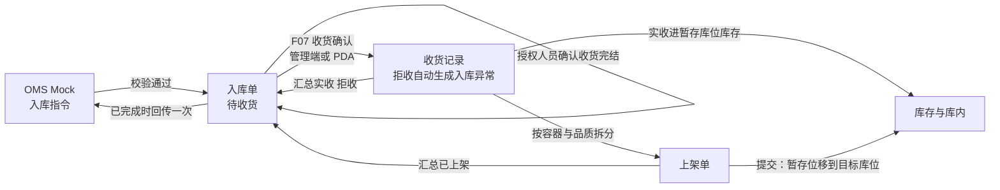
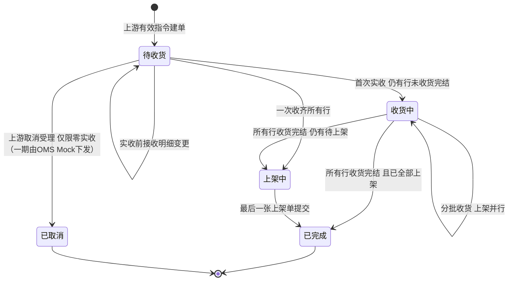

# 入库单主PRD

> 用途：定义管理端入库单的列表、详情、收货确认（F07，与 PDA 双端）、数量与状态推导、确认收货完结，以及收货记录、上架单、入库异常三类只读页签的系统行为，作为研发实现和测试验收的依据；同时作为生成前端原型代码与演示数据的业务输入。
> 定位：应用设计层**业务真源**。规则以[《入库模块宏观系统架构》](../../../../../01-全局背景信息/04-入库模块宏观系统架构.md)和[《入库业务需求分析》](../../../../../03-需求调研和分析/02-入库业务/入库业务需求分析.md)为准；场景走查见[《入库业务设计》](../../../../../04-业务分析和设计/02-入库业务设计.md)；字段以[《入库单（详细稿）》](../../../字段清单合集/02-入库管理/入库单/入库单（详细稿）.tsv)及同模块收货记录、上架单、入库异常详细稿为准；页面见[《入库单页面骨架》](入库单页面骨架.md)；页面交互以[前端Demo版PRD](前端Demo版PRD/)为准，**须服从本文 §6.4 状态—功能矩阵**。
> 不写什么：不写 PDA 到货定位、新品维护、上架保存与提交的**操作细则**（上架仍主要在 PDA/上架单套件）；收货的**页面交互**见[收货与双端分册](前端Demo版PRD/入库单前端Demo版PRD_收货与双端.md)，PDA 收货与上架的交互见 [7-PDA作业端](../../7-PDA作业端/)；不写无主货登记；不写库存流水与库内调整；不写 OMS 消息报文；不写权限矩阵与接口、表结构实现。

| 版本 | 本次变化 | 状态 |
| --- | --- | --- |
| WMS-V0.1 | 参照 ERP 采购订单三件制改写：单一状态由数量推导，去掉提交审核、编辑、删除、取消与价税；补确认收货完结、三类只读页签、Demo 模拟推送；增加设计要点与数据口径 | 初稿，待评审 |
| WMS-V0.2 | 补 R03/R04；规则章节顺延编号；Q01 与字段详细稿收货完结三字段；修正 Demo PRD 章节互引；Demo PRD 对齐 qs-wms-demo 组件与 UI 规范 | 初稿，待评审 |
| WMS-V0.3 | 前端 Demo 套件拆为公共+列表+详情+弹窗与Mock（对齐采购订单目录结构）；根目录保留索引页 | 初稿，待评审 |
| WMS-V0.4 | 子 Agent 走查：补列表反馈/验收、详情子表列、弹窗流程与 i18n；公共篇 M0 迁移；设计规范入库单例外 | 初稿，待评审 |
| WMS-V0.5 | 收货确认 F07：管理端详情 + PDA 双端；R15 分步录入（实收/拒收→良品/不良）；§6.4 矩阵与验收 AC21～AC22；Q10 已确认 | 初稿，待评审 |
| WMS-V0.6 | 已取消一期纳入并补状态机、矩阵与 AC06（对齐宏观架构）；管理端收货口径改收货作业台；AC10 数量修正；无容器收货术语；单号 Demo 格式回写 Q04 | 初稿，待评审 |
| WMS-V0.7 | 收货支持一次作业多个作业容器：一次提交生成一条收货记录，明细按「容器 × SKU」成行；允许分批提交；PDA 未提交作业本机暂存（R16 修订、新增 R17、AC23～AC26、Q12～Q13）；PDA 交互移至 [7-PDA作业端](../../7-PDA作业端/) | 初稿，待评审 |
| WMS-V0.8（2026-10-14） | 按全局背景同步单号、取消优先推导、盘点阻断、字段详细稿、SN落位追溯；清理已解决待确认项 | 文档修订，演示未验收 |

当前规则见第6、7节；历史版本说明只用于查阅修订经过。一次收货提交生成一条收货记录，明细按容器、SKU、批次／效期拆分；管理端与PDA共用数量和库存规则。

## 原型阅读路径（生成原型时按序读）

| 顺序 | 文档 | 承担内容 |
| --- | --- | --- |
| 1 | **本文** | 范围、设计要点、状态与矩阵、规则R01～R17、功能 F01～F07、验收 AC |
| 2 | [《入库单（详细稿）》](../../../字段清单合集/02-入库管理/入库单/入库单（详细稿）.tsv)及[收货记录](../../../字段清单合集/02-入库管理/收货记录/收货记录（详细稿）.tsv)、[上架单](../../../字段清单合集/02-入库管理/上架单/上架单（详细稿）.tsv)、[入库异常](../../../字段清单合集/02-入库管理/入库异常/入库异常（详细稿）.tsv)详细稿 | 字段名称、类型、来源与说明 |
| 3 | [《入库单页面骨架》](入库单页面骨架.md) | ASCII 线框：列表、详情与页签、两个 Sheet、两个弹出层 |
| 4 | [前端Demo版PRD](前端Demo版PRD/)（先读[公共与技术约定](前端Demo版PRD/入库单前端Demo版PRD_公共与技术约定.md)） | 路由、派生、列表/详情/弹窗分册、Mock 种子 |
| 5 | [《QS-WMS 前端设计与开发规范》](../../../../../09-产品原型/qs-wms-demo/docs/02-设计规范.md) | 样式与容器选型 |
| 6 | [7-PDA作业端](../../7-PDA作业端/)（先读[《PDA作业端设计规范》](../../7-PDA作业端/PDA作业端设计规范.md)） | PDA 收货、上架的步骤与交互 |

**分工**：业务规则与验收以本文为准；布局以页面骨架为准；类型、公式、组件用法与种子数据以[前端Demo版PRD](前端Demo版PRD/)为准。字段列映射见[公共分册 §4](前端Demo版PRD/入库单前端Demo版PRD_公共与技术约定.md)。

## 1. 文档信息与阅读边界

| 项目 | 内容 |
| --- | --- |
| 读者 | 研发工程师、测试工程师、产品复核；以及据此生成前端原型的 AI |
| 业务依据 | 《入库业务需求分析》第二节（入库指令接收、收货、收货品质分流、入库完成与结果、取消与变更、库存影响、入库单来源）；《入库模块宏观系统架构》第二至六节 |
| 状态依据 | 宏观架构第三节；与《单据与状态流转》第二节同步，以全局背景宏观架构为上位依据 |
| 字段依据 | 入库单、收货记录、上架单、入库异常四份详细稿 |
| 页面依据 | 页面骨架、[前端Demo版PRD](前端Demo版PRD/) |

关联资料：[《系统流程与单据交互》](../../../系统架构设计/01-系统流程与单据交互.md)、[《实体对象关系》](../../../系统架构设计/02-实体对象关系.md)、[《全局机制与操作留痕》](../../../系统架构设计/05-全局机制与权限配置.md)、[《接口与OMS Mock消息设计》](<../../../系统架构设计/06-接口与OMS Mock消息设计.md>)。本目录写法见[需求文档 PRD 写作约定](../../AGENTS.md)。

## 2. 需求背景与目标

### 2.1 背景

入库单是上游入库指令在仓内的执行单据。一期全部入库单由 OMS Mock 指令生成，管理端不新建、不编辑。现场以 PDA 为主完成到货定位、新品维护、上架；**收货**在 Demo 与一期目标中支持 **管理端收货作业台（独立路由） + PDA 双端**（同一收货确认动作与收货记录）。每次收货须先录本次实收与拒收，再在实收>0 时拆分良品与不良品（§7.2 R03、R15）。管理端使用者还要看进度、核对数量，并在不再到货时确认收货完结。

同一张入库单会分批到货、多人协作，收货和上架可以并行。如果让人手工维护单据状态，状态很快会和数量对不上。所以本模块的状态全部由数量推导，整单收货阶段的人工收口动作是授权人员确认收货完结。

### 2.2 目标

- 一张单的进度由数量推导，页面任何时刻看到的状态都能用数量复算；
- 预计、实收、拒收、未收、良品、不良品、已上架在单头和明细上口径一致，且始终满足 §7.3 的恒等式；
- 收货记录、上架单、入库异常在入库单详情内可查，并能从应上架行追到收货明细行；
- 少收的行有明确的收口动作（确认收货完结），收口后的未收数量即最终短少，随整单结果回传上游；
- 前端原型能用本文与 Demo PRD 生成，种子数据自洽，无需再补业务规则。

### 2.3 设计要点（给研发与测试）

| 设计点 | 做法 | 原因与影响 |
| --- | --- | --- |
| 状态由业务事实推导 | 单据状态、明细状态按 §7.4 公式先判取消受理事实，再由数量与人工收货完结标记推导，管理端没有改状态的入口 | 避免状态与数量脱节；测试用数量造数据即可覆盖状态 |
| 唯一人工动作 | 确认收货完结：整单级，需累计实收大于 0；不阻断后续上架 | 少收的行只能靠它收口；零实收由仓库通知上游，OMS Mock取消受理后进入已取消 |
| 拒收与不良品分开 | 拒收：不计实收，不进库存，自动生成入库异常。不良品：计入实收，进暂存库位，整体不可用 | 两者的分界由现场人工判断，系统不约束；统计时不能混算 |
| 库存在收货时形成 | 收货确认即按实收、按品质进暂存库位；上架提交才把库存移到目标库位 | 入库单上的“已上架”只在上架单提交时增加；暂存正常品可被接单预占，暂存库存不能参与库位分配 |
| 数量源头在子记录 | 实收、拒收、良品、不良品来自收货记录；已上架来自已提交的上架单；单头和明细只做汇总 | 前端 Mock 只造子记录，汇总一律计算，避免两处数字不一致 |
| 收货记录等不独立成菜单 | 收货记录、入库异常在入库单详情页签内查看；上架单在详情内只读，独立列表查询按上架单PRD落实 | 与宏观架构一致；一期不设这两类的独立菜单 |
| 不做更正与作废 | 收货记录、已提交上架单、入库异常都是已发生事实 | 实收误记、货主认错没有更正路径，受影响数量保持未完成（宏观架构第六节） |

## 3. 需求范围

### 3.1 本期范围

- 入库单列表：按状态页签、条件查询、列表展示、行内「确认收货完结」入口、导出（Mock）；
- 入库单详情：基本信息、到货信息、数量汇总、时间与完结信息、入库明细；
- 详情内三个只读页签：收货记录、上架单、入库异常；收货记录与上架单可展开查看明细（Sheet）；
- 收货确认（**F07**）：管理端**收货作业台**（独立路由，一次可收多个容器后统一提交） + PDA 收货（一次作业可新增多个容器，统一或分批提交）；分步录入见 R15，容器与暂存见 R16、R17；
- 确认收货完结（管理端入口，与 PDA 共用同一完结记录）；
- 已取消：一期接管上游取消（仅限整单累计实收为 0；Demo 由 OMS Mock 下发并受理）；
- Demo 专用：页头「模拟推送入库指令」，用于造出待收货单据，不属于正式验收；
- 单据状态、明细状态、各类数量由系统推导和汇总。

### 3.2 功能清单

| 编号 | 功能/位置 | 本次内容 | 需求来源 |
| --- | --- | --- | --- |
| F01 | 入库单列表 | 状态页签（带数量）、查询、列展示、行内操作入口、导出 Mock | 入库单来源、入库完成与结果 |
| F02 | 入库单详情 | 分区展示、明细数量、按状态展示完结信息、页头操作 | 入库完成与结果、库存影响 |
| F03 | 三类只读页签 | 收货记录、上架单、入库异常；收货记录 Sheet、上架单 Sheet | 收货、收货品质分流、上架任务 |
| F04 | 确认收货完结 | 二次确认、状态重算、未收转最终短少 | 入库完成与结果 |
| F05 | 导出 | 页头导出（Demo 为 Mock 提示） | — |
| F06 | 模拟推送入库指令 | 仅 Demo：按指令字段建一张待收货单；重复指令幂等 | 入库指令接收、入库单来源 |
| F07 | 收货确认 | 管理端收货作业台 + PDA；本次实收/拒收→良品/不良；生成收货记录与拒收异常 | 收货、收货品质分流 |

### 3.3 需求追溯

下表「需求分析」列写《入库业务需求分析》第二节的功能需求名称。

| 需求分析 | 本 PRD 功能与规则 | 验收 |
| --- | --- | --- |
| 入库指令接收 | F06、R01、R02 | AC02、AC03、AC16 |
| 收货（分次记录实收与拒收） | F07、F03、R03、R04、R15、R16、R17 | AC04、AC06、AC19、AC21～AC26 |
| 收货品质分流 | F07、R03、R05、R15 | AC04、AC10、AC21 |
| 上架单、上架校验 | F03、R10（只读） | AC09、AC15 |
| 入库完成与结果 | F02、F04、R05～R08 | AC05～AC08、AC10、AC11 |
| 取消与变更 | R02（明细变更）、§6.5（取消受理） | AC16、AC06 |
| 库存影响 | R09、R11 | AC07、AC09 |
| 入库单来源 | R01、AC01 | AC01 |
| 多货主归属与仓库权限 | R12 | AC17 |

### 3.4 非本期范围

- 管理端新建、编辑、删除入库单；提交、审核、撤回；
- 零实收结案（零实收走上游取消，受理后转已取消，见 §6）；
- 到货识别并入收货作业（一期不设独立到货登记页面）；新品维护的操作界面（PDA 与后续套件）；
- 上架单的保存、提交与库位占用校验（入库单详情内只读展示；操作上架走 PDA 上架页或上架单套件）；
- 列表页批量收货、导入收货；
- 收货记录、入库异常的独立菜单；超收、未预报商品的系统登记；品质转换与丢失收口（上架单一期不处理）；
- 批量导入、批量操作、整单结果回传的重试界面。

| 范围补充 | 说明 |
| --- | --- |
| 适用对象 | 正常入库、调拨入库共用同一页面与规则；调拨入库不关联调出仓单据 |
| 数据范围 | 当前用户授权仓库内全部货主的入库单；顶栏当前仓库决定列表默认过滤 |

## 4. 单据定位与业务边界

### 4.1 业务作用

| 项目 | 内容 |
| --- | --- |
| 单据层级 | 执行单据：承接上游指令，记录收货与上架的结果与进度 |
| 核心职责 | 记录哪个货主、哪个仓、要入哪些 SKU、预计多少，以及已收、已拒、未收、已上架各多少 |
| 单据来源 | OMS Mock 指令；一期唯一方式 |
| 下游对象 | 收货记录、上架单、入库异常；库存在收货与上架提交时变化 |
| 数量关系 | 一张入库单对应 0～多条收货记录；一条收货记录通常对应多张上架单 |
| 业务终结 | 已完成（自动进入）；已取消由上游取消受理写入（一期纳入，仅限整单累计实收为 0） |

### 4.2 上下游关系摘要

> 完整流程见[《系统流程与单据交互》](../../../系统架构设计/01-系统流程与单据交互.md)；本文只保留入库单侧的交接点。

### 4.3 业务对象关系

| 关系 | 说明 |
| --- | --- |
| 入库单 : 货主、仓库 | N:1；各一个，建单后不可更换 |
| 入库单 : 入库单明细 | 1:N；同一 SKU 只占一行 |
| 入库单 : 收货记录 | 1:0..N；收货确认一次生成一条 |
| 收货记录 : 作业容器 | 1:0..N；一次提交可含多个容器，容器号记在收货明细行上；无容器收货的明细行容器号为空 |
| 收货记录 : 上架单 | 1:N；按「容器 × 品质」拆分，无容器收货按「收货记录 × 品质」合并为一张 |
| 收货明细行 : 应上架行 | 1:1～2；同一行良品与不良品并存时进入两张上架单 |
| 收货明细行 : 入库异常 | 1:0..1；有拒收数量即生成一条拒收类异常 |

### 4.4 本单据不负责的事项

- 入库单不直接改库存；库存由收货确认和上架单提交触发；
- 入库单不记录无主货；无法归属货主的实物走无主货登记，不建入库单；
- 短少不是入库异常：短少体现为明细未收数量，收货完结后即最终短少；
- 超收、未预报商品、已知货主待补单的实物，一期由仓库线下暂存，联系货主补单，系统不记录；
- 上架前残损、暂存期间丢失一期不在上架单处理，上架后按库存与库内的品质转换和盘点执行。

## 5. 核心业务场景索引

| 场景ID | 场景 | 类型 | 说明 |
| --- | --- | --- | --- |
| S01 | 一次收齐并上架 | 主流程 | 待收货 → 上架中 → 已完成；每行实收＋拒收＝预计，自动收货完结，无需确认 |
| S02 | 分批到货、边收边上架 | 主流程 | 首次实收后进入收货中；收货与上架并行；明细状态收货中，上架进度看实收与已上架 |
| S03 | 少收后确认收货完结 | 主流程 | 确认后未收数量记为最终短少；仍有待上架则进入上架中，否则已完成 |
| S04 | 整行未到货随单结案 | 支线 | 某行实收为 0，整单确认完结后该行已完成、未收即短少；整单实收须大于 0 |
| S05 | 部分拒收 | 支线 | 拒收不计实收，自动生成入库异常；其余实收照常进入暂存库位 |
| S06 | 全部拒收 | 支线 | 每行实收＋拒收＝预计，但整单累计实收为 0；单据停在待收货，不自动完成；仓库通知上游，由 OMS Mock 下发取消并受理后转已取消 |
| S07 | 上游在实收前变更明细 | 支线 | 待收货且无实收时接受明细变更；产生实收后拒绝 |
| S08 | 重复指令 | 支线 | 同一来源、业务类型、上游单号再次下发，不新增单据；同消息标识重发返回原结论 |

## 6. 状态与操作

状态定义 owner：[《入库模块宏观系统架构》](../../../../../01-全局背景信息/04-入库模块宏观系统架构.md)第三节。本节写管理端怎么展示和什么时候允许操作。

### 6.1 状态维度

| 维度 | 取值 | 说明 |
| --- | --- | --- |
| 单据状态 | 待收货、收货中、上架中、已完成、已取消 | **推导值**（已取消由上游取消受理写入后保持终态）；一期纳入，仅限整单累计实收为 0 |
| 明细状态 | 待收货、收货中、上架中、已完成、已取消 | **推导值**；取值与单据状态一致；已取消随单收口，不设已完成 |
| 收货完结标记 | 未确认、已确认 | 唯一由人工写入的状态量，整单级；确认后记录确认人与确认时间 |
| 上架单状态 | 待上架、上架中、已完成 | 在上架单上维护，入库单只读展示 |

### 6.2 状态取值说明

| 状态 | 含义 | 是否终态 |
| --- | --- | --- |
| 待收货 | 整单累计实收为 0；包括尚未到货、部分拒收、全部拒收 | 否 |
| 收货中 | 累计实收大于 0，且还有行未收货完结；收货与上架可并行 | 否 |
| 上架中 | 累计实收大于 0，所有行收货完结，仍有行已上架小于实收；不再接收到货 | 否 |
| 已完成 | 累计实收大于 0，所有行已完成；自动进入，同时触发整单结果回传 | 是 |
| 已取消 | 一期由 OMS Mock 下发取消并受理，仅限整单累计实收为 0（全单拒收、未到货零收等）；受理后原单及明细收口为已取消，保留收货记录与入库异常，不回传入库完成结果 | 是 |

「上架中」在单据、明细、上架单三处含义一致：还有已收货物没提交上架。

### 6.3 状态流转图

触发者：建单为上游指令；首次实收、分批收货为 **F07 收货确认**（管理端收货作业台或 PDA）；所有行收货完结为每行实收＋拒收＝预计（自动）或授权人员确认收货完结（人工）；最后一张上架单提交为 PDA 或上架单入口的提交动作；已取消为 OMS Mock 取消指令受理。

### 6.4 状态—功能矩阵

> ✅ = 允许；❌ = 不允许；✅（条件）= 须满足 R07。查看类功能各状态均可用。

| 动作 | 待收货 | 收货中 | 上架中 | 已完成 | 已取消 |
| --- | --- | --- | --- | --- | --- |
| 查看列表、详情（F01、F02） | ✅ | ✅ | ✅ | ✅ | ✅ |
| 查看收货记录、上架单、入库异常（F03） | ✅ | ✅ | ✅ | ✅ | ✅ |
| 收货确认（F07） | ✅（R04、R15） | ✅ | ❌ | ❌ | ❌ |
| 确认收货完结（F04） | ❌ | ✅（R07） | ❌ | ❌ | ❌ |
| 导出（F05） | ✅ | ✅ | ✅ | ✅ | ✅ |

已取消单（一期纳入，仅限零实收）只保留查看能力：列表无操作入口，详情页头只有「返回列表」；明细状态为已取消。

页头与行内「模拟推送入库指令」（F06）与单据状态无关，只在列表页头出现。

入库单的新建／编辑／删除、审批提交、审核、撤回、WMS手工取消在任何状态下都不提供入口；收货和上架提交、上游取消受理按各自规则执行。条件不满足的按钮直接不渲染，不用 disabled 占位。

待收货状态下一律没有「确认收货完结」：整单累计实收为 0 时不允许完结（含全部拒收的单据）。上架中已完成收货，可能仍有最终短少；不再提供收货完结动作。

### 6.5 状态流转表

| 当前状态 | 动作/事件 | 前置条件 | 结果状态 | 二次确认 | 后置影响 | 失败处理 |
| --- | --- | --- | --- | --- | --- | --- |
| — | 上游指令（正常入库、调拨入库） | 货主、仓库、商品校验通过；来源＋业务类型＋上游单号未建立有效单据 | 待收货 | 无 | 生成入库单；回执接收成功 | 校验不通过：整单拒绝并记录原因，不建单；重复指令：不增加单据 |
| 待收货 | 上游明细变更 | 累计实收为 0；变更后各行预计仍不小于已拒收数量 | 待收货 | 无 | 预计数量与汇总重算 | 已有实收：拒绝变更 |
| 待收货 | 首次收货确认（F07） | R04、R15；管理端或 PDA | 收货中；每行都已收货完结时为上架中 | 无 | 实收进暂存库位库存；生成上架单；拒收生成入库异常 | 超量或分步校验不通过则拒绝提交 |
| 收货中 | 收货确认（F07） | R04、R15 | 收货中；所有行收货完结后为上架中或已完成 | 无 | 同上 | 同上 |
| 收货中 | 确认收货完结 | R07 | 上架中；已全部上架时直接已完成 | 二次确认 | 写入确认人与时间；未收转最终短少；不阻断上架 | 状态已变化：提示刷新，不执行 |
| 上架中 | 上架单提交（最后一张） | 已上架等于实收 | 已完成 | 无 | 写入完成时间；整单结果回传一次 | 回传失败只重试回传，不回退状态 |
| 待收货 | 上游取消受理 | 整单累计实收为 0；取消指令由 OMS Mock 下发 | 已取消 | 无 | 单据与明细收口为已取消；保留收货记录与入库异常；不回传入库完成结果 | 已有实收：拒绝取消并记录原因；重复取消：不重复处理 |

## 7. 核心业务规则

### 7.1 来源、建单与变更

| 规则编号 | 主题 | 规则 | 边界或例外 |
| --- | --- | --- | --- |
| R01 | 来源与唯一性 | 全部由上游指令生成；管理端无新建、编辑、删除入口。按来源＋业务类型＋上游单号定位同一指令；消息标识去重，重复消息返回原结论、不新增单据 | 一期由 OMS Mock 指令生成；Demo 用「模拟推送」代替 |
| R02 | 建单校验与明细 | 货主须启用；仓库须为一期预置四仓之一；每行商品须为该货主下已启用的 SKU；同一 SKU 在单内只占一行；预计数量大于 0。仓库、货主、业务类型建单后不得在原单更换 | 校验不通过整单拒绝，不建单。无实收时可接受明细变更，有实收后拒绝变更 |

### 7.2 收货、拒收与品质（F07；管理端 + PDA）

| 规则编号 | 主题 | 规则 | 边界或例外 |
| --- | --- | --- | --- |
| R03 | 拒收与实收分界 | 每次收货确认在入库单明细行分别录入**本次**拒收数量（拒收>0 须原因）与**本次**实收数量；拒收不计实收、不进库存，确认后自动生成拒收类入库异常。实收内分良品、不良品，良品＋不良品＝本次实收（累计后仍满足良品＋不良品＝实收）。现场决定拒收还是接收为不良品；同一件实物不能同时计入拒收和实收不良品 | 管理端收货作业台与 PDA 共用同一动作与收货记录；列表行内提供作业台入口 |
| R04 | 收货确认校验 | 按入库单明细行累计：历史各次实收＋拒收，加上本行本次实收与拒收，不得超过该行预计数量；整单已确认收货完结后不得再提交收货。收货确认后按实收、按品质进入收货暂存库位库存，并按「容器×品质」生成上架单 | 超量、完结后收货在两端拦截；新品未维护等阻断见入库业务设计 |
| R15 | 分步录入 | 每次提交须先完成第一步：本次实收、本次拒收（及拒收原因）。仅当本次实收>0 时进入第二步：录入良品、不良品，且良品＋不良品＝本次实收；本次实收为 0 且仅有拒收时可跳过第二步 | 交互细则见[收货与双端分册](前端Demo版PRD/入库单前端Demo版PRD_收货与双端.md) |
| R16 | 作业容器 | 收货前须绑定**作业容器**（扫箱唛/托唛）；无容器收货可不绑容器。一个容器可装多个 SKU。一次收货提交可包含 1～N 个容器（无容器收货至多一组），生成**一条**收货记录；收货明细按容器、SKU、批次／效期拆行，同一SKU多批次分别记录，行上记录容器号。已在本单提交过的容器不得再用于本单；上架单按「容器×品质」拆分。收货记录与详情可按容器汇总 SKU 数、实收/拒收、良/不良 | 与宏观架构「作业容器」一致；柜号（到货）≠作业容器。管理端收货作业台可连续收多个容器后统一提交；PDA 还可勾选部分容器分批提交（R17） |
| R17 | 收货作业暂存与分批提交 | PDA 一次收货作业可连续处理多个容器。「新增容器」时先校验当前容器（至少一行，且每行满足 R04、R15），通过后暂存，再绑定下一个容器；「提交收货」把选中的容器一次提交。允许部分收货、分次提交：本次未勾选的容器继续留在作业中。暂存内容不是收货记录：不增库存，不生成上架单与入库异常，管理端不可见；PDA 意外退出后可恢复 | 提交时按最新数量整体重新校验，任一容器不通过则整次不提交；暂存位置见 §12.2 |

收货提交必须按本次所有勾选容器与明细汇总同一SKU的增量，再加历史累计校验上限；不能逐行各自比较而漏掉多容器合计。只有拒收也生成收货记录；实收与拒收均为0的空提交拒绝。效期不符的数量只能拒收，不能记为实收不良品绕过准入。启用SN的实收逐件采集，按品质分别核对SN件数；已在库SN不得重复收货。

涉及盘点中的SKU时，阻断该SKU收货提交；含它的上架单不能开始作业。允许同单不在盘点中的其他SKU收货。前端暂存不代表业务受理，提交时重新校验新品维护、商品配置、盘点、单据终态、累计数量和仓库权限。

单号按[单据术语与生成规则](../../../../../01-全局背景信息/08-单据术语与生成规则.md)执行：入库单IB、收货记录RC、入库异常EX、上架单PA；UTC日期、同前缀同日四仓共用序列，全系统唯一，超过9999自动扩位。新品维护NS、无主货UG沿用同一规则。

### 7.3 数量口径

数量公式只在本节写全，其他位置引用。

| 层级 | 数量 | 含义 | 关系 |
| --- | --- | --- | --- |
| 明细 | 预计数量 | 上游预报的件数 | 大于 0 |
| 明细 | 实收数量 | 各次收货记录该商品实收之和 | 实收进暂存库位库存 |
| 明细 | 拒收数量 | 各次收货记录该商品拒收之和 | 不计实收，不进库存 |
| 明细 | 未收数量 | 预计 − 实收 − 拒收 | 不小于 0；收货完结后即最终短少 |
| 明细 | 良品数量、不良品数量 | 实收内的品质拆分 | 良品 ＋ 不良品 ＝ 实收 |
| 明细 | 已上架数量 | 已提交上架单中该商品的实际上架数量之和 | 不超过实收 |
| 明细 | 待上架数量（页面计算） | 实收 − 已上架 | 不单独存字段 |
| 单头 | 预计、实收、拒收、已上架总数量 | 各行对应数量之和 | 单头不设良品、不良品、未收汇总 |
| 单头 | SKU 种类数 | 明细中不重复的 SKU 个数 | — |

**约束（可判定）**：预计 ＝ 实收 ＋ 拒收 ＋ 未收；良品 ＋ 不良品 ＝ 实收；实收 ＋ 拒收 ≤ 预计；已上架 ≤ 实收；以上任一条不成立即为数据错误。

**数量示例（标明为示例）**：预计 1,000，第一批拒收 5、实收 600（良品 590、不良品 10），则未收 395。良品单 590 件提交后已上架 590，待上架 10。再补收 395 后，未收为 0，该行自动收货完结。

### 7.4 状态推导

先判断取消终态，再判定行收货完结及数量状态。整单实收为0且未取消时，明细展示待收货，不因拒收收齐而自动进入已完成。

**行收货完结**：未收数量为 0，或整单收货完结标记为已确认。

| 明细状态 | 判断条件 |
| --- | --- |
| 待收货 | 行未收货完结，且实收为 0 |
| 收货中 | 行未收货完结，且实收大于 0 |
| 上架中 | 行已收货完结，且已上架小于实收 |
| 已完成 | 未取消、整单累计实收大于0、行已收货完结且已上架等于实收；含随整单结案的零实收行 |
| 已取消 | 入库单已为已取消，优先返回；明细随单收口，不设已完成 |

**单据状态**：

| 单据状态 | 判断条件 |
| --- | --- |
| 已取消 | 已接受上游取消；优先于所有数量推导 |
| 待收货 | 尚未取消且整单累计实收为0 |
| 收货中 | 整单累计实收大于 0，且存在未收货完结的行 |
| 上架中 | 整单累计实收大于 0，所有行收货完结，且存在已上架小于实收的行 |
| 已完成 | 整单累计实收大于 0，所有行都为已完成 |

「整单累计实收大于 0」是后三个状态的共同前提，所以全部拒收的单据即使每行都已自动收货完结，也停在待收货。

### 7.5 确认收货完结

| 规则编号 | 主题 | 规则 | 边界或例外 |
| --- | --- | --- | --- |
| R05 | 品质与回传口径 | 良品、不良品只取收货时录入的数量；整单已完成时，短少取明细未收数量，拒收取入库异常，分项回传上游 | 单头不设差异标记 |
| R07 | 可确认的条件 | 单据处于收货中且同时满足：整单累计实收大于 0；收货完结标记为未确认；至少一行未收数量大于 0。满足时在列表行内和详情页头出现「确认收货完结」 | 条件不满足不渲染按钮。三条里任一不满足，该动作都没有对象 |
| R08 | 确认的结果 | 写入确认人和确认时间，收货完结标记变为已确认；所有行视为收货完结，未收数量成为最终短少；不阻断也不触发上架；已确认后不再接收实收，不可撤销 | 之后状态按 §7.4 重算：仍有待上架为上架中，已全部上架为已完成 |

示例：见 §附录 示例 B。

### 7.6 上架与库存口径（只读）

| 规则编号 | 主题 | 规则 | 边界或例外 |
| --- | --- | --- | --- |
| R09 | 库存形成 | 收货确认即按实收、按品质进入本仓收货暂存库位库存；良品为正常库存，不良品整体不可用。暂存库位库存计入实际库存，不参与出库分配 | 管理端入库单页面不改库存 |
| R10 | 上架单只读 | 入库单详情内展示上架单：单头（容器号、品质、状态、收货记录号）、应上架明细、实际上架明细。上架单提交时库存才从暂存库位移到目标库位，入库单已上架数量只在此时增加 | 保存实际上架明细只记进度，不动库存、不增加已上架 |

上架单怎么拆：按「容器 × 品质」。收货时绑定容器号的，一个容器一张单；同一容器里良品和不良品各一张，数量为 0 的品质不生成；无容器收货的，同一收货记录、同一品质合并为一张，容器号为空，页面显示「无容器收货」。

### 7.7 只读子对象与进度展示

| 规则编号 | 主题 | 规则 | 边界或例外 |
| --- | --- | --- | --- |
| R11 | 收货记录、入库异常 | 收货记录每次收货确认生成一条，确认后不作废、不更正；拒收数量大于 0 的收货明细行自动生成一条拒收类入库异常，指回该行，数量与原因取自收货记录。只有拒收没有实收的收货也生成收货记录，但没有上架单、不增库存 | 页签内无新建、编辑、作废入口 |
| R13 | 进度展示 | 收货进度、上架进度由页面按总数量计算：收货进度 ＝ 实收总数量 ÷ 预计总数量；上架进度 ＝ 已上架总数量 ÷ 实收总数量，实收为 0 时上架进度显示「—」。列表用 `Progress` 条 + **已完成件数/分母件数**（如 `600/1100`），不另写百分比；详情页右侧汇总卡在件数之外显示取整到个位的百分比（2026-10-15 随详情改版） | 口径为建议，见 §12.2 |

### 7.8 权限与时间

| 规则编号 | 主题 | 规则 | 边界或例外 |
| --- | --- | --- | --- |
| R12 | 数据范围与动作权限 | 用户只能访问授权仓库，授权仓内可见全部货主，不做货主级账号隔离。「确认收货完结」须具备收货完结确认权限，管理端与 PDA 可操作同一记录 | 一期须校验仓库与动作权限；原型若尚无鉴权，仅属未完成实现，不能作为一期验收例外 |
| R14 | 时间 | 业务时间一律以 UTC 存储；页面按所选展示时区显示，默认当前仓库时区 | 见[《全局机制与操作留痕》](../../../系统架构设计/05-全局机制与权限配置.md)第二节 |

### 7.9 业务生效点

| 业务动作 | 入库单影响 | 库存影响 | 外部影响 |
| --- | --- | --- | --- |
| 指令建单 | 生成待收货单 | 无 | 回执接收成功 |
| 收货确认（管理端或PDA） | 实收、拒收、良品、不良品增加；状态可能推进 | 暂存库位库存按品质增加 | 拒收生成入库异常 |
| 上架单提交 | 已上架增加；状态可能推进 | 暂存库位移到目标库位 | 无 |
| 确认收货完结 | 完结标记置位；未收转最终短少；状态重算 | 无 | 无 |
| 变为已完成 | 写入完成时间 | 无 | 整单结果回传一次，短少与拒收分项 |

## 8. 功能需求说明（页面索引）

| 编号 | 页面/位置 | 规则与状态依据 | 文档 |
| --- | --- | --- | --- |
| F01 | 列表 | §6.4；R01、R07、R13 | [列表页分册](前端Demo版PRD/入库单前端Demo版PRD_列表页.md) |
| F02 | 详情 | §7.3、§7.4；R05、R08、R13 | [详情页分册](前端Demo版PRD/入库单前端Demo版PRD_详情页.md) |
| F03 | 子记录只读页签与 Sheet | R09～R11 | 详情页分册 §4、§5 |
| F04 | 确认收货完结 | R07、R08；§6.5 | [弹窗与 Mock §3](前端Demo版PRD/入库单前端Demo版PRD_弹窗与Mock.md) |
| F05 | 导出 | — | 列表页分册 §2 |
| F06 | 模拟推送入库指令 | R01、R02；非正式验收 | [弹窗与 Mock §4](前端Demo版PRD/入库单前端Demo版PRD_弹窗与Mock.md) |
| F07 | 收货确认 | R03、R04、R15；§6.4 | [收货与双端分册](前端Demo版PRD/入库单前端Demo版PRD_收货与双端.md) |

## 9. 上下游影响与协同

| 关联模块/系统 | 需要配合的变化 | 交接内容与时机 | 验收结果 |
| --- | --- | --- | --- |
| 系统集成与对接 | 接收指令、拒绝并记录原因；明细变更；整单结果回传；零实收的取消指令受理 | 建单时；实收前变更；已完成时回传一次；零实收取消时 | 重复指令不增单；失败只重试回传；取消受理后不回传入库完成结果 |
| 基础资料 | 货主启用、商品启用且属于该货主；每仓配置收货暂存库位 | 建单校验；收货确认 | 禁用货主或商品的指令被拒 |
| 库存与库内 | 收货确认增加暂存库位库存；上架提交移库存 | 收货确认；上架提交 | 已上架数量与库存流水一致 |
| 公共能力 | 仓库授权、动作权限、操作记录 | 全程 | 未授权仓不可见 |

## 10. 关联文档与阅读入口

| 关联内容 | 阅读入口 | 本 PRD 与其边界 |
| --- | --- | --- |
| 状态、数量、拆单规则 | 《入库模块宏观系统架构》第二、三节 | 规则真源；本文落到页面与验收 |
| 场景与数量走查 | 《入库业务设计》 | 业务走查；本文不重复 |
| 状态与操作（总表） | 《单据与状态流转》第二节 | 已与宏观架构同步 |
| 对象与数量流动 | 《实体对象关系》 | 对象级关系；本文 §4.3 为摘要 |
| 字段定义 | 入库单、收货记录、上架单、入库异常四份字段详细稿 | 字段定义来源；初稿由详细稿投影生成，类型与取值以详细稿为准 |
| 页面结构 | 《入库单页面骨架》 | 区域与线框，非规则权威 |
| 页面交互与 Mock | [分册目录](前端Demo版PRD/)（公共、列表、详情、收货与双端、弹窗与 Mock） | 服从 §6.4 |

## 11. 异常与一致性

### 11.1 并发操作

| 场景 | 业务处理结果 |
| --- | --- |
| PDA 正在收货时，管理端确认收货完结 | 以先提交者为准。完结已生效后，PDA 再提交实收被拒绝并提示单据已收货完结；收货先到，管理端确认时按最新数量重新校验 R07 |
| 多人同时对同一张入库单收货 | 各自暂存、各自提交；提交时按最新未收重新校验 R04，超出的一方整次提交被拒，提示调整后再提交。同一容器号以先提交者为准，后提交者提示容器在本单已确认收货 |
| 两人同时确认收货完结 | 只允许一个成功；另一个提示单据状态已变化，请刷新 |
| 确认时单据已自动进入上架中或已完成 | 不执行，提示单据状态已变化，请刷新 |

### 11.2 幂等与重复处理

| 操作 | 幂等规则 |
| --- | --- |
| 上游指令重复下发 | 同一来源＋业务类型＋上游单号不新增单据；同消息标识重发返回原结论 |
| 上游取消重复下发 | 已取消的单据不重复处理，保持原取消结果 |
| 确认收货完结重复点击 | 已确认的单据再次确认返回已有结果，不改确认人和确认时间 |
| 状态与数量重算 | 重复触发只得到同一结果，不产生额外动作 |
| 整单结果回传 | 按原指令回传；失败只重试回传，不重复改变单据 |

### 11.3 与下游记录的一致性

| 场景 | 处理方式 |
| --- | --- |
| 实收误记、货主认错 | 一期没有更正路径，受影响数量保持未完成，单据停在收货中或上架中，线下跟进 |
| 零实收且不再接收 | 走上游取消：仓库线下通知上游，OMS Mock 下发取消并受理后原单及明细转已取消；取消前保持待收货，不自行结案 |
| 暂存期间丢失 | 上架单仍按应上架数量提交，再通过盘点调整库存；回传给上游的上架数量不反映丢失 |

## 12. 验收标准与待确认事项

### 12.1 验收标准

编号后括号内为[弹窗与 Mock 分册 §6.2](前端Demo版PRD/入库单前端Demo版PRD_弹窗与Mock.md) 固定种子单号后四位。

| 编号 | 对应功能/规则 | 条件与操作 | 预期结果 |
| --- | --- | --- | --- |
| AC01 | F01、R01 | 打开列表页头 | 只有「模拟推送入库指令（Demo）」与「导出」；没有新增、导入、审核、批量操作 |
| AC02 | F06、R02 | 模拟推送：货主 ANKR、美西仓、正常入库、上游单号 OMS-IN-DEMO-001、CABLE-01 × 500 | 列表出现一张待收货单；预计 500，实收、拒收、已上架均为 0；创建时间为当前时间 |
| AC03 | F06、R01、S08 | 重发同一来源、业务类型、上游单号和消息标识 | 不新增单据、不改库存，返回原接收结论 |
| AC04 | R03、§7.3（0003） | 查看 CABLE-01 行：预计 1,000、实收 600（良 590、不良 10）、拒收 5 | 未收 395；良品＋不良品＝600；已上架 590，待上架 10 |
| AC05 | §7.4（0001） | 查看未收货的单 | 单据状态待收货；无「确认收货完结」 |
| AC06 | S06、§6.5、§7.4（0002） | 查看全部拒收单：CABLE-01 预计 200、拒收 200，已由 OMS Mock 取消受理 | 单据与明细均为已取消（明细随单收口，不设已完成）；收货记录 1 条、入库异常 1 条、上架单 0 张；无收货与确认完结入口；拒收事实保留 |
| AC07 | S02、R07（0003） | 查看收货中、有未收行的单 | 单据收货中；行 1 收货中、行 2 待收货；列表行内与详情页头均有「确认收货完结」 |
| AC08 | S03、R08（0003） | 对 0003 确认收货完结，二次确认 | 行 1 与行 2 的未收 395、100 均记为最终短少；行 1 上架中（已上架 590 小于实收 600），行 2 已完成；单据变为上架中；写入确认人与时间；按钮消失 |
| AC09 | R10（0004） | 查看上架中的单 | 单据上架中；上架单状态为上架中，已保存的实际上架 300 不计入已上架；已上架总数量为 0 |
| AC10 | S03、R05（0005） | 查看已完成且有短少的单 | 单据已完成，有完成时间；CABLE-01 未收 2 标「短少」；入库异常 1 条数量 4；良品 92 在存储位、不良品 2 已上架到不良隔离库位 |
| AC11 | S04（0007） | 查看整行未到货随单结案的单 | SN-DEMO-01 行实收 0、未收 30，明细状态已完成；单据已完成 |
| AC12 | F04 | 打开确认弹层 | 正文列出有未收数量的商品与件数、合计件数，并说明不再接收到货、已收货物可继续上架 |
| AC13 | §11.1 | 弹层打开后，单据在别处已进入上架中，再点确认 | 不执行，提示单据状态已变化，请刷新 |
| AC14 | F03（0003） | 查看详情页签 | 收货记录 1、上架单 2、入库异常 1，页签标题带数量角标 |
| AC15 | R10、R11 | 查看三类页签与 Sheet | 无新建、编辑、作废、提交入口；上架单 Sheet 分应上架、实际上架两个子页签 |
| AC16 | R02、S07 | 上游对有实收的单（0003）发明细变更 | 拒绝变更；对待收货且无实收的单（0001）可变更，预计与汇总重算 |
| AC17 | R12 | 切换顶栏当前仓库 | 列表只显示该仓库的入库单 |
| AC18 | R11（0006） | 打开启用批次与效期商品的收货记录 Sheet | 显示批次号、生产日期、失效日期 |
| AC19 | §7.6（0008） | 查看无容器收货的上架单 | 容器号显示「无容器收货」，品质良品，状态待上架 |
| AC20 | F01 | 查看列表状态页签 | 页签带数量，且各状态数量之和等于全部 |
| AC21 | F07、R15（0001） | 管理端对 0001 的 CABLE-01 收货：本次实收 10（良 8、不良 2） | 提交成功；明细实收/良品/不良累加；收货记录 +1；上架中/已完成状态不出现收货按钮 |
| AC22 | F07、R03（0001，接 AC21） | 同一行再收：本次实收 0、拒收 2、原因选一项 | 拒收累加；入库异常 +1；本次实收为 0 时不做良品/不良拆分；单据收货中 |
| AC23 | F07、R16（0001） | PDA 对 CABLE-01 收货：容器 BOX-A 录良品 30；新增容器 BOX-B，录良品 28、不良 2；提交收货 | 收货记录 +1，明细两行（BOX-A、BOX-B）；上架单 +3（BOX-A 良品、BOX-B 良品、BOX-B 不良品）；实收 +60，未收相应减少；单据收货中 |
| AC24 | R17 | PDA 本次作业有 3 个容器，提交时只勾选其中 2 个 | 收货记录 +1，只含勾选的 2 个容器；第 3 个容器留在作业中，可继续录入或下次提交 |
| AC25 | R16 | 用已在本单提交过的容器号再次收货（PDA 或管理端） | 拒绝，提示该容器在本单已确认收货 |
| AC26 | R17 | PDA 录入中途刷新页面或退出后再进入收货 | 提示继续上次作业，已暂存的容器与明细原样恢复；管理端看不到未提交内容，库存不变 |

补充验收：取消后单据及全部明细优先保持已取消，重复重算不回到待收货；同容器同SKU不同批次分别生成收货行、应上架行；新品未维护或SKU盘点中不能收货；SN收货件数与品质数量相符；上架保存不移动SN、提交后每件SN有目标位；IB单号在四仓全系统唯一且超过9999扩位。这些是本轮新增文档校验要求，尚未实操验收。

### 12.2 页面约定与后续输入

本轮沿用现有页面设计：管理端每次提交一个容器，PDA支持多容器；列表无批量勾选；业务备注只读；PDA未提交作业保存在本机浏览器，恢复后重新校验当前业务。上述是应用设计约定，不增加一期业务能力。

收货进度暂沿用“实收／预计”，上架进度为“已上架／实收”，拒收数量单列；该显示口径是页面建议，不代表拒收数量已转实收或收货未完结。若后续改为包含拒收的处置进度，须同步两端标签与分母。整单结果和送达状态由系统集成收发台维护，业务详情是否增加只读入口留页面细化，不另设一份业务结果字段。

生产系统是否采用服务端暂存、换设备接续等不属于本机MVP本轮设计；独立上架查询、新品维护、无主货的管理端骨架与Demo分册已于2026-10-15补齐，见入库管理入口；同日走查修订后，这些页面与PDA量方屏、无主货登记屏已实现并演示通过（入库管理 README）。

## 附录 数量示例

以下数字均为示例，对应弹窗与 Mock 分册固定种子单号。

**示例 A：分批收货、边收边上架（0003）**

| 步骤 | 事件 | 预计 | 实收 | 拒收 | 未收 | 良品 | 不良品 | 已上架 | 明细状态 |
| --- | --- | --- | --- | --- | --- | --- | --- | --- | --- |
| 1 | 建单 | 1,000 | 0 | 0 | 1,000 | 0 | 0 | 0 | 待收货 |
| 2 | 第一次收货：容器 C-A01，拒收 5，实收 600（良 590、不良 10） | 1,000 | 600 | 5 | 395 | 590 | 10 | 0 | 收货中 |
| 3 | 良品单 590 件提交 | 1,000 | 600 | 5 | 395 | 590 | 10 | 590 | 收货中 |

**示例 B：确认收货完结（接示例 A 同一单，同单另一行 SN-DEMO-01 预计 100，一直未到货）**

| 步骤 | 事件 | 单据状态 | 说明 |
| --- | --- | --- | --- |
| 4 | 授权人员确认收货完结 | 上架中 | CABLE-01 未收 395 与 SN-DEMO-01 未收 100 成为最终短少；CABLE-01 已上架 590 小于实收 600，所以仍是上架中；SN-DEMO-01 行已完成 |
| 5 | 不良品单 10 件提交 | 已完成 | 已上架 600 等于实收；写入完成时间，整单回传：短少 395 与 100，拒收 5 |
