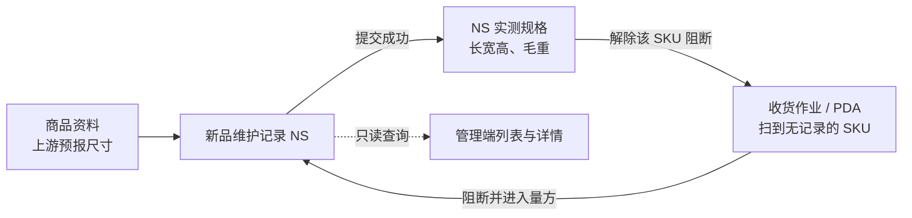

# 新品维护主PRD

> 用途：定义新品维护记录（NS）的新品判断、首次量方录入、单位换算、提交校验、收货准入阻断与记录查询，作为研发实现和测试验收的依据。
> 定位：应用设计层**业务真源**。规则以[《入库模块宏观系统架构》](../../../../../01-全局背景信息/04-入库模块宏观系统架构.md)第一节、[《入库业务需求分析》](../../../../../03-需求调研和分析/02-入库业务/入库业务需求分析.md)新品维护一节（IN-FR-014）为准；场景走查见[《入库业务设计》](../../../../../04-业务分析和设计/02-入库业务设计.md)§3.7、§8.6；字段以[《新品维护（详细稿）》](../../../字段清单合集/02-入库管理/新品维护/新品维护（详细稿）.tsv)为准；页面见[《新品维护页面骨架》](新品维护页面骨架.md)；交互以[前端Demo版PRD](新品维护前端Demo版PRD.md)为准。
> 不写什么：不写 PDA 量方屏的扫码、按键与页面布局（见[PDA 新品量方套件](../../7-PDA作业端/新品量方作业/PDA新品量方前端Demo版PRD.md)）；不写商品资料自身的维护、启用/停用与字段同步（见[《商品资料主PRD》](../../1-基础资料/商品资料/商品资料主PRD.md)）；不写收货实收、拒收与上架规则（见[《入库单主PRD》](../入库单/入库单主PRD.md)、[《上架单主PRD》](../上架单/上架单主PRD.md)）；不写电子秤、DWS、附件存储服务。

| 版本 | 本次变化 | 状态 |
| --- | --- | --- |
| 2026-10-14 | 首版：量方与首次收货准入规则 | 文档修订 |
| 2026-10-15 | 拆出判断、录入、提交、页面与验收；补单位换算精度、管理端入口与数据范围 | 文档修订 |
| 2026-10-15 | 走查修订：照片上限改为待公共能力定义；补菜单基线；页面与 PDA 量方屏实现并演示通过 | 演示已走查 |
| WMS-V1.0（2026-10-27） | 按 ERP 采购订单主 PRD 结构重构：补文档边界、范围与追溯、对象定位、场景索引、状态说明、规则分组、上下游与一致性；业务结论不变 | 待评审，文档修订 |

## 1. 文档信息与阅读边界

| 项目 | 内容 |
| --- | --- |
| 读者 | 研发工程师、测试工程师、产品复核；据此生成管理端原型的 AI |
| 业务依据 | 《入库业务需求分析》IN-FR-014；《入库模块宏观系统架构》第一节“新品维护”取舍；《入库业务设计》§3.7、§8.6 |
| 状态依据 | 本对象为事实记录，无状态；《单据与状态流转》第一节与第四节均列为“无状态，提交即形成记录” |
| 字段依据 | [《新品维护（详细稿）》](../../../字段清单合集/02-入库管理/新品维护/新品维护（详细稿）.tsv) |
| 页面依据 | [《新品维护页面骨架》](新品维护页面骨架.md)、[前端Demo版PRD](新品维护前端Demo版PRD.md)、[PDA 新品量方套件](../../7-PDA作业端/新品量方作业/PDA新品量方前端Demo版PRD.md) |

关联资料：[《商品资料主PRD》](../../1-基础资料/商品资料/商品资料主PRD.md)（初始规格保留与实测记录分离）、[《入库单主PRD》](../入库单/入库单主PRD.md)（收货准入阻断）、[《基础资料需求分析》](../../../../../03-需求调研和分析/01-基础资料/基础资料需求分析.md)（商品启用与规格字段）。本目录写法见[需求文档 PRD 写作约定](../../AGENTS.md)。

## 2. 需求背景与目标

### 2.1 背景

海外仓收到的 SKU 第一次进入本 WMS 仓网时，商品资料里只有上游预报尺寸，没有仓库实测的长宽高和毛重。没有实测规格，后续上架推荐、库位适配、容器装载和计费都缺少依据。所以同一货主同一 SKU 第一次到仓、首次收货提交前，必须先完成一次量方称重。

新品维护不是审批流，也不建“待维护单”。它只在量方提交成功后生成一条记录，并只在 NS 记录中保存实测规格，不改写商品资料的初始规格。判断一个 SKU 是不是新品，只看这条记录在不在，不看上游有没有标记、也不看商品资料里有没有预报尺寸。

### 2.2 目标

- 同一货主 + SKU 只有一条提交成功的 NS 记录，四仓共用；
- 未维护的 SKU 在收货提交时被阻断，维护完成后立即可收；
- 录入单位随维护仓库，落库统一换算，任一仓查看都能复算；
- 记录只保留首次量方事实，后续规格变化走商品资料维护，不更正、不删除；
- 管理端、收货作业台、PDA 三处入口共用同一套提交规则与同一份记录。

### 2.3 设计要点（给研发与测试）

| 设计点 | 做法 | 原因与影响 |
| --- | --- | --- |
| 判断只看 NS 记录 | 同货主 + SKU 无提交成功记录即新品；不读上游“需维护”标记 | 上游标记不可靠，记录是仓内事实 |
| 四仓共用 | 任一仓维护成功后，其他仓不再量方；记录归属货主 + SKU，不按仓拆分 | 商品规格是货主商品属性，不是仓内库存 |
| 收货阻断只针对该 SKU | 未维护时阻断该 SKU 收货提交；同单其他 SKU 照常收 | 避免整单停摆 |
| 单位在录入时换算 | 按维护仓库单位录入，保存时统一换算为 cm、kg；展示反向换算 | 四仓单位不同，账面口径要统一 |
| 记录只读 | 提交后不可改、不可删；量错走商品资料维护 | 保留首次量方事实，避免追溯断点 |
| 提交幂等 | 重复点击、网络重试返回原 NS 记录 | 并发首次维护只产生一条 |

## 3. 需求范围

### 3.1 本期范围

- 新品维护记录列表：按记录号、货主、商品编码、维护仓库、维护时间、来源入库单号查询；导出 Mock；
- 记录详情：基本信息、实测规格（按当前仓库单位换算）、留底信息与照片文件名；
- 页头「新品量方」：独立维护，手工选择启用货主及其下尚无 NS 记录的 SKU；
- 收货作业台入口：新品行阻断提示「去量方」，带出货主、SKU、来源入库单，提交后回到作业台继续收货；
- PDA 收货扫到新品时进入量方屏；规则同本文，交互见 PDA 套件；
- 提交校验、单位换算、实测规格记录、并发与重复提交处理；
- 记录只读与查询数据范围。

### 3.2 功能清单

| 编号 | 功能/位置 | 本次内容 | 需求来源 |
| --- | --- | --- | --- |
| F01 | 新品维护列表 | 查询、列展示、导出 Mock、页头「新品量方」、点记录号打开详情 | IN-FR-014 |
| F02 | 记录详情 Sheet | 基本信息、实测规格、留底信息与照片；只读 | IN-FR-014 |
| F03 | 独立量方 Dialog | 手工选货主与待量方 SKU；录长宽高、毛重、照片、备注；提交 | IN-FR-014 |
| F04 | 收货作业台入口 | 新品行阻断提示与「去量方」，带入货主、SKU、来源入库单；提交后回作业台 | IN-FR-003、IN-FR-014 |
| F05 | PDA 量方屏入口 | 收货扫到新品自动进入；提交后回收货；规则同本文 | IN-FR-013、IN-FR-014 |
| F06 | 导出 | 页头导出当前筛选结果（Demo 为 Mock） | — |

### 3.3 需求追溯

| 需求分析 | 本 PRD 功能与规则 | 验收 |
| --- | --- | --- |
| 新品维护（首次到仓量方并记录实测规格） | F01～F05、R01、R03～R06 | AC01～AC08 |
| 收货（新品未维护阻断） | F04、F05、R02 | AC01、AC02 |
| 多货主归属与当前仓库范围 | R07 | AC05、AC09 |
| 商品资料初始规格 | R06 | AC03、AC08 |

### 3.4 非本期范围

- 待维护单、审核、驳回、入库单上的新品状态；
- 更正、删除、重新量方；后续规格变化走商品资料维护；
- 自动回写上游规格或与 OMS 做尺寸确认；
- 电子秤、DWS、扫码量方设备集成；
- 附件服务、照片大小与张数硬限制；
- 用户账号、角色、仓库授权与审批流。

| 范围补充 | 说明 |
| --- | --- |
| 适用对象 | 同一货主 + 商品编码；同编码不同货主分别判断 |
| 数据范围 | NS 记录四仓共用，列表不按顶栏仓库过滤，默认显示全部；可按维护仓库筛选；量方提交只能在当前仓库发生 |

## 4. 对象定位与业务边界

### 4.1 业务作用

| 项目 | 内容 |
| --- | --- |
| 对象层级 | 事实记录：一次首次量方的结果 |
| 核心职责 | 记录货主、SKU、维护仓库、来源入库单、长宽高、毛重、照片与维护人时间 |
| 记录来源 | 管理端独立量方、收货作业台「去量方」、PDA 收货扫到新品；三处同一提交规则 |
| 下游影响 | 生成 NS 实测记录；解除该 SKU 的收货阻断 |
| 数量关系 | 同一货主 + SKU 至多 1 条；四仓共用；与入库单、SKU 数量无数量关系 |
| 业务终结 | 提交即形成记录；无后续状态 |

### 4.2 上下游关系摘要

### 4.3 业务对象关系

| 关系 | 说明 |
| --- | --- |
| 新品维护记录 : 货主 | N:1；记录属于一个货主 |
| 新品维护记录 : 商品 | N:1；同一货主 + SKU 至多一条 |
| 新品维护记录 : 维护仓库 | N:1；记录在哪一仓完成首次量方，决定录入单位，不限制使用范围 |
| 新品维护记录 : 来源入库单 | N:0..1；从收货环节进入时有值，独立维护为空 |
| 新品维护记录 : 商品资料 | 多对一；每次量方生成独立 NS，商品资料初始规格不被覆盖 |

### 4.4 本对象不负责的事项

- 不改变入库单、收货记录、库存或入库进度；
- 不判断商品是否可售、是否启用；启用状态由商品资料维护；
- 不记录后续每次规格变化；后续变化走商品资料维护并留痕；
- 不负责上游预报尺寸的准确性，只展示供对照；
- 不代替效期准入、批次/SN 采集和品质录入。

## 5. 核心业务场景索引

| 场景ID | 场景 | 类型 | 说明 |
| --- | --- | --- | --- |
| S01 | 收货扫到新品，现场量方后继续收货 | 主流程 | 阻断→量方→提交→回作业台→该 SKU 可收 |
| S02 | 管理端主动量方 | 主流程 | 页头「新品量方」选启用货主与尚无记录的 SKU，提交生成记录 |
| S03 | 英制仓查看公制仓记录 | 支线 | 按查看仓库单位反向换算，数值可复算 |
| S04 | 同编码不同货主 | 支线 | 分别判断、分别量方；一条记录不能跨货主复用 |
| S05 | 两仓并发首次维护 | 异常 | 先提交成功者生成记录，后提交者阻断并显示已有记录 |
| S06 | 重复点击或网络重试 | 异常 | 返回原 NS 号，不新增第二条 |
| S07 | 商品已停用或字段非法 | 异常 | 阻断提交，定位字段；不生成记录 |

## 6. 状态与操作

**本对象无独立状态。** 提交成功即形成不可改的事实记录；列表无状态页签，详情不显示状态标签。业务上只有“无记录（新品）”与“有记录（非新品）”两种判断结果，不是单据状态。

### 6.1 状态维度

| 维度 | 取值 | 说明 |
| --- | --- | --- |
| 记录存在性 | 无记录、有记录 | 新品判断依据；无记录时该 SKU 收货提交被阻断 |
| 维护来源 | 独立维护、收货作业台、PDA 收货 | 只影响来源入库单号是否有值，不影响记录效力 |
| 记录可编辑性 | 只读 | 提交后不可改、不可删 |

### 6.2 状态取值说明

| 取值 | 含义 | 是否终态 |
| --- | --- | --- |
| 无记录 | 该货主 + SKU 尚未完成首次量方，视为新品 | 否，提交后变为有记录 |
| 有记录 | 已完成首次量方，NS 实测规格已记录 | 是，记录长期有效 |
| 照片缺失 | 允许；照片选填 | 不影响记录效力 |

### 6.3 状态流转图

本对象无状态机。业务上的唯一变化是：`无记录 →（提交成功）→ 有记录`。提交失败保持无记录；重复提交返回原记录。

### 6.4 状态—功能矩阵

> ✅ = 允许；❌ = 不允许。查看类功能对全部记录可用。

| 动作 | 无记录（新品） | 有记录（非新品） |
| --- | --- | --- |
| 在收货作业台/PDA 收货提交该 SKU | ❌（R02） | ✅ |
| 打开独立量方 Dialog 并选择该 SKU | ✅ | ❌（下拉不列出） |
| 提交量方 | ✅（R05） | ❌（阻断并显示已有记录） |
| 查看记录列表、详情 | ✅（列表为空态） | ✅ |
| 编辑、删除记录 | ❌ | ❌ |

### 6.5 状态流转表

| 当前状态 | 动作/事件 | 前置条件 | 结果状态 | 二次确认 | 后置影响 | 失败处理 |
| --- | --- | --- | --- | --- | --- | --- |
| 无记录 | 独立维护提交 | 货主、商品启用；该货主 + SKU 仍无记录；字段合法 | 有记录 | 无 | 生成 NS 号；记入 NS 实测规格；商品资料初始规格不变；记维护人与 UTC 时间 | 定位字段或提示已有记录 |
| 无记录 | 收货作业台「去量方」提交 | 同上；货主、SKU、来源入库单带入且只读 | 有记录 | 无 | 同上；回到作业台后该 SKU 可收 | 同上；阻断期间不影响同单其他 SKU |
| 无记录 | PDA 量方提交 | 同上 | 有记录 | 无 | 同上 | 同上 |
| 有记录 | 再次提交同一货主 + SKU | — | 有记录 | — | 返回原 NS 号，不新建 | 展示已有记录号、维护仓库、维护人、时间 |
| 有记录 | 查看/导出 | — | 不变 | — | — | — |

## 7. 核心业务规则

### 7.1 新品判断与收货准入

| 规则编号 | 主题 | 规则 | 边界或例外 |
| --- | --- | --- | --- |
| R01 | 新品判断 | 同一货主 + SKU 没有提交成功的 NS 记录，就是新品。判断只看 NS 记录，不看上游“需维护”标记，也不看商品资料是否已有预报尺寸 | 同编码不同货主分别判断；同货主 SKU 在任一仓维护成功后四仓共用 |
| R02 | 收货阻断 | 新品在任何仓、任何入库单的收货提交都被阻断，提示先完成新品维护；阻断只针对该 SKU，同单其他 SKU 照常收货 | 完成维护后立即可收；维护本身不产生实收、库存或入库进度 |

### 7.2 录入与单位换算

| 规则编号 | 主题 | 规则 | 边界或例外 |
| --- | --- | --- | --- |
| R03 | 录入字段 | 货主、SKU 从收货作业台或 PDA 带入时不可改；独立维护时手工选择启用货主及其下启用 SKU，下拉只列尚无 NS 记录的 SKU。维护仓库取操作人当前仓库、只读，决定录入单位；来源入库单从收货环节进入时带入，独立维护为空 | 长、宽、高必填、大于 0、最多 2 位小数；毛重必填、大于 0、最多 3 位小数 |
| R04 | 单位换算 | 按维护仓库长度单位（cm 或 inch）与重量单位（kg 或 lb）录入。保存时 inch × 2.54 得 cm，lb × 0.45359237 得 kg；cm 保留 2 位小数、kg 保留 3 位小数，四舍五入。展示时按查看仓库单位反向换算，保留同样位数 | 任一仓看到的值都能从 cm、kg 复算；换算后 cm < 0.01 或 kg < 0.001 时阻断并提示“换算后小于最小精度”，不得存为 0 |
| R09 | 对照信息与照片 | 只读展示商品条码、名称及商品资料初始长宽高、毛重，没有显示「—」；照片选填，最多10张、单张≤10MB、常见图片格式，一期仅本地预览与文件名留底 | 不接附件服务；超出张数/大小/格式阻断选择 |

### 7.3 提交、结果与幂等

| 规则编号 | 主题 | 规则 | 边界或例外 |
| --- | --- | --- | --- |
| R05 | 提交校验 | 操作人从当前仓库上下文进入；一期不配置用户账号、角色或仓库授权。提交时重新检查货主、商品均启用，且该货主 + SKU 仍无 NS 记录 | 已有记录时阻断，并展示已有记录号、维护仓库、维护人、时间 |
| R06 | 提交结果 | 成功后生成 NS 号（按[《单据术语与生成规则》](../../../../../01-全局背景信息/08-单据术语与生成规则.md)），记维护人与 UTC 时间，并把 WMS 实测长宽高、毛重保存在 NS 记录中；商品资料初始规格字段保持原值，不被覆盖 | 商品资料/新品详情分开展示“初始规格”和“WMS实测规格”；NS 记录生成后只读，量错不覆盖原记录，按新品维护重新量方生成新 NS |
| R07 | 并发与幂等 | 多仓并发提交同一货主 + SKU，以先提交成功者为准，后提交者按 R05 阻断；同一次提交重复到达（重复点击、网络重试）返回原 NS 记录，不新建第二条 | 以服务端记录存在性为准，不依赖页面状态 |
| R08 | 数据范围与入口 | 管理端入口为入库管理 → 新品维护；收货作业台新品行提供「去量方」；PDA 不设独立量方入口。列表不按顶栏仓库过滤，可按维护仓库筛选；量方提交仍只能在当前仓库发生 | 一期不做登录、角色或仓库授权校验 |

### 7.4 业务生效点

| 业务动作 | 新品维护影响 | 库存影响 | 外部影响 |
| --- | --- | --- | --- |
| 打开量方并提交 | 生成一条 NS 记录 | 无 | 记入 NS 实测规格；不改商品资料初始规格 |
| 收货扫到新品 | 不生成记录；阻断该 SKU 收货 | 无 | 无 |
| 重复提交 | 返回原记录 | 无 | 无 |
| 商品停用后提交 | 阻断，不生成记录 | 无 | 无 |

### 7.5 字段校验绑定

完整字段见[《新品维护（详细稿）》](../../../字段清单合集/02-入库管理/新品维护/新品维护（详细稿）.tsv)。摘要：

| 校验时机 | 要求 |
| --- | --- |
| 保存/提交 | 货主、商品启用；该货主 + SKU 仍无 NS 记录；长宽高大于 0 且最多 2 位小数；毛重大于 0 且最多 3 位小数；维护仓库为当前仓库 |
| 展示 | 按查看仓库单位换算，保留与录入相同位数；预报规格只读；照片显示文件名，无照片显示「—」 |
| 重复提交 | 返回原 NS 号；不覆盖原维护人、时间与规格 |

## 8. 功能需求说明（页面索引）

| 编号 | 页面/位置 | 规则与状态依据 | Demo PRD |
| --- | --- | --- | --- |
| F01 | 新品维护列表 | §6.4；R01、R08 | [前端Demo版PRD](新品维护前端Demo版PRD.md) §四 |
| F02 | 记录详情 Sheet | R03、R06、R09 | 同上 §五 |
| F03 | 独立量方 Dialog | R03～R06 | 同上 §六 |
| F04 | 收货作业台阻断与「去量方」 | R02、R05 | [《入库单主PRD》](../入库单/入库单主PRD.md)§7.2；[收货与双端分册](../入库单/前端Demo版PRD/入库单前端Demo版PRD_收货与双端.md) |
| F05 | PDA 量方屏 | R02～R05 | [PDA 新品量方 Demo PRD](../../7-PDA作业端/新品量方作业/PDA新品量方前端Demo版PRD.md) |
| F06 | 导出 | — | 同上 §四页头 |

## 9. 上下游影响与协同

| 关联模块/系统 | 需要配合的变化 | 交接内容与时机 | 验收结果 |
| --- | --- | --- | --- |
| 商品资料 | 提供启用货主与 SKU、上游预报尺寸；初始规格只读 | 建单时读取 | NS 实测规格独立展示；商品资料修改走自身规则 |
| 入库收货 | 收货提交前校验 NS 记录；提供「去量方」入口 | 每次收货提交；扫到新品时 | 无记录阻断该 SKU，维护后可收 |
| PDA | 收货扫到新品进入量方屏；提交后回收货 | 现场收货 | 与管理端同一记录、同一校验 |
| 公共能力 | 照片与操作记录 | 照片、留痕 | 一期照片仅本地预览；最多10张、单张≤10MB、常见图片格式 |

## 10. 关联文档与阅读入口

| 关联内容 | 阅读入口 | 本 PRD 与其边界 |
| --- | --- | --- |
| 新品维护业务规则 | 《入库模块宏观系统架构》第一节、§2.1 | 规则真源；本文落到录入与验收 |
| 场景走查 | 《入库业务设计》§3.7、§8.6 | 业务走查；本文不重复案例表 |
| 收货阻断 | [《入库单主PRD》](../入库单/入库单主PRD.md)§7.2 | 收货规则；本文只定义阻断条件 |
| 商品资料初始规格 | [《商品资料主PRD》](../../1-基础资料/商品资料/商品资料主PRD.md) | 初始规格 owner；NS 不覆盖 |
| 字段定义 | 《新品维护（详细稿）》 | 字段 owner |
| 页面结构 | [《新品维护页面骨架》](新品维护页面骨架.md) | 区域与线框，非规则权威 |
| 页面交互 | [前端Demo版PRD](新品维护前端Demo版PRD.md) | 控件、Mock；服从本文规则 |
| PDA 交互 | [PDA 新品量方套件](../../7-PDA作业端/新品量方作业/PDA新品量方前端Demo版PRD.md) | 扫码步骤；规则同本文 |

## 11. 异常与一致性

### 11.1 并发操作

| 场景 | 业务处理结果 |
| --- | --- |
| 两仓同时首次维护同一货主 + SKU | 只生成一条记录，以先提交成功者为准；后提交者显示已有记录号、维护仓库、维护人与时间 |
| 收货作业台与 PDA 同时提交同一 SKU | 同上；先成功者解除阻断，后提交返回原记录 |
| 提交时商品刚被停用 | 阻断，不生成记录 |

### 11.2 幂等与重复处理

| 操作 | 幂等规则 |
| --- | --- |
| 同一提交重复点击 | 返回原 NS 号，不新建 |
| 网络重试同一请求 | 按请求标识返回原结果 |
| 重复量方 | 已有记录即阻断，不覆盖首次量方 |
| 页面刷新后再次提交 | 以服务端记录为准，返回原结果 |

### 11.3 与关联记录的一致性

| 场景 | 处理方式 |
| --- | --- |
| 量方后商品资料修改初始规格 | NS 记录保留本次实测；商品资料以最新维护为准并留痕，两者不互相覆盖 |
| 商品停用 | 已生成记录保留；停用不影响历史记录查询，但新提交被阻断 |
| 记录已存在但商品被重新启用 | 不算新品，不再量方；可按商品资料维护更新规格 |
| 照片文件丢失 | NS 记录与规格仍有效；照片仅作留底线索 |

## 12. 验收标准与待确认事项

### 12.1 验收标准

| 编号 | 对应功能/规则 | 条件与操作 | 预期结果 |
| --- | --- | --- | --- |
| AC01 | F04、R02 | 货主 A 的 SKU-X 无 NS 记录，在公制仓收货 | 收货提交被阻断，提示先做新品维护；同单其他 SKU 可收 |
| AC02 | F04、R05 | 收货作业台点「去量方」，录 30×20×10 cm、1.25 kg 提交 | 生成 NS 记录，来源入库单号为当前单；回到作业台后 SKU-X 可收；库存与入库数量不变 |
| AC03 | F02、R04 | 货主 A 的 SKU-X 到英制仓查看记录 | 显示 11.81×7.87×3.94 inch、2.756 lb；可由 cm、kg 复算 |
| AC04 | R01 | 货主 B 也有同编码 SKU-X | 仍按新品阻断，需单独量方；不能复用货主 A 的记录 |
| AC05 | R07 | 两仓同时提交货主 A 的 SKU-Y | 只生成一条记录；后提交者看到已有记录号 |
| AC06 | R07 | 同一次提交重复点击 | 返回同一 NS 号，不新增记录 |
| AC07 | F03、R05 | 商品已停用时提交 | 阻断，不生成记录 |
| AC08 | F03、R03 | 长或毛重填 0、负数或超出小数位 | 阻断保存，字段内提示 |
| AC09 | F01、R08 | 切换顶栏仓库查看列表 | 列表仍显示四仓记录，不按仓库过滤；可按维护仓库筛选 |
| AC10 | F01、F02 | 查看独立维护的记录 | 来源入库单号为空显示「—」；详情无编辑入口 |
| AC11 | R06 | 提交成功后在 NS 详情查看实测规格 | 长宽高、毛重已记录；商品资料初始规格未被覆盖 |
| AC12 | R04 | 英制仓毛重录入 0.001 lb | 换算后 0.000 kg 小于最小精度，阻断并提示；不得保存为 0 |

### 12.2 待确认事项

| 编号 | 问题 | 影响范围 | 状态/结论 |
| --- | --- | --- | --- |
| Q01 | 照片正式上限（张数、大小、格式）与附件服务 | F03、F02、R09 | **已确认（2026-10-27）**：一期最多10张、单张≤10MB、支持常见图片格式；仅本地预览与文件名留底 |
| Q02 | 新品阻断范围是否与《入库业务设计》§3.7“阻断本单”完全等同 | R02、F04 | **已确认（2026-10-27）**：按 R02“任何仓、任何入库单阻断”执行；未维护时无法产生实收，因此不存在已收后上架。设计措辞按本规则统一，不再作为未决项 |
| Q03 | 独立维护是否允许在没有任何来源入库单的情况下提前量方 | F03、R03 | **已确认（2026-10-15）**：允许，来源入库单为空 |
| Q04 | 商品仓内规格写入后，商品资料的留痕字段与展示位置 | R06、F02 | **已确认（2026-10-27）**：单独记录WMS实测长宽高/毛重，与商品资料初始规格分开展示；不改写初始字段 |
| Q05 | 量方是否需要记录设备或操作终端 | F03、F05 | **已确认（2026-10-27）**：不记录设备或操作终端 |

## 附录 单位换算示例（模拟）

公制仓录入长 30.00 cm、宽 20.00 cm、高 10.00 cm、毛重 1.250 kg。英制仓查看：30 ÷ 2.54 = 11.811 → 11.81 inch；20 ÷ 2.54 = 7.874 → 7.87 inch；10 ÷ 2.54 = 3.937 → 3.94 inch；1.250 ÷ 0.45359237 = 2.7558 → 2.756 lb。四舍五入按固定小数位，不因展示反复换算改变落库值。
