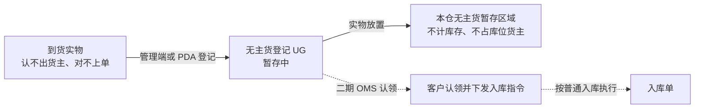

# 无主货登记主PRD

> 用途：定义无主货登记（UG）的适用范围、登记粒度、识别线索、箱数、暂存位置、提交结果与查询边界，作为研发实现和测试验收的依据。
> 定位：应用设计层**业务真源**。规则以[《入库模块宏观系统架构》](../../../../../01-全局背景信息/04-入库模块宏观系统架构.md)§2.1、§6、[《库存模块宏观系统架构》](../../../../../01-全局背景信息/07-库存模块宏观系统架构.md)§2.2 库位用途、[《项目定位与范围》](../../../../../01-全局背景信息/01-项目定位与范围.md)及[《入库业务需求分析》](../../../../../03-需求调研和分析/02-入库业务/入库业务需求分析.md)无主货登记一节（IN-FR-012）为准；字段以[《无主货登记（详细稿）》](../../../字段清单合集/02-入库管理/无主货登记/无主货登记（详细稿）.tsv)为准；页面见[《无主货登记页面骨架》](无主货登记页面骨架.md)；交互以[前端Demo版PRD](无主货登记前端Demo版PRD.md)为准。
> 不写什么：不写入库单、收货、上架、退货的流程与数量（见[《入库单主PRD》](../入库单/入库单主PRD.md)、[《退货单主PRD》](../../4-退货管理/退货单/退货单主PRD.md)）；不写 OMS 认领链路与消息报文；不写异常处理库区的库位编码与基础资料配置；不写 PDA 登记屏的扫码、按键与布局（见[PDA 无主货登记套件](../../7-PDA作业端/无主货登记作业/PDA无主货登记前端Demo版PRD.md)）；不写线下实物的保管、移交与处置。

| 版本 | 本次变化 | 状态 |
| --- | --- | --- |
| 2026-10-14 | 首版：登记与查询规则 | 文档修订 |
| 2026-10-15 | 拆出适用范围、登记、结果、页面与验收；补页面骨架与 Demo PRD | 文档修订 |
| 2026-10-15 | 走查修订：登记不选库位（无主货统一放专门暂存区域）；照片上限改为待公共能力定义；页面与 PDA 登记屏实现并演示通过 | 演示已走查 |
| WMS-V1.0（2026-10-27） | 按 ERP 采购订单主 PRD 结构重构：补文档边界、范围与追溯、对象定位、场景索引、状态说明、规则分组、上下游与一致性；业务结论不变 | 待评审，文档修订 |

## 1. 文档信息与阅读边界

| 项目 | 内容 |
| --- | --- |
| 读者 | 研发工程师、测试工程师、产品复核；据此生成管理端原型的 AI |
| 业务依据 | 《入库业务需求分析》IN-FR-012、IN-FR-002；《入库模块宏观系统架构》§2.1、§6；《库存模块宏观系统架构》§2.2 库位用途 |
| 状态依据 | 《单据与状态流转》第七节；《单据术语与生成规则》§1.4；一期只有「暂存中」 |
| 字段依据 | [《无主货登记（详细稿）》](../../../字段清单合集/02-入库管理/无主货登记/无主货登记（详细稿）.tsv) |
| 页面依据 | [《无主货登记页面骨架》](无主货登记页面骨架.md)、[前端Demo版PRD](无主货登记前端Demo版PRD.md)、[PDA 无主货登记套件](../../7-PDA作业端/无主货登记作业/PDA无主货登记前端Demo版PRD.md) |

关联资料：[《入库单主PRD》](../入库单/入库单主PRD.md)（能对上单的货物走收货）、[《退货单主PRD》](../../4-退货管理/退货单/退货单主PRD.md)（能核实为退货的走退货）、[《库存查询主PRD》](../../4-库存管理/库存查询/库存查询主PRD.md)（无主货不计库存）、[《基础资料需求分析》](../../../../../03-需求调研和分析/01-基础资料/基础资料需求分析.md)（异常处理库区）。本目录写法见[需求文档 PRD 写作约定](../../AGENTS.md)。

## 2. 需求背景与目标

### 2.1 背景

海外仓到货时，总会出现对不上任何入库单或退货预报、也认不出货主的实物：面单模糊、箱唛缺失、拼柜混装、客户没提前预报。这类货如果直接入库，会污染某个货主的库存；如果随手放在月台，过几天就没人说得清是什么、哪来的、进了几箱。

一期只做一件事：把“收到一批不知道是谁的货”这件事登记下来，留下识别线索和存放位置，实物统一放在本仓无主货暂存区域，等 OMS 上线后由客户认领。认领、指定货主、转入库都不在一期。

### 2.2 目标

- 把“无主”与“已知货主但对不上单”分开：前者登记，后者线下处理，不混入 WMS；
- 一条登记对应一批同来源实物，不按箱拆，也不据此推算箱内件数；
- 自动绑定本仓无主货专用库位；实物统一暂存，不与已识别货主的货混放；
- 登记成功不生成任何入库、收货、上架、异常或库存记录；
- 登记后字段只读，录错不更正；后续能力边界写清楚，不预留可点击但无业务的入口。

### 2.3 设计要点（给研发与测试）

| 设计点 | 做法 | 原因与影响 |
| --- | --- | --- |
| 只登记、不建单 | 只生成 UG 记录，不生成入库单、退货单、收货记录、上架单、入库异常、库存或流水 | 无主货没有货主，无法进入任何货主的库存账 |
| 一批一条 | 同一运单、同一柜或同一次到件的一批外箱合并为一条，不按箱拆 | 现场一次到件通常整批处理，拆箱登记反而难以对应实物 |
| 不选库位 | 登记只记到仓，实物放本仓无主货暂存区域 | 无主货不占具体库位，也不占货主归属 |
| 线索至少一项 | 运单号、箱唛号、柜号至少填一项；运单号、箱唛号可多行 | 保留后续认领和查找的最小依据 |
| 箱数不等于件数 | 箱数只表示外箱或包裹数，不据此生成 SKU 数量 | 没有 SKU 和货主，不能形成库存数量 |
| 提交即事实 | 重复提交返回原 UG 号；登记后只读 | 避免重复登记和事后改线索 |
| 页面不出现后续动作 | 无指定货主、认领、转入库、转库存、处置按钮 | 一期能力未建设，不做空入口 |

## 3. 需求范围

### 3.1 本期范围

- 无主货登记列表：按登记号、运单号、箱唛号、柜号、登记时间查询；列表展示识别线索摘要、箱数、登记人与时间；
- 登记详情：识别线索、箱数、实物描述、照片文件名、登记仓库、登记人与 UTC 时间；
- 页头「登记无主货」及登记 Dialog；
- PDA 登记：扫运单或箱唛登记，规则同本文；
- 提交校验、重复提交幂等、登记后只读；
- 当前仓库范围内的查询与导出（Mock）。

### 3.2 功能清单

| 编号 | 功能/位置 | 本次内容 | 需求来源 |
| --- | --- | --- | --- |
| F01 | 无主货登记列表 | 查询、列展示、详情入口、页头「登记无主货」、导出 Mock | IN-FR-012 |
| F02 | 登记详情 Sheet | 识别线索、箱数、实物描述、照片、登记信息；只读 | IN-FR-012 |
| F03 | 登记 Dialog | 录运单号/箱唛号/柜号、箱数、实物描述、照片；提交生成 UG | IN-FR-012 |
| F04 | PDA 登记屏 | 扫运单或箱唛登记；规则同本文，交互见 PDA 套件 | IN-FR-002、IN-FR-012 |
| F05 | 导出 | 页头导出当前筛选结果（Demo 为 Mock） | — |

### 3.3 需求追溯

| 需求分析 | 本 PRD 功能与规则 | 验收 |
| --- | --- | --- |
| 无主货登记（只登记与暂存） | F01～F04、R01～R06 | AC01～AC08 |
| 到货登记与签收（未知归属登记无主货） | F04、R01 | AC01、AC03 |
| 多货主归属与当前仓库范围 | R07 | AC06、AC09 |
| 后续 OMS 认领与转入库 | R08（本期不做） | AC10 |

### 3.4 非本期范围

- 认领、指定货主、转入库、转库存、手工入库、线下处置；
- 与 OMS 的无主货推送、客户认领、认领后下发入库指令；
- 按箱拆登记、箱内 SKU/件数登记、称重与量方；
- 无主货暂存位置的库位容量、库位编码与库存台账；
- 更正、删除、合并、拆分登记记录；
- 用户账号、角色、仓库授权与审批流。

| 范围补充 | 说明 |
| --- | --- |
| 适用对象 | 无法确定货主、也对不上任何入库单或退货预报的到货实物；已知货主但对不上单的不适用 |
| 数据范围 | 顶栏当前仓库决定列表与详情范围；其他仓的登记不可见；登记仓库取操作人当前仓库 |

## 4. 对象定位与业务边界

### 4.1 业务作用

| 项目 | 内容 |
| --- | --- |
| 对象层级 | 到货信息记录：只保留无主实物到仓的识别线索与暂存事实 |
| 核心职责 | 记录哪个仓、哪一批、什么线索、几箱、谁在什么时候登记 |
| 记录来源 | 管理端登记 Dialog、PDA 登记屏；无上游指令，也无手工导入 |
| 下游对象 | 一期没有下游对象；OMS 上线后才可能关联认领与入库指令 |
| 数量关系 | 一条登记对应一批同来源实物；箱数只记外箱/包裹数，不形成 SKU 数量 |
| 业务终结 | 一期停在「暂存中」；后续状态待 OMS 认领能力上线 |

### 4.2 上下游关系摘要

### 4.3 业务对象关系

| 关系 | 说明 |
| --- | --- |
| 无主货登记 : 仓库 | N:1；登记仓库取操作人当前仓库，登记后不可改 |
| 无主货登记 : 识别线索 | 1:N；运单号、箱唛号可多行；柜号单值 |
| 无主货登记 : 实物 | 1:N；一批外箱/包裹，只记箱数，不记箱内 SKU |
| 无主货登记 : 存货位置 | N:1；只记到本仓无主货暂存区域，不记具体库位 |
| 无主货登记 : 入库单/库存 | 一期无关系；不生成、不占用 |

### 4.4 本对象不负责的事项

- 不形成库存、库存流水、订单预占或库位货主归属；
- 不生成入库单、退货单、收货记录、上架单或入库异常；
- 不判断实物价值、破损程度与赔偿责任；
- 不负责实物保管、移交、退回或销毁；
- 不代替“已知货主但对不上单”的线下补单跟踪；
- 不代替“能对上入库单但现场不收”的拒收处理（走收货拒收与入库异常）。

## 5. 核心业务场景索引

| 场景ID | 场景 | 类型 | 说明 |
| --- | --- | --- | --- |
| S01 | 未知货主到件登记 | 主流程 | 面单对不上任何单、认不出货主；登记一批 UG，实物放无主货暂存区域 |
| S02 | 已知货主但缺单 | 支线 | 不登记无主货；线下暂存、联系货主补报或退回 |
| S03 | 能对上入库单但现场不收 | 支线 | 走收货拒收；生成入库异常，不登记无主货 |
| S04 | 经核实属于退货/退件 | 支线 | 交退货流程按预报收货，不登记无主货 |
| S05 | 识别线索缺失或箱数为 0 | 异常 | 阻断提交，提示至少填一项、箱数为正整数 |
| S06 | 重复提交 | 异常 | 返回原 UG 号，不重复登记 |
| S07 | 跨仓查询 | 支线 | 只显示当前仓库登记；切换仓库后不显示他仓记录 |
| S08 | 二期 OMS 认领 | 后续能力 | 一期不实现，不预留可点击入口 |

## 6. 状态与操作

**一期只有「暂存中」**，记录提交即形成，不存在状态流转，也不设状态页签。二期状态待 OMS 认领能力上线后再规划，本期不建枚举、不预留下拉或入口。

### 6.1 状态与操作

| 项目 | 规则 |
| --- | --- |
| 状态 | 暂存中（一期唯一状态，视为终态） |
| 可查看 | 列表、详情、导出 |
| 可登记 | 管理端或 PDA 新建 |
| 不可操作 | 指定货主、认领、转入库、转库存、编辑、删除、线下处置 |

页面只展示「暂存中」，不出现指定货主、认领、转入库、转库存或处置按钮。实物统一放在本仓无主货专用暂存库位，登记详情只读展示库位编码。

## 7. 核心业务规则

### 7.1 适用范围与分类

| 规则编号 | 主题 | 规则 | 边界或例外 |
| --- | --- | --- | --- |
| R01 | 什么算无主货 | 只有“认不出货主，也对不上任何入库单或退货预报”的到货实物才登记无主货 | 能确定货主但错 SKU、缺单、超收、未预报的，仓库线下暂存并联系货主补报或退回，WMS 不记录、不增加库存，也不登记无主货 |
| R02 | 不替代其他路径 | 能对上入库单但现场判定不收的，走收货拒收并生成入库异常；经核实属于退货、退件的，交退货流程按预报收货 | 三类情况不得互相改写：无主货登记、拒收、退货收货各自留痕 |
| R03 | 登记粒度 | 找不到订单时，同一批到件登记一条，不按箱内 SKU 拆分；同运单/柜号分批到件也按本次到件分别登记 | 一期不自动合批；由现场按本次到件登记 |

### 7.2 登记字段与暂存

| 规则编号 | 主题 | 规则 | 边界或例外 |
| --- | --- | --- | --- |
| R04 | 仓库与线索 | 仓库取操作人当前仓库，登记后不可改；运单号、箱唛号、柜号至少填一项，运单号、箱唛号可填多个、每行一个，去首尾空格、去空行 | 三项全空阻断；重复线索不阻断，按不同批次分别登记 |
| R05 | 箱数与描述 | 箱数必填、正整数，只表示外箱或包裹数，不代表箱内件数，也不据此生成 SKU 数量；实物描述选填 | 箱数为 0 或负数阻断；照片选填，最多10张、单张≤10MB、常见图片格式，一期仅本地预览与文件名留底 |
| R09 | 暂存位置 | 自动绑定本仓无主货专用库区/库位（如 `EX-01-01`），详情只读展示 | 专用位置仅作实物存放参考，不形成库存、不占库位货主；具体编码取基础资料异常处理库区 |

### 7.3 提交、结果与查询

| 规则编号 | 主题 | 规则 | 边界或例外 |
| --- | --- | --- | --- |
| R06 | 提交结果与幂等 | 提交时记录登记人与 UTC 时间，按[《单据术语与生成规则》](../../../../../01-全局背景信息/08-单据术语与生成规则.md)生成 UG 号，状态为暂存中；同一次提交重复到达返回原 UG 号，不重复登记 | 登记后所有字段只读，不更正、不删除；录错线索在新登记的实物描述中说明，不改原记录 |
| R07 | 查询范围与只读 | 列表按顶栏当前仓库过滤，其他仓登记不可见；按登记号、运单号、箱唛号、柜号、登记时间查询；列表展示识别线索摘要、箱数、登记人与时间 | 页面不出现指定货主、认领、转入库、转库存或处置按钮；不设状态页签 |
| R08 | 后续能力边界 | OMS 上线后，WMS 推送登记信息供客户在 OMS 认领，客户下发有效入库指令，WMS 再按普通入库执行并关联原登记；届时启用「已转入库」「已线下处置」 | 一期 Mock 不代做认领，也不预留可点击的认领入口 |

### 7.4 数量口径与示例

本对象**没有库存数量口径**。唯一数量是箱数，只统计外箱/包裹，不参与库存、预占、可用、已分配中的任何一项，也不与入库单预计或实收相加。

**示例（模拟）**：到件 3 箱，面单运单号对不上任何单、认不出货主；登记一条 UG，箱数 3，运单号 1 个，状态暂存中。各货主库存与库存流水不变；实物放本仓无主货专用暂存库位（如 `EX-01-01`）。后续 OMS 认领并下发入库指令前，这 3 箱不进入任何库存账。

### 7.5 业务生效点

| 业务动作 | 无主货登记影响 | 库存影响 | 外部影响 |
| --- | --- | --- | --- |
| 管理端/PDA 登记 | 生成一条暂存中记录 | 无 | 无 |
| 重复提交 | 返回原记录 | 无 | 无 |
| 查询/导出 | 只读 | 无 | 无 |
| 二期认领（未实现） | 状态转已转入库 | 按普通入库形成库存 | 关联 OMS 指令 |

### 7.6 字段校验绑定

完整字段见[《无主货登记（详细稿）》](../../../字段清单合集/02-入库管理/无主货登记/无主货登记（详细稿）.tsv)。摘要：

| 校验时机 | 要求 |
| --- | --- |
| 提交登记 | 仓库为当前仓库；运单号、箱唛号、柜号至少一项非空；运单号/箱唛号多行去空行；箱数为正整数；实物描述、照片选填 |
| 查看详情 | 全部字段只读；照片显示文件名；无照片显示「—」 |
| 重复提交 | 返回原 UG 号，不覆盖原登记人、时间与线索 |

## 8. 功能需求说明（页面索引）

| 编号 | 页面/位置 | 规则与状态依据 | Demo PRD |
| --- | --- | --- | --- |
| F01 | 无主货登记列表 | §6.4；R07 | [前端Demo版PRD](无主货登记前端Demo版PRD.md) §三 |
| F02 | 登记详情 Sheet | R04～R06 | 同上 §五 |
| F03 | 登记 Dialog | R04、R05、R06 | 同上 §四 |
| F04 | PDA 登记屏 | R02、R04～R06 | [PDA 无主货登记 Demo PRD](../../7-PDA作业端/无主货登记作业/PDA无主货登记前端Demo版PRD.md) |
| F05 | 导出 | — | 同上 §三页头 |

## 9. 上下游影响与协同

| 关联模块/系统 | 需要配合的变化 | 交接内容与时机 | 验收结果 |
| --- | --- | --- | --- |
| 入库收货 | 区分无主货与能对上单的货；能对上单的走收货，不登记 | 到货识别时 | 同一批货不重复登记、不混入库存 |
| 退货 | 经核实属于退货/退件的按退货预报收货 | 到货识别时 | 退货不登记为无主货 |
| 库存与库内 | 不生成库存、流水、库位占用；暂存区域不计库存 | 登记时 | 各货主库存不变 |
| 基础资料 | 异常处理库区与无主货暂存位置 | 登记时展示暂存位置说明 | 位置编码与展示口径一致 |
| OMS（二期） | 推送登记信息、接收认领与入库指令 | 二期 | 本期不实现 |

## 10. 关联文档与阅读入口

| 关联内容 | 阅读入口 | 本 PRD 与其边界 |
| --- | --- | --- |
| 无主货定位与边界 | 《入库模块宏观系统架构》§2.1、§6 | 规则真源；本文落到登记与查询 |
| 库区用途与暂存位置 | 《库存模块宏观系统架构》§2.2 | 无主货不计库存、不占库位货主 |
| 入库需求 | 《入库业务需求分析》IN-FR-012 | 需求来源；本文不重复入库流程 |
| 字段定义 | 《无主货登记（详细稿）》 | 字段 owner |
| 页面结构 | [《无主货登记页面骨架》](无主货登记页面骨架.md) | 区域与线框，非规则权威 |
| 页面交互 | [前端Demo版PRD](无主货登记前端Demo版PRD.md) | 控件、Mock；服从本文规则 |
| PDA 交互 | [PDA 无主货登记套件](../../7-PDA作业端/无主货登记作业/PDA无主货登记前端Demo版PRD.md) | 扫码步骤；规则同本文 |

## 11. 异常与一致性

### 11.1 并发操作

| 场景 | 业务处理结果 |
| --- | --- |
| 两人同时登记同一批实物 | 各自生成 UG；系统不自动合并。现场应在实物描述中注明重复，后续按线下实际处理 |
| 管理端与 PDA 同时提交同一次登记 | 重复请求返回原 UG 号；不同请求标识按两次登记处理 |
| 登记时切换顶栏仓库 | 仓库取提交时的当前仓库；提交后不可改 |

### 11.2 幂等与重复处理

| 操作 | 幂等规则 |
| --- | --- |
| 同一次提交重复点击 | 返回原 UG 号，不新增记录 |
| 网络重试 | 按请求标识返回原结果 |
| 同一线索再次登记 | 不视为重复业务；生成新 UG，现场用实物描述区分批次 |
| 登记后再次打开提交 | 不回写原记录 |

### 11.3 与关联记录的一致性

| 场景 | 处理方式 |
| --- | --- |
| 登记后客户在 OMS 认领 | 一期无链路；二期按原登记关联入库指令，不重复建登记 |
| 登记后线下处置 | 一期不改状态、不留处置记录；二期启用「已线下处置」 |
| 已知货主补单成功 | 原无主货登记保留；新入库按普通入库执行，不把原 UG 当作入库依据 |
| 实物在暂存区域丢失 | 一期无库存账，不做盘亏；按线下保管流程处理，登记记录仍保留 |

## 12. 验收标准与待确认事项

### 12.1 验收标准

| 编号 | 对应功能/规则 | 条件与操作 | 预期结果 |
| --- | --- | --- | --- |
| AC01 | F03、R01 | 到件 3 箱，面单运单号对不上任何单、认不出货主，登记 | 生成一条 UG 记录，状态暂存中；箱数 3；各货主库存、流水不变 |
| AC02 | F03、R04 | 运单、箱唛、柜号都不填 | 阻断提交，提示至少填一项 |
| AC03 | F03、R05 | 箱数填 0 | 阻断提交，提示正整数 |
| AC04 | F03、R01 | 已知货主 ANKR 缺单的 5 箱，尝试登记 | 页面提示能确定货主的不在此登记；不生成 UG；按线下补单处理 |
| AC05 | F01、R07 | 美西仓登记后，顶栏切换到美东仓查询 | 不显示美西仓记录 |
| AC06 | F03、R06 | 同一次提交重复点击 | 只生成一个 UG 号，返回原记录 |
| AC07 | F02、R07 | 登记后打开详情 | 所有字段只读；无认领、指定货主、转入库按钮 |
| AC08 | F03、R09 | 登记时查看暂存位置 | 只显示本仓无主货暂存区域，不出现具体库位选择 |
| AC09 | F01、F05 | 列表按运单号、箱唛号、柜号、登记时间查询 | 命中对应记录；列表显示识别线索摘要、箱数、登记人与时间 |
| AC10 | R08 | 查看页面与菜单 | 不出现 OMS 认领、已转入库、已线下处置入口 |
| AC11 | R02 | 能对上入库单但现场不收的货 | 走收货拒收并生成入库异常；不生成 UG |

### 12.2 待确认事项

| 编号 | 问题 | 影响范围 | 状态/结论 |
| --- | --- | --- | --- |
| Q01 | 无主货暂存区域是否需要建立专用库位编码（如 `EX-01-*`）并在登记详情展示 | R09、F02 | **已确认（2026-10-27）**：使用本仓无主货专用库区/库位；详情展示 |
| Q02 | “同一次到件/同来源”的判定口径 | R03、F03 | **已确认（2026-10-27）**：找不到订单时，同一批到件登记一条，不自动拆分 |
| Q03 | 二期「已转入库」「已线下处置」是否现在就建状态枚举与字段 | §6、字段稿 | **已确认（2026-10-27）**：一期只保留“暂存中”；二期状态后续再规划 |
| Q04 | 照片正式上限与附件服务 | F03、R05 | **已确认（2026-10-27）**：同照片规则：最多10张、单张≤10MB、常见图片格式 |
| Q05 | 无主货登记是否需要记录发现环节、到货时间与承运商 | F03 | **已确认（2026-10-27）**：登记时间必填；发现环节/到货时间/承运商不强制 |

## 附录 识别与处理对照（模拟）

| 现场情况 | 处理路径 | 是否生成 UG |
| --- | --- | --- |
| 面单模糊，认不出货主，对不上单 | 登记无主货，实物放无主货暂存区域 | 是 |
| 货主 ANKR 明确，但本批没有入库单 | 线下暂存，联系 ANKR 补报或退回；WMS 不记录 | 否 |
| 能对上 IB 单，但 4 件外箱破损现场不收 | 收货时录拒收 4，生成入库异常 | 否 |
| 客户退货包裹，能对上退货预报 | 按退货预报收货 | 否 |
| 同一柜里混有 A 货主已预报货和 3 箱无主货 | 已预报货按单收货；3 箱单独登记 UG | 是（仅 3 箱） |
