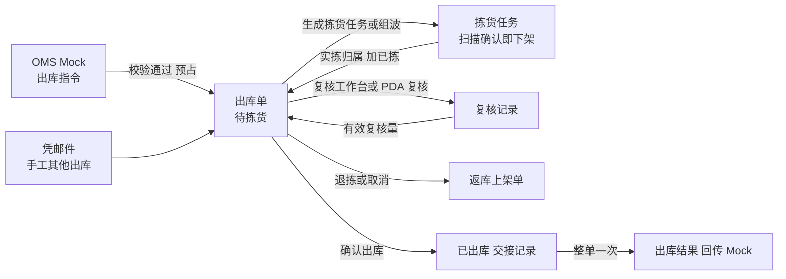
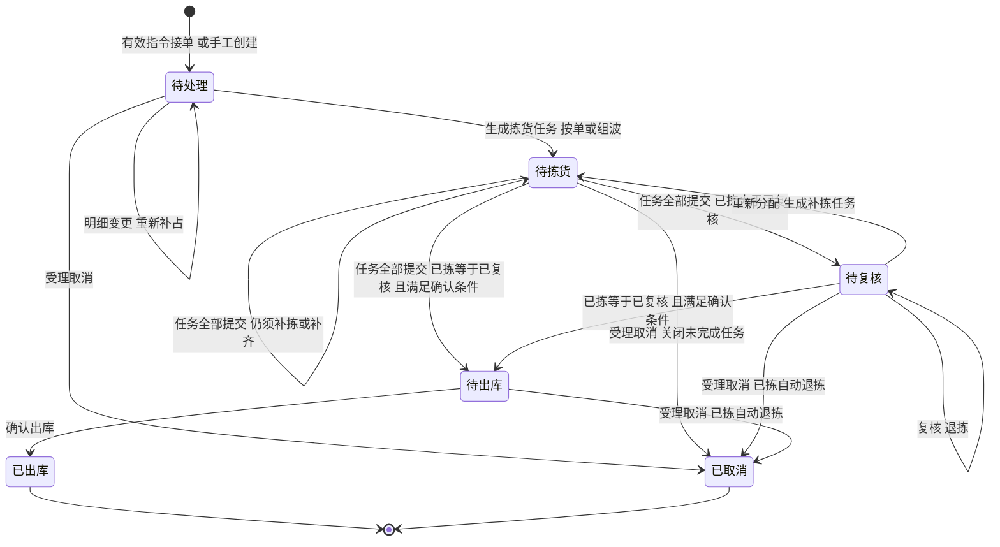

# 出库单主PRD

> 用途：定义管理端出库单的列表、详情、生成拣货任务与重新分配、复核记录维护、退拣、确认出库与交接、取消，以及拣货任务、复核记录、交接记录、返库上架单、出库结果五类子记录在详情内的展示，作为研发实现、测试验收和生成前端原型的业务依据。
> 定位：应用设计层**业务真源**。规则以[《出库模块宏观系统架构》](../../../../../01-全局背景信息/05-出库模块宏观系统架构.md)和[《出库业务需求分析》](../../../../../03-需求调研和分析/03-出库业务/出库业务需求分析.md)为准；类型差异与数量走查见[《出库业务设计》](../../../../../04-业务分析和设计/03-出库业务设计.md)；字段以[《出库单（详细稿）》](../../../字段清单合集/03-出库管理/出库单/出库单（详细稿）.tsv)及同模块复核记录、出库交接详细稿为准；页面见[《出库单页面骨架》](出库单页面骨架.md)；页面交互以[前端Demo版PRD](前端Demo版PRD/)为准，**须服从本文 §6.4 状态—功能矩阵**。
> 不写什么：波次组波与成员规则见[《波次主PRD》](../波次/波次主PRD.md)；拣货扫描、缺货上报与任务提交见[《拣货任务主PRD》](../拣货任务/拣货任务主PRD.md)；返库保存与提交见[《返库上架单主PRD》](../返库上架单/返库上架单主PRD.md)；PDA 拣货、复核、返库的交互见 [7-PDA作业端](../../7-PDA作业端/)；不写盘点页面、OMS 报文、接口与表结构。

| 版本 | 本次变化 | 状态 |
| --- | --- | --- |
| WMS-V0.1（2026-10-15） | 原《出库管理主PRD》六类对象合写一稿 | 已拆分，归档于本次修订 |
| WMS-V0.2（2026-10-15） | 按入库单样板拆为出库单、波次、拣货任务、返库上架单四个三件制；本文补状态—功能矩阵、功能清单、需求追溯、异常与一致性、可判定验收 | 文档修订，待演示验收 |

## 原型阅读路径（生成原型时按序读）

| 顺序 | 文档 | 承担内容 |
| --- | --- | --- |
| 1 | **本文** | 范围、状态与矩阵、规则 R01～R16、功能 F01～F12、验收 AC |
| 2 | [《出库单（详细稿）》](../../../字段清单合集/03-出库管理/出库单/出库单（详细稿）.tsv)及[复核记录](../../../字段清单合集/03-出库管理/复核记录/复核记录（详细稿）.tsv)、[出库交接](../../../字段清单合集/03-出库管理/出库交接/出库交接（详细稿）.tsv)详细稿 | 字段名称、类型、来源与说明 |
| 3 | [《出库单页面骨架》](出库单页面骨架.md) | ASCII 线框：列表、详情与页签、复核记录 Sheet、五个弹窗 |
| 4 | [前端Demo版PRD](前端Demo版PRD/)（先读[公共与技术约定](前端Demo版PRD/出库单前端Demo版PRD_公共与技术约定.md)） | 路由、派生、列表/详情/弹窗分册、Mock 种子 |
| 5 | [《QS-WMS 前端设计与开发规范》](../../../../../09-产品原型/qs-wms-demo/docs/02-设计规范.md) | 样式与容器选型 |
| 6 | 波次、拣货任务、返库上架单三个套件；[7-PDA作业端](../../7-PDA作业端/) | 出库单详情跳转后的对象与 PDA 作业 |

**分工**：业务规则与验收以本文为准；布局以页面骨架为准；类型、公式、组件用法与种子数据以前端Demo版PRD为准。

## 1. 文档信息与阅读边界

| 项目 | 内容 |
| --- | --- |
| 读者 | 研发工程师、测试工程师、产品复核；以及据此生成前端原型的 AI |
| 业务依据 | 《出库业务需求分析》第二节；《出库模块宏观系统架构》第一至五节 |
| 状态依据 | 宏观架构第三节；与[《单据与状态流转》](../../../系统架构设计/03-单据与状态流转.md)第三节同步 |
| 字段依据 | 出库单、复核记录、出库交接三份详细稿 |
| 页面依据 | 页面骨架、前端Demo版PRD |

关联资料：[《实体对象关系》](../../../系统架构设计/02-实体对象关系.md)、[《全局机制与操作留痕》](../../../系统架构设计/05-全局机制与权限配置.md)、[《接口与OMS Mock消息设计》](<../../../系统架构设计/06-接口与OMS Mock消息设计.md>)、[上游消息记录字段](../../../字段清单合集/05-系统集成与对接/上游消息记录/)。本目录写法见[需求文档 PRD 写作约定](../../AGENTS.md)。

## 2. 需求背景与目标

### 2.1 背景

出库单是上游出库指令在仓内的执行单据。一期六种业务类型（B2C出库、FBA转运出库、批发出库、调拨出库、采购退货出库、其他出库）共用一张出库单、一套页面，差别只在接单怎么占库存、确认时能不能缺量。普通出库全部由 OMS Mock 指令生成；其他出库还可凭线下邮件在管理端手工创建。

一张出库单会拣多次（首次拣货、补拣）、复核多次（多个包裹或箱托），多人在 PDA 与管理端协作。出库单的状态由拣货任务和确认出库自动推导，管理端没有改状态的入口；管理端与 PDA 在详情页完成各自动作，入口只看状态。

### 2.2 目标

- 一张单的状态与按钮任何时刻都能由任务、复核和确认出库事实复算，条件不满足的按钮不出现；
- 需求、预占、缺货、已拣、已复核、实发、未发在单头汇总和明细上口径一致，且满足 §7.3 的约束；
- 拣货任务、复核记录、交接记录、返库上架单、出库结果在出库单详情内可查，并能跳到对应对象；
- 缺货有明确出路：重新分配补拣、按类型缺量结案或等上游取消；
- 前端原型能用本文与 Demo PRD 生成，种子数据覆盖五个状态，无需再补业务规则。

### 2.3 设计要点（给研发与测试）

| 设计点 | 做法 | 原因与影响 |
| --- | --- | --- |
| 状态由事实推导 | 待处理、待拣货、待复核、待出库由任务与数量推导；已出库、已取消由确认出库和取消受理写入 | 避免人改状态与任务脱节；测试按动作造数据即可覆盖状态 |
| 接单只占 SKU，分配才定库位 | 接单在 SKU 库存上加订单预占；生成拣货任务时才分配库位与批次 | 暂存库位的货能接单不能分配；B2C 要等整单能分配足 |
| 扫描确认即下架 | 已拣数量来自拣货任务的实拣归属，确认一次加一次；任务提交不改已拣 | 出库单已拣始终等于在本单名下的出库暂存实物 |
| 实发取有效复核 | 确认出库时实发＝有效已复核，且已拣须全部复核 | 复核是唯一的发货核对口径，波次汇总数不能代替逐单复核 |
| 缺量只因库存不足 | FBA转运出库、批发出库可缺量一次结案；其余类型须足量 | 接单允许部分预占不等于确认允许缺量 |
| 取消接管已拣 | 受理取消即已取消；已拣按原单归属自动退拣，生成返库上架单 | 已取消只表示原单不再出库，不表示实物已返库 |
| 子记录不独立成菜单 | 复核记录、交接记录、出库结果只在出库单详情页签查看 | 与宏观架构一致；拣货任务、返库上架单另有列表 |

## 3. 需求范围

### 3.1 本期范围

- 出库单列表：状态页签、条件查询、列展示、勾选 B2C 单组波入口、导出（Mock）；
- 出库单详情：基本信息、数量进度、商品明细、指定实物（其他出库）及五类子记录页签、操作日志；
- 生成拣货任务、重新分配补拣（管理端）；
- 复核入口（复核工作台或 PDA 复核二选一）、删除复核记录、补录包裹信息（B2C）；
- 退拣（复核发现残损或少件）；
- 确认出库（可同时登记交接）、出库后补登交接；
- 取消：OMS Mock 取消指令受理；手工其他出库在详情取消；
- OMS Mock：新建六类指令、明细变更、取消、指令处理记录与重发；手工创建其他出库；
- 出库结果：已出库时生成一次，可模拟失败并重交（Mock）。

### 3.2 功能清单

| 编号 | 功能/位置 | 本次内容 | 需求来源 |
| --- | --- | --- | --- |
| F01 | 出库单列表 | 状态页签（带数量）、查询、列展示；待处理单勾选后按单生成拣货任务或组波批量拣货、导出 Mock | 出库单来源、多货主归属与仓库权限 |
| F02 | 出库单详情 | 概览卡（基本信息＋数量进度）、页头按状态出按钮、多页签 | 库存校验与预占、出库结果 |
| F03 | 子记录页签 | 拣货任务、复核记录（Sheet 看明细）、交接记录、返库上架单、出库结果、操作日志 | 拣货任务、复核、退拣与返库上架 |
| F04 | 生成拣货任务／重新分配 | 待处理首次生成；待拣货、待复核按缺口重新分配并生成补拣任务 | 拣货任务、缺货处理 |
| F05 | 组波入口 | 列表勾选同仓同货主待处理 B2C 单生成波次；规则见波次主PRD | 基础波次 |
| F06 | 复核维护 | 进复核工作台或 PDA 复核；删除复核记录重做；B2C 补包裹号、模拟重量与运单 | 复核 |
| F07 | 退拣 | 选实拣归属、数量／SN、原因，生成返库上架单 | 退拣与返库上架 |
| F08 | 确认出库与交接 | 二次确认弹窗，可同时登记交接；已出库后补登交接 | 确认出库、出库结果 |
| F09 | 取消 | OMS Mock 取消受理；手工其他出库在详情取消；已拣自动退拣 | 取消与变更 |
| F10 | OMS Mock 与处理记录 | 新建、明细变更、取消指令；处理记录查看与按原消息重发 | 出库指令接收、取消与变更 |
| F11 | 手工创建其他出库 | 凭邮件依据指定不良品库存与数量 | 其他出库 |
| F12 | 导出 | 页头导出（Demo 为 Mock 提示） | — |

### 3.3 需求追溯

下表「需求分析」列写《出库业务需求分析》第二节的功能需求名称。

| 需求分析 | 本 PRD 功能与规则 | 验收 |
| --- | --- | --- |
| 出库指令接收、出库单来源 | F10、R01、R02 | AC01～AC03、AC20 |
| 库存校验与预占 | F10、R03、R04 | AC02、AC04 |
| 拣货任务、缺货处理 | F04、R05～R07 | AC05、AC06、AC14 |
| 拣货校验与换位 | 拣货任务主PRD；本文只读展示 | AC07 |
| 复核 | F06、R08、R09 | AC08、AC09 |
| 确认出库、出库结果 | F08、R10～R12 | AC10～AC13 |
| 取消与变更 | F09、F10、R02、R13 | AC15、AC16 |
| 退拣与返库上架 | F07、R14 | AC17、AC18 |
| 其他出库 | F11、R03、R15 | AC19 |
| 基础波次 | F05；波次主PRD | AC21 |
| 多货主归属与仓库权限 | R16 | AC22 |
| 采购退货出库 | R02（引用原入库单） | AC04 |

### 3.4 非本期范围

- 普通出库的管理端新建、编辑、删除；提交、审核、撤回；
- 自动波次、派工、边拣边分；
- 出库异常单、已拣损失确认、拆包合包流程；
- 复核记录、交接记录的独立菜单；
- 确认出库的 PDA 入口（架构允许，一期只在管理端）；
- 真实 OMS、承运商、打印、称重设备与服务端鉴权；
- 批量导入、批量确认出库。

| 范围补充 | 说明 |
| --- | --- |
| 适用对象 | 六种业务类型共用页面；差异见 §7.1 R03 与 §7.6 R11 |
| 数据范围 | 顶栏当前仓库内全部货主的出库单；切换当前仓库决定列表与详情范围 |

## 4. 单据定位与业务边界

### 4.1 业务作用

| 项目 | 内容 |
| --- | --- |
| 单据层级 | 执行单据：承接上游指令，记录要发什么、占了多少、拣了多少、核了多少、发了多少 |
| 核心职责 | 一个仓、一个货主、一种业务类型下各 SKU 的需求、预占、已拣、已复核、实发、未发 |
| 单据来源 | OMS Mock 指令；其他出库另可凭邮件手工创建 |
| 下游对象 | 拣货任务、复核记录、出库交接记录、返库上架单、出库结果 |
| 数量关系 | 一张出库单对应 0～多张拣货任务（首次＋补拣）、0～多条复核记录、0～多条交接、0～多张返库上架单 |
| 业务终结 | 已出库（确认出库写入）；已取消（取消受理写入） |

### 4.2 上下游关系摘要

> 完整流程见宏观架构第四、五节；本文只保留出库单侧的交接点。

### 4.3 业务对象关系

| 关系 | 说明 |
| --- | --- |
| 出库单 : 仓库、货主、业务类型 | N:1；建单后不可更换，需改时取消后重下发 |
| 出库单 : 出库单明细 | 1:N；同一 SKU 只占一行 |
| 出库单明细 : 指定实物 | 1:0..N；仅其他出库，引用具体库存明细与 SN |
| 出库单 : 拣货任务 | 1:0..N；按单或补拣直接关联；波次任务通过原单份额关联 |
| 出库单 : 复核记录 | 1:0..N；始终按原单复核 |
| 出库单 : 交接记录 | 1:0..N；确认时或出库后补登 |
| 出库单 : 返库上架单 | 1:0..N；每次退拣一张 |
| 出库单 : 出库结果 | 1:0..1；已出库时生成，手工其他出库不生成 |

### 4.4 本单据不负责的事项

- 出库单不直接改库位库存：分配、下架由拣货任务完成，回库由返库上架单完成；出库单只在确认出库时扣出库暂存实际；
- 不设出库异常记录：缺货与短拣记在拣货任务上，残损少件记为退拣原因；
- 不处理装车、揽收与运输跟踪；交接只登记事实；
- 已拣后的残损品质转换、少件盘点由库存与库内处理。

## 5. 核心业务场景索引

| 场景ID | 场景 | 类型 | 说明 |
| --- | --- | --- | --- |
| S01 | B2C 按单拣货、复核、出库 | 主流程 | 待处理 → 待拣货 → 待复核 → 待出库 → 已出库；实发＝需求 |
| S02 | B2C 组波 | 主流程 | 两张同仓同货主 B2C 单组波，成员各自复核与确认出库 |
| S03 | FBA 缺量结案 | 主流程 | 接单预占不足记缺货，按已复核量一次确认，未发留痕 |
| S04 | 调拨／采购退货缺货 | 支线 | 可部分预占接单，确认时必须足量，补货后重新分配 |
| S05 | 复核发现少件或残损 | 支线 | 退拣生成返库上架单；少件标记待核对；预占保留可补拣 |
| S06 | 已拣后上游取消 | 支线 | 立即已取消；已拣自动退拣；返库上架单另行完成 |
| S07 | 手工其他出库 | 支线 | 凭邮件指定不良品库存，按指定数量足量出库，不回传 |
| S08 | 重复与冲突指令 | 支线 | 同消息重发返回原结论；同标识改内容拒收；版本不符拒收 |

## 6. 状态与操作

状态定义 owner：宏观架构第三节。本节写管理端怎么展示和什么时候允许操作。

### 6.1 状态维度

| 维度 | 取值 | 说明 |
| --- | --- | --- |
| 单据状态 | 待处理、待拣货、待复核、待出库、已出库、已取消 | 前四个由任务与数量推导；后两个由动作写入后保持终态 |
| 明细状态 | 不设 | 进度看需求、预占、已拣、已复核、实发 |
| 订单来源 | OMS Mock、管理端手工 | 决定取消入口与是否生成出库结果 |
| 拣货任务、返库上架单状态 | 见各自主PRD | 在出库单详情只读展示 |

### 6.2 状态取值说明

| 状态 | 含义 | 是否终态 |
| --- | --- | --- |
| 待处理 | 尚未生成拣货任务；可能带缺货 | 否 |
| 待拣货 | 有未提交任务，或任务已结束但仍不能按类型确认 | 否 |
| 待复核 | 任务已结束，已拣大于已复核 | 否 |
| 待出库 | 已拣等于已复核且满足本类型确认条件 | 否 |
| 已出库 | 已确认出库；实发、未发定型，可补登交接 | 是 |
| 已取消 | 已受理取消；预占与未拣分配已释放，已拣退拣返库 | 是 |

### 6.3 状态流转图

触发者：建单为 OMS Mock；生成任务、重新分配、组波在管理端；任务提交在 PDA（拣货任务主PRD）；确认出库在管理端；取消为 OMS Mock 或管理端（仅手工其他出库）。

### 6.4 状态—功能矩阵

> ✅ = 允许；❌ = 不允许；✅（条件）= 须满足所列规则。查看类功能各状态均可用。**状态或括号内条件不满足的按钮直接不渲染，不用 disabled 占位**；唯一例外是「确认出库」：待出库即出现，R10、R11 的数量条件在确认弹窗里逐行列出，不满足时说明差额且不能提交。所有动作提交时仍按最新数据重新校验。

| 动作 | 待处理 | 待拣货 | 待复核 | 待出库 | 已出库 | 已取消 |
| --- | --- | --- | --- | --- | --- | --- |
| 查看列表、详情、子记录（F01～F03） | ✅ | ✅ | ✅ | ✅ | ✅ | ✅ |
| 生成拣货任务（F04） | ✅（R05、R06） | ❌ | ❌ | ❌ | ❌ | ❌ |
| 重新分配（F04） | ❌ | ✅（R07：有缺货或待拣） | ✅（同左） | ❌ | ❌ | ❌ |
| 勾选组波（F05） | ✅（仅 B2C） | ❌ | ❌ | ❌ | ❌ | ❌ |
| 去复核（F06，复核工作台／PDA） | ❌ | ✅（R08：已拣＞有效复核） | ✅（同左） | ❌ | ❌ | ❌ |
| 删除复核记录、补包裹信息（F06） | ❌ | ✅（R09） | ✅（R09） | ❌ | ❌ | ❌ |
| 退拣（F07） | ❌ | ✅（R14：有有效实拣） | ✅（同左） | ❌ | ❌ | ❌ |
| 确认出库（F08） | ❌ | ❌ | ❌ | ✅（R10、R11） | ❌ | ❌ |
| 补登交接（F08） | ❌ | ❌ | ❌ | ❌ | ✅ | ❌ |
| OMS Mock 明细变更（F10） | ✅（R02：普通出库） | ❌ | ❌ | ❌ | ❌ | ❌ |
| OMS Mock 取消（F09） | ✅ | ✅ | ✅ | ✅ | ❌ | ❌ |
| 手工取消（F09，仅手工其他出库） | ✅ | ✅ | ✅ | ✅ | ❌ | ❌ |
| 结果重交（F10，仅 OMS 来源） | ❌ | ❌ | ❌ | ❌ | ✅（结果未接收） | ❌ |
| 导出（F12） | ✅ | ✅ | ✅ | ✅ | ✅ | ✅ |

按钮不按角色限定：上表状态条件满足即渲染，所有动作默认可见。

页头「OMS Mock」「指令处理记录」「创建其他出库」与单据状态无关，只在列表页头出现。已出库、已取消详情页头只有「返回列表」及适用的补登交接、结果重交。

### 6.5 状态流转表

| 当前状态 | 动作/事件 | 前置条件 | 结果状态 | 二次确认 | 后置影响 | 失败处理 |
| --- | --- | --- | --- | --- | --- | --- |
| — | OMS Mock 新建指令 | R01、R02、R03 | 待处理 | 无 | 生成出库单；按类型预占；写处理记录 | 整单拒收并记录具体 SKU、需求与可用；不留部分占用 |
| — | 手工创建其他出库 | R15 | 待处理 | 无 | 指定库存计已分配 | 指定实物不足或不是不良品：不建单 |
| 待处理 | OMS Mock 明细变更 | R02 | 待处理 | 无 | 释放原预占，按新需求重新准入；版本推进 | 准入失败：原单原占用保留 |
| 待处理 | 生成拣货任务 | R05、R06 | 待拣货 | 无 | 分配库位批次，生成按单任务 | 无可分配量或 B2C 不足：提示缺少的 SKU 与数量 |
| 待拣货 | 全部任务提交或关闭 | 拣货任务主PRD | 待复核或待拣货或待出库 | — | 短拣确定，剩余分配释放 | — |
| 待拣货、待复核 | 重新分配 | R07 | 待拣货 | 无 | 先补预占缺口，再为剩余待拣生成补拣任务 | 已有未完成任务时返回该任务；SKU 待核对时提示等待盘点 |
| 待拣货、待复核 | 退拣 | R14 | 不变 | 无 | 有效已拣、有效复核减少；生成返库上架单；少件标记待核对 | 超过有效实拣：拒绝 |
| 待出库 | 确认出库 | R10、R11 | 已出库 | 二次确认 | 扣出库暂存实际；实发定型；普通出库清预占；可同时登记交接；OMS 来源生成出库结果 | 有未完成任务、已拣未全部复核、不满足类型数量条件：拒绝并说明 |
| 待处理、待拣货、待复核、待出库 | 取消（Mock 或手工） | R13 | 已取消 | 手工取消二次确认 | 释放预占与未拣分配；关闭未完成任务；已拣自动退拣生成返库上架单 | 已出库：拒绝；重复取消：返回原结论 |
| 已出库 | 补登交接 | — | 不变 | 无 | 新增交接记录，不再扣库 | 必填缺失：就近提示 |

## 7. 核心业务规则

### 7.1 来源、建单与变更

| 规则编号 | 主题 | 规则 | 边界或例外 |
| --- | --- | --- | --- |
| R01 | 来源与唯一性 | 普通出库全部由 OMS Mock 指令生成，管理端无新建、编辑、删除入口。消息标识去重：同标识同内容返回原结论，同标识改内容拒收；同一上游指令号重发不重复建单、不重复预占 | 其他出库可由 Mock 或手工创建（R15）；手工来源不伪造上游指令号 |
| R02 | 建单校验与变更 | 仓库、货主、商品、物流渠道及其承运商须有效启用；同一 SKU 只占一行；需求数量为正整数；采购退货出库须引用原入库单。首次预期版本为 0，变更或取消须携带原单当前版本，接受后推进，版本由上游消息记录维护。明细变更只对没有生成过拣货任务的待处理普通出库：先释放原预占再按新需求重新准入，失败时原单原占用保留 | 仓库、货主、业务类型、物流渠道不在原单变更，需改时取消后重下发；其他出库改指定实物须取消后重建 |
| R03 | 接单预占 | 看本仓本货主该 SKU 的可用＝正常品实际－订单占用，收货暂存、出库暂存上的正常品也算，不良品不算，负数照实展示。B2C：每行都能足量才接单，一行不足整单拒收，不留部分占用。FBA、批发、调拨、采购退货：按需求与可用的较小值预占，最低为 0，差额为缺货。其他出库：不加订单占用，指定数量计已分配 | SKU 待核对或盘点中仍可按可用接普通新单 |
| R04 | 拒收反馈 | 拒收原因写明 SKU、需求与可用量；失败不生成半张单，不留预占 | 处理记录可按原消息重发 |

### 7.2 分配与拣货组织

| 规则编号 | 主题 | 规则 | 边界或例外 |
| --- | --- | --- | --- |
| R05 | 分配范围 | 只在本仓本货主存储、拣货库位上未被分配的正常品分配，排除过期批次，效期商品先到期先出，其余按库位顺序；收货暂存、出库暂存不参与分配。其他出库直接使用已指定的库存，不重复计已分配 | 合计不超过本单预占（其他出库为指定数量） |
| R06 | 首次生成条件 | B2C 须整单预占全部能分配足才生成任务；其他普通出库可把当前可分配的部分生成任务；无可分配量时说明缺少的 SKU 与数量，不生成空任务。SKU 待核对或盘点中时不生成 | 组波见波次主PRD |
| R07 | 重新分配 | 待拣货或待复核，且存在缺货（需求＞预占）或待拣（预占＞已拣）时可用。先补预占缺口，再为剩余待拣量生成补拣任务；B2C 补拣须把剩余待拣量分配足。已有未完成任务时返回该任务，不重复补拣 | 补货、上架不自动触发 |

### 7.3 数量口径

数量公式只在本节写全，其他位置引用。

| 层级 | 数量 | 含义 | 关系 |
| --- | --- | --- | --- |
| 明细 | 需求数量 | 上游要求发出的件数 | 生成拣货任务后不变 |
| 明细 | 本单预占数量 | 普通出库在 SKU 库存上的订单占用 | 预占 ≤ 需求；其他出库不计，显示「-」；确认出库后保留原值供缺货追溯，但已出库单不再计入可用量的占用；取消时清零 |
| 明细 | 缺货数量（页面计算） | 普通出库需求 − 预占 | 其他出库不适用 |
| 明细 | 已拣数量 | 实拣归属中仍有效的件数 | 扫描确认增加，退拣减少；普通出库 ≤ 预占，其他出库 ≤ 指定数量 |
| 明细 | 待拣数量（页面计算） | 普通出库预占 − 已拣；其他出库指定数量 − 已拣 | 不单独存字段 |
| 明细 | 已复核数量 | 有效复核记录中的件数 | ≤ 已拣；退拣时对应量失效 |
| 明细 | 实发数量 | 确认出库时的已复核数量 | 确认时已拣＝已复核＝实发 |
| 明细 | 未发数量（页面计算） | 需求 − 实发 | 只在已出库时展示，其余状态显示「-」 |
| 单头 | 各数量汇总 | 各行对应数量之和 | 单头不另存 |

**约束（可判定）**：已复核 ≤ 已拣 ≤ 预占 ≤ 需求（普通出库）；已出库时 实发＋未发＝需求；已取消时预占、已拣、有效复核均为 0。任一不成立即为数据错误。

### 7.4 状态推导

| 单据状态 | 判断条件（自上而下，先命中先返回） |
| --- | --- |
| 已取消 | 已受理取消 |
| 已出库 | 已确认出库 |
| 待处理 | 历史上尚未生成拣货任务 |
| 待拣货 | 存在未提交、未关闭的本单相关拣货任务；或任务均已结束但不能按类型确认 |
| 待复核 | 任务均已结束，且存在已拣大于已复核 |
| 待出库 | 任务均已结束，各行已拣等于已复核，且满足本类型确认出库数量条件（R10、R11） |
| 待拣货 | 其余（兜底） |

### 7.5 复核

| 规则编号 | 主题 | 规则 | 边界或例外 |
| --- | --- | --- | --- |
| R08 | 按原单复核 | 复核定位原单，按其有效实拣核对商品、批次、SN 和数量；一次提交一条复核记录，复核方式为随分拣或随打包装箱，容器类型为包裹、箱、托或无。已复核的 SN 不能重复计数；非 SN 批次复核不超过该批次尚未复核的实拣。复核不动库存 | 交互见[复核工作台](../复核工作台/复核工作台前端Demo版PRD.md)与 PDA 复核 Demo PRD；B2C 一单一包、托仅分组只作建议，不作为限制 |
| R09 | 复核记录维护 | 确认出库前可删除复核记录重做，删除后有效复核量相应减少，记录保留并标「已删除」。B2C 随分拣复核后可在原记录补包裹号、模拟重量并生成 Mock 运单，不增加复核量；B2C 出库前包裹信息须齐备 | 已出库后复核记录只读 |

### 7.6 确认出库与交接

| 规则编号 | 主题 | 规则 | 边界或例外 |
| --- | --- | --- | --- |
| R10 | 通用条件 | 单据待出库；没有未完成拣货任务；各行已拣＝已复核；至少一行已复核＞0 | 零实发不结案 |
| R11 | 类型数量条件 | B2C、调拨、采购退货、其他出库：每行已复核＝需求（其他出库为指定数量）。FBA、批发：可缺量，缺量一次结案，结案后不再补发 | 不满足时拒绝并写明差多少 |
| R12 | 确认结果与交接 | 一次扣出库暂存实际；实发定型；普通出库清本单预占；写确认人与确认时间。OMS 来源生成一次出库结果（各行实发、未发），复核容器明细不回传；手工其他出库不生成。交接可在确认弹窗同时登记，或已出库后补登，补登不再扣库 | 已拣暂存期间不追加效期复检或品质转换 |

### 7.7 取消与退拣

| 规则编号 | 主题 | 规则 | 边界或例外 |
| --- | --- | --- | --- |
| R13 | 取消 | 确认出库前受理取消即已取消，记录取消原因：释放本单预占与未拣分配，关闭本单未完成任务（波次只处理本单份额），已确认实拣按原单归属自动退拣并生成一张返库上架单；未扫描确认的实物由现场人工放回，无库存动作 | 普通出库只经 OMS Mock 取消；手工其他出库在详情取消；已取消详情仍展示未完成返库 |
| R14 | 人工退拣 | 选择有效实拣归属，录数量、原因（少件、残损）及 SN（SN 商品必录）；有效已拣与对应有效复核同时减少，生成一张返库上架单；少件同时标记该 SKU 待核对；残损须先转不良再退拣。本单预占保留，可重新分配补拣 | 数量不超过该归属的有效实拣 |

### 7.8 其他出库、动作与时间

| 规则编号 | 主题 | 规则 | 边界或例外 |
| --- | --- | --- | --- |
| R15 | 手工其他出库 | 管理端填仓库、货主、邮件依据，逐行选择已上架的不良品库存、指定数量与 SN；指定数量计已分配，不加订单占用；生成任务时直接按指定库存拣，不换位 | 指定实物不足、不是不良品或已被分配：不建单 |
| R16 | 数据范围与动作可见性 | 只看顶栏当前仓；不做用户仓库授权与角色裁剪。生成任务、重新分配、组波、复核、退拣、交接、确认出库、手工其他出库创建与取消等入口，只要单据状态和业务规则允许即默认可见 | 一期 Demo 不配置登录与角色权限 |

时间：业务时间以 UTC 存储，页面按顶栏展示时区显示；交接时间按展示时区录入后转 UTC。单号按[单据术语与生成规则](../../../../../01-全局背景信息/08-单据术语与生成规则.md)：出库单 OB、复核记录 VR、交接记录 HO。

### 7.9 业务生效点

| 业务动作 | 出库单影响 | 库存影响 | 外部影响 |
| --- | --- | --- | --- |
| 接单 | 生成待拣货单 | 普通出库加订单占用；其他出库计已分配 | 处理记录：已接收 |
| 生成任务／重新分配 | 状态待拣货（自待处理生成任务后） | 来源库位计已分配 | 无 |
| 扫描确认（拣货任务） | 已拣增加 | 来源移到出库暂存 | 无 |
| 复核 | 已复核增加 | 无 | 无 |
| 退拣 | 已拣、已复核减少 | 无（返库提交才移回） | 生成返库上架单 |
| 确认出库 | 已出库；实发定型 | 扣出库暂存实际；清本单预占 | OMS 来源生成出库结果 |
| 取消 | 已取消 | 释放预占与未拣分配 | 处理记录：已接收；不生成出库结果 |

## 8. 功能需求说明（页面索引）

| 编号 | 页面/位置 | 规则与状态依据 | 文档 |
| --- | --- | --- | --- |
| F01、F05、F12 | 列表 | §6.4；R16 | [列表页分册](前端Demo版PRD/出库单前端Demo版PRD_列表页.md) |
| F02、F03 | 详情 | §7.3、§7.4；R08～R12 | [详情页分册](前端Demo版PRD/出库单前端Demo版PRD_详情页.md) |
| F04、F06、F07、F08、F09 | 详情页头与弹窗 | §6.4、§6.5；R05～R14 | 详情页分册 §2；[弹窗与 Mock](前端Demo版PRD/出库单前端Demo版PRD_弹窗与Mock.md) |
| F10、F11 | 列表页头弹窗 | R01～R04、R15 | 弹窗与 Mock 分册 |

## 9. 上下游影响与协同

| 关联模块/系统 | 需要配合的变化 | 交接内容与时机 | 验收结果 |
| --- | --- | --- | --- |
| 系统集成与对接 | 指令去重、版本校验、处理记录；出库结果生成与重交 | 接单、变更、取消时；已出库时一次 | 重发不增单；重交只增加提交次数，不再扣库 |
| 基础资料 | 货主、商品、渠道与承运商启用；每仓出库暂存库位 | 建单校验；生成任务 | 停用资料的指令被拒 |
| 库存与库内 | 订单占用、已分配、出库暂存、待核对与盘点 | 接单、分配、下架、确认出库、返库 | 库存查询与流水与出库单数量一致 |
| 公共能力 | 演示仓库范围、动作可见性、操作记录 | 全程 | 顶栏当前仓过滤 |

## 10. 关联文档与阅读入口

| 关联内容 | 阅读入口 | 本 PRD 与其边界 |
| --- | --- | --- |
| 类型差异、状态与数量 | 《出库模块宏观系统架构》 | 规则真源；本文落到页面与验收 |
| 场景与数量走查 | 《出库业务设计》 | 业务走查；本文不重复 |
| 波次、拣货任务、返库上架单 | 各自三件制 | 出库单详情只读展示并跳转 |
| PDA 拣货、复核、返库 | [7-PDA作业端](../../7-PDA作业端/) | 交互真源；规则引本文与对象主PRD |
| 字段定义 | 出库单、复核记录、出库交接详细稿 | 字段定义来源 |
| 页面交互与 Mock | [分册目录](前端Demo版PRD/) | 服从 §6.4 |

## 11. 异常与一致性

### 11.1 并发操作

| 场景 | 业务处理结果 |
| --- | --- |
| 打开确认出库弹窗时，现场又退拣了一件 | 提交时按最新数据重算；已拣≠已复核或不满足类型条件则拒绝，提示刷新 |
| 重新分配时，补拣任务已由他人生成 | 返回已存在的未完成任务，不重复分配 |
| 上游取消与确认出库同时到达 | 以先生效者为准；已出库后取消被拒；已取消后确认出库被拒 |
| 两人同时删除同一复核记录 | 只生效一次；第二次提示记录已删除 |

### 11.2 幂等与重复处理

| 操作 | 幂等规则 |
| --- | --- |
| 指令或消息重发 | 同消息标识同内容返回原结论；同上游指令号不重复建单、不重复预占 |
| 重复取消 | 返回原取消结论，不重复退拣 |
| 确认出库重复点击 | 已出库后再确认返回原结果，不再扣库 |
| 补登交接 | 每次提交新增一条记录，不扣库 |
| 结果重交 | 沿用结果序号与商品结果，只增加提交次数；已接收时提示无需重交 |

### 11.3 与下游记录的一致性

| 场景 | 处理方式 |
| --- | --- |
| 已取消但返库未完成 | 出库单状态仍为已取消；返库上架单页签显示未完成数量，不显示为已返库 |
| 退拣少件 | 返库仍按应返库量提交，再通过盘点扣实物差异；该 SKU 待核对期间不参与新分配 |
| 已出库后发现错发 | 一期不撤销已出库事实，走上游其他业务 |

## 12. 验收标准与待确认事项

### 12.1 验收标准

编号后括号内为[弹窗与 Mock 分册 §7.2](前端Demo版PRD/出库单前端Demo版PRD_弹窗与Mock.md) 美西仓固定种子单号后四位；数量为演示样例。

| 编号 | 对应功能/规则 | 条件与操作 | 预期结果 |
| --- | --- | --- | --- |
| AC01 | F01、R01 | 打开列表页头 | 有「OMS Mock」「指令处理记录」「导出」「创建其他出库」；无普通出库新建、导入 |
| AC02 | F10、R03 | Mock 新建 B2C 指令，两行中一行可用不足 | 整单拒收，处理记录写明 SKU、需求与可用；两行均无残留预占 |
| AC03 | F10、R01 | 同消息标识同内容重发；同标识改数量再发 | 前者返回原结论不增单；后者拒收 |
| AC04 | R03（0003） | 查看 FBA 单：需求 12、可用 8 | 预占 8、缺货 4；状态待处理 |
| AC05 | F04、R06（0001） | 对 B2C 单生成拣货任务 | 状态待拣货；拣货任务页签 1 条；「生成拣货任务」按钮消失 |
| AC06 | §6.4 | 在待处理、待拣货单的详情页头 | 都不出现「确认出库」；待处理不出现「去复核」「退拣」 |
| AC07 | 拣货任务主PRD（0001） | PDA 分次确认 1、2 并提交任务 | 出库单已拣 3，状态待复核；库存流水两次下架，提交无移库 |
| AC08 | F06、R08（0001） | PDA 复核 3 | 复核记录 1 条，已复核 3；库存不变 |
| AC09 | R09 | 删除该复核记录 | 记录标「已删除」，有效已复核回到 0；打开确认出库弹窗，提示已拣未全部复核，确认按钮不可用 |
| AC10 | F08、R10～R12（0001） | 重新复核 3，确认出库，勾选同时登记交接 | 已出库；实发 3、未发 0、预占 0；交接记录 1 条；出库结果 1 条 |
| AC11 | R11（0003） | FBA 实拣复核 8 后确认 | 已出库，实发 8、未发 4；再次确认不扣库 |
| AC12 | R11（0004） | 调拨需求 2 只拣复核 1 时打开确认出库弹窗 | 弹窗写明 CABLE-01 还差 1，确认按钮不可用 |
| AC13 | F08 | 已出库单详情 | 页头只有「返回列表」「补登交接」；补登后交接记录 +1，库存不变 |
| AC14 | R07 | 待拣货且有缺货的单点「重新分配」两次 | 第一次生成补拣任务，第二次返回同一任务，无重复分配 |
| AC15 | F09、R13（0008） | 查看已拣后取消的单 | 已取消；预占、已拣为 0；返库上架单 1 张未完成，页签显示数量 |
| AC16 | R02 | 对已生成任务的单发明细变更 | 拒收；待处理单可变更，需求与预占重算 |
| AC17 | F07、R14 | 待复核单退拣少件 1 | 有效已拣、已复核各减 1；返库上架单 +1；SKU 待核对；预占不变 |
| AC18 | R14 | 退拣数量超过该归属有效实拣 | 拒绝，不生成返库单 |
| AC19 | F11、R15 | 手工创建其他出库，指定不良品 5 中的 2 | 不增加订单占用；该库存已分配 +2；出库后剩 3；不生成出库结果 |
| AC20 | F10 | 指令处理记录中重发一条失败消息 | 按原消息重新处理，结论写入新记录 |
| AC21 | F05 | 勾选两张同仓同货主待处理 B2C 单点「生成波次」 | 跳波次详情；两张单状态待拣货，拣货任务页签指向同一波次任务 |
| AC22 | R16 | 切换顶栏仓库 | 列表只显示该仓单据；跨仓单号详情提示未找到 |
| AC23 | F01 | 查看列表状态页签 | 页签带数量，各状态之和等于全部 |
| AC24 | R12 | 在德国仓登记交接时间 10:00 | 列表与详情按柏林时区显示 10:00，存储为对应 UTC |

### 12.2 页面约定与后续输入

- 出库单列表不设「查看」按钮，单号即详情入口；不设复核、交接独立列表。
- 详情基本信息不展示对象版本；版本在指令处理记录中查看。
- 确认出库一期只在管理端；PDA 首页不提供确认出库。
- 「去复核」下拉选择复核工作台（打包台电脑）或 PDA 复核页，两种形态共用复核记录与数量口径。
