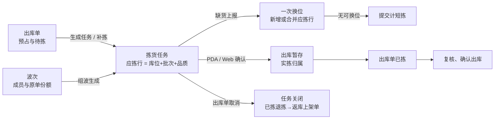
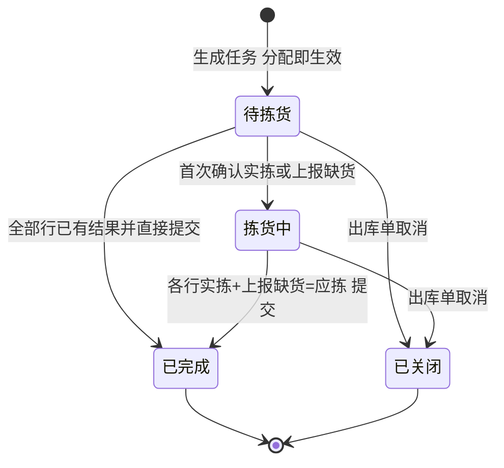

# 拣货任务主PRD

> 用途：定义拣货任务的生成与关联、按库位扫描确认、实拣归属、库位缺货与一次换位、提交与关闭、管理端查询与 Web 端补录，作为研发实现、测试验收和生成前端原型的业务依据。
> 定位：应用设计层**现场作业真源**。规则以[《出库模块宏观系统架构》](../../../../../01-全局背景信息/05-出库模块宏观系统架构.md)§2.1.1、§2.1.2、§3.4 与[《库存模块宏观系统架构》](../../../../../01-全局背景信息/07-库存模块宏观系统架构.md)为准；需求见[《出库业务需求分析》](../../../../../03-需求调研和分析/03-出库业务/出库业务需求分析.md)拣货与缺货处理（OUT-FR-003、OUT-FR-004）；场景见[《出库业务设计》](../../../../../04-业务分析和设计/03-出库业务设计.md)§5.1、§7.1、§7.4、§7.5、§9.7；字段以[《拣货任务（详细稿）》](../../../字段清单合集/03-出库管理/拣货任务/拣货任务（详细稿）.tsv)为准；页面见[《拣货任务页面骨架》](拣货任务页面骨架.md)；交互以[前端Demo版PRD](拣货任务前端Demo版PRD.md)为准；PDA 见[《PDA拣货页面骨架》](../../7-PDA作业端/拣货作业/PDA拣货页面骨架.md)。
> 不写什么：不写出库单接单、预占、复核、确认出库与取消（见[《出库单主PRD》](../出库单/出库单主PRD.md)）；不写组波准入与成员份额生成（见[《波次主PRD》](../波次/波次主PRD.md)）；不写库位分配算法与盘点执行（见库存模块）；不写退拣单与返库上架单的落位（见[《返库上架单主PRD》](../返库上架单/返库上架单主PRD.md)）；不写 PDA 按键与页面布局细节。

| 版本 | 本次变化 | 状态 |
| --- | --- | --- |
| 2026-10-15 | 由原《出库管理主PRD》拆出；定义任务生成、扫描确认、缺货、提交与关闭 | 文档修订 |
| 2026-10-18 | 新增 Web 端拣货录入页；PDA 改为按库位逐站拣货；批次随来源库位确定 | 文档修订 |
| WMS-V1.0（2026-10-27） | 按 ERP 采购订单主 PRD 结构重构：补文档边界、范围与追溯、对象定位、场景索引、状态矩阵与流转表、规则分组、上下游与一致性；业务结论不变 | 待评审，文档修订 |

## 1. 文档信息与阅读边界

| 项目 | 内容 |
| --- | --- |
| 读者 | 研发工程师、测试工程师、现场作业负责人、产品复核；据此生成管理端与 Web 端原型的 AI |
| 业务依据 | 《出库业务需求分析》拣货与缺货处理（OUT-FR-003、OUT-FR-004）；《出库业务设计》§7.1、§7.4、§7.5 |
| 状态依据 | 《出库模块宏观系统架构》§3.4；[《单据与状态流转》](../../../系统架构设计/03-单据与状态流转.md)第六节 |
| 字段依据 | [《拣货任务（详细稿）》](../../../字段清单合集/03-出库管理/拣货任务/拣货任务（详细稿）.tsv) |
| 页面依据 | [《拣货任务页面骨架》](拣货任务页面骨架.md)、[前端Demo版PRD](拣货任务前端Demo版PRD.md)、[PDA拣货页面骨架](../../7-PDA作业端/拣货作业/PDA拣货页面骨架.md) |

关联资料：[《出库单主PRD》](../出库单/出库单主PRD.md)（生成条件、重新分配、退拣、取消）、[《波次主PRD》](../波次/波次主PRD.md)（成员顺序与份额）、[《返库上架单主PRD》](../返库上架单/返库上架单主PRD.md)、[《实体对象关系》](../../../系统架构设计/02-实体对象关系.md)、[《单据术语与生成规则》](../../../../../01-全局背景信息/08-单据术语与生成规则.md)。本目录写法见[需求文档 PRD 写作约定](../../AGENTS.md)。

## 2. 需求背景与目标

### 2.1 背景

出库单只说明“要发什么、占了多少”，真正决定从哪个库位、哪个批次拿货的是拣货任务。任务生成时就把库位、批次、品质和应拣数量定下来，并把数量计入批次库存的已分配；现场只有按任务取货，不能在拣货时改库位、改数量或改批次。

现场有两类实际做法：有 PDA 的按库位逐站扫描；不用 PDA 的按纸质拣货单拣完后在管理端补录。两端必须写同一张任务、走同一套校验，否则同一批货会出现两套账。库位实物不足时，任务允许上报缺货并换位一次；换位不修原库位账面，差异留给库存盘点收口。

### 2.2 目标

- 任务生成即确定库位、批次、品质、应拣数量和出库暂存库位，人员不能修改应拣行；
- 扫描确认一件即下架一件，来源库位实际与已分配减少、出库暂存实际增加，SKU 总量与订单预占不变；
- 缺货只换位一次，换不上就在提交时计短拣，不反复分配、不伪造库存；
- 波次任务按原单份额归属实拣，短拣落在未分满的靠后单；
- 提交只结束进度，不再次移库；关闭只由出库单取消触发；
- PDA 与 Web 端共用同一套动作、校验和幂等标识。

### 2.3 设计要点（给研发与测试）

| 设计点 | 做法 | 原因与影响 |
| --- | --- | --- |
| 生成即分配 | 应拣行写库位、SKU、批次、品质、应拣量；批次库存已分配同步增加；出库暂存库位生成时确定 | 拣货现场只执行，不再做分配决策 |
| 确认即下架 | 每次确认把本次数量从来源库位移到出库暂存；SKU 实际与预占不变 | 任务进度与库存位置同步，不靠提交补记 |
| 缺货只换一次 | 释放本行未拣分配，按既有规则换位，追加或合并应拣行并保留原单份额；同时标记 SKU 待核对 | 避免反复换位把账越搅越乱；差异交盘点 |
| 提交不再移库 | 提交只校验每行有结果、结束进度、释放剩余分配 | 防止重复扣减或二次下架 |
| 两入口一套动作 | PDA 扫描与 Web 录入调用同一确认、缺货、提交动作 | 现场换设备不换规则；测试用例可复用 |
| 波次按份额归属 | 新增实拣按波次内序号归属未取消成员，归属后不重排 | 汇总拣货不能替代原单身份 |

## 3. 需求范围

### 3.1 本期范围

- 按单拣货、基础波次、补拣三种来源生成任务；生成即分配；
- 管理端任务列表、详情、应拣明细、实拣归属、原单份额、操作日志；
- 待拣货、拣货中任务进入 PDA拣货或 Web 端拣货；
- 按库位逐站扫描、商品计数、自动确认、跨库位跳转、同库位多批次区分；
- 实拣确认、SN 校验、上报缺货（无货/残损）、一次换位；
- 提交任务、短拣定型、剩余分配释放；
- 出库单取消触发任务关闭与已拣退拣；
- 列表筛选任务号、出库单号、任务来源、货主；导出 Mock。

### 3.2 功能清单

| 编号 | 功能/位置 | 本次内容 | 需求来源 |
| --- | --- | --- | --- |
| F01 | 任务生成与关联 | 按单、组波、补拣生成任务；记录来源、所属单、出库暂存库位、应拣行 | OUT-FR-003、OUT-FR-012 |
| F02 | 任务列表 | 状态页签、筛选、列展示、导出 Mock、进入详情或拣货 | OUT-FR-003 |
| F03 | 任务详情 | 基本信息、拣货进度、应拣明细、实拣归属、原单份额、操作日志 | OUT-FR-003、OUT-FR-004 |
| F04 | PDA拣货 | 扫库位到站、扫商品计数、自动确认、跨库位跳转、扫批次/SN | OUT-FR-003、OUT-FR-004 |
| F05 | Web 端拣货 | 按纸质拣货单逐行录入实拣、缺货与 SN，保存即下架，全部处理后提交 | OUT-FR-003、OUT-FR-004 |
| F06 | 缺货与换位 | 上报无货/残损，释放分配并换位一次；换不上计短拣 | OUT-FR-004 |
| F07 | 导出 | 页头导出当前筛选结果（Demo 为 Mock） | — |

### 3.3 需求追溯

| 需求分析 | 本 PRD 功能与规则 | 验收 |
| --- | --- | --- |
| 拣货任务生成即分配 | F01、R01、R02 | AC01、AC02 |
| 扫描确认即下架 | F04、F05、R04、R05 | AC03、AC04、AC05 |
| 实拣归属与原单份额 | F03、R06 | AC06、AC07 |
| 库位缺货与一次换位 | F06、R07、R14 | AC08、AC09、AC10 |
| 提交与短拣 | F05、R08 | AC11、AC12 |
| 出库单取消与任务关闭 | R09 | AC13、AC14 |
| 盘点、待核对与数据范围 | R13、R15 | AC15、AC16 |

### 3.4 非本期范围

- 管理端关闭任务、修改应拣行、新增或删除应拣行；
- 边拣边分、自动派工、路径优化、产能计算、爆款抽样复核；
- 多次换位、跨仓调拨补货、自动补拣；
- 拣货任务级损失确认、盘亏单、出库异常单据；
- PDA 页面布局、扫码枪型号、离线作业；
- 用户账号、角色、仓库授权与审批流。

| 范围补充 | 说明 |
| --- | --- |
| 适用对象 | 按单拣货、基础波次任务、补拣任务；其他出库与不良品同样走任务，但应拣行直接取指定库存、不换位 |
| 任务数量 | 一张出库单可先后有多张任务（补拣），但同一时点至多一张未完成任务 |
| 数据范围 | 顶栏当前仓库；不做用户或角色裁剪 |

## 4. 对象定位与业务边界

### 4.1 业务作用

| 项目 | 内容 |
| --- | --- |
| 对象层级 | 作业对象：把出库需求落到具体库位、批次、品质和出库暂存的实际取货指令 |
| 核心职责 | 记录从哪取、取多少、取到哪、谁取、何时取；记录缺货与换位结果；决定成员单已拣数量 |
| 对象来源 | 出库单详情「生成拣货任务」；出库单列表组波；出库单「重新分配」生成补拣 |
| 下游对象 | 出库单已拣、复核、确认出库；返库上架单（退拣）；库存流水与批次库存 |
| 数量关系 | 一张任务 N 条应拣行；一行可对应多条实拣归属；波次任务另有原单份额 |
| 业务终结 | 已完成（提交且各行有结果）；已关闭（出库单取消触发） |

### 4.2 上下游关系摘要

### 4.3 业务对象关系

| 关系 | 说明 |
| --- | --- |
| 任务 : 出库单 | N:1（按单、补拣）；波次任务为 N:M，通过原单份额关联成员单 |
| 任务 : 波次 | 一期 1:1；一张波次拣货任务汇总全部成员 |
| 任务 : 应拣行 | 1:N；行由库位 + SKU + 批次 + 品质确定；生成后只读 |
| 应拣行 : 实拣归属 | 1:N；每次确认生成一条归属，记录数量、SN、操作人、时间 |
| 应拣行 : 原单份额 | 波次任务 1:N；记录成员单号、行号、份额 |
| 任务 : 返库上架单 | 关闭或退拣时 1:N；退拣按原单生成返库上架单 |

### 4.4 本对象不负责的事项

- 任务不新增或释放订单预占；预占在出库单接单与取消时处理；
- 任务不修改需求、不拆分或合并出库单明细；
- 任务不决定补拣时机；补拣由出库单「重新分配」触发，待核对解除前不分配；
- 任务不做退拣动作；退拣由出库单发起，任务只展示归属实拣与有效数量；
- 任务不处理残损的品质转换；现场只上报原因，转换另行确认；
- 任务不修正原库位账实差异；差异由盘点确认；
- 任务不负责复核、确认出库和结果回传。

## 5. 核心业务场景索引

| 场景ID | 场景 | 类型 | 说明 |
| --- | --- | --- | --- |
| S01 | 按单生成并扫描完成 | 主流程 | B2C 需求 3，PDA 分次确认 1、2，提交后已完成，已拣 3 |
| S02 | 波次集中拣货 | 主流程 | 按库位汇总应拣，扫描确认按波次内序号归属未取消成员 |
| S03 | 缺货换位成功 | 支线 | L1 应拣 5、确认 3、缺货 2，换位到 L2 补 2，确认后提交短拣 0 |
| S04 | 缺货无位可换 | 支线 | 同上但 L2 无货，提交后短拣 2，预占仍 5 |
| S05 | 同库位多批次 | 分支 | 只扫商品条码时提示选批次或扫批次号；选定后继续计数 |
| S06 | 扫错或未扫库位 | 异常 | 扫码错误，写明扫到什么、应去哪个库位，不计数 |
| S07 | SN 校验失败 | 异常 | 非在库、品质冲突、已被占用或同次重复，阻断且不动库存 |
| S08 | 出库单取消 | 支线 | 任务关闭；已确认实拣退拣并生成返库上架单 |
| S09 | 不用 PDA，Web 端补录 | 主流程 | 逐行录实拣与缺货，保存即下架，全部处理后提交 |
| S10 | 盘点中 | 异常 | 只暂停新单/新分配；已生成任务继续拣货、复核、确认出库 |
| S11 | 重复确认 | 异常 | 同一确认标识重试返回原结果，不重复下架 |
| S12 | 波次成员部分取消 | 支线 | 只处理该单份额；全部成员取消才关闭任务 |

## 6. 状态与操作

状态定义 owner：[《出库模块宏观系统架构》](../../../../../01-全局背景信息/05-出库模块宏观系统架构.md)§3.4。任务状态不表达库存是否已发出；出库单状态另见出库单。

### 6.1 状态维度

| 维度 | 取值 | 说明 |
| --- | --- | --- |
| 任务状态 | 待拣货、拣货中、已完成、已关闭 | 待拣货：未发生任何确认或上报；拣货中：已有确认或上报且未提交；已完成：已提交；已关闭：出库单取消触发 |
| 任务来源 | 按单拣货、基础波次、补拣 | 决定所属单据与原单份额的展示 |
| 应拣行 | 无独立状态 | 用实拣、上报缺货、换位补上、剩余表达 |
| 实拣归属 | 有效、已部分或全部退拣 | 有效数量 = 归属实拣 − 已退拣 |
| 出库暂存 | 已下架 | 确认即移入；提交不再移库 |

### 6.2 状态取值说明

| 状态 | 含义 | 是否终态 |
| --- | --- | --- |
| 待拣货 | 任务已生成并完成分配，尚未发生任何确认或上报 | 否 |
| 拣货中 | 至少一行已确认实拣或已上报缺货，任务尚未提交 | 否 |
| 已完成 | 各行满足实拣 + 上报缺货 = 应拣后提交；短拣定型，剩余分配已释放 | 是 |
| 已关闭 | 所属出库单在待拣货、待复核或待出库时取消；未拣分配释放，已确认实拣退拣 | 是 |

任务来源与状态无关：三种来源都走同一状态机。波次任务在成员部分取消时仍为待拣货或拣货中，不因单个成员取消而关闭。

### 6.3 状态流转图

触发者：生成任务在出库单详情或出库单列表组波；确认、上报、提交在 PDA 或 Web 端拣货；关闭由出库单取消触发，管理端无关闭入口。

### 6.4 状态—功能矩阵

> ✅ = 允许；❌ = 不允许；✅（条件）= 须满足所列规则。查看列表、详情各状态均可用。

| 动作 | 待拣货 | 拣货中 | 已完成 | 已关闭 |
| --- | --- | --- | --- | --- |
| 查看列表、详情（F02、F03） | ✅ | ✅ | ✅ | ✅ |
| Web 端拣货入口（F05） | ✅ | ✅ | ❌ | ❌ |
| PDA拣货入口（F04） | ✅ | ✅ | ❌ | ❌ |
| 确认实拣 | ✅ | ✅ | ❌ | ❌ |
| 上报缺货 | ✅ | ✅ | ❌ | ❌ |
| 提交任务 | ✅（全部行已有结果） | ✅（全部行已有结果） | ❌ | ❌ |
| 管理端关闭任务 | ❌ | ❌ | ❌ | ❌ |
| 修改应拣行、增删应拣行 | ❌ | ❌ | ❌ | ❌ |
| 生成补拣 | 由出库单侧发起；本任务无入口 | 由出库单侧发起 | 由出库单侧发起 | 无 |
| 导出（F07） | ✅ | ✅ | ✅ | ✅ |

已完成、已关闭只读，页头只有「返回列表」。已完成或已关闭任务打开录入页直接回详情。

### 6.5 状态流转表

| 当前状态 | 动作/事件 | 前置条件 | 结果状态 | 二次确认 | 后置影响 | 失败处理 |
| --- | --- | --- | --- | --- | --- | --- |
| — | 出库单生成任务/组波/补拣 | 出库单规则 R05～R07；SKU 非盘点中；可分配足 | 待拣货 | 无 | 应拣行落库位批次；批次已分配增加；出库暂存库位确定 | 无可分配量或 B2C 不足：不生成空任务，提示缺量 |
| 待拣货 | 首次确认实拣 | R05；行剩余 > 0；SN 合法 | 拣货中 | 无 | 本次数量移入出库暂存；原单已拣增加 | 超剩余、SN 冲突：阻断，不动库存 |
| 待拣货 | 上报缺货 | R07；本行有剩余 | 拣货中 | 无 | 释放未拣分配；一次换位；SKU 标记待核对 | 原因未选：阻断 |
| 待拣货/拣货中 | 提交 | R08；各行实拣 + 上报缺货 = 应拣 | 已完成 | 无 | 短拣定型；剩余分配释放；不再次移库；记录提交人时间 | 有行无结果：拒绝，提示还差多少 |
| 待拣货/拣货中 | 出库单取消 | 出库单 R13；本单在待拣货/待复核/待出库 | 已关闭 | 出库单侧确认 | 未拣分配释放；已确认实拣退拣；生成返库上架单 | 成员单已出库：拒绝取消，任务不变 |
| 已完成/已关闭 | 查看 | — | 不变 | — | — | — |

## 7. 核心业务规则

### 7.1 生成、分配与关联

| 规则编号 | 主题 | 规则 | 边界或例外 |
| --- | --- | --- | --- |
| R01 | 生成即分配 | 任务生成时，应拣行记录库位、SKU、批次、品质与应拣数量，并计入对应批次库存的已分配；出库暂存库位在生成时确定 | 生成不新增订单预占；SKU 实际总量不变 |
| R02 | 三种来源 | 按单拣货：出库单详情「生成拣货任务」，关联该单；基础波次：出库单列表组波，关联波次并保留原单份额；补拣：出库单「重新分配」，关联该单 | 已有未完成任务时返回原任务；一张单同一时点至多一张未完成任务 |
| R03 | 应拣行只读 | 生成后拣货人员、管理端均不能改库位、批次、品质、应拣量，也不能增删应拣行 | 唯一会新增或合并应拣行的是缺货换位，见 R07 |
| R04 | 其他出库与不良品 | 其他出库的应拣行直接取出库单指定的库存，不换位；不良品按指定品质出库，不因库位缺货改去良品库位 | 指定库存不足时按出库单类型完成条件处理 |

### 7.2 按库位扫描与确认

| 规则编号 | 主题 | 规则 | 边界或例外 |
| --- | --- | --- | --- |
| R05 | 拣货路径 | 任务内还有剩余的应拣行按来源库位分组，按库位编号顺序排成路径；换位新增的库位并入路径 | 一个库位拣完自动跳到路径上下一个库位；扫到路径上另一个待拣库位则改去该库位 |
| R06 | 到站与计数 | 先扫当前库位确认到站，再逐件扫商品（SN 商品逐件扫 SN）计数；一行数满剩余应拣即自动确认；件数多时可扫一件后改数量再确认 | 未扫库位就扫商品、扫到不在路径上的库位：扫码错误，写明扫到什么、应去哪个库位，不计数 |
| R07 | 批次确定 | 批次随来源库位确定；只有同一库位同一商品存在多个批次的应拣行时，才需扫批次号或点选区分 | 只扫商品条码时提示选择批次；选定后继续计数 |
| R08 | 单次确认校验 | 每次确认数量为正整数，不超过该行剩余应拣（应拣 − 实拣 − 上报缺货）；SN 须在本仓同货主同 SKU 台账中为在库，不能因未绑定来源库位而拒绝；已确认品质冲突或已被其他实拣占用的 SN 不能用；同一次确认中不得重复 | 任一不满足即阻断，提示原因，不动库存 |
| R09 | 确认即下架 | 确认成功把本次数量从来源库位移到出库暂存：来源实际与已分配减少，暂存实际增加，原单已拣增加；SKU 实际总量与订单预占不变 | 还没确认的计数是本机草稿，不动库存；确认不能撤销，多录走出库单退拣 |
| R10 | 两入口一致 | PDA 扫描与 Web 端逐行录入调用同一确认动作、同一校验；Web 端 SN 条数须等于实拣数量 | Web 端保存即确认下架，不等提交 |

### 7.3 归属、缺货与提交

| 规则编号 | 主题 | 规则 | 边界或例外 |
| --- | --- | --- | --- |
| R11 | 实拣归属 | 按单与补拣任务直接归属所属出库单；波次任务按波次内序号把本次新增实拣归属给未取消成员，归属确定后不重排，SN 记到对应原单 | 同一 SKU 也按原单份额归属，不能拿总量替代原单身份 |
| R12 | 缺货上报 | 填写缺货数量与原因（无货、残损）；本行已数未确认的件数先确认下架，再报缺货。释放该部分分配，按既有分配规则尝试一次换位（追加或合并应拣行，并保留原单份额），同时把本仓本货主该 SKU 标记待核对 | 此后不再继续分配或反复换位；其他出库与不良品行不换位；残损只记录原因，不阻断本任务提交，品质转换另行处理 |
| R13 | 换位与账面 | 换位只改分配和应拣行，不自动修正原库位账面；缺货上报与短拣留在拣货任务上，一期不另建出库异常单据 | 账有货而现场无货，由库存责任角色查移位、流水或通过真实盘点确认；任务提交后对该 SKU 发起盘点 |
| R14 | 提交 | 各行须满足 实拣 + 上报缺货 = 应拣；通过后任务已完成，记录提交人与提交时间；未被换位补上的缺货即短拣，剩余分配释放；不再次移库 | 有行未拣足也未上报：拒绝提交，提示还差多少 |
| R15 | 关闭 | 由出库单取消触发，管理端不提供关闭入口；未拣分配释放，已确认实拣退拣并生成返库上架单 | 波次任务成员部分取消只处理该单份额；全部成员取消才关闭任务 |

### 7.4 数量口径与示例

| 层级 | 数量 | 含义 | 关系 |
| --- | --- | --- | --- |
| 应拣行 | 应拣 | 生成时确定的取货数量；换位合并的行按合并后数量 | 生成后只读（换位除外） |
| 应拣行 | 实拣 | 已确认下架数量 | 实拣 + 上报缺货 ≤ 应拣 |
| 应拣行 | 上报缺货 | 现场报告的库位不足数量 | 换位补上 ≤ 上报缺货 |
| 应拣行 | 换位补上 | 本次换位在其他库位补上的数量 | 短拣 = 上报缺货 − 换位补上 |
| 应拣行 | 剩余 | 应拣 − 实拣 − 上报缺货 | 录入页与 PDA 的计数上限 |
| 任务 | 应拣、实拣、上报缺货、短拣总数 | 各行之和 | 已完成任务短拣定型；未完成列表/详情不显示短拣列，只显示上报缺货/换位 |
| 实拣归属 | 归属实拣、有效数量 | 有效 = 归属实拣 − 已退拣 | 出库单已拣取有效之和 |

**约束（可判定）**：每行实拣 + 上报缺货 ≤ 应拣；换位补上 ≤ 上报缺货；提交时每行实拣 + 上报缺货 = 应拣；任务实拣总数 = 各归属有效数量 + 已退拣数量；确认不改变 SKU 实际总量与预占。

**任务口径（换位与成员取消）**：

| 数量 | 口径 | 用途 |
| --- | --- | --- |
| 原始应拣 | 生成时各应拣行 planned 之和；换位不增加 | 任务总量、追溯 |
| 替代分配 | 换位新增/合并行的数量，单独列示 | 解释执行路径，不计入原始应拣 |
| 有效应拣 | 原始应拣 − 已取消成员的未拣份额（含其替代行） | 进度分母、提交校验 |
| 实拣 | 原行实拣 + 替代行实拣；取消成员的已拣在退拣后扣减 | 进度分子、出库单已拣 |
| 短拣 | 上报缺货 − 替代分配；按原行计算 | 只统计未补上的缺口 |

进度 = 实拣 / 有效应拣；替代行不得再次计入原始应拣。成员取消只扣该成员未拣份额；已拣部分按退拣规则返库并从实拣扣除，替代行同时取消。

**数量示例（模拟）**：B2C 需求 3，按单任务应拣 3；PDA 分次确认 1、2，每次来源实际减、暂存增；任务拣货中；提交后已完成，库存流水无第三次移库，出库单已拣 3。另一例：L1 应拣 5，确认 3，上报缺货 2，换位到 L2 补 2；确认 L2 的 2 后提交，短拣 0。若 L2 无货，提交后短拣 2，出库单已拣 3、待拣 2，预占仍 5。

### 7.5 业务生效点

| 业务动作 | 任务影响 | 库存影响 | 外部影响 |
| --- | --- | --- | --- |
| 生成任务 | 待拣货；应拣行落库位批次 | 批次已分配增加；预占不变 | 无 |
| 确认实拣 | 实拣增加；首次确认转拣货中 | 来源实际与已分配减少；出库暂存实际增加；SKU 实际与预占不变 | 原单已拣增加 |
| 上报缺货 | 上报缺货增加；SKU 待核对 | 释放该部分分配；换位部分在新库位计已分配 | 换位后应拣行变化 |
| 提交 | 已完成；短拣定型 | 释放剩余未拣分配；不再次移库 | 原单按已拣进入复核 |
| 出库单取消 | 已关闭 | 释放未拣分配；已拣退拣回库 | 生成返库上架单 |
| 人工重新分配 | 新补拣任务待拣货 | 补占缺口并分配 | 原单回待拣货 |

### 7.6 字段校验绑定

完整字段见[《拣货任务（详细稿）》](../../../字段清单合集/03-出库管理/拣货任务/拣货任务（详细稿）.tsv)。摘要：

| 校验时机 | 要求 |
| --- | --- |
| 生成 | 任务号按 PK 规则；来源、所属单/波次、货主、仓库、出库暂存库位必填；应拣行库位、SKU、批次、品质、应拣量为正 |
| 确认 | 数量正整数且 ≤ 剩余；SN 在库且未被占用；同次不重复；确认标识唯一 |
| 缺货 | 数量正整数且 ≤ 剩余；原因必选；换位结果记录在应拣行 |
| 提交 | 每行实拣 + 上报缺货 = 应拣；提交人、提交时间写入 |
| 关闭 | 只能由出库单取消触发；关闭原因可取 |
| 详情/列表 | 已完成、已关闭只读；未完成才渲染拣货入口 |

## 8. 功能需求说明（页面索引）

| 编号 | 页面/位置 | 规则与状态依据 | Demo PRD |
| --- | --- | --- | --- |
| F01 | 出库单详情/列表生成任务 | §6.5；R01～R04 | [出库单详情页分册](../出库单/前端Demo版PRD/出库单前端Demo版PRD_详情页.md) |
| F02 | 任务列表 | §6.4；R02、R15 | [拣货任务前端Demo版PRD](拣货任务前端Demo版PRD.md) §三 |
| F03 | 任务详情 | §7.4；R09、R11 | 同上 §四 |
| F04 | PDA拣货 | §7.2；R05～R10 | [PDA拣货前端Demo版PRD](../../7-PDA作业端/拣货作业/PDA拣货前端Demo版PRD.md) |
| F05 | Web 端拣货 | §7.2、§7.3；R05～R14 | [拣货任务前端Demo版PRD](拣货任务前端Demo版PRD.md) §五 |
| F06 | 缺货与换位 | §7.3；R12、R13 | 同上 §五 |
| F07 | 导出 | — | 同上 §三页头 |

## 9. 上下游影响与协同

| 关联模块/系统 | 需要配合的变化 | 交接内容与时机 | 验收结果 |
| --- | --- | --- | --- |
| 出库单 | 生成任务、重新分配、退拣、取消 | 生成时交接应拣行；取消时交接关闭与退拣 | 任务状态与出库单状态一致；已拣 = 有效归属之和 |
| 波次 | 提供成员顺序与原单份额；成员取消只扣份额 | 组波时；成员取消时 | 波次任务归属按序号；部分取消不关闭任务 |
| 库存与库内 | 已分配、换位、待核对、盘点 | 生成、确认、缺货、提交、关闭 | 批次实际/已分配/可分配一致；流水与动作对应 |
| 返库上架单 | 接收退拣实物与应返库数量 | 关闭或退拣时 | 返库单按应返库量提交，差异由盘点收口 |
| 基础资料 | 库位、商品、批次、SN | 生成、扫描、提交 | 停用资料不参与新任务 |
| 公共能力 | 当前仓库、操作日志 | 全程 | 只显示当前仓任务 |

## 10. 关联文档与阅读入口

| 关联内容 | 阅读入口 | 本 PRD 与其边界 |
| --- | --- | --- |
| 任务定位与状态 | 《出库模块宏观系统架构》§2.1.1、§2.1.2、§3.4 | 规则真源；本文落到页面与验收 |
| 缺货、短拣、退拣 | 《出库业务设计》§7.1、§7.4、§7.5、§9.7 | 业务走查；本文不重复案例 |
| 生成条件与重新分配 | [《出库单主PRD》](../出库单/出库单主PRD.md) R05～R07、R13、R14 | 出库单 owner；本文引用不重写 |
| 波次与份额 | [《波次主PRD》](../波次/波次主PRD.md) R03、R05、R06 | 波次 owner；任务只执行归属 |
| 退拣与返库 | [《返库上架单主PRD》](../返库上架单/返库上架单主PRD.md) | 返库 owner；任务不落位 |
| 字段定义 | 《拣货任务（详细稿）》 | 字段 owner |
| 页面结构 | [《拣货任务页面骨架》](拣货任务页面骨架.md) | 区域与线框，非规则权威 |
| 页面交互 | [前端Demo版PRD](拣货任务前端Demo版PRD.md) | 控件、Mock；服从 §6.4 |
| PDA | [《PDA拣货页面骨架》](../../7-PDA作业端/拣货作业/PDA拣货页面骨架.md) | 作业端页面；业务规则回本文 |

## 11. 异常与一致性

### 11.1 并发操作

| 场景 | 业务处理结果 |
| --- | --- |
| 两人同时确认同一应拣行 | 各自按剩余量校验；先到者下架，后到者最多确认剩余；合计不超过应拣 |
| 同一确认标识重复提交 | 返回原结果，不重复下架 |
| Web 端与 PDA 交替操作同一任务 | 写同一任务；后操作方读取最新实拣与剩余，不存在两套进度 |
| 确认与出库单取消同时到达 | 以先生效者为准；取消先生效则任务关闭、确认阻断；确认先生效则按已拣退拣处理 |
| 缺货上报与另一人确认同仓同 SKU | 上报释放本行分配并标记待核对；另一行已确认部分不回滚，后续分配等待核对解除 |

### 11.2 幂等与重复处理

| 操作 | 幂等规则 |
| --- | --- |
| 重复确认（同一确认标识） | 返回原结果，不重复移库、不重复计已拣 |
| 重复上报缺货 | 返回原结论，不重复释放或换位 |
| 重复提交 | 返回原任务结果，不重复释放分配 |
| 重复生成任务 | 已有未完成任务时返回原任务，不重复分配 |
| 重复关闭 | 返回原关闭结果，不重复退拣 |

### 11.3 与出库单、波次、库存的一致性

| 场景 | 处理方式 |
| --- | --- |
| 任务已完成但出库单未出库 | 正常；任务只结束拣货，复核与出库另行完成 |
| 波次成员部分取消 | 只扣该单份额；任务不关闭；已确认归属该单的实物退拣 |
| 波次全部成员取消 | 任务关闭；波次已取消 |
| 短拣后补货 | 不自动补拣；由出库单人工重新分配生成补拣任务；补拣实拣不回冲原任务短拣 |
| 待核对 SKU | 不新增分配；已分配行仍可确认；盘点完成解除后允许补拣 |
| 盘点中 SKU | 不生成新任务/不新增分配；已生成任务继续拣货、复核、确认出库 |
| 已拣后退拣 | 出库单发起；任务归属有效数量减少；返库上架单按应返库量提交，少件由盘点调整 |

## 12. 验收标准与待确认事项

### 12.1 验收标准

| 编号 | 对应功能/规则 | 条件与操作（数字为模拟） | 预期结果 |
| --- | --- | --- | --- |
| AC01 | F01、R01 | 对 B2C 需求 3 生成任务 | 任务待拣货；应拣行落库位批次；批次已分配 3；出库暂存库位已定 |
| AC02 | R02 | 对已有未完成任务再点生成或重新分配 | 返回原任务，不重复分配 |
| AC03 | F04、R09 | B2C 需求 3，PDA 分次确认 1、2 后提交 | 每次确认来源减、暂存增；提交后已完成，库存流水无第三次移库；出库单已拣 3 |
| AC04 | R08 | 确认数量超过剩余应拣，或扫描他人 SN | 阻断并提示原因，不动库存 |
| AC05 | F04、R06 | 任务两个库位：L1 线材 3、L2 SN 商品 1；扫 L1、扫商品 3 次 | 第 3 次扫描后自动确认 3，跳到 L2 提示扫库位；扫 L2、扫 SN 后自动确认，进入提交 |
| AC06 | F04、R06 | 未扫库位就扫商品，或扫不在路径上的库位 | 扫码错误，写明扫到什么、应去哪个库位，不计数 |
| AC07 | F04、R07 | 同一库位同一商品两个批次，只扫商品条码 | 提示点选批次或扫批次号；选定后继续计数 |
| AC08 | F06、R12 | L1 应拣 5，确认 3，上报缺货 2，换位到 L2 补 2 | 新增或合并 L2 应拣行 2；SKU 待核对；确认 L2 的 2 后提交，短拣 0 |
| AC09 | F06、R14 | 同上但 L2 无货 | 提交后短拣 2；出库单已拣 3、待拣 2；预占仍 5 |
| AC10 | R13 | 上报缺货后查看原库位库存 | 原库位账面不被修正；差异标记待盘点 |
| AC11 | R14 | 一行未拣足也未上报就提交 | 拒绝，提示还有未完成行与差额 |
| AC12 | F05 | Web 端录 L1 实拣 2、缺货 1（无货） | 与 PDA 结果相同：确认 2 件下架，缺货 1 按规则换位或计短拣；录满后提交，提交人为录入人 |
| AC13 | R15 | 出库单在待拣货、待复核或待出库取消 | 任务已关闭；已确认实拣退拣，生成返库上架单 |
| AC14 | R15 | 波次任务仅一个成员取消，成员已部分实拣 | 任务不关闭；扣该成员未拣份额与替代行；已拣部分退拣并从实拣扣除；其他成员继续；有效应拣、实拣、短拣同步重算 |
| AC15 | R15 | 波次任务全部成员取消 | 任务关闭；波次已取消 |
| AC16 | R10 | 同一确认标识重放 | 返回原结果，不重复下架 |
| AC17 | F03 | 打开已完成任务 | 页头无拣货入口；应拣明细显示上报缺货、换位补上、短拣 |
| AC18 | R03 | 在管理端尝试修改应拣行 | 无入口；接口拒绝 |

### 12.2 待确认事项

| 编号 | 问题 | 影响范围 | 状态/结论 |
| --- | --- | --- | --- |
| Q01 | 缺货换位新增或合并应拣行后，任务“应拣总数”是否随之增加 | R12、R14、§7.4、F02、F03 | **已确认（2026-10-27）**：原始应拣保持不变；换位行记“替代分配”，不计入原始应拣；进度按有效应拣，短拣=上报缺货−替代分配。 |
| Q02 | 波次成员部分取消后，应拣行如何扣减、已拣与缺货份额如何处理 | R15、§7.4、AC14 | **已确认（2026-10-27）**：只扣该成员未拣份额及其替代行；已拣部分按退拣规则返库并从实拣扣除；缺货份额随之取消；其他成员继续。 |
| Q03 | 盘点中 SKU 对已生成任务的阻断范围：设计 §7.2 写“分配、组波、拣货、复核、确认出库都等盘点完成”，本文只明确生成等待；已生成任务在盘点中是否整单暂停，还是仅暂停该 SKU 行 | R02、§11.3、S10 | **已确认（2026-10-27）**：盘点时只暂停新单/新分配；已生成任务继续 |
| Q04 | 补拣任务实拣后，原任务的短拣是否回冲：原任务短拣定型后保留，补拣在另一任务上完成，出库单已拣增加；列表和报表若按任务汇总短拣，会看到“原任务短拣 + 补拣实拣”并存 | R14、§7.4、F02 | **已确认（2026-10-27）**：不回冲 |
| Q05 | 未完成任务列表与详情的“短拣”列是否实时显示：当前按 上报缺货 − 换位补上 计算，任务未提交、后续仍可能补拣或取消，数字会变化 | F02、F03、§7.4 | **已确认（2026-10-27）**：短拣只在已完成任务显示 |
| Q06 | Web 端与 PDA 同时操作同一任务时是否需要行级锁定或操作人占用；当前只校验剩余量，允许多人各确认一部分 | §11.1、R08 | **已确认（2026-10-27）**：先到先得，不锁行 |
| Q07 | 缺货原因选“残损”后，谁在何时发起品质转换、转换前该行能否提交；现场只记录原因，未规定责任人与时序 | R12、F06、§4.4 | **已确认（2026-10-27）**：不阻断提交；残损先按原因记录，转换不在提交前强制 |
| Q08 | 已关闭任务是否允许补拣回冲或重新打开；当前为终态，补拣另生成新任务 | R15、§6.2 | **已确认（2026-10-27）**：保持终态，补拣另生成新任务 |

## 附录 缺货换位与短拣示例（模拟）

| 步骤 | 事件 | 任务状态 | L1 应拣/实拣/缺货 | L2 应拣/实拣 | 任务短拣 |
| --- | --- | --- | --- | --- | --- |
| 1 | 生成任务，L1 应拣 5 | 待拣货 | 5 / 0 / 0 | — | 0 |
| 2 | 确认 3 | 拣货中 | 5 / 3 / 0 | — | 0 |
| 3 | 上报缺货 2，换位到 L2 补 2 | 拣货中 | 5 / 3 / 2 | 2 / 0 | 0（原始应拣不变，短拣按有效应拣计算） |
| 4 | 确认 L2 的 2 并提交 | 已完成 | 5 / 3 / 2 | 2 / 2 | 0 |
| 5 | 若 L2 无货，直接提交 | 已完成 | 5 / 3 / 2 | — | 2 |
