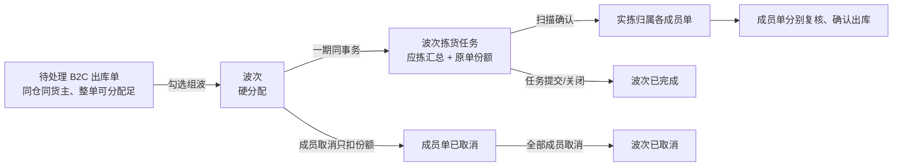
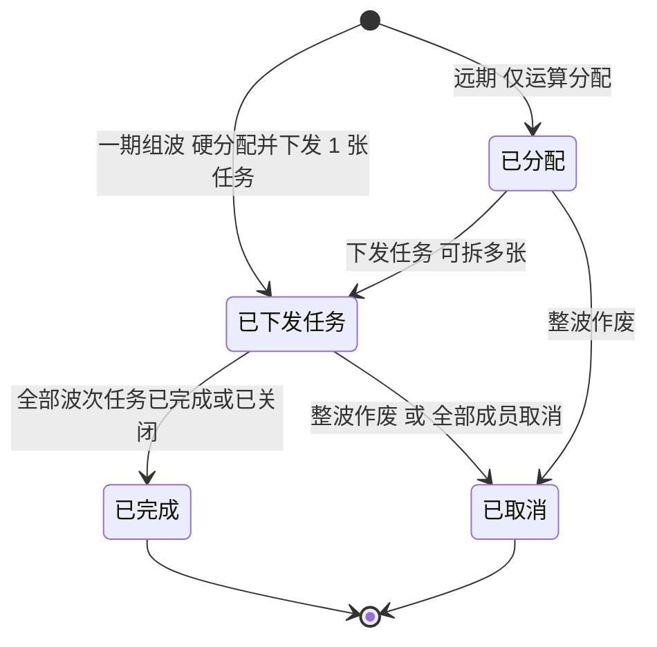

# 波次主PRD

> 用途：定义 B2C 基础波次的组波条件、硬分配与任务下发、成员份额与扫描归属、波次头状态推导、列表与详情展示，作为研发实现和测试验收的依据。
> 定位：应用设计层**业务真源**。规则以[《出库模块宏观系统架构》](../../../../../01-全局背景信息/05-出库模块宏观系统架构.md)§2.1.1、§3.4 为准；需求见[《出库业务需求分析》](../../../../../03-需求调研和分析/03-出库业务/出库业务需求分析.md)基础波次（OUT-FR-012）；场景见[《出库业务设计》](../../../../../04-业务分析和设计/03-出库业务设计.md)§5.1、§5.2；字段以[《波次（详细稿）》](../../../字段清单合集/03-出库管理/波次/波次（详细稿）.tsv)为准；页面见[《波次页面骨架》](波次页面骨架.md)；交互以[前端Demo版PRD](波次前端Demo版PRD.md)为准。
> 不写什么：不写拣货扫描、缺货换位、提交条件（见[《拣货任务主PRD》](../拣货任务/拣货任务主PRD.md)）；不写成员单的复核、确认出库与结果回传（见[《出库单主PRD》](../出库单/出库单主PRD.md)）；不写自动波次、派工、边拣边分、产能调度；不写库位分配算法本身（见出库单主 PRD 与库存模块）；不写 PDA 扫码交互。

| 版本 | 本次变化 | 状态 |
| --- | --- | --- |
| 2026-10-15 | 由原《出库管理主PRD》拆出；定义 B2C 基础波次组波、查询与追溯 | 文档修订 |
| 2026-10-15 | 波次头状态改为已分配／已下发任务／已完成／已取消；一期组波同时下发 | 文档修订 |
| WMS-V1.0（2026-10-27） | 按 ERP 采购订单主 PRD 结构重构：补文档边界、范围与追溯、对象定位、场景索引、状态矩阵与流转表、规则分组、上下游与一致性；业务结论不变 | 待评审，文档修订 |

## 1. 文档信息与阅读边界

| 项目 | 内容 |
| --- | --- |
| 读者 | 研发工程师、测试工程师、产品复核；据此生成管理端原型的 AI |
| 业务依据 | 《出库业务需求分析》基础波次 OUT-FR-012；《出库模块宏观系统架构》§2.1.1、§3.4 |
| 状态依据 | 《出库模块宏观系统架构》§3.4；[《单据与状态流转》](../../../系统架构设计/03-单据与状态流转.md)第六节 |
| 字段依据 | [《波次（详细稿）》](../../../字段清单合集/03-出库管理/波次/波次（详细稿）.tsv) |
| 页面依据 | [《波次页面骨架》](波次页面骨架.md)、[前端Demo版PRD](波次前端Demo版PRD.md) |

关联资料：[《拣货任务主PRD》](../拣货任务/拣货任务主PRD.md)（波次任务扫描与提交）、[《出库单主PRD》](../出库单/出库单主PRD.md)（成员单接单、复核、出库）、[《实体对象关系》](../../../系统架构设计/02-实体对象关系.md)、[《单据术语与生成规则》](../../../../../01-全局背景信息/08-单据术语与生成规则.md)。本目录写法见[需求文档 PRD 写作约定](../../AGENTS.md)。

## 2. 需求背景与目标

### 2.1 背景

B2C 单多、单小、SKU 重复，逐单拣货会让拣货员在库位之间来回跑。基础波次把同仓同货主、待处理且整单能分配足的 B2C 单合起来集中拣货，再按原单分回去复核、确认出库。波次只解决“怎么组织拣货”，不改变每张出库单的需求、预占和完成责任。

波次头不表达“工人拣到哪了”。现场进度看波次拣货任务；波次头只表达计划与硬分配、任务下发、拣货段结案、整波作废。这样波次状态不会被扫描次数推着走，也不会和任务状态各说一套。

### 2.2 目标

- 组波前能判定整批是否可组；任一成员不满足条件整批拒绝，不生成半波；
- 组波即完成库位、批次硬分配并生成一张波次拣货任务，一期不留“已分配”中间态；
- 应拣按库位、SKU、批次汇总，同时保留各成员单的原单份额，扫描确认时能归属到具体原单；
- 波次头状态只由任务下发与任务终态推导，成员取消只扣该单份额；
- 列表与详情能查到成员、商品明细、任务与进度，不提供新建、编辑、移出成员入口。

### 2.3 设计要点（给研发与测试）

| 设计点 | 做法 | 原因与影响 |
| --- | --- | --- |
| 组波是批量准入 | 全部成员须同时满足 B2C、待处理、同仓、同货主、无拣货任务、整单可分配足；任一不满足整批拒绝 | 避免部分成波后成员责任不清；不生成空波或半波 |
| 一期组波即下发 | 同一事务内完成硬分配并生成一张波次拣货任务，头状态直接为已下发任务 | 一期不拆“先锁库、后下发”；已分配只保留给远期 |
| 汇总应拣但保留份额 | 应拣按库位 + SKU + 批次汇总；每行保留各成员单行号与份额 | 集中拣货后还能按原单分货、复核和出库 |
| 扫描按波次内序号归属 | 成员顺序为勾选后按单号排序；新增实拣按序归属未取消成员，归属确定后不重排 | 同 SKU 也不能拿总量替代原单身份 |
| 波次头不表达拣货中 | 波次状态只看任务是否下发、是否全部终态 | 现场进度只在拣货任务；避免两处状态打架 |
| 成员只能取消不能移出 | 生成任务后成员单不能移出，只能取消；取消只扣该单份额 | 已分配份额和实物归属需要可追溯 |

## 3. 需求范围

### 3.1 本期范围

- 出库单列表勾选 2 张及以上同仓同货主待处理 B2C 单组波；
- 组波准入校验、硬分配、生成一张波次拣货任务；
- 波次列表：状态页签、筛选波次号/出库单号/货主、列展示任务数/出库单数/应拣/实拣/创建时间、导出 Mock；
- 波次详情：基本信息、拣货进度卡、出库单页签、商品明细页签、操作日志；
- 已下发任务时进入未完成波次拣货任务；
- 成员单取消后只扣该单份额；全部成员取消时任务关闭、波次已取消；
- 波次状态由任务终态推导，无人工【完成波次】。

### 3.2 功能清单

| 编号 | 功能/位置 | 本次内容 | 需求来源 |
| --- | --- | --- | --- |
| F01 | 出库单列表组波入口 | 勾选同仓同货主待处理 B2C 单，点「生成波次」，整批校验后生成波次与波次任务 | OUT-FR-012、OUT-FR-003 |
| F02 | 波次列表 | 状态页签、筛选、列展示、导出 Mock、任务号跳转 | OUT-FR-012 |
| F03 | 波次详情 | 基本信息、拣货进度、出库单页签、商品明细页签、操作日志 | OUT-FR-012 |
| F04 | 去拣货入口（Web 端 / PDA） | 已下发任务且存在未关闭任务时，提供 Web 端拣货和 PDA拣货两个入口，跳未完成波次拣货任务 | OUT-FR-003、OUT-FR-016 |
| F05 | 导出 | 页头导出当前筛选结果（Demo 为 Mock） | — |

### 3.3 需求追溯

| 需求分析 | 本 PRD 功能与规则 | 验收 |
| --- | --- | --- |
| 基础波次（同仓同货主 B2C 手工组波） | F01～F03、R01～R03 | AC01～AC05 |
| 拣货任务（波次任务生成、应拣汇总、原单份额） | F01、R02、R03 | AC02、AC03、AC06 |
| 缺货与短拣（短拣落在未分满的靠后单） | R05、§4.4 | AC07 |
| 取消与变更（成员只取消不移出） | R06、§6.5 | AC08、AC09 |
| 多货主归属与当前仓库范围 | R08 | AC10 |

### 3.4 非本期范围

- 自动波次、智能组波、派工、产能调度、边拣边分；
- 一期拆分「已分配」与「下发任务」两个动作、一波多张波次拣货任务；
- 波次内移出成员、替换成员、拆波、并波；
- 波次内直接复核、确认出库或回传结果；
- 波次内补拣任务参与波次头；
- 波次级打印、周转箱绑定、播种格位管理；
- 用户账号、角色、仓库授权与审批流。

| 范围补充 | 说明 |
| --- | --- |
| 适用对象 | 仅 B2C 出库；FBA 转运出库、B2B 四类、其他出库不进入波次 |
| 成员数量 | 2 张及以上；一张出库单至多进一个波次 |
| 数据范围 | 顶栏当前仓库；成员必须同仓同货主；一期不按用户或角色裁剪 |

## 4. 对象定位与业务边界

### 4.1 业务作用

| 项目 | 内容 |
| --- | --- |
| 对象层级 | 组织对象：把多张 B2C 出库单合成一次拣货作业，不替代出库单 |
| 核心职责 | 记录哪些成员单、在哪一仓哪一货主、生成了哪张波次拣货任务、应拣与实拣多少 |
| 对象来源 | 出库单列表手工组波；无独立新建入口 |
| 下游对象 | 波次拣货任务；成员出库单仍各自复核、确认出库、回传 |
| 数量关系 | 一个波次 N 张成员单（N≥2）；一期 1 张波次拣货任务；成员补拣任务不参与波次头 |
| 业务终结 | 已完成（全部波次任务已完成或已关闭）；已取消（整波作废或全部成员取消） |

### 4.2 上下游关系摘要

### 4.3 业务对象关系

| 关系 | 说明 |
| --- | --- |
| 波次 : 仓库、货主 | N:1；成员必须同仓同货主，波次不跨仓跨货主 |
| 波次 : 出库单 | 1:N；N≥2；一张出库单至多进一个波次 |
| 波次 : 波次拣货任务 | 1:1（一期）；远期可 1:N，按任务终态聚合波次头 |
| 波次拣货任务 : 应拣行 | 1:N；按库位 + SKU + 批次汇总，行上保留各成员份额 |
| 应拣行 : 原单份额 | 1:N；记录成员单号、行号、数量 |
| 波次 : 补拣任务 | 不关联；成员补拣任务不参与波次头 |

### 4.4 本对象不负责的事项

- 波次不新增预占、不改成员单需求、不改库存；硬分配只落在批次库存的已分配；
- 波次不替代成员单复核、确认出库与结果回传；
- 波次头不表达拣货任务是否拣货中，现场进度只在拣货任务；
- 波次不处理缺货换位和短拣数量，这两件事记在拣货任务应拣行上；
- 波次不负责成员单取消后的退拣与返库，退拣由出库单取消规则触发；
- 波次不是库存锁定单据，不能用来跨仓借量或绕过盘点。

## 5. 核心业务场景索引

| 场景ID | 场景 | 类型 | 说明 |
| --- | --- | --- | --- |
| S01 | 两张 B2C 单正常组波 | 主流程 | 同仓同货主、待处理、整单可分配足；生成波次与一张任务，成员转待拣货 |
| S02 | 集中拣货后按原单归属 | 主流程 | 扫描确认按波次内序号归属未取消成员；已确认归属不重排 |
| S03 | 波次任务提交 | 主流程 | 任务已完成；波次已完成；成员按已拣与复核进度进入待复核或待出库 |
| S04 | 组波混入非 B2C 或已有任务的单 | 异常 | 整批拒绝，提示原因；不生成波次、任务或分配残留 |
| S05 | 不同货主或不同仓勾选 | 异常 | 整批拒绝，提示货主/仓库不同 |
| S06 | 成员单扫描后取消 | 支线 | 只扣该单份额；已确认归属该单的实物退拣；其他成员仍在波次内 |
| S07 | 波次内全部成员取消 | 支线 | 任务关闭，波次已取消 |
| S08 | 盘点中或待核对 SKU | 异常 | 不组波；提示等待盘点或先处理待核对 |

## 6. 状态与操作

状态定义 owner：[《出库模块宏观系统架构》](../../../../../01-全局背景信息/05-出库模块宏观系统架构.md)§3.4。波次状态由任务下发与任务终态推导；一期无人工【完成波次】。

### 6.1 状态维度

| 维度 | 取值 | 说明 |
| --- | --- | --- |
| 波次状态 | 一期：已下发任务、已完成、已取消；远期预留：已分配 | 已分配：硬分配已落库、尚未下发任务（一期组波后瞬时跳过，不展示）；已下发任务：至少一张波次任务对现场可见且未全部终态；已完成：全部任务已完成或已关闭；已取消：整波作废或全部成员取消 |
| 成员状态 | 在波次内、已取消 | 成员出库单自身的状态另见出库单 |
| 任务状态 | 待拣货、拣货中、已完成、已关闭 | 在拣货任务上维护，波次只读 |
| 补拣任务 | 不参与波次头 | 只归属成员出库单 |

### 6.2 状态取值说明

| 状态 | 含义 | 是否终态 |
| --- | --- | --- |
| 已分配 | 硬分配已落库，尚未对现场下发任何波次拣货任务 | 否；一期不产生、不展示，仅远期预留 |
| 已下发任务 | 至少一张波次拣货任务已对现场可见，且未全部终态 | 否 |
| 已完成 | 全部波次拣货任务均为已完成或已关闭；只表示波次拣货段结案，不代表成员已出库 | 是 |
| 已取消 | 整波作废，或全部成员出库单已取消；解除波次绑定，未拣分配释放，已确认实拣按取消规则退拣 | 是 |

波次状态与批次库存的「已分配」不是一回事：前者是波次头状态名，后者是批次库存上被任务占住的数量。页面文案不得把波次状态简写成“已分配数量”。

### 6.3 状态流转图

触发者：组波为出库单列表手工操作；任务完成/关闭为拣货任务动作；成员取消为出库单取消受理；整波作废在一期无可操作入口，见 Q03。

### 6.4 状态—功能矩阵

> ✅ = 允许；❌ = 不允许；✅（条件）= 须满足所列规则。查看类功能各状态均可用。

| 动作 | 已下发任务 | 已完成 | 已取消 |
| --- | --- | --- | --- |
| 查看列表、详情（F02、F03） | ✅ | ✅ | ✅ |
| 去拣货：Web 端 / PDA（F04） | ✅（存在未关闭任务） | ❌ | ❌ |
| 下发任务 | ❌ | ❌ | ❌ |
| 移出成员、拆波、并波 | ❌ | ❌ | ❌ |
| 整波作废 | ❌ | ❌ | ❌ |
| 导出（F05） | ✅ | ✅ | ✅ |

一期只出现「已下发任务、已完成、已取消」三种状态；「已分配」为远期预留，组波后瞬时跳过，不设页签、不参与一期验收。已完成、已取消只读，详情页头只有「返回列表」。成员单取消在出库单侧操作，波次页只反映结果，不提供成员取消按钮。

### 6.5 状态流转表

| 当前状态 | 动作/事件 | 前置条件 | 结果状态 | 二次确认 | 后置影响 | 失败处理 |
| --- | --- | --- | --- | --- | --- | --- |
| — | 出库单列表组波 | R01、R02；勾选 ≥2 张；全部成员满足条件 | 已下发任务 | 见 Demo PRD | 生成波次号、硬分配、生成 1 张波次任务；成员转待拣货 | 任一成员不满足：整批拒绝，提示具体原因；无波次、无任务、无分配残留 |
| 已下发任务 | 波次任务扫描确认 | 拣货任务规则；成员未取消 | 已下发任务 | 无 | 新增实拣按波次内序号归属成员；来源已分配减少、出库暂存增加 | 归属满或成员取消：按任务规则阻断或跳过 |
| 已下发任务 | 波次任务提交 | 各行实拣 + 上报缺货 = 应拣 | 已完成（全部任务终态） | 无 | 任务已完成；短拣定型；成员进入待复核或待出库 | 有未完成行：拒绝提交 |
| 已下发任务 | 成员单取消 | 出库单规则 | 已下发任务（部分取消）或已取消（全部取消） | 出库单侧确认 | 只扣该单份额；已确认归属该单的实物退拣；全取消时任务关闭 | 已出库成员：拒绝取消 |
| 已下发任务 | 补拣任务（成员） | 出库单重新分配 | 不变 | 无 | 补拣不参与波次头 | 无 |
| 已完成/已取消 | 查看 | — | 不变 | — | — | — |

## 7. 核心业务规则

### 7.1 组波准入

| 规则编号 | 主题 | 规则 | 边界或例外 |
| --- | --- | --- | --- |
| R01 | 成员条件 | 在出库单列表勾选 2 张及以上出库单生成波次。全部成员须同时满足：B2C 出库、待处理、同一仓库、同一货主、尚未生成过拣货任务，且整单预占都能分配足 | 任一不满足整批保持原样并提示原因，不生成部分波次 |
| R02 | 排除条件 | SKU 待核对或盘点中时不组波；已有拣货任务（含补拣）的成员不组波；一张出库单至多进一个波次 | 待核对与盘点中由库存模块标记；组波只读判断，不自行解除 |
| R03 | 组波结果 | 组波完成硬分配并生成波次拣货任务；一期在同一操作内完成，头状态为已下发任务。应拣按库位 + SKU + 批次汇总，每行保留各成员单的行号与份额 | 组波不新增预占、不改需求；分配只落批次库存的已分配 |
| R04 | 波次号与成员序号 | 波次号按[《单据术语与生成规则》](../../../../../01-全局背景信息/08-单据术语与生成规则.md)生成 WV 号；成员顺序即勾选后按单号排序的波次内序号 | 序号决定扫描归属顺序；归属确定后不重排 |

### 7.2 份额、归属与短拣

| 规则编号 | 主题 | 规则 | 边界或例外 |
| --- | --- | --- | --- |
| R05 | 扫描归属 | 扫描确认时按波次内序号把新增实拣归属给未取消的成员，归属确定后不重排；短拣落在未分满的靠后单上 | 同一 SKU 也按原单份额归属，不能拿汇总数量替代成员身份 |
| R06 | 成员取消 | 成员单取消只扣该单份额；已确认归属该单的实物退拣，生成返库上架单；其他成员仍在波次内 | 成员不能移出波次，只能取消；部分取消不把波次标为已取消 |
| R07 | 波次完成与取消 | 全部波次拣货任务为已完成或已关闭时，波次已完成；仅当全部成员出库单已取消时，任务关闭、波次已取消。成员补拣任务不参与波次头 | 波次完成不代表成员已出库，成员仍各自复核、确认、回传 |
| R08 | 数据范围 | 只看顶栏当前仓；不做用户仓库授权与角色裁剪。组波入口在出库单列表，波次页不提供新建、编辑、移出成员 | 切换仓库只显示该仓波次 |

### 7.3 数量口径与示例

| 层级 | 数量 | 含义 | 关系 |
| --- | --- | --- | --- |
| 波次头 | 出库单数 | 未取消成员数（列表口径）或全部成员数（详情口径），见 Q04 | 一期建议列表显示全部成员数，详情分行显示成员状态 |
| 波次头 | 应拣总数 | 波次任务各行应拣数量之和 | 等于各成员在本波次应拣份额之和 |
| 波次头 | 实拣总数 | 波次任务各行实拣数量之和 | 含已归属成员的新增实拣 |
| 波次头 | 短拣总数 | 任务提交后上报缺货未换位补上的数量 | 不改需求、不释放预占 |
| 应拣行 | 应拣、实拣、上报缺货、原单份额 | 见拣货任务主 PRD | 实拣 + 上报缺货 ≤ 应拣 |
| 成员行 | 需求、已拣、已复核 | 来自成员出库单 | 波次页只读展示 |

**约束（可判定）**：波次应拣总数 = 成员份额之和；实拣总数 ≤ 应拣总数；短拣 = 上报缺货 − 换位补上；波次不新增预占、不改需求。

**数量示例（模拟）**：勾选 B2C 单 A（需求 3）、B（需求 2）组波，生成波次与一张任务，应拣 5；波次已下发任务；A、B 状态待拣货；波次成员 2。扫描确认 4 件后取消 A：归属 A 3、B 1；A 的 3 件退拣返库，B 的 1 件保留；B 仍在波次内，A 显示已取消；波次仍已下发任务。

### 7.4 业务生效点

| 业务动作 | 波次影响 | 库存影响 | 外部影响 |
| --- | --- | --- | --- |
| 组波 | 生成已下发任务的波次与 1 张任务 | 批次库存已分配增加；不新增预占 | 无 |
| 扫描确认 | 实拣按份额归属成员；波次头不单独记进度 | 来源已分配减少、出库暂存增加 | 无 |
| 任务提交 | 波次已完成（全部任务终态） | 释放剩余未拣分配；不重复移库 | 无 |
| 成员取消 | 只扣该单份额；全取消时波次已取消 | 释放该单未拣分配；已拣退拣 | 无 |
| 成员补拣 | 波次头不变 | 补拣分配 | 无 |

### 7.5 字段校验绑定

完整字段见[《波次（详细稿）》](../../../字段清单合集/03-出库管理/波次/波次（详细稿）.tsv)。摘要：

| 校验时机 | 要求 |
| --- | --- |
| 组波 | ≥2 张；B2C、待处理、同仓、同货主、无拣货任务、整单可分配足；SKU 非待核对/盘点中 |
| 详情/列表 | 成员行带货主、出库单状态、波次状态；任务号可跳；已完成/已取消只读 |
| 去拣货 | 状态为已下发任务且存在未关闭任务；同时提供 Web 端拣货和 PDA拣货两个入口，否则不渲染 |

## 8. 功能需求说明（页面索引）

| 编号 | 页面/位置 | 规则与状态依据 | Demo PRD |
| --- | --- | --- | --- |
| F01 | 出库单列表组波 | §6.4；R01～R03 | [出库单列表页分册](../出库单/前端Demo版PRD/出库单前端Demo版PRD_列表页.md) §6 |
| F02 | 波次列表 | §6.4；R04、R08 | [波次前端Demo版PRD](波次前端Demo版PRD.md) §三 |
| F03 | 波次详情 | §7.3；R05～R07 | 同上 §四 |
| F04 | 去拣货（Web 端 / PDA） | §6.4；R07 | 同上 §四页头 |
| F05 | 导出 | — | 同上 §三页头 |

## 9. 上下游影响与协同

| 关联模块/系统 | 需要配合的变化 | 交接内容与时机 | 验收结果 |
| --- | --- | --- | --- |
| 出库单 | 提供可组波成员；组波后成员转待拣货；成员取消只扣份额 | 组波时、成员取消时 | 成员状态与波次成员状态一致 |
| 拣货任务 | 接收波次任务与应拣汇总、原单份额；扫描归属、提交、关闭 | 组波时；扫描与提交时 | 任务应拣 = 成员份额之和；短拣落靠后单 |
| 库存与库内 | 硬分配、释放、退拣 | 组波、提交、取消 | 已分配与库存流水一致 |
| 基础资料 | 货主、商品、库位；每仓配置 | 组波、分配 | 停用资料不参与 |
| 公共能力 | 顶栏当前仓库、操作记录 | 全程 | 只显示当前仓波次 |

## 10. 关联文档与阅读入口

| 关联内容 | 阅读入口 | 本 PRD 与其边界 |
| --- | --- | --- |
| 波次定位与状态 | 《出库模块宏观系统架构》§2.1.1、§3.4 | 规则真源；本文落到页面与验收 |
| 组波业务走查 | 《出库业务设计》§5.1、§5.2 | 业务走查；本文不重复案例 |
| 任务扫描与提交 | [《拣货任务主PRD》](../拣货任务/拣货任务主PRD.md) | 现场规则 owner；本文只读展示 |
| 成员复核与出库 | [《出库单主PRD》](../出库单/出库单主PRD.md) | 成员单后续动作不在本波次 |
| 字段定义 | 《波次（详细稿）》 | 字段 owner |
| 页面结构 | [《波次页面骨架》](波次页面骨架.md) | 区域与线框，非规则权威 |
| 页面交互 | [前端Demo版PRD](波次前端Demo版PRD.md) | 控件、Mock；服从 §6.4 |

## 11. 异常与一致性

### 11.1 并发操作

| 场景 | 业务处理结果 |
| --- | --- |
| 两人同时勾选同一批单组波 | 以先成功者为准；后者的成员已生成任务，整批拒绝 |
| 组波同时成员单被取消 | 取消先生效：该成员不满足待处理，整批拒绝；组波先生效：成员进入波次后再按成员取消处理 |
| 扫描归属时成员单取消 | 取消后不再归属该成员；已归属部分按退拣处理，后续实拣顺延给下一个未取消成员 |
| 任务提交与成员取消同时到达 | 以先生效者为准；任务已提交后成员取消按出库单规则处理，波次不重开 |

### 11.2 幂等与重复处理

| 操作 | 幂等规则 |
| --- | --- |
| 重复点击生成波次 | 返回原波次与任务，不重复分配 |
| 重复提交波次任务 | 返回原任务结果，不重复移库 |
| 重复成员取消 | 返回原结论，不重复退拣 |
| 重复计算波次状态 | 同一任务终态只得到同一波次状态，不产生额外动作 |

### 11.3 与成员单、任务的一致性

| 场景 | 处理方式 |
| --- | --- |
| 波次已完成但成员未全部出库 | 正常；波次只表示拣货段结案，成员各自复核、确认、回传 |
| 成员部分取消 | 波次仍已下发任务；成员行显示已取消；任务份额相应减少 |
| 全部成员取消 | 任务关闭、波次已取消；已确认实拣退拣，返库上架单另行完成 |
| 成员补拣 | 补拣任务只挂成员单，不改变波次应拣、实拣与状态 |
| 盘点中 SKU 进入成员单 | 不组波；已组波后盘点仍按库存规则阻断作业，波次状态不变 |

## 12. 验收标准与待确认事项

### 12.1 验收标准

| 编号 | 对应功能/规则 | 条件与操作 | 预期结果 |
| --- | --- | --- | --- |
| AC01 | F01、R01 | 勾选 B2C 单 A（需求 3）、B（需求 2）组波 | 生成波次与一张任务，应拣 5；波次已下发任务；A、B 待拣货；成员 2 |
| AC02 | F01、R01 | 勾选中混入 FBA 单或已有任务的单 | 整批拒绝并提示原因；无波次、无任务、无分配残留 |
| AC03 | F01、R01 | 勾选两张不同货主或不同仓的 B2C 单 | 拒绝，提示货主/仓库不同 |
| AC04 | F02、R04 | 查看波次列表 | 状态页签、波次号、任务号、货主、出库单数、应拣、实拣、创建时间正确；任务号可跳 |
| AC05 | F03、R05 | 查看商品明细 | 任务侧按同一库位 + SKU + 批次汇总应拣数量；页面明细按“应拣行 × 成员份额”拆行，每行保留成员单号、行号与份额，不把多个单号塞进一格 |
| AC06 | F04、R07 | 已下发任务且任务未关闭时打开详情 | 页头有「Web 端拣货」「PDA拣货」两个入口；分别进入未完成波次任务的 Web 录入页/PDA 作业页 |
| AC07 | R05 | 扫描确认 4 件后提交 | 实拣按波次内序号归属；短拣落在未分满靠后单；波次已完成 |
| AC08 | R06 | 任务扫描确认 4 件后取消 A | 归属 A 3、B 1；A 的 3 件退拣返库；B 保留；A 显示已取消；波次仍已下发任务 |
| AC09 | R07 | 波次内全部成员取消 | 任务关闭，波次已取消 |
| AC10 | F02、R08 | 切换顶栏仓库 | 列表只显示该仓波次；跨仓波次提示未找到 |
| AC11 | R05 | 波次内同一 SKU 分属两张成员单 | 扫描归属按原单份额，不按 SKU 总量平均或合并 |
| AC12 | §11.2 | 重复点击生成波次 | 返回原波次与任务，不重复分配 |

### 12.2 待确认事项

| 编号 | 问题 | 影响范围 | 状态/结论 |
| --- | --- | --- | --- |
| Q01 | 列表是否保留「已分配」状态页签 | F02、§6.4 | **已确认（2026-10-27）**：一期不设「已分配」页签；列表页签固定为全部/已下发任务/已完成/已取消。 |
| Q02 | 波次「已完成」与「已取消」的优先级 | R07、§6.2 | **已确认（2026-10-27）**：取消优先；全部成员取消时波次为已取消，不再推导为已完成。 |
| Q03 | 一期是否存在「整波作废」入口 | §6.4、§6.5 | **已确认（2026-10-27）**：一期不提供整波作废；已取消只由全部成员取消推导。 |
| Q04 | 列表「出库单数」是否包含已取消成员 | F02、F03、§7.3 | **已确认（2026-10-27）**：列表出库单数按全部成员计数；详情显示全部成员并标“在波次内/已取消”；应拣/实拣只统计未取消成员的有效份额。 |
| Q05 | 商品明细一行汇总多张成员单时如何展示“出库单号、行号” | F03、§7.3 | **已确认（2026-10-27）**：页面按“应拣行 × 成员份额”拆行，不合并多单号；任务汇总仍按库位+SKU+批次。 |
| Q06 | 波次状态名「已分配」与批次库存「已分配」同词不同义 | §6.2、F02 | **已确认（2026-10-27）**：一期页面不展示波次「已分配」；批次库存的「已分配」仍在库存页使用，正文已有区分说明。 |

## 附录 组波与取消示例（模拟）

| 步骤 | 事件 | 波次状态 | 成员 A | 成员 B | 应拣/实拣 |
| --- | --- | --- | --- | --- | --- |
| 1 | 勾选 A（需求 3）、B（需求 2）组波 | 已下发任务 | 待拣货 | 待拣货 | 5 / 0 |
| 2 | 扫描确认 4 件 | 已下发任务 | 待拣货 | 待拣货 | 5 / 4（A3、B1） |
| 3 | 取消 A | 已下发任务 | 已取消，3 件退拣 | 待拣货，保留 1 件 | 2 / 1 |
| 4 | 提交波次任务（B 剩余 1 件已上报缺货） | 已完成 | 已取消 | 待复核或待出库 | 2 / 1，短拣 1 |

> 表中“应拣/实拣”是成员取消后的**有效量**：原始为 5 / 4，A 取消后退回 3 件，B 有效份额 2、已拣 1；不是把历史实拣清零。
